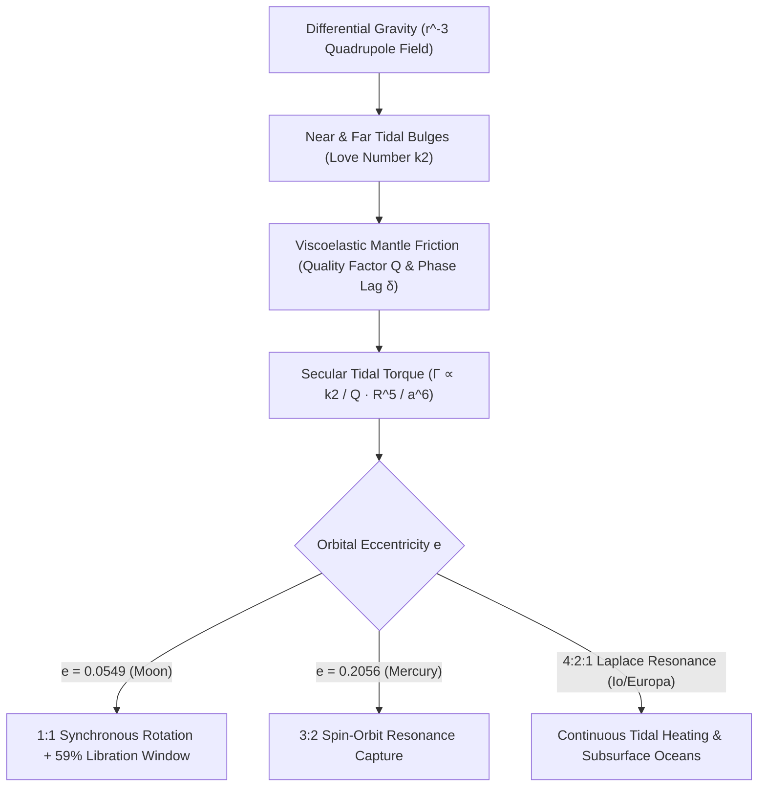

## 1. 引言与四极潮汐力场：为什么潮汐力与距离立方 $r^{-3}$ 成反比？

当我们从地球上的任何角落仰望夜空，看到的永远是月球正面的静海、风暴洋与第谷环形山；直到1959年苏联“月球3号”探测器绕到月球背面，人类才首次目睹布满密集撞击坑的月球背面。月球围绕自身轴线自转的周期（$P_{\text{rot}} = 27.321661\,\text{天}$）与它绕地球公转的恒星月周期（$P_{\text{orb}} = 27.321661\,\text{天}$）保持着惊人的 $1:1$ 严格相等。这并非宇宙的巧合，而是引力、粘弹性形变与热力学耗散历经亿万年共同雕琢的力学必然——<strong>潮汐锁定（Tidal Locking / Synchronous Rotation）</strong>。

在牛顿万有引力定律中，质量为 $M$ 的中心天体对距离 $r$ 处的卫星（质量 $m$、半径 $R$）质心产生的引力加速度为 $g_0 = GM/r^2$。然而卫星并非几何质点，而是具有有限直径 $2R$ 的延展球体。月球近地点（距离 $r-R$）受到的地球引力大于质心引力，而远地点（距离 $r+R$）受到的引力小于质心引力。将二项式级数 $(1 \mp R/r)^{-2} \approx 1 \pm 2(R/r)$ 展开并减去质心加速度后，近端与远端相对于月球质心的<strong>潮汐加速度（Tidal Acceleration）</strong>分别为 $+2GMR/r^3$（指向地球）与 $-2GMR/r^3$（背离地球）。通过勒让德多项式 $P_\ell(\cos\theta)$ 展开引力势 $\Phi(R,\theta) = -GM/s$，消去常数项（$\ell=0$）与维持公转的质心加速度项（$\ell=1$），即可得到主导天体形变的<strong>四极潮汐势（Quadrupole Tidal Potential，$\ell=2$）</strong>：

$$
\mathbf{a}_{\text{tidal}}(R, \theta) = -\nabla V_{\text{tidal}} = -\nabla \left[ -\frac{G M R^2}{2 r^3} (3\cos^2\theta - 1) \right] = \frac{G M R}{r^3} \left[ (3\cos^2\theta - 1)\hat{\mathbf{e}}_R - 3\sin\theta\cos\theta\,\hat{\mathbf{e}}_\theta \right]
$$

---

## 2. 粘弹性形变、勒夫数 $k_2$、相位滞后角 $\delta$ 与 $a^{-6}$ 潮汐力矩

在四极潮汐势的作用下，天体沿连心线方向（$\theta = 0, \pi$）被拉伸，而在垂直赤道环（$\theta = \pi/2$）方向被压缩，形成对称的<strong>近端与远端双潮汐隆起（Tidal Bulges）</strong>。英国数学家奥古斯都·勒夫（A. E. H. Love）于1909年引入无量纲<strong>勒夫数 $k_2$</strong> 来描述非刚体天体因潮汐形变产生的附加引力势比例：$k_2 = \frac{3/2}{1 + 19\mu_{\text{shear}}/(2\rho g R)}$。对于完全刚体 $k_2 = 0$，均匀流体球 $k_2 = 1.5$，而现代固体月球的 $k_2 \approx 0.0241$，地球的 $k_2 \approx 0.299$。

如果月球是完全无摩擦的理想弹性体，潮汐隆起将瞬间响应地球引力并严格对准地月连心线（$\delta = 0$），此时对称的引力不会产生任何净力矩（$\Gamma = 0$）。然而真实的岩石地幔与岩浆具有<strong>粘弹性（Viscoelasticity）</strong>与内摩擦（由品质因子 $Q$ 表征，每次循环耗散能量比例为 $Q^{-1} \approx \sin 2\delta$）。当早期月球自转角速度大于公转角速度（$\omega_{\text{rot}} > n$）时，形变响应的时间延迟 $\Delta t$ 会使潮汐隆起被月球自转拖拽到地月连心线<strong>前方一个相位滞后角 $\delta$</strong>。地球对近端隆起的向后拉力大于对远端隆起的向前拉力，从而产生与轨道半长轴六次方成反比（$a^{-6}$）的<strong>长期潮汐制动扭矩（Secular Tidal Torque）</strong>：

$$
\Gamma = -\frac{3}{2} \frac{G M^2 R^5}{a^6} k_2 \sin(2\delta) \approx -\frac{3}{2} \frac{G M^2 R^5}{a^6} \left(\frac{k_2}{Q}\right) \operatorname{sgn}(\omega_{\text{rot}} - n), \qquad \tau_{\text{lock}} \approx \frac{2 \alpha \, \omega_0 \, m \, a^6 \, Q}{3 G M^2 k_2 R^3}
$$

---

## 3. 地月角动量守恒、月球退行与天平动（59%可视面积之谜）

由于潮汐力矩正比于 $a^{-6}$，45亿年前刚从大碰撞碎屑盘中形成于 $a_0 \approx 4\text{–}10\,R_\oplus$ 处的年轻月球，仅用了 $10^2\text{–}10^5$ 年就迅速被制动至 $\omega_{\text{rot}} = n$ 的 $1:1$ 同步自转状态。今天，虽然月球的自转已锁定，但地球自身的快速自转（$24$小时周期）仍将地球海洋与地幔的潮汐隆起拖拽到地月连线前方约 $2.9^\circ$。这一超前隆起一方面减慢地球自转（使地球昼夜每世纪延长约 $+1.7\text{–}2.3\,\text{毫秒}$），另一方面通过牛顿第三定律向前加速月球轨道，将地球自转角动量 $I_\oplus\Omega_\oplus$ 转移为月球轨道角动量 $m\sqrt{GM_\oplus a}$。阿波罗登月任务留下的角反射器阵列通过<strong>月球激光测距（LLR）</strong>精确证实：月球正以每年 $+3.82 \pm 0.07\,\text{厘米}$ 的速度远离地球！

那么，既然月球处于 $1:1$ 同步自转，为何我们在地球上能观测到<strong>月球表面积的 $59\%$</strong> 而非恰好 $50\%$？答案在于<strong>月球天平动（Lunar Libration）</strong>：月球绕地轨道是偏心率为 $e = 0.0549$ 的椭圆，根据开普勒第二定律，月球在近地点附近公转角速度 $\dot{f}(t)$ 快于平均角速度 $n$，在远地点附近则慢于 $n$；而月球绕轴自转角速度 $\omega_{\text{rot}} = n$ 几乎恒定。这导致经度方向产生振幅达 $\pm 7^\circ 54'$ 的光学摆动（<strong>经度天平动</strong>）；加上自转轴与白道面法线 $6^\circ 41'$ 倾角引起的<strong>纬度天平动</strong>以及地球半径基线引起的 $\pm 1^\circ$ <strong>周日视差天平动</strong>，使人类得以窥见月球边缘以外额外 $9\%$ 的疆域：

$$
\Delta \phi_{\text{long}}(t) = f(t) - M(t) = 2 e \sin(n t) + \frac{5}{4} e^2 \sin(2 n t) + \mathcal{O}(e^3), \qquad \frac{\dot{f}_{\text{peri}}}{n} = \frac{\sqrt{1 - e^2}}{(1 - e)^2} \approx 1.5506 \approx \frac{3}{2}
$$

---

## 4. 水星的 3:2 自旋-轨道共振与木星伽利略卫星的潮汐加热

并非所有受潮汐作用的天体都会落入 $1:1$ 锁定。1965年，阿雷西博射电望远镜的雷达多普勒观测震惊了天文学界：水星的自转周期并非 $87.97$ 天，而是 $58.646$ 天——恰好等于公转周期的 $\frac{2}{3}$（每公转两周自转三周，即 <strong>$3:2$ 自旋-轨道共振</strong>）！戈德赖希与皮尔（Goldreich & Peale, 1966）证明，这是因为水星具有极高的轨道偏心率（$e = 0.2056$）。由于潮汐力矩 $\propto r^{-6}$，水星在近日点的潮汐作用比远日点强 $12.2$ 倍；而在近日点处，水星的瞬时轨道角速度恰好为 $\dot{f}_{\text{peri}}/n = (1-e^2)^{1/2}/(1-e)^2 \approx 1.5506 \approx 3/2$！当水星以 $\omega_{\text{rot}} = 1.5n$ 自转时，它在近日点附近相对于太阳几乎静止，配合水星三轴椭球体质量不对称性 $(B-A)/C$ 产生的恢复力矩 $G(3/2, e) \approx \frac{7}{2}e$，将其永久捕获在 $3:2$ 共振势阱中。

更进一步，在木星系统中，木卫一（Io）、木卫二（Europa）与木卫三（Ganymede）被锁定在拉普拉斯 <strong>$4:2:1$ 平均运动轨道共振</strong>中。同伴卫星的周期性引力摄动不断激发受迫偏心率（$e_{\text{Io}} = 0.0041$），阻止轨道圆化，从而在同步自转的卫星内部持续产生高达 $10^{14}\,\text{W}$ 的<strong>偏心率潮汐耗散加热（Tidal Heating）</strong>，不仅造就了木卫一壮观的活火山群，更在木卫二与土卫二的冰壳之下维持着孕育生命希望的液态海洋。

| 天体系统 | 主星 | 自旋:轨道共振比 | 轨道偏心率 $e$ | 核心天体力学与地球物理效应 |
| :--- | :--- | :--- | :--- | :--- |
| <strong>月球 (Moon)</strong> | 地球 | $1:1$ 同步自转 | $0.0549$ | 永远同一面朝向地球；天平动揭示 $59\%$ 表面；以 $+3.82\,\text{cm/yr}$ 退行 |
| <strong>水星 (Mercury)</strong> | 太阳 | $3:2$ 自旋-轨道共振 | $0.2056$ | $P_{\text{rot}}=58.65\,\text{d}$；水星上的一个太阳日长达2个水星年（$176$地球日） |
| <strong>冥王星-卡戎</strong> | 互相锁定 | $1:1$ 双重完全锁定 | $<0.0002$ | 主星与卫星自转周期均等于公转周期（$6.387\,\text{d}$），达到潮汐演化终极平衡 |
| <strong>木卫一 / 木卫二</strong> | 木星 | $1:1$ 自旋 + $4:2:1$ 轨道 | $0.0041$ | 拉普拉斯共振维持受迫偏心率，驱动木卫一极强火山活动与木卫二冰下液态海洋 |

$$
\dot{E}_{\text{ecc}} = \frac{21}{2} \frac{k_2}{Q} \frac{G M_J^2 R^5 n \, e^2}{a^6}, \qquad \frac{d}{dt}\left(I_\oplus \Omega_\oplus + m \sqrt{G M_\oplus a}\right) = 0
$$

