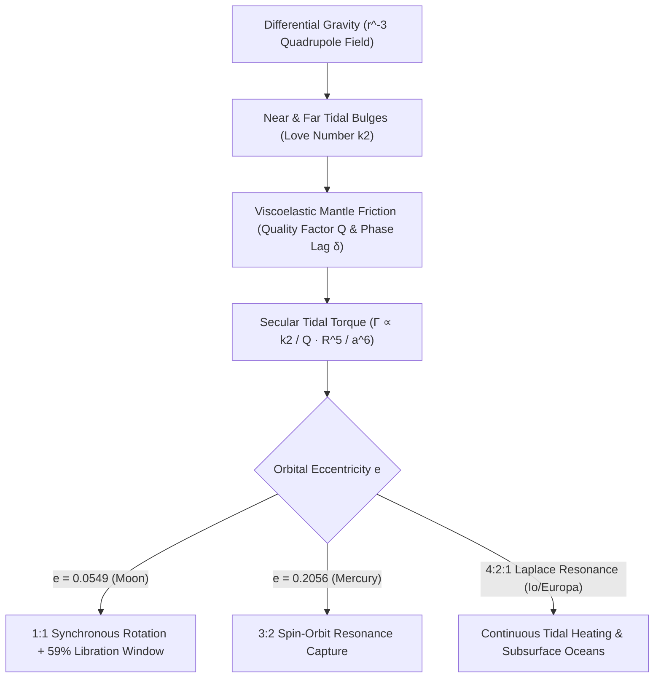

## 1. 引言與四極潮汐力場：為什麼潮汐力與距離立方 $r^{-3}$ 成反比？

當我們從地球上的任何角落仰望夜空，看到的永遠是月球正面的靜海、風暴洋與第谷環形山；直到1959年蘇聯「月球3號」探測器繞到月球背面，人類才首次目睹布滿密集撞擊坑的月球背面。月球圍繞自身軸線自轉的週期（$P_{\text{rot}} = 27.321661\,\text{天}$）與它繞地球公轉的恆星月週期（$P_{\text{orb}} = 27.321661\,\text{天}$）保持著驚人的 $1:1$ 嚴格相等。這並非宇宙的巧合，而是引力、黏彈性形變與熱力學耗散歷經億萬年共同雕琢的力學必然——<strong>潮汐鎖定（Tidal Locking / Synchronous Rotation）</strong>。

在牛頓萬有引力定律中，質量為 $M$ 的中心天體對距離 $r$ 處的衛星（質量 $m$、半徑 $R$）質心產生的引力加速度為 $g_0 = GM/r^2$。然而衛星並非幾何質點，而是具有有限直徑 $2R$ 的延展球體。月球近地點（距離 $r-R$）受到的地球引力大於質心引力，而遠地點（距離 $r+R$）受到的引力小於質心引力。將二項式級數 $(1 \mp R/r)^{-2} \approx 1 \pm 2(R/r)$ 展開並減去質心加速度後，近端與遠端相對於月球質心的<strong>潮汐加速度（Tidal Acceleration）</strong>分別為 $+2GMR/r^3$（指向地球）與 $-2GMR/r^3$（背離地球）。透過勒讓德多項式 $P_\ell(\cos\theta)$ 展開引力勢 $\Phi(R,\theta) = -GM/s$，消去常數項（$\ell=0$）與維持公轉的質心加速度項（$\ell=1$），即可得到主導天體形變的<strong>四極潮汐勢（Quadrupole Tidal Potential，$\ell=2$）</strong>：

$$
\mathbf{a}_{\text{tidal}}(R, \theta) = -\nabla V_{\text{tidal}} = -\nabla \left[ -\frac{G M R^2}{2 r^3} (3\cos^2\theta - 1) \right] = \frac{G M R}{r^3} \left[ (3\cos^2\theta - 1)\hat{\mathbf{e}}_R - 3\sin\theta\cos\theta\,\hat{\mathbf{e}}_\theta \right]
$$

---

## 2. 黏彈性形變、勒夫數 $k_2$、相位滯後角 $\delta$ 與 $a^{-6}$ 潮汐力矩

在四極潮汐勢的作用下，天體沿連心線方向（$\theta = 0, \pi$）被拉伸，而在垂直赤道環（$\theta = \pi/2$）方向被壓縮，形成對稱的<strong>近端與遠端雙潮汐隆起（Tidal Bulges）</strong>。英國數學家奧古斯都·勒夫（A. E. H. Love）於1909年引入無因次<strong>勒夫數 $k_2$</strong> 來描述非剛體天體因潮汐形變產生的附加引力勢比例：$k_2 = \frac{3/2}{1 + 19\mu_{\text{shear}}/(2\rho g R)}$。對於完全剛體 $k_2 = 0$，均勻流體球 $k_2 = 1.5$，而現代固體月球的 $k_2 \approx 0.0241$，地球的 $k_2 \approx 0.299$。

如果月球是完全無摩擦的理想彈性體，潮汐隆起將瞬間響應地球引力並嚴格對準地月連心線（$\delta = 0$），此時對稱的引力不會產生任何淨力矩（$\Gamma = 0$）。然而真實的岩石地幔與岩漿具有<strong>黏彈性（Viscoelasticity）</strong>與內摩擦（由品質因子 $Q$ 表徵，每次循環耗散能量比例為 $Q^{-1} \approx \sin 2\delta$）。當早期月球自轉角速度大於公轉角速度（$\omega_{\text{rot}} > n$）時，形變響應的時間延遲 $\Delta t$ 會使潮汐隆起被月球自轉拖拽到地月連心線<strong>前方一個相位滯後角 $\delta$</strong>。地球對近端隆起的向後拉力大於對遠端隆起的向前拉力，從而產生與軌道半長軸六次方成反比（$a^{-6}$）的<strong>長期潮汐制動扭矩（Secular Tidal Torque）</strong>：

$$
\Gamma = -\frac{3}{2} \frac{G M^2 R^5}{a^6} k_2 \sin(2\delta) \approx -\frac{3}{2} \frac{G M^2 R^5}{a^6} \left(\frac{k_2}{Q}\right) \operatorname{sgn}(\omega_{\text{rot}} - n), \qquad \tau_{\text{lock}} \approx \frac{2 \alpha \, \omega_0 \, m \, a^6 \, Q}{3 G M^2 k_2 R^3}
$$

---

## 3. 地月角動量守恆、月球退行與天平動（59%可視面積之謎）

由於潮汐力矩正比於 $a^{-6}$，45億年前剛從大碰撞碎屑盤中形成於 $a_0 \approx 4\text{–}10\,R_\oplus$ 處的年輕月球，僅用了 $10^2\text{–}10^5$ 年就迅速被制動至 $\omega_{\text{rot}} = n$ 的 $1:1$ 同步自轉狀態。今天，雖然月球的自轉已鎖定，但地球自身的快速自轉（$24$小時週期）仍將地球海洋與地幔的潮汐隆起拖拽到地月連線前方約 $2.9^\circ$。這一超前隆起一方面減慢地球自轉（使地球晝夜每世紀延長約 $+1.7\text{–}2.3\,\text{毫秒}$），另一方面透過牛頓第三定律向前加速月球軌道，將地球自轉角動量 $I_\oplus\Omega_\oplus$ 轉移為月球軌道角動量 $m\sqrt{GM_\oplus a}$。阿波羅登月任務留下的角反射器陣列透過<strong>月球雷射測距（LLR）</strong>精確證實：月球正以每年 $+3.82 \pm 0.07\,\text{公分}$ 的速度遠離地球！

那麼，既然月球處於 $1:1$ 同步自轉，為何我們在地球上能觀測到<strong>月球表面積的 $59\%$</strong> 而非恰好 $50\%$？答案在於<strong>月球天平動（Lunar Libration）</strong>：月球繞地軌道是偏心率為 $e = 0.0549$ 的橢圓，根據克卜勒第二定律，月球在近地點附近公轉角速度 $\dot{f}(t)$ 快於平均角速度 $n$，在遠地點附近則慢於 $n$；而月球繞軸自轉角速度 $\omega_{\text{rot}} = n$ 幾乎恆定。這導致經度方向產生振幅達 $\pm 7^\circ 54'$ 的光學擺動（<strong>經度天平動</strong>）；加上自轉軸與白道面法線 $6^\circ 41'$ 傾角引起的<strong>緯度天平動</strong>以及地球半徑基線引起的 $\pm 1^\circ$ <strong>周日視差天平動</strong>，使人類得以窺見月球邊緣以外額外 $9\%$ 的疆域：

$$
\Delta \phi_{\text{long}}(t) = f(t) - M(t) = 2 e \sin(n t) + \frac{5}{4} e^2 \sin(2 n t) + \mathcal{O}(e^3), \qquad \frac{\dot{f}_{\text{peri}}}{n} = \frac{\sqrt{1 - e^2}}{(1 - e)^2} \approx 1.5506 \approx \frac{3}{2}
$$

---

## 4. 水星的 3:2 自旋-軌道共振與木星伽利略衛星的潮汐加熱

並非所有受潮汐作用的天體都會落入 $1:1$ 鎖定。1965年，阿雷西博射電望遠鏡的雷達都卜勒觀測震驚了天文學界：水星的自轉週期並非 $87.97$ 天，而是 $58.646$ 天——恰好等於公轉週期的 $\frac{2}{3}$（每公轉兩週自轉三週，即 <strong>$3:2$ 自旋-軌道共振</strong>）！戈德賴希與皮爾（Goldreich & Peale, 1966）證明，這是因為水星具有極高的軌道偏心率（$e = 0.2056$）。由於潮汐力矩 $\propto r^{-6}$，水星在近日點的潮汐作用比遠日點強 $12.2$ 倍；而在近日點處，水星的瞬時軌道角速度恰好為 $\dot{f}_{\text{peri}}/n = (1-e^2)^{1/2}/(1-e)^2 \approx 1.5506 \approx 3/2$！當水星以 $\omega_{\text{rot}} = 1.5n$ 自轉時，它在近日點附近相對於太陽幾乎靜止，配合水星三軸橢球體質量不對稱性 $(B-A)/C$ 產生的恢復力矩 $G(3/2, e) \approx \frac{7}{2}e$，將其永久捕獲在 $3:2$ 共振勢阱中。

更進一步，在木星系統中，木衛一（Io）、木衛二（Europa）與木衛三（Ganymede）被鎖定在拉普拉斯 <strong>$4:2:1$ 平均運動軌道共振</strong>中。同伴衛星的週期性引力攝動不斷激發受迫偏心率（$e_{\text{Io}} = 0.0041$），阻止軌道圓化，從而在同步自轉的衛星內部持續產生高達 $10^{14}\,\text{W}$ 的<strong>偏心率潮汐耗散加熱（Tidal Heating）</strong>，不僅造就了木衛一壯觀的活火山群，更在木衛二與土衛二的冰殼之下維持著孕育生命希望的液態海洋。

| 天體系統 | 主星 | 自旋:軌道共振比 | 軌道偏心率 $e$ | 核心天體力學與地球物理效應 |
| :--- | :--- | :--- | :--- | :--- |
| <strong>月球 (Moon)</strong> | 地球 | $1:1$ 同步自轉 | $0.0549$ | 永遠同一面朝向地球；天平動揭示 $59\%$ 表面；以 $+3.82\,\text{cm/yr}$ 退行 |
| <strong>水星 (Mercury)</strong> | 太陽 | $3:2$ 自旋-軌道共振 | $0.2056$ | $P_{\text{rot}}=58.65\,\text{d}$；水星上的一個太陽日長達2個水星年（$176$地球日） |
| <strong>冥王星-卡戎</strong> | 互相鎖定 | $1:1$ 雙重完全鎖定 | $<0.0002$ | 主星與衛星自轉週期均等於公轉週期（$6.387\,\text{d}$），達到潮汐演化終極平衡 |
| <strong>木衛一 / 木衛二</strong> | 木星 | $1:1$ 自旋 + $4:2:1$ 軌道 | $0.0041$ | 拉普拉斯共振維持受迫偏心率，驅動木衛一極強火山活動與木衛二冰下液態海洋 |

$$
\dot{E}_{\text{ecc}} = \frac{21}{2} \frac{k_2}{Q} \frac{G M_J^2 R^5 n \, e^2}{a^6}, \qquad \frac{d}{dt}\left(I_\oplus \Omega_\oplus + m \sqrt{G M_\oplus a}\right) = 0
$$

