## Einleitung: Die Unumkehrbarkeit der Zeit und der Albtraum des Softwareentwicklers

Jeder Softwareentwickler kennt das Gefühl tiefer Verzweiflung bei nicht reproduzierbaren Fehlern: Ein Dienst stürzt in der Produktionsumgebung mit einem Segmentation Fault ab. Bei dem Versuch, den Fehler lokal nachzustellen, läuft das Programm millionenfach fehlerfrei durch. Fügt man Logging-Befehle ein oder setzt Haltepunkte, verschiebt sich das Timing minimal und der Fehler verschwindet spurlos – ein Phänomen, das in Anlehnung an die Heisenbergsche Unschärferelation als <strong>„Heisenbug“</strong> bezeichnet wird.

Hinzu kommt die strukturelle Begrenzung klassischer Debugger (GDB, LLDB, Visual Studio): <strong>Die Zeit lässt sich nicht zurückdrehen</strong>.
Hat man im Einzelschritt-Modus (`step`) versehentlich einen Schritt zu viel ausgeführt und die fehlerverursachende Funktion übersprungen, sind Speicher und Register unwiederbringlich überschrieben. Dem Entwickler bleibt nur der mühsame Neustart des Programms.

```mermaid
flowchart TD
    subgraph TraditionalDebugging ["Grenzen des klassischen Debuggings"]
        Start["Programmausführung"] --> Step["Schrittweises Vorwärtstasten"]
        Step --> Overstep["★ Fehlerstelle versehentlich übersprungen!\nSpeicherzustand zerstört und überschrieben"]
        Overstep --> Fail["Kein Zurückspulen möglich!\nNeustart erforderlich (Heisenbug verschwindet)"]
    end

    subgraph TimeTravelDebugging ["Time-Travel Debugging (TTD)"]
        Record["Deterministische Aufzeichnung\n(I/O, Signale, PMU-Befehlszähler)"] --> Crash["Absturz / Ausnahme tritt auf"]
        Crash --> Rewind["『Rückwärtsausführung (reverse-step / reverse-continue)』\nZustand wird exakt in die Vergangenheit zurückversetzt!"]
        Rewind --> RootCause["Punktlandung auf der modifizierenden Instruktion\nVerursacher sofort identifiziert!"]
    end

    style TraditionalDebugging fill:#ffe6e6,stroke:#d9534f,stroke-width:2px
    style TimeTravelDebugging fill:#e6ffe6,stroke:#009900,stroke-width:2px
```

Was wäre, wenn man die Programmausführung wie ein Videoband <strong>Instruktion für Instruktion deterministisch zurückspulen</strong> könnte?
Was wäre, wenn man auf einer zerstörten Speicheradresse einen <strong>Reverse Watchpoint</strong> setzen und direkt zu dem Befehl springen könnte, der den Speicher korrumpiert hat?
Dies ist die Realität des <strong>Time-Travel Debuggings (TTD)</strong> und des <strong>deterministischen Record & Replay</strong>.

---

## 1. Deterministische Automaten und die Quellen des Nicht-Determinismus

Theoretisch bildet ein Computer einen <strong>deterministischen endlichen Automaten (DFA)</strong>: $S_{t+1} = \delta(S_t, I_t)$.
In der realen Welt stören jedoch vier fundamentale Quellen von Nicht-Determinismus diese mathematische Vorhersehbarkeit:
1. <strong>Externe Ein- und Ausgaben (I/O):</strong> Netzwerkpakete, Festplattenzugriffe, Systemaufrufe.
2. <strong>Nicht-deterministische CPU-Instruktionen:</strong> Zeitstempelabfragen (`RDTSC`), Hardware-Zufallszahlen (`RDRAND`).
3. <strong>Asynchrone Interrupts und Signale:</strong> OS-Timer-Interrupts und POSIX-Signale können zwischen zwei beliebigen Maschinenbefehlen einschlagen.
4. <strong>Nebenläufigkeit auf Shared-Memory-Multiprozessoren:</strong> Schwankende Befehlsverschachtelungen durch Cache-Kohärenzprotokolle (MESI).

TTD-Systeme zeichnen daher gezielt nur diese nicht-deterministischen Ereignisse mit minimalem Overhead auf.

---

## 2. Architektur von Record & Replay: CoW und Hardware-Zähler

### 2.1 Checkpoints und Copy-on-Write (CoW)
Regelmäßig erstellte Snapshots des virtuellen Speichers nutzen das Copy-on-Write-Verfahren des Betriebssystems. Das Wiederherstellen eines Speicherzustands erfordert lediglich das Neusetzen des Basisregisters der Seitentabelle (CR3 unter x86).

### 2.2 Der Zauber der PMU-Hardware-Zähler
Um asynchrone Unterbrechungen instruktionsgenau zu reproduzieren, nutzt Mozilla `rr` die <strong>Performance Monitoring Unit (PMU)</strong> der CPU. Sie zählt die Anzahl der abgearbeiteten bedingten Sprungbefehle (<strong>Retired Conditional Branches, RCB</strong>). Beim Replay programmiert `rr` die PMU so, dass sie bei exakt demselben Befehlszählerstand einen Interrupt auslöst – eine Präzision auf den Taktzyklus genau.

---

## 3. Die Mechanik der Rückwärtsausführung: Rollback und Roll-Forward

Da Halbleitergatter irreversibel sind, dreht kein Prozessor seine Takte physikalisch rückwärts. Stattdessen setzt TTD auf den <strong>Rollback-and-Roll-Forward-Algorithmus</strong>:
1. Rücksprung zum nächstgelegenen vorherigen <strong>Checkpoint</strong>.
2. Extrem schnelles <strong>Vorwärtsabspielen (Fast-Forward)</strong> anhand des Protokolls bis exakt eine Instruktion vor der Zielposition.

### 3.1 Die Macht von Reverse Watchpoints
Mit `watch -l *address` und `reverse-continue` läuft der Debugger rückwärts und stoppt haargenau auf dem Maschinencodebefehl, der den Zeiger überschrieben hat. Der Aufrufstapel und alle Variablen stehen unversehrt zur Verfügung.

---

## 4. Industrielle Implementierungen: Mozilla rr vs. Microsoft TTD

- <strong>Mozilla rr (Linux):</strong> Nutzt PMU-Hardwarezähler, `ptrace` und `seccomp-bpf`. Um Multithreading deterministisch zu erfassen, pinnt `rr` alle Threads auf einen einzigen CPU-Kern (Deterministic Multithreading). Der Aufzeichnungs-Overhead liegt bei sensationell niedrigen <strong>1,2- bis 2-fach</strong>, ideal für Mammutprojekte wie Firefox.
- <strong>Microsoft TTD (Windows):</strong> Verwendet dynamische Binärübersetzung (Nirvana DBT Engine). Instrumentiert Maschinencodeblöcke zur Laufzeit und integriert sich nahtlos in WinDbg und Visual Studio Enterprise.

---

## 5. Vektoruhren und die Grenzen der Parallelität

Auf echten Multiprozessorsystemen existiert keine universelle physikalische Zeit. Mittels <strong>Lamport-Vektoruhren (Vector Clocks)</strong> und der <strong>Happens-Before-Relation ($\to$)</strong> erfassen moderne Replay-Engines kausale Abhängigkeiten zwischen Threads. Nicht kausal geordnete Zugriffe auf dieselbe Speicherstelle entlarven Race Conditions mathematisch zweifelsfrei.

---

## 6. Fazit: Das allwissende Paradigma

Time-Travel Debugging transformiert die Fehlerbehebung von spekulativer Spurensuche in vollkommene deterministische Beobachtbarkeit. Durch die Beherrschung der zeitlichen Umkehrbarkeit gewinnt die Softwaretechnik die Kontrolle über das Chaos moderner Rechensysteme zurück.
