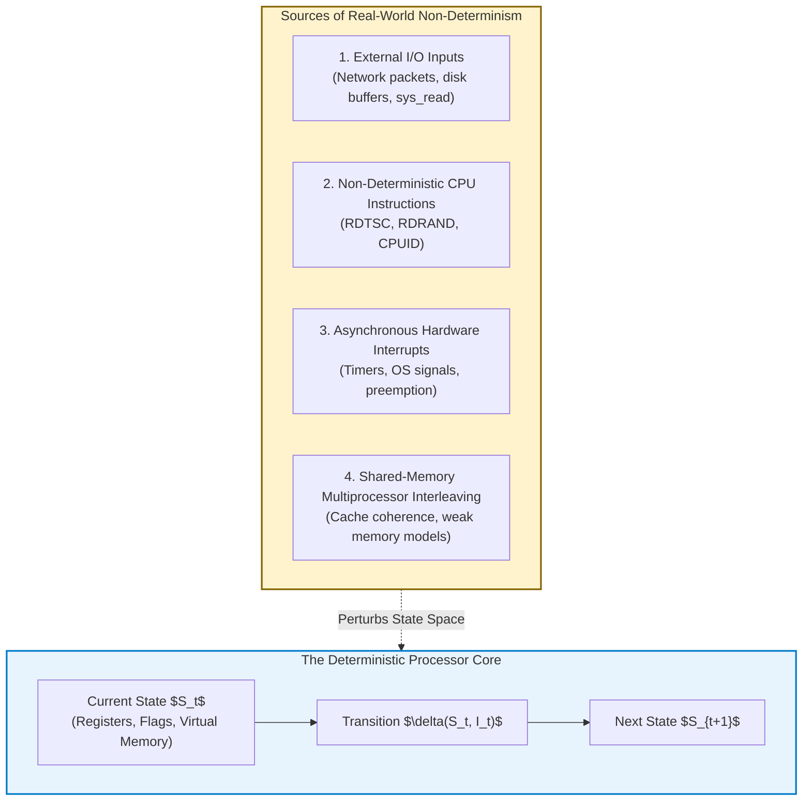
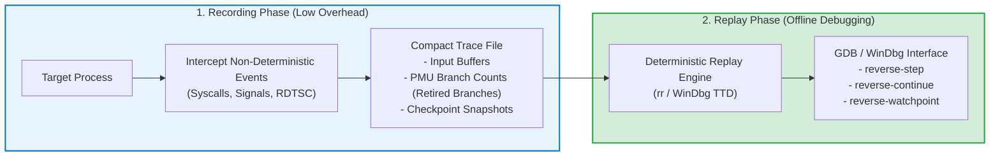
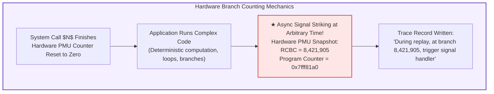
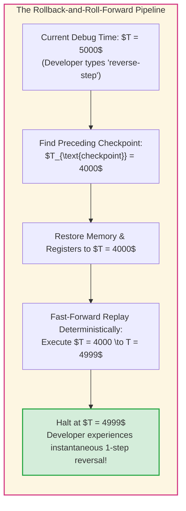
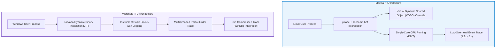
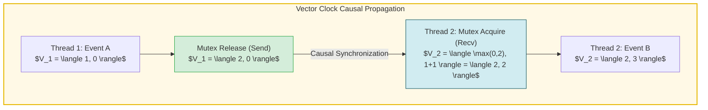

## Introduction: The Arrow of Time and the Software Engineer's Nightmare

Every software engineer has experienced the profound existential dread of the unreproducible bug:

A mission-critical service crashes in production under high load. The core dump indicates a catastrophic segmentation fault at an invalid memory address. Yet when developers attempt to reproduce the failure locally under identical inputs, the program runs flawlessly millions of times.
When an engineer inserts `printf` logging or attaches an interactive debugger to inspect internal program state, the timing shifts ever so slightly, and the defect vanishes into thin air. In homage to the observer effect in quantum mechanics, software engineering terms this maddening phenomenon a <strong>"Heisenbug"</strong>.

Moreover, conventional interactive debuggers (such as classic GDB, LLDB, and Visual Studio) suffer from a brutal architectural limitation: <strong>the irreversibility of time</strong>.
Consider the classic debugging scenario: an engineer sets a breakpoint, executes successive single-steps (`step-over`), and meticulously monitors pointer variables. In an instant of fatigue, the developer hits the step key one time too many—stepping cleanly over the exact machine instruction that corrupted the memory buffer.

In standard forward debugging, <strong>you cannot step backward</strong>.
The register values are overwritten, the corrupted heap block is committed, and the dirty state has propagated through memory. The developer's only recourse is to terminate the process, re-launch from scratch, and pray that the non-deterministic bug recurs.

```mermaid
flowchart TD
    subgraph ConventionalDebugging ["Conventional Forward Debugging"]
        Start["Process Execution"] --> Step["Step-by-Step Forward Execution"]
        Step --> Overstep["★ Accidentally Overstepped Bug Location!\nState destroyed, memory permanently overwritten"]
        Overstep --> Failure["Cannot Rewind!\nForced to restart from scratch\n(Non-deterministic bugs may never re-appear)"]
    end

    subgraph TimeTravelDebugging ["Time-Travel Debugging (TTD)"]
        Record["Deterministic Record Phase\n(Capture I/O, interrupts, PMU branch counts)"] --> Crash["Crash / Exception Occurs"]
        Crash --> ReverseExecution["'reverse-step' / 'reverse-continue'\nRegisters and memory state restore back into the past!"]
        ReverseExecution --> TargetFault["Pinpoint arrival at exact corruption instruction\nInstant identification of the rogue write!"]
    end

    style ConventionalDebugging fill:#ffe6e6,stroke:#d9534f,stroke-width:2px
    style TimeTravelDebugging fill:#e6ffe6,stroke:#009900,stroke-width:2px
    style Overstep fill:#f8d7da,stroke:#dc3545
    style TargetFault fill:#d4edda,stroke:#28a745
```



What if debugging operated like an omniscient media player—allowing an engineer to scrub arbitrarily backward and forward through CPU instruction cycles, inspecting memory addresses before and after every modification?
What if, in a complex concurrent application with billions of executed instructions, a developer could place a <strong>Reverse Watchpoint</strong> on a corrupted memory address and immediately jump back to the exact thread, instruction, and microsecond that corrupted the pointer?

This paradigm is <strong>Time-Travel Debugging (TTD)</strong>, underpinned by the science of <strong>Deterministic Record and Replay</strong>.
This article explores the foundational state-machine mathematics of determinism, the hardware mechanisms enabling instruction-accurate replay via Performance Monitoring Units (PMUs), memory snapshotting with Copy-on-Write (CoW), the engineering internals of Mozilla `rr` and Microsoft TTD, and the formidable theoretical frontiers of shared-memory concurrency and Lamport vector clocks.

---

## 1. The Mathematical Foundation: Deterministic Automata and Sources of Non-Determinism

To construct a practical time-travel debugger, computer systems must first be analyzed through the formal lens of <strong>Deterministic Finite Automata (DFA)</strong>.

### 1.1 The Classical State Machine
In a pure mathematical Turing machine isolated from outside interference, a computer's CPU registers and memory form a completely deterministic dynamical system.
Let $S_t \in \mathcal{S}$ denote the complete system state (all general-purpose registers, control registers, flags, and addressable virtual memory bytes) at discrete instruction cycle $t$. Let $I_t \in \mathcal{I}$ represent the machine instruction executed at cycle $t$. The subsequent state $S_{t+1}$ is governed by a deterministic state-transition function $\delta$:

$$S_{t+1} = \delta(S_t, I_t)$$

Under this pure model, reconstructing any past state $S_k$ ($k < t$) requires merely saving the initial state $S_0$ and re-evaluating the transition function $\delta$ forward from $0$ up to $k$:

$$S_k = \delta^{(k)}(S_0, \{I_0, I_1, \dots, I_{k-1}\})$$

However, <strong>real-world physical computers do not operate as closed deterministic automata</strong>.



### 1.2 The Four Pillars of Computing Non-Determinism
Modern microprocessors and operating systems introduce four distinct categories of non-determinism that decouple program execution from mathematical reproducibility:

1. <strong>External Input and Kernel Interaction (I/O):</strong>
   Whenever a process invokes a system call (e.g., `sys_read`, `recvfrom`, `ioctl`), the Linux or Windows kernel copies external data into user-space buffers. The returned values and bytes depend entirely on external physical phenomena—network packet latency, user keyboard strokes, or disk controller timings.
2. <strong>Non-Deterministic Machine Instructions:</strong>
   Certain CPU instructions directly sample non-deterministic physical sources. For instance, the x86 `RDTSC` (Read Time-Stamp Counter) instruction returns the processor's cumulative clock cycles; `RDRAND` samples thermal noise within silicon diodes to yield cryptographic entropy; `CPUID` returns environmental configuration data. Two consecutive executions of `RDTSC` on identical hardware will never yield identical integers.
3. <strong>Asynchronous Interrupts and POSIX Signals:</strong>
   Operating system kernel preemptive schedulers periodically interrupt executing processes via timer interrupts (e.g., APIC timer firing at 1000 Hz). Similarly, asynchronous signals (`SIGINT`, `SIGALRM`, `SIGCHLD`) can strike between *any* two arbitrary machine instructions. If an interrupt handler modifies memory or alters control flow, the instruction boundary at which the interrupt landed must be reproduced with single-instruction fidelity.
4. <strong>Shared-Memory Multithreaded Interleaving:</strong>
   In modern symmetric multiprocessing (SMP) systems, multiple threads execute concurrently across distinct physical CPU cores. When two threads concurrently read and write to overlapping virtual memory locations without explicit mutual exclusion locks, the exact order in which their memory accesses interleave is determined by sub-nanosecond physical fluctuations in CPU cache coherence buses (MESI/MOESI), write buffers, and interconnect arbitration.

Consequently, the grand challenge of Time-Travel Debugging is not storing every state transition, but rather: <strong>capturing every non-deterministic event during execution and replaying it deterministically into an isolated virtualized execution envelope.</strong>

---

## 2. Architecture of Deterministic Record and Replay

A naive approach to time-travel debugging might attempt to dump the full virtual address space and register set after every instruction cycle.
However, a standard 4 GHz CPU executes up to 4 billion instructions per second per core. Streaming gigabytes of memory dumps per second would exhaust system memory bandwidth in milliseconds and generate petabytes of data within minutes.

Modern deterministic record-and-replay engines resolve this via <strong>log-based input recording</strong>: they record only the *divergences* from pure determinism.



### 2.1 Checkpoints and Copy-on-Write (CoW) Virtual Memory
To enable instantaneous seek operations across long execution traces, the replay framework periodically captures process <strong>checkpoints</strong>.

Using virtual memory paging primitives analogous to `fork()`, the framework duplicates page table entries while marking physical pages read-only.
When the replaying process executes forward from checkpoint $C_i$, pages are lazily duplicated only upon write via Copy-on-Write (CoW). Rolling back to checkpoint $C_i$ requires merely re-pointing the root page directory pointer (CR3 on x86) and restoring the register bank, an operation taking mere microseconds.

### 2.2 The Magic of Hardware Performance Counters (PMUs)
The most formidable hurdle in deterministic replay is reproducing asynchronous interrupts at the exact instruction boundary. If a thread is interrupted between instruction 14,892,104 and 14,892,105, how does the replay engine know where to pause execution during playback?

Mozilla's pioneering `rr` framework resolved this by weaponizing modern CPU <strong>Performance Monitoring Units (PMUs)</strong>.
Specifically, `rr` configures hardware counters to track the count of <strong>Retired Conditional Branches (RCBs)</strong>.



When an asynchronous signal occurs, `rr` reads the current count of retired conditional branches.
During replay, `rr` programs the CPU's PMU performance counter to trigger an overflow interrupt precisely when the counter reaches that exact value minus a small threshold. The engine then single-steps the final few instructions, reproducing the interruption at the identical clock cycle and instruction boundary.

---

## 3. Reverse Execution Mechanics: How "Stepping Backward" Actually Works

When a developer enters `reverse-step` or `reverse-continue` in a time-travel debugging session, what happens inside the execution engine?

### 3.1 The Thermodynamic Constraint: Reversal via Forward Roll
In physical semiconductor hardware, digital logic gates (AND, OR, NAND) are logically irreversible. Erasing a register value incurs microscopic thermodynamic dissipation (the Landauer limit), and silicon cannot run its clock signals in reverse.

Therefore, Time-Travel Debugging executes reverse motion via a deterministic <strong>Rollback-and-Roll-forward</strong> algorithm:



1. The debugger targets destination cycle $T_{\text{target}} = T_{\text{current}} - 1$.
2. The engine locates the closest preceding checkpoint $C$ where $T_C \le T_{\text{target}}$.
3. The virtual address space and registers are restored to checkpoint $C$.
4. The engine executes the deterministic event log forward at native processor speed until the instruction pointer and branch counter reach $T_{\text{target}}$.
5. Execution halts, and register contents are returned to the user interface.

Because replaying skips all blocking network I/O, sleep syscalls, and user interactions, forward simulation operates at hundreds of millions of instructions per second, creating the subjective illusion of instantaneous reverse time navigation.

### 3.2 Reverse Watchpoints: The Ultimate Bug Assassin
The single most transformative tool unlocked by time-travel debugging is the <strong>Reverse Watchpoint</strong>.

In conventional debugging, discovering memory corruption leaves the engineer stranded in the "aftermath": a buffer contains garbage, or a function pointer points to `0xdeadbeef`. The developer must guess which of the thousands of codebase functions wrote the rogue value.
With a time-travel debugger, the procedure is trivial:

```text
(rr) watch -l *0x7fff5fbff8a0      # Set hardware write watchpoint on corrupted address
(rr) reverse-continue             # Rewind execution backward into the past!
```

The debugger runs backward in time and <strong>halts at the exact instruction that wrote the corrupted value</strong>.
The call stack, the calling thread, the local variables, and the register state at that precise microsecond are preserved in absolute perfection. What previously required weeks of trial-and-error logging is diagnosed in under ten seconds.

---

## 4. Dissecting Real-World Implementations: Mozilla rr vs. Microsoft TTD

Two predominant production architectures represent the state of the art in time-travel debugging: Mozilla `rr` in the Linux ecosystem and Microsoft TTD in Windows.



### 4.1 Mozilla rr: Kernel-Level Traps and Single-Core Virtualization
Developed by Robert O'Callahan and the Mozilla research team, `rr` operates strictly within unprivileged Linux user space:
- <strong>`seccomp-bpf` and `ptrace`:</strong> Every system call that writes to user memory is trapped. `rr` records the mutated byte slices directly to the trace stream.
- <strong>Neutralizing VDSO:</strong> Fast kernel calls like `clock_gettime` that read directly from shared kernel-user memory pages without entering ring 0 are neutralized. `rr` overwrites the VDSO mappings in the target address space with code that forces an interceptable system call trap.
- <strong>Deterministic Multithreading via Single-Core Pinning:</strong> To guarantee reproducible memory interleaving without heavy software instrumentation, `rr` enforces that all application threads run time-sliced upon a <strong>single physical CPU core</strong>. The scheduler switches threads deterministically at system calls and specified branch counts. This achieves an astonishingly low recording overhead of merely <strong>1.2× to 2×</strong>, allowing developers to record complex web browser sessions interactively.

### 4.2 Microsoft TTD: Dynamic Binary Translation and WinDbg Integration
Integrated natively into Visual Studio and WinDbg, Microsoft Time Travel Debugging (TTD) utilizes the <strong>Nirvana Dynamic Binary Translation (DBT)</strong> engine:
- Rather than trapping system calls alone, TTD dynamically translates and instruments basic blocks of machine code as they are executed by the CPU.
- TTD records memory reads, register mutations, and synchronization events into a highly compressed `.run` file.
- WinDbg exposes powerful LINQ and SQL-style object query models across the time-travel trace:

```text
# WinDbg TTD Query Commands
0:000> !tt 14:02:10.743                     # Seek directly to timestamp
0:000> dx @$curprocess.TTD.Events           # Enumerate all module loads & exceptions
0:000> dx @$curprocess.TTD.MemoryRead(...)  # Time-indexed query of all memory reads
```

---

## 5. Comparative Matrix of Time-Travel Debugging Engines

| Technology / Tool | Maintainer | Core Architecture | Multicore Support | Runtime Overhead | Primary OS | Distinctive Strength |
|---|---|---|---|---|---|---|
| <strong>Mozilla rr</strong> | Mozilla / Open Source | PMU Hardware Counters + `ptrace` + `seccomp` | Single-core serialized (DMT) | <strong>Minimal (1.2× – 2×)</strong> | Linux (x86_64, aarch64) | Extremely low overhead; capable of recording multi-hour browser sessions |
| <strong>Microsoft TTD</strong> | Microsoft Corporation | Dynamic Binary Translation (Nirvana DBT) | Concurrent thread recording | Moderate (2× – 8×) | Windows (x86, x64, ARM64) | Native integration in WinDbg & Visual Studio; full object query model |
| <strong>Undo LiveRecorder</strong> | Undo Ltd. | JIT Binary Instrumentation + Memory Snapshotting | Multithreaded memory trap | Moderate (2× – 5×) | Linux (C/C++, Java, Go) | Enterprise continuous integration & production post-mortem recording |
| <strong>GDB Process Record</strong> | GNU Project (`record-full`) | Pure software CPU instruction emulation | Single thread only | <strong>Prohibitive (100× – 1000×)</strong> | POSIX-wide | Universal availability; severely limited by glacial execution speeds |
| <strong>Pernosco</strong> | Pernosco Inc. | Distributed Cloud Indexing of `rr` Traces | Inherits `rr` semantics | Offline cloud indexing | Web Browser UI | Transforms rr traces into an omniscient, queryable relational database |

---

## 6. The Frontier of Concurrency: Vector Clocks and Multiprocessor Interleaving

While single-core virtualization solves non-determinism for standard multithreading, capturing true multicore race conditions on high-frequency server systems remains the ultimate research frontier.

### 6.1 Lamport Vector Clocks and the Happens-Before Relation
In true distributed or multicore shared-memory systems, establishing a total order across all CPU instructions is physically impossible due to relativistic limits on information propagation and weak memory consistency models.
Instead, concurrency engines rely on <strong>Lamport Vector Clocks</strong> to establish a partial order defined by the <strong>Happens-Before relation ($\to$)</strong>.

For a system of $N$ threads $T_1, T_2, \dots, T_N$, each thread maintains an integer vector clock $V \in \mathbb{N}^N$:
1. Before performing an internal event, thread $T_i$ increments its own component:
   $$V_i[i] \leftarrow V_i[i] + 1$$
2. When releasing a lock or sending a message, $T_i$ transmits its current vector $V_i$.
3. Upon acquiring the lock, receiving thread $T_j$ computes the element-wise supremum:
   $$V_j[k] \leftarrow \max(V_j[k], V_i[k]) \quad (\forall k \in \{1, \dots, N\})$$
   $$V_j[j] \leftarrow V_j[j] + 1$$



Two events $e_a$ (with vector $V_a$) and $e_b$ (with vector $V_b$) satisfy the happens-before condition:

$$e_a \to e_b \iff (\forall k, V_a[k] \le V_b[k]) \land (\exists k, V_a[k] < V_b[k])$$

If neither $e_a \to e_b$ nor $e_b \to e_a$, the events are mathematically <strong>concurrent ($e_a \parallel e_b$)</strong>. If both events access the identical memory location and at least one is a write, a <strong>data race</strong> is proven.

### 6.2 Hardware-Assisted Tracing: Intel PT and Beyond
To record true multicore execution without massive software slowing down, next-generation architectures leverage hardware tracing primitives such as <strong>Intel Processor Trace (Intel PT)</strong> and <strong>ARM CoreSight</strong>.
Intel PT captures retired branch packets and timing packets at wire speed directly into dedicated physical SRAM buffers with minimal CPU performance degradation (< 5%). Combined with cache coherence snooping, hardware-assisted time-travel debugging promises to extend deterministic recording into the realm of massively concurrent cloud microservices.

---

## 7. Conclusion: The Omniscient Future of Software Engineering

Time-Travel Debugging represents a historic conceptual pivot in computer science: the transition from <strong>speculative forensic archaeology</strong> to <strong>omniscient deterministic observation</strong>.

For sixty years, software developers diagnosed failures by sifting through the debris of crashed memory, forming conjectures, and re-running code in the desperate hope that bugs would repeat themselves.
Time-travel debugging obliterates this uncertainty. By commanding time to flow backward, developers stand directly at the genesis of the fault—observing the precise CPU cycle, the exact assembly instruction, and the unambiguous memory write that precipitated the failure.

As autonomous AI coding agents and self-healing systems mature, time-travel debugging engines will serve as their sensory foundation—enabling AI agents to deterministically rewind program execution, prove formal safety invariants, and synthesize surgical bug fixes with mathematical certainty.

By mastering the reversibility of execution, we conquer the chaos of computing—transforming the debugging of software from an arduous trial into an exact, reproducible physical science.
