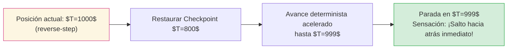

## Introducción: La irreversibilidad del tiempo y la pesadilla del programador

```mermaid
flowchart TD
    subgraph TraditionalDebugging ["Depuración convencional hacia adelante"]
        Start["Ejecución del programa"] --> Step["Paso a paso hacia adelante"]
        Step --> Overstep["★ ¡Instrucción crítica sobrepasada!\nMemoria corrompida irreversiblemente"]
        Overstep --> Fail["¡No se puede retroceder!\nObligado a reiniciar"]
    end

    subgraph TimeTravelDebugging ["Depuración Time-Travel (TTD)"]
        Record["Grabación determinista\n(I/O, señales, contadores PMU)"] --> Crash["Ocurre el fallo"]
        Crash --> Rewind["『Ejecución inversa (reverse-step / reverse-continue)』\n¡El estado pasado se restaura con total precisión!"]
        Rewind --> RootCause["Aterrizaje en la instrucción culpable\n¡Causa raíz identificada al instante!"]
    end

    style TraditionalDebugging fill:#ffe6e6,stroke:#d9534f,stroke-width:2px
    style TimeTravelDebugging fill:#e6ffe6,stroke:#009900,stroke-width:2px
```

Todo ingeniero de software ha sufrido la desesperación del error no reproducible: un servicio crítico falla en producción con un fallo de segmentación (Segmentation Fault). Sin embargo, al ejecutar el programa localmente bajo idénticas condiciones, se ejecuta millones de veces sin error. Si se agregan sentencias de registro (`printf`) o se conecta un depurador interactivo, los tiempos se alteran y el problema desaparece: el temido <strong>«Heisenbug»</strong>.

A esto se suma la limitación estructural de los depuradores tradicionales (GDB, LLDB, Visual Studio): <strong>el tiempo solo avanza</strong>.
Si al depurar paso a paso (`step`) se pulsa la tecla una vez de más y se sobrepasa la instrucción que corrompió la memoria, <strong>no hay forma de retroceder</strong>. La memoria ya ha sido sobreescrita. Solo queda reiniciar la aplicación desde el principio.

¿Qué ocurriría si pudiéramos rebobinar la ejecución <strong>instrucción por instrucción</strong>, tal como un vídeo digital?
¿Y si pudiéramos colocar un <strong>Reverse Watchpoint</strong> sobre una dirección de memoria corrupta y saltar directamente al instante exacto en que fue modificada?
Esta es la revolución de la <strong>depuración con viaje en el tiempo (Time-Travel Debugging, TTD)</strong> y la <strong>grabación y reproducción determinista (Record & Replay)</strong>.

---

## 1. Autómatas deterministas y fuentes de no-determinismo

En teoría de la computación, un ordenador opera como un <strong>autómata finito determinista</strong>: $S_{t+1} = \delta(S_t, I_t)$.
Sin embargo, en el hardware físico real intervienen cuatro fuentes de no-determinismo:
1. <strong>Entradas/Salidas externas (I/O):</strong> Paquetes de red, operaciones de disco, llamadas al sistema.
2. <strong>Instrucciones de CPU no deterministas:</strong> Lecturas de temporizador (`RDTSC`), generadores de números aleatorios (`RDRAND`).
3. <strong>Interrupciones asíncronas y señales:</strong> Ticks del reloj del sistema operativo o señales POSIX que interrumpen el flujo entre dos instrucciones cualesquiera.
4. <strong>Intercalado multihilo en memoria compartida:</strong> Protocolos de coherencia de caché (MESI) en múltiples núcleos.

El depurador Time-Travel graba únicamente estas fuentes de divergencia con un impacto mínimo en el rendimiento.

---

## 2. Mecanismos de Record & Replay: CoW y contadores PMU

### 2.1 Puntos de control con Copy-on-Write (CoW)
Los puntos de control periódicos duplican tablas de páginas virtuales sin copiar físicamente la memoria hasta que se modifica, permitiendo restauraciones de estado en microsegundos.

### 2.2 La magia de los contadores hardware PMU
Para reproducir una señal en el momento exacto durante el reejecutado, Mozilla `rr` utiliza los contadores de la <strong>Unidad de Monitorización de Rendimiento (PMU)</strong> del microprocesador, contando las <strong>ramas condicionales retiradas (Retired Conditional Branches)</strong>. Al reproducir, la CPU lanza una interrupción por desbordamiento exactamente en la misma instrucción.

---

## 3. Ejecución inversa: Rebobinar avanzando

Puesto que las puertas lógicas semiconductoras son disipativas e irreversibles (principio de Landauer), el hardware no puede funcionar marcha atrás físicamente. La ejecución inversa funciona mediante el algoritmo <strong>Rollback and Roll-Forward</strong>:
1. Restaurar el <strong>punto de control inmediatamente anterior</strong>.
2. <strong>Avanzar a máxima velocidad (Fast-Forward)</strong> utilizando el registro de eventos determinista hasta justo la instrucción anterior al destino.

### 3.1 El poder del Reverse Watchpoint
Con `watch -l *address` y `reverse-continue`, el depurador retrocede en el tiempo y se detiene milimétricamente en la instrucción de ensamblador que modificó la memoria, revelando la pila de llamadas intacta.

---

## 4. Implementaciones industriales: Mozilla rr y Microsoft TTD

- <strong>Mozilla rr (Linux):</strong> Basado en contadores PMU, `ptrace` y `seccomp-bpf`. Serializa los hilos en un único núcleo de CPU (Deterministic Multithreading), logrando un sobrecoste de solo <strong>1,2× a 2×</strong>.
- <strong>Microsoft TTD (Windows):</strong> Utiliza traducción binaria dinámica (Nirvana DBT), instrumentando bloques de código en tiempo real con integración nativa en WinDbg.

---

## 5. Concurrencia y relojes vectoriales

En entornos multinúcleo reales, el ordenamiento causal se modela mediante la relación <strong>Happens-Before ($\to$)</strong> de Leslie Lamport y los <strong>relojes vectoriales (Vector Clocks)</strong>. Dos eventos no ordenados causalmente sobre la misma variable demuestran matemáticamente una condición de carrera de datos.

---

## 6. Conclusión: La era de la depuración omnisciente

El Time-Travel Debugging convierte la resolución de errores en una ciencia exacta determinista. Al dominar la reversibilidad del tiempo computacional, los ingenieros conquistan el caos de los sistemas de software modernos.
