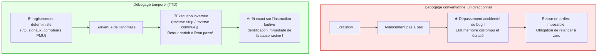

## Introduction : L'irréversibilité du temps et l'angoisse du développeur

Chaque développeur a déjà vécu ce cauchemar : un plantage survient en production sous la forme d'une redoutable erreur de segmentation. Pourtant, reproduit en environnement local avec des paramètres identiques, le binaire s'exécute parfaitement. Dès que l'on ajoute des journaux de débogage ou que l'on attache un débogueur, le timing est altéré et le bug s'évanouit mystérieusement — ce que l'informatique nomme un <strong>« Heisenbug »</strong>.

De surcroît, les débogueurs classiques (GDB, LLDB, Visual Studio) souffrent d'une limite structurelle : <strong>l'impossibilité de remonter le temps</strong>.
Si, lors d'un pas-à-pas, vous appuyez par inadvertance une fois de trop sur la touche d'avancement et sautez la fonction critique qui a corrompu la mémoire, <strong>vous ne pouvez pas revenir en arrière</strong>. L'état est détruit et les variables sont écrasées.

Et si l'on pouvait rembobiner l'exécution d'un programme comme un flux vidéo, <strong>instruction par instruction</strong> ?
Et si l'on pouvait poser un <strong>Reverse Watchpoint</strong> sur une zone mémoire corrompue et sauter directement dans le passé jusqu'à l'instruction assembleur précise qui a altéré la mémoire ?
C'est la promesse du <strong>Time-Travel Debugging (TTD)</strong> et de l'enregistrement-rejeu déterministe (<strong>Record & Replay</strong>).

---

## 1. Automates déterministes et sources de non-déterminisme

En théorie pure, un processeur et sa mémoire constituent un <strong>automate fini déterministe</strong> : $S_{t+1} = \delta(S_t, I_t)$.
Cependant, l'ordinateur physique réel est soumis à quatre sources majeures de non-déterminisme :
1. <strong>Entrées/Sorties externes (I/O) :</strong> Paquets réseau, données disques, retours d'appels système.
2. <strong>Instructions processeur non déterministes :</strong> Lecture d'horloge haute résolution (`RDTSC`), générateurs de nombres aléatoires matériels (`RDRAND`).
3. <strong>Interruptions et signaux asynchrones :</strong> Interruptions d'ordonnancement d'horloge OS et signaux POSIX frappant arbitrairement entre deux instructions quelconques.
4. <strong>Entrelacement multithread sur mémoire partagée :</strong> Variabilité nanoseconde des bus de cohérence de cache (MESI).

Le débogage temporel enregistre uniquement ces événements divergents avec une empreinte minimale.

---

## 2. Architecture de Record & Replay : Snapshots CoW et compteurs matériels

### 2.1 Points de contrôle et Copy-on-Write (CoW)
Des points de contrôle périodiques exploitent le mécanisme de copie sur écriture de la mémoire virtuelle, permettant de restaurer un espace d'adressage en quelques microsecondes en rechargeant le registre de table de pages (CR3).

### 2.2 La précision des compteurs matériels PMU
Pour repositionner une interruption au cycle d'horloge près lors du rejeu, Mozilla `rr` exploite les compteurs matériels de l'unité PMU du CPU, spécifiquement le décompte des <strong>branches conditionnelles complétées (Retired Conditional Branches)</strong>. Lors du rejeu, le compteur est configuré pour déclencher une interruption matérielle sur ce quota exact d'instructions.

---

## 3. Le mécanisme d'inversion : Rollback et avance rapide

Les portes logiques étant irréversibles au sens de Landauer, le silicium ne tourne pas à l'envers. Le TTD opère donc selon l'algorithme <strong>Rollback and Roll-Forward</strong> :
1. Restauration de l'état mémoire du <strong>point de contrôle antérieur</strong>.
2. <strong>Avance ultra-rapide (Fast-Forward)</strong> via le journal déterministe jusqu'à l'instruction cible.

### 3.1 La puissance des Reverse Watchpoints
En appliquant `watch -l *adresse` puis `reverse-continue`, le moteur remonte le flux d'instructions et s'immobilise directement sur l'instruction assembleur qui a écrasé l'adresse mémoire, avec sa pile d'appels complète.

---

## 4. Comparatif : Mozilla rr et Microsoft TTD

- <strong>Mozilla rr (Linux) :</strong> Capture via PMU, `ptrace` et `seccomp`. Pour neutraliser les aléas concurrents, `rr` sérialise l'exécution des threads sur un cœur unique (Deterministic Multithreading). Le surcoût d'enregistrement ne dépasse pas <strong>1,2× à 2×</strong>.
- <strong>Microsoft TTD (Windows) :</strong> Utilise la traduction dynamique binaire (DBT Nirvana) pour instrumenter les blocs de base à la volée. Totalement intégré dans WinDbg et Visual Studio.

---

## 5. Horloges vectorielles et concurrence

Sur architectures multicœurs, le temps physique absolu n'existe pas. Les moteurs de débogage s'appuient sur la relation <strong>Happens-Before ($\to$)</strong> de Leslie Lamport et les <strong>horloges vectorielles</strong>. Deux événements sans relation causale directe accédant à la même adresse mémoire prouvent formellement l'existence d'une condition de course (Race Condition).

---

## 6. Conclusion : Vers l'omniscience logicielle

Le Time-Travel Debugging élève la recherche de pannes du statut de médecine légale spéculative à celui d'observation déterministe totale. Maîtriser la réversibilité temporelle de l'exécution dote les développeurs de l'arme ultime face à la complexité des systèmes modernes.
