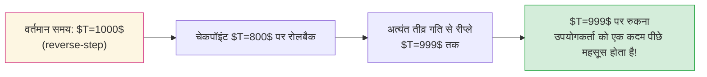

## प्रस्तावना: समय की अपरिवर्तनीयता और सॉफ्टवेयर डेवलपर की दुविधा

```mermaid
flowchart TD
    subgraph TraditionalDebugging ["पारंपरिक एकतरफा डिबगिंग की सीमा"]
        Start["प्रोग्राम निष्पादन"] --> Step["आगे बढ़ना (Step)"]
        Step --> Overstep["★ बग का क्षण गलती से छूट गया!\nमेमोरी दूषित और ओवरराइट"]
        Overstep --> Fail["समय पीछे नहीं ले जाया जा सकता!\nशुरुआत से दोबारा रन करना अनिवार्य"]
    end

    subgraph TimeTravelDebugging ["टाइम-ट्रैवल डिबगिंग (TTD)"]
        Record["निश्चित रिकॉर्डिंग\n(I/O, सिग्नल्स, PMU काउंटर्स)"] --> Crash["क्रैश उत्पन्न होना"]
        Crash --> Rewind["『उलटा निष्पादन (reverse-step / reverse-continue)』\nपिछली अवस्था पूरी तरह से बहाल!"]
        Rewind --> RootCause["दोषपूर्ण निर्देश पर सटीक लैंडिंग\nअपराधी कोड की तुरंत पहचान!"]
    end

    style TraditionalDebugging fill:#ffe6e6,stroke:#d9534f,stroke-width:2px
    style TimeTravelDebugging fill:#e6ffe6,stroke:#009900,stroke-width:2px
```

प्रत्येक सॉफ्टवेयर इंजीनियर ने उस भयानक बग का अनुभव किया है जिसे दोबारा दोहराया नहीं जा सकता: प्रोडक्शन सर्वर पर एक महत्वपूर्ण सेवा अचानक क्रैश हो जाती है। लेकिन जब स्थानीय वातावरण में उसी इनपुट के साथ चलाया जाता है, तो प्रोग्राम लाखों बार बिना किसी त्रुटि के चलता है। जैसे ही कोड में `printf` लॉगिंग जोड़ी जाती है या डिबगर लगाया जाता है, समय बदल जाता है और बग गायब हो जाता है—इसे <strong>«हाइजेनबग» (Heisenbug)</strong> कहा जाता है।

इसके अतिरिक्त, पारंपरिक डिबगर्स (GDB, LLDB, Visual Studio) में एक गंभीर संरचनात्मक सीमा होती है: <strong>समय केवल आगे की ओर बढ़ता है</strong>।
यदि स्टेप-बाय-स्टेप डिबगिंग करते समय आपने गलती से एक बार अधिक बटन दबा दिया और मेमोरी को दूषित करने वाले मुख्य फंक्शन को पार कर गए, <strong>तो आप वापस पीछे नहीं जा सकते</strong>। मेमोरी और रजिस्टर्स हमेशा के लिए बदल चुके होते हैं। डेवलपर के पास प्रोग्राम को दोबारा शुरू करने के अलावा कोई विकल्प नहीं बचता।

क्या होगा यदि हम किसी प्रोग्राम के निष्पादन को वीडियो टेप की तरह <strong>निर्देश-दर-निर्देश पीछे ले जा सकें</strong>?
क्या होगा यदि हम किसी दूषित मेमोरी पते पर <strong>रिवर्स वॉचपॉइंट (Reverse Watchpoint)</strong> लगाएं और सीधे उस निर्देश पर पहुंच जाएं जिसने उस मेमोरी को नुकसान पहुंचाया था?
यही <strong>टाइम-ट्रैवल डिबगिंग (Time-Travel Debugging, TTD)</strong> और <strong>डिटरमिनिस्टिक रिकॉर्ड एंड रीप्ले</strong> की शक्ति है।

---

## 1. नियतात्मक ऑटोमेटा और अनिश्चितता के स्रोत

सैद्धांतिक रूप से, सीपीयू और मेमोरी एक <strong>नियतात्मक परिमित ऑटोमेटन</strong> बनाते हैं: $S_{t+1} = \delta(S_t, I_t)$।
लेकिन भौतिक कंप्यूटरों में चार प्रमुख कारक अनिश्चितता उत्पन्न करते हैं:
1. <strong>बाहरी इनपुट/आउटपुट (I/O):</strong> नेटवर्क पैकेट, डिस्क रीडिंग, सिस्टम कॉल।
2. <strong>अनिश्चित सीपीयू निर्देश:</strong> टाइमस्टैम्प काउंटर (`RDTSC`), हार्डवेयर यादृच्छिक संख्या जनरेटर (`RDRAND`)।
3. <strong>अतुल्यकालिक हार्डवेयर इंटरप्ट और सिग्नल्स:</strong> ओएस टाइमर इंटरप्ट जो किन्हीं दो निर्देशों के बीच में आ सकते हैं।
4. <strong>शेयर मेमोरी मल्टीथ्रेडिंग इंटरलीविंग:</strong> मल्टीकोर प्रोसेसर पर कैश सुसंगतता (MESI) के कारण समय में भिन्नता।

टीटीडी प्रणाली केवल इन अनिश्चित घटनाओं को न्यूनतम ओवरहेड के साथ रिकॉर्ड करती है।

---

## 2. रिकॉर्ड और रीप्ले की वास्तुकला: CoW और PMU काउंटर्स

### 2.1 कॉपी-ऑन-राइट (CoW) आधारित चेकपॉइंट्स
वर्चुअल मेमोरी की कॉपी-ऑन-राइट तकनीक का उपयोग करके समय-समय पर चेकपॉइंट बनाए जाते हैं, जिससे बिना डेटा कॉपी किए माइक्रोसेकंड में मेमोरी स्टेट को रीस्टोर किया जा सकता है।

### 2.2 हार्डवेयर प्रदर्शन काउंटर (PMU)
मोज़िला `rr` सीपीयू के <strong>परफॉर्मेंस मॉनिटरिंग यूनिट (PMU)</strong> का उपयोग करके <strong>सेवानिवृत्त सशर्त शाखाओं (Retired Conditional Branches)</strong> की गिनती करता है। रीप्ले के दौरान हार्डवेयर काउंटर उसी मान पर सटीक रूप से इंटरप्ट उत्पन्न करता है।

---

## 3. रिवर्स निष्पादन: पीछे जाने के लिए आगे बढ़ना

सेमीकंडक्टर लॉजिक गेट्स भौतिक रूप से प्रतिवर्ती नहीं होते (लैंडॉअर सीमा), इसलिए सीपीयू समय में भौतिक रूप से पीछे नहीं चल सकता। रिवर्स निष्पादन <strong>Rollback and Roll-Forward</strong> एल्गोरिदम द्वारा संचालित होता है:
1. निकटतम पिछले <strong>चेकपॉइंट पर वापस जाना</strong>।
2. रिकॉर्ड किए गए लॉग का उपयोग करके लक्ष्य निर्देश से ठीक पहले तक <strong>अत्यधिक तीव्र गति से आगे बढ़ना (Fast-Forward)</strong>।

### 3.1 रिवर्स वॉचपॉइंट्स का प्रभाव
`watch -l *address` और `reverse-continue` के साथ डिबगर समय में पीछे की ओर यात्रा करता है और ठीक उसी असेंबली निर्देश पर रुक जाता है जिसने गलत मान लिखा था।

---

## 4. प्रमुख औद्योगिक समाधान: मोज़िला rr और माइक्रोसॉफ्ट TTD

- <strong>मोज़िला rr (Linux):</strong> PMU काउंटर्स और `seccomp` पर आधारित। मल्टीथ्रेडिंग को एकल सीपीयू कोर पर क्रमबद्ध (DMT) करके केवल <strong>1.2x से 2x</strong> ओवरहेड पर रिकॉर्ड करता है।
- <strong>माइक्रोसॉफ्ट TTD (Windows):</strong> डायनामिक बाइनरी ट्रांसलेशन (Nirvana DBT) का उपयोग करता है और WinDbg में पूरी तरह एकीकृत है।

---

## 5. वेक्टर घड़ियां और संगामिति (Concurrency)

मल्टीकोर वातावरण में लेस्ली लैम्पॉर्ट के <strong>Happens-Before ($\to$)</strong> संबंध और <strong>वेक्टर घड़ियों (Vector Clocks)</strong> द्वारा थ्रेड्स के बीच कारण संबंध स्थापित किए जाते हैं, जिससे डेटा रेस कंडीशंस को गणितीय रूप से पहचाना जा सकता है।

---

## 6. निष्कर्ष: सॉफ्टवेयर विश्वसनीयता का नया युग

टाइम-ट्रैवल डिबगिंग ने सॉफ्टवेयर डिबगिंग को अनिश्चित अनुमान से एक सटीक भौतिक विज्ञान में बदल दिया है। समय को उलटने की इस क्षमता ने आधुनिक सॉफ्टवेयर इंजीनियरिंग को अप्रत्याशित बग्स से निपटने का सबसे शक्तिशाली हथियार दिया है।
