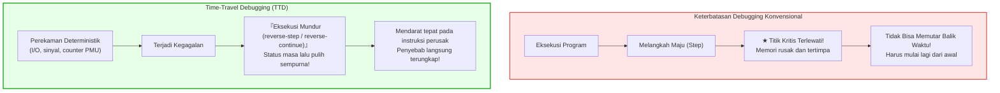
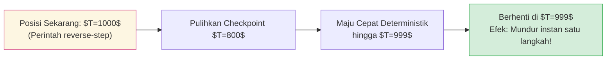

## Pendahuluan: Ketakterbalikkan Waktu dan Mimpi Buruk Pemrogram

Setiap pengembang perangkat lunak pernah mengalami frustrasi akibat bug yang sulit direproduksi: layanan mengalami Segmentation Fault di server produksi. Namun, ketika dijalankan di lingkungan lokal dengan masukan yang persis sama, aplikasi berjalan mulus jutaan kali. Begitu ditambahkan kode logging (`printf`) atau dipasang debugger, waktu eksekusi bergeser dan bug menghilang tanpa jejak — fenomena mengerikan ini dinamai <strong>«Heisenbug»</strong>.

Selain itu, debugger konvensional (GDB, LLDB, Visual Studio) memiliki kelemahan mendasar: <strong>waktu hanya berjalan satu arah ke depan</strong>.
Jika saat melangkah (`step`) Anda tidak sengaja melangkah satu instruksi terlalu jauh dan melewatkan fungsi yang merusak memori, <strong>Anda tidak bisa mundur</strong>. Data memori dan register telah terlanjur tertimpa. Pengembang terpaksa memulai ulang proses dari awal.

Bagaimana jika kita bisa memutar mundur eksekusi program <strong>instruksi demi instruksi</strong>, layaknya rekaman video digital?
Bagaimana jika kita bisa memasang <strong>Reverse Watchpoint</strong> pada alamat memori yang rusak dan melompat mundur ke instruksi mesin yang merusak memori tersebut?
Inilah pencapaian revolusioner dari <strong>Time-Travel Debugging (TTD)</strong> dan teknologi <strong>Deterministic Record & Replay</strong>.

---

## 1. Otomata Deterministik dan Sumber Ketidakpastian

Secara teoretis, prosesor dan memori membentuk <strong>otomata terhingga deterministik</strong>: $S_{t+1} = \delta(S_t, I_t)$.
Namun, komputer fisik di dunia nyata dipengaruhi oleh empat sumber ketidaktentuan:
1. <strong>Masukan/Keluaran Eksternal (I/O):</strong> Paket jaringan, pembacaan berkas, nilai kembalian panggilan sistem kernel.
2. <strong>Instruksi CPU Non-deterministik:</strong> Penghitung siklus stempel waktu (`RDTSC`), generator bilangan acak termal (`RDRAND`).
3. <strong>Interupsi Asinkron dan Sinyal:</strong> Penjadwal waktu sistem operasi dan sinyal POSIX yang menyela di antara dua instruksi acak.
4. <strong>Interleaving Multithread pada Memori Bersama:</strong> Fluktuasi nanodetik pada bus koherensi cache (MESI).

Engine TTD hanya mencatat kejadian non-deterministik ini dengan beban eksekusi yang sangat ringan.

---

## 2. Arsitektur Record & Replay: CoW dan Counter Perangkat Keras

### 2.1 Titik Periksa dengan Copy-on-Write (CoW)
Snapshot memori berkala menduplikasi pemetaan tabel halaman virtual tanpa menyalin data fisik sampai terjadi perubahan, memungkinkan pemulihan memori dalam hitungan mikrodetik.

### 2.2 Presisi Counter Perangkat Keras PMU
Untuk memposisikan interupsi asinkron secara tepat pada instruksi yang sama saat pemutaran ulang, Mozilla `rr` memanfaatkan <strong>Performance Monitoring Unit (PMU)</strong> prosesor, menghitung jumlah <strong>percabangan bersyarat yang selesai (Retired Conditional Branches)</strong>. Saat replay, interupsi overflow dipicu tepat pada instruksi tersebut.

---

## 3. Mekanisme Eksekusi Mundur: Rollback dan Roll-Forward

Karena gerbang logika semikonduktor tidak dapat dibalik secara fisik (batas Landauer), prosesor tidak memutar mundur detak jam fisiknya. Pembalikan waktu diimplementasikan melalui algoritma <strong>Rollback and Roll-Forward</strong>:
1. Memulihkan keadaan dari <strong>titik periksa (checkpoint) terdekat sebelumnya</strong>.
2. Melakukan <strong>pemutaran maju deterministik super cepat (Fast-Forward)</strong> hingga tepat sebelum instruksi target.

### 3.1 Kekuatan Reverse Watchpoints
Dengan `watch -l *address` dan `reverse-continue`, debugger mundur melintasi waktu dan berhenti tepat pada instruksi bahasa rakitan yang memodifikasi memori, menampilkan tumpukan panggilan utuh.

---

## 4. Implementasi Terkemuka: Mozilla rr vs Microsoft TTD

- <strong>Mozilla rr (Linux):</strong> Memanfaatkan counter PMU, `ptrace`, dan `seccomp`. Menjaga determinisme multithread dengan membatasi thread pada satu inti CPU (DMT), dengan overhead rekam hanya <strong>1,2× hingga 2×</strong>.
- <strong>Microsoft TTD (Windows):</strong> Menggunakan translasi biner dinamis (Nirvana DBT) yang menginstrumentasi blok kode secara langsung, terintegrasi penuh dalam WinDbg.

---

## 5. Jam Vektor dan Konkurensi Multicore

Pada lingkungan multiprosesor murni, relasi kausalitas dimodelkan melalui hubungan <strong>Happens-Before ($\to$)</strong> Leslie Lamport dan <strong>Jam Vektor (Vector Clocks)</strong>. Operasi konkuren yang mengakses memori yang sama tanpa sinkronisasi secara matematis membuktikan adanya kondisi balapan data (Data Race).

---

## 6. Kesimpulan: Era Baru Observabilitas Perangkat Lunak

Time-Travel Debugging mengubah investigasi kegagalan dari spekulasi forensik menjadi observasi deterministik mutlak. Dengan menaklukkan arah waktu komputasi, para pengembang memiliki kendali penuh atas sistem perangkat lunak modern yang kompleks.
