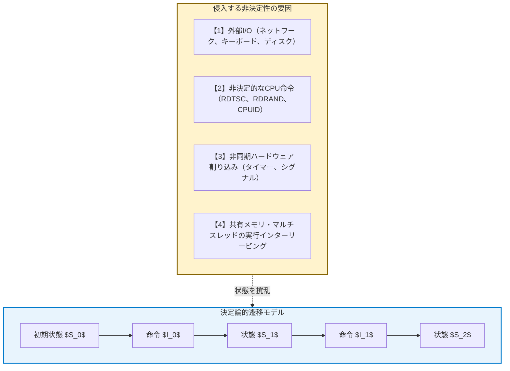
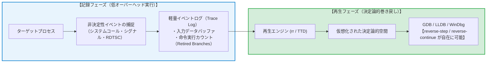
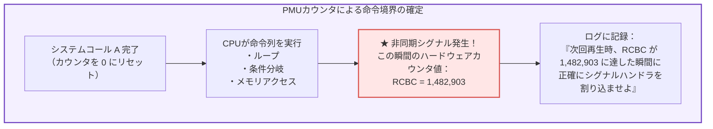
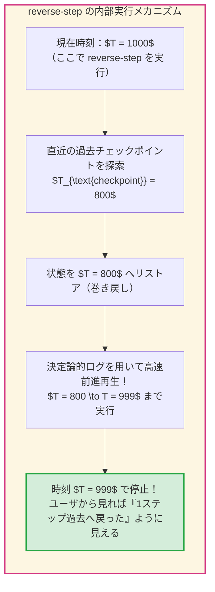
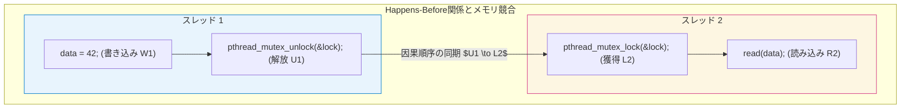
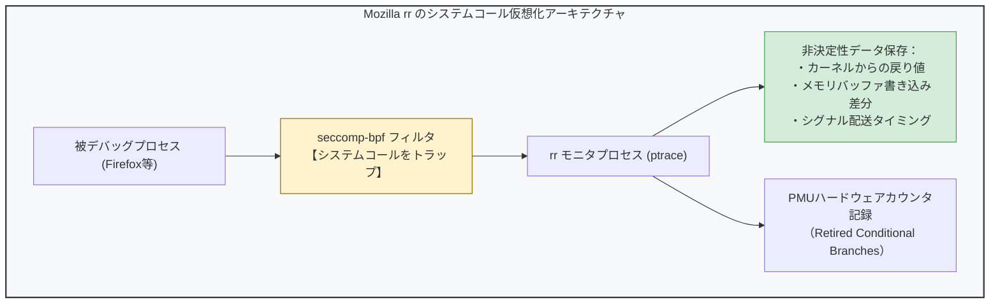
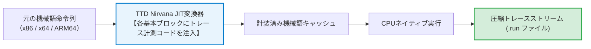
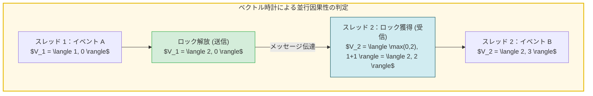

## 序論：ソフトウェア開発者を苦しめる「時間の不可逆性」

すべてのプログラマは、かつて次のような絶望を味わった経験があるはずです：

本番環境でクラッシュが発生した。ログには無残なセグメンテーション違反（Segmentation Fault）のアドレスが刻まれている。しかし、同じ条件で手元の開発マシンで実行しても、エラーは二度と起きない。
原因を突き止めるために `printf` やロギングを挟むと、タイミングが微妙にずれてバグが完全に姿を消してしまう――物理学の不確定性原理になぞらえて<strong>「ハイゼンバグ（Heisenbug）」</strong>と呼ばれる、悪夢の現象です。

また、従来のデバッガ（GDBやLLDB、Visual Studioなど）を用いた調査にも、残酷な構造的限界が存在します。
ブレークポイントを張り、`step`（ステップ実行）を連打しながら変数を監視している最中、うっかりキーを1回多く叩いてしまい、バグが発生したクリティカルな関数を通り過ぎてしまった瞬間を思い出してください。
従来のデバッガでは、<strong>時間を巻き戻すことはできません</strong>。
すでにメモリの状態は破壊され、ポインタは不正な領域を指し、変数は上書きされてしまいました。プログラマができることは、ため息をつきながらプログラムを再起動し、最初から同じ手順をやり直すことだけです。

```mermaid
flowchart TD
    subgraph TraditionalDebugging ["【従来の順方向デバッグの限界】"]
        Start["プログラム起動"] --> Run["実行進行"]
        Run --> Step["ステップ実行を継続"]
        Step --> Miss["★ バグ発生の瞬間を通り過ぎてしまった！\n（状態破壊・上書き代入完了）"]
        Miss --> Despair["時間を巻き戻せない！\n最初からやり直し（非決定性バグは二度と再現せず）"]
    end

    subgraph TimeTravelDebugging ["【タイムトラベル・デバッグ（TTD）の理想】"]
        Record["実行の全状態を決定論的に記録\n（I/O・割り込み・命令ストリーム）"] --> Crash["クラッシュ発生"]
        Crash --> Rewind["『時間を逆再生（reverse-step / reverse-continue）』\nメモリやレジスタが過去の状態へ完全に復元！"]
        Rewind --> RootCause["不正書き込みの瞬間へピンポイント着陸\n『誰がこのポインタを壊したか』が即座に判明"]
    end

    style TraditionalDebugging fill:#ffe6e6,stroke:#d9534f,stroke-width:2px
    style TimeTravelDebugging fill:#e6ffe6,stroke:#009900,stroke-width:2px
    style Miss fill:#f8d7da,stroke:#dc3545
    style RootCause fill:#d4edda,stroke:#28a745
```



もし、録画したビデオテープを巻き戻して一時停止するように、<strong>「プログラムの実行を1命令単位で過去へと巻き戻す」</strong>ことができたなら？
もし、数億行の命令が実行される巨大な分散システムや並行処理の中で、何百万回に一度しか起きない致命的なメモリ破壊の「犯人の命令」へと、時間を遡って直接ジャンプできたなら？

この夢の技術を実現するのが、<strong>タイムトラベル・デバッグ（Time-Travel Debugging, TTD）</strong>と<strong>決定論的記録・再生（Deterministic Record & Replay）</strong>の理論です。
本稿では、コンピュータの非決定性を飼いならす数理的メカニズムから、ハードウェア性能モニタリングカウンタを用いた命令単位の決定論、メモリのスナップショットと差分CoW（Copy-on-Write）技術、Mozilla `rr` や Microsoft TTD の内部アーキテクチャ、そしてマルチスレッド並行処理の「時間の順序（Happens-Before関係）」を巡る究極の挑戦までを徹底的に解明します。

---

## 1. 決定論的オートマトンと「非決定性」の源泉

プログラムの実行を過去へと巻き戻すための第一歩は、コンピュータという機械の本質を<strong>決定論的有限オートマトン（Deterministic Finite Automaton, DFA）</strong>として捉え直すことです。

### 1.1 理想的なチューリングマシンと状態遷移
外部からの干渉がない純粋な数学的モデルにおいて、プロセッサとメモリは決定論的な力学系を形成します。
時刻 $t$ におけるCPUレジスタと全メモリ空間の状態を $S_t$、次に実行される機械語命令を $I_t$ とすると、時刻 $t+1$ の状態 $S_{t+1}$ は確定的な遷移関数 $\delta$ によって一意に定まります：

$$S_{t+1} = \delta(S_t, I_t)$$

もしコンピュータが完全にこの方程式のみに従って動作しているならば、過去のすべての状態を再現することは極めて容易です。初期状態 $S_0$ さえ記録しておけば、同じ命令列を最初から再実行するだけで、任意の時刻 $t$ の状態を寸分狂わず再構成できるはずです。

しかし、<strong>現実のコンピュータは決定論的ではありません</strong>。



### 1.2 現実のプロセッサを狂わせる4つの非決定性
現代のコンピュータにおいて、同じプログラムを同じ引数で実行しても毎回異なる結果をもたらす非決定性の要因は、以下の4つに分類されます：

1. <strong>外部入力（External I/O Inputs）：</strong>
   ネットワークソケットから受信したパケット、ディスクからの読み込みデータ、`read()` や `recv()` システムコールによってカーネルからユーザ空間メモリへ書き込まれるバッファは、外部世界の物理的状態に依存します。
2. <strong>非決定的なプロセッサ命令（Non-deterministic CPU Instructions）：</strong>
   x86アーキテクチャの `RDTSC`（タイムスタンプカウンタの読み出し命令）や `RDRAND`（ハードウェア熱雑音による乱数生成）、`CPUID` などは、実行するクロックサイクルや環境に応じて異なる値をレジスタに書き込みます。
3. <strong>非同期ハードウェア割り込み（Asynchronous Interrupts & Signals）：</strong>
   OSのプリエンプティブ・スケジューラによるタイマー割り込みや、Ctrl+C、`SIGALRM` などのシグナルは、プログラムの「どの命令とどの命令の間」で発生するかが完全にランダムです。命令 `i` と命令 `i+1` の境界という、プログラムカウンタ（PC）の任意の場所で非同期にコンテキストスイッチが発生します。
4. <strong>共有メモリ型マルチスレッドの競合（Shared-Memory Concurrency）：</strong>
   マルチコアプロセッサ上で複数のスレッドが同一のメモリアドレスに対してアトミックでない読み書きを行う場合、CPUキャッシュのコヒーレンシ・プロトコル（MESIなど）やバス調停、メモリオーダリング（弱メモリモデル）の微視的タイミングによって、スレッド間の命令実行順序（インターリービング）が実行ごとに激しく変動します。

したがって、タイムトラベル・デバッグを実現するための核心課題は、<strong>「これらすべての非決定性イベントをいかに最小限のオーバーヘッドで捕獲（Record）し、再現環境において1ビットの狂いもなく再生（Replay）するか」</strong>という工学的問題に帰着されます。

---

## 2. 記録・再生（Record & Replay）のアーキテクチャ

プログラムの全実行履歴を保存する方法として、素朴には「毎クロックサイクルごとに全メモリとレジスタのダンプをディスクに書き出す」アプローチが考えられます。
しかし、毎秒数十億回（GHzオーダー）の命令を実行するプロセッサの全状態を愚直に保存すれば、ディスクI/O帯域は瞬時にパンクし、ストレージは数秒でテラバイト単位で枯渇します。

現実的なタイムトラベル・デバッガは、<strong>「状態そのものを保存するのではなく、状態を狂わせる非決定性イベントのみをログに記録する」</strong>という極めて洗練された設計を採用しています。



### 2.1 スナップショットと差分CoW（Copy-on-Write）
長時間動作するプロセスの任意の時点へ高速に巻き戻すため、システムは定期的にプロセスの<strong>チェックポイント（Checkpoint）</strong>を作成します。

このとき利用されるのが、仮想メモリ管理機構の<strong>コピー・オン・ライト（Copy-on-Write, CoW）</strong>技術です。Linuxの `fork()` システムコールと同様に、メモリページテーブルの複製のみを行い、物理メモリページを共有します。あるページに変更が加えられた瞬間だけ新しいページを割り当てて差分を保存するため、メモリ消費とスナップショット作成時間は劇的に圧縮されます。

### 2.2 ハードウェア性能監視カウンタ（PMU）の魔術
非同期割り込みやシグナルを寸分狂わず元の位置で再生するために、Mozillaのタイムトラベル・デバッガ <strong>`rr`（Record and Replay Framework）</strong> は、現代のCPUに搭載されている<strong>パフォーマンス・モニタリング・ユニット（PMU）</strong>のハードウェアカウンタを極めて独創的な方法で活用しています。

プロセッサが命令を実行する際、PMUは<strong>「リタイアした条件分岐命令の数（Retired Conditional Branches）」</strong>をハードウェアレベルで正確にカウントします。
あるシステムコールから次のシステムコールまでの間に、CPUが何命令を実行したかをこのカウンタで記録します。



再生フェーズにおいて、`rr` はPMUのカウンタに目的のカウント（例えば `1,482,903`）をセットし、カウンタがゼロになった瞬間にハードウェア割り込み（Overflow Interrupt）を発生させるようにCPUを設定します。
これにより、<strong>数十億回の命令実行の中から、過去の記録時とまったく同じ単一の命令の直後でプロセッサを一時停止させ、正確に割り込みを再現する</strong>ことが可能になるのです。このハードウェア支援により、`rr` はわずか 1.2倍〜2倍程度の実行時オーバーヘッドで完全な決定論的記録を実現しています。

---

## 3. 逆向き実行（Reverse Execution）の実装原理

デバッガのコンソールで `reverse-step`（1行巻き戻す）や `reverse-continue`（過去のブレークポイントまで時間を遡る）を入力したとき、内部では一体どのような処理が走っているのでしょうか？

### 3.1 物理的な巻き戻しの不可能性と「前進による後退」
熱力学や半導体の物理法則が示す通り、トランジスタの論理ゲート（ANDやOR）は不可逆であり、CPU回路そのものを物理的に「逆回転」させることはできません。
レジスタ `EAX` に値 `5` が上書き代入された後、ハードウェアレベルで「直前の値」を復元する回路は存在しないのです。

そのため、タイムトラベル・デバッガは、情報科学的な<strong>「前進による後退（Rollback and Roll-forward）」</strong>というアルゴリズムによって時間を巻き戻します。



1. ユーザが現在時刻 $T = 1000$ で `reverse-step` を実行。
2. デバッガは、目的の時刻 $T = 999$ よりも前にある<strong>直近のチェックポイント（例えば $T = 800$）</strong>へとプロセス全体を巻き戻す（スナップショットからメモリとレジスタを瞬時に復元）。
3. チェックポイント $T = 800$ から、記録されたイベントログを忠実に再生しながら、目的の時刻 $T = 999$ の命令の直前まで<strong>猛スピードで前進実行（Fast-Forward）</strong>する。
4. $T = 999$ に到達した瞬間に実行を停止し、ユーザに制御を返す。

再生フェーズは外部I/Oの待ち時間や実時間のスリープが発生しないため、順方向の再生は毎秒数億〜数十億命令という超高速で完了します。プログラマの目には、あたかも時間が瞬時に1ステップ巻き戻ったかのように知覚されるのです。

### 3.2 逆向きウォッチポイント（Reverse Watchpoints）の威力
タイムトラベル・デバッグが開発者の生産性を桁違いに引き上げる最強の機能が、<strong>逆向きウォッチポイント（Reverse Watchpoint）</strong>です。

ポインタの不正アクセスやメモリ破壊バグにおいて、開発者が直面するのは「すでに破壊された後のメモリ」です。従来のデバッグでは、「誰が、いつ、どこでこのメモリアドレス `0x7fff5fbff8a0` に不正な値を書き込んだのか」を突き止めるために、コード中のありとあらゆる怪しい箇所に当たりをつけてブレークポイントを張り巡らせる必要がありました。

しかし、タイムトラベル・デバッグ環境では、クラッシュした地点で以下のように命令を下すだけです：

```gdb
(rr) watch -l *0x7fff5fbff8a0   # メモリアドレスに対する書き込みを監視
(rr) reverse-continue          # 過去に向かって実行を巻き戻す！
```

デバッガは時間を過去へと遡り、<strong>そのアドレスに不正なデータを書き込んだまさにその瞬間の命令でピタリと停止</strong>します。
コールスタックには、犯人の関数の名前、引数の値、ローカル変数の状態が完璧に保存されています。「犯人を捜す」ための何時間もの苦闘は、一撃の `reverse-continue` によって数秒の作業へと変わるのです。

---

## 4. 並行性の壁：マルチコアと競合状態の再生

シングルスレッドのプログラム、あるいは単一のCPUコアに固定（CPU Pinning）されたプロセスであれば、システムコールとPMUカウンタの記録によってほぼ完璧な決定論的再生が可能です。
しかし、現代のソフトウェアの大半は<strong>マルチスレッド・マルチコア</strong>で並行動作しています。ここに、タイムトラベル・デバッグにおける最大の難関が横たわっています。

### 4.1 メモリのインターリービングとランポートの先行発生（Happens-Before）関係
マルチコアシステムにおいて、スレッド $A$ とスレッド $B$ が共有メモリに対して競合アクセス（Race Condition）を行う場合、どのスレッドのメモリアクセスが先に実行されたかという<strong>インターリービング（Interleaving）</strong>を追跡しなければなりません。

分散システム理論の創始者レスリー・ランポート（Leslie Lamport）が定義した<strong>先行発生関係（Happens-Before Relation: $\to$）</strong>は、イベント間の因果関係を規定します：
- 同一スレッド内の命令実行順序：$a \prec b \implies a \to b$
- ロックの解放と獲得：スレッド $A$ のミューテックス解放 $U$ と、その後のスレッド $B$ による同一ミューテックスの獲得 $L$ において、$U \to L$
- 共有変数の書き込みと読み込み：スレッド $A$ の書き込み $W$ の結果をスレッド $B$ の読み込み $R$ が観測した場合、$W \to R$



ロック（Mutexやセマフォ）で適切に保護された同期操作であれば、同期プリミティブの呼び出し順序をログに記録することで、再生時に同じ順序でロックを獲得させることができます。

### 4.2 データ競合（Data Race）の追跡：ソフトウェア vs ハードウェア
しかし、プログラマの不注意やロックフリーデータ構造によって、<strong>適切な同期を伴わない並行メモリアクセス（データ競合）</strong>が発生している場合、共有メモリの読み書きの順序をすべてソフトウェアでインターセプトしようとすると、プログラムの実行速度は 100倍〜1000倍も遅延してしまい、実用性を失います。

この課題に対し、現代の計算機科学では2つの最先端アプローチが実用化されています：

1. <strong>シングルコア仮想化（Deterministic Multi-threading, DMT）：</strong>
   Mozilla `rr` が採用するアプローチ。マルチスレッドプログラムであっても、デバッグ記録時にはすべてのスレッドを単一のCPUコア上でコンテキストスイッチさせながら動作させます。共有メモリへのアクセスは物理的に単一のプロセッサで直列化されるため、データ競合が存在しても命令カウントによって完全に決定論的なインターリービングが保証されます。
2. <strong>ハードウェア支援プロセッサ・トレース（Intel PT / ARM CoreSight）：</strong>
   CPU内部の専用ハードウェアロジックが、分岐履歴やキャッシュミス、メモリバスのトランザクション情報を直接圧縮して専用メモリバッファに出力します。Microsoftの <strong>TTD（Time Travel Debugging）</strong> や Undo社の <strong>LiveRecorder</strong> は、OSカーネルの仮想化支援とプロセッサのハードウェア機能を融合させ、実用的なオーバーヘッドでマルチコア並行実行の完全トレースを実現しています。

---

## 5. 結論：ソフトウェアの信頼性と「万能のデバッガ」

タイムトラベル・デバッグの登場は、ソフトウェア開発における「バグ修正」という行為の定義を根本から塗り替えました。

これまで、デバッグとは<strong>「限られた情報から過去の惨劇を推理する、不完全な法医学」</strong>でした。開発者はコアダンプの瓦礫をかき集め、仮説を立て、コードにログを埋め込み、再現することを祈りながら何日も徹夜していました。

しかし、タイムトラベル・デバッグのパラダイムにおいて、デバッグは<strong>「確固たる決定論的時空を自由に往来する、完全な観測」</strong>へと昇華しました。
バグが起きた未来から、バグが仕込まれた過去へと時間を遡り、変数の値が改ざんされたまさにその瞬間の物理的クロックサイクルを直視する。そこには推測の入り込む余地はありません。

決定論的記録・再生技術は、自動修復AIエージェントがプログラムの実行時系列を過去へ巻き戻しながら原因を特定する「自律デバッグ」の基盤としても、現在急速に統合が進んでいます。

時間を巻き戻す技術――それは、有限の人間が構築する複雑巨大なソフトウェア宇宙において、私たちがカオスに打ち勝ち、真の決定論的秩序を取り戻すための、計算機科学が到達した最も美しく強力な武器なのです。


---

## 6. 実世界の実装解剖：Mozilla rr と Microsoft TTD の内部構造

タイムトラベル・デバッグの理論をプロダクションレベルの実用システムへと昇華させた代表格が、Mozillaの <strong>`rr`</strong> とマイクロソフトの <strong>TTD（Time Travel Debugging）</strong> です。両者は異なるアプローチで非決定性の克服に挑みました。

### 6.1 Mozilla rr の低レベル仮想化：ptrace、seccomp-bpf、VDSO
MozillaがFirefoxのような超巨大C++アプリケーションのデバッグのために開発した `rr` は、Linuxの標準機能のみを極限まで使い倒す設計思想を持っています。



1. <strong>`ptrace` と `seccomp-bpf` によるシステムコール調停：</strong>
   `rr` は対象プロセスを `ptrace` で監視下に置き、`seccomp-bpf` を用いてすべてのシステムコールを瞬時にトラップします。カーネルがユーザ空間のメモリにデータを書き込むシステムコール（`read`、`poll`、`recvmsg` 等）が発生すると、`rr` はカーネルが変更したメモリ領域のバイト列をそっくりそのままトレースログに吸い上げます。
2. <strong>VDSO（Virtual Dynamically linked Shared Object）の無力化：</strong>
   Linuxでは、高速化のために `gettimeofday` や `clock_gettime` などの一部のシステムコールが、カーネル空間に入らずユーザ空間の共有メモリ（VDSO）から直接時刻を読み取ります。このままでは `ptrace` でトラップできず非決定性が生じてしまうため、`rr` は起動時にプロセスのVDSOマッピングを自前のトラップコードで上書きし、すべての時刻取得を強制的にトラップして決定論的ログに記録します。
3. <strong>シングルコアへのスレッド直列化（CPU Pinning）：</strong>
   マルチスレッドアプリケーションであっても、`rr` はすべてのアクティブスレッドを単一の物理CPUコアに強制バインドします。スレッドの切り替えはOSのタイムスライスや同期ポイントでのみ行われるため、マルチスレッドの実行は「単一コア上の決定論的インターリービング」へと縮退し、共有メモリのデータ競合であっても完全な再現性を維持できるのです。

### 6.2 Microsoft TTD：動的バイナリ変換（DBT）とNirvanaエンジン
一方、Windowsプラットフォームにおける標準となった <strong>Microsoft TTD（Time Travel Debugging）</strong> は、Visual Studio Enterprise や WinDbg に組み込まれ、商用OSのあらゆるクラッシュダンプ調査を革新しました。

TTDのエンジン（内部コードネーム：Nirvana）は、<strong>動的バイナリ変換（Dynamic Binary Translation, DBT）</strong>技術を核としています。



TTDはプロセスが実行される直前に機械語命令を基本ブロック（Basic Block）単位で検査し、メモリの読み込み命令や非決定性命令の直前に微小なロギング・コードを動的に差し込みます。
生成された `.run` ファイルには、プロセスのキーフレーム（定期的なフルメモリダンプ）と、キーフレーム間の命令実行ストリームが高度に圧縮されて保存されます。
WinDbg上でこのファイルを読み込むと、開発者は以下のようなSQL風のオブジェクトモデル照会（LINQ）を使って、過去の実行履歴を自在に検索できます：

```text
# WinDbg での TTD タイムトラベル照会コマンド例
0:000> !tt 14:02:10.743                 # 特定のタイムスタンプへジャンプ
0:000> dx @$curprocess.TTD.Events        # 発生したすべての例外・モジュール読み込みを検索
0:000> dx @$curprocess.TTD.MemoryRead(0x7fff5fbff8a0)  # このアドレスを読んだ全過去命令を抽出
```

---

## 7. ツール比較マトリクスと設計トレードオフ

タイムトラベル・デバッグの各フレームワークは、実行性能、並行性のサポート、対象プラットフォームにおいて異なる設計トレードオフを選択しています。

| ツール / 技術 | 開発元 / プロジェクト | 実装アーキテクチャ | マルチコア並行性 | 実行時オーバーヘッド | 主な対応環境 | 特徴・強み |
|---|---|---|---|---|---|---|
| <strong>Mozilla rr</strong> | Mozilla / オープンソース | PMUハードウェアカウンタ + ptrace + seccomp | シングルコア直列化（DMT） | <strong>極小（約 1.2x〜2x）</strong> | Linux (x86_64, aarch64) | 圧倒的な低オーバーヘッド。長時間のブラウザ動作も実用的に記録可能 |
| <strong>Microsoft TTD</strong> | マイクロソフト | 動的バイナリ変換 (Nirvana DBT) + エミュレーション | マルチスレッド（部分順序記録） | 中程度（約 2x〜10x） | Windows (x86, x64, ARM64) | WinDbg / Visual Studio にネイティブ統合。クラッシュ後のオフライン解析に強力 |
| <strong>Undo LiveRecorder</strong> | Undo Ltd. | JITバイナリ計装 + メモリスナップショット | マルチコア（メモリ保護トラップ） | 中程度（約 2x〜5x） | Linux (C/C++, Java, Go) | 企業のエンタープライズ・ミッションクリティカル本番環境向け商用ソリューション |
| <strong>GDB process record</strong> | GNU Project (`target record-full`) | ソフトウェア完全エミュレーション | 不可（シングルスレッドのみ） | <strong>極大（100x〜1000x）</strong> | 汎用（GDBサポート環境全般） | 追加ハードウェアやOS機能不要だが、速度低下が極めて激しく実用範囲が限定的 |
| <strong>Pernosco</strong> | Pernosco Inc. | rr トレースのクラウド分散インデックス化 | rr に準拠 | クラウド後処理 | Webブラウザ UI | rr で記録したトレースを分散クラウドでDB化し、全変数の時系列をWeb上で全知検索 |

---

## 8. ベクトル時計と並行レースコンディションの数理モデル

マルチコア環境における非決定性を理論的に分析する上で不可欠な数学的ツールが、<strong>ベクトル時計（Vector Clocks）</strong>です。

システム内に $N$ 個のスレッド $T_1, T_2, \dots, T_N$ が存在する場合、各スレッドは長さ $N$ の整数ベクトル $V = \langle v_1, v_2, \dots, v_N \rangle$ を保持します。
イベント発生時の時計更新規則は以下の通りです：
1. スレッド $T_i$ が内部イベントを実行するたびに、自身の成分をインクリメント：
   $$V_i[i] \leftarrow V_i[i] + 1$$
2. スレッド $T_i$ がスレッド $T_j$ へメッセージやロックを渡す際、自身の現在のベクトル $V_i$ を添付。
3. スレッド $T_j$ がそれを受信した際、各成分の最大値を取り、自身の成分をインクリメント：
   $$V_j[k] \leftarrow \max(V_j[k], V_i[k]) \quad (\forall k)$$
   $$V_j[j] \leftarrow V_j[j] + 1$$



2つのイベント $e_a$（ベクトル $V_a$）と $e_b$（ベクトル $V_b$）について、先行発生関係 $e_a \to e_b$ は次のように厳密に定義されます：

$$e_a \to e_b \iff (\forall k, V_a[k] \le V_b[k]) \land (\exists k, V_a[k] < V_b[k])$$

もし $V_a \not\le V_b$ かつ $V_b \not\le V_a$ であるならば、2つのイベントは<strong>「並行（Concurrent, $e_a \parallel e_b$）」</strong>であり、因果関係が存在しません。
もしこの並行な2つのイベントが同一の共有メモリ領域に対する書き込みを含んでいた場合、そこに<strong>データ競合（Data Race）</strong>が存在することが数学的に証明されます。タイムトラベル・デバッガのトレース解析エンジンは、このベクトル時計の因果ネットワークを逆行探索することで、競合の根本原因を自動検出するアルゴリズムを内蔵しています。
