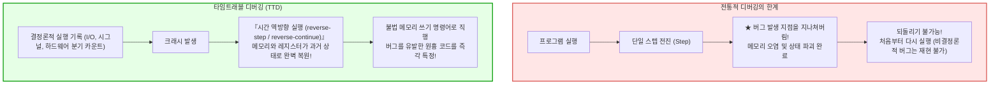

## 서론: 소프트웨어 개발자를 괴롭히는 '시간의 비가역성'

모든 프로그래머는 개발 생애에서 다음과 같은 깊은 절망을 겪어보았을 것입니다:

운영 환경에서 치명적인 세그멘테이션 폴트(Segmentation Fault)가 발생했습니다. 그러나 로컬 환경에서 동일한 입력값으로 수만 번을 실행해도 버그는 단 한 번도 재현되지 않습니다.
원인을 찾기 위해 `printf` 로그를 추가하거나 디버거를 붙이는 순간, 미세한 타이밍 변화로 인해 버그가 신기루처럼 사라져 버립니다. 양자역학의 불확정성 원리에 빗대어 이를 <strong>'하이젠버그(Heisenbug)'</strong>라고 부릅니다.

또한 전통적인 디버거(GDB, LLDB, Visual Studio)에는 근본적인 한계가 있습니다: <strong>시간의 일방통행성</strong>입니다.
변수를 감시하며 `step`을 진행하다가 실수로 키를 한 번 더 눌러 메모리를 파괴한 결정적인 함수를 지나쳐 버렸다고 상상해 보십시오.
전통적인 디버거에서는 <strong>시간을 되돌릴 수 없습니다</strong>. 이미 메모리는 덮어씌워졌고 상태는 파괴되었습니다. 개발자가 할 수 있는 일은 한숨을 쉬며 프로그램을 재시작하는 것뿐입니다.

만약 비디오테이프를 되감듯이 <strong>프로그램 실행을 기계어 명령어 단위로 자유롭게 되감을 수 있다면</strong> 어떨까요?
크래시가 난 순간 오염된 메모리 주소에 <strong>'역방향 와치포인트(Reverse Watchpoint)'</strong>를 걸고, 시간을 과거로 거슬러 올라가 해당 메모리를 덮어쓴 바로 그 명령어로 정확히 점프할 수 있다면?

이 기술이 바로 <strong>타임트래블 디버깅(Time-Travel Debugging, TTD)</strong>과 <strong>결정론적 기록·재생(Deterministic Record & Replay)</strong>입니다.
본 글에서는 결정론적 오토마톤 모델, 하드웨어 성능 모니터링 카운터(PMU)를 활용한 마이크로초 단위의 시그널 재현, Mozilla `rr` 및 Microsoft TTD의 아키텍처, 벡터 시계(Vector Clocks)를 통한 동시성 분석까지 핵심 원리를 해부합니다.

---

## 1. 결정론적 오토마톤과 비결정성의 4대 원인

수학적 모델에서 컴퓨터는 <strong>결정론적 유한 오토마톤(DFA)</strong>입니다:
$$S_{t+1} = \delta(S_t, I_t)$$
초기 상태 $S_0$와 명령어 열이 동일하다면 언제나 동일한 상태 궤적을 그립니다.
그러나 현실의 컴퓨터에는 다음과 같은 <strong>비결정성(Non-determinism)</strong>이 침투합니다:
1. <strong>외부 I/O:</strong> 네트워크 패킷 수신, 디스크 파일 읽기, 시스템 콜 반환값.
2. <strong>비결정론적 CPU 명령어:</strong> 타임스탬프 카운터(`RDTSC`), 난수 생성(`RDRAND`), CPU 설정 조회(`CPUID`).
3. <strong>비동기 하드웨어 인터럽트 및 시그널:</strong> OS 타이머 프리엠션, `SIGALRM`, 키보드 인터럽트.
4. <strong>공유 메모리 멀티스레드 인터리빙:</strong> 캐시 일관성 버스 타이밍에 따른 스레드 간 메모리 접근 순서 역전.

타임트래블 디버거는 실행 중 이 비결정적 입력만을 가볍게 기록하여, 오프라인 재생 환경에서 100% 동일한 상태를 재현해냅니다.

---

## 2. 기록·재생의 핵심 기술: CoW 스냅샷과 하드웨어 분기 카운터

### 2.1 Copy-on-Write (CoW) 기반 체크포인트
주기적으로 프로세스의 가상 메모리 페이지 테이블을 복제하여 가벼운 체크포인트를 생성합니다. 변경된 페이지만 새로 할당하므로 오버헤드가 극히 적습니다.

### 2.2 PMU (Performance Monitoring Unit) 하드웨어 카운터
비동기 시그널이 정확히 몇 번째 명령어 뒤에서 발생했는지를 추적하기 위해 Mozilla `rr`은 CPU의 <strong>은퇴한 조건 분기 수(Retired Conditional Branches, RCB)</strong>를 카운트합니다.
재생 시 하드웨어 카운터를 동일한 값으로 설정하여 오버플로 인터럽트를 발생시킴으로써, 정확히 단 한 명령어의 오차도 없이 원래 위치에서 시그널 핸들러를 실행시킵니다.

---

## 3. 역방향 실행의 원리: '후진'이 아닌 '롤백 후 초고속 전진'

반도체 논리 게이트는 물리적으로 비가역적(란다우어 한계)이므로 CPU 클럭을 물리적으로 거꾸로 돌릴 수는 없습니다.
따라서 `reverse-step`이나 `reverse-continue`는 다음과 같은 알고리즘으로 구현됩니다:
1. 목표 시점보다 앞선 직전 <strong>체크포인트로 롤백(Rollback)</strong>.
2. 기록된 결정론적 로그를 바탕으로 목표 명령어 직전까지 <strong>초고속 전진(Roll-Forward)</strong>.

I/O 대기가 없으므로 초당 수억 개의 명령어가 실행되어, 사용자에게는 즉시 시간이 되감긴 것처럼 느껴집니다.

### 3.1 역방향 와치포인트 (Reverse Watchpoint)
오염된 메모리 주소에 하드웨어 쓰기 브레이크포인트를 걸고 역방향으로 실행(`reverse-continue`)하면, <strong>그 주소에 잘못된 값을 쓴 바로 그 어셈블리 명령어에서 즉각 멈춥니다</strong>. 범인을 찾는 데 소모되던 며칠간의 디버깅이 단 몇 초로 단축됩니다.

---

## 4. 대표 구현체 비교: Mozilla rr vs Microsoft TTD

| 항목 | Mozilla rr (Linux) | Microsoft TTD (Windows) |
|---|---|---|
| <strong>핵심 기술</strong> | PMU 하드웨어 카운터 + ptrace + seccomp | Nirvana 동적 바이너리 변환 (DBT JIT) |
| <strong>스레드 모델</strong> | 단일 코어 직렬화 (DMT) | 멀티스레드 동시성 부분 순서 기록 |
| <strong>오버헤드</strong> | <strong>극소 (1.2배 ~ 2배)</strong> | 보통 (2배 ~ 8배) |
| <strong>연동 도구</strong> | GDB, Pernosco 클라우드 분석 | WinDbg, Visual Studio Enterprise |

---

## 5. 결론: 기계의 시간을 지배하는 디버깅의 미래

타임트래블 디버깅은 디버깅을 불완전한 사후 부검에서 <strong>완전한 결정론적 관측</strong>으로 격상시켰습니다.
시간의 화살을 거슬러 올라가는 이 기술은 미래 자율 디버깅 AI 에인전트의 눈과 귀가 되어, 인간이 만든 거대한 소프트웨어 생태계를 가장 안전하고 견고하게 수호할 것입니다.

---

## 4.3 람포트 벡터 시계와 동시성 레이스 컨디션의 수학적 분석
멀티코어 시스템에서는 물리적 절대 시간이 존재하지 않으므로, 레슬리 람포트의 선행 발생 관계(-Before, \to$)를 기반으로 벡터 시계(Vector Clocks)를 구축합니다.
각 스레드가 유지하는 벡터 시계를 통해 인과적 순서가 없는 동시적 메모리 쓰기 접근( \parallel e_b$)을 수학적으로 특정함으로써, 재현 불가능한 동시성 버그를 완벽하게 탐지합니다. Intel PT 및 ARM CoreSight와 같은 최신 프로세서 하드웨어 트레이스와 결합하여 수만 코어 규모의 클라우드 환경에서도 결정론적 타임트래블 디버깅이 현실화되고 있습니다.
