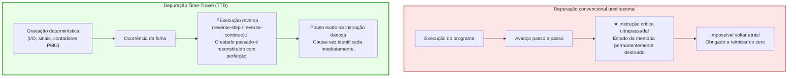
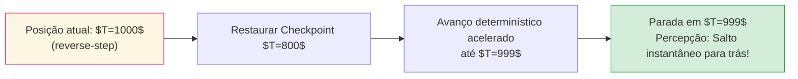

## Introdução: A irreversibilidade do tempo e o pesadelo do desenvolvedor

Todo desenvolvedor de software já sentiu o desespero de um erro intermitente: um serviço crítico sofre uma falha de segmentação (Segmentation Fault) em produção. Contudo, ao tentar reproduzir a falha no ambiente local sob as mesmas entradas, o programa executa perfeitamente. Ao adicionar comandos de log (`printf`) ou anexar um depurador tradicional, o timing é ligeiramente alterado e o bug desaparece — o notório <strong>«Heisenbug»</strong>.

Além disso, os depuradores clássicos (GDB, LLDB, Visual Studio) sofrem de uma restrição estrutural incontornável: <strong>o tempo só anda para a frente</strong>.
Se durante um passo a passo (`step`) você acidentalmente avançar uma instrução a mais e ultrapassar a linha que corrompeu a memória, <strong>não há como voltar atrás</strong>. Os registradores e a memória já foram sobrescritos.

E se pudéssemos rebobinar a execução de um programa <strong>instrução por instrução</strong>?
E se pudéssemos posicionar um <strong>Reverse Watchpoint</strong> em um endereço corrompido e saltar diretamente no tempo até o exato comando em assembly que causou a violação de memória?
Essa é a tecnologia do <strong>Time-Travel Debugging (TTD)</strong> e do <strong>Record & Replay determinístico</strong>.

---

## 1. Autômatos determinísticos e fontes de não-determinismo

Em teoria da computação, processador e memória compõem um <strong>autômato finito determinístico</strong>: $S_{t+1} = \delta(S_t, I_t)$.
No hardware físico real, quatro fatores introduzem não-determinismo:
1. <strong>Entradas e saídas externas (I/O):</strong> Pacotes de rede, leituras de disco, chamadas de sistema.
2. <strong>Instruções de CPU não determinísticas:</strong> Leituras de ciclos (`RDTSC`), geradores de ruído aleatório (`RDRAND`).
3. <strong>Interrupções assíncronas e sinais:</strong> Interrupções de temporizador do sistema operacional ocorrendo entre duas instruções quaisquer.
4. <strong>Concorrência em memória compartilhada:</strong> Variação no escalonamento de threads e coerência de cache (MESI).

Sistemas TTD registram apenas essas variações com mínima sobrecarga de execução.

---

## 2. Engenharia de Record & Replay: CoW e contadores PMU

### 2.1 Snapshots com Copy-on-Write (CoW)
Pontos de verificação periódicos utilizam o mecanismo de cópia em gravação da memória virtual, permitindo restaurar o espaço de endereçamento em microssegundos sem copiar páginas inalteradas.

### 2.2 O papel dos contadores de hardware PMU
Para reproduzir uma interrupção assíncrona com precisão atômica, o Mozilla `rr` utiliza os contadores da <strong>Unidade de Monitoramento de Desempenho (PMU)</strong> da CPU, contabilizando as <strong>ramificações condicionais retiradas (Retired Conditional Branches)</strong>. No reprocessamento, a PMU dispara uma interrupção exatamente na mesma instrução registrada.

---

## 3. Execução reversa: Avançar para voltar

Como as portas lógicas digitais são termodinamicamente irreversíveis (limite de Landauer), o processador não gira seus ciclos ao contrário. A reversão opera pelo algoritmo <strong>Rollback and Roll-Forward</strong>:
1. Restaurar o <strong>ponto de verificação anterior</strong>.
2. <strong>Avançar rapidamente (Fast-Forward)</strong> reproduzindo o log determinístico até a instrução imediatamente anterior ao alvo.

### 3.1 O poder dos Reverse Watchpoints
Ao aplicar `watch -l *address` e disparar `reverse-continue`, o depurador retrocede no tempo e para exatamente no comando em código de máquina que corrompeu o ponteiro, preservando a pilha de chamadas e variáveis intactas.

---

## 4. Ferramentas consolidadas: Mozilla rr e Microsoft TTD

- <strong>Mozilla rr (Linux):</strong> Emprega contadores PMU, `ptrace` e `seccomp`. Serializa a execução em um único núcleo de CPU (Deterministic Multithreading) com sobrecarga de apenas <strong>1,2× a 2×</strong>.
- <strong>Microsoft TTD (Windows):</strong> Baseado em tradução binária dinâmica (Nirvana DBT), instrumentando blocos básicos em tempo de execução com integração nativa no WinDbg.

---

## 5. Concorrência e relógios vetoriais

Em sistemas multiprocessadores, o ordenamento temporal é modelado pela relação <strong>Happens-Before ($\to$)</strong> de Leslie Lamport e pelos <strong>relógios vetoriais (Vector Clocks)</strong>. Operações simultâneas de escrita e leitura sem sincronização causal direta caracterizam inequivocamente condições de corrida de dados.

---

## 6. Conclusão: A depuração onisciente

A depuração Time-Travel transforma a análise de falhas de uma arqueologia forense incerta em uma observação determinística absoluta. Ao dominar a reversibilidade da computação, a engenharia de software supera o caos e estabelece uma nova fronteira de confiabilidade digital.
