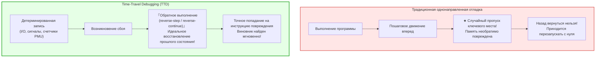
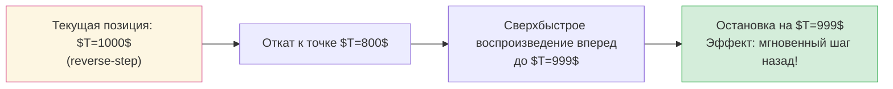

## Введение: Необратимость времени и кошмар разработчика

Каждый программист сталкивался с отчаянием при попытке поймать плавающий баг: сервис аварийно завершает работу на боевом сервере с ошибкой сегментации (Segmentation Fault). Однако в локальной среде при абсолютно тех же входных данных программа успешно отрабатывает миллионы раз. Стоит добавить логирование (`printf`) или подключить отладчик, как тайминги смещаются и ошибка растворяется — это классический <strong>«гейзенбаг» (Heisenbug)</strong>.

Кроме того, традиционные отладчики (GDB, LLDB, Visual Studio) страдают от фундаментального ограничения: <strong>стрела времени направлена только вперед</strong>.
Если при пошаговом выполнении (`step`) вы случайно нажали клавишу на один раз больше и пропустили функцию, повредившую память, <strong>вернуться назад невозможно</strong>. Состояние регистров и памяти уничтожено. Разработчику остается лишь с вздохом перезапускать процесс.

Что, если бы мы могли перематывать выполнение программы назад во времени, <strong>инструкция за инструкцией</strong>, словно видеозапись?
Что, если бы можно было поставить <strong>Reverse Watchpoint</strong> на поврежденный адрес памяти и мгновенно перенестись в точный момент времени, когда этот адрес был перезаписан?
В этом заключается революция <strong>Time-Travel Debugging (TTD)</strong> и детерминированной технологии <strong>Record & Replay</strong>.

---

## 1. Детерминированные автоматы и природа недетерминизма

В теории процессор и память образуют <strong>детерминированный конечный автомат</strong>: $S_{t+1} = \delta(S_t, I_t)$.
В реальных компьютерах идеальную предсказуемость нарушают четыре источника недетерминизма:
1. <strong>Внешний ввод-вывод (I/O):</strong> Сетевые пакеты, операции с диском, системные вызовы ядра.
2. <strong>Недетерминированные процессорные инструкции:</strong> Считывание счетчика тактов (`RDTSC`), аппаратные генераторы случайных чисел (`RDRAND`).
3. <strong>Асинхронные прерывания и сигналы:</strong> Таймеры планировщика ОС и сигналы POSIX, прерывающие поток между двумя любыми инструкциями.
4. <strong>Многопоточное чередование в разделяемой памяти:</strong> Микроскопические колебания на шине когерентности кэшей (MESI).

Системы TTD протоколируют исключительно эти отклонения с минимальными накладными расходами.

---

## 2. Архитектура Record & Replay: CoW и аппаратные счетчики

### 2.1 Контрольные точки с Copy-on-Write (CoW)
Периодические снимки памяти дублируют лишь таблицы страниц виртуальной памяти без физического копирования данных, что позволяет мгновенно восстанавливать гигабайты адресного пространства.

### 2.2 Аппаратные счетчики PMU
Для воспроизведения асинхронного прерывания с точностью до машинной инструкции Mozilla `rr` использует блок мониторинга производительности (PMU) процессора, фиксируя количество <strong>выполненных условных переходов (Retired Conditional Branches)</strong>. При воспроизведении аппаратный счетчик настраивается так, чтобы вызвать прерывание ровно на том же значении.

---

## 3. Реверсивное выполнение: Откат и сверхбыстрое движение вперед

Логические элементы микропроцессора необратимы (предел Ландауэра), поэтому кремниевые чипы не могут физически вращать тактовые импульсы вспять. Реверс реализуется через алгоритм <strong>Rollback and Roll-Forward</strong>:
1. Восстановление состояния из <strong>ближайшей предшествующей контрольной точки</strong>.
2. <strong>Сверхбыстрое детерминированное воспроизведение вперед (Fast-Forward)</strong> вплоть до нужной инструкции.

### 3.1 Мощь обратных точек останова (Reverse Watchpoints)
Командами `watch -l *address` и `reverse-continue` отладчик движется назад во времени и останавливается ровно на той инструкции ассемблера, которая записала некорректное значение, предоставляя разработчику контекст вызова в первозданном виде.

---

## 4. Индустриальные инструменты: Mozilla rr и Microsoft TTD

- <strong>Mozilla rr (Linux):</strong> Опирается на счетчики PMU, `ptrace` и `seccomp`. Привязывает все потоки к единственному ядру CPU (DMT), сохраняя оверхед записи в пределах <strong>1.2x – 2x</strong>.
- <strong>Microsoft TTD (Windows):</strong> Использует динамическую бинарную трансляцию (Nirvana DBT), на лету инструментируя базовые блоки кода с прямой интеграцией в WinDbg.

---

## 5. Векторные часы и параллелизм

В многоядерных системах причинно-следственные связи описываются отношением <strong>Happens-Before ($\to$)</strong> Лесли Лэмпорта и <strong>векторными часами (Vector Clocks)</strong>. События, не имеющие отношения предшествования и обращающиеся к одной ячейке памяти, математически строго определяют состояние гонки (Data Race).

---

## 6. Заключение: Всевидящее око программной инженерии

Time-Travel Debugging переводит поиск ошибок из области гаданий в плоскость точной науки. Научившись управлять направлением времени в вычислениях, программисты получают абсолютный контроль над сложностью современных программных систем.
