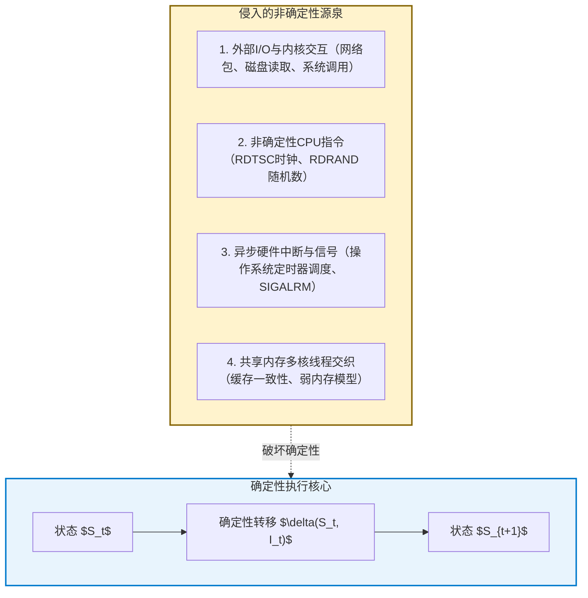
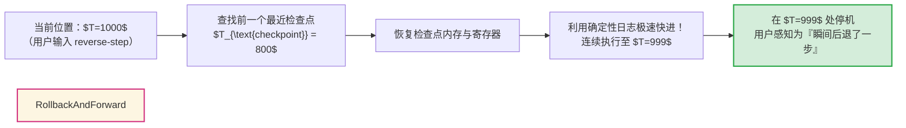

## 引言：软件开发者的“时间不可逆”梦魇

每一个程序员在职业生涯中都经历过这种绝望的时刻：

线上核心服务发生了崩溃，日志中只留下冰冷的段错误（Segmentation Fault）内存地址。然而，当工程师试图在本地开发环境中复现时，使用完全相同的输入参数运行成千上万次，程序却永远正常运行。
当开发者插入 `printf` 打印日志或附加调试器进行单步跟踪时，执行时序发生微妙漂移，Bug便诡异地消失得无影无踪——借用量子力学中的测不准原理，这种令人发疯的现象被称为<strong>“海森堡Bug（Heisenbug）”</strong>。

不仅如此，传统调试器（如 GDB、LLDB 或 Visual Studio）存在着致命的结构性限制：<strong>时间的单向不可逆性</strong>。
设想在漫长的单步调试过程中，你正在聚精会神地监视指针变量，手指疲惫地一按，多按了一次“单步跳过（Step Over）”，恰恰跳过了破坏内存的最关键函数。
在传统调试中，<strong>你无法撤销刚才的操作，无法倒流时间</strong>。
内存已经被写入，寄存器已被覆盖。开发者唯一能做的，就是沮丧地重启进程，祈祷那个非确定性的Bug能再次撞大运般地出现。


如果我们能像倒带录像带一样，<strong>“将程序的执行以机器指令为单位精准倒流”</strong>？
如果我们在崩溃时可以在被破坏的内存地址上打上一个<strong>“逆向观察点（Reverse Watchpoint）”</strong>，直接倒退跳跃到数百万条指令之前非法修改该地址的那个确切微秒？

这正是<strong>时间旅行调试（Time-Travel Debugging, TTD）</strong>与<strong>确定性记录与重放（Deterministic Record & Replay）</strong>所实现的计算奇迹。
本文将深入解构确定性状态机的数理本质、硬件性能计数器（PMU）在指令边界定位中的妙用、Mozilla `rr` 与微软 TTD 的底层架构差异，以及向量时钟（Vector Clocks）在解决多核并发竞态中的前沿突破。

---

## 1. 确定性自动机与“非确定性”的四大根源

在纯理论数学模型中，计算机的处理器与内存构成了一个<strong>确定性有限状态机（DFA）</strong>。
设系统在时刻 $t$ 的状态为 $S_t$（所有寄存器与可寻址虚拟内存），执行的指令为 $I_t$，则下一个状态满足确定性函数映射：

$$S_{t+1} = \delta(S_t, I_t)$$

只要给定初始状态 $S_0$ 并重新执行相同的指令流，系统就可以在任意时间重构任意时刻的状态 $S_k$。
然而，<strong>真实的物理计算机从来不是孤立的纯确定性系统</strong>。



时间旅行调试的核心工程任务，便是<strong>在运行时以极低的开销拦截这四类非确定性事件并记入日志，从而在脱机重放时重构一个完美的确定性微观宇宙</strong>。

---

## 2. 记录与重放的工程精要：写时复制与硬件计数器

记录程序的所有状态不能靠暴力全量备份内存，否则每秒数G的数据写入会立即击垮存储系统。高效的TTD采用<strong>基于事件日志的差分记录</strong>。

### 2.1 检查点与写时复制（Copy-on-Write）
系统每隔一定时间周期性创建进程<strong>检查点（Checkpoint）</strong>。利用虚拟内存的写时复制（CoW）机制，回滚至检查点只需要重新绑定页表目录基地址（CR3寄存器），在微秒级别即可恢复巨量内存空间。

### 2.2 硬件性能监控计数器（PMU）的指令级捕获
最精巧的设计莫过于处理异步硬件中断。当一个定时器中断或信号打断程序时，它落在两条机器指令之间的哪个位置？
Mozilla 的 `rr` 调试器利用了CPU内置的<strong>性能监控单元（PMU）</strong>，精确记录<strong>已退休条件分支指令数（Retired Conditional Branches, RCB）</strong>。

在重放阶段，`rr` 预设该硬件计数器。当计数器在硬件层面递减到零触发溢出中断时，CPU便精确地停在与当初记录时<strong>完全相同的单条指令之后</strong>，分毫不差地注入信号处理流程！

---

## 3. 逆向执行的真实机制：前进而非后退

半导体逻辑门（AND、OR）在热力学与物理上是不可逆的（朗道尔原理），CPU无法真正倒着反转时钟脉冲。
因此，所有时间旅行调试器在执行 `reverse-step`（逆向单步）或 `reverse-continue`（逆向继续）时，本质上运行的是<strong>“回滚并快进（Rollback and Roll-Forward）”</strong>算法：



由于重放过程跳过了真实的I/O等待和物理网络延迟，快进以每秒数亿指令的极限速度运行，给开发者呈现出时间平滑逆流的交互体验。

### 3.1 逆向观察点（Reverse Watchpoint）的毁灭性威力
在内存破坏Bug中，崩溃发生时我们面对的是被污染的内存死尸。
通过逆向观察点，我们在被破坏的地址上设置硬件写入断点，直接命令调试器：

```text
(rr) watch -l *0x7fff5fbff8a0
(rr) reverse-continue
```

时间瞬间倒流，调试器<strong>不偏不倚地精准停留在执行非法写入的那条汇编指令上</strong>！调用栈、参数变量原封不动地展现在眼前，原本需要数天盲猜的Bug在数秒内土崩瓦解。

---

## 4. 主流工业实现：Mozilla rr 与 微软 TTD

| 特性 / 维度 | Mozilla rr (Linux) | Microsoft TTD (Windows) |
|---|---|---|
| <strong>底层核心机制</strong> | PMU硬件计数器 + ptrace + seccomp-bpf | Nirvana 动态二进制翻译 (DBT JIT) |
| <strong>多线程支持</strong> | 单核序列化执行 (DMT) | 多线程并发部分顺序记录 |
| <strong>运行时开销</strong> | <strong>极低（约 1.2x – 2x）</strong> | 中等（约 2x – 8x） |
| <strong>宿主工具集成</strong> | GDB / Pernosco 云端分析 | WinDbg / Visual Studio Enterprise |
| <strong>适用场景</strong> | 复杂开源C/C++系统、Firefox长时间记录 | Windows内核及企业级关键系统崩溃诊断 |

---

## 5. 并发的终极边界：向量时钟与因果一致性

在真正的多核物理并发系统中，由于相对论光速极限与弱内存模型，全局统一的物理时间是不存在的。
理论计算机科学引入兰伯特（Leslie Lamport）定义的<strong>先行发生关系（Happens-Before Relation: $\to$）</strong>与<strong>向量时钟（Vector Clocks）</strong>：

对于包含 $N$ 个线程的系统，各线程维护向量 $V \in \mathbb{N}^N$。通过同步原语（锁的释放与获取、消息收发）传递向量时钟，系统得以建立偏序关系。
若两个事件既不满足 $e_a \to e_b$ 也不满足 $e_b \to e_a$，则它们在因果上是<strong>并发（$e_a \parallel e_b$）</strong>的。当并发事件触及同一共享内存地址且包含写操作时，数据竞态（Data Race）便被形式化证明。

结合硬件辅助追踪（如 Intel PT），时间旅行调试正在向万核并发的分布式云计算深水区大步迈进。

---

## 6. 结语：软件工程的“全知之眼”

时间旅行调试彻底终结了将调试视为“从残骸中推测罪犯的法医学”的旧时代，开启了“在确定性时空矩阵中自由穿梭的全知观察”的新纪元。
学会逆转时间的河流，我们便拥有了驯服复杂软件宇宙中一切混沌与不确定性的终极理性力量。
