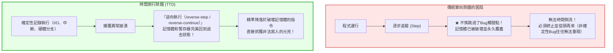
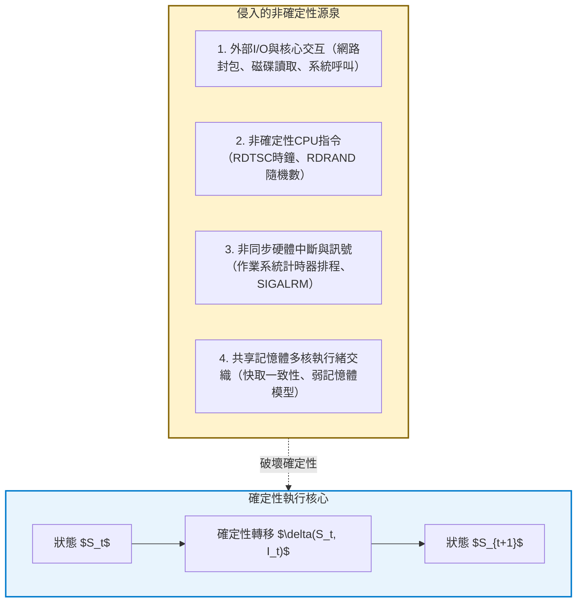
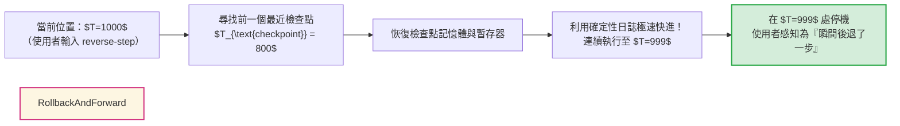

## 引言：軟體開發者的「時間不可逆」夢魘

每一個工程師在職業生涯中都經歷過這種絕望的時刻：

線上核心服務發生了崩潰，日誌中只留下冰冷的記憶體區段錯誤（Segmentation Fault）記憶體位址。然而，當工程師試圖在本機開發環境中重現時，使用完全相同的輸入參數運行成千上萬次，程式卻永遠正常運行。
當開發者插入 `printf` 印出日誌或附加除錯器進行逐步追蹤時，執行時序發生微妙漂移，Bug便詭異地消失得無影無蹤——借用量子力學中的測不準原理，這種令人發瘋的現象被稱為<strong>「海森堡Bug（Heisenbug）」</strong>。

不僅如此，傳統除錯器（如 GDB、LLDB 或 Visual Studio）存在著致命的結構性限制：<strong>時間的單向不可逆性</strong>。
設想在漫長的逐步除錯過程中，你正在聚精會神地監視指標變數，手指疲憊地一按，多按了一次「單步跳過（Step Over）」，恰恰跳過了破壞記憶體的最關鍵函式。
在傳統除錯中，<strong>你無法撤銷剛才的操作，無法倒流時間</strong>。
記憶體已經被寫入，暫存器已被覆蓋。開發者唯一能做的，就是沮喪地重啟行程，祈禱那個非確定性的Bug能再次撞大運般地出現。



如果我們能像倒帶錄影帶一樣，<strong>「將程式的執行以機器指令為單位精準倒流」</strong>？
如果我們在崩潰時可以在被破壞的記憶體位址上打上一個<strong>「逆向觀察點（Reverse Watchpoint）</strong>，直接倒退跳躍到數百萬條指令之前非法修改該位址的那個確切微秒？

這正是<strong>時間旅行除錯（Time-Travel Debugging, TTD）</strong>與<strong>確定性記錄與重放（Deterministic Record & Replay）</strong>所實現的計算奇蹟。
本文將深入解構確定性狀態機的數理本質、硬體效能計數器（PMU）在指令邊界定位中的妙用、Mozilla `rr` 與微軟 TTD 的底層架構差異，以及向量時鐘（Vector Clocks）在解決多核並發競爭中的前沿突破。

---

## 1. 確定性自動機與「非確定性」的四大根源

在純理論數學模型中，電腦的處理器與記憶體構成了一個<strong>確定性有限狀態機（DFA）</strong>。
設系統在時刻 $t$ 的狀態為 $S_t$（所有暫存器與可定址虛擬記憶體），執行的指令為 $I_t$，則下一個狀態滿足確定性函數映射：

$$S_{t+1} = \delta(S_t, I_t)$$

只要給定初始狀態 $S_0$ 並重新執行相同的指令流，系統就可以在任意時間重構任意時刻的狀態 $S_k$。
然而，<strong>真實的物理電腦從來不是孤立的純確定性系統</strong>。



時間旅行除錯的核心工程任務，便是<strong>在運行時以極低的開銷攔截這四類非確定性事件並記入日誌，從而在離線重放時重構一個完美的確定性微觀宇宙</strong>。

---

## 2. 記錄與重放的工程精要：寫時複製與硬體計數器

記錄程式的所有狀態不能靠暴力全量備份記憶體，否則每秒數G的資料寫入會立即擊垮儲存系統。高效的TTD採用<strong>基於事件日誌的差分記錄</strong>。

### 2.1 檢查點與寫時複製（Copy-on-Write）
系統每隔一定時間週期性建立行程<strong>檢查點（Checkpoint）</strong>。利用虛擬記憶體的寫時複製（CoW）機制，回滾至檢查點只需要重新綁定頁表目錄基底位址（CR3暫存器），在微秒級別即可恢復巨量記憶體空間。

### 2.2 硬體效能監控計數器（PMU）的指令級捕獲
最精巧的設計莫過於處理非同步硬體中斷。當一個計時器中斷或訊號打斷程式時，它落在兩條機器指令之間的哪個位置？
Mozilla 的 `rr` 除錯器利用了CPU內建的<strong>效能監控單元（PMU）</strong>，精確記錄<strong>已退休條件分支指令數（Retired Conditional Branches, RCB）</strong>。

在重放階段，`rr` 預設該硬體計數器。當計數器在硬體層面遞減到零觸發溢位中斷時，CPU便精確地停在與當初記錄時<strong>完全相同的單條指令之後</strong>，分毫不差地注入訊號處理流程！

---

## 3. 逆向執行的真實機制：前進而非後退

半導體邏輯閘（AND、OR）在熱力學與物理上是不可逆的（朗道爾原理），CPU無法真正倒著反轉時鐘脈衝。
因此，所有時間旅行除錯器在執行 `reverse-step`（逆向單步）或 `reverse-continue`（逆向繼續）時，本質上運行的是<strong>「回滾並快進（Rollback and Roll-Forward）」</strong>演算法：



由於重放過程跳過了真實的I/O等待和物理網路延遲，快進以每秒數億指令的極限速度運行，給開發者呈現出時間平滑逆流的互動體驗。

### 3.1 逆向觀察點（Reverse Watchpoint）的毀滅性威力
在記憶體破壞Bug中，崩潰發生時我們面對的是被污染的記憶體死屍。
透過逆向觀察點，我們在被破壞的位址上設定硬體寫入中斷點，直接命令除錯器：

```text
(rr) watch -l *0x7fff5fbff8a0
(rr) reverse-continue
```

時間瞬間倒流，除錯器<strong>不偏不倚地精準停留在執行非法寫入的那條組合語言指令上</strong>！呼叫堆疊、參數變數原封不動地展現在眼前，原本需要數天盲猜的Bug在數秒內土崩瓦解。

---

## 4. 主流工業實現：Mozilla rr 與 微軟 TTD

| 特性 / 維度 | Mozilla rr (Linux) | Microsoft TTD (Windows) |
|---|---|---|
| <strong>底層核心機制</strong> | PMU硬體計數器 + ptrace + seccomp-bpf | Nirvana 動態二進位翻譯 (DBT JIT) |
| <strong>多執行緒支援</strong> | 單核序列化執行 (DMT) | 多執行緒並發部分順序記錄 |
| <strong>運行時開銷</strong> | <strong>極低（約 1.2x – 2x）</strong> | 中等（約 2x – 8x） |
| <strong>宿主工具整合</strong> | GDB / Pernosco 雲端分析 | WinDbg / Visual Studio Enterprise |
| <strong>適用場景</strong> | 複雜開源C/C++系統、Firefox長時間記錄 | Windows核心及企業級關鍵系統崩潰診斷 |

---

## 5. 並發的終極邊界：向量時鐘與因果一致性

在真正的多核物理並發系統中，由於相對論光速極限與弱記憶體模型，全域統一的物理時間是不存在的。
理論計算機科學引入蘭伯特（Leslie Lamport）定義的<strong>先行發生關係（Happens-Before Relation: $\to$）</strong>與<strong>向量時鐘（Vector Clocks）</strong>：

對於包含 $N$ 個執行緒的系統，各執行緒維護向量 $V \in \mathbb{N}^N$。透過同步原語（鎖的釋放與獲取、訊息收發）傳遞向量時鐘，系統得以建立偏序關係。
若兩個事件既不滿足 $e_a \to e_b$ 也不滿足 $e_b \to e_a$，則它們在因果上是<strong>並發（$e_a \parallel e_b$）</strong>的。當並發事件觸及同一共享記憶體位址且包含寫入操作時，資料競爭（Data Race）便被形式化證明。

結合硬體輔助追蹤（如 Intel PT），時間旅行除錯正在向萬核並發的分散式雲端運算深水區大步邁進。

---

## 6. 結語：軟體工程的「全知之眼」

時間旅行除錯徹底終結了將除錯視為「從殘骸中推測罪犯的法醫學」的舊時代，開啟了「在確定性時空矩陣中自由穿梭的全知觀察」的新紀元。
學會逆轉時間的河流，我們便擁有了馴服複雜軟體宇宙中一切混沌與不確定性的終極理性力量。
