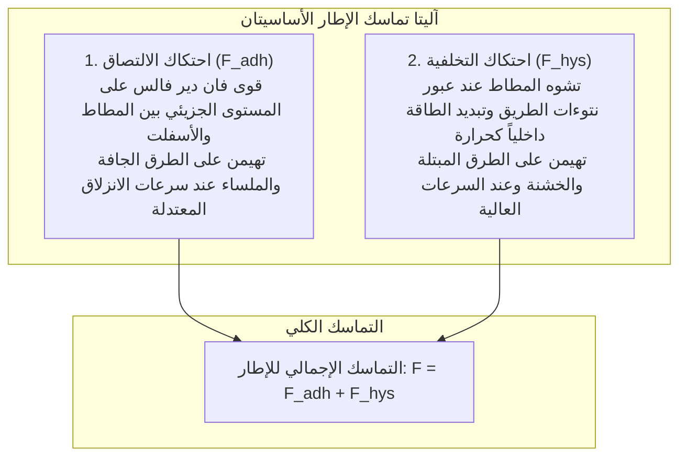

تندفع سيارة حديثة تزن نحو طنين على طريق سريع بسرعة تتجاوز 100 كم/ساعة وسط أمطار غزيرة، فتنعطف في المنحنيات الحادة بثبات، وتتوقف تماماً عند الطوارئ في أمتار معدودة.

تعتمد كل هذه القوى والتحكم الحركي على وسيط مادي دقيق للغاية: <strong>أربع مساحات تلامس (Contact Patches)، مساحة كل واحدة منها تعادل مساحة بطاقة بريدية عادية</strong>.

تنص قوانين كولوم التقليدية على أن الاحتكاك مستقل تماماً عن المساحة الظاهرية للتلامس، إلا أن هذا المبدأ يسقط تماماً أمام إطارات السيارات. احتكاك المطاط هو <strong>«ظاهرة فيزيائية لا خطية فائقة التعقيد تحكمها المرونة اللزجة (Viscoelasticity) للبوليمرات، وقوى فان دير فالس الجزيئية، وديناميكا الموائع متعددة الأطوار.»</strong>

---

## 1. ركيزتا احتكاك المطاط: الالتصاق الجزيئي والتخلفية (الهستريزيس)

تتولد قوة التماسك الإجمالية للإطار من خلال آليتين فيزيائيتين متميزتين:

$$F_{\text{friction}} = F_{\text{adhesion}} + F_{\text{hysteresis}}$$

### 1.1 احتكاك الالتصاق الجزيئي
يتكيف المطاط فائق المرونة مع التعرجات الدقيقة للأسفلت على مقياس النانومتر، فتنشأ قوى فان دير فالس الجاذبة. وأثناء الانزلاق، تتمدد الروابط الجزيئية وتنقطع ثم تتشكل مجدداً ملايين المرات في الثانية، مما يولد قوة سحب هائلة تتناسب طردياً مع مساحة التلامس الحقيقية $A_{\text{real}}$.

### 1.2 احتكاك التخلفية (الهستريزيس)
عندما يعزل الماء الروابط الجزيئية، يبرز دور <strong>احتكاك التخلفية</strong>. فعندما يعبر الإطار فوق نتوء صخري، ينضغط المطاط بقوة في المقدمة بضغط $P_{\text{front}}$، بينما يتأخر ارتداده في الخلف بسبب لزوجته الداخلية ($P_{\text{rear}} < P_{\text{front}}$). هذا التباين في الضغط يولد قوة أفقية كابحة توقف السيارة على الطرق المبتلة.

---

## 2. زاوية الانزلاق ومعادلة باتسيكا السحرية

أثناء الانعطاف، تختلف وجهة دوران العجلة عن المسار الفعلي للمركبة، مما ينشئ <strong>زاوية الانزلاق (Slip Angle: $\alpha$)</strong>.
ينتج عن تشوه المطاط قوة مركزية موجهة تسمى <strong>قوة الانعطاف (Cornering Force: $F_y$)</strong>.
وقد صاغ البروفيسور هانز باتسيكا نموذج <strong>المعادلة السحرية (Magic Formula)</strong>:
$$Y(x) = D \sin\left[ C \arctan\left\{ Bx - E(Bx - \arctan(Bx)) \right\} \right]$$
والتي تصف سلوك الإطار بدقة من النطاق الخطي حتى بلوغ ذروة التماسك والانزلاق التام.

---

## 3. الانزلاق المائي (Hydroplaning) وتصريف المياه

عند تراكم المياه، تحدد صيغة هورن (NASA) السرعة الحرجة لطوفان الإطار:
$$v_c \approx 6.35 \sqrt{p_t} \quad [\text{km/h}]$$
فعند ضغط $220\text{ kPa}$، قد يبدأ الانزلاق المائي عند <strong>94 كم/ساعة</strong>. وتقوم قنوات الإطار الطولية بتصريف ما يصل إلى 30 لتراً من الماء في الثانية للحفاظ على التلامس الجاف.

---

## 4. ثورة السيليكا وإطارات الشتاء المسامية

- <strong>مركبات السيليكا والسلان</strong>: خفضت مقاومة التدحرج بنسبة 20-30% عند 60 درجة مئوية (توفير الوقود) مع رفع كفاءة الكبح المبتل عند صفر مئوي.
- <strong>المطاط الخلوي الإسفنجي للجليد</strong>: يمتص الغشاء المائي الرقيق الذائب فوق الجليد عبر مسام شعرية دقيقة، مستعيداً التلامس الجاف مع بلورات الجليد فوراً.

---

## 5. خاتمة

إن إطار السيارة هو معجزة هندسية متكاملة تجمع بين كيمياء البوليمرات وميكانيكا التلامس وديناميكا السوائل لحماية الأرواح في كل رحلة.
