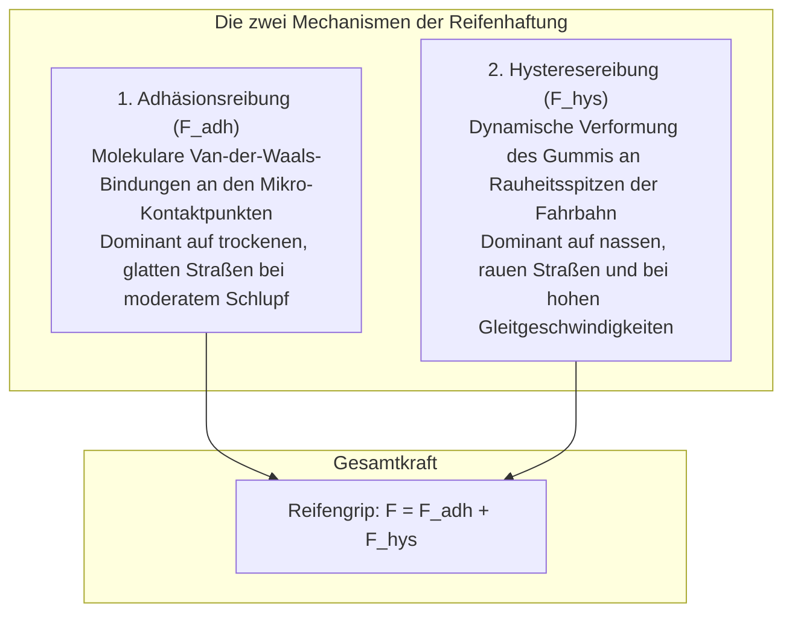

Ein modernes Automobil mit einem Leergewicht von 1,5 bis 2,5 Tonnen jagt bei strömendem Regen mit über 100 km/h über die Autobahn. Es folgt Kurvenradien wie auf Schienen und verzögert im Notfall innerhalb von dreißig Metern bis zum Stillstand.

Die gesamte physikalische Übertragung aller Beschleunigungs-, Brems- und Lenkkräfte stützt sich auf eine winzige Grenzfläche: <strong>vier Reifenaufstandsflächen (Latsch / Contact Patch), die jeweils kaum größer als eine Postkarte sind</strong>.

Nach den klassischen Coulombschen Reibungsgesetzen ist die Reibungskraft unabhängig von der scheinbaren Kontaktfläche. Für Fahrzeugreifen versagt dieses Modell völlig. Reifenreibung ist <strong>„ein extremes, nichtlineares Phänomen, beherrscht von der Viskoelastizität vernetzter Polymere, zwischenmolekularen Van-der-Waals-Kräften und Mehrphasen-Fluiddynamik.“</strong>

---

## 1. Die zwei Pfeiler der Gummireibung: Adhäsion und Hysterese

Die Gesamtreibungskraft eines Reifens setzt sich im Wesentlichen aus zwei Mechanismen zusammen:

$$F_{\text{friction}} = F_{\text{adhesion}} + F_{\text{hysteresis}}$$

### 1.1 Adhäsionsreibung: Molekulare Bindung und Bruch
Auf trockener Fahrbahn schmiegt sich der hochelastische Kautschuk im Nanometerbereich an die mineralischen Zuschlagstoffe an. Van-der-Waals-Kräfte ketten die Polymerstränge fest. Beim Gleiten werden die Molekülketten elastisch gedehnt, reißen ab und binden im Mikrosekundentakt neu. Dies erfordert maximale reale Kontaktfläche $A_{\text{real}}$.

### 1.2 Hysteresereibung: Energiedissipation am Makrorauheitsgebirge
Auf nasser Straße trennt ein Schmierfilm den Kautschuk vom Asphalt. Hier greift die <strong>Hysteresereibung</strong>.
Fährt der Reifen über mikroskopische Gesteinsspitzen (Asperities), wird das viskoelastische Gummi komprimiert. Beim Überrollen verzögert die innere molekulare Zähigkeit die Rückverformung. Der Anpressdruck auf der Vorderseite des Steins ($P_{\text{front}}$) ist drastisch höher als der rückwärtige Druck ($P_{\text{rear}}$). Diese Druckasymmetrie erzeugt eine resultierende Bremskraft gegen die Bewegungsrichtung.

---

## 2. Schräglaufwinkel und Pacejkas „Magic Formula“

Beim Lenken entsteht eine Richtungsdifferenz zwischen Radebene und tatsächlicher Bewegungsrichtung – der <strong>Schräglaufwinkel (Slip Angle: $\alpha$)</strong>.
Die Verformung der Profilblöcke im Latsch erzeugt die zentripetale <strong>Seitenkraft (Cornering Force: $F_y$)</strong>.
Hans B. Pacejka formulierte dies in seiner weltberühmten <strong>Magic Formula</strong>:
$$Y(x) = D \sin\left[ C \arctan\left\{ Bx - E(Bx - \arctan(Bx)) \right\} \right]$$
Sie beschreibt den linearen Anstieg, die Reibwertsättigung und den Übergang ins instabile Schleudern mathematisch exakt.

---

## 3. Aquaplaning und Profilströmungsmechanik

Bei Regen droht Aquaplaning, wenn der hydrodynamische Staudruck den Reifeninnendruck $p_t$ übersteigt.
Nach der Horne-Formel der NASA liegt die kritische Geschwindigkeit bei:
$$v_c \approx 6,35 \sqrt{p_t} \quad [\text{km/h}]$$
Bei $220\text{ kPa}$ schwimmt ein Reifen rechnerisch ab ca. <strong>94 km/h</strong> auf. Moderne Profile pumpen über breite Längsrillen bis zu 30 Liter Wasser pro Sekunde ab.

---

## 4. Silica-Nanochemie und Lamellen-Winterreifen

- <strong>Silica-Silan-Technologie</strong>: Ersetzt Ruß durch gefällte Kieselsäure mit bifunktionalen Silanen. Senkt den Rollwiderstand bei 60 °C um bis zu 30 %, während der Nassgriff bei 0 °C massiv gesteigert wird.
- <strong>Mikroporöser Kautschuk für Winterreifen</strong>: Glatteis wird erst durch den mikroskopischen Schmelzwasserfilm rutschig. Mikroporöser Kautschuk saugt das Wasser kapillar auf und stellt direkten Trockenkontakt zu Eiskristallen her.

---

## 5. Fazit

Reifen sind hochkomplexe Verbundstrukturen aus Polymerchemie, Strömungs- und Kontaktmechanik, die uns sicher mit der Erdoberfläche verbinden.
