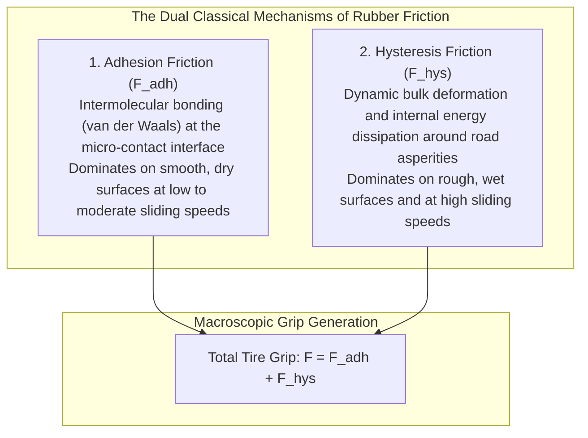
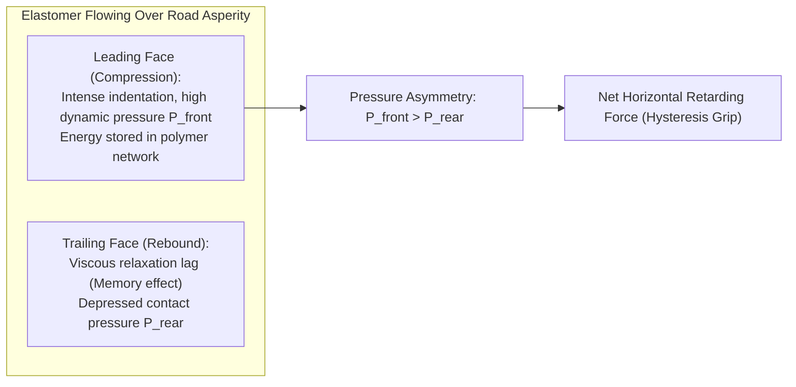
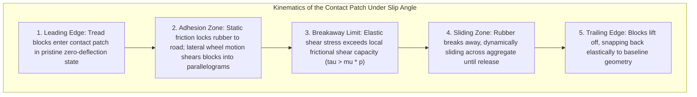
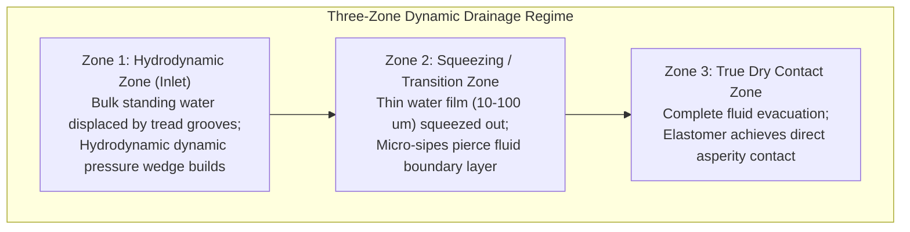
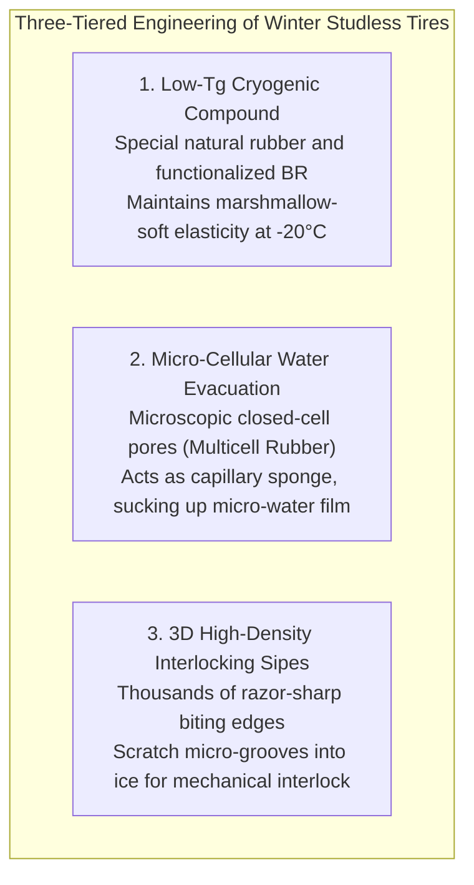

A modern automobile weighing between 1.5 and 2.5 metric tons streaks down an interstate highway at over 100 kilometers per hour. It slices through a torrential rainstorm, maneuvers through sharp curves with surgical precision, and, when an emergency arises, decelerates to a dead halt within a few dozen meters.

Every ounce of control, acceleration, cornering force, and braking capacity that governs this multi-ton kinetic projectile is mediated by a single physical interface: <strong>four contact patches (one per tire), each roughly the surface area of an ordinary postcard or an adult human palm</strong>.

Yet, open an introductory physics textbook, and one encounters Amontons-Coulomb's classical laws of dry friction:
1. <strong>Friction force is directly proportional to normal load ($F = \mu N$).</strong>
2. <strong>Friction force is completely independent of the apparent contact area.</strong>
3. <strong>Friction force is independent of sliding velocity.</strong>

If these classical laws applied strictly to pneumatic automotive tires, motor racing would be rendered absurd. Formula 1 cars would derive zero benefit from colossal, ultra-wide racing slicks; a bicycle-thin tire would theoretically generate identical traction. Furthermore, classical dry friction cannot explain why wet asphalt induces catastrophic skidding, why anti-lock braking systems (ABS) shorten stopping distances by managing wheel slip ratios, or why tire grip fluctuates violently with ambient temperature.

Tire friction is emphatically not the rigid-body friction of polished metals. It is <strong>"an extreme, non-linear physical phenomenon governed by polymer viscoelasticity, molecular-scale van der Waals forces, bulk dynamic indentation, and multi-phase fluid dynamics."</strong>

This comprehensive treatise dissects the contact mechanics of the tire: from the dual mechanisms of adhesion and hysteresis to complex modulus spectra, the brush model of cornering, Pacejka's celebrated "Magic Formula," the three-zone fluid dynamics of hydroplaning, rolling resistance nanochemistry with silica-silane coupling, and the micro-pore physics of winter studless rubber.

---

## 1. Defying Classical Mechanics: The Dual Nature of Rubber Friction

In metallic tribology, the friction coefficient $\mu$ rarely exceeds $0.3 \sim 0.6$. By contrast, motorsport racing compounds routinely achieve friction coefficients of <strong>1.5 to 2.0</strong>, and under optimized track conditions, peak values can surge past <strong>2.5</strong>. The notion that a horizontal frictional force can exceed the vertical gravitational load acting on the body is a direct violation of elementary Coulombic intuition.

This apparent paradox arises because rubber is an <strong>elastomer</strong>—a lightly cross-linked network of flexible, long-chain polymer molecules operating well above their glass transition temperature. The total frictional force $F_{\text{friction}}$ generated between a tire tread and a road surface is fundamentally the superposition of two distinct physical mechanisms:

$$F_{\text{friction}} = F_{\text{adhesion}} + F_{\text{hysteresis}} + F_{\text{wear/tearing}}$$



### 1.1 Adhesion Friction: The Nanoscale Molecular Dance
Adhesion friction originates at the intimate atomic interface where rubber polymer chains make direct, unhindered contact with mineral aggregates in the pavement.

Because rubber exhibits a remarkably low elastic modulus ($E \approx 1 \sim 10\text{ MPa}$ compared to $200\text{ GPa}$ for structural steel), normal contact pressure forces the soft elastomer to conform microscopically to the microscopic texture of the road. When the gap between polymer chains and mineral atoms narrows to fractions of a nanometer, attractive <strong>van der Waals forces</strong> seize the interface.

As the tire attempts to slide, these molecular bonds act as microscopic springs, stretching elastically in shear. When local shear strain reaches a critical rupture threshold, the bond snaps, releasing stored elastic energy as thermal vibration (phonons). In the next sub-microsecond interval, the polymer chain recoils and establishes a new bond with an adjacent road atom.

This rapid cycle of <strong>"adhere $\rightarrow$ stretch $\rightarrow$ snap $\rightarrow$ re-adhere"</strong> repeats at staggering frequencies of millions of cycles per second across billions of microscopic contact nodes.
Adhesion friction is fundamentally proportional to the <strong>true microscopic contact area</strong> $A_{\text{real}}$:

$$F_{\text{adhesion}} = \tau_s \cdot A_{\text{real}}$$

where $\tau_s$ is the intrinsic interfacial shear strength of the junction.
Because rough pavement limits true contact to microscopic peaks (asperities), $A_{\text{real}}$ is typically only a fraction of the nominal geometric contact patch. Increasing tire width and decreasing rubber hardness dramatically expands $A_{\text{real}}$, explaining why wide racing tires deliver immense dry grip.

### 1.2 Hysteresis Friction: Bulk Deformation and Energy Dissipation
When rain, dust, or snow covers a roadway, a lubricating boundary layer separates the rubber from the mineral aggregate, reducing adhesion friction nearly to zero. Under these wet conditions, vehicles avoid fatal skids almost entirely through <strong>hysteresis friction</strong>.

Viewed under a scanning electron microscope, pavement is a jagged landscape of sharp micro-asperities ranging in wavelength from micrometers to several millimeters. As a rolling tire slides across these jagged peaks, the elastomer is subjected to severe, high-speed cyclic indentation.

If rubber were an idealized Hookean elastic solid (a perfect spring), the mechanical energy absorbed during compression at the leading edge of a rock peak would be returned 100% to the tire as it recovers on the trailing edge. The net horizontal force would sum to zero.
Rubber, however, is a classic <strong>viscoelastic material</strong>. It possesses both spring-like elasticity and fluid-like internal molecular viscosity.



When an asperity indents the rubber, polymer chains slide past one another, dissipating a substantial fraction of the deformation work as internal heat. When the asperity passes, the elastomer cannot rebound instantaneously; its recovery is delayed by viscous relaxation.

Consequently, the normal contact pressure pushing against the front of the rock peak ($P_{\text{front}}$) is substantially higher than the recovering pressure pushing forward on the backside ($P_{\text{rear}}$):

$$P_{\text{front}} > P_{\text{rear}}$$

Integrating this asymmetrical pressure distribution over the entire micro-topography yields a net horizontal resultant force opposing the direction of sliding. This is hysteresis friction. Because it relies purely on mechanical bulk deformation rather than molecular bonding, hysteresis friction operates effectively even through thin lubricating water films, forming the foundation of wet-weather safety.

---

## 2. The Viscoelastic Domain: Complex Modulus and the WLF Law

To quantitatively engineer tire traction, polymer scientists analyze the dynamic mechanical response of rubber subjected to sinusoidal oscillatory strain $\gamma(t) = \gamma_0 \sin(\omega t)$. The resulting stress response $\sigma(t)$ lags by a characteristic phase angle $\delta$:

$$\sigma(t) = \sigma_0 \sin(\omega t + \delta) = \gamma_0 \left[ E'(\omega) \sin(\omega t) + E''(\omega) \cos(\omega t) \right]$$

- <strong>Storage Modulus ($E'$)</strong>: The real component, representing elastic potential energy stored and recovered during a deformation cycle.
- <strong>Loss Modulus ($E''$)</strong>: The imaginary component, representing mechanical energy irreversibly dissipated into heat through internal molecular friction.
- <strong>Loss Tangent ($\tan \delta$)</strong>: The ratio of dissipated energy to stored energy:

$$\tan \delta = \frac{E''}{E'}$$

The loss tangent $\tan \delta$ serves as the master metric for tire compound design. A high $\tan \delta$ signifies tremendous internal energy dissipation, translating directly to massive hysteresis friction and superior wet braking grip.

```
Dynamic Mechanical Spectrum of Tire Rubber (tan delta vs Frequency / Temperature)
  tan delta
   ^
   |                     [WET GRIP DOMAIN]
   |                 High Frequency: 10^4 - 10^7 Hz
   |                 Equivalent to 0°C laboratory test
   |                        (High tan delta required)
   |                             ┌─────────┐
   |                             │  ▲▲▲▲   │
   |   [ROLLING RESISTANCE]      │ ▲▲▲▲▲▲  │
   |   Low Frequency: 10-100 Hz  │▲▲▲▲▲▲▲▲ │
   |   Equivalent to 60°C test   │         │
   |   (Low tan delta required)  │         │
   |         ┌──────┐            │         │
   |         │ ▼▼▼▼ │            │         │
   +---------┴──────┴────────────┴─────────┴----------> Excitation Frequency (Hz)
        Wheel Rotation                Micro-Asperity Indentation
```

### The Williams-Landel-Ferry (WLF) Principle of Time-Temperature Superposition
Polymer dynamics obey the <strong>Williams-Landel-Ferry (WLF) equation</strong>, which establishes that <strong>lowering the temperature of a polymer produces an identical physical state to increasing the deformation frequency (strain rate)</strong>.

$$\log_{10} a_T = \frac{-C_1 (T - T_{\text{ref}})}{C_2 + (T - T_{\text{ref}})}$$

When a vehicle travels at 100 km/h over road asperities spaced between $10\,\mu\text{m}$ and $1\,\text{mm}$ apart, the rubber experiences cyclic micro-indentations at extraordinary frequencies of <strong>$10^4$ to $10^7\text{ Hz}$</strong> (tens of thousands to millions of cycles per second).
In stark contrast, the macro-deformation of the tire carcass flexing as the wheel rotates occurs at the wheel rotation frequency, typically <strong>$10$ to $100\text{ Hz}$</strong>.

This vast frequency separation creates a legendary design challenge known as the <strong>"Magic Triangle of Tire Design"</strong>:
1. <strong>Low Rolling Resistance</strong> requires minimal energy loss ($\tan \delta \rightarrow \text{min}$) at $10 \sim 100\text{ Hz}$ (or $60^\circ\text{C}$).
2. <strong>High Wet Grip</strong> demands maximum energy dissipation ($\tan \delta \rightarrow \text{max}$) at $10^4 \sim 10^7\text{ Hz}$ (or $0^\circ\text{C}$).
3. <strong>High Wear Resistance</strong> demands high cross-link density and tear strength.

Historically, optimizing one vertex inevitably degraded the other two. Modern compound engineering, however, exploits nanostructured fillers to decouple these regimes.

---

## 3. How Vehicles Steer: Slip Angle, Cornering Force, and Magic Formulas

When a driver turns the steering wheel, the front road wheels pivot to a new heading. However, the car does not change trajectory instantly along that exact geometric plane. Due to the lateral elasticity of rubber, the actual direction of wheel travel deviates from the wheel center line.

This angular discrepancy between the wheel's orientation and its true path of travel is defined as the <strong>Slip Angle ($\alpha$)</strong>.



### 3.1 The Brush Model of Lateral Traction
The physical mechanism of cornering force generation is illuminated by the classic <strong>Brush Model</strong>, which conceptualizes the tire tread as an array of flexible, elastic bristles mounted to a rigid rim.

1. <strong>Adhesion Zone</strong>: At the front of the contact patch, normal load is high, and static friction pins the brush tips firmly to the pavement without slipping. As the wheel rolls forward at slip angle $\alpha$, the carcass moves laterally relative to the road. This shears the rubber bristles into a triangular deflection profile, generating a linearly increasing restoring force.
2. <strong>Sliding Zone</strong>: Toward the rear of the patch, the lateral deflection force exceeds the available friction limit ($\tau_{\text{shear}} > \mu \cdot p_z$). The bristles slip relative to the asphalt, generating dynamic sliding friction.

Integrating the lateral shear stresses across the entire contact patch produces the net centripetal force that turns the automobile: the <strong>Cornering Force ($F_y$)</strong>.
At small slip angles ($\alpha < 3^\circ$), cornering force increases linearly with slip angle:

$$F_y \approx C_\alpha \cdot \alpha$$

where $C_\alpha$ is the <strong>Cornering Stiffness</strong> of the tire (measured in $\text{N/deg}$ or $\text{N/rad}$).

### 3.2 Pacejka's "Magic Formula"
As slip angle increases further, the sliding zone expands forward until it engulfs the entire contact patch. At this juncture, cornering force saturates and reaches its absolute peak before gradually declining into total sliding breakaway.

Professor Hans B. Pacejka of Delft University developed the definitive semi-empirical mathematical model describing this complex non-linear behavior: <strong>Pacejka's Magic Formula</strong>. Used ubiquitously in vehicle dynamics simulations and professional motorsport engineering, it takes the form:

$$Y(x) = D \sin\left[ C \arctan\left\{ Bx - E(Bx - \arctan(Bx)) \right\} \right]$$

where:
- $Y(x)$: Lateral force $F_y$, longitudinal force $F_x$, or self-aligning torque $M_z$.
- $x$: Slip angle $\alpha$ or longitudinal slip ratio $\kappa$.
- $B$: Stiffness factor (determines initial slope at the origin).
- $C$: Shape factor (determines the asymptotic behavior).
- $D$: Peak factor (governed by peak friction coefficient $\mu_{\text{peak}}$ and normal load $F_z$).
- $E$: Curvature factor (controls the sharpness of the transition around the peak).

```
Cornering Force (Fy) vs Slip Angle (alpha)
  Fy (N)
  ^
  |                   Peak Force D (Limit Grip)
  |                      ┌────┐
  |                     /      \_____ Saturated Sliding Limit
  |                    /
  |    Linear Zone    /
  |   Slope = C_alpha/
  |                 /
  |                /
  +---------------+---------------------> Slip Angle alpha (deg)
                 3°  6°   9°   12°
```

Expert racing drivers manipulate vehicle weight transfer to operate constantly within the razor-thin band around <strong>Peak Point $D$ (typically $6^\circ \sim 9^\circ$ of slip)</strong>, extracting the theoretical maximum kinetic grip of the tire.

### 3.3 Pneumatic Trail and Self-Aligning Torque
Because the triangular shear stress profile reaches its centroid behind the geometric center of the contact patch, the resultant lateral force $F_y$ acts at an offset distance called the <strong>Pneumatic Trail ($t_n$)</strong>.
Multiplying this lateral force by the pneumatic trail yields a restoring moment that acts around the vertical steering axis: the <strong>Self-Aligning Torque ($M_z$)</strong>:

$$M_z = F_y \cdot t_n$$

Self-aligning torque is the physical source of the steering feel that a driver perceives through the steering wheel. As cornering limits are approached and the rear of the contact patch begins to slip, the pneumatic trail $t_n$ collapses toward zero faster than $F_y$ declines. Consequently, <strong>the steering wheel momentarily goes light right before the front tires break into catastrophic understeer</strong>, providing a physical warning cue to the driver.

---

## 4. The Fluid Mechanics of Wet Traction and Hydroplaning

When asphalt is drenched by heavy rainfall, water ceases to act merely as a thin lubricant; it becomes an inertially massive fluid body that must be physically displaced by the rolling tire.

### 4.1 The Three-Zone Contact Theory
Under wet conditions, the contact patch stratifies into three distinct hydrodynamic regimes:



1. <strong>Zone 1: Hydrodynamic Zone (Bulk Evacuation)</strong>: At the leading entrance of the contact patch, the bulk water layer (often $1 \sim 3\text{ mm}$ thick) collides with the tire. The circumferential and lateral tread grooves must channel and evacuate this water volume instantaneously. If water cannot escape fast enough, a high-pressure dynamic fluid wedge forms beneath the tire nose.
2. <strong>Zone 2: Transition / Thin-Film Squeezing Zone</strong>: In the intermediate region, bulk water has been displaced into grooves, but a residual water film ($10 \sim 100\,\mu\text{m}$) remains trapped between the rubber tread blocks and the road surface. Sipes (hairline slits) and micro-texture must pierce this film, squeezing the water laterally into micro-channels.
3. <strong>Zone 3: Dry / Boundary Contact Zone</strong>: At the rear of the patch, fluid has been eliminated. The rubber establishes direct microscopic contact with the road aggregate, generating adhesion and hysteresis traction.

### 4.2 Dynamic Hydroplaning and Horne's Formula
As vehicle speed increases, the duration for which any individual rubber element remains in the contact patch (the contact residence time) shrinks to mere milliseconds:

$$t_{\text{contact}} = \frac{L_{\text{patch}}}{v}$$

At $120\text{ km/h}$, a $15\text{ cm}$ contact patch passes over a point on the road in just <strong>$4.5\text{ milliseconds}$</strong>.
When vehicle velocity rises, the hydrodynamic lift pressure generated in Zone 1 escalates according to Bernoulli's principle:
$$p_{\text{dyn}} = \frac{1}{2} \rho_{\text{water}} v^2$$

When this hydrodynamic upward pressure equals the internal pneumatic inflation pressure of the tire ($p_t$), Zone 1 expands rearward until Zone 3 is completely eradicated. The tire lifts off the asphalt entirely, riding upon a fluid cushion like a water-skier.
In this state of <strong>Dynamic Hydroplaning</strong>, directional control and braking capability drop instantaneously to zero.

NASA aeronautical researcher Walter B. Horne formulated the classical empirical relationship governing dynamic hydroplaning critical velocity $v_c$:

$$v_c \approx 6.35 \sqrt{p_t} \quad [\text{km/h}]$$

where $p_t$ is inflation pressure in $\text{kPa}$.
For a standard passenger car tire inflated to $220\text{ kPa}$ ($32\text{ psi}$):

$$v_c \approx 6.35 \times \sqrt{220} \approx 6.35 \times 14.83 \approx 94.2\text{ km/h}$$

At just $94\text{ km/h}$ in deep standing water, a standard tire reaches its critical hydroplaning threshold. If inflation pressure drops to $150\text{ kPa}$ ($22\text{ psi}$), the hydroplaning velocity plummets to $77\text{ km/h}$, demonstrating why proper pneumatic maintenance is crucial for wet highway survival.

### 4.3 Tread Pattern Architecture
To forestall hydroplaning, modern ultra-high-performance tires are engineered to evacuate up to <strong>30 liters of water per second at 100 km/h</strong>—enough to drain a standard residential bathtub in five seconds.
- <strong>Wide Longitudinal Circumferential Grooves</strong>: Wide straight channels running circumferentially act as uninterrupted expressways, routing massive water volumes from the leading edge directly out the back of the contact patch.
- <strong>Lateral / Swept Chevron Grooves</strong>: Diagonal channels angled toward the shoulders pump water outward under the crushing force of vehicle weight.
- <strong>Micro-Siping</strong>: Laser-cut slits $0.4 \sim 0.8\text{ mm}$ wide act via capillary action, absorbing residual surface moisture and using sharp block edges to slice through microscopic surface tension films.

---

## 5. The Physics of Rolling Resistance and Nanocomposite Silica

In an era defined by carbon emission reduction and electric vehicle battery efficiency, rolling resistance is a paramount engineering priority. Approximately <strong>15% to 20% of an internal combustion engine's fuel consumption (and up to 30% of an EV's battery energy)</strong> is consumed simply overcoming tire rolling resistance.

### 5.1 The Origin of Rolling Resistance: Viscoelastic Self-Heating
Rolling resistance does not stem from external friction against the road. Over <strong>90% of rolling resistance</strong> is caused by internal <strong>hysteresis loss within the bulk tire structure</strong>.

As a wheel rotates, every radial sector of the tire undergoes a violent cycle of bending, shearing, and tension as it enters the flat contact patch, followed by rapid elastic unbending as it exits. Because rubber is viscoelastic, this continuous cyclic strain at $10 \sim 100\text{ Hz}$ dissipates mechanical energy as heat. (This internal dissipation explains why tires become hot to the touch after highway travel, independent of brake usage.)

Rolling resistance force $F_{\text{rr}}$ is proportional to vehicle weight $W$:

$$F_{\text{rr}} = RRC \cdot W$$

where $RRC$ is the <strong>Rolling Resistance Coefficient</strong>. While traditional passenger car tires exhibited $RRC$ values of $0.010 \sim 0.012$, state-of-the-art eco-tires achieve $RRC$ levels below <strong>$0.006$</strong>, cutting rolling energy loss in half.

### 5.2 The Silica-Silane Nanocomposite Revolution
For over eight decades, <strong>carbon black</strong> (sub-micron petroleum soot particles) served as the primary reinforcing filler in tire treads. Carbon black binds tightly to polymer chains, providing superb tensile strength and wear resistance. However, carbon black particles tend to agglomerate into dense clusters. Under cyclic deformation at $60^\circ\text{C}$ (rolling frequencies), these clusters break and reform, dissipating vast amounts of energy (the Payne Effect) and elevating rolling resistance.

In 1992, Michelin pioneered a breakthrough that resolved the classic conflict between low rolling resistance and high wet grip: <strong>Silica ($\text{SiO}_2$) Nanocomposites with Bifunctional Silane Coupling Agents</strong>.

```mermaid
flowchart TD
    subgraph SilicaNanotech ["Molecular Architecture of Green Tire Rubber"]
        Silica["Precipitated Silica Nanoparticle (Hydrophilic SiO2)"]
        Silane["Bifunctional Silane Coupling Agent (e.g., TESPT)"]
        Polymer["Functionalized Solution-SBR Elastomer Chain"]

        Silica ---|Condensation Reaction (Si-O-Si)| Silane
        Silane ---|Sulfur Vulcanization Crosslink| Polymer
    end

    subgraph DynamicPerformance ["Macroscopic Decoupling of the Magic Triangle"]
        LowRR["At 60°C / 10-100 Hz (Wheel Flexing):<br>Elimination of filler agglomeration network reduces tan delta by 30%<br>➔ Massive fuel economy gains"]
        HighWet["At 0°C / 10^5-10^7 Hz (Asperity Micro-Indentation):<br>Silica surface interactions dramatically spike tan delta<br>➔ Superior wet braking distance"]
    end

    SilicaNanotech --> DynamicPerformance
```

Precipitated silica consists of highly polar, hydrophilic nanoparticles. Left untreated, silica repels non-polar synthetic rubber (such as solution-styrene-butadiene rubber, S-SBR), clumping into useless lumps.
To bond them, chemists introduced <strong>bifunctional organosilanes</strong> (such as bis(triethoxysilylpropyl)tetrasulfide, TESPT). During thermomechanical mixing, one end of the silane molecule reacts with hydroxyl groups on the silica surface, while the other end contains sulfur groups that cross-link directly into the polymer backbone during vulcanization.

The results are transformative:
- At <strong>wheel rolling frequencies ($10 \sim 100\text{ Hz}$ at $60^\circ\text{C}$)</strong>, the isolated, chemically bound silica nanoparticles do not rub against one another, lowering $\tan \delta$ and reducing rolling resistance by <strong>20% to 30%</strong>.
- At <strong>micro-indentation frequencies ($10^5 \sim 10^7\text{ Hz}$ at $0^\circ\text{C}$)</strong>, the polymer-filler interface exhibits intensive mechanical damping, driving $\tan \delta$ upward and <strong>slashing wet stopping distances by several car lengths</strong>.

---

## 6. Cryogenic Grip: The Science of Winter Studless Tires

Driving on frozen lakes or hard-packed snow exposes elastomers to the cryogenic frontier of polymer physics.

### 6.1 The True Cause of Ice Slipperiness: The Quasi-Liquid Water Layer
Contrary to popular belief, solid ice at extreme low temperatures is not inherently slippery. At $-40^\circ\text{C}$, ice behaves like dry sandstone, providing abundant frictional traction to standard rubber.

Ice becomes treacherous near its melting point. Due to frictional heating from sliding and localized contact pressure melting (pre-melting), a microscopic <strong>quasi-liquid water layer</strong> forms on top of the ice. This water layer—often merely $1 \sim 10\,\mu\text{m}$ thick—acts as an ultra-efficient lubricant, separating the rubber from the solid ice crystal lattice. The most dangerous road condition on Earth is <strong>"black ice" between $-2^\circ\text{C}$ and $0^\circ\text{C}$</strong>, where this lubricating water layer reaches peak thickness.



### 6.2 Glass Transition ($T_g$) and Cryogenic Elasticity
A conventional summer tire compound undergoes a dramatic phase change when ambient temperatures drop below $+7^\circ\text{C}$. It approaches its <strong>Glass Transition Temperature ($T_g$)</strong>, transforming from a compliant, rubbery elastomer into a hard, brittle polymer glass. Once vitrified, the tire cannot conform to the microscopic texture of the road; true contact area collapses, and traction vanishes.

Winter studless tires utilize polymer compounds formulated with high concentrations of <strong>cis-1,4-polybutadiene rubber and natural rubber</strong> plasticized with specialized synthetic esters and treated silica. This drives the glass transition temperature down to <strong>$-50^\circ\text{C}$ to $-60^\circ\text{C}$</strong>. Even during sub-zero Arctic blizzards, the tread blocks remain extraordinarily soft and pliable, wrapping intimately around frozen micro-asperities.

### 6.3 Multicell Sponge Rubber: Removing the Liquid Film
To neutralize the lubricating water film on ice, Japanese tire manufacturers developed <strong>Multicell (Foamed) Rubber technology</strong>.

During vulcanization, chemical blowing agents generate millions of microscopic closed-cell cavities (ranging from $10$ to $50\,\mu\text{m}$ in diameter) distributed uniformly throughout the rubber matrix:
1. <strong>Capillary Sponging</strong>: When the tread contacts icy pavement, the exposed micro-cavities act like miniature suction cups, drawing the thin lubricating water layer into their chambers via capillary pressure.
2. <strong>Instant Dry Contact</strong>: With the fluid boundary layer removed, the surrounding dry rubber contacts the underlying solid ice crystals in direct dry adhesion.
3. <strong>Self-Renewing Micro-Edges</strong>: As the tire wears down over thousands of kilometers, deeper cavities are continually uncovered at the surface. Unlike standard sipes that lose efficacy as grooves wear shallow, foamed rubber maintains consistent ice grip across its entire service life.

To further amplify ice traction without environmentally destructive steel studs, modern winter compounds integrate microscopic abrasive additives—such as pulverized walnut shells, hollow glass ceramic micro-spheres, or micro-silicon carbide crystals—that bite into the ice sheet like micro-cleats.

---

## 7. The Anisotropic Architecture of the Radial Tire

Beneath its outer skin of vulcanized rubber, a modern radial tire is a marvel of <strong>composite structural engineering</strong>, combining high-tensile steel cord, synthetic polymers, and textile matrices.

```
Cross-Sectional Architecture of a Modern Steel-Belted Radial Tire:
                     ┌────────── Tread Rubber (Wear-resistant, high-grip compound)
                     │   ┌────── Jointless Nylon Cap Ply (Centrifugal expansion limiter)
                     │   │   ┌── High-Tensile Steel Belts (Crossed at ±20° for shear stiffness)
                     │   │   │
           __________|___|___|______
          /                         \
         /    Radial Carcass Ply     \ ── (Polyester/Rayon cords running bead-to-bead at 90°)
        |     (Primary Pressure Hull)|
        |                            |
        |     Sidewall Rubber        | ── (Flexible protective elastomeric damping cushion)
        |                            |
        |     Inner Liner            | ── (Halobutyl rubber sheet ensuring air retention)
         \                          /
          \_______    Bead Core    /
                  \__(Piano Wire)_/   ── (Continuous high-carbon steel wire ring locking onto rim)
```

1. <strong>Bead Core</strong>: A hoop of braided high-carbon steel piano wire wrapped in hard rubber apex fillers. It anchors the tire assembly securely to the wheel rim under hundreds of kilopascals of internal air pressure.
2. <strong>Radial Carcass Plies</strong>: The structural skeleton of the tire. Made from high-tenacity polyester or rayon cords laid perpendicularly ($90^\circ$) to the direction of rotation. This radial architecture decouples sidewall flexibility from tread rigidity, providing a plush ride while keeping the tread flat against the asphalt.
3. <strong>High-Tensile Steel Belts</strong>: Two or more layers of brass-coated steel cords laid at opposing acute angles (typically $\pm 20^\circ$) beneath the tread. These belts form a rigid, unyielding hoop that resists lateral cornering distortion and provides immense puncture resistance.
4. <strong>Spiral-Wound Jointless Cap Ply</strong>: A continuous strip of heat-shrinkable nylon cord wound helically over the steel belts. At speeds exceeding $250\text{ km/h}$, centrifugal forces induce destructive standing waves in the belt package; the cap ply exerts hoop stress, holding the belts firmly in place against centrifugal lift.
5. <strong>Halobutyl Inner Liner</strong>: A specialized, chemically impermeable layer of chlorobutyl or bromobutyl rubber laminated to the interior surface. It exhibits gas permeability coefficients an order of magnitude lower than standard rubber, trapping nitrogen and oxygen molecules for months without an inner tube.

---

## 8. The Future Frontier: Cyber Tires and Airless Mobility

The transition toward autonomous driving, electric powertrains, and intelligent transportation infrastructure is transforming the tire from a passive structural component into a high-bandwidth digital sensor node.

### 8.1 Cyber Tires and Dynamic Road Friction Estimation
Next-generation <strong>Sensor-Integrated Smart Tires</strong> embed battery-less micro-electromechanical systems (MEMS) accelerometers, piezoelectric strain harvesters, and high-frequency transponders directly into the inner liner beneath the tread centerline.
- <strong>Microsecond Friction Coefficient ($\mu$) Mapping</strong>: By tracking the acceleration profile of the tread rubber as it enters and leaves the contact patch, the sensor detects micro-slip signatures. An onboard machine-learning algorithm identifies road friction status—whether dry asphalt ($\mu \approx 1.0$), wet asphalt ($\mu \approx 0.5$), packed snow ($\mu \approx 0.3$), or smooth ice ($\mu \approx 0.1$)—in less than <strong>20 milliseconds</strong>.
- <strong>Active Safety Integration</strong>: This telemetry is fed over high-speed CAN-bus networks directly into vehicle stability controllers and autonomous AI pilots, optimizing ABS trigger thresholds, emergency stopping paths, and cornering limits before an unexpected skid can initiate.

### 8.2 Non-Pneumatic (Airless) Tires
The holy grail of tire durability is the total elimination of pressurized air.
Modern <strong>Non-Pneumatic Tires (NPT)</strong> replace the pneumatic cavity with an array of flexible, high-strength thermoplastic polyurethane resin spokes tuned to replicate the load-deflection curve of compressed air.
Airless tires eliminate catastrophic highway blowouts, eradicate roadside tire maintenance, and cut rolling resistance further through optimized geometric shear bands. Currently entering service in urban autonomous shuttles, delivery robotics, and military all-terrain vehicles, airless architectures will soon support civilian passenger transportation.

---

## 9. Conclusion: The Masterwork of Invisible Contact

When enthusiasts discuss automotive excellence, conversation naturally gravitates to thousand-horsepower electric powertrains, active aerodynamics, and sophisticated autonomous artificial intelligence.

Yet in the strict language of Newtonian physics:
$$\sum \mathbf{F} = m \mathbf{a}$$

Every acceleration vector, every emergency deceleration, and every lateral arc that keeps a vehicle securely on the highway is dictated entirely by the microscopic forces exchanged across the contact patch.

Without the molecular adhesion of polymer chains, the viscoelastic energy dissipation of hysteresis, the rapid fluid displacement of tread grooves, and the nanoscale reinforcement of silica networks, the most advanced automobile on Earth is nothing more than an unguided missile subject to uncontrolled inertia.

From the quantum vibrations of polymer chains to the fluid mechanics of monsoon drainage, the pneumatic tire remains one of the quietest, most complex, and most triumphant achievements in the history of civil, chemical, and mechanical engineering.
