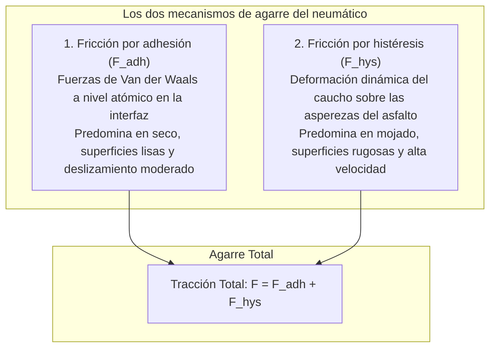

Un automóvil moderno de casi dos toneladas rueda a más de 100 km/h bajo un diluvio torrencial. Negocia giros cerrados con absoluta precisión y, ante una emergencia, se detiene por completo en pocos metros.

Toda la dinámica de este proyectil cinético depende de una interfaz mínima: <strong>cuatro parches de contacto (Contact Patches), cada uno apenas del tamaño de una tarjeta postal</strong>.

Las leyes clásicas de Coulomb afirman que la fricción es independiente del área de contacto aparente. Para el neumático, este principio no se cumple. La fricción del caucho es <strong>«un fenómeno físico extremo y no lineal gobernado por la viscoelasticidad de los polímeros, las fuerzas intermoleculares de Van der Waals y la dinámica de fluidos.»</strong>

---

## 1. La dualidad de la fricción del caucho: Adhesión e Histéresis

La fuerza de agarre del neumático proviene de dos mecanismos complementarios:

$$F_{\text{friction}} = F_{\text{adhesion}} + F_{\text{hysteresis}}$$

### 1.1 Fricción de adhesión
El caucho flexible se amolda a escala nanométrica a los áridos del asfalto, activando enlaces de Van der Waals que se estiran, rompen y recombinan a frecuencias de millones de ciclos por segundo.

### 1.2 Fricción por histéresis
En suelo mojado, el agua bloquea la adhesión molecular. La <strong>histéresis</strong> toma el relevo: al sortear las asperezas del asfalto, el caucho se comprime en la cara anterior con una presión $P_{\text{front}}$ muy superior a la presión retrasada de descompresión $P_{\text{rear}}$, disipando energía interna en forma de calor y generando una enorme fuerza de frenado.

---

## 2. Ángulo de deriva y la Fórmula Mágica de Pacejka

Al trazar una curva, la orientación de la rueda diverge de la trayectoria real, creando el <strong>ángulo de deriva (Slip Angle: $\alpha$)</strong>.
La deformación transversal genera la <strong>fuerza lateral (Cornering Force: $F_y$)</strong>.
La <strong>Fórmula Mágica de Pacejka</strong> modela matemáticamente esta transición desde el régimen elástico lineal hasta la saturación límite:
$$Y(x) = D \sin\left[ C \arctan\left\{ Bx - E(Bx - \arctan(Bx)) \right\} \right]$$

---

## 3. Aquaplaning e hidrodinámica del dibujo

En asfalto inundado, la fórmula de Horne (NASA) calcula la velocidad crítica de flotación:
$$v_c \approx 6,35 \sqrt{p_t} \quad [\text{km/h}]$$
A una presión de $220\text{ kPa}$, el aquaplaning se inicia alrededor de los <strong>94 km/h</strong>. Los surcos longitudinales evacuan hasta 30 litros de agua por segundo a 100 km/h para preservar el contacto seco.

---

## 4. Nanocompuestos de sílice y neumáticos de invierno

- <strong>Compuestos de sílice y silano</strong>: Reducen la resistencia a la rodadura a 60 °C (ahorro de combustible) mientras multiplican el agarre en mojado a 0 °C.
- <strong>Caucho espumado microporoso para hielo</strong>: El hielo resbala por la microcapa de agua que se funde bajo el neumático. Los poros del caucho espumado absorben instantáneamente esta película líquida restableciendo el contacto en seco.

---

## 5. Conclusión

El neumático es una obra maestra de ingeniería de materiales que transforma sutiles principios moleculares y fluidodinámicos en la máxima garantía de seguridad sobre el asfalto.
