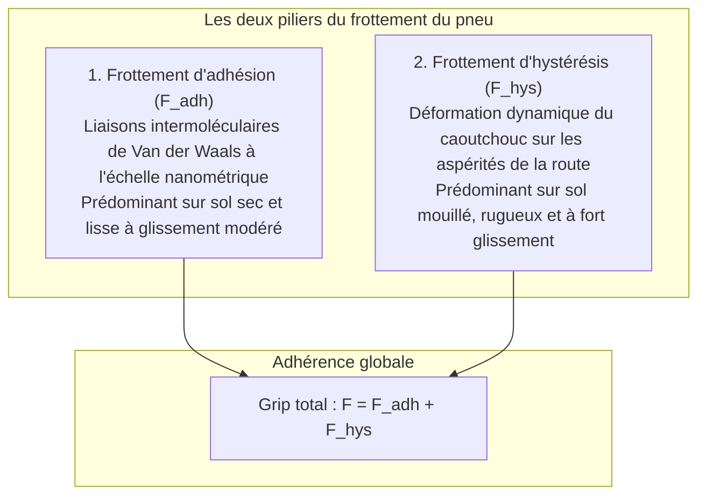

Un véhicule contemporain pesant de 1,5 à plus de 2 tonnes file à plus de 100 km/h sous une pluie battante. Il s'inscrit avec précision dans une courbe serrée et s'immobilise en quelques dizaines de mètres.

Toute cette dynamique repose sur une surface dérisoire : <strong>quatre aires de contact (Contact Patches), chacune de la taille d'une simple carte postale</strong>.

Selon les lois classiques d'Amontons-Coulomb, le frottement est indépendant de l'aire de contact. Cette loi échoue totalement pour les pneumatiques. Le frottement du caoutchouc est <strong>« un phénomène physique hautement non linéaire, dicté par la viscoélasticité des polymères, les forces moléculaires de Van der Waals et la dynamique des fluides. »</strong>

---

## 1. La dualité du frottement élastomère : Adhésion et Hystérésis

Le frottement global d'un pneu est la somme de deux mécanismes fondamentaux :

$$F_{\text{friction}} = F_{\text{adhesion}} + F_{\text{hysteresis}}$$

### 1.1 L'adhésion moléculaire
Sur sol sec, le polymère s'adapte à l'échelle nanométrique aux granulats de la route, activant les forces d'attraction de Van der Waals. Lors du glissement, ces liaisons s'étirent, se rompent et se reforment à des fréquences de millions de cycles par seconde.

### 1.2 L'hystérésis : Dissipation d'énergie mécanique
Sur chaussée mouillée, le film d'eau empêche le contact moléculaire direct. L'adhérence est alors assurée par l'<strong>hystérésis</strong>.
Lorsque le caoutchouc franchit une micro-aspérité rocheuse, il subit une compression brutale en amont. En raison de sa viscosité interne, le retour élastique en aval accuse un retard temporel. La pression frontale $P_{\text{front}}$ est nettement supérieure à la pression arrière $P_{\text{rear}}$, créant une force résultante horizontale qui freine le véhicule.

---

## 2. Dérive, angle de glissement et Formule Magique de Pacejka

En virage, l'orientation de la roue diffère de sa trajectoire réelle : c'est l'<strong>angle de dérive (Slip Angle : $\alpha$)</strong>.
Le cisaillement élastique de la bande de roulement engendre la <strong>force de guidage latéral (Cornering Force : $F_y$)</strong>.
La célèbre <strong>Formule Magique de Pacejka</strong> modélise cette réponse non linéaire avec une précision remarquable :
$$Y(x) = D \sin\left[ C \arctan\left\{ Bx - E(Bx - \arctan(Bx)) \right\} \right]$$

---

## 3. Aquaplanage et hydrodynamique

En cas de forte pluie, l'eau forme une lame sous le pneu. La vitesse critique d'aquaplanage selon la formule de Horne (NASA) vaut :
$$v_c \approx 6,35 \sqrt{p_t} \quad [\text{km/h}]$$
À une pression nominale de $220\text{ kPa}$, la limite critique se situe autour de <strong>94 km/h</strong>. Les canaux longitudinaux évacuent jusqu'à 30 litres d'eau par seconde à 100 km/h pour préserver la zone de contact sec.

---

## 4. Nanotechnologie de la silice et pneus hiver

- <strong>Charge de silice hautement dispersible</strong> : Grâce aux agents de couplage silane, la silice abaisse la résistance au roulement à 60 °C tout en maximisant l'adhérence sur sol mouillé à 0 °C.
- <strong>Pneus hiver thermogomme et micro-alvéoles</strong> : Le verglas glisse à cause d'une pellicule d'eau microscopique liquide. Les caoutchoucs alvéolaires agissent comme des micro-éponges pour évacuer ce film liquide et rétablir le contact direct sur la glace.

---

## 5. Conclusion

Le pneu moderne est une merveille d'ingénierie composite alliant chimie macromoléculaire et mécanique des contacts pour garantir la sécurité de nos mobilités.
