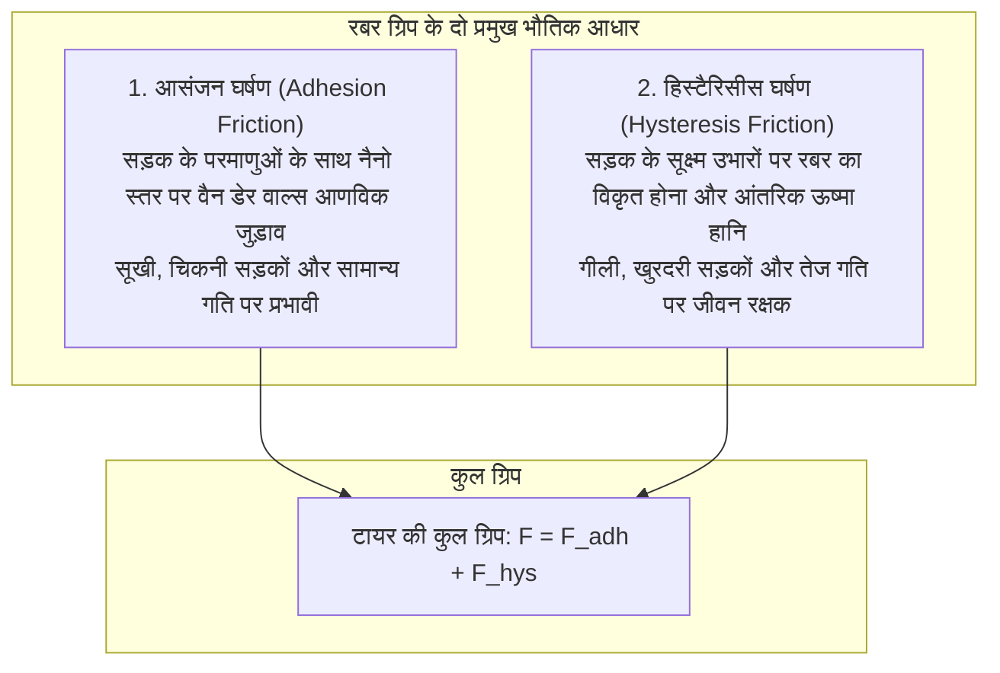

दो टन वजनी एक आधुनिक कार भारी बारिश के बीच 100 किमी/घंटा से अधिक की गति से दौड़ती है, तीखे मोड़ों पर सटीकता से घूमती है और आपात स्थिति में कुछ ही मीटर में सुरक्षित रुक जाती है।

इस भारी गतिशीलता को संभालने वाला एकमात्र माध्यम है: <strong>टायर के चार संपर्क क्षेत्र (Contact Patches), जिनमें से प्रत्येक का आकार एक साधारण पोस्टकार्ड जितना ही होता है</strong>।

पारंपरिक भौतिकी के कूलॉम नियम कहते हैं कि घर्षण बल संपर्क सतह के क्षेत्रफल पर निर्भर नहीं करता। लेकिन टायरों पर यह नियम लागू नहीं होता। रबर का घर्षण <strong>«पॉलिमर विस्कोइलास्टिसिटी (Viscoelasticity), वैन डेर वाल्स आणविक बलों और द्रव गतिकी द्वारा संचालित एक अत्यंत जटिल अरैखिक भौतिक घटना है»</strong>।

---

## 1. रबर घर्षण के दो मुख्य आधार: आसंजन और हिस्टैरिसीस

टायर का कुल घर्षण बल दो स्वतंत्र भौतिक तंत्रों का योग होता है:

$$F_{\text{friction}} = F_{\text{adhesion}} + F_{\text{hysteresis}}$$

### 1.1 आसंजन घर्षण (Adhesion): आणविक जुड़ाव
सूखी सड़क पर नरम रबर सड़क के सूक्ष्म पत्थरों के साथ नैनोमीटर स्तर पर चिपक जाती है, जिससे वैन डेर वाल्स बल सक्रिय हो जाते हैं। फिसलते समय ये आणविक बंधन खिंचते हैं, टूटते हैं और प्रति सेकंड लाखों बार फिर से जुड़ते हैं।

### 1.2 हिस्टैरिसीस घर्षण (Hysteresis): आंतरिक ऊर्जा का क्षय
गीली सड़क पर पानी आणविक संपर्क को तोड़ देता है। तब <strong>हिस्टैरिसीस घर्षण</strong> काम आता है। जब रबर सड़क के नुकीले पत्थरों पर चढ़ती है, तो सामने का दबाव $P_{\text{front}}$ बहुत अधिक होता है, जबकि पीछे का दबाव $P_{\text{rear}}$ आंतरिक श्यानता के कारण धीमा पड़ता है। यह दबाव असंतुलन एक मजबूत क्षैतिज ब्रेकिंग बल पैदा करता है।

---

## 2. स्लिप एंगल और पेसेइका का मैजिक फॉर्मूला

गाड़ी मोड़ते समय पहिए की दिशा और चलने की वास्तविक दिशा के बीच एक कोण बनता है जिसे <strong>स्लिप एंगल (Slip Angle: $\alpha$)</strong> कहते हैं।
ट्रेड ब्लॉक के मुड़ने से <strong>कॉर्नरिंग फोर्स (Cornering Force: $F_y$)</strong> उत्पन्न होती है।
प्रोफेसर हैंस पेसेइका ने इसके लिए विश्व प्रसिद्ध <strong>मैजिक फॉर्मूला (Magic Formula)</strong> दिया:
$$Y(x) = D \sin\left[ C \arctan\left\{ Bx - E(Bx - \arctan(Bx)) \right\} \right]$$
यह सूत्र अधिकतम ग्रिप और अनियंत्रित फिसलन के पूरे चक्र को सटीकता से गणितीय रूप में दर्शाता है।

---

## 3. हाइड्रोप्लेनिंग और जल निकासी

गीली सड़क पर हॉर्न (NASA) के सूत्र से हाइड्रोप्लेनिंग की गति तय होती है:
$$v_c \approx 6.35 \sqrt{p_t} \quad [\text{km/h}]$$
टायर का सामान्य दबाव $220\text{ kPa}$ होने पर कार <strong>94 किमी/घंटा</strong> पर पानी पर तैरने लगती है। आधुनिक टायर के खांचे प्रति सेकंड 30 लीटर पानी बाहर फेंककर सूखा संपर्क बनाए रखते हैं।

---

## 4. सिलिका नैनोटेक्नोलॉजी और विंटर टायर

- <strong>सिलिका-सिलेन यौगिक</strong>: कार्बन ब्लैक की जगह सिलिका का उपयोग 60 °C पर रोलिंग प्रतिरोध को 20-30% घटाता है (ईंधन बचत) और 0 °C पर गीली सड़क पर ब्रेकिंग दूरी घटाता है।
- <strong>मल्टीसेल रबर</strong>: बर्फ की सतह पर फिसलने का असली कारण दबाव से पिघलने वाली सूक्ष्म जल परत है। विंटर टायर का स्पंज जैसा छिद्रयुक्त रबर इस पानी को सोख लेता है और ठोस बर्फ से सीधा सूखा संपर्क बनाता है।

---

## 5. निष्कर्ष

टायर केवल रबर का एक काला टुकड़ा नहीं है, बल्कि यह पॉलिमर रसायन, संपर्क यांत्रिकी और द्रव गतिकी का एक बेजोड़ इंजीनियरिंग चमत्कार है जो हर मोड़ पर जीवन की रक्षा करता है।
