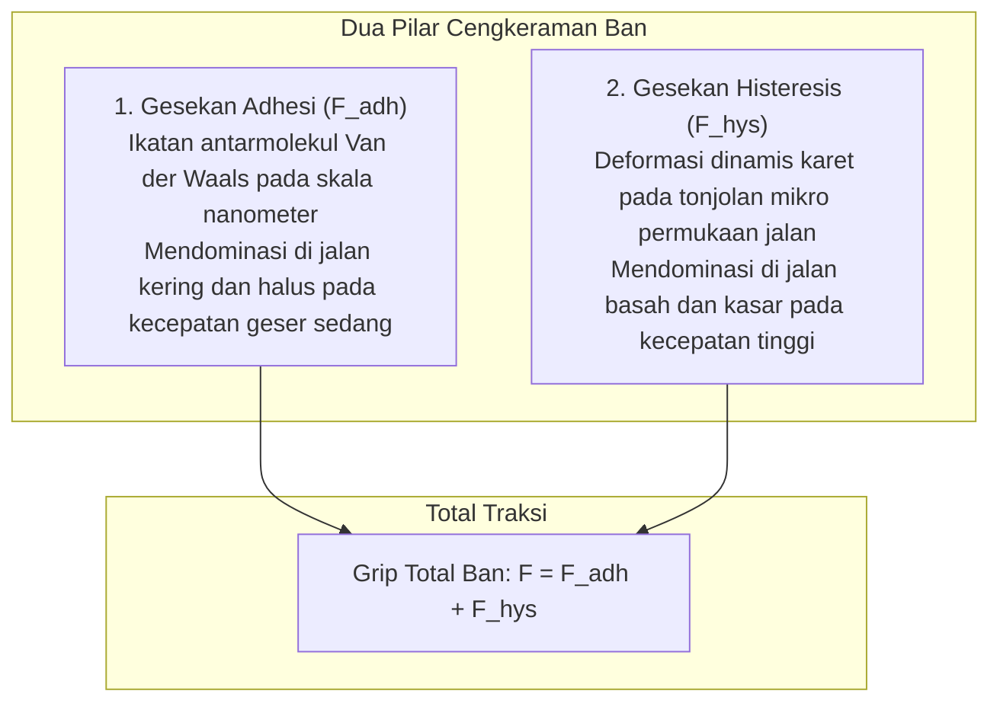

Sebuah mobil modern seberat 1,5 hingga 2 ton melaju di jalan tol dengan kecepatan lebih dari 100 km/jam di tengah hujan lebat. Mobil tersebut melibas tikungan tajam dengan stabil dan mampu berhenti total dalam hitungan detik saat keadaan darurat.

Seluruh pengendalian dahsyat ini bertumpu pada satu area fisik: <strong>empat bidang kontak (Contact Patches), yang masing-masing luasnya tak lebih dari selembar kartu pos biasa</strong>.

Hukum gesekan Coulomb klasik menyatakan bahwa gaya gesekan tidak bergantung pada luas permukaan kontak. Namun bagi ban karet, hukum ini tidak berlaku. Gesekan ban adalah <strong>«fenomena fisik non-linear ekstrem yang dikendalikan oleh viskoelastisitas polimer, gaya antarmolekul Van der Waals, dan dinamika fluida multi-fasa.»</strong>

---

## 1. Dua Pilar Gesekan Karet: Adhesi dan Histeresis

Total gaya cengkeram ban merupakan perpaduan dua mekanisme fisik utama:

$$F_{\text{friction}} = F_{\text{adhesion}} + F_{\text{hysteresis}}$$

### 1.1 Gesekan Adhesi Molekuler
Pada jalan kering, karet lunak menyesuaikan diri hingga skala atomik dengan bebatuan aspal, memicu gaya tarik Van der Waals. Saat ban tergelincir, ikatan molekuler teregang, putus, dan terbentuk kembali jutaan kali per detik.

### 1.2 Gesekan Histeresis dan Penyerapan Energi
Pada jalan basah, lapisan air memutus kontak molekuler langsung. Di sinilah <strong>gesekan histeresis</strong> bekerja.
Saat karet melewati tonjolan aspal (asperities), karet tertekan kuat. Karena sifat viskosnya, pemulihan bentuk karet mengalami jeda waktu. Tekanan pada sisi depan tonjolan ($P_{\text{front}}$) jauh lebih tinggi dibanding tekanan pemulihan di sisi belakang ($P_{\text{rear}}$). Ketidakseimbangan ini menghasilkan gaya hambat horizontal penahan laju kendaraan.

---

## 2. Sudut Slip dan Formula Ajaib Pacejka

Saat berbelok, arah putaran roda menyimpang dari arah laju sebenarnya, menghasilkan <strong>sudut slip (Slip Angle: $\alpha$)</strong>.
Deformasi geser blok tapak menghasilkan gaya penahan sentripetal yang disebut <strong>Cornering Force ($F_y$)</strong>.
Profesor Hans B. Pacejka merumuskan model matematis <strong>Magic Formula</strong>:
$$Y(x) = D \sin\left[ C \arctan\left\{ Bx - E(Bx - \arctan(Bx)) \right\} \right]$$
Formula ini merepresentasikan transisi dari respons elastis linier hingga mencapai batas saturasi traksi puncak.

---

## 3. Bahaya Aquaplaning dan Aliran Pola Tapak

Di jalan tergenang air, rumus Horne (NASA) memprediksi kecepatan kritis mengapungnya ban:
$$v_c \approx 6,35 \sqrt{p_t} \quad [\text{km/h}]$$
Pada tekanan $220\text{ kPa}$, aquaplaning dapat terjadi mulai kecepatan <strong>94 km/h</strong>. Alur ban dirancang membuang hingga 30 liter air per detik untuk mempertahankan kontak kering.

---

## 4. Nanokomposit Silika dan Ban Salju Mikropori

- <strong>Teknologi Silika-Silana</strong>: Menggantikan karbon hitam dengan silika terendap yang terikat agen kopling silana, menurunkan hambatan gelinding sebesar 20-30% pada suhu 60 °C sekaligus meningkatkan cengkeraman basah pada suhu 0 °C.
- <strong>Karet Mikroseluler untuk Es</strong>: Es menjadi licin akibat lapisan air mikroskopis yang mencair di bawah tekanan. Karet spons mikroseluler menyedot lapisan air ini secara kapiler, memulihkan cengkeraman kering secara instan.

---

## 5. Struktur Komposit Internal Ban Radial

Di balik lapisan karet luarnya, ban adalah struktur komposit canggih:
1. <strong>Bead Core</strong>: Kawat baja berkarbon tinggi yang mengunci ban pada velg roda.
2. <strong>Carcass Ply</strong>: Lapisan serat sintetis radial penahan tekanan udara internal.
3. <strong>Steel Belts</strong>: Sabuk baja bersilang untuk menahan deformasi akibat gaya lateral.
4. <strong>Inner Liner</strong>: Lapisan karet butil kedap gas pengganti ban dalam.

---

## 6. Kesimpulan

Ban kendaraan adalah karya sains material yang mengintegrasikan kimia makromolekul, mekanika kontak, dan hidrodinamik untuk melindungi mobilitas manusia.
