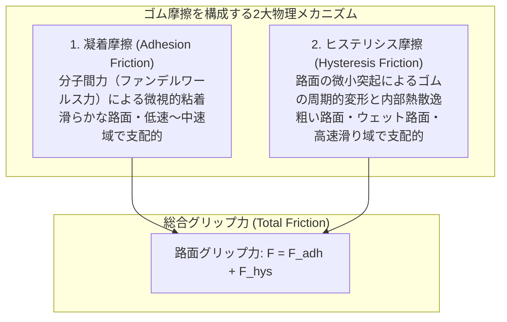
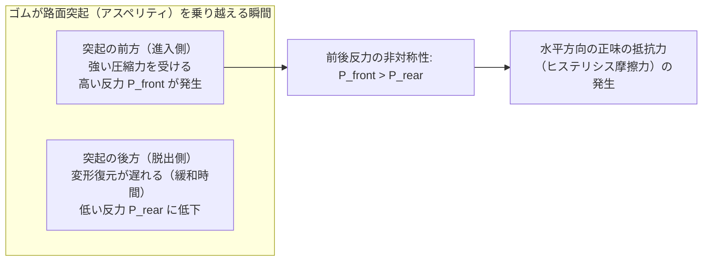
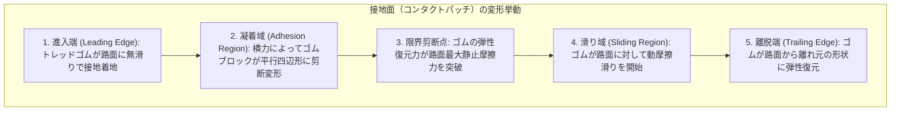
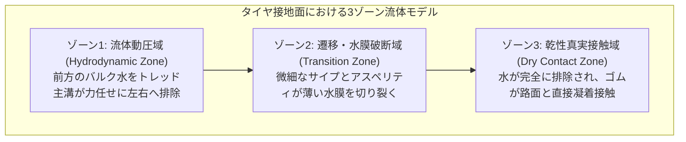
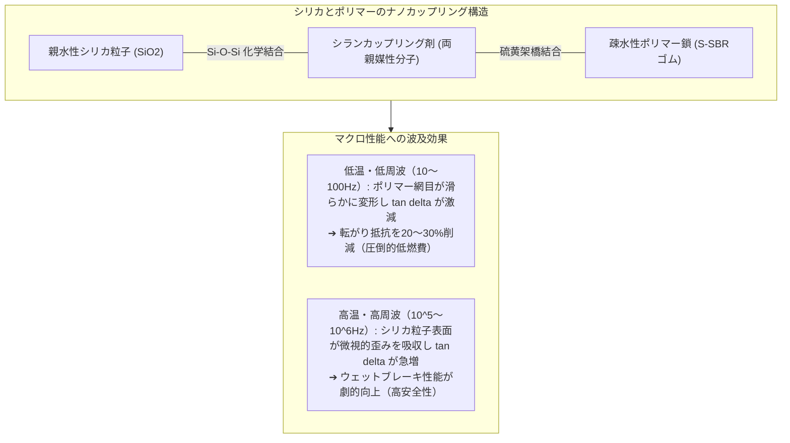
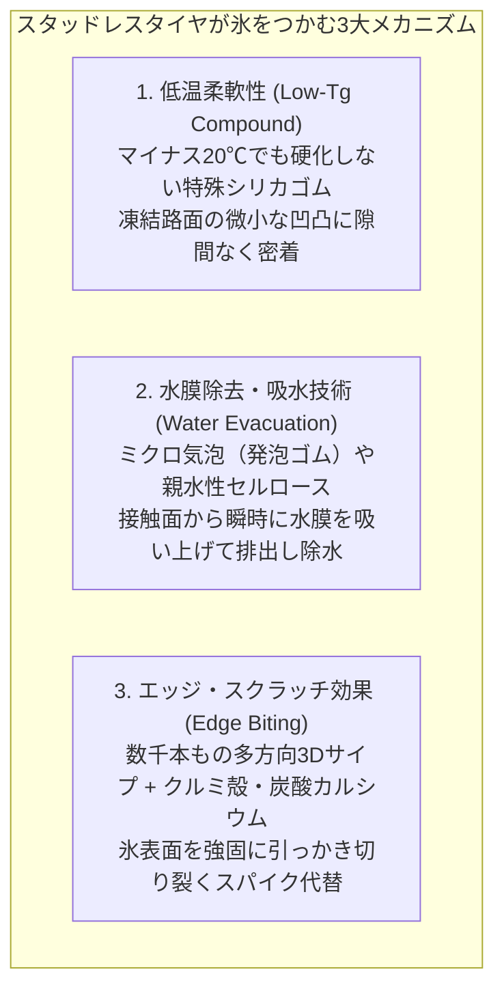

車重1.5トンから2トンを超える鉄とバッテリーの塊が、時速100km以上の猛スピードで高速道路を駆け抜け、タイトなカーブを何事もなく旋回し、危険を察知すればわずか数十メートルの距離でピタリと停止する。

私たちが当たり前のように享受しているこの圧倒的な操縦性と制動力を物理的に支えているのは、車体と地球が唯一交わる接点――<strong>「ハガキわずか4枚分（1輪あたり手のひら1枚分）」</strong>にすぎないタイヤの接地面（コンタクトパッチ：Contact Patch）です。

しかし、高校物理の教科書を開くと、そこには不可解な矛盾が横たわっています。
古典的なクーロン摩擦の法則（アモントンの法則）によれば：
1. <strong>「摩擦力は垂直荷重に比例する（$F = \mu N$）」</strong>
2. <strong>「摩擦力は接触面積の大きさに依存しない」</strong>
3. <strong>「摩擦力はすべり速度に依存しない」</strong>

もしこの古典物理法則が完全に当てはまるなら、F1マシンが極太の幅広スリックタイヤを履く意味は一切なくなります。自転車のような極細タイヤでも同じ摩擦力が得られるはずですし、濡れた路面で滑る理由や、ABS（アンチロック・ブレーキ・システム）がタイヤのロックを防いで制動距離を縮められる理由も説明できません。

タイヤの摩擦は、金属や木材のような「剛体の摩擦」とは根本的に異なる、<strong>「高分子ポリマーの粘弾性（Viscoelasticity）と分子間力、そして流体力学が支配する極限の非線形物理現象」</strong>です。

本稿では、ゴムが路面をつかむ分子レベルのメカニズムから、グリップ力を決定づけるヒステリシスロス、旋回を生み出すコーナリングフォースとパツェイカの「マジックフォーミュラ」、雨水を引き裂くトレッドパターンの流体力学、エコタイヤの転がり抵抗低減技術、そして氷雪路を制するスタッドレスタイヤのミクロ化学までを徹底的に解明します。

---

## 1. 古典物理学への反逆：ゴム摩擦の特異性

金属同士をこすり合わせた場合、摩擦係数 $\mu$ は通常 0.2〜0.5 程度であり、垂直荷重を増やしても摩擦係数はほぼ一定です。しかし、レース用タイヤの摩擦係数は <strong>1.5〜2.0</strong> を超え、時には <strong>2.5</strong> に達することすらあります。「垂直荷重よりも大きな水平力を生み出す」という現象自体、クーロンの古典摩擦論では説明がつきません。

ゴムの摩擦力 $F_{\text{friction}}$ は、主に以下の2つの独立したメカニズムの総和として発生します。

$$F_{\text{friction}} = F_{\text{adhesion}}（凝着摩擦） + F_{\text{hysteresis}}（ヒステリシス摩擦） + F_{\text{tearing}}（摩耗・引き裂き）$$



### 1.1 凝着摩擦（Adhesion）：分子間引力の結合と破断
ゴムは「エラストマー」と呼ばれる高分子化合物であり、ガラス転移温度以上の常温では、網目状に架橋された分子鎖が極めて自由に熱運動しています。

ゴムがアスファルトの表面に押し付けられると、ゴム分子鎖がミクロなレベルで路面の原子スケールにまで入り込み、原子間距離が数ナノメートル以下に接近します。ここで強力に働くのが<strong>「ファンデルワールス力（Van der Waals force）」</strong>です。

タイヤが路面に対して滑ろうとすると、この分子間引力による結合がゴムを強く引き留めます。しかし、せん断応力が限界に達すると分子結合は引きちぎられ、次の瞬間、ミリ秒以下の極小時間で隣接する路面分子と新たな結合を形成します。

この<strong>「微視的結合 $\rightarrow$ 引き伸ばし（弾性エネルギー蓄積） $\rightarrow$ 破断（エネルギー解放） $\rightarrow$ 再結合」</strong>のサイクルが、毎秒数万回から数百万回という超高周波で繰り返されます。これが凝着摩擦の正体です。
凝着摩擦は、真実接触面積（Real Contact Area） $A_{\text{real}}$ に直接比例します。

$$F_{\text{adhesion}} = \tau_s \cdot A_{\text{real}}$$

（$\tau_s$: 界面のせん断強度）

見かけの接触面積が大きく、ゴムが柔らかい（弾性率が低い）ほど、路面の微細な凹凸に隙間なく密着して $A_{\text{real}}$ が劇的に増大するため、F1マシンのワイドなソフトタイヤは絶大なグリップ力を発揮できるのです。

### 1.2 ヒステリシス摩擦（Hysteresis）：エネルギー散逸の力学
しかし、路面が濡れていたり泥が存在する場合、水膜が分子間のナノレベルの接触を遮断するため、凝着摩擦は激減してしまいます。このとき、タイヤを滑らせないための主役に躍り出るのが<strong>「ヒステリシス摩擦（変形履歴摩擦）」</strong>です。

アスファルトの表面を拡大して観察すると、数マイクロメートルから数ミリメートルの鋭い突起（アスペリティ：Asperity）が無数に存在しています。走行中のタイヤゴムがこの突起に乗り上げると、ゴムは局所的に激しく押し潰されて圧縮変形します。突起を通り過ぎると、ゴムは自らの弾性によって元の形状に戻ろうと復元します。

もしゴムが完全な「理想弾性体（バネ）」であれば、圧縮されたときに蓄えられた弾性エネルギーは、復元するときに100%運動エネルギーとして押し返され、差し引きの抵抗力はゼロになります。
しかし、ゴムは「粘性（液体のように流動してエネルギーを熱に散逸させる性質）」と「弾性（固体のように元に戻る性質）」を併せ持つ<strong>「粘弾性体（Viscoelastic Material）」</strong>です。



ゴムが圧縮される際の応力-ひずみ曲線と、除荷（復元）される際の曲線は一致せず、ループ状の軌跡を描きます。この閉じたループの面積を<strong>「ヒステリシスロス（Hysteresis Loss：力学的損失エネルギー）」</strong>と呼びます。

突起の前方（進入面）では大きな圧縮反力 $P_{\text{front}}$ がタイヤを押し戻す方向に働きますが、突起の後方（脱出面）ではゴムの復元が遅れる（粘性遅延）ため、後方から前へ押し出す反力 $P_{\text{rear}}$ が極端に小さくなります。

$$P_{\text{front}} > P_{\text{rear}}$$

この前後の圧力のアンバランス（非対称性）によって、進行方向と逆向きの巨大な水平抗力が発生します。これがヒステリシス摩擦です。ヒステリシス摩擦は、水膜を介していても突起の幾何学的変形さえ起きれば発生するため、雨天時のウェットグリップを支える決定的な物理的防壁となります。

---

## 2. 粘弾性の魔術：複素弾性率と温度・周波数依存性

ゴムの性能を語る上で欠かせないのが、高分子物理学における<strong>「複素弾性率（Complex Modulus）」</strong>と<strong>「損失正接（$\tan \delta$）」</strong>です。

周期的な正弦波ひずみ $\gamma(t) = \gamma_0 \sin(\omega t)$ をゴムに与えたとき、発生する応力 $\sigma(t)$ は位相の遅れ $\delta$ を伴って応答します。

$$\sigma(t) = \sigma_0 \sin(\omega t + \delta) = \gamma_0 \left[ E'(\omega) \sin(\omega t) + E''(\omega) \cos(\omega t) \right]$$

- <strong>貯蔵弾性率 $E'$（Storage Modulus）</strong>：変形エネルギーをバネのように内部に蓄える弾性成分（実部）。
- <strong>損失弾性率 $E''$（Loss Modulus）</strong>：変形エネルギーを熱として周囲に散逸・放出する粘性成分（虚部）。
- <strong>損失正接 $\tan \delta$（Loss Factor）</strong>：

$$\tan \delta = \frac{E''}{E'}$$

$\tan \delta$ は、変形エネルギーのうちどれだけの割合が「熱（摩擦抵抗）」として奪われるかを示す無次元の指標です。$\tan \delta$ が大きいほど、ヒステリシス摩擦（グリップ力）は強烈になります。

```
粘弾性スペクトル (tan delta vs 周波数 / 温度)
  tan delta
   ^
   |           [ウェットグリップ領域]
   |             周波数: 10^4 〜 10^7 Hz
   |                 (高tan deltaが望ましい)
   |                     ┌────────┐
   |                     │  ▲▲▲   │
   |   [転がり抵抗領域]   │ ▲▲▲▲▲  │
   |     周波数: 10〜100 Hz│▲▲▲▲▲▲▲ │
   |   (低tan deltaが必須) │         │
   |        ┌─────┐       │         │
   |        │ ▼▼▼ │       │         │
   +--------┴─────┴───────┴─────────┴---------> 周波数 f (変形速度)
   低速・タイヤ回転変形      ミクロ路面アスペリティ変形
```

### ウィリアムズ・ランデル・フェリー（WLF）の温度・時間換算則
高分子ポリマーの極めてユニークな性質は、<strong>「低温での振る舞いは、高速（高周波）変形での振る舞いと等価である」</strong>という点にあります。これを<strong>「WLF則（Williams-Landel-Ferry equation / 時間-温度換算則）」</strong>と呼びます。

タイヤが時速100kmでアスファルトの微細突起（波長 $10\,\mu\text{m} \sim 1\,\text{mm}$）を乗り越える際、ゴムが受ける局所的な変形周波数は <strong>$10^4 \sim 10^7\text{ Hz}$（毎秒数万〜数千万回）</strong>という超高周波に達します。
一方、タイヤが転がるときにタイヤ全体がグニャグニャと撓む変形周波数は、車輪の回転数に相当するわずか <strong>$10 \sim 100\text{ Hz}$</strong> にすぎません。

現代のタイヤ工学は、この周波数の違いを巧みに利用しています。
- <strong>$10 \sim 100\text{ Hz}$（回転変形）</strong>では $\tan \delta$ を極限まで下げてエネルギーロス（発熱）を抑え、<strong>燃費（低転がり抵抗）</strong>を向上させる。
- <strong>$10^5 \sim 10^6\text{ Hz}$（路面突起変形）</strong>では $\tan \delta$ を極大化させてエネルギーを熱に散逸させ、強烈な<strong>ウェットグリップ</strong>を叩き出す。

相反する「低燃費」と「ハイグリップ」を同一のゴム材料で両立させるという究極の技術革新が、現代のタイヤ開発の最前線で行われています。

---

## 3. なぜ車は曲がれるのか：コーナリングフォースとスリップ角

自動車がカーブを曲がるとき、車輪は旋回方向へと向きを変えますが、物理的に車輪の向きと車体の進行方向は完全に一致しているわけではありません。

ステアリングを切ると、タイヤの進行方向と車輪の回転面との間に、わずかな角度のズレが生じます。この角度を<strong>「スリップ角（Slip Angle: $\alpha$）」</strong>と呼びます。



### 3.1 ブラシモデル（Brush Model）による横力の解剖
タイヤ接地面の力学を最も直感的に説明するのが、タイヤトレッドを無数の柔軟な直立ブラシ毛の集合体としてモデル化した<strong>「ブラシモデル」</strong>です。

1. <strong>凝着域（Adhesion Region）</strong>：
   接地面の前半部分では、ゴムの毛先は路面にしっかりと食いつき、滑っていません。しかし、車輪は斜め前方に進もうとするため、ブラシの毛は進行方向に対して横向きにグニャリと平行四辺形状に曲げられます。この弾性ひずみによって、横向きの復元力（剪断応力）が線形に蓄積されます。
2. <strong>滑り域（Sliding Region）</strong>：
   接地面の後方へ進むにつれてブラシの変形量は増大し、ついにはゴムのせん断応力が路面の最大静止摩擦力を超えます。毛先は路面を引っかきながら横滑りを始め、動摩擦状態へと移行します。

この接地面全体で発生する横方向の弾性復元力と摩擦力の総和こそが、車両をカーブの内側へと引き戻す求心力――<strong>「コーナリングフォース（Cornering Force: $F_y$）」</strong>です。

$$\text{小スリップ角域（}\alpha < 3^\circ\text{）}: F_y \approx C_p \cdot \alpha$$

（$C_p$: コーナリングパワースティフネス）

### 3.2 パツェイカの「マジックフォーミュラ（Magic Formula）」
スリップ角 $\alpha$ が大きくなると、接地面のほぼ全域が「滑り域」へと転落し、コーナリングフォースは頭打ち（飽和）となって限界を迎えます。この非線形な限界挙動を、オランダのデルフト工科大学名誉教授ハンス・パツェイカ（Hans B. Pacejka）は、三角関数を組み合わせた経験的数式<strong>「マジックフォーミュラ（Pacejka's Magic Formula）」</strong>として定式化しました。世界中の自動車メーカーやF1チームの車両運動シミュレータは、現在でもすべてこの数式を基礎として作られています。

$$Y(x) = D \sin\left( C \arctan\left( Bx - E(Bx - \arctan(Bx)) \right) \right)$$

- $Y$: 発生する力（コーナリングフォース $F_y$ または制動・駆動力 $F_x$）
- $x$: スリップ角 $\alpha$ または前後スリップ率 $\kappa$
- $B$: 剛性係数（Stiffness Factor）
- $C$: 形状係数（Shape Factor）
- $D$: ピーク値係数（Peak Value Factor：最大摩擦係数に対応）
- $E$: 曲率係数（Curvature Factor）

```
コーナリングフォース Fy vs スリップ角 alpha
  Fy
  ^
  |               ピーク点 D (最大グリップ)
  |                  ┌───┐
  |                 /     \_____ 限界超過（グリップ飽和・滑り出し）
  |                /
  |    線形領域   /
  |   (傾き: Cp) /
  |             /
  |            /
  +-----------+---------------------> スリップ角 alpha (度)
             3°  6°  9°  12°
```

プロのレーシングドライバーは、タイヤのスリップ角を常にこの<strong>「ピーク点 $D$（通常 $6^\circ \sim 10^\circ$ 前後）」</strong>の狭い領域に維持し続けることで、物理限界ギリギリの旋回速度を引き出しているのです。

### 3.3 セルフアライニングトルク（SAT）：ステアリングの手応え
コーナリングフォースの合力中心は、幾何学的な接地面の中心よりも数センチメートル後方に発生します。この偏心距離を<strong>「ニューマチックトレール（Pneumatic Trail: $t_n$）」</strong>と呼びます。

合力が後ろから押すため、車輪にはスリップ角をゼロに戻そうとする復元モーメント――<strong>「セルフアライニングトルク（Self-Aligning Torque: $M_z$）」</strong>が自然に発生します。

$$M_z = F_y \cdot t_n$$

カーブを曲がっている最中にステアリングを握る手に感じる「ググッ」という手応えは、このセルフアライニングトルクがステアリングシャフトを通じてドライバーに伝わっているものです。
限界を超えてフロントタイヤが完全に滑り出す（アンダーステア）と、ニューマチックトレール $t_n$ が急激にゼロに向かって消失するため、<strong>「ステアリングの手応えがフッと軽くなる」</strong>という危険信号としてドライバーにフィジカルに感知されます。

---

## 4. 水膜との戦い：ウェットグリップとハイドロプレーニングの流体力学

雨の日の高速道路において、タイヤの最大の敵は「水」です。
アスファルトの上にわずか 1〜2mm の水膜が存在するだけで、時速100kmで疾走するタイヤの前方には強烈な動水圧が立ちはだかります。

### 4.1 ハイドロプレーニングの3ゾーンモデル
濡れた路面におけるタイヤの接地現象は、流体力学的に以下の<strong>「3つの領域（Three-Zone Concept）」</strong>に分かれて推移します。



1. <strong>ゾーン1：流体動圧域（Hydrodynamic Zone）</strong>：
   タイヤの進入端。路面上の大量の水がタイヤの丸いノーズによって押し退けられます。溝に入り切らない水がタイヤ前方に堰き止められ、クサビ状の「水枕」を形成してタイヤを持ち上げようとする動圧を発生させます。
2. <strong>ゾーン2：遷移・水膜破断域（Transition Zone）</strong>：
   接地面の中央部。主溝によって大部分の水が排水された後、ゴム表面とアスファルトの微細突起との間に残った厚さ数十マイクロメートルの薄い水膜を、タイヤ表面の微細な切れ込み（サイプ）とゴムのエッジがスクイーズ（搾り出し）し、突き破っていきます。
3. <strong>ゾーン3：実質接触域（Dry/Boundary Contact Zone）</strong>：
   接地面の後方。水膜が完全に排除され、ゴム分子と路面アスペリティがナノスケールで直に接触し、凝着摩擦とヒステリシス摩擦が100%発現する領域です。

車速が上がるほど、水膜を押し退けて排除するための時間的猶予（コンタクトタイム：わずか数ミリ秒）が失われます。ゾーン1の動水圧がタイヤの空気圧 $p_t$ を上回った瞬間、ゾーン3（乾性接触域）はゼロに押し潰され、タイヤは完全に水の上に浮上します。これが悪名高い<strong>「ハイドロプレーニング現象（Hydroplaning / Aquaplaning）」</strong>です。

### 4.2 ホーン（Horne）の限界速度予測式
NASAの航空力学エンジニアであるウォルター・ホーン（Walter B. Horne）は、航空機の着陸実験からハイドロプレーニングが発生する限界車速 $v_c$ を導き出しました。

$$v_c \approx 6.35 \sqrt{p_t} \quad [\text{km/h}]$$

（$p_t$: タイヤの内圧 $[\text{kPa}]$）

たとえば、乗用車のタイヤ空気圧が一般的な $220\text{ kPa}$ の場合：
$$v_c \approx 6.35 \times \sqrt{220} \approx 6.35 \times 14.83 \approx 94.2\text{ km/h}$$

なんと、計算上は<strong>時速94km前後</strong>でハイドロプレーニングの危険領域に突入することがわかります。
タイヤの空気圧が低下すると、この浮上限界速度は時速70〜80kmにまで一気に低下します。雨天時の高速走行において「空気圧点検」が命を左右する最大の理由がここにあります。

### 4.3 トレッドパターンの排水設計学
ハイドロプレーニングを阻止する唯一の武器が、タイヤ表面に刻まれた<strong>トレッドパターン（溝の幾何学）</strong>です。
最新のスポーツタイヤでは、毎秒数十リットル（時速100kmで<strong>毎秒約30リットル、家庭用風呂桶をわずか6秒で満杯にする量</strong>）もの水を瞬時に後方および側方へと排出し続けています。

- <strong>ストレート主溝（Circumferential Grooves）</strong>：
  回転方向に一直線に走る幅太い縦溝。接地面の進入端で前方に押し寄せるクサビ状の水を、最短距離で後方へと素早く逃がす「超高速道路」の役目を果たします。
- <strong>ラテラルラグ溝（Lateral Grooves）</strong>：
  タイヤのセンターからショルダー（外側）へと斜めに抜ける横溝。接地面中央に溜まった水を左右両側へと高速ジェットのように噴射排出します。
- <strong>サイプ（Sipes / 微小スリット）</strong>：
  幅わずか 0.5〜0.8mm 程度の細い切れ込み。毛細管現象によって残存水膜を瞬時に吸い上げ、エッジ効果（角の圧力集中）によってアスファルト表面の油膜や微細水膜をカンナのように掻き落とします。

タイヤの溝深さが新品時の約8mmから半分以下の4mm以下に摩耗すると、溝の断面積（流路容積）が激減し、排水限界速度は急激に低下します。スリップサイン（残り溝1.6mm）が出る遥か手前の段階で、ウェットグリップはすでに危機的な領域まで劣化しているのです。

---

## 5. 転がり抵抗の物理学とエコタイヤ革命

現代の自動車産業において、CO2排出量削減とEV（電気自動車）の一充電走行距離の延長は最重要課題です。走行中の自動車が消費する全エネルギーのうち、実に <strong>15〜20%（EVでは20〜30%）</strong>が「タイヤの転がり抵抗」によって消費されています。

### 5.1 転がり抵抗（Rolling Resistance）の発生源
タイヤが平坦な路面を一定速度で転がるとき、なぜ抵抗が発生するのでしょうか？
その真因の<strong>約90%以上</strong>は、車輪が回転するたびにタイヤ全体が連続的に押し潰され、復元するサイクルを繰り返すことによる<strong>「内部ヒステリシスロス（ゴムの自己発熱）」</strong>です。

```
タイヤの転がり抵抗の寄与率内訳：
1. ゴム・コードの変形ヒステリシスロス：約 90〜95 %
2. 接地面のミクロな滑り摩擦ロス：約 3〜5 %
3. タイヤ回転に伴う空気抵抗（空力抵抗）：約 1〜3 %
```

タイヤが路面と接地する瞬間、トレッドゴム、サイドウォール、ベルト層は激しく屈曲変形します。このとき、弾性エネルギーの一部が熱に変換されて散逸します（長距離ドライブの後にタイヤが熱くなっているのは、ブレーキ熱だけでなくこのゴム自身の自己発熱が原因です）。

転がり抵抗力 $F_{\text{rr}}$ は、垂直荷重 $W$ と<strong>転がり抵抗係数（RRC: Rolling Resistance Coefficient）</strong>の積で表されます。

$$F_{\text{rr}} = RRC \cdot W$$

一般的な乗用車タイヤの $RRC$ は <strong>$0.008 \sim 0.012$（0.8〜1.2%）</strong>程度ですが、最新の超低燃費タイヤやEV専用タイヤでは <strong>$0.006$ 以下</strong>にまで低減されています。

### 5.2 シリカ（Silica）配合技術による「魔法の両立」
かつてタイヤの補強材（フィラー）としては、石油から作られる「カーボンブラック（微粒子炭素）」が100年以上にわたって使われてきました。カーボンブラックはゴム分子と強く結びつき、優れた耐摩耗性と高グリップを与えますが、同時にゴム全体の粘性抵抗を高め、転がり抵抗を悪化させてしまうというジレンマを抱えていました。

このトレードオフを打ち破ったのが、1990年代初頭にミシュランが実用化した<strong>「シリカ（二酸化ケイ素: $\text{SiO}_2$）配合技術」</strong>です。



シリカは本質的に「親水性（水になじみやすい）」であり、石油系ポリマーであるゴム（疎水性）とは反発し合って均一に混ざりません。そこで、両端に異なる官能基を持つ特殊な仲介分子<strong>「シランカップリング剤」</strong>を投入しました。シランカップリング剤の一端がシリカと結合し、もう一端が加硫時にポリマー鎖と強固に化学架橋することで、シリカ微粒子がゴム基質の中にナノスケールで完璧に分散されます。

このシリカ架橋ネットワークにより：
- <strong>タイヤが回転する低周波（$10 \sim 100\text{ Hz}$）</strong>では、ゴム分子が引きずられる内部摩擦が減少し、エネルギーロス（転がり抵抗）が <strong>20〜30% 削減</strong>されます。
- <strong>路面のアスペリティと衝突する高周波（$10^5 \sim 10^7\text{ Hz}$）</strong>では、ナノシリカ粒子が激しいせん断変形を引き起こしてエネルギーを熱に散逸させ、<strong>ウェットグリップ性能が大幅に向上</strong>します。

シリカ技術は、「転がり抵抗の低減」と「雨の日のブレーキ性能」という二律背反を同時に解決し、タイヤ工学に真のパラダイムシフトをもたらしました。

---

## 6. 極低温の物理：スタッドレスタイヤの氷雪路面科学

冬用スタッドレスタイヤの科学は、高分子化学における最大の難問――<strong>「氷の上の水膜」</strong>との格闘です。

### 6.1 氷の上が滑る真の理由：感温性疑似液体層
氷そのものは、実は滑りません。マイナス40℃の極寒環境にある氷の上は、サラサラに乾いた砂の上のようにタイヤがしっかりとグリップします。

氷の上で車が滑る真の理由は、<strong>「氷の上に存在する極めて薄い水膜（厚さ数マイクロ〜数十マイクロメートル）」</strong>にあります。
車重によって氷にかかる圧力（復水現象）と、タイヤゴムとの摩擦熱によって、タイヤ接地面の氷の表面がごくわずかに融解します。この発生した水膜が潤滑油（ルブリカント）として働き、ゴムと氷の真実接触を阻害するため、ツルツルと滑るのです。
最も危険な路面温度は、氷が溶けかけて水膜が最も厚くなる <strong>$-2^\circ\text{C} \sim 0^\circ\text{C}$ のアイスバーン（ブラックアイス）</strong>です。



### 6.2 ガラス転移温度（$T_g$）と低温柔軟ゴム
通常のサマータイヤ（夏用タイヤ）のゴムは、外気温が $+7^\circ\text{C}$ を下回ると、高分子鎖の運動が凍結し始める「ガラス転移点（Glass Transition Point: $T_g$）」に近づき、プラスチックのように硬くカチコチになります。ゴムが硬くなると、路面の凹凸に追従できず、真実接触面積が激減して夏場からは考えられないほど滑るようになります。

スタッドレスタイヤには、特殊な天然ゴムや末端変性ブタジエンゴムに多量の柔軟オイルやシリカを配合し、ガラス転移点を <strong>$-50^\circ\text{C} \sim -60^\circ\text{C}$</strong> という極低温領域まで引き下げたコンパウンドが採用されています。これにより、北海道や北欧の真冬の氷点下環境でも、マシュマロのような柔軟性を維持し、氷の微細な凹凸へと吸い付くように密着します。

### 6.3 発泡ゴム（Cellular Rubber）のスポンジ除水メカニズム
氷の上の水膜をどうやって排除するのか。日本のタイヤメーカー（ブリヂストン等）が世界に先駆けて開発したのが<strong>「発泡ゴム（Multicell Rubber）」</strong>技術です。

ゴムの内部に、直径数十マイクロメートルの無数の均一な独立気泡（ミクロの空洞）を含ませています。
1. <strong>吸水スポンジ作用</strong>：
   タイヤが氷の上に接地した瞬間、表面に露出した無数の気泡穴が、毛細管現象によって氷表面の水膜を「キュッ」と吸い上げます。
2. <strong>乾性接触の回復</strong>：
   水膜が気泡内へと吸水・排除されることで、気泡の周囲のゴムが氷の表面に直に接する「乾いた接触」がミリ秒単位で復活します。
3. <strong>持続するエッジ</strong>：
   タイヤが摩耗しても、内部から次々と新しい気泡が表面に現れるため、タイヤの溝が減っても吸水性能とエッジ効果が長期間失われません。

さらに、卵の殻やクルミの殻、竹炭微粒子、微小ガラス繊維などをコンパウンドに練り込み、ミクロのスパイクピンとして氷の表面を引っかく技術（トーヨータイヤやダンロップなど）も進化を続け、金属スパイクタイヤが粉塵公害で禁止された後の冬の交通安全を物理的に支えています。

---

## 7. タイヤの内部構造：複合材料工学の極致

外見は単なる黒いゴムの輪に見えるタイヤですが、その内部は鉄、化学繊維、天然高分子が幾重にも織り成された、人類が生み出した最も洗練された<strong>複合材料（Composite Material）構造体</strong>です。

```
タイヤの断面構造モデル：
                 ┌─────────── トレッドゴム（路面と接触する耐摩耗・高グリップ層）
                 │   ┌─────── キャッププライ（高速遠心力による膨張を抑えるナイロン帯）
                 │   │   ┌─── スチールベルト（高張力鋼線を交差配置した強靭な鎧）
                 │   │   │
           ______|___|___|______
          /                     \
         /   カーカスプライ      \ ──（車重と内圧を支えるポリエステル/レーヨンコードの骨格）
        |   (Carcass Ply)        |
        |                        |
        |   サイドウォールゴム    | ──（路面からの衝撃を吸収する柔軟なダンパー）
        |   (Sidewall Rubber)    |
        |                        |
        |    インナーライナー     | ──（空気分子を通さない高気密ブチルゴムのチューブ代替層）
        |    (Inner Liner)       |
         \                      /
          \_____   ビードコア   /
                \_(Bead Core) _/  ──（ホイールのリムにタイヤを固定するピアノ線の束）
```

1. <strong>ビードコア（Bead Core）</strong>：
   高炭素鋼（ピアノ線）を束ねた強靭なリング。数気圧の内圧がかかったタイヤがホイールのリムから外れないよう、数十トンの張力でリムに強力に固定します。
2. <strong>カーカスプライ（Carcass Ply）</strong>：
   タイヤの内圧を支える「骨格」。ポリエステルやアラミド、レーヨンなどの高強度繊維コードをラジアル（放射状）方向に並べ、内圧による破裂を防ぎます。
3. <strong>スチールベルト（Steel Belts）</strong>：
   カーカスとトレッドの間に挟まれる、高張力鋼のワイヤー層。コードを斜め（通常20度前後）に交差させて2枚重ねることで、トレッド面を平坦に保持し、コーナリング時の横歪みに対して強大な剛性を発揮します。
4. <strong>キャッププライ（Cap Ply / Jointless Nylon Band）</strong>：
   時速200〜300km以上の超高速回転時、スチールベルトが遠心力によって外側へ飛び出そうとする力（スタンディングウェーブ現象）を抑え込むため、熱収縮性ナイロンコードを継ぎ目なくらせん状に巻き付けた補強層です。
5. <strong>インナーライナー（Inner Liner）</strong>：
   チューブレスタイヤの心臓部。空気透過性が極めて低い「ハロゲン化ブチルゴム」の薄膜シートを内面に貼り付け、酸素や窒素分子の外部への漏れを数ヶ月にわたって遮断します。

---

## 8. 次世代タイヤのフロンティア：スマートタイヤとエアレスタイヤ

CASE（コネクテッド、自動運転、シェアリング、電動化）時代を迎えた今、タイヤは単なる受動的なゴム部品から、路面と対話する「アクティブな車載センサー」へと進化を遂げつつあります。

### 8.1 センシングタイヤ（Cyber Tire）と路面推定
タイヤのインナーライナー直下に、超小型加速度センサ、圧電素子、RFIDタグ、ワイヤレス通信モジュールを埋め込み、回転ごとの接地面の変形波形をリアルタイムで解析する技術が実用化されています。
- <strong>μ（摩擦係数）の瞬時推定</strong>：
  接地面の進入から脱出までの歪み速度プロファイルから、走行中の路面が「乾燥アスファルト（$\mu \approx 1.0$）」なのか、「ウェット（$\mu \approx 0.5$）」なのか、「圧雪（$\mu \approx 0.3$）」なのか、「氷盤（$\mu \approx 0.1$）」なのかを数十ミリ秒で特定。
- <strong>自動運転システムとの協調制御</strong>：
  滑り出す前にタイヤ側から車両のECUへ路面情報が直接フィードバックされ、安全マージンに応じた車間距離や自動緊急ブレーキの介入タイミングがミリ秒単位で最適化されます。

### 8.2 エアレスタイヤ（Non-Pneumatic Tire: NPT）
空気を一切使わず、特殊な熱可塑性樹脂スポークで車重を支える「エアレスタイヤ」の研究も加速しています。
パンクの完全な撲滅、空気圧管理の不要化、スペアタイヤ廃止による車両軽量化、そして省資源化を達成する技術として、自動運転シャトルや月面探査車、配送モビリティでの実用化が目前に迫っています。

---

## 9. 結論：目に見えぬ「接触の科学」

クルマの運動性能を議論するとき、私たちはしばしば数百馬力のエンジン出力や、最新の電子制御サスペンション、超高速な自動運転AIに目を奪われがちです。

しかし、運動方程式 $F = ma$ において、車輪に作用するすべての力 $F$ は、究極的には<strong>タイヤと路面が接する数平方センチメートルのミクロな分子接触面からしか生み出されません</strong>。

どれほどパワフルなモーターを積んでいても、どれほど賢明なAIが瞬時に回避判断を下しても、タイヤが路面と分子レベルで手を取り合い、水膜を切り裂いてアスファルトを掴み続けなければ、車はただの慣性に従って暴走する鉄の塊にすぎません。

ゴム分子のランダムな熱運動から、ナノシリカの化学架橋、トレッドパターンの流体力学、そして氷の上のミクロ吸水に至るまで――タイヤの接地面には、目に見えない極小の世界で繰り広げられる人類の物理学と化学の英知が凝縮されているのです。
