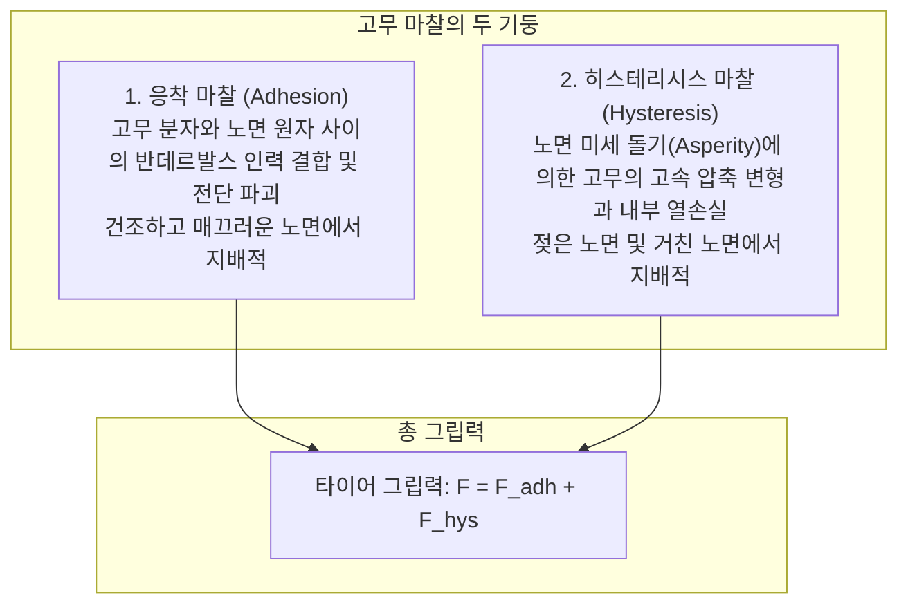
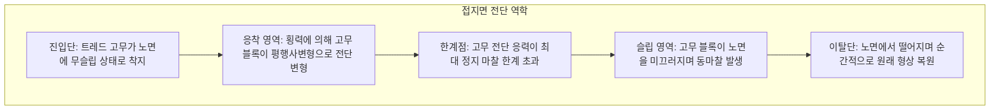

1.5톤에서 2톤이 넘는 강철과 배터리의 결합체가 시속 100km 이상의 고속으로 아스팔트를 질주하고 급커브를 매끄럽게 돌아 나갑니다. 이 거대한 운동 에너지를 통제하는 유일한 물리적 접점은 차량 1대당 <strong>엽서 단 4장 면적에 불과한 타이어 접지면(Contact Patch)</strong>입니다.

고전 물리학의 쿨롱 마찰 법칙에 따르면 마찰력은 겉보기 접촉 면적과 무관하다고 합니다. 하지만 타이어에 이 법칙을 그대로 대입하면 레이싱카가 폭넓은 광폭 슬릭타이어를 장착할 이유가 전혀 없습니다.

타이어 마찰은 단순한 강체 마찰이 아닌, <strong>「고분자 폴리머의 점탄성(Viscoelasticity), 반데르발스 분자간력, 그리고 유체역학이 결합된 극한의 비선형 물리 현상」</strong>입니다.

---

## 1. 고무 마찰의 2대 메커니즘: 응착 마찰과 히스테리시스 손실

고무 마찰력은 크게 두 가지 물리 현상의 합으로 발생합니다:

$$F_{\text{friction}} = F_{\text{adhesion}}（응착 마찰） + F_{\text{hysteresis}}（히스테리시스 마찰）$$

### 1.1 응착 마찰 (Adhesion)
고무가 아스팔트에 밀착하면 분자 수준에서 반데르발스 결합이 형성됩니다. 고무가 미끄러지려 할 때 분자 결합이 늘어나다 끊어지고 다시 인접 원자와 결합하는 초고주파 과정이 반복되며 마찰력이 발생합니다. 이는 진실 접촉 면적 $A_{\text{real}}$에 정비례합니다. 폭이 넓고 유연한 레이싱 타이어가 막강한 접지력을 발휘하는 이유가 여기에 있습니다.

### 1.2 히스테리시스 마찰 (Hysteresis)
노면이 젖어 수막이 분자 결합을 차단할 때 차를 멈춰 세우는 주역입니다. 노면의 날카로운 미세 돌기를 고무가 타고 넘을 때, 진입면의 높은 압축 압력($P_{\text{front}}$)에 비해 통과 후 복원될 때의 점성 지연 압력($P_{\text{rear}}$)이 현저히 낮아지는 압력 비대칭성이 발생하여 운동을 방해하는 강한 수평 저항력이 형성됩니다.

---

## 2. 점탄성 스펙트럼과 WLF 법칙

고분자의 동적 기계적 특성은 복소 탄성계수 $E^* = E' + i E''$ 및 손실 탄젠트 $\tan \delta = E'' / E'$로 정의됩니다.
<strong>WLF(Williams-Landel-Ferry) 시간-온도 환산칙</strong>에 따르면 온도를 낮추는 것은 변형 주파수를 높이는 것과 물리적으로 동일합니다.
- <strong>타이어 회전 주파수 (10~100 Hz, 약 60°C)</strong>: 타이어 골격이 주기적으로 휘어지는 구간입니다. 이 영역에서 $\tan \delta$를 낮춰야 내부 발열을 막고 <strong>구름저항을 줄여 연비를 개선</strong>할 수 있습니다.
- <strong>노면 미세 돌기 마찰 주파수 ($10^4 \sim 10^7\text{ Hz}$, 약 0°C)</strong>: 고주파 전단 변형이 일어나는 구간입니다. 이 영역에서는 $\tan \delta$를 극대화해야 에너지를 열로 방출하며 <strong>강력한 젖은 노면 제동력</strong>을 얻을 수 있습니다.

---

## 3. 코너링 포스와 파체이카의 매직 포뮬러

조향 시 바퀴의 회전면과 실제 진행 방향 사이에 발생하는 각도를 <strong>슬립각(Slip Angle: $\alpha$)</strong>이라 합니다.

접지면 전반부의 탄성 전단 변형과 후반부의 슬립이 합성되어 차체를 회전시키는 <strong>코너링 포스(Cornering Force: $F_y$)</strong>가 발생합니다.
파체이카 교수의 <strong>매직 포뮬러(Magic Formula)</strong>는 이 비선형 한계 거동을 완벽히 모델링합니다:
$$Y(x) = D \sin\left[ C \arctan\left\{ Bx - E(Bx - \arctan(Bx)) \right\} \right]$$
이 수식은 선형 증가 구간부터 피크 한계점 $D$(일반적으로 슬립각 $6^\circ \sim 9^\circ$)를 지나 완전 미끄러짐에 도달하는 거동을 수학적으로 표현하여 모든 최신 차량의 자세제어장치(ESP)의 기반이 됩니다.

---

## 4. 수막현상(하이드로플래닝)과 호른의 한계 속도

수심 1~2mm의 젖은 노면에서 고속 주행 시 유체 동압이 발생합니다. NASA 혼(Horne)의 공식에 따르면:
$$v_c \approx 6.35 \sqrt{p_t} \quad [\text{km/h}]$$
타이어 공기압이 $220\text{ kPa}$일 때 임계 속도는 약 <strong>94 km/h</strong>입니다. 공기압이 부족하면 임계 속도는 70km/h대로 추락합니다.
타이어는 매초 수십 리터의 물을 배출하는 정교한 세로 메인 그루브와 가로 경사 홈을 통해 수막을 뚫고 노면과 직접 접촉합니다.

---

## 5. 실리카 배합과 스터드리스 타이어의 화학

- <strong>실리카(Silica) 나노 배합 기술</strong>: 카본 블랙 대신 친수성 침전 실리카와 실란 커플링제를 결합하여 60°C 주행 시 구름저항을 20~30% 줄이면서, 0°C 제동 시 젖은 노면 마찰력을 극대화하여 마법의 고효율 안전 타이어를 완성했습니다.
- <strong>발포고무(Multicell Rubber) 스노우타이어</strong>: 빙판이 미끄러운 원인은 압력과 마찰열로 생기는 수 마이크로미터의 미세 수막 때문입니다. 유리전이온도($T_g$)가 $-60^\circ\text{C}$에 달하는 초저온 고무 속에 수억 개의 미세 기포를 형성시켜, 스펀지처럼 수막을 순간 흡수하여 얼음과 건식 접촉을 회복합니다.

---

## 6. 결론

타이어는 단순한 검은색 고무 덩어리가 아니라 고분자 화학, 접촉 역학, 유체역학이 결집된 지상 최고의 모빌리티 안전 공학입니다.
