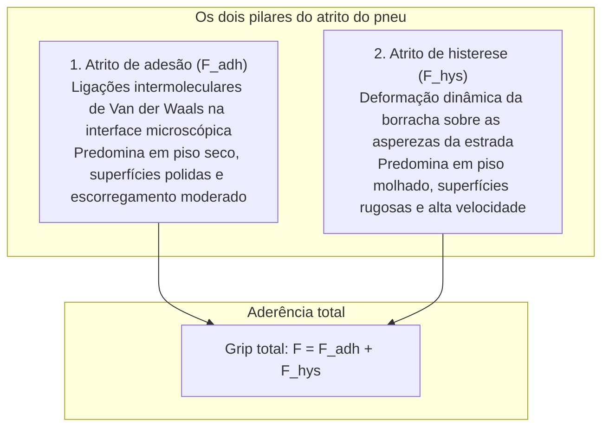

Um automóvel moderno de duas toneladas percorre a autoestrada a mais de 100 km/h sob chuva intensa. Ele curva com extrema precisão e, perante um imprevisto, imobiliza-se em poucas dezenas de metros.

Toda esta imensa dinâmica assenta numa área quase insignificante: <strong>quatro zonas de contacto (Contact Patches), cada uma do tamanho aproximado de um vulgar postal ilustrado</strong>.

As leis clássicas de Coulomb afirmam que o atrito é independente da área de contacto. No entanto, para a borracha pneumática, este postulado falha redondamente. O atrito dos pneus é <strong>«um fenómeno físico extremo e não linear governado pela viscoelasticidade dos polímeros, forças intermoleculares de Van der Waals e hidrodinâmica multifásica.»</strong>

---

## 1. A dualidade do atrito da borracha: Adesão e Histerese

A força total de atrito exercida por um pneu resulta da soma de dois mecanismos fundamentais:

$$F_{\text{friction}} = F_{\text{adhesion}} + F_{\text{hysteresis}}$$

### 1.1 Atrito de adesão: Conexão molecular à nanoescala
Em piso seco, a borracha flexível molda-se microscopicamente às rugosidades da estrada, ativando forças de atração de Van der Waals. Ao escorregar, estas cadeias moleculares comportam-se como molas elásticas que se esticam, rompem e voltam a ligar-se milhões de vezes por segundo. O atrito de adesão é diretamente proporcional à área real de contacto $A_{\text{real}}$.

### 1.2 Atrito de histerese: Dissipação de energia interna
Quando a água impede o contacto molecular direto, a <strong>histerese</strong> assegura a travagem. Ao galgar as micro-asperezas de pedra do asfalto, a borracha sofre compressões severas. Devido à sua viscosidade molecular, a descompressão sofre um atraso no tempo (atraso de relaxação). A pressão frontal $P_{\text{front}}$ é substancialmente superior à pressão traseira de alívio $P_{\text{rear}}$, gerando uma força resultante contrária ao movimento.

---

## 2. Ângulo de deriva e a Fórmula Mágica de Pacejka

Ao curvar, o plano da roda difere da trajetória real do veículo, criando o chamado <strong>ângulo de deriva (Slip Angle: $\alpha$)</strong>.
A deformação por corte dos blocos de piso gera a <strong>força lateral de guiamento (Cornering Force: $F_y$)</strong>.
O professor Hans B. Pacejka deduziu a célebre <strong>Fórmula Mágica (Magic Formula)</strong>:
$$Y(x) = D \sin\left[ C \arctan\left\{ Bx - E(Bx - \arctan(Bx)) \right\} \right]$$
Esta equação modela com exatidão a resposta não linear, o pico de saturação de aderência $D$ e a transição para a perda total de controlo.

---

## 3. Aquaplanagem e hidrodinâmica dos pisos

Com lâminas de água no asfalto, a fórmula de Horne (NASA) calcula a velocidade crítica de aquaplanagem:
$$v_c \approx 6,35 \sqrt{p_t} \quad [\text{km/h}]$$
Com $220\text{ kPa}$ de pressão, o pneu entra em risco de aquaplanagem a partir dos <strong>94 km/h</strong>. Os canais longitudinais do piso conseguem evacuar até 30 litros de água por segundo para restabelecer o contacto em seco.

---

## 4. Nanotecnologia da sílica e pneus de inverno

- <strong>Compósitos de sílica e silano</strong>: Substituem o negro de fumo por sílica precipitada ligada por organossilanos, reduzindo a resistência ao rolamento a 60 °C (economia de combustível) e aumentando brutalmente o atrito em piso molhado a 0 °C.
- <strong>Borracha alveolar para gelo</strong>: O gelo escorrega devido a uma micro-película de água líquida fundida pela pressão. A borracha celular esponjosa microporosa absorve instantaneamente esta água, restaurando a aderência sólida sobre o gelo.

---

## 5. Estrutura compósita interna do pneu radial

Sob o revestimento exterior de borracha vulcanizada, o pneu é uma estrutura compósita complexa:
1. <strong>Talão de aço (Bead Core)</strong>: Anel de fios de aço de alta resistência que fixa o pneu firmemente à jante.
2. <strong>Telas de carcaça radiais</strong>: Fios têxteis dispostos a 90 graus que contêm a pressão pneumática interna.
3. <strong>Cintas de aço</strong>: Camadas de cabos de aço cruzados sob a banda de rodagem, garantindo rigidez contra forças laterais.
4. <strong>Camada estanque interior (Inner Liner)</strong>: Folha de borracha butílica que impede a fuga de gases.

---

## 6. Conclusão

O pneu é um triunfo invisível da física dos polímeros e da mecânica dos contactos, mantendo a humanidade segura em cada curva e travagem.
