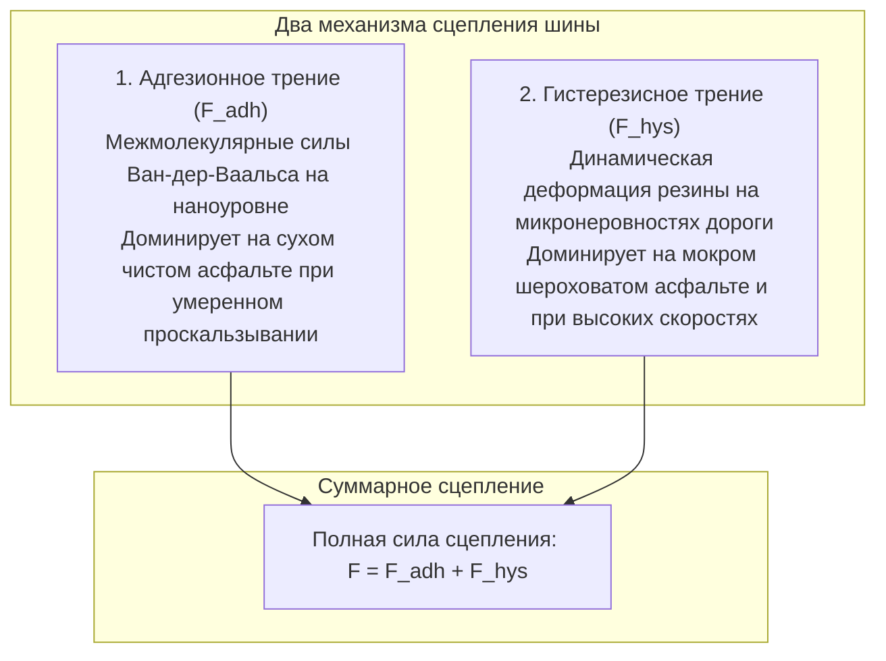

Многотонный современный автомобиль мчится по скоростной трассе в ливень на скорости свыше 100 км/ч. Он с ювелирной точностью вписывается в затяжной поворот и при возникновении опасности останавливается как вкопанный за считанные метры.

Вся эта грандиозная кинетическая энергия удерживается на асфальте единственным связующим звеном — <strong>четырьмя пятнами контакта (Contact Patch), каждое из которых по площади не превышает обычную почтовую открытку</strong>.

Классические законы сухого трения Амонтона-Кулона гласят, что сила трения не зависит от площади соприкосновения. Но для резиновых шин этот закон абсолютно неприменим. Трение резины — это <strong>«экстремальный нелинейный физический процесс, подчиняющийся вязкоупругости полимерных цепей, ван-дер-ваальсовым силам и многофазной гидродинамике.»</strong>

---

## 1. Два столпа трения резины: Адгезия и Гистерезис

Общая сила сцепления шины с дорогой складывается из двух фундаментальных составляющих:

$$F_{\text{friction}} = F_{\text{adhesion}} + F_{\text{hysteresis}}$$

### 1.1 Адгезионное трение: Молекулярное сцепление
На сухой дороге эластичный каучук проникает в мельчайшие поры минерального щебня. На дистанции в доли нанометра возникают силы Ван-дер-Ваальса. При сдвиге молекулярные цепочки растягиваются, рвутся и вновь завязываются миллионы раз в секунду. Сила адгезии прямо пропорциональна истинной площади микроконтакта $A_{\text{real}}$.

### 1.2 Гистерезисное трение: Поглощение энергии микрорельефом
Когда вода препятствует прямому молекулярному контакту, безопасность обеспечивает <strong>гистерезисное трение</strong>.
Шина накатывается на острые микровыступы дорожного полотна. Резина сжимается, но из-за своей внутренней вязкости восстанавливает форму с запаздыванием. Давление на передней грани выступа ($P_{\text{front}}$) значительно выше, чем на задней ($P_{\text{rear}}$). Эта асимметрия создает горизонтальное сопротивление движению, останавливая автомобиль даже на мокром асфальте.

---

## 2. Угол увода и «Магическая формула» Пасейки

При повороте направление вращения колеса не совпадает с реальной траекторией его движения. Возникает <strong>угол увода (Slip Angle: $\alpha$)</strong>.
Упругая деформация блоков протектора порождает боковую силу — <strong>поперечную силу сцепления (Cornering Force: $F_y$)</strong>.
Профессор Ханс Пасейка вывел знаменитую эмпирическую <strong>«Магическую формулу» (Magic Formula)</strong>:
$$Y(x) = D \sin\left[ C \arctan\left\{ Bx - E(Bx - \arctan(Bx)) \right\} \right]$$
Она с математической точностью описывает весь нелинейный диапазон: от линейного нарастания реакции до предельного срыва в неуправляемый занос.

---

## 3. Аквапланирование и гидродинамика протектора

При наличии водной пленки на скорости возникает гидродинамический клин. Формула Хорна (NASA) связывает критическую скорость аквапланирования с давлением в шине:
$$v_c \approx 6,35 \sqrt{p_t} \quad [\text{км/ч}]$$
При стандартном давлении $220\text{ кПа}$ шина может всплыть уже на скорости <strong>94 км/ч</strong>. Глубокие продольные канавки отводят до 30 литров воды в секунду на скорости 100 км/ч.

---

## 4. Нанохимия диоксида кремния и фрикционные зимние шины

- <strong>Силика (диоксид кремния) и силаны</strong>: Замена технического углерода на силикатные наночастицы снижает сопротивление качению при 60 °C на 20–30 %, одновременно увеличивая сцепление на мокрой дороге при 0 °C.
- <strong>Микропористая резина (Multicell Rubber)</strong>: Скольжение на льду вызывает тончайшая водяная пленка, образующаяся от трения. Микропоры зимней нешипованной резины впитывают эту влагу, как губка, восстанавливая сухое трение о кристаллы льда.

---

## 5. Внутренняя композитная анатомия радиальной шины

Под протектором скрывается сложная композитная конструкция:
1. <strong>Бортовые кольца (Bead Core)</strong>: Жгут из высокоуглеродистой стальной проволоки, удерживающий шину на ободе колеса.
2. <strong>Радиальный каркас (Carcass Ply)</strong>: Корд из синтетических волокон, воспринимающий внутреннее пневматическое давление.
3. <strong>Стальной брекер (Steel Belts)</strong>: Слои высокопрочной стальной сетки, противостоящие центробежным силам.
4. <strong>Гермослой (Inner Liner)</strong>: Слой бутилкаучука, удерживающий воздух без использования камеры.

---

## 6. Заключение

Автомобильная шина — это триумф прикладной науки, соединяющий физику высокомолекулярных соединений, трибологию и гидромеханику в одной высокотехнологичной оболочке.
