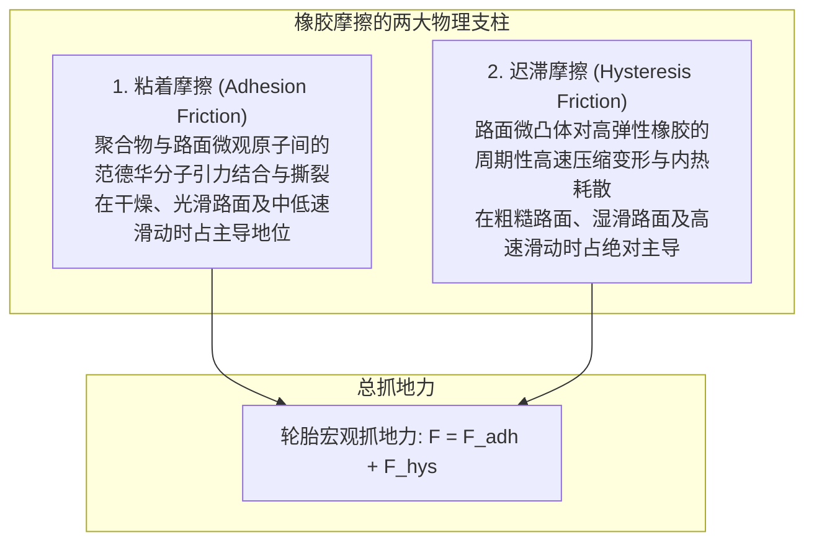

一辆重达两吨的钢铁与电池构成的现代汽车，以超过百公里的时速在暴雨中的高速公路上疾驰、精准切入弯道，并在遭遇险情时于数十米内稳稳停下。

支撑这庞大动能与极致操控的唯一物理媒介，是整车与地球表面接触的<strong>仅仅四块明信片大小的接触面（Contact Patch）</strong>。

翻开经典物理学课本，阿蒙顿-库仑摩擦定律断言：
1. 摩擦力与法向载荷成正比（$F = \mu N$）；
2. 摩擦力与表观接触面积无关；
3. 摩擦力与滑动速度无关。

如果这套刚体摩擦定律完全适用于汽车轮胎，那么赛车使用超宽热熔胎将变得毫无意义，甚至自行车胎也能提供相同的抓地力。然而在现实中，橡胶并非刚性金属，它是<strong>「受高分子聚合物粘弹性（Viscoelasticity）、范德华分子间引力及流体力学综合主导的极端非线性物理体系」</strong>。

---

## 1. 橡胶摩擦的双重核心：粘着摩擦与迟滞损失

橡胶与路面的总摩擦力由两大独立物理机制叠加而成：

$$F_{\text{friction}} = F_{\text{adhesion}}（粘着摩擦） + F_{\text{hysteresis}}（迟滞摩擦）$$

### 1.1 粘着摩擦（Adhesion）：分子尺度的结合与断裂
橡胶分子链在常温下处于高弹态。当轮胎压向沥青路面时，软质橡胶能顺应微观凹凸，深入到纳米尺度。此时，<strong>范德华力（Van der Waals force）</strong>在原子间建立连接。
随着轮胎相对路面移动，分子键被拉长蓄能，达到剪切极限时断裂释放能量，并在瞬间与邻近原子重新结合。这种“结合—拉伸—破裂—再结合”的高频循环（每秒数万至数百万次）形成了粘着摩擦。粘着力直接取决于真实微观接触面积 $A_{\text{real}}$，这解释了为何赛车要采用低弹性模量、超宽断面的软质光头胎。

### 1.2 迟滞摩擦（Hysteresis）：能量耗散的力学
在雨水或泥泞隔绝了分子间接触时，<strong>迟滞摩擦（Hysteresis Loss）</strong>成为防止车辆失控的最后屏障。

路面微观结构布满了微米级的尖锐凸起（Asperities）。当滚动轮胎滑过这些凸起时，橡胶局部遭受剧烈压缩；越过凸起后，橡胶依靠弹性回弹。
由于橡胶兼具弹性与粘性，其内部应力-应变曲线形成封闭的迟滞环。凸起迎风面的压缩反力 $P_{\text{front}}$ 极大，而背风面的回弹由于粘性滞后而大幅延迟（$P_{\text{rear}} < P_{\text{front}}$）。这种前后压力的不对称性在水平方向合成了强大的阻力，即使在水膜润滑下依然能稳定产生抓地力。

---

## 2. 粘弹性谱与 WLF 时温等效原理

材料动态力学分析通过复数弹性模量 $E^* = E' + i E''$ 与损耗因子 $\tan \delta = E'' / E'$ 描述橡胶特性。

根据聚合物物理学的<strong>WLF时温等效原理（Williams-Landel-Ferry equation）</strong>，降低温度等同于提高变形频率。
- <strong>轮胎滚动宏观形变（10～100 Hz）</strong>：发生在车轮旋转尺度。工程师要求在该频段尽量降低 $\tan \delta$，以抑制轮胎自发热，从而<strong>显著降低滚动阻力、节约燃油</strong>。
- <strong>路面微凸体微观冲击（$10^4 \sim 10^7\text{ Hz}$）</strong>：属于极高频微观形变。在该频段需要极高的 $\tan \delta$，以最大化迟滞能量耗散，从而<strong>提供强悍的湿地刹车性能</strong>。

---

## 3. 车辆如何过弯：侧偏角与帕捷卡魔术公式

车辆转向时，车轮滚动的几何指向与车轮实际行进方向存在微小夹角，该夹角称为<strong>侧偏角（Slip Angle: $\alpha$）</strong>。

在侧偏角作用下，轮胎接地印痕前端发生剪切变形（积蓄恢复力），后端发生滑移，整体产生的横向合力称为<strong>侧偏力（Cornering Force: $F_y$）</strong>。
荷兰学者帕捷卡（Hans B. Pacejka）提出了著名的<strong>魔术公式（Magic Formula）</strong>：

$$Y(x) = D \sin\left[ C \arctan\left\{ Bx - E(Bx - \arctan(Bx)) \right\} \right]$$

该公式精准拟合了侧偏力随侧偏角增加呈现的线性上升、峰值饱和及过极限失控的全过程，成为现代汽车底盘动力学与ESC电子稳定系统的核心控制基石。

---

## 4. 湿滑雨夜的死敌：水滑现象（Hydroplaning）流体力学

当路面积水超过 1～2 毫米，高速行驶的轮胎面临失控浮起的危险。

### 4.1 接地面三区流体模型
- <strong>流体动压区（Zone 1）</strong>：前方大量积水被轮胎主排水沟强力劈开，形成高动水压楔形水枕。
- <strong>过渡挤压区（Zone 2）</strong>：微细花纹与刀槽切断残留数十微米的薄水膜。
- <strong>干态接触区（Zone 3）</strong>：水分彻底排空，橡胶与微凸体实现分子级接触。

### 4.2 霍恩（Horne）水滑临界速度公式
NASA 工程师霍恩通过实验确定了水滑临界速度 $v_c$：
$$v_c \approx 6.35 \sqrt{p_t} \quad [\text{km/h}]$$
其中 $p_t$ 为轮胎胎压（$\text{kPa}$）。当胎压为标准的 $220\text{ kPa}$ 时，临界水滑速度约为 <strong>94 km/h</strong>。一旦胎压不足，水滑速度将骤降至 70 km/h 左右，极易引发致命水上漂事故。

---

## 5. 绿色轮胎与冬季无钉胎的材料科学革命

- <strong>白炭黑（高分散二氧化硅 Silica）配方技术</strong>：采用硅烷偶联剂将极性二氧化硅与非极性橡胶牢固偶联，在 60°C 滚动频段降低 20～30% 滚动阻力，同时在 0°C 高频区大幅提升湿地抓地力，完美打破了轮胎性能的“魔鬼三角”。
- <strong>冬季无钉防滑胎的微孔吸水技术</strong>：冰面之所以湿滑，源于冰面微观受压融化形成的一层微米级润滑水膜。无钉胎采用超低温柔软橡胶（$T_g$ 低至 $-60^\circ\text{C}$）结合<strong>发泡橡胶（Multicell Rubber）</strong>，其内部数以亿计的微观独立气孔如同微型海绵，瞬间吸除冰面水膜，恢复干燥直触抓地。

---

## 6. 结语

从纳米尺度的分子粘着，到毫米尺度的胎面排水流体动力学，轮胎绝非简单的黑色橡胶圆环，它是人类将高分子化学、接触力学与流体力学融合至微米极致的工业奇迹。
