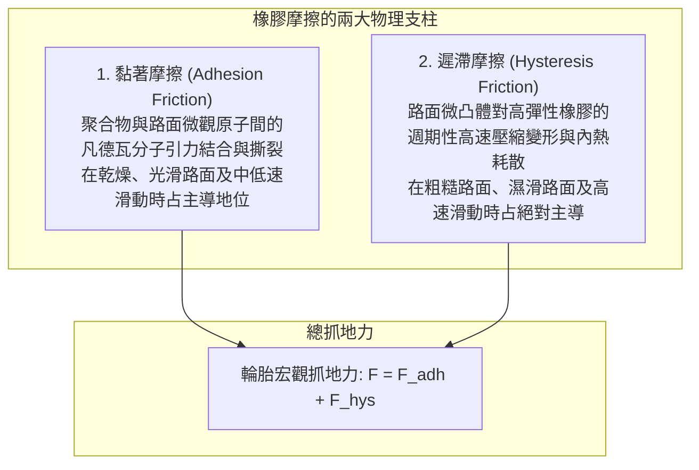
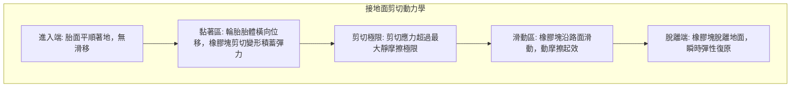

一輛重達兩噸的鋼鐵與電池構成的現代汽車，以超過百公里的時速在暴雨中的高速公路上疾馳、精準切入彎道，並在遭遇險情時於數十公尺內穩穩停下。

支撐這龐大動能與極致操控的唯一物理媒介，是整車與地球表面接觸的<strong>僅僅四塊明信片大小的接觸面（Contact Patch）</strong>。

翻開經典物理學課本，阿蒙頓-庫侖摩擦定律斷言：
1. 摩擦力與法向載重成正比（$F = \mu N$）；
2. 摩擦力與表觀接觸面積無關；
3. 摩擦力與滑動速度無關。

如果這套剛體摩擦定律完全適用於汽車輪胎，那麼賽車使用超寬熱熔胎將變得毫無意義，甚至單車胎也能提供相同的抓地力。然而在現實中，橡膠並非剛性金屬，它是<strong>「受高分子聚合物黏彈性（Viscoelasticity）、凡德瓦分子間引力及流體力學綜合主導的極端非線性物理體系」</strong>。

---

## 1. 橡膠摩擦的雙重核心：黏著摩擦與遲滯損失

橡膠與路面的總摩擦力由兩大獨立物理機制疊加而成：

$$F_{\text{friction}} = F_{\text{adhesion}}（黏著摩擦） + F_{\text{hysteresis}}（遲滯摩擦）$$

### 1.1 黏著摩擦（Adhesion）：分子尺度的結合與斷裂
橡膠分子鏈在常溫下處於高彈態。當輪胎壓向瀝青路面時，軟質橡膠能順應微觀凹凸，深入到奈米尺度。此時，<strong>凡德瓦力（Van der Waals force）</strong>在原子間建立連接。
隨著輪胎相對路面移動，分子鍵被拉長蓄能，達到剪切極限時斷裂釋放能量，並在瞬間與鄰近原子重新結合。這種“結合—拉伸—破裂—再結合”的高頻循環（每秒數萬至數百萬次）形成了黏著摩擦。粘著摩擦力與真實微觀接觸面積 $A_{\text{real}}$ 直接成正比：
$$F_{\text{adhesion}} = \tau_s \cdot A_{\text{real}}$$
這說明了為何賽車必須使用低彈性模數、胎面寬闊的熱熔胎以爭取最大極限接觸面積。

### 1.2 遲滯摩擦（Hysteresis）：能量耗散的力學
在雨水或泥漿隔絕了分子間接觸時，<strong>遲滯摩擦（Hysteresis Loss）</strong>成為防止車輛失控的救命防線。
路面微觀結構布滿了微米至毫米級的尖銳凸起（Asperities）。當輪胎滑過這些凸起時，凸起迎風面的壓縮反力 $P_{\text{front}}$ 遠大於背風面因黏性遲緩回彈的反力 $P_{\text{rear}}$：
$$P_{\text{front}} > P_{\text{rear}}$$
前後壓力的不對稱性合成了強大的水平阻力。這種能量耗散直接轉換為橡膠內部熱能，在濕滑路面上提供不可替代的抓地力。

---

## 2. 黏彈性光譜與 WLF 時溫等效原理

高分子聚合物受動態交變應變時，其應力響應存在相位延遲 $\delta$。複數彈性模數表示為：
$$E^* = E' + i E''$$
損耗因子定義為 $\tan \delta = E'' / E'$。
根據著名的<strong>WLF時溫等效原理（Williams-Landel-Ferry equation）</strong>，降低溫度在物理上等同於提高變形頻率。
- <strong>低頻輪胎旋轉形變（10～100 Hz，約 60°C）</strong>：胎體循環彎曲，此頻段必須將 $\tan \delta$ 降至最低，以抑制滾動阻力，降低車輛油耗或電耗。
- <strong>高頻路面微凸體激發（$10^4 \sim 10^7\text{ Hz}$，約 0°C）</strong>：橡膠劇烈剪切，此頻段必須極大化 $\tan \delta$，以釋放最大摩擦抓地力。

---

## 3. 車輛轉向動力學：側偏角與帕捷卡魔術公式

車輛轉彎時，輪胎滾動方向與實際行進方向存在微小夾角，即<strong>側偏角（Slip Angle: $\alpha$）</strong>。

接地面內部的前端剪切變形與後端滑移合成了使車輛轉向的<strong>側偏力（Cornering Force: $F_y$）</strong>。
荷蘭學者帕捷卡（Hans B. Pacejka）提出了著名的<strong>魔術公式（Magic Formula）</strong>：
$$Y(x) = D \sin\left[ C \arctan\left\{ Bx - E(Bx - \arctan(Bx)) \right\} \right]$$
此公式精確描繪了側偏力隨側偏角非線性增長、達到極限峰值 $D$（通常在 $6^\circ \sim 9^\circ$）並進入飽和滑移的完整物理過程，是現代底盤調校與電子穩定程序（ESP）的核心算法基礎。

---

## 4. 水滑現象（Hydroplaning）流體力學與花紋設計

當路面積水超過 1～2 毫米時，高速行駛的輪胎面臨水滑失控風險。根據 NASA 霍恩（Horne）臨界公式：
$$v_c \approx 6.35 \sqrt{p_t} \quad [\text{km/h}]$$
胎壓為 $220\text{ kPa}$ 時的水滑臨界速度約為 <strong>94 km/h</strong>。若胎壓不足至 $150\text{ kPa}$，浮水速度驟降至 77 km/h。
高性能輪胎透過縱向主溝槽、橫向導流斜溝與毛細刀槽花紋，在百公里時速下每秒強行排開高達 30 公升積水，確保乾態接觸區的完整建立。

---

## 5. 材料科學革命：白煙（二氧化矽）與冬季無釘胎

- <strong>二氧化矽（Silica / 白煙）奈米複合材料</strong>：傳統碳黑易團聚生熱。藉助雙官能基矽烷偶聯劑，將親水性白煙奈米粒子與疏水性橡膠分子化學交聯，成功將滾動阻力降低 20～30%，同時顯著縮短濕地煞車距離。
- <strong>發泡橡膠（Multicell Rubber）微孔吸水技術</strong>：冰面之所以極度濕滑，是由於局部微受壓融化形成的微米級潤滑水膜。無釘防滑胎採用超低玻璃化轉變溫度（$T_g$ 低至 $-60^\circ\text{C}$）的高彈性橡膠，其內部密布的微觀獨立氣孔如同微型海綿，瞬間吸除冰面水膜，恢復乾燥直觸抓地。

---

---

## 6. 輪胎內部複合結構工學

外觀看似單純的黑色橡膠環，其內部實為高強度複合材料工程的極致結晶：
1. <strong>胎唇鋼絲環（Bead Core）</strong>：高碳鋼琴線束牢固錨定於輪圈邊緣，承受高達數百千帕的內胎氣壓。
2. <strong>輻射層簾布（Carcass Ply）</strong>：高強度聚酯或人造絲簾線呈 90 度垂直排列，構成承受內部充氣壓力的抗爆骨架。
3. <strong>高張力鋼絲環帶（Steel Belts）</strong>：交叉成角度（通常為 $\pm 20^\circ$）鋪設於胎面下方，提供強大的抗剪切剛性，防止胎面在高速離心力下鼓脹變形。
4. <strong>氣密層（Inner Liner）</strong>：高氣密性鹵化丁基橡膠薄膜，徹底阻隔氮氣與氧氣分子向外滲漏，維持長達數月的標準胎壓。

## 7. 結語

從奈米級分子凡德瓦力到宏觀流體排水力學，汽車輪胎是人類將高分子化學、接觸力學與流體力學發揮至極致的工藝奇蹟。
