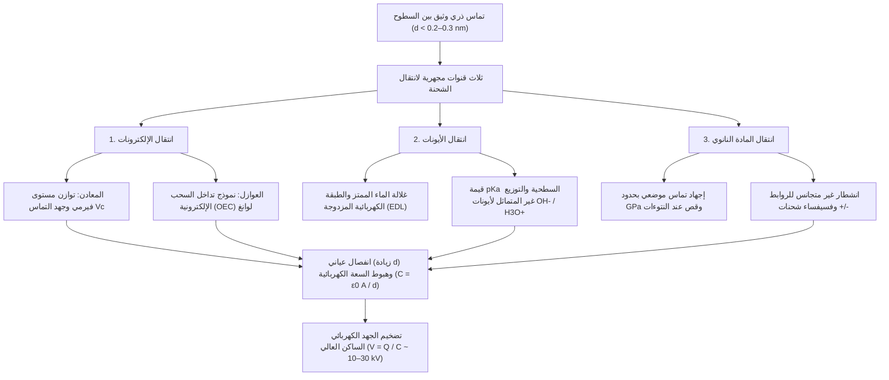
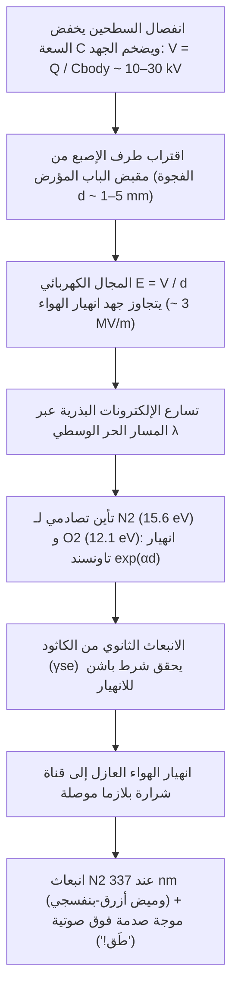

## 1. مقدمة: لغز عمره 2600 عام يختبئ في مقبض الباب الشتوي

في صباح شتوي جاف وبارد، تمشي فوق سجادة الغرفة وتمد يدك نحو مقبض الباب النحاسي، وفجأة —*طَق!*— تقفز صاعقة مصغرة زرقاء وبيضاء من طرف إصبعك لتصيبك بوخزة كهربائية حادة. وعندما تخلع سترة صوفية في الظلام تسمع طقطقة مصحوبة بشرارات بنفسجية خافتة؛ بل إن فك لفة شريط لاصق عادي داخل غرفة مفرغة من الهواء يطلق أشعة سينية كافية لتصوير عظام إصبعك. كل هذه الظواهر اليومية تنبع من العملية الفيزيائية الأساسية نفسها: <strong>الكهرباء الساكنة (Static Electricity)</strong>، المعروفة في الفيزياء باسم <strong>الكهرباء الاحتكاكية (Triboelectricity)</strong> أو بدقة أكبر <strong>التكهرب بالتماس (Contact Electrification, CE)</strong>.

تاريخياً، كانت الكهرباء الاحتكاكية أول لقاء للبشرية مع الظواهر الكهرومغناطيسية. فحوالي عام $600\,\text{ق.م}$، سجل الفيلسوف اليوناني طاليس الملطي أن دلك الراتنج المتحجر —<strong>الكهرمان (Amber)</strong>، المسمى باليونانية $\eta\lambda\epsilon\kappa\tau\rho o\nu$ (*ēlektron*)— بفرو الحيوانات يمنحه قدرة خفية على جذب القش والريش الخفيف. وفي القرن السابع عشر، صاغ الطبيب الإنجليزي ويليام جيلبرت المصطلح اللاتيني الجديد *electricus* («شبيه الكهرمان»)، ومنه ولدت كلمتا *الكهرباء (Electricity)* و*الإلكترون (Electron)*.

غير أن وراء هذه التجربة المألوفة يكمن أحد أكثر أسرار العلم الحديث إدهاشاً: <strong>حتى في القرن الحادي والعشرين —بعد أن وحّد ماكسويل الكهرومغناطيسية، وحلّت ميكانيكا الكم ذرة الهيدروجين، ورصد الفيزيائيون موجات الجاذبية وبوزون هيغز— لا تزال الآلية المجهرية الأساسية لكيفية انتقال الشحنة الكهربائية بين سطحين عازلين عند التلامس واحدة من أكثر المسائل المفتوحة جدلاً في فيزياء المادة المكثفة وكيمياء السطوح.</strong>

وبينما يُفسَّر انتقال الإلكترونات بين *معدنين* بسهولة عبر تساوي مستويات فيرمي، فإن المواد التلامسية الشائعة —كالزجاج، ومتعدد رباعي فلورو الإيثيلين (PTFE / التيفلون)، والنايلون، والمطاط السيليكوني، وشعر الإنسان— هي <strong>عوازل (Dielectrics)</strong> ذات فجوات طاقة إلكترونية واسعة ($E_g \approx 4\text{–}9\,\text{eV}$) وتكاد تخلو تماماً من إلكترونات التوصيل الحرة في درجة حرارة الغرفة. عندما يتلامس عازلان، ما الكيان الفيزيائي الذي يعبر السطح البيني فعلياً؟ هل هي <strong>إلكترونات</strong> تعبر بالنفق الكمي بين حالات سطحية موضعية أو مدارات ذرية متداخلة؟ أم <strong>أيونات متحركة</strong> ($\text{H}_3\text{O}^+, \text{OH}^-$) تتوزع عبر طبقات مياه ممتزة نانومترية؟ أم <strong>شظايا مادية نانوية</strong> ناتجة عن الانشطار الميكانيكي الكيميائي لسلاسل البوليمر التساهمية؟

في هذا المقال نفكك فيزياء الكهرباء الساكنة من المقياس الذري إلى المقاييس الكوكبية والصناعية: الفرق بين مساحة التماس الظاهرية والحقيقية، والآليات المجهرية الثلاث بما فيها <strong>نموذج تداخل السحب الإلكترونية (OEC)</strong> للعالم تشونغ لين وانغ، ومفارقات السلسلة الاحتكاكية الدورية وتكهرب المواد المتماثلة في العواصف الرملية والأقراص الكوكبية الأولية، وتأثير الرطوبة الشتوية، و<strong>قانون باشن (Paschen's Law)</strong> للانهيار الكهربائي، وتطبيقاتها في طابعات الليزر وكمامات N95 و<strong>المولدات النانوية التلامسية (TENG)</strong>.

---

## 2. حقيقة «الاحتكاك»: مساحة التماس الظاهرية مقابل الحقيقية

في اللغة اليومية نتحدث عن «كهرباء الاحتكاك» (من اليونانية *tribos* بمعنى الفرك). لكن فيزياء السطوح الحديثة أثبتت أن الاحتكاك الحركي ليس شرطاً مسبقاً لتوليد الشحنة؛ إذ يحدث انتقال الشحنة بمجرد <strong>التماس الفيزيائي الوثيق ثم الانفصال</strong>. فلماذا نفرك البالون بالشعر إذن؟

### 2.1 النتوءات السطحية ومساحة التماس الحقيقية $A_{\text{real}} \ll A_{\text{apparent}}$

تحت مجهر القوة الذرية (AFM)، يبدو أي سطح صلب —باستثناء البلورات الطبقية المشطورة ذرياً كالميكا أو الغرافين— كسلسلة جبال وعرة من القمم والوديان النانوية والميكروية تُسمى <strong>النتوءات المجهرية (Asperities)</strong>. عند ضغط جسمين بمساحة اسمية $A_{\text{apparent}}$ تحت قوة عمودية $F_N$، يحدث التماس فقط عند قمم أعلى النتوءات المتقابلة. ووفقاً لميكانيكا التماس لبودن-تابور وغرينوود-ويليامسون، فإن <strong>مساحة التماس الحقيقية ($A_{\text{real}}$)</strong> تتناسب طردياً مع الحمل العمودي مقسوماً على معامل المرونة الفعال $E^*$:

$$A_{\text{real}} = \sum_{i=1}^{N} A_i \propto \frac{F_N}{E^*} \quad \left( \text{عادةً } \frac{A_{\text{real}}}{A_{\text{apparent}}} \sim 10^{-5} \text{ إلى } 10^{-3} \right)$$

تحت قوى الضغط العادية، <strong>فإن أقل من $0.001\%$ إلى $0.1\%$ فقط من المساحة الظاهرية يحقق تماساً ذرياً فعلياً!</strong>

### 2.2 جهد لينارد-جونز والدخول في نظام تنافر باولي قصير المدى

لكي يعبر إلكترون أو أيون من الذرة A إلى الذرة B، يجب تقريب الذرتين إلى مسافة <strong>$d \lesssim 0.2\text{–}0.3\,\text{nm}$</strong>، وهي مقاربة لطول الرابطة الكيميائية. لننظر إلى <strong>جهد لينارد-جونز (Lennard-Jones Potential)</strong> $U_{\text{LJ}}(r)$:

$$U_{\text{LJ}}(r) = 4\varepsilon \left[ \left(\frac{\sigma}{r}\right)^{12} - \left(\frac{\sigma}{r}\right)^{6} \right]$$

يمثل الحد $-\left(\sigma/r\right)^6$ قوى تجاذب فان دير فالس بعيدة المدى، بينما يمثل الحد الحاد $+\left(\sigma/r\right)^{12}$ <strong>تنافر باولي قصير المدى</strong> عندما تبدأ السحب الإلكترونية الخارجية بالتداخل مكانياً. يتطلب انتقال الشحنة دفع ذرات السطح البيني إلى <strong>منطقة التنافر ($r < r_{\text{eq}}$)</strong> هذه. الدور الفيزيائي الحقيقي للفرك (الانزلاق المماسي) هو جعل النتوءات تمسح مناطق جديدة من السطح المقابل، مما <strong>يضاعف مساحة التماس الحقيقية التراكمية $\int A_{\text{real}}\,dt$ التي تبلغ القرب الذري ($d \lesssim 0.3\,\text{nm}$) مئات أو آلاف المرات!</strong>

---

## 3. الآليات المجهرية الثلاث لانتقال الشحنة

تكشف علوم السطوح أن <strong>ثلاث قنوات مجهرية</strong> تعمل بشكل مستقل أو تكاملي تبعاً لنوع المادة والبيئة:

### 3.1 انتقال الإلكترونات: من مستوى فيرمي إلى نموذج تداخل السحب الإلكترونية (OEC)

#### (1) تماس معدن–معدنوفرق جهد فولتا
في المعدن تخضع إلكترونات التوصيل <strong>لتوزيع فيرمي-ديراك</strong>:

$$f(E) = \frac{1}{\exp\left(\frac{E - E_F}{k_B T}\right) + 1}$$

حيث $E_F$ مستوى فيرمي و$\Phi = E_{\text{vac}} - E_F$ دالة الشغل. عند تلامس معدنين ($\Phi_1 < \Phi_2$)، تنتقل الإلكترونات بالنفق الكمي من المعدن 1 إلى المعدن 2 حتى يتساوى مستويا فيرمي، فينشأ <strong>فرق جهد التماس لفولتا $V_c = -(\Phi_1 - \Phi_2)/e$</strong>.

#### (2) تماس عازل–عازل: الحالات السطحية ونموذج OEC لتشونغ لين وانغ
في العوازل، يؤدي انقطاع التناظر البلوري عند السطح إلى خلق <strong>حالات سطحية موضعية</strong> داخل فجوة الطاقة. وبين عامي 2018 و2020، طرح البروفيسور <strong>تشونغ لين وانغ (Zhong Lin Wang)</strong> إطاراً كمياً شاملاً يُعرف باسم <strong>نموذج تداخل السحب الإلكترونية (Overlapped Electron-Cloud, OEC Model)</strong>:
- <strong>قبل التماس ($d > 0.5\,\text{nm}$)</strong>: تكون إلكترونات التكافؤ في الذرتين A وB محصورة في بئرين جهديين منفصلين يفصل بينهما حاجز طاقة مرتفع $E_b$.
- <strong>أثناء التماس الميكانيكي الوثيق ($d < 0.2\text{–}0.3\,\text{nm}$)</strong>: عندما تدفع القوة العمودية الذرتين إلى منطقة تنافر لينارد-جونز، تتداخل المدارات الخارجية $\psi_A$ و$\psi_B$ بقوة ($\langle \psi_A | \psi_B \rangle \neq 0$). يؤدي هذا التداخل المداري إلى خفض حاجز الجهد $E_b$ بشدة، محولاً البئر المزدوج إلى بئر غير متماثل منخفض الحاجز.
- <strong>الانتقال الكمي والاحتجاز عند الانفصال</strong>: مع انخفاض الحاجز، تنتقل الإلكترونات ضعيفة الارتباط في المدارات الأعلى طاقة بالذرة A تلقائياً إلى المدارات الفارغة الأخفض طاقة بالذرة B. وعند انفصال السطحين ($d \to \infty$)، يرتفع الحاجز $E_b$ فوراً ليحبس الإلكترونات المنتقلة بشكل دائم في السطح B.

أثبت فريق وانغ تجريبياً أن الاضمحلال الحراري للشحنات التلامسية ($350\text{–}650\,\text{K}$) يتبع بدقة <strong>قانون الانبعاث الأيوني الحراري لريتشاردسون-دوشمان</strong>:

$$J_{\text{th}} = A^* T^2 \exp\left(-\frac{\Phi_B}{k_B T}\right)$$

### 3.2 انتقال الأيونات: غلالات الماء الممتز والطبقة الكهربائية المزدوجة (EDL)

في السطوح المحبة للماء أو البوليمرات الأيونية تحت الرطوبة الجوية، أثبت <strong>جورج وايتسايدز (George M. Whitesides)</strong> وزملاؤه (2008) الدور المحوري <strong>لانتقال الأيونات المتحركة</strong>. يغطي كل سطح صلب تقريباً غشاء ماء نانومتري ($0.5\text{–}5\,\text{nm}$). يفقد الزجاج ($\text{SiO}_2$) بروتونات مجموعات السيلانول ($-\text{Si–O}^- + \text{H}_3\text{O}^+$) مكوناً <strong>طبقة كهربائية مزدوجة (EDL)</strong> غنية بأيونات $\text{H}_3\text{O}^+$ المتحركة، بينما تمتز البوليمرات الكارهة للماء مثل PTFE <strong>أيونات الهيدروكسيد ($\text{OH}^-$)</strong> بشكل تفضيلي. عند التماس، تندمج جسور الماء الشعرية وعند الانفصال تنقطع بشكل غير متماثل.

### 3.3 انتقال المادة النانوي والكيمياء الميكانيكية: فسيفساء الشحنات

في عام 2011، اكتشف <strong>بارتوش غجيبوفسكي (Bartosz A. Grzybowski)</strong> وزملاؤه (*Science* 2011) بواسطة مجهر مسبار كلفن (KPFM) أن العازل المشحون بالتماس يشكل <strong>فسيفساء نانوية من نطاقات موجبة ($+$) وسالبة ($-$) ($10\text{–}200\,\text{nm}$)</strong>. تؤدي الضغوط الموضعية التي تبلغ غيغاباسكال ($\sim \text{GPa}$) عند قمم النتوءات إلى <strong>انشطار ميكانيكي كيميائي غير متجانس للروابط التساهمية</strong> (مولداً أيونات ميكانيكية $\text{R}_1^+ + \text{R}_2^-$ وجذوراً حرة) مع انتقال متبادل لشظايا البوليمر.

| الخاصية | 1. انتقال الإلكترونات | 2. انتقال الأيونات | 3. انتقال المادة النانوي والكيمياء الميكانيكية |
| :--- | :--- | :--- | :--- |
| <strong>حامل الشحنة الأساسي</strong> | الإلكترونات ($e^-$) | الأيونات المتحركة ($\text{H}_3\text{O}^+, \text{OH}^-$) | شظايا أوليغومر مشحونة وأيونات ميكانيكية ($\text{R}^+, \text{R}^-$) |
| <strong>الإطار النظري</strong> | مستوى فيرمي، الحالات السطحية، <strong>نموذج OEC</strong> | غلالة الماء، <strong>EDL</strong>، $\text{pK}_a$ وجهد زيتا $\zeta$ | <strong>انشطار الروابط الميكانيكي الكيميائي</strong>، التآكل الالتصاقي |
| <strong>المقياس المكاني</strong> | منطقة التنافر الذري ($d \lesssim 0.2\text{–}0.3\,\text{nm}$) | سمك غشاء الماء ($0.5\text{–}10\,\text{nm}$) | فسيفساء النطاقات النانوية ($10\text{–}500\,\text{nm}$) |
| <strong>الحساسية البيئية</strong> | يعمل في الفراغ الفائق (UHV) والحرارة المنخفضة؛ اضمحلال حراري $>350\,\text{K}$ | يعتمد بشدة على الرطوبة النسبية ($RH$) | يعتمد على إجهاد القص والتشابك البوليمري |

---

## 4. السلسلة الكهربائية الاحتكاكية ومفارقاتها

### 4.1 الأصول الكيميائية والكمية للسلسلة الكهربائية الاحتكاكية

تُرتب <strong>السلسلة الكهربائية الاحتكاكية</strong> —التي جمعها يوهان كارل فيلكه عام 1757 وعيّرها كمياً فريق وانغ (2019) مقابل الزئبق السائل عبر كثافة الشحنة المعيارية $\sigma_N$ ($\mu\text{C/m}^2$)— المواد من الأكثر إيجابية ($+$) إلى الأكثر سلبية ($-$):

| القطبية | المواد الممثلة | المجموعات الوظيفية السائدة | كثافة الشحنة $\sigma_N$ ($\mu\text{C/m}^2$) | الآلية الإلكترونية والكيميائية |
| :---: | :--- | :--- | :---: | :--- |
| <strong>موجبة بقوة ($+++$)</strong> | الكوارتز / الزجاج ($\text{SiO}_2$)، الميكا | مجموعات السيلانول ($-\text{Si–OH}$)، شبكة السيليكات | $+80 \text{ إلى } +110$ | الأزواج الإلكترونية الحرة عالية الطاقة على الأكسجين تمنح الإلكترونات بسهولة (قاعدة لويس) |
| <strong>موجبة باعتدال ($++$)</strong> | نايلون-6,6، جلد وشعر الإنسان، الصوف | روابط الأميد ($-\text{NH–CO}-$)، الأمينات ($-\text{NH}_2$)، الكيراتين | $+50 \text{ إلى } +85$ | أزواج N/O المانحة للإلكترونات؛ تفسر الشحنة القوية بين السترة الصوفية والجلد |
| <strong>موجبة قليلاً ($+$)</strong> | الألومنيوم، الورق (السليلوز)، القطن، الخشب | أكسيد أصلي ($\text{Al}_2\text{O}_3$)، بوليمرات حيوية غنية بـ $-\text{OH}$ | $+10 \text{ إلى } +40$ | منح معتدل للإلكترونات وتوزيع البروتونات |
| <strong>متعادلة ($0$)</strong> | الفولاذ، PMMA (أكريليك)، بولي كربونات (PC) | بحر فيرمي المعدني، مجموعات الإستر والكربونات | $-10 \text{ إلى } +10$ | سلوك متردد: يشحن إيجابياً أمام PTFE وسلبياً أمام النايلون |
| <strong>سالبة باعتدال ($-$)</strong> | بولي ستايرين (PS)، بولي إيثيلين (PE)، بولي بروبيلين (PP) | سلاسل هيدروكربونية مشبعة ($-\text{CH}_2-$) | $-30 \text{ إلى } -60$ | سطوح غير قطبية كارهة للماء؛ تحبس الإلكترونات وتمتز $\text{OH}^-$ |
| <strong>سالبة بقوة ($--$)</strong> | PVC، PDMS (سيليكون)، كابتون (بولي إيميد) | روابط $-\text{C–Cl}$، هيكل سيلوكسان، حلقات إيميد | $-70 \text{ إلى } -110$ | ذرات الكلور عالية الكهروسلبية ($\chi = 3.16$) وحلقات الإيميد الساحبة للإلكترونات |
| <strong>سالبة للغاية ($---$)</strong> | <strong>PTFE (تيفلون)</strong>، FEP، PVDF | سلاسل مشبعة بالفلور ($-(\text{CF}_2-\text{CF}_2)_n-$)، غلاف $\text{C–F}$ | $-110 \text{ إلى } -150$ | <strong>يمتلك الفلور أعلى كهروسلبية لباولنغ ($\chi = 3.98$)</strong>؛ مدارات $\sigma^*$ عميقة تحبس الإلكترونات |

### 4.2 المفارقات: الحلقات غير المتعدية ($A > B > C > A$) وتكهرب المواد المتماثلة

بسبب تداخل الحالات الإلكترونية والأيونات وعدم تماثل معامل المرونة ($E_A \neq E_B$)، قد تنكسر خاصية التعدي لتظهر <strong>ثلاثيات دورية ($A > B > C > A$)</strong>.

بل إن قطعتين من <strong>المادة نفسها كيميائياً</strong> تشحنان بعضهما عند التصادم بفضل آليتين لكسر التناظر:
1. <strong>الكهرباء الانحنائية (Flexoelectricity) الناتجة عن تدرج الانفعال</strong>: يولد تدرج الانفعال $\frac{\partial \varepsilon_{jk}}{\partial x_l}$ استقطاباً $P_i = \mu_{ijkl} \frac{\partial \varepsilon_{jk}}{\partial x_l}$ يزيح حواف نطاقات الطاقة الموضعية.
2. <strong>الشحن ثنائي القطب المعتمد على حجم الجسيمات (الصغيرة $-$ والكبيرة $+$)</strong>: عند تصادم الحبيبات (نموذج لاكس-كوك-فايتوكايتس)، <strong>تكتسب الجسيمات الأصغر شحنة سالبة ($-$) والأكبر شحنة موجبة ($+$)</strong>. يفصل التيار الصاعد والجاذبية هذه الشحنات، مولداً مجالات بملايين الفولتات لكل متر تطلق <strong>برق العواصف الرملية الصحراوية</strong>، و<strong>البرق البركاني («العواصف الرعدية القذرة»)</strong>، وتساعد غبار السيليكات في الأقراص الكوكبية الأولية على تجاوز <strong>«حاجز المتر»</strong> لتكوين الكواكب المصغرة والكواكب الصخرية كالأرض (Steinpilz & Wurm, *Nature Physics* 2020).

---

## 5. الرطوبة، وتضخيم السعة ($V = Q / C$)، وقانون باشن للتفريغ الكهربائي

### 5.1 لماذا تشتد الكهرباء الساكنة شتاءً: أيزوثيرم BET والموصلية السطحية

الهواء الشتوي الجاف يمنع تسرب الشحنة. يخضع عدد طبقات الماء الممتزة $\theta_{\text{BET}}$ <strong>لمعادلة بروناور-إيميت-تيلر (BET)</strong>:

$$\theta_{\text{BET}}(RH) = \frac{v}{v_m} = \frac{c \cdot RH}{(1 - RH)\left[1 + (c - 1)RH\right]}$$

في الشتاء ($RH < 20\text{–}30\%$ داخل المباني) يكون $\theta_{\text{BET}} < 1$: يشكل الماء جزراً معزولة وتتجاوز المقاومة السطحية $10^{15}\,\Omega/\text{sq}$. أما في الصيف ($RH > 60\text{–}70\%$) فتتكون شبكة مائية متصلة ($2\text{–}5$ طبقات) تقفز عبرها البروتونات ($\text{H}^+$) وفق <strong>آلية غروتوس (Grotthuss mechanism)</strong>، مما يرفع الموصلية السطحية $\sigma_s(RH) \approx \sigma_0 \exp(\alpha_{\text{RH}} \cdot RH)$ أسياً بمقدار $6$ إلى $10$ رتب أسية.

### 5.2 تضخيم الجهد ($V = Q / C$) وقانون باشن

عند التماس ($d_0 \approx 1\,\text{nm}$) تكون السعة $C_0 = \varepsilon_0 A / d_0$ هائلة والجهد بضعة فولتات فقط. وعند رفع القدم عن السجادة يزداد $d$ بمقدار $10^8$ مرة وتهبط السعة إلى سعة جسم الإنسان ($C_{\text{body}} \approx 150\,\text{pF}$). ومع بقاء الشحنة $Q$ محفوظة، يضخم الشغل الميكانيكي للعضلات الجهد وفق $V(d) = Q / C(d)$ ليصل إلى <strong>$10,000\text{–}30,000\,\text{V}$ ($10\text{–}30\,\text{kV}$)</strong>! لا تقتلنا هذه الصدمة لأن الطاقة المخزنة لا تتجاوز $U_E = \frac{1}{2}C_{\text{body}}V^2 = 30\,\text{mJ}$ ($Q = 3.0\,\mu\text{C}$، مدة النبضة $\tau \approx 150\,\text{ns}$)، لكنها تدمر فوراً أكسيد البوابة البالغ سمكه $2\,\text{nm}$ في رقائق CMOS الحديثة.

عند اقتراب الإصبع من مقبض الباب لبضعة مليمترات، يطلق المجال $E = V/d$ <strong>انهيار تاونسند الإلكتروني</strong> ($\alpha = Ap\exp(-Bp/E)$) والانبعاث الثانوي ($\gamma_{\text{se}}$)، المحكوم <strong>بقانون باشن (1889)</strong>:

$$V_B(p d) = \frac{B \cdot p d}{\ln(A \cdot p d) - \ln\left[\ln\left(1 + \frac{1}{\gamma_{\text{se}}}\right)\right]}$$

عند ضغط $1\,\text{atm}$ يبلغ مجال انهيار الهواء <strong>$E_{\text{crit}} \approx 3\,\text{kV/mm}$</strong> و<strong>الحد الأدنى لباشن $V_{\text{min}} \approx 327\,\text{V}$</strong> ($pd \approx 7.5\,\mu\text{m}\cdot\text{atm}$). ينبعث الوميض الأزرق-البنفسجي من جزيئات النيتروجين المثارة ($\text{N}_2$، $\lambda = 337.1\,\text{nm}$)، بينما ينشأ صوت الطقطقة من التمدد الحراري فوق الصوتي لقناة البلازما.

---

## 6. التطبيقات التقنية: الطباعة بالليزر، وكمامات N95، ومولدات TENG

1. <strong>التصوير الجاف (طابعات الليزر) والمرسبات الكهروستاتيكية (ESP)</strong>: تعتمد طابعات الليزر على حبيبات الحبر المشحونة احتكاكياً ($Q/M \approx -20\text{ إلى }-40\,\mu\text{C/g}$)، بينما تلتقط مرسبات كوتريل الصناعية $>99.9\%$ من جسيمات $\text{PM}_{2.5}$.
2. <strong>مرشحات الإلكتريت في كمامات N95 الطبية</strong>: تولد ألياف البولي بروبيلين المشحونة كـ<strong>إلكتريت (Electret)</strong> تدرجات مجال كهربائي قوية تجذب الهباء الفيروسي المتعادل ($0.1\text{–}0.3\,\mu\text{m}$) عبر <strong>قوة الاستقطاب الكهربائي غير المنتظم (Dielectrophoretic Force)</strong> دون إعاقة التنفس:

$$\mathbf{F}_{\text{DEP}} = 2\pi r_p^3 \varepsilon_0 \left(\frac{\varepsilon_p - \varepsilon_0}{\varepsilon_p + 2\varepsilon_0}\right) \nabla |\mathbf{E}|^2$$

3. <strong>المولدات النانوية التلامسية (TENG) وتيار الإزاحة لماكسويل</strong>: اخترعها تشونغ لين وانغ عام 2012 لتحويل الطاقة الميكانيكية منخفضة التردد إلى كهرباء عبر حد الاستقطاب السطحي $\frac{\partial \mathbf{P}_s}{\partial t}$ المضاف إلى <strong>تيار الإزاحة لماكسويل</strong>:

$$\mathbf{J}_D = \frac{\partial \mathbf{D}}{\partial t} = \varepsilon_0 \frac{\partial \mathbf{E}}{\partial t} + \frac{\partial \mathbf{P}_s}{\partial t}$$

مما يتيح حصاد طاقة خطوات الإنسان ونبض القلب وقطرات المطر وأمواج المحيط (*الطاقة الزرقاء*).
