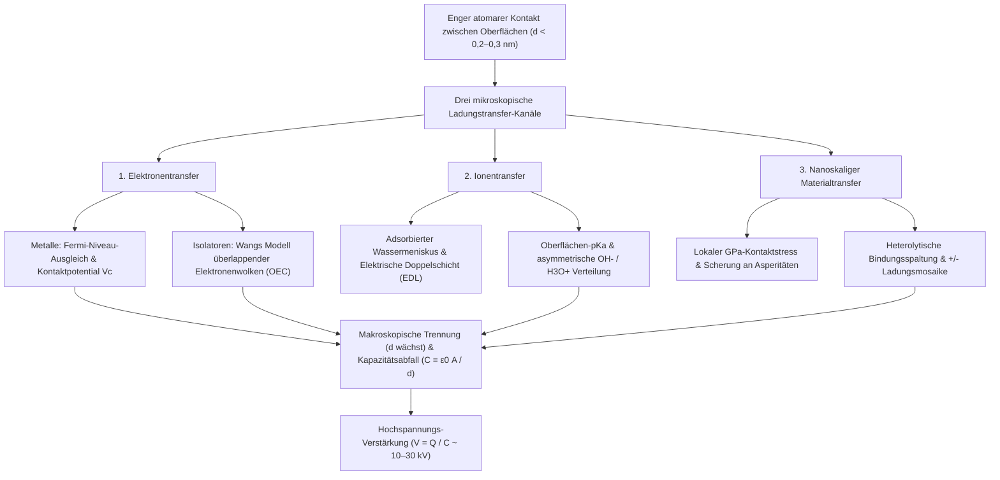
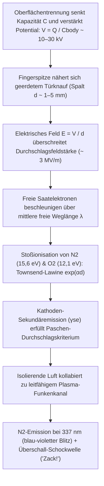

## 1. Einleitung: Ein 2.600 Jahre altes Rätsel am winterlichen Türknauf

An einem klaren, trockenen Wintermorgen gehen Sie über einen Teppichboden, greifen nach einer Messingtürklinke und – *ZACK!* – ein winziger blau-weißer Blitz springt von Ihrer Fingerspitze über und versetzt Ihnen einen spitzen Schlag. Ziehen Sie im Dunkeln einen Wollpullover aus, hören Sie ein Knistern, begleitet von violetten Funken; rollen Sie gewöhnliches Klebeband in einer Vakuumkammer ab, emittiert die Ablösezone genügend tribolumineszente Röntgenstrahlung, um Ihren Fingerknochen abzubilden. All diese Phänomene entspringen demselben fundamentalen Prozess: der <strong>statischen Elektrizität</strong>, in der Physik als <strong>Triboelektrizität</strong> oder präziser als <strong>Kontaktelektrisierung (Contact Electrification, CE)</strong> bezeichnet.

Historisch gesehen war die Triboelektrizität die allererste Begegnung der Menschheit mit dem Elektromagnetismus. Um $600\,\text{v. Chr.}$ dokumentierte der griechische Philosoph Thales von Milet, dass das Reiben von versteinertem Baumharz – <strong>Bernstein</strong>, auf Griechisch $\eta\lambda\epsilon\kappa\tau\rho o\nu$ (*ēlektron*) – an Tierfell diesem die unsichtbare Kraft verlieh, leichte Strohhalme und Federn anzuziehen. Im 17. Jahrhundert prägte der englische Arzt William Gilbert daraus den neulateinischen Begriff *electricus* („bernsteinartig“), woraus die modernen Wörter *Elektrizität* und *Elektron* hervorgingen.

Doch hinter diesem vertrauten Alltagseffekt verbirgt sich eines der erstaunlichsten Geheimnisse der modernen Naturwissenschaft: <strong>Selbst im 21. Jahrhundert – lange nachdem Maxwell den Elektromagnetismus vereint hat, die Quantenmechanik das Wasserstoffatom gelöst hat und Physiker Gravitationswellen sowie das Higgs-Boson nachgewiesen haben – bleibt der elementare mikroskopische Mechanismus, wie elektrische Ladung beim Kontakt zweier isolierender Oberflächen übertragen wird, eine der am heftigsten diskutierten offenen Fragen der Festkörperphysik und Oberflächenchemie.</strong>

Auf den ersten Blick erinnert man sich vielleicht an eine einfache Lehrbucherklärung: „Wenn man zwei Materialien aneinander reibt, springen Elektronen von einem Material zum anderen.“ Während der Elektronentransfer zwischen zwei *Metallen* durch wohldefinierte Fermi-Niveaus beschrieben wird, sind typische triboelektrische Materialien – wie Glas, Polytetrafluorethylen (PTFE/Teflon), Nylon, Silikonkautschuk und menschliches Haar – <strong>Isolatoren (Dielektrika)</strong> mit breiten elektronischen Bandlücken ($E_g \approx 4\text{–}9\,\text{eV}$) und praktisch keinen freien Leitungselektronen bei Raumtemperatur. Welche physikalische Spezies überquert also tatsächlich die Grenzfläche? Sind es <strong>Elektronen</strong>, die zwischen lokalisierten Oberflächenzuständen oder überlappenden Atomorbitalen tunneln? Sind es <strong>mobile Ionen</strong> ($\text{H}_3\text{O}^+, \text{OH}^-$), die sich in nanometrischen adsorbierten Wasserschichten umverteilen? Oder sind es <strong>nanoskalige Materialfragmente</strong>, die durch das mechanochemische Aufbrechen kovalenter Polymerketten entstehen?

In diesem Artikel analysieren wir die Physik der statischen Elektrizität von der atomaren Skala bis hin zu planetaren und industriellen Systemen: den Unterschied zwischen scheinbarer und realer Kontaktfläche, die drei konkurrierenden Ladungstransfer-Mechanismen einschließlich Zhong Lin Wangs <strong>Modell überlappender Elektronenwolken (OEC-Modell)</strong>, die Paradoxa zyklischer triboelektrischer Reihen und der Aufladung identischer Materialien in Sandstürmen und protoplanetaren Scheiben, die exponentielle Luftfeuchtigkeitsabhängigkeit, das <strong>Paschen-Gesetz</strong> des Funkendurchschlags sowie Anwendungen in Laserdruckern, N95-Elektretfiltern und <strong>triboelektrischen Nanogeneratoren (TENGs)</strong>.

---

## 2. Die Wahrheit über das „Reiben“: Scheinbare vs. reale mikroskopische Kontaktfläche

Im Alltag sprechen wir von „Reibungselektrizität“ (vom griechischen *tribos*, „reiben“). Die moderne Oberflächenphysik hat jedoch bewiesen, dass kinetische Reibung keine Voraussetzung für die Ladungserzeugung ist. Der Ladungstransfer erfolgt allein durch <strong>engen physikalischen Kontakt und anschließende Trennung</strong> – daher der präzise Fachbegriff <strong>Kontaktelektrisierung (CE)</strong>.

Warum reiben wir dann instinktiv einen Ballon an den Haaren? Die Antwort liegt in der Nanotopographie fester Oberflächen und der extrem kurzen Reichweite interatomarer Kräfte.

### 2.1 Oberflächen-Asperitäten und die reale Kontaktfläche $A_{\text{real}} \ll A_{\text{apparent}}$

Unter einem Rasterkraftmikroskop (AFM) gleicht jede Festkörperoberfläche – mit Ausnahme atomar gespaltener Schichtkristalle wie Glimmer oder Graphen – einem schroffen Gebirge aus mikroskopischen Spitzen und Tälern im Nano- bis Mikrometerbereich, den sogenannten <strong>Asperitäten (Rauheitsspitzen)</strong>.

Werden zwei makroskopische Körper der nominellen Fläche $A_{\text{apparent}}$ (<strong>scheinbare Kontaktfläche</strong>) mit einer Normalkraft $F_N$ zusammengepresst, berühren sie sich nur an den höchsten gegenüberliegenden Spitzen. Nach der Kontaktmechanik von Bowden–Tabor und Greenwood–Williamson ist die Summe dieser Mikrokontakte – die <strong>reale Kontaktfläche ($A_{\text{real}}$)</strong> – proportional zur Normalkraft geteilt durch den effektiven Elastizitätsmodul $E^*$:

$$A_{\text{real}} = \sum_{i=1}^{N} A_i \propto \frac{F_N}{E^*} \quad \left( \text{typischerweise } \frac{A_{\text{real}}}{A_{\text{apparent}}} \sim 10^{-5} \text{ bis } 10^{-3} \right)$$

Unter normalen Anpresskräften <strong>kommen weniger als $0,001\%$ bis $0,1\%$ der scheinbaren Oberfläche tatsächlich in atomaren Kontakt!</strong>

### 2.2 Das Lennard-Jones-Potential und die kurzreichweitige Pauli-Abstoßung

Damit ein Elektron oder Ion von einem Atom A auf Oberfläche 1 zu einem Atom B auf Oberfläche 2 wechseln kann, müssen sich die Atome auf <strong>$d \lesssim 0,2\text{–}0,3\,\text{nm}$</strong> annähern – vergleichbar mit der Länge einer chemischen Bindung. Betrachten wir das klassische <strong>Lennard-Jones-Potential</strong> $U_{\text{LJ}}(r)$ zwischen zwei neutralen Atomen im Abstand $r$:

$$U_{\text{LJ}}(r) = 4\varepsilon \left[ \left(\frac{\sigma}{r}\right)^{12} - \left(\frac{\sigma}{r}\right)^{6} \right]$$

Während der Term $-\left(\sigma/r\right)^6$ die langreichweitige attraktive van-der-Waals-Kraft (London-Dispersionskraft) beschreibt, repräsentiert der steile Term $+\left(\sigma/r\right)^{12}$ die <strong>kurzreichweitige Pauli-Abstoßung</strong>, die einsetzt, wenn sich die äußeren Elektronenwolken (Wellenfunktionen) der beiden Atome räumlich überlappen.

Ladungstransfer erfordert genau das Hineinzwingen der Grenzflächenatome in dieses <strong>abstoßende Regime ($r < r_{\text{eq}}$)</strong>. Makroskopisches Reiben (tangentiales Gleiten) bewirkt, dass die Asperitäten über frische Bereiche der Gegenfläche streichen und <strong>die kumulative mikroskopische Kontaktfläche $\int A_{\text{real}}\,dt$, die atomare Nähe ($d \lesssim 0,3\,\text{nm}$) erreicht, um das Hundert- bis Tausendfache vervielfacht!</strong> Zudem erzeugen lokale Reibungswärmespitzen (*Flash Temperatures* $\Delta T$) thermionische Anregungen und hohe Scherspannungen ($\tau$) mechanochemische Bindungsbrüche. Dennoch zeigen Experimente mit flüssigem Quecksilber ($A_{\text{real}} \approx A_{\text{apparent}}$), dass ein reiner Normalkontakt ohne jedes Reiben bereits die maximale Ladungsdichte erzeugt.

---

## 3. Die drei mikroskopischen Mechanismen des Ladungstransfers

Moderne Oberflächenanalytik zeigt, dass je nach Materialklasse und Umgebung <strong>drei mikroskopische Kanäle</strong> zusammenwirken:

### 3.1 Elektronentransfer: Vom Fermi-Niveau zum Modell überlappender Elektronenwolken (OEC)

#### (1) Metall-Metall-Kontakt und Kontaktpotentialdifferenz
In Metallen folgen die Leitungselektronen der <strong>Fermi-Dirac-Verteilung</strong>:

$$f(E) = \frac{1}{\exp\left(\frac{E - E_F}{k_B T}\right) + 1}$$

mit dem Fermi-Niveau $E_F$ und der Austrittsarbeit $\Phi = E_{\text{vac}} - E_F$. Berühren sich zwei Metalle mit $\Phi_1 \neq \Phi_2$, tunneln Elektronen vom Metall mit kleinerer Austrittsarbeit zum Metall mit größerer Austrittsarbeit, bis die <strong>Volta-Kontaktpotentialdifferenz $V_c = -(\Phi_1 - \Phi_2)/e$</strong> das Gleichgewicht herstellt.

#### (2) Isolator-Isolator-Kontakt: Oberflächenzustände und Wangs OEC-Modell
Bei Isolatoren ermöglichen zunächst lokalisierte <strong>Oberflächenzustände (Surface States)</strong> innerhalb der verbotenen Bandlücke (durch ungesättigte Bindungen und Defekte an der Oberfläche) den Ladungsaustausch.
Darüber hinaus formulierte <strong>Prof. Zhong Lin Wang</strong> (2018–2020) das quantenmechanische <strong>Modell überlappender Elektronenwolken (Overlapped Electron-Cloud, OEC-Modell)</strong>:
- <strong>Vor dem Kontakt ($d > 0,5\,\text{nm}$)</strong>: Die Valenzelektronen der Oberflächenatome A und B sind in getrennten Einzelpotentialtöpfen durch eine hohe Energiebarriere $E_b$ gefangen.
- <strong>Während des Kontakts ($d < 0,2\text{–}0,3\,\text{nm}$)</strong>: Im Pauli-Abstoßungsbereich überlappen sich die Atomorbitale $\psi_A$ und $\psi_B$ stark ($\langle \psi_A | \psi_B \rangle \neq 0$). Dies senkt die Potentialbarriere $E_b$ drastisch ab, sodass ein asymmetrisches Doppelmuldenpotential mit niedriger Barriere entsteht.
- <strong>Quantenübergang und Einfang</strong>: Elektronen aus höherenergetischen besetzten Orbitalen von Atom A wechseln durch Tunneln oder thermische Anregung in tieferliegende unbesetzte Orbitale von Atom B. Bei der Trennung ($d \to \infty$) schnellt die Barriere $E_b$ sofort wieder hoch und hält die übertragenen Elektronen dauerhaft auf Oberfläche B gefangen.

Wangs Gruppe bestätigte dies durch Messungen der thermischen Ladungsabnahme bei $350\text{–}650\,\text{K}$, die exakt dem <strong>Richardson-Dushman-Gesetz der Glühemission</strong> folgt:

$$J_{\text{th}} = A^* T^2 \exp\left(-\frac{\Phi_B}{k_B T}\right)$$

### 3.2 Ionentransfer: Adsorbierte Wassermenisken und die Elektrische Doppelschicht (EDL)

An hydrophilen Oberflächen oder ionischen Polymeren unter Umgebungsfeuchte wiesen <strong>George M. Whitesides</strong> und Mitarbeiter (2008) nach, dass der <strong>Transfer mobiler Ionen</strong> dominiert. Fast jede Oberfläche trägt an Luft einen $0,5\text{–}5\,\text{nm}$ dünnen adsorbierten Wasserfilm. Während Glas ($\text{SiO}_2$) durch Deprotonierung von Silanolgruppen ($-\text{Si–O}^- + \text{H}_3\text{O}^+$) mobile $\text{H}_3\text{O}^+$-Gegenionen bereitstellt, lagern sich an hydrophoben Polymeren wie PTFE bevorzugt <strong>Hydroxidionen ($\text{OH}^-$)</strong> an. Beim Kontakt verschmelzen die Wasserfilme zu einer nanoskaligen Kapillarbrücke, über die Ionen gemäß $\text{pK}_a$-Gradienten und Zeta-Potential $\zeta$ diffundieren, bevor die Flüssigkeitsbrücke beim Trennen asymmetrisch abreißt.

### 3.3 Nanoskaliger Materialtransfer und Mechanochemie: Ladungsmosaike

2011 zeigten <strong>Bartosz A. Grzybowski</strong> et al. (*Science* 2011) mittels <strong>Kelvin-Sonden-Kraftmikroskopie (KPFM)</strong>, dass kontaktgeladene Isolatoren <strong>nicht homogen positiv oder negativ</strong> sind, sondern ein <strong>nanoskaliges Mosaik aus $+$ und $-$ Domänen ($10\text{–}200\,\text{nm}$)</strong> bilden. Lokale Kontaktspannungen im Gigapascal-Bereich ($\sim \text{GPa}$) führen zur <strong>mechanochemischen Spaltung kovalenter Polymerbindungen</strong> (Heterolyse in Mechanoionen $\text{R}_1^+ + \text{R}_2^-$ und Homolyse in Radikale) sowie zum Übertrag nanometrischer Polymerfragmente.

| Eigenschaft | 1. Elektronentransfer | 2. Ionentransfer | 3. Nanoskaliger Materialtransfer |
| :--- | :--- | :--- | :--- |
| <strong>Ladungsträger</strong> | Elektronen ($e^-$) | Mobile Ionen ($\text{H}_3\text{O}^+, \text{OH}^-$, Gegenionen) | Geladene Oligomerfragmente & Mechanoionen ($\text{R}^+, \text{R}^-$) |
| <strong>Theoretisches Modell</strong> | Fermi-Niveau, Oberflächenzustände, <strong>OEC-Modell</strong> | Adsorbierter Wassermeniskus, <strong>EDL</strong>, $\text{pK}_a$ & $\zeta$-Potential | <strong>Mechanochemische Bindungsspaltung</strong>, adhäsiver Verschleiß |
| <strong>Längenskala</strong> | Atomarer Abstoßungsbereich ($d \lesssim 0,2\text{–}0,3\,\text{nm}$) | Wasserschicht & Meniskus ($0,5\text{–}10\,\text{nm}$) | Nanodomänen-Mosaike ($10\text{–}500\,\text{nm}$) |
| <strong>Umgebungseinfluss</strong> | Aktiv im Ultrahochvakuum (UHV) & bei tiefen $T$; thermionischer Zerfall $>350\,\text{K}$ | Stark abhängig von der relativen Luftfeuchte ($RH$) | Abhängig von Kontaktdruck, Schergeschwindigkeit & Vernetzung |

---

## 4. Die triboelektrische Reihe und ihre Paradoxa

### 4.1 Chemische und quantenmechanische Ursachen der triboelektrischen Reihe

Die 1757 von Johan Carl Wilcke begründete und 2019 von Wang et al. gegen flüssiges Quecksilber quantifizierte <strong>triboelektrische Reihe</strong> ordnet Materialien nach ihrer normierten Ladungsdichte $\sigma_N$ (in $\mu\text{C/m}^2$):

| Polarität | Repräsentative Materialien | Dominante funktionelle Gruppen | Ladungsdichte $\sigma_N$ ($\mu\text{C/m}^2$) | Elektronischer & chemischer Mechanismus |
| :---: | :--- | :--- | :---: | :--- |
| <strong>Stark positiv ($+++$)</strong> | Quarz / Glas ($\text{SiO}_2$), Glimmer | Silanolgruppen ($-\text{Si–OH}$), Silikatgitter | $+80 \text{ bis } +110$ | Energiereiche freie Elektronenpaare am Sauerstoff geben leicht Elektronen ab (Lewis-Base) |
| <strong>Mäßig positiv ($++$)</strong> | Nylon-6,6, menschliche Haut & Haar, Wolle | Amidbindungen ($-\text{NH–CO}-$), Amine ($-\text{NH}_2$), Keratin | $+50 \text{ bis } +85$ | Elektronenspendende N/O-Orbitale; erklärt starke Aufladung von Wollpullovern auf der Haut |
| <strong>Schwach positiv ($+$)</strong> | Aluminium, Papier (Cellulose), Baumwolle, Holz | Natürliches Oxid ($\text{Al}_2\text{O}_3$), Hydroxylgruppen ($-\text{OH}$) | $+10 \text{ bis } +40$ | Moderate Elektronenabgabe und Protonenaustausch |
| <strong>Neutral ($0$)</strong> | Stahl, PMMA (Acrylglas), Polycarbonat (PC) | Metallisches Fermi-Gas, Ester- & Carbonatgruppen | $-10 \text{ bis } +10$ | Amphoter: lädt sich gegen PTFE positiv, gegen Nylon negativ auf |
| <strong>Mäßig negativ ($-$)</strong> | Polystyrol (PS), Polyethylen (PE), Polypropylen (PP) | Gesättigte Kohlenwasserstoffketten ($-\text{CH}_2-$) | $-30 \text{ bis } -60$ | Unpolare hydrophobe Oberflächen; fangen Elektronen in Defekten und adsorbieren $\text{OH}^-$ |
| <strong>Stark negativ ($--$)</strong> | PVC, PDMS (Silikon), Kapton (Polyimid) | $-\text{C–Cl}$-Bindungen, Siloxankette, Imidringe | $-70 \text{ bis } -110$ | Elektronegatives Chlor ($\chi = 3,16$) und elektronenziehende Imidringe |
| <strong>Extrem negativ ($---$)</strong> | <strong>PTFE (Teflon)</strong>, FEP, PVDF | Perfluorierte Ketten ($-(\text{CF}_2-\text{CF}_2)_n-$), $\text{C–F}$-Hülle | $-110 \text{ bis } -150$ | <strong>Fluor besitzt die höchste Pauling-Elektronegativität ($\chi = 3,98$)</strong>; tiefe unbesetzte $\sigma^*$-Orbitale |

### 4.2 Paradoxon 1 & 2: Zyklische Intransitivität ($A > B > C > A$) und Aufladung identischer Materialien

Da elektronische Zustandsdichten, Ionenverteilung, Elastizitätsmodul-Asymmetrien ($E_A \neq E_B$) und Abrieb konkurrieren, bricht die einfache Transitivität zusammen und erzeugt mitunter <strong>zyklische Trippel ($A > B > C > A$)</strong>.

Noch faszinierender ist die <strong>Kontaktelektrisierung identischer Materialien</strong>:
1. <strong>Flexoelektrizität durch Dehnungsgradienten</strong>: In jedem Dielektrikum bricht ein inhomogener Dehnungsgradient $\frac{\partial \varepsilon_{jk}}{\partial x_l}$ die lokale Inversionssymmetrie und erzeugt eine Polarisation $P_i = \mu_{ijkl} \frac{\partial \varepsilon_{jk}}{\partial x_l}$, die die Bandkanten verschiebt.
2. <strong>Größenabhängige bipolare Kornaufladung (Kleine Körner $-$, große Körner $+$)</strong>: Bei Kollisionen chemisch identischer Partikel unterschiedlicher Größe (Lacks–Kok–Waitukaitis-Modell) laden sich <strong>kleinere Partikel systematisch negativ ($-$) und größere Partikel positiv ($+$)</strong> auf. In Aufwinden steigen die leichten negativen Feinstaubpartikel auf, während schwere positive Körner absinken. Dies erzeugt elektrische Felder von Megavolt pro Meter und treibt <strong>Wüstensandsturm-Blitze</strong>, <strong>Vulkanblitze („schmutzige Gewitter“)</strong> sowie in protoplanetaren Scheiben die elektrostatische Aggregation von Silikatstaub über die <strong>„Meter-Barriere“</strong> hinweg zur Entstehung von Planetesimalen und erdähnlichen Planeten an (Steinpilz & Wurm, *Nature Physics* 2020).

---

## 5. Luftfeuchtigkeit, Kapazitätsverstärkung und das Paschen-Gesetz der Funkenentladung

### 5.1 Warum statische Elektrizität im Winter dominiert: BET-Isotherme und Oberflächenleitfähigkeit

Trockene Winterluft erzeugt nicht mehr Ladung, sondern verhindert deren Abfließen. Die Anzahl adsorbierter Wassermonolagen $\theta_{\text{BET}}$ folgt der <strong>Brunauer-Emmett-Teller-(BET)-Isotherme</strong>:

$$\theta_{\text{BET}}(RH) = \frac{v}{v_m} = \frac{c \cdot RH}{(1 - RH)\left[1 + (c - 1)RH\right]}$$

Im Winter ($RH < 20\text{–}30\%$ in geheizten Räumen) ist $\theta_{\text{BET}} < 1$: Isolierte Wasserinseln führen zu enormen Oberflächenwiderständen ($>10^{15}\,\Omega/\text{sq}$). Im Sommer ($RH > 60\text{–}70\%$) bildet sich ein durchgehendes Wasserstoffbrücken-Netzwerk ($\theta_{\text{BET}} > 2\text{–}5$), in dem Protonen über den <strong>Grotthuss-Mechanismus (Protonenhopping)</strong> leiten. Die Oberflächenleitfähigkeit $\sigma_s(RH) \approx \sigma_0 \exp(\alpha_{\text{RH}} \cdot RH)$ steigt exponentiell um $6$ bis $10$ Größenordnungen, sodass Ladungen in Millisekunden abfließen.

### 5.2 Spannungsverstärkung ($V = Q / C$) und das Paschen-Gesetz

Beim Kontakt ($d_0 \approx 1\,\text{nm}$) ist die Grenzflächenkapazität $C_0 = \varepsilon_0 A / d_0$ riesig und die Spannung beträgt nur wenige Volt. Beim Abheben des Schuhs oder Ausziehen des Pullovers wächst $d$ um den Faktor $10^8$ auf Dezimeter an, während die Kapazität auf die Körperkapazität $C_{\text{body}} \approx 150\,\text{pF}$ fällt. Bei konstanter Ladung $Q$ verstärkt Ihre Muskelarbeit die Spannung gemäß $V(d) = Q / C(d)$ auf <strong>$10.000\text{–}30.000\,\text{V}$ ($10\text{–}30\,\text{kV}$)</strong>! Da die gespeicherte Energie bei $20\,\text{kV}$ und $C_{\text{body}} = 150\,\text{pF}$ jedoch nur $U_E = \frac{1}{2}C_{\text{body}}V^2 = 30\,\text{mJ}$ ($Q = 3,0\,\mu\text{C}$, Pulsdauer $\tau \approx 150\,\text{ns}$) beträgt, ist der Schlag für den Menschen ungefährlich – für $2\,\text{nm}$ dünne Gate-Oxide moderner CMOS-Mikrochips jedoch tödlich.

Nähert sich der Finger dem geerdeten Türknauf auf wenige Millimeter, zündet eine <strong>Townsend-Elektronenlawine</strong> ($\alpha = Ap\exp(-Bp/E)$) gekoppelt mit Sekundärelektronenemission ($\gamma_{\text{se}}$). Die Durchschlagsspannung $V_B$ gehorcht dem <strong>Paschen-Gesetz (1889)</strong>:

$$V_B(p d) = \frac{B \cdot p d}{\ln(A \cdot p d) - \ln\left[\ln\left(1 + \frac{1}{\gamma_{\text{se}}}\right)\right]}$$

In Luft bei $1\,\text{atm}$ liegt die makroskopische Durchschlagsfeldstärke bei <strong>$E_{\text{crit}} \approx 3\,\text{kV/mm}$</strong> und das <strong>Paschen-Minimum bei $V_{\text{min}} \approx 327\,\text{V}$</strong> ($pd \approx 7,5\,\mu\text{m}\cdot\text{atm}$). Der blau-violette Blitz stammt aus dem zweiten positiven Bandensystem angeregter Stickstoffmoleküle ($\text{N}_2$, $\lambda = 337,1\,\text{nm}$), während die rasante Joule-Aufheizung des Plasmakanals eine akustische Überschall-Schockwelle erzeugt.

---

## 6. Vom Störeffekt zur Schlüsseltechnologie: Laserdruck, N95-Elektrete und TENGs

1. <strong>Elektrophotographie (Laserdruck) & Elektrofilter (ESP)</strong>: Laserdrucker nutzen triboelektrisch geladenen Toner ($Q/M \approx -20\text{ bis }-40\,\mu\text{C/g}$) zur präzisen Bildentwicklung; industrielle Elektrofilter scheiden mittels Koronaentladung über $99,9\%$ des Feinstaubs ($\text{PM}_{2.5}$) aus Kraftwerksabgasen ab.
2. <strong>Elektret-Vliesfilter in N95/FFP2-Atemschutzmasken</strong>: Ein Meltblown-Polypropylen-<strong>Elektret</strong> speichert quasi-permanente Raumladungen, deren starke elektrische Feldgradienten selbst ungeladene Viren-Aerosole ($0,1\text{–}0,3\,\mu\text{m}$) über die <strong>dielektrophoretische Kraft</strong> anziehen, ohne den Atemwiderstand durch enge Poren zu erhöhen:

$$\mathbf{F}_{\text{DEP}} = 2\pi r_p^3 \varepsilon_0 \left(\frac{\varepsilon_p - \varepsilon_0}{\varepsilon_p + 2\varepsilon_0}\right) \nabla |\mathbf{E}|^2$$

3. <strong>Triboelektrische Nanogeneratoren (TENG) und Maxwells Verschiebungsstrom</strong>: 2012 erfand Zhong Lin Wang den <strong>TENG</strong>, der Kontaktelektrisierung mit elektrostatischer Influenz koppelt. 2017 erweiterte Wang den <strong>Maxwellschen Verschiebungsstrom $\mathbf{J}_D$</strong> um die durch bewegte Oberflächenladungen erzeugte Polarisationsdichte $\mathbf{P}_s$:

$$\mathbf{J}_D = \frac{\partial \mathbf{D}}{\partial t} = \varepsilon_0 \frac{\partial \mathbf{E}}{\partial t} + \frac{\partial \mathbf{P}_s}{\partial t}$$

Während $\varepsilon_0 \frac{\partial \mathbf{E}}{\partial t}$ die drahtlose Kommunikation begründete, bildet $\frac{\partial \mathbf{P}_s}{\partial t}$ die Grundlage zur Gewinnung niederfrequenter mechanischer Energie aus Schritten, Herzschlag, Regentropfen und Meereswellen (*Blue Energy*).
