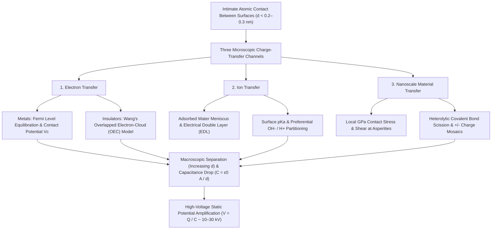
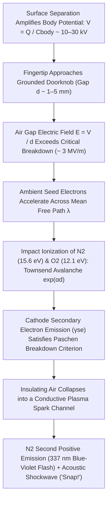

## 1. Introduction: A 2,600-Year-Old Mystery Hiding on the Winter Doorknob

On a crisp, dry winter morning, you walk across a carpeted floor, reach for a brass doorknob, and—*SNAP!*—a miniature bolt of blue-white lightning leaps from your fingertip, delivering a sharp jolt. Pull off a wool sweater in the dark and you hear a chorus of crackles accompanied by faint violet sparks; unroll a roll of ordinary Scotch tape in a vacuum chamber and the peeling interface emits enough triboluminescent X-rays to image the bones of your finger. All of these everyday spectacles arise from the same fundamental phenomenon: <strong>static electricity</strong>, known in physics as <strong>triboelectricity</strong> or, more precisely, <strong>Contact Electrification (CE)</strong>.

Historically, triboelectricity was humanity's very first encounter with electromagnetic phenomena. Around $600\,\text{BCE}$, the ancient Greek philosopher Thales of Miletus recorded that rubbing fossilized tree resin—<strong>amber</strong>, called $\eta\lambda\epsilon\kappa\tau\rho o\nu$ (*ēlektron*) in Greek—against animal fur endowed it with the unseen power to attract lightweight straw and feathers. In the 17th century, English physician William Gilbert coined the Neo-Latin term *electricus* ("like amber") to describe this attractive force, giving birth to the modern words *electricity* and *electron*.

Yet behind this familiar childhood demonstration lies one of the most surprising secrets in modern science: <strong>even in the 21st century—long after Maxwell unified electromagnetism, quantum mechanics solved the hydrogen atom, and physicists detected gravitational waves and the Higgs boson—the fundamental microscopic mechanism of how electrical charge transfers between two insulating surfaces upon contact remains one of the most fiercely debated open questions in condensed matter physics and surface chemistry.</strong>

At first glance, one might recall a simple textbook explanation: "When you rub two materials together, electrons jump from one material to the other." While electron transfer between two *metals* is textbook solid-state physics governed by well-defined Fermi levels, common triboelectric materials—such as glass, polytetrafluoroethylene (PTFE/Teflon), nylon, silicone rubber, and human hair—are <strong>insulators (dielectrics)</strong> with wide electronic bandgaps ($E_g \approx 4\text{–}9\,\text{eV}$) and virtually zero free conduction electrons at room temperature. When two insulators touch, what physical entity actually crosses the interface? Is it <strong>electrons</strong> tunneling between localized surface states or overlapping atomic orbitals? Is it <strong>mobile ions</strong> ($\text{H}_3\text{O}^+, \text{OH}^-$) partitioning across nanometric adsorbed water layers? Or is it <strong>nanoscale material fragments</strong> created by the mechanochemical rupture of covalent polymer backbones?

In this comprehensive exploration, we will dissect the physics of static electricity from the atomic scale to planetary and industrial scales. We will examine why "friction" is actually a misnomer for contact electrification, analyze the three competing microscopic charge-transfer mechanisms including Zhong Lin Wang's <strong>Overlapped Electron-Cloud (OEC) model</strong>, resolve the paradoxes of cyclic triboelectric series and same-material charging in desert sandstorms and protoplanetary disks, derive the mathematics of winter humidity and <strong>Paschen's Law</strong> of spark breakdown, and explore how modern engineering harnesses triboelectricity in laser printers, N95 electret respirators, and <strong>Triboelectric Nanogenerators (TENGs)</strong>.

---

## 2. The Truth About "Rubbing": Apparent vs. Real Microscopic Contact Area

In everyday language, we speak of "frictional electricity" (*triboelectricity*, from the Greek *tribos*, meaning "to rub"). However, modern surface physics has established that kinetic friction itself is not a prerequisite for charge generation. Instead, charge transfer occurs simply upon <strong>intimate physical contact and subsequent separation</strong>—hence the rigorous scientific term <strong>Contact Electrification (CE)</strong>.

If mere contact suffices to transfer charge, why do we instinctively rub a balloon against our hair or vigorously scrub a plastic rod with fur? The answer lies in the nanoscale topography of solid surfaces and the extreme short-range nature of interatomic forces.

### 2.1 Surface Asperities and the Real Contact Area $A_{\text{real}} \ll A_{\text{apparent}}$

To the naked eye, a sheet of glass, a polished metal block, or a polymer film appears flat and continuous. Under an Atomic Force Microscope (AFM) or Scanning Tunneling Microscope (STM), however, every solid surface—except atomically cleaved layered crystals like mica or graphene—is a rugged mountain range of microscopic peaks and valleys spanning nanometers to micrometers. In tribology, these microscopic peaks are called <strong>asperities</strong>.

When two macroscopic objects of nominal area $A_{\text{apparent}}$ (the <strong>apparent contact area</strong>) are pressed together under a normal load $F_N$, they do not touch across their entire face. Like two mountain ranges placed peak-to-peak, physical contact occurs exclusively at the tips of the highest opposing asperities. According to Bowden–Tabor adhesion theory and Greenwood–Williamson elastic contact mechanics, the sum of these microscopic contact spots—the <strong>real contact area ($A_{\text{real}}$)</strong>—is proportional to the normal load $F_N$ divided by the effective elastic modulus $E^*$ (or plastic indentation hardness $H$):

$$A_{\text{real}} = \sum_{i=1}^{N} A_i \propto \frac{F_N}{E^*} \quad \left( \text{typically } \frac{A_{\text{real}}}{A_{\text{apparent}}} \sim 10^{-5} \text{ to } 10^{-3} \right)$$

Under ordinary pressing forces, <strong>less than $0.001\%$ to $0.1\%$ of the apparent surface area actually makes atomic contact!</strong> The remaining $99.9\%$ of the interface is separated by air gaps of tens to thousands of nanometers, across which no charge transfer can occur.

### 2.2 The Lennard-Jones Potential and Entry into the Short-Range Repulsive Regime

Furthermore, for an electron or ion to cross from Atom A on one surface to Atom B on another, the two atoms must be brought closer than the equilibrium van der Waals distance, entering a separation of <strong>$d \lesssim 0.2\text{–}0.3\,\text{nm}$</strong>—comparable to the length of a chemical bond.

Consider the classic <strong>Lennard-Jones interatomic potential</strong> describing the interaction energy $U_{\text{LJ}}(r)$ between two neutral non-bonding atoms separated by distance $r$:

$$U_{\text{LJ}}(r) = 4\varepsilon \left[ \left(\frac{\sigma}{r}\right)^{12} - \left(\frac{\sigma}{r}\right)^{6} \right]$$

Here, $\varepsilon$ is the depth of the potential well, $\sigma$ is the finite distance at which the interparticle potential is zero, the $-\left(\sigma/r\right)^6$ term represents long-range attractive van der Waals (London dispersion) forces, and the steep $+\left(\sigma/r\right)^{12}$ term represents <strong>short-range Pauli repulsion</strong> arising when the outer electron shells (wavefunctions) of the two atoms begin to overlap in space.

As we will see in Section 3, charge transfer requires forcing interfacial atoms into this <strong>repulsive regime ($r < r_{\text{eq}}$)</strong> so that their electron clouds strongly interpenetrate.

This explains the true physical role of macroscopic rubbing (tangential sliding): when you slide one surface across another over a macroscopic distance $L$, the protruding asperities of the first surface sweep across fresh regions of the opposing surface, and vice versa. Tangential rubbing <strong>multiplies the cumulative microscopic contact area $\int A_{\text{real}}\,dt$ that achieves atomic proximity ($d \lesssim 0.3\,\text{nm}$) by a factor of hundreds or thousands</strong> compared to static normal pressing!

To be sure, frictional sliding also introduces secondary physical effects: localized <strong>frictional heating (flash temperature spikes $\Delta T$ at asperity junctions)</strong> can bias thermionic electron excitation, and high tangential <strong>shear stress ($\tau$)</strong> can mechanically cleave covalent polymer chains. Nevertheless, experiments using atomically flat cleaved mica or liquid metals (such as mercury or eutectic gallium-indium, which conform perfectly to surface roughness with $A_{\text{real}} \approx A_{\text{apparent}}$) prove conclusively that maximum contact charge density is achieved by pure normal contact and separation without any rubbing whatsoever.

---

## 3. The Three Competing and Complementary Microscopic Mechanisms of Charge Transfer

What physical species actually crosses the interface during contact electrification? For over half a century, physicists and chemists waged an intense debate divided into three camps. Today, high-resolution surface science has revealed that <strong>three distinct microscopic mechanisms</strong> operate either independently or synergistically depending on the material classes (metals, inorganic dielectrics, polymers) and environmental conditions:

1. <strong>Electron Transfer</strong>: Driven by Fermi level equilibration in metals, localized surface states, and <strong>Overlapped Electron-Cloud (OEC) quantum transitions</strong> in insulators.
2. <strong>Ion Transfer</strong>: Driven by the partitioning of mobile counter-ions ($\text{H}_3\text{O}^+, \text{OH}^-$) across adsorbed nanometric water menisci governed by surface $\text{pK}_a$, zeta potential, and the <strong>Electrical Double Layer (EDL)</strong>.
3. <strong>Nanoscale Material Transfer & Mechanochemical Bond Scission</strong>: Driven by stress-induced heterolytic cleavage of covalent bonds at asperity contacts, creating a nanoscale mosaic of positively and negatively charged molecular fragments.

Let us examine the rigorous physics and governing equations of each mechanism.

### 3.1 Electron Transfer: From Fermi Level Equilibration to the Overlapped Electron-Cloud (OEC) Model

#### (1) Metal–Metal Contact and Volta's Contact Potential Difference
In a metal, conduction electrons form a degenerate Fermi gas whose occupation probability at energy $E$ and absolute temperature $T$ is governed by the <strong>Fermi–Dirac distribution</strong>:

$$f(E) = \frac{1}{\exp\left(\frac{E - E_F}{k_B T}\right) + 1}$$

where $E_F$ is the <strong>Fermi level</strong> (electrochemical potential of electrons) and $k_B$ is Boltzmann's constant. The minimum energy required to extract an electron from the Fermi level to the vacuum level $E_{\text{vac}}$ just outside the surface is the metal's <strong>work function</strong>, $\Phi = E_{\text{vac}} - E_F$.

When two dissimilar metals with work functions $\Phi_1$ and $\Phi_2$ ($\Phi_1 < \Phi_2$) are brought into electrical contact, thermodynamic equilibrium demands that their electrochemical potentials equalize ($E_{F,1} = E_{F,2}$). Electrons spontaneously tunnel from Metal 1 (higher Fermi level, smaller work function) into Metal 2 (lower Fermi level, larger work function) until an interfacial electrostatic dipole layer halts further flow. This establishes the <strong>Contact Potential Difference (Volta Potential) $V_c$</strong>:

$$V_c = -\frac{\Phi_1 - \Phi_2}{e}$$

where $e$ is the elementary charge. If the two metals are separated while maintaining an effective tunneling cutoff distance $d_0 \approx 1\,\text{nm}$ across area $A$, the transferred charge is $\Delta Q = C_0 V_c = \left(\varepsilon_0 A / d_0\right) V_c$.

#### (2) Insulator–Insulator Contact: Surface States and Zhong Lin Wang's OEC Model
How can electrons transfer between two *insulators* (such as PTFE and nylon, or silica and PDMS) that lack a Fermi sea of free electrons and possess bulk bandgaps of $5\text{–}9\,\text{eV}$?

First, in the 1960s–1980s, C. B. Duke, T. J. Fabish, and J. Lowell & A. C. Rose developed the <strong>Surface States Model</strong>. While the bulk interior of an insulator has a wide forbidden bandgap due to periodic lattice symmetry, that symmetry terminates abruptly at the physical surface. Dangling bonds, chain ends, adsorbed oxygen groups, and structural defects introduce localized electronic states—<strong>surface states</strong> or <strong>trap states</strong>—inside the forbidden bandgap, allowing an insulator surface to be assigned an effective work function $\Phi_{\text{eff}}$.

Second, between 2018 and 2020, <strong>Prof. Zhong Lin Wang</strong> (Georgia Institute of Technology) proposed a universal quantum-mechanical framework known as the <strong>Overlapped Electron-Cloud (OEC) Model</strong> (also termed the *Wang transition model*), which explains electron transfer between any two arbitrary condensed matter surfaces without requiring bulk conduction bands:

- <strong>Before Contact ($d > 0.5\,\text{nm}$)</strong>: An atom on Surface A and an atom on Surface B each confine their outer valence electrons within deep, independent single-well atomic potentials. Between them lies an asymmetric <strong>double-well potential</strong> separated by a high interatomic energy barrier $E_b$ that prevents electron escape at room temperature.
- <strong>During Intimate Mechanical Contact ($d < 0.2\text{–}0.3\,\text{nm}$)</strong>: When external normal force pushes the two surface atoms into the short-range repulsive regime of the Lennard-Jones potential (shorter than standard bonding length), their outermost electron clouds (atomic or molecular orbitals $\psi_A$ and $\psi_B$) strongly overlap in real space ($\langle \psi_A | \psi_B \rangle \neq 0$). This strong orbital overlap drastically lowers the interatomic potential barrier $E_b$, transforming the symmetric/asymmetric double-well potential into an <strong>asymmetric single-well potential (or low-barrier double well)</strong>.
- <strong>Quantum Transition & Trapping Upon Separation</strong>: With the barrier suppressed by electron-cloud overlap, weakly bound electrons occupying higher-energy surface orbitals on Atom A spontaneously transition (via quantum tunneling or thermal hopping) into lower-energy unoccupied orbitals on Atom B. Once the mechanical force is removed and the two surfaces separate ($d \to \infty$), the interatomic barrier $E_b$ instantaneously snaps back up, permanently trapping the transferred electrons in the deep potential well of Surface B!

#### (3) Experimental Proof via Thermionic Emission Decay
To prove that trapped electrons—rather than massive ions—dominate solid–solid contact electrification, Wang's group investigated the thermal stability of triboelectric charges on dielectric surfaces ($\text{SiO}_2, \text{Al}_2\text{O}_3, \text{Si}_3\text{N}_4$, and high-temperature polymers) across elevated temperatures ($350\text{–}650\,\text{K}$). They discovered that surface charge decay follows the <strong>Richardson–Dushman thermionic emission law</strong>:

$$J_{\text{th}} = A^* T^2 \exp\left(-\frac{\Phi_B}{k_B T}\right)$$

where $J_{\text{th}}$ is the thermionic emission current density, $A^*$ is the effective Richardson constant, and $\Phi_B$ is the surface potential barrier height trapping the electrons. Because ions and polymer fragments cannot evaporate into vacuum via Richardson–Dushman kinetics or be detrapped by sub-bandgap UV photon excitation, these experiments provided direct spectroscopic proof that <strong>electron transfer driven by electron-cloud overlap is the primary mechanism in solid–solid contact electrification</strong>.

### 3.2 Ion Transfer: Adsorbed Water Menisci and the Electrical Double Layer (EDL)

While electron transfer dominates in dry, vacuum, or hydrophobic solid–solid contacts, <strong>Prof. George M. Whitesides</strong> and colleagues at Harvard University demonstrated that <strong>mobile ion transfer</strong> plays a major—and sometimes dominant—role when hydrophilic surfaces or ionic polymers contact under ambient humidity (McCarty & Whitesides, *Angew. Chem.* 2008).

Under ambient atmospheric conditions, almost every solid surface is coated with an invisible, nanometric <strong>adsorbed water film</strong> ($0.5\text{–}5\,\text{nm}$ thick, corresponding to 2 to 15 molecular monolayers of $\text{H}_2\text{O}$). Within this nanometric water layer, auto-ionization of water ($2\text{H}_2\text{O} \rightleftharpoons \text{H}_3\text{O}^+ + \text{OH}^-$), dissolved atmospheric $\text{CO}_2$ (forming $\text{HCO}_3^-$), and dissociation of surface chemical groups generate mobile ions:

1. <strong>Surface $\text{pK}_a$, Zeta Potential ($\zeta$), and the Electrical Double Layer (EDL)</strong>:
   Oxide surfaces such as glass ($\text{SiO}_2$) bear surface silanol groups ($-\text{Si–OH}$) that deprotonate in water ($-\text{Si–O}^- + \text{H}_3\text{O}^+$), creating a negatively charged wall balanced by a diffuse cloud of mobile $\text{H}_3\text{O}^+$ counter-ions—an <strong>Electrical Double Layer (EDL)</strong> characterized by a specific <strong>zeta potential ($\zeta$)</strong>. Conversely, amine-rich surfaces carry basic groups ($-\text{NH}_2 + \text{H}_2\text{O} \rightleftharpoons -\text{NH}_3^+ + \text{OH}^-$) with mobile $\text{OH}^-$ counter-ions.
2. <strong>Preferential Hydroxide ($\text{OH}^-$) Adsorption at Hydrophobic Interfaces</strong>:
   Remarkably, even chemically inert hydrophobic polymers like PTFE or polyethylene acquire a negative zeta potential in contact with water because the asymmetric hydrogen-bonding network of interfacial water preferentially stabilizes <strong>hydroxide ions ($\text{OH}^-$)</strong> over hydronium ions ($\text{H}_3\text{O}^+$) at hydrophobic boundaries.
3. <strong>Capillary Bridge Coalescence and Snap-Off</strong>:
   When two surfaces touch, their adsorbed water films merge into a transient nanoscale <strong>capillary water bridge (meniscus)</strong>. Mobile ions ($\text{H}_3\text{O}^+, \text{OH}^-$) diffuse across this liquid bridge driven by gradients in surface $\text{pK}_a$, dielectric constant $\varepsilon_r$ (image-charge forces favor ion solvation near the higher-$\varepsilon_r$ solid), and electrochemical potential. When the surfaces are pulled apart, the liquid bridge necks down and snaps, leaving an asymmetric excess of cations on one surface and anions on the other.

### 3.3 Nanoscale Material Transfer and Mechanochemistry: The Discovery of Charge Mosaics

In 2011, <strong>Prof. Bartosz A. Grzybowski</strong> and colleagues (Baytekin et al., *Science* 2011) shattered a century-old assumption in electrostatics. Using high-resolution <strong>Kelvin Probe Force Microscopy (KPFM)</strong> to map the surface potential of polymers after contact electrification with nanometer resolution, they discovered that a contact-charged insulator is <strong>NOT uniformly positive or uniformly negative</strong>.

Instead, every contact-charged surface consists of a complex <strong>nanoscale mosaic of both positively ($+$) and negatively ($-$) charged domains</strong> ($10\text{–}200\,\text{nm}$ in diameter), where local charge densities exceed the macroscopic average by orders of magnitude! What we measure macroscopically with a Faraday cup as "positive nylon" or "negative PTFE" is merely the slight arithmetic imbalance between billions of intense positive and negative nanodomains.

What creates these bipolar charge mosaics? The culprit is <strong>mechanochemistry (stress-induced covalent bond scission)</strong> accompanied by <strong>nanoscale material transfer</strong>:
- At the tips of contacting asperities, local contact pressures and adhesive pull-off stresses easily reach the <strong>gigapascal ($\sim \text{GPa}$)</strong> regime—exceeding the cohesive strength of covalent polymer chains.
- As the surfaces separate, instead of cleaving cleanly along the van der Waals interface, entangled polymer backbones ($\text{C–C}$, $\text{C–O}$, or $\text{Si–O}$ bonds) undergo <strong>homolytic cleavage</strong> (generating neutral <strong>mechanoradicals</strong> $\text{R}_1^\bullet + \text{R}_2^\bullet$, detectable via Electron Spin Resonance, ESR) and <strong>heterolytic cleavage</strong> (or rapid inter-radical electron transfer, generating positive and negative <strong>mechanoions</strong> $\text{R}_1^+ + \text{R}_2^-$).
- X-ray Photoelectron Spectroscopy (XPS) and confocal Raman spectroscopy confirm that when PDMS contacts PTFE, nanometric patches of fluorinated PTFE oligomers transfer onto the PDMS surface while siloxane fragments transfer onto the PTFE surface.

### 3.4 Comprehensive Comparison of the Three Charge-Transfer Mechanisms

| Feature / Property | 1. Electron Transfer | 2. Ion Transfer | 3. Nanoscale Material Transfer |
| :--- | :--- | :--- | :--- |
| <strong>Primary Charge Carrier</strong> | Electrons ($e^-$) | Mobile ions ($\text{H}_3\text{O}^+, \text{OH}^-$, counter-ions) | Charged oligomer fragments & mechanoions ($\text{R}^+, \text{R}^-$) |
| <strong>Governing Theoretical Framework</strong> | Fermi level alignment, surface states, <strong>Overlapped Electron-Cloud (OEC) model</strong> | Adsorbed water meniscus, <strong>Electrical Double Layer (EDL)</strong>, surface $\text{pK}_a$ & $\zeta$ potential | <strong>Mechanochemical bond scission</strong> (heterolysis/homolysis), adhesive wear |
| <strong>Characteristic Length Scale</strong> | Interatomic repulsive regime ($d \lesssim 0.2\text{–}0.3\,\text{nm}$) | Adsorbed water thickness & meniscus ($0.5\text{–}10\,\text{nm}$) | Nanodomain mosaics ($10\text{–}500\,\text{nm}$ patches) |
| <strong>Environmental Sensitivity</strong> | Operates in ultra-high vacuum (UHV) and cryogenic $T$; decays via thermionic emission above $350\text{–}600\,\text{K}$ | Strongly dependent on Relative Humidity ($RH$); suppressed in UHV (except intrinsic ionic polymers) | Strongly dependent on contact stress, shear velocity, molecular weight, and crosslinking |
| <strong>Key Experimental Signatures</strong> | Work-function correlation, Richardson–Dushman thermal decay, UV photoemission | Sensitivity to pH/humidity, charge reversal in polyelectrolytes | KPFM $+/-$ charge mosaics, XPS elemental transfer, ESR radical detection |

---

## 4. The Triboelectric Series and Its Paradoxes: Cyclic Inconsistency & Same-Material Charging

### 4.1 Chemical and Quantum Origins of the Triboelectric Series

First compiled by Swedish physicist Johan Carl Wilcke in 1757, the <strong>Triboelectric Series</strong> is an empirical ranking of materials ordered from those that most readily donate electrons to become <strong>positively charged ($+$)</strong> at the top, to those that most avidly capture electrons to become <strong>negatively charged ($-$)</strong> at the bottom. In 2019, Zhong Lin Wang's group standardized this ranking by measuring the <strong>Normalized Triboelectric Charge Density ($\sigma_N$, in $\mu\text{C/m}^2$)</strong> of dozens of polymers and inorganic solids against a liquid mercury reference electrode under controlled conditions (Zou et al., *Nature Communications* 2019).

| Polarity Tendency | Representative Materials | Dominant Functional Groups & Bonding | Typical Charge Density $\sigma_N$ ($\mu\text{C/m}^2$) | Electronic & Chemical Mechanism |
| :---: | :--- | :--- | :---: | :--- |
| <strong>Strongly Positive ($+++$)</strong> | Quartz / Glass ($\text{SiO}_2$), Muscovite Mica | Silanol groups ($-\text{Si–OH}$), aluminosilicate lattice | $+80 \text{ to } +110$ | High-energy lone-pair electrons on oxygen and high occupied surface states readily donate electrons (Lewis basicity) |
| <strong>Moderately Positive ($++$)</strong> | Nylon-6,6 (Polyamide), Human Skin & Hair, Wool | Amide linkages ($-\text{NH–CO}-$), amine groups ($-\text{NH}_2$), keratin proteins | $+50 \text{ to } +85$ | Electron-donating nitrogen/oxygen lone pairs; explains strong charging between wool sweaters and human skin |
| <strong>Slightly Positive ($+$)</strong> | Aluminum, Paper (Cellulose), Cotton, Wood | Native oxide ($\text{Al}_2\text{O}_3$), hydroxyl-rich ($-\text{OH}$) biopolymers | $+10 \text{ to } +40$ | Moderate electron donation and proton partitioning |
| <strong>Neutral / Intermediate ($0$)</strong> | Steel, PMMA (Acrylic), Polycarbonate (PC) | Metallic Fermi sea, ester ($-\text{COOCH}_3$) & carbonate groups | $-10 \text{ to } +10$ | Amphoteric behavior; charges positively against PTFE but negatively against nylon |
| <strong>Moderately Negative ($-$)</strong> | Polystyrene (PS), Polyethylene (PE), Polypropylene (PP) | Saturated hydrocarbon backbones ($-\text{CH}_2-\text{CH}_2-$), phenyl rings | $-30 \text{ to } -60$ | Non-polar hydrophobic surfaces; trap electrons in defect states and preferentially adsorb $\text{OH}^-$ |
| <strong>Strongly Negative ($--$)</strong> | Polyvinyl Chloride (PVC), PDMS (Silicone), Kapton (Polyimide) | Carbon–chlorine bonds ($-\text{C–Cl}$), siloxane backbone, imide rings | $-70 \text{ to } -110$ | Electronegative chlorine atoms ($\chi = 3.16$) and electron-withdrawing imide rings stabilize negative charge |
| <strong>Extremely Negative ($---$)</strong> | <strong>PTFE (Teflon)</strong>, FEP, PVDF | Perfluorinated carbon chains ($-(\text{CF}_2-\text{CF}_2)_n-$), dense $\text{C–F}$ sheath | $-110 \text{ to } -150$ | <strong>Fluorine has the highest Pauling electronegativity ($\chi = 3.98$)</strong>; deep low-lying unoccupied $\sigma^*$ orbitals strongly trap electrons |

Why does <strong>PTFE (polytetrafluoroethylene)</strong> sit at the extreme negative bottom of the series while <strong>nylon and glass</strong> sit at the extreme positive top? From the standpoint of Density Functional Theory (DFT) and frontier molecular orbital theory, PTFE's carbon backbone is encased in a dense helical sheath of fluorine atoms ($\chi = 3.98$). These strongly electron-withdrawing $\text{C–F}$ bonds create deep, low-lying unoccupied surface states (analogous to a low LUMO / high electron affinity) that act as irreversible sinks for electrons. Conversely, nylon's amide groups ($-\text{CONH}-$) and glass's silanol oxygen atoms possess high-energy lone-pair orbitals (high HOMO / low ionization potential, Lewis bases) that readily surrender electrons upon electron-cloud overlap.

### 4.2 Paradox 1: Violation of Transitivity — The Cyclic Triboelectric Series ($A > B > C > A$)

If contact electrification were governed by a single scalar material property—such as an effective work function $\Phi_{\text{eff}}$ where $\Delta q \propto (\Phi_{\text{eff},B} - \Phi_{\text{eff},A})$—then the triboelectric series would strictly obey mathematical <strong>transitivity</strong>: if Material $A$ charges positively against $B$ ($A > B$) and $B$ charges positively against $C$ ($B > C$), then $A$ *must* charge positively against $C$ ($A > C$).

Yet careful experiments repeatedly uncover <strong>cyclic triboelectric triples ($A > B > C > A$)</strong>—a "rock-paper-scissors" intransitivity where $A$ charges positively against $B$, $B$ charges positively against $C$, and $C$ charges positively against $A$!

This paradox arises because real insulator contact electrification is not a 1D scalar comparison, but a <strong>multi-parameter vector process</strong> coupling at least three independent variables:
1. Electronic surface state density vs. ionic $\text{pK}_a$ partitioning.
2. Mechanical modulus asymmetry ($E_A \neq E_B$), which alters the Hertzian contact radius, strain gradient, and asymmetric frictional heating.
3. Asymmetric mechanochemical wear and oligomer transfer. When different mechanisms dominate different pairs within the triad $(A,B)$, $(B,C)$, and $(C,A)$, strict linear ordering breaks down.

### 4.3 Paradox 2: Same-Material Contact Electrification — From Desert Sandstorms to Planet Formation

Even more counterintuitive is <strong>Same-Material Contact Electrification (Identical-Material Tribocharging)</strong>: when two chemically *identical* pieces of silica, PMMA, or nylon are rubbed or collided against each other, they still acquire substantial opposite charges! If $\Phi_1 = \Phi_2$, $\text{pK}_{a,1} = \text{pK}_{a,2}$, and $E_1 = E_2$, what breaks the symmetry?

Physicists have identified two primary symmetry-breaking mechanisms:

#### (1) Geometric/Mechanical Strain Asymmetry and Flexoelectricity
Whenever one sample is bent, stretched, or rubbed asymmetrically (e.g., a small slider rubbing across a long track of the same polymer), mechanical symmetry is broken. In any dielectric solid, a non-uniform <strong>strain gradient ($\frac{\partial \varepsilon_{jk}}{\partial x_l}$)</strong> breaks local inversion symmetry and induces an electric polarization $\mathbf{P}_{\text{flexo}}$ via the <strong>flexoelectric effect</strong>:

$$P_i = \mu_{ijkl} \frac{\partial \varepsilon_{jk}}{\partial x_l}$$

where $\mu_{ijkl}$ is the fourth-rank flexoelectric tensor. Tensile vs. compressive strain shifts the local electronic band edges (via the deformation potential) by tenths of an electron-volt, driving directional charge transfer between chemically identical surfaces!

#### (2) Particle-Size-Dependent Bipolar Charging: Sandstorm Lightning, Volcanic Plumes, and Protoplanetary Disks
When chemically identical granular particles of different sizes collide—whether in industrial fluidized beds, pharmaceutical powder blenders, desert sandstorms, or volcanic ash clouds—a universal bipolar rule emerges: <strong>smaller particles systematically charge negatively ($-$), while larger particles charge positively ($+$)!</strong>

Why does particle size dictate polarity? As explained by the <strong>asymmetric trapped-electron / collision-statistics model</strong> developed by Daniel Lacks, Troy Shinbrot, Jasper Kok, and Scott Waitukaitis:
- Both small particles (radius $R_S$) and large particles (radius $R_L \gg R_S$) initially possess the same surface density of high-energy trapped electrons.
- However, during repeated collisions in a polydisperse granular gas, small particles expose a much higher fraction of their total surface area ($4\pi R_S^2 \ll 4\pi R_L^2$) per collision, experience different local Hertzian curvature stresses, and undergo asymmetric thermal/mechanical de-trapping compared to large grains. Consequently, electrons (or adsorbed negative ions) net-migrate onto the smaller grains.
- In an atmospheric updraft or gravitational field, aerodynamic drag separates the particles by mass (terminal sedimentation velocity $v_t \propto R^2$): <strong>lightweight, negatively charged small particles are lofted to the top of the plume, while heavy, positively charged large particles settle toward the bottom!</strong>

This combination of microscopic size-dependent contact electrification and macroscopic gravitational sedimentation powers three awe-inspiring natural phenomena:
1. <strong>Desert Sandstorm Lightning</strong>: Intense lightning bolts flashing inside bone-dry Saharan or Arabian dust storms—with zero rain or ice present—are driven entirely by silica sand grains tribocharging against one another.
2. <strong>Volcanic Lightning ("Dirty Thunderstorms")</strong>: During explosive eruptions such as Eyjafjallajökull (2010) or Sakurajima, violent lightning storms erupt inside the ash plume, driven by magma fragmentation charging (*fractoelectrification*) and size-dependent silicate ash collisions generating electric fields exceeding megavolts per meter.
3. <strong>Overcoming the "Meter-Size Barrier" in Astrophysical Planet Formation</strong>:
   In protoplanetary disks around young stars, sub-micron cosmic dust grains must coagulate over $15$ orders of magnitude in size to form rocky planets like Earth. For decades, astrophysicists faced a fatal bottleneck known as the <strong>bouncing barrier / meter-size barrier</strong>: once silicate dust aggregates grow to millimeter-to-centimeter "pebbles," van der Waals sticking forces become too weak to prevent colliding pebbles from simply bouncing off or shattering each other. In 2020, microgravity drop-tower experiments by Tobias Steinpilz, Gerhard Wurm, and colleagues (*Nature Physics* 2020) proved that <strong>same-material contact electrification</strong> creates strong positive and negative charges on colliding silicate grains, providing the long-range <strong>electrostatic attraction</strong> required to bind pebbles together into planetesimals! Without static electricity, Earth itself might never have formed.

---

## 5. Humidity, Capacitance Amplification, and the Physics of Electrostatic Discharge (ESD)

Let us now connect microscopic charge transfer to the macroscopic experience of a winter doorknob shock: <strong>Why does static electricity vanish in summer and rage in winter?</strong> And <strong>how does a few volts of interfacial potential turn into a $25,000\,\text{V}$ plasma spark?</strong>

### 5.1 Why Static Electricity Thrives in Winter: The BET Isotherm and Exponential Surface Conductivity

A widespread myth holds that dry winter air "creates more static charge." In reality, primary charge transfer at contact occurs year-round; what changes dramatically between summer and winter is the rate of <strong>charge dissipation (leakage to ground)</strong>.

As atmospheric Relative Humidity ($RH = p/p_0$, where $p$ is partial water vapor pressure and $p_0(T)$ is saturation vapor pressure) increases, water molecules physisorb onto solid surfaces in multilayer films governed by the <strong>Brunauer–Emmett–Teller (BET) adsorption isotherm</strong>:

$$\theta_{\text{BET}}(RH) = \frac{v}{v_m} = \frac{c \cdot RH}{(1 - RH)\left[1 + (c - 1)RH\right]}$$

where $\theta_{\text{BET}}$ is the statistical number of adsorbed water monolayers ($v/v_m$) and $c = \exp\left[(E_1 - E_L)/k_B T\right]$ is the BET constant relating first-layer adsorption heat $E_1$ to the latent heat of condensation $E_L$.

- <strong>In Winter ($RH < 20\text{–}30\%$ indoors)</strong>: Cold outdoor air holds very little absolute moisture; when heated indoors to $22\,^\circ\text{C}$, its relative humidity plummets below $20\%$. At $RH < 30\%$, $\theta_{\text{BET}} < 1$: water molecules form isolated, disconnected islands on insulator surfaces. The surface sheet resistance $\rho_s$ of polymers and carpets exceeds $10^{15}\text{–}10^{18}\,\Omega/\text{sq}$, trapping static charge for hours.
- <strong>In Summer ($RH > 60\text{–}70\%$)</strong>: $\theta_{\text{BET}}$ exceeds $2\text{–}5$ monolayers, forming a continuous, percolating hydrogen-bonded liquid network across the solid surface. Through this network, protons ($\text{H}^+$) hop rapidly from one water molecule to the next via the <strong>Grotthuss mechanism (proton hopping conduction)</strong> along with dissolved ionic impurities.

Consequently, the <strong>surface electrical conductivity $\sigma_s(RH)$ of insulators increases exponentially over $6$ to $10$ orders of magnitude</strong> with relative humidity:

$$\sigma_s(RH) \approx \sigma_0 \exp(\alpha_{\text{RH}} \cdot RH)$$

Because the electrostatic RC relaxation time constant is $\tau_{\text{relax}} = R C \propto \varepsilon / \sigma_s(RH)$, charges accumulated while walking across a floor bleed away in milliseconds during a humid summer afternoon, whereas in winter they accumulate step after step on the insulated human body.

### 5.2 Voltage Amplification Upon Separation: How $V = Q / C$ Generates $30,000\,\text{V}$

Here lies the central electromagnetic amplification mechanism of static electricity. At the exact moment two surfaces are in intimate contact ($d_0 \approx 1\,\text{nm}$), their interfacial capacitance $C_0 = \frac{\varepsilon_0 A}{d_0}$ is enormous. Even a substantial surface charge density of $\sigma = 50\,\mu\text{C/m}^2$ produces an interfacial voltage of only $V_0 = \frac{\sigma d_0}{\varepsilon_0} \approx \frac{(5 \times 10^{-5})(10^{-9})}{8.854 \times 10^{-12}} \approx 5.6\,\text{V}$—far below any spark threshold!

However, when you lift your shoe off the carpet or pull off a sweater, you increase the separation distance $d$ from $1\,\text{nm}$ ($10^{-9}\,\text{m}$) to $10\,\text{cm}$ ($10^{-1}\,\text{m}$)—an eight-order-of-magnitude increase! Because the charge $Q$ trapped on the insulator cannot escape ($Q = \text{const.}$), the capacitance $C(d)$ drops precipitously down to the self-capacitance of the human body relative to ground ($C_{\text{body}} \approx 100\text{–}200\,\text{pF}$). By the fundamental capacitor relation $V = Q / C$:

$$V(d) = \frac{Q}{C(d)} = \frac{Q \cdot d}{\varepsilon_0 A}$$

<strong>Separating the surfaces slashes the capacitance $C(d)$ and amplifies the voltage $V(d)$ from a few volts to $10,000\text{–}30,000\,\text{V}$ ($10\text{–}30\,\text{kV}$)!</strong>

Where does the energy for this $30,000\,\text{V}$ surge come from? By conservation of energy, it comes directly from the <strong>mechanical work done by your muscles</strong> pulling the oppositely charged surfaces apart against their mutual Coulomb attraction $F_C = \frac{Q^2}{2\varepsilon_0 A}$:

$$U_E = \int_{d_0}^{d} F_C\,dx = \frac{1}{2}\frac{Q^2}{C(d)} = \frac{1}{2} C(d) V(d)^2$$

#### Why Doesn't a $20,000\,\text{V}$ Static Shock Kill You?
If a $120\,\text{V}$ or $230\,\text{V}$ household wall outlet can be lethal, why is a $20,000\,\text{V}$ doorknob shock merely an annoyance? Because lethality depends on continuous current and total delivered energy, and the human body's capacitance $C_{\text{body}} \approx 150\,\text{pF}$ ($1.5 \times 10^{-10}\,\text{F}$) stores only a minuscule charge $Q$ and total energy $U_E$:

$$Q = C_{\text{body}} V = (1.5 \times 10^{-10}\,\text{F})(2.0 \times 10^4\,\text{V}) = 3.0\,\mu\text{C}$$

$$U_E = \frac{1}{2} C_{\text{body}} V^2 = \frac{1}{2}(1.5 \times 10^{-10}\,\text{F})(2.0 \times 10^4\,\text{V})^2 = 30\,\text{mJ} \,\, (0.03\,\text{J})$$

In the standard <strong>Human Body Model (HBM)</strong> ($C_{\text{HBM}} = 100\,\text{pF}$, series body resistance $R_{\text{HBM}} = 1500\,\Omega$), this $30\,\text{mJ}$ pulse discharges with a time constant $\tau = R_{\text{HBM}} C_{\text{HBM}} = 150\,\text{ns}$ (less than a millionth of a second), far too brief to induce ventricular fibrillation (human sensory threshold is $\sim 0.5\,\text{mJ}$ at $\sim 2.5\,\text{kV}$; pain threshold is $\sim 10\,\text{mJ}$). Yet for a modern CMOS microchip whose $1\text{–}3\,\text{nm}$ gate oxide ($\text{SiO}_2 / \text{HfO}_2$) breaks down at $< 5\,\text{V}$, an unmitigated ESD pulse is catastrophic!

### 5.3 Townsend Electron Avalanche and Paschen's Law of Gas Breakdown

As your charged fingertip ($V \sim 15\,\text{kV}$) approaches a grounded metal doorknob across an air gap $d \sim 3\text{–}5\,\text{mm}$, the electric field $E = V/d$ surpasses the dielectric breakdown strength of ambient air. What triggers the sudden transition of air from an insulator into a white-hot plasma conductor?

Ambient air always contains a tiny background population of free seed electrons ($\sim 10^2\text{–}10^3\,\text{cm}^{-3}$) generated by cosmic rays and natural terrestrial radioactivity. When the electric field $E$ accelerates a free electron so strongly that it gains kinetic energy exceeding the ionization energy of $\text{N}_2$ ($15.6\,\text{eV}$) or $\text{O}_2$ ($12.1\,\text{eV}$) within a single gas mean free path $\lambda \propto 1/p$, impact ionization knocks out a second electron. Both electrons accelerate and ionize further molecules, triggering an exponential <strong>Townsend electron avalanche</strong> governed by the <strong>first Townsend ionization coefficient $\alpha$</strong> (ionizations per unit length):

$$\alpha = A p \exp\left(-\frac{B p}{E}\right)$$

where $p$ is gas pressure and $A, B$ are gas-specific constants. Over gap distance $d$, a single electron multiplies by $\exp(\alpha d)$. Meanwhile, positive ions drift back and strike the cathode, ejecting secondary electrons with probability $\gamma_{\text{se}}$ (the <strong>second Townsend coefficient</strong>). Self-sustained spark breakdown occurs when the Townsend criterion $\gamma_{\text{se}}\left(e^{\alpha d} - 1\right) = 1$ is met. Substituting $E = V_B / d$ yields <strong>Paschen's Law (1889)</strong> for the breakdown voltage $V_B$ as a function of the pressure-distance product $p d$:

$$V_B(p d) = \frac{B \cdot p d}{\ln(A \cdot p d) - \ln\left[\ln\left(1 + \frac{1}{\gamma_{\text{se}}}\right)\right]}$$

Paschen's Law reveals three foundational physical facts about every static spark:
1. <strong>Macroscopic Breakdown Field of Air ($E_{\text{crit}} \approx 3 \times 10^6\,\text{V/m} = 3\,\text{kV/mm}$)</strong>: For millimeter gaps at $p = 1\,\text{atm}$, air breaks down at roughly $3\,\text{kV/mm}$. Thus, a person charged to $12\,\text{kV}$ experiences a spark when their finger comes within $d \approx 4\,\text{mm}$ of the doorknob.
2. <strong>The Paschen Minimum ($V_{\text{min}} \approx 327\,\text{V}$ at $pd \approx 7.5\,\mu\text{m}\cdot\text{atm}$)</strong>: On the left branch of the V-shaped Paschen curve ($d < 7.5\,\mu\text{m}$ at $1\,\text{atm}$), the gap is narrower than the electron mean free path $\lambda$, so electrons cross the gap without colliding with gas molecules! Consequently, <strong>a gas avalanche spark cannot occur in air below $\sim 327\,\text{V}$</strong> regardless of how small the gap is.
3. <strong>Origin of the Flash and the "Snap!"</strong>: Inside the plasma streamer, electronically excited nitrogen molecules ($\text{N}_2$ second positive system, $C^3\Pi_u \to B^3\Pi_g$) emit photons peaked at $\lambda = 337.1\,\text{nm}$ (near-UV and blue-violet), producing the visible spark. Simultaneously, Joule heating raises the narrow plasma channel to several thousand kelvins in tens of nanoseconds, driving supersonic thermal expansion—a <strong>microscopic acoustic shockwave (miniature thunder)</strong> that we hear as a sharp *snap!*

---

## 6. From Nuisance to Core Technology: Industrial, Medical, and Energy Applications

Far from being merely a winter nuisance or an industrial hazard, controlled triboelectricity and electrostatics form the backbone of major modern technologies.

### 6.1 Electrophotography (Xerography and Laser Printing)

Invented by physicist and patent attorney <strong>Chester Carlson</strong> in 1938, <strong>electrophotography (xerography)</strong> powers every modern laser printer and photocopier through a tightly choreographed electrostatic cycle:
1. <strong>Corona Charging</strong>: A rotating organic photoconductor (OPC) drum is uniformly charged in the dark (e.g., to $-600\,\text{V}$).
2. <strong>Laser Exposure</strong>: A scanning laser beam selectively illuminates the image areas; photoconductivity discharges the illuminated pixels (to $\sim -100\,\text{V}$), writing an invisible <strong>electrostatic latent image</strong>.
3. <strong>Triboelectric Toner Development</strong>: Microscopic polymer resin particles ($5\text{–}8\,\mu\text{m}$ <strong>toner</strong>) are agitated against magnetic ferrite carrier beads (or a metering doctor blade) to acquire a precisely engineered <strong>triboelectric charge-to-mass ratio ($Q/M \approx -20\text{ to }-40\,\mu\text{C/g}$)</strong>. When brought near the drum, Coulomb forces cause the negatively charged toner particles to leap exclusively onto the discharged latent image regions with micron precision.
4. <strong>Electrostatic Transfer & Thermal Fusing</strong>: A strong positive bias behind the paper pulls the toner off the drum onto the sheet, where heated pressure rollers melt and fuse the resin permanently into the paper fibers.

### 6.2 Electrostatic Precipitators (ESP) and Electrostatic Powder Coating

- <strong>Cottrell's Electrostatic Precipitator (ESP, 1907)</strong>: Installed in coal/biomass power plants, steel mills, and cement factories, high-voltage corona wires ionize flue gas and charge suspended fly ash and soot particles ($\text{PM}_{2.5}$). The charged particulates migrate under Coulomb forces $\mathbf{F} = q\mathbf{E}$ to grounded collector plates, achieving <strong>$>99.9\%$ particulate removal efficiency</strong> with negligible aerodynamic pressure drop.
- <strong>Electrostatic Powder Coating</strong>: In automotive and appliance manufacturing, solvent-free polymer powder particles are triboelectrically charged inside a PTFE-lined spray gun barrel (or corona-charged at the nozzle) and sprayed toward a grounded metal car body. Following electric field lines, the charged powder exhibits the famous <strong>wrap-around effect</strong>—curving behind edges to coat the front, sides, and back of complex metal parts uniformly with near-$100\%$ material transfer efficiency.

### 6.3 Electret Nonwoven Filters in N95 Medical Respirators

How can an <strong>N95 respirator</strong> trap $>95\%$ of airborne viral aerosols and sub-micron particulates ($0.1\text{–}0.3\,\mu\text{m}$ in diameter) while keeping its fiber pore spacing wide enough ($10\text{–}30\,\mu\text{m}$) for a healthcare worker to breathe comfortably?

If a mask relied solely on mechanical sieving with $0.2\,\mu\text{m}$ pores, the pressure drop (breathing resistance) would be suffocating. Instead, N95 respirators utilize a middle layer of <strong>melt-blown polypropylene electret</strong> nonwoven fabric. An <strong>electret</strong> is the electrostatic analog of a permanent magnet: a dielectric injected with quasi-permanent trapped space charges and aligned dipoles via corona charging or hydro-charging.

These trapped charges surround each polypropylene micro-fiber with an intense local electrostatic field ($\sim 10^5\text{–}10^6\,\text{V/m}$):
- Any charged aerosol particle passing through the wide $20\,\mu\text{m}$ pore is deflected onto the fiber by the <strong>Coulomb force $\mathbf{F}_e = q\mathbf{E}$</strong>.
- Even a completely neutral viral droplet or dust particle ($q = 0$, radius $r_p$, permittivity $\varepsilon_p$) experiences an induced dipole moment in the strong non-uniform electric field gradient around the fiber, pulling it onto the fiber via the <strong>dielectrophoretic polarization force ($\mathbf{F}_{\text{DEP}}$)</strong>:

$$\mathbf{F}_{\text{DEP}} = 2\pi r_p^3 \varepsilon_0 \left(\frac{\varepsilon_p - \varepsilon_0}{\varepsilon_p + 2\varepsilon_0}\right) \nabla |\mathbf{E}|^2$$

This electrostatic capture mechanism enables high filtration efficiency with minimal airflow resistance (and explains why washing an N95 mask with alcohol or soap degrades its efficiency by neutralizing the electret charges).

### 6.4 Triboelectric Nanogenerators (TENG) and Maxwell's Displacement Current

In 2012, <strong>Prof. Zhong Lin Wang</strong> invented the <strong>Triboelectric Nanogenerator (TENG)</strong>, transforming contact electrification from a parasitic phenomenon into a powerful clean-energy harvesting technology. By pairing two materials from opposite ends of the triboelectric series (such as PTFE and nylon/metal) backed by electrodes, periodic mechanical contact and separation couples <strong>contact electrification</strong> with <strong>electrostatic induction</strong>, driving alternating current through an external load.

In 2017, Wang formulated the fundamental electrodynamic theory of TENGs by expanding <strong>Maxwell's displacement current ($\mathbf{J}_D$)</strong> to include the surface polarization density $\mathbf{P}_s$ created by immobile triboelectric surface charges moving mechanically in space:

$$\mathbf{J}_D = \frac{\partial \mathbf{D}}{\partial t} = \varepsilon_0 \frac{\partial \mathbf{E}}{\partial t} + \frac{\partial \mathbf{P}_s}{\partial t}$$

Whereas the first term $\varepsilon_0 \frac{\partial \mathbf{E}}{\partial t}$ predicted electromagnetic waves and birthed wireless communications, the second term $\frac{\partial \mathbf{P}_s}{\partial t}$ governs mechanical-to-electrical energy generation in nanogenerators! Unlike classical electromagnetic generators (Faraday induction turbines), which require high rotational frequencies ($> 10\text{–}50\,\text{Hz}$) for efficient operation, TENGs excel at harvesting <strong>low-frequency ($< 1\text{–}5\,\text{Hz}$), irregular mechanical energy</strong>—from human footsteps, arterial pulses, and biomechanical motion to wind flutter, falling raindrops, and ocean waves ("Blue Energy").

---

## 7. Unsolved Frontiers in Condensed Matter Physics and Conclusion

More than two and a half millennia after Thales rubbed amber with fur, contact electrification remains a vibrant frontier at the intersection of quantum mechanics, surface chemistry, and non-equilibrium statistical physics:

- <strong>First-Principles Quantum Dynamics at Amorphous Interfaces</strong>: Developing time-dependent density functional theory (TD-DFT) and non-adiabatic *ab initio* molecular dynamics capable of modeling real-time electron tunneling, phonon excitation, and bond cleavage across disordered polymer surfaces under dynamic shear.
- <strong>Solid–Liquid and Liquid–Gas Contact Electrification</strong>: Unifying the Overlapped Electron-Cloud model with Electrical Double Layer dynamics (the *Wang hybrid EDL model*), where electron transfer and ion adsorption occur simultaneously as a single water droplet impinges on a hydrophobic PTFE film—enabling high-voltage droplet electricity generators.
- <strong>Quantum Triboelectricity and Nanoscale Superlubricity</strong>: Controlling electronic friction and contact charging in 2D van der Waals heterostructures (graphene, $\text{MoS}_2$, hexagonal boron nitride) for ultra-low-wear nanoelectromechanical systems (NEMS).

The next time a winter doorknob greets your fingertip with a sharp blue spark, pause to appreciate the extraordinary cascade of physics that just unfolded: nanoscale mountain ranges colliding into the Pauli repulsive regime, overlapping quantum electron clouds, Grotthuss proton networks starved by winter dryness, muscular work amplifying voltage across a shrinking capacitance, and a Townsend electron avalanche igniting a miniature bolt of lightning right in your hand.
