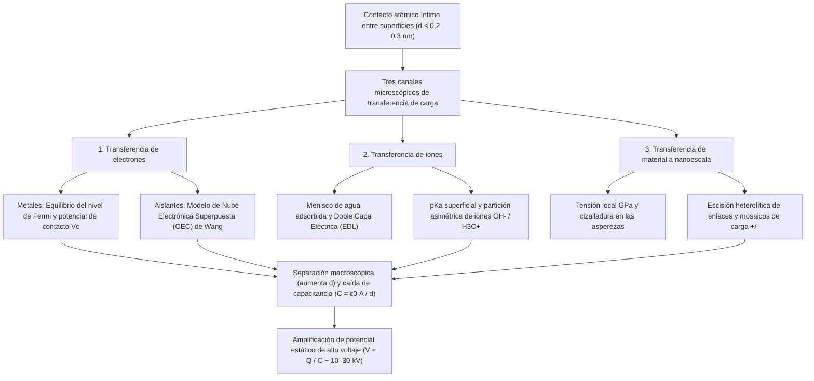
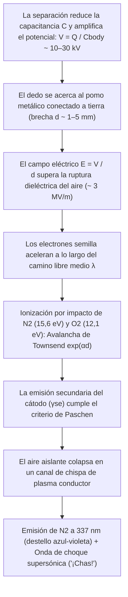

## 1. Introducción: Un misterio de 2.600 años oculto en el pomo de la puerta en invierno

En una mañana fría y seca de invierno, caminas sobre una alfombra, extiendes la mano hacia el pomo de latón de una puerta y —*¡CHAS!*— un diminuto relámpago azul-blanco salta desde la yema de tu dedo produciéndote una aguda descarga. Si te quitas un suéter de lana en la oscuridad, escucharás chasquidos acompañados de tenues chispas violetas; si desenrollas cinta adhesiva común dentro de una cámara de vacío, la interfaz de despegue emite suficientes rayos X triboluminiscentes como para radiografiar los huesos de tu dedo. Todos estos fenómenos cotidianos surgen del mismo proceso físico fundamental: la <strong>electricidad estática</strong>, conocida en física como <strong>triboelectricidad</strong> o, con mayor rigor, <strong>electrificación por contacto (Contact Electrification, CE)</strong>.

Históricamente, la triboelectricidad fue el primer encuentro de la humanidad con el electromagnetismo. Hacia el año $600\,\text{a. C.}$, el filósofo griego Tales de Mileto registró que al frotar resina fósil de árbol —<strong>ámbar</strong>, llamado $\eta\lambda\epsilon\kappa\tau\rho o\nu$ (*ēlektron*) en griego— contra piel animal, esta adquiría la fuerza invisible de atraer paja y plumas ligeras. En el siglo XVII, el médico inglés William Gilbert acuñó el término neolatino *electricus* («como el ámbar»), dando origen a las palabras modernas *electricidad* y *electrón*.

Sin embargo, tras este fenómeno tan familiar se esconde uno de los secretos más sorprendentes de la ciencia moderna: <strong>incluso en el siglo XXI —mucho después de que Maxwell unificara el electromagnetismo, la mecánica cuántica resolviera el átomo de hidrógeno y los físicos detectaran las ondas gravitacionales y el bosón de Higgs— el mecanismo microscópico fundamental de cómo se transfiere la carga eléctrica entre dos superficies aislantes al tocarse sigue siendo una de las preguntas abiertas más intensamente debatidas en la física de la materia condensada y la química de superficies.</strong>

Mientras que la transferencia de electrones entre dos *metales* se rige por niveles de Fermi bien definidos, los materiales triboeléctricos comunes —como el vidrio, el politetrafluoroetileno (PTFE/Teflón), el nailon, la silicona y el cabello humano— son <strong>aislantes (dieléctricos)</strong> con amplias bandas prohibidas ($E_g \approx 4\text{–}9\,\text{eV}$) y prácticamente cero electrones libres de conducción a temperatura ambiente. Cuando dos aislantes se tocan, ¿qué especie física cruza realmente la interfaz? ¿Son <strong>electrones</strong> que hacen túnel entre estados superficiales localizados u orbitales atómicos superpuestos? ¿Son <strong>iones móviles</strong> ($\text{H}_3\text{O}^+, \text{OH}^-$) que se reparten a través de capas nanométricas de agua adsorbida? ¿O son <strong>fragmentos materiales a nanoescala</strong> creados por la ruptura mecanocímica de enlaces covalentes poliméricos?

En este artículo diseccionamos la física de la electricidad estática desde la escala atómica hasta la escala planetaria e industrial: la diferencia entre área de contacto aparente y real, los tres mecanismos microscópicos incluyendo el <strong>modelo de Nube Electrónica Superpuesta (OEC)</strong> de Zhong Lin Wang, las paradojas de las series triboeléctricas cíclicas y la carga entre materiales idénticos, el efecto de la humedad invernal, la <strong>ley de Paschen</strong> de ruptura dieléctrica y las aplicaciones en impresoras láser, mascarillas N95 de electreto y <strong>nanogeneradores triboeléctricos (TENG)</strong>.

---

## 2. La verdad sobre el «frotamiento»: Área de contacto aparente vs. real

En el lenguaje cotidiano hablamos de «electricidad por fricción» (del griego *tribos*, «frotar»). Sin embargo, la física de superficies moderna ha demostrado que la fricción cinética no es un requisito previo para generar carga: la transferencia ocurre simplemente mediante el <strong>contacto físico íntimo y la posterior separación</strong>. ¿Por qué entonces frotamos instintivamente un globo contra nuestro cabello?

### 2.1 Asperezas superficiales y el área de contacto real $A_{\text{real}} \ll A_{\text{apparent}}$

Bajo un microscopio de fuerza atómica (AFM), cualquier superficie sólida —salvo cristales laminares exfoliados atómicamente como la mica o el grafeno— es una abrupta cordillera de picos y valles nanométricos y micrométricos llamados <strong>asperezas (asperities)</strong>. Cuando dos objetos de área nominal $A_{\text{apparent}}$ se presionan con una fuerza normal $F_N$, solo se tocan en las puntas de las asperezas más altas. Según la mecánica de contacto de Bowden–Tabor y Greenwood–Williamson, el <strong>área de contacto real ($A_{\text{real}}$)</strong> es proporcional a la carga normal dividida por el módulo elástico efectivo $E^*$:

$$A_{\text{real}} = \sum_{i=1}^{N} A_i \propto \frac{F_N}{E^*} \quad \left( \text{típicamente } \frac{A_{\text{real}}}{A_{\text{apparent}}} \sim 10^{-5} \text{ a } 10^{-3} \right)$$

Bajo fuerzas normales ordinarias, <strong>¡menos del $0,001\%$ al $0,1\%$ del área aparente entra realmente en contacto atómico!</strong>

### 2.2 El potencial de Lennard-Jones y el régimen repulsivo de Pauli

Además, para que un electrón o ion salte de un átomo A a un átomo B, ambos deben acercarse a <strong>$d \lesssim 0,2\text{–}0,3\,\text{nm}$</strong>, comparable a la longitud de un enlace químico. En el clásico <strong>potencial interatómico de Lennard-Jones</strong> $U_{\text{LJ}}(r)$:

$$U_{\text{LJ}}(r) = 4\varepsilon \left[ \left(\frac{\sigma}{r}\right)^{12} - \left(\frac{\sigma}{r}\right)^{6} \right]$$

el término $-\left(\sigma/r\right)^6$ representa la atracción de van der Waals a larga distancia, mientras que el empinado término $+\left(\sigma/r\right)^{12}$ representa la <strong>repulsión de Pauli a corta distancia</strong> cuando las nubes electrónicas externas comienzan a superponerse espacialmente. La transferencia de carga exige empujar los átomos interfaciales dentro de este <strong>régimen repulsivo ($r < r_{\text{eq}}$)</strong>. El papel físico real de frotar (deslizamiento tangencial) es hacer que las asperezas barran regiones frescas de la superficie opuesta, <strong>multiplicando por cientos o miles el área de contacto real acumulada $\int A_{\text{real}}\,dt$ que alcanza proximidad atómica ($d \lesssim 0,3\,\text{nm}$)</strong>.

---

## 3. Los tres mecanismos microscópicos de transferencia de carga

La ciencia de superficies ha revelado que <strong>tres mecanismos microscópicos</strong> operan de forma independiente o sinérgica según los materiales y la humedad:

### 3.1 Transferencia de electrones: Del nivel de Fermi al modelo de Nube Electrónica Superpuesta (OEC)

#### (1) Contacto metal–metal y potencial de contacto de Volta
En un metal, los electrones de conducción obedecen la <strong>distribución de Fermi–Dirac</strong>:

$$f(E) = \frac{1}{\exp\left(\frac{E - E_F}{k_B T}\right) + 1}$$

con nivel de Fermi $E_F$ y función de trabajo $\Phi = E_{\text{vac}} - E_F$. Al tocarse dos metales ($\Phi_1 < \Phi_2$), los electrones hacen túnel del metal 1 al metal 2 hasta igualar sus niveles de Fermi, generando la <strong>diferencia de potencial de contacto de Volta $V_c = -(\Phi_1 - \Phi_2)/e$</strong>.

#### (2) Contacto aislante–aislante: Estados superficiales y el modelo OEC de Zhong Lin Wang
En los aislantes, la ruptura de la simetría periódica en la superficie introduce <strong>estados superficiales localizados</strong> dentro de la banda prohibida. Entre 2018 y 2020, el <strong>Prof. Zhong Lin Wang</strong> propuso el marco cuántico universal conocido como el <strong>modelo de Nube Electrónica Superpuesta (Overlapped Electron-Cloud, OEC)</strong>:
- <strong>Antes del contacto ($d > 0,5\,\text{nm}$)</strong>: Los electrones de valencia de los átomos A y B están confinados en pozos de potencial individuales separados por una alta barrera energética $E_b$.
- <strong>Durante el contacto mecánico íntimo ($d < 0,2\text{–}0,3\,\text{nm}$)</strong>: Cuando la fuerza normal empuja a los átomos al régimen repulsivo de Lennard-Jones, sus orbitales externos $\psi_A$ y $\psi_B$ se superponen fuertemente ($\langle \psi_A | \psi_B \rangle \neq 0$). Esta superposición reduce drásticamente la barrera interatómica $E_b$, transformando el doble pozo en un pozo único asimétrico (o doble pozo de baja barrera).
- <strong>Transición cuántica y atrapamiento al separar</strong>: Con la barrera suprimida, los electrones débilmente ligados en orbitales de mayor energía del átomo A transicionan espontáneamente hacia orbitales desocupados de menor energía del átomo B. Al separarse las superficies ($d \to \infty$), la barrera $E_b$ vuelve a elevarse instantáneamente, atrapando permanentemente los electrones transferidos en la superficie B.

El grupo de Wang demostró experimentalmente que la desintegración térmica de las cargas triboeléctricas ($350\text{–}650\,\text{K}$) sigue la <strong>ley de emisión termoiónica de Richardson–Dushman</strong>:

$$J_{\text{th}} = A^* T^2 \exp\left(-\frac{\Phi_B}{k_B T}\right)$$

### 3.2 Transferencia de iones: Meniscos de agua adsorbida y Doble Capa Eléctrica (EDL)

En superficies hidrófilas o polímeros iónicos bajo humedad ambiental, <strong>George M. Whitesides</strong> y colaboradores (2008) demostraron que domina la <strong>transferencia de iones móviles</strong>. Casi toda superficie sólida posee una película nanométrica de agua adsorbida ($0,5\text{–}5\,\text{nm}$). El vidrio ($\text{SiO}_2$) desprotona sus grupos silanol ($-\text{Si–O}^- + \text{H}_3\text{O}^+$) creando una <strong>Doble Capa Eléctrica (EDL)</strong> con contraiones móviles $\text{H}_3\text{O}^+$, mientras que polímeros hidrófobos como el PTFE adsorben preferentemente <strong>iones hidróxido ($\text{OH}^-$)</strong>. Al tocarse, los meniscos de agua se fusionan y al separarse se rompen asimétricamente, dejando cargas iónicas netas.

### 3.3 Transferencia de material a nanoescala y mecanocímica: Mosaicos de carga

En 2011, <strong>Bartosz A. Grzybowski</strong> et al. (*Science* 2011) descubrieron mediante microscopía de sonda Kelvin (KPFM) que un aislante cargado por contacto exhibe un <strong>mosaico a nanoescala de dominios positivos ($+$) y negativos ($-$) ($10\text{–}200\,\text{nm}$)</strong>. Las presiones locales de gigapascales ($\sim \text{GPa}$) en las asperezas provocan la <strong>escisión mecanocímica heterolítica de enlaces covalentes</strong> (creando mecanoiones $\text{R}_1^+ + \text{R}_2^-$ y radicales libres) junto con la transferencia de fragmentos poliméricos.

| Propiedad | 1. Transferencia de electrones | 2. Transferencia de iones | 3. Transferencia de material a nanoescala |
| :--- | :--- | :--- | :--- |
| <strong>Portador de carga</strong> | Electrones ($e^-$) | Iones móviles ($\text{H}_3\text{O}^+, \text{OH}^-$, contraiones) | Fragmentos de oligómeros y mecanoiones ($\text{R}^+, \text{R}^-$) |
| <strong>Marco teórico</strong> | Nivel de Fermi, estados superficiales, <strong>modelo OEC</strong> | Menisco de agua, <strong>EDL</strong>, $\text{pK}_a$ y potencial $\zeta$ | <strong>Escisión mecanocímica covalente</strong>, desgaste adhesivo |
| <strong>Escala espacial</strong> | Régimen repulsivo atómico ($d \lesssim 0,2\text{–}0,3\,\text{nm}$) | Película de agua y menisco ($0,5\text{–}10\,\text{nm}$) | Mosaicos de nanodominios ($10\text{–}500\,\text{nm}$) |
| <strong>Sensibilidad ambiental</strong> | Opera en ultra-alto vacío (UHV) y baja $T$; decaimiento termoiónico $>350\,\text{K}$ | Fuertemente dependiente de la humedad relativa ($RH$) | Dependiente del esfuerzo de corte y reticulación |

---

## 4. La serie triboeléctrica y sus paradojas

### 4.1 Orígenes químicos y cuánticos de la serie triboeléctrica

Compilada por Johan Carl Wilcke en 1757 y estandarizada cuantitativamente por Wang et al. (2019) frente a mercurio líquido mediante la densidad de carga normalizada $\sigma_N$ ($\mu\text{C/m}^2$), la <strong>serie triboeléctrica</strong> ordena los materiales desde los más positivos ($+$) hasta los más negativos ($-$):

| Polaridad | Materiales representativos | Grupos funcionales dominantes | Densidad $\sigma_N$ ($\mu\text{C/m}^2$) | Mecanismo electrónico y químico |
| :---: | :--- | :--- | :---: | :--- |
| <strong>Muy positivo ($+++$)</strong> | Cuarzo / Vidrio ($\text{SiO}_2$), Mica | Grupos silanol ($-\text{Si–OH}$), red de silicato | $+80 \text{ a } +110$ | Pares solitarios de alta energía en el oxígeno donan electrones fácilmente (base de Lewis) |
| <strong>Moderadamente positivo ($++$)</strong> | Nailon-6,6, piel y cabello humano, lana | Enlaces amida ($-\text{NH–CO}-$), aminas ($-\text{NH}_2$), queratina | $+50 \text{ a } +85$ | Pares solitarios donadores N/O; explica la fuerte carga entre suéteres de lana y la piel |
| <strong>Ligeramente positivo ($+$)</strong> | Aluminio, papel (celulosa), algodón, madera | Óxido nativo ($\text{Al}_2\text{O}_3$), biopolímeros ricos en $-\text{OH}$ | $+10 \text{ a } +40$ | Donación moderada de electrones y partición de protones |
| <strong>Neutro ($0$)</strong> | Acero, PMMA (acrílico), policarbonato (PC) | Mar de Fermi metálico, grupos éster y carbonato | $-10 \text{ a } +10$ | Comportamiento anfótero: se carga positivamente frente a PTFE y negativamente frente a nailon |
| <strong>Moderadamente negativo ($-$)</strong> | Poliestireno (PS), polietileno (PE), polipropileno (PP) | Cadenas hidrocarbonadas saturadas ($-\text{CH}_2-$) | $-30 \text{ a } -60$ | Superficies hidrófobas apolares; atrapan electrones en defectos y adsorben $\text{OH}^-$ |
| <strong>Muy negativo ($--$)</strong> | PVC, PDMS (silicona), Kapton (poliimida) | Enlaces $-\text{C–Cl}$, esqueleto de siloxano, anillos imida | $-70 \text{ a } -110$ | Cloro electronegativo ($\chi = 3,16$) y anillos imida atractores de electrones |
| <strong>Extremadamente negativo ($---$)</strong> | <strong>PTFE (Teflón)</strong>, FEP, PVDF | Cadenas perfluoradas ($-(\text{CF}_2-\text{CF}_2)_n-$), vaina $\text{C–F}$ | $-110 \text{ a } -150$ | <strong>El flúor posee la mayor electronegatividad de Pauling ($\chi = 3,98$)</strong>; orbitales $\sigma^*$ profundos |

### 4.2 Paradojas: Ciclos intransitivos ($A > B > C > A$) y carga entre materiales idénticos

Al acoplar estados electrónicos, iones, asimetría elástica ($E_A \neq E_B$) y desgaste, pueden surgir <strong>tripletes cíclicos ($A > B > C > A$)</strong> que violan la transitividad.

Incluso dos piezas del <strong>mismo material</strong> se cargan al chocar o frotarse debido a:
1. <strong>Flexoelectricidad por gradientes de deformación</strong>: Un gradiente de deformación $\frac{\partial \varepsilon_{jk}}{\partial x_l}$ induce una polarización $P_i = \mu_{ijkl} \frac{\partial \varepsilon_{jk}}{\partial x_l}$ que desplaza las bandas electrónicas locales.
2. <strong>Carga bipolar dependiente del tamaño de partícula (partículas pequeñas $-$, grandes $+$)</strong>: En colisiones granulares (modelo de Lacks–Kok–Waitukaitis), las <strong>partículas pequeñas se cargan negativamente ($-$) y las grandes positivamente ($+$)</strong>. La convección y la gravedad separan estas cargas a gran escala, generando campos de $\text{MV/m}$ que impulsan los <strong>relámpagos en tormentas de arena del desierto</strong>, los <strong>relámpagos volcánicos («tormentas sucias»)</strong> y la coagulación electrostática de polvo de silicato sobre la <strong>«barrera del metro»</strong> en discos protoplanetarios para formar planetesimales y planetas terrestres (Steinpilz & Wurm, *Nature Physics* 2020).

---

## 5. Humedad, amplificación capacitiva ($V = Q / C$) y la ley de Paschen

### 5.1 Por qué la electricidad estática prolifera en invierno: Isoterma BET y conductividad superficial

El aire seco de invierno no genera más carga, sino que impide su fuga a tierra. El número de monocapas de agua adsorbidas $\theta_{\text{BET}}$ obedece la <strong>isoterma de Brunauer–Emmett–Teller (BET)</strong>:

$$\theta_{\text{BET}}(RH) = \frac{v}{v_m} = \frac{c \cdot RH}{(1 - RH)\left[1 + (c - 1)RH\right]}$$

En invierno ($RH < 20\text{–}30\%$ en interiores), $\theta_{\text{BET}} < 1$: el agua forma islas desconectadas y la resistencia superficial supera $10^{15}\,\Omega/\text{sq}$. En verano ($RH > 60\text{–}70\%$), se forma una película continua de $2\text{–}5$ monocapas donde los protones ($\text{H}^+$) saltan mediante el <strong>mecanismo de Grotthuss</strong>, aumentando exponencialmente la conductividad superficial $\sigma_s(RH) \approx \sigma_0 \exp(\alpha_{\text{RH}} \cdot RH)$ entre $6$ y $10$ órdenes de magnitud.

### 5.2 Amplificación de voltaje ($V = Q / C$) y la ley de Paschen

En el contacto ($d_0 \approx 1\,\text{nm}$), la capacitancia $C_0 = \varepsilon_0 A / d_0$ es enorme y el voltaje es de solo unos voltios. Al levantar el zapato de la alfombra, $d$ aumenta $10^8$ veces y la capacitancia cae hasta la del cuerpo humano ($C_{\text{body}} \approx 150\,\text{pF}$). A carga $Q$ constante, el trabajo mecánico amplifica el voltaje según $V(d) = Q / C(d)$ hasta <strong>$10.000\text{–}30.000\,\text{V}$ ($10\text{–}30\,\text{kV}$)</strong>! No es letal porque la energía almacenada es de apenas $U_E = \frac{1}{2}C_{\text{body}}V^2 = 30\,\text{mJ}$ ($Q = 3,0\,\mu\text{C}$, pulso de $\tau \approx 150\,\text{ns}$), aunque resulta destructiva para los óxidos de compuerta de $2\,\text{nm}$ en microchips CMOS.

Cuando el dedo se acerca al pomo a pocos milímetros, el campo $E = V/d$ desencadena una <strong>avalancha electrónica de Townsend</strong> ($\alpha = Ap\exp(-Bp/E)$) y emisión secundaria ($\gamma_{\text{se}}$), gobernada por la <strong>ley de Paschen (1889)</strong>:

$$V_B(p d) = \frac{B \cdot p d}{\ln(A \cdot p d) - \ln\left[\ln\left(1 + \frac{1}{\gamma_{\text{se}}}\right)\right]}$$

A $1\,\text{atm}$, el campo de ruptura del aire es <strong>$E_{\text{crit}} \approx 3\,\text{kV/mm}$</strong> y el <strong>mínimo de Paschen es $V_{\text{min}} \approx 327\,\text{V}$</strong> ($pd \approx 7,5\,\mu\text{m}\cdot\text{atm}$). El destello azul-violeta proviene del nitrógeno excitado ($\text{N}_2$, $\lambda = 337,1\,\text{nm}$) y el chasquido acústico de la expansión térmica supersónica del canal de plasma.

---

## 6. Aplicaciones tecnológicas: Impresión láser, mascarillas N95 y TENG

1. <strong>Xerografía (impresión láser) y precipitadores electrostáticos (ESP)</strong>: Las impresoras láser emplean tóner cargado triboeléctricamente ($Q/M \approx -20\text{ a }-40\,\mu\text{C/g}$); los precipitadores industriales capturan $>99,9\%$ de las partículas $\text{PM}_{2.5}$.
2. <strong>Filtros de electreto en mascarillas médicas N95</strong>: Las microfibras de polipropileno cargadas como <strong>electreto</strong> generan intensos gradientes de campo eléctrico que atrapan aerosoles virales neutros ($0,1\text{–}0,3\,\mu\text{m}$) mediante la <strong>fuerza dielectroforética</strong> sin obstaculizar la respiración:

$$\mathbf{F}_{\text{DEP}} = 2\pi r_p^3 \varepsilon_0 \left(\frac{\varepsilon_p - \varepsilon_0}{\varepsilon_p + 2\varepsilon_0}\right) \nabla |\mathbf{E}|^2$$

3. <strong>Nanogeneradores triboeléctricos (TENG) y la corriente de desplazamiento de Maxwell</strong>: Inventados por Zhong Lin Wang en 2012, los TENG cosechan energía mecánica de baja frecuencia mediante el término de polarización superficial $\frac{\partial \mathbf{P}_s}{\partial t}$ añadido a la <strong>corriente de desplazamiento de Maxwell</strong>:

$$\mathbf{J}_D = \frac{\partial \mathbf{D}}{\partial t} = \varepsilon_0 \frac{\partial \mathbf{E}}{\partial t} + \frac{\partial \mathbf{P}_s}{\partial t}$$

convirtiendo pasos humanos, latidos cardíacos, gotas de lluvia y olas oceánicas (*Energía Azul*) en electricidad limpia.
