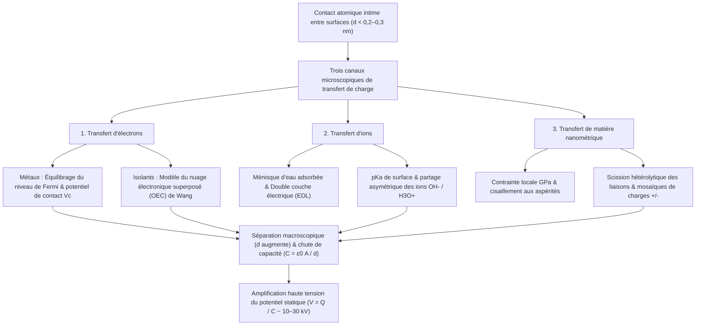
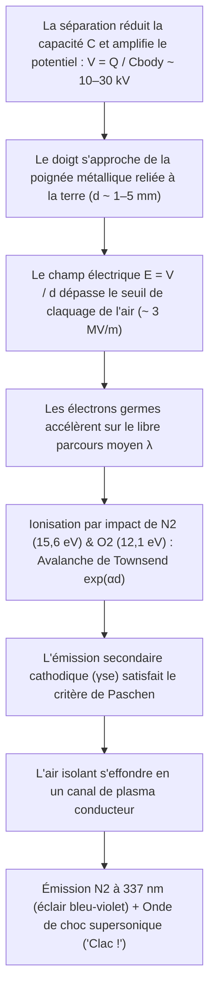

## 1. Introduction : Un mystère de 2 600 ans caché sur la poignée de porte en hiver

Par un matin d'hiver sec et vif, vous marchez sur une moquette, tendez la main vers une poignée de porte en laiton et — *CLAC !* — un minuscule éclair bleu-blanc jaillit du bout de votre doigt en vous infligeant une vive décharge. Retirez un pull en laine dans l'obscurité et vous entendrez des crépitements accompagnés d'étincelles violettes ; déroulez un simple ruban adhésif dans une chambre à vide et l'interface de pelage émet suffisamment de rayons X triboluminescents pour radiographier les os de votre doigt. Tous ces phénomènes découlent du même processus fondamental : l'<strong>électricité statique</strong>, appelée en physique <strong>triboélectricité</strong> ou plus exactement <strong>électrisation par contact (Contact Electrification, CE)</strong>.

Historiquement, la triboélectricité fut la toute première rencontre de l'humanité avec l'électromagnétisme. Vers $600\,\text{av. J.-C.}$, le philosophe grec Thalès de Milet nota que le frottement de la résine fossile — l'<strong>ambre</strong>, appelée $\eta\lambda\epsilon\kappa\tau\rho o\nu$ (*ēlektron*) en grec — contre une fourrure animale lui conférait le pouvoir invisible d'attirer des brins de paille et des plumes. Au XVIIe siècle, le médecin anglais William Gilbert forgea le terme néo-latin *electricus* (« semblable à l'ambre »), donnant naissance aux mots modernes *électricité* et *électron*.

Pourtant, derrière cette expérience enfantine se cache l'un des secrets les plus surprenants de la science moderne : <strong>même au XXIe siècle — bien après que Maxwell a unifié l'électromagnétisme, que la mécanique quantique a résolu l'atome d'hydrogène et que les physiciens ont détecté les ondes gravitationnelles et le boson de Higgs — le mécanisme microscopique fondamental du transfert de charge électrique entre deux surfaces isolantes lors d'un contact demeure l'une des questions ouvertes les plus débattues de la physique de la matière condensée et de la chimie des surfaces.</strong>

Alors que le transfert d'électrons entre deux *métaux* s'explique par l'alignement des niveaux de Fermi, les matériaux triboélectriques courants — verre, polytétrafluoroéthylène (PTFE/Téflon), nylon, silicone et cheveux humains — sont des <strong>isolants (diélectriques)</strong> dotés d'une large bande interdite ($E_g \approx 4\text{–}9\,\text{eV}$) et dépourvus d'électrons libres à température ambiante. Quelle entité physique traverse alors l'interface ? Des <strong>électrons</strong> franchissant par effet tunnel des états de surface ou des orbitales atomiques superposées ? Des <strong>ions mobiles</strong> ($\text{H}_3\text{O}^+, \text{OH}^-$) se répartissant dans des films d'eau adsorbés nanométriques ? Ou des <strong>fragments matériels nanométriques</strong> issus de la rupture mécanochimique de chaînes polymères covalentes ?

Dans cet article, nous analysons la physique de l'électricité statique de l'échelle atomique à l'échelle planétaire et industrielle : la distinction entre aire de contact apparente et réelle, les trois mécanismes microscopiques incluant le <strong>modèle du nuage électronique superposé (OEC)</strong> de Zhong Lin Wang, les paradoxes des séries triboélectriques cycliques et de la charge entre matériaux identiques, la loi d'humidité hivernale, la <strong>loi de Paschen</strong> du claquage électrique, ainsi que les applications aux imprimantes laser, aux masques N95 à électret et aux <strong>nanogénérateurs triboélectriques (TENG)</strong>.

---

## 2. La vérité sur le « frottement » : Aire de contact apparente vs réelle

Dans le langage courant, on parle d'« électricité de frottement » (du grec *tribos*, « frotter »). Or, la physique des surfaces a établi que le frottement cinétique n'est pas indispensable : le transfert de charge s'opère dès qu'il y a <strong>contact physique intime suivi d'une séparation</strong>. Pourquoi frottons-nous alors un ballon contre nos cheveux ?

### 2.1 Aspérités de surface et aire de contact réelle $A_{\text{real}} \ll A_{\text{apparent}}$

Sous un microscope à force atomique (AFM), toute surface solide — hormis les cristaux lamellaires clivés comme le mica ou le graphène — ressemble à une chaîne de montagnes hérissée de pics nanométriques et micrométriques appelés <strong>aspérités</strong>. Lorsque deux objets d'aire nominale $A_{\text{apparent}}$ sont pressés l'un contre l'autre sous une charge normale $F_N$, le contact physique ne s'établit qu'au sommet des aspérités les plus hautes. Selon la mécanique du contact de Bowden–Tabor et Greenwood–Williamson, l'<strong>aire de contact réelle ($A_{\text{real}}$)</strong> est proportionnelle à la force normale divisée par le module d'élasticité effectif $E^*$ :

$$A_{\text{real}} = \sum_{i=1}^{N} A_i \propto \frac{F_N}{E^*} \quad \left( \text{typiquement } \frac{A_{\text{real}}}{A_{\text{apparent}}} \sim 10^{-5} \text{ à } 10^{-3} \right)$$

Sous une pression ordinaire, <strong>moins de $0,001\%$ à $0,1\%$ de la surface apparente entre réellement en contact atomique !</strong>

### 2.2 Le potentiel de Lennard-Jones et l'entrée dans le régime répulsif de Pauli

Pour qu'un électron ou un ion passe d'un atome A à un atome B, les deux atomes doivent s'approcher à <strong>$d \lesssim 0,2\text{–}0,3\,\text{nm}$</strong>, distance comparable à une liaison chimique. Considérons le <strong>potentiel interatomique de Lennard-Jones</strong> $U_{\text{LJ}}(r)$ :

$$U_{\text{LJ}}(r) = 4\varepsilon \left[ \left(\frac{\sigma}{r}\right)^{12} - \left(\frac{\sigma}{r}\right)^{6} \right]$$

Le terme $-\left(\sigma/r\right)^6$ décrit l'attraction de van der Waals à longue portée, tandis que le terme $+\left(\sigma/r\right)^{12}$ représente la <strong>répulsion de Pauli à courte portée</strong> lorsque les nuages électroniques externes commencent à se chevaucher. Le transfert de charge exige de forcer les atomes interfaciaux dans ce <strong>régime répulsif ($r < r_{\text{eq}}$)</strong>. Le frottement macroscopique (glissement tangentiel) fait balayer les aspérités sur des zones fraîches de la surface opposée, <strong>multipliant par cent ou par mille l'aire de contact réelle cumulée $\int A_{\text{real}}\,dt$ qui atteint la proximité atomique ($d \lesssim 0,3\,\text{nm}$) !</strong>

---

## 3. Les trois mécanismes microscopiques du transfert de charge

La science des surfaces montre que <strong>trois canaux microscopiques</strong> opèrent selon la nature des matériaux et l'humidité ambiante :

### 3.1 Transfert d'électrons : Du niveau de Fermi au modèle du nuage électronique superposé (OEC)

#### (1) Contact métal–métal et différence de potentiel de Volta
Dans un métal, la probabilité d'occupation des électrons obéit à la <strong>distribution de Fermi–Dirac</strong> :

$$f(E) = \frac{1}{\exp\left(\frac{E - E_F}{k_B T}\right) + 1}$$

avec le niveau de Fermi $E_F$ et le travail de sortie $\Phi = E_{\text{vac}} - E_F$. Lorsque deux métaux ($\Phi_1 < \Phi_2$) entrent en contact, des électrons passent par effet tunnel du métal 1 vers le métal 2 jusqu'à égalisation des niveaux de Fermi, créant le <strong>potentiel de contact de Volta $V_c = -(\Phi_1 - \Phi_2)/e$</strong>.

#### (2) Contact isolant–isolant : États de surface et modèle OEC de Zhong Lin Wang
Pour les isolants, des <strong>états de surface localisés</strong> au sein de la bande interdite permettent le piégeage électronique. Entre 2018 et 2020, le <strong>Prof. Zhong Lin Wang</strong> a formulé le <strong>modèle du nuage électronique superposé (Overlapped Electron-Cloud, OEC)</strong> :
- <strong>Avant contact ($d > 0,5\,\text{nm}$)</strong> : Les électrons de valence des atomes A et B sont confinés dans deux puits de potentiel séparés par une haute barrière énergétique $E_b$.
- <strong>Pendant le contact intime ($d < 0,2\text{–}0,3\,\text{nm}$)</strong> : Sous l'effet de la force normale dans le régime répulsif de Lennard-Jones, les orbitales externes $\psi_A$ et $\psi_B$ se recouvrent fortement ($\langle \psi_A | \psi_B \rangle \neq 0$). Ce recouvrement abaisse drastiquement la barrière $E_b$, transformant le double puits en un puits unique asymétrique (ou double puits à basse barrière).
- <strong>Transition quantique et piégeage</strong> : Les électrons faiblement liés de l'atome A franchissent la barrière réduite vers les orbitales inoccupées de plus basse énergie de l'atome B. Dès la séparation ($d \to \infty$), la barrière $E_b$ se redresse instantanément, piégeant définitivement les électrons sur la surface B.

Le groupe de Wang a validé ce mécanisme en démontrant que la décroissance thermique des charges triboélectriques ($350\text{–}650\,\text{K}$) suit exactement la <strong>loi d'émission thermoïonique de Richardson–Dushman</strong> :

$$J_{\text{th}} = A^* T^2 \exp\left(-\frac{\Phi_B}{k_B T}\right)$$

### 3.2 Transfert d'ions : Ménisques d'eau adsorbée et Double Couche Électrique (EDL)

Sous humidité ambiante, <strong>George M. Whitesides</strong> et ses collègues (2008) ont démontré le rôle clé du <strong>transfert d'ions mobiles</strong>. Presque toute surface est recouverte d'un film d'eau nanométrique ($0,5\text{–}5\,\text{nm}$). Le verre ($\text{SiO}_2$) se déprotone ($-\text{Si–O}^- + \text{H}_3\text{O}^+$) en formant une <strong>double couche électrique (EDL)</strong> riche en cations mobiles $\text{H}_3\text{O}^+$, tandis que les polymères hydrophobes comme le PTFE adsorbent préférentiellement les ions <strong>hydroxyde ($\text{OH}^-$)</strong>. Lors du contact, les films d'eau fusionnent en un ménisque capillaire où les ions diffusent selon le potentiel zêta $\zeta$ et le $\text{pK}_a$, avant que la rupture du pont liquide ne laisse un excès asymétrique d'ions.

### 3.3 Transfert de matière nanométrique et mécanochimie : Mosaïques de charges

En 2011, <strong>Bartosz A. Grzybowski</strong> et al. (*Science* 2011) ont découvert par microscopie à sonde de Kelvin (KPFM) que les isolants chargés par contact présentent une <strong>mosaïque nanométrique de domaines positifs ($+$) et négatifs ($-$) ($10\text{–}200\,\text{nm}$)</strong>. Les contraintes locales de l'ordre du gigapascal ($\sim \text{GPa}$) aux aspérités provoquent la <strong>scission mécanochimique hétérolytique des liaisons covalentes</strong> (générant des mécano-ions $\text{R}_1^+ + \text{R}_2^-$ et des radicaux libres détectables par RPE) ainsi que le transfert croisé de fragments d'oligomères.

| Propriété | 1. Transfert d'électrons | 2. Transfert d'ions | 3. Transfert de matière nanométrique |
| :--- | :--- | :--- | :--- |
| <strong>Porteur de charge</strong> | Électrons ($e^-$) | Ions mobiles ($\text{H}_3\text{O}^+, \text{OH}^-$, contre-ions) | Fragments d'oligomères & mécano-ions ($\text{R}^+, \text{R}^-$) |
| <strong>Cadre théorique</strong> | Niveau de Fermi, états de surface, <strong>modèle OEC</strong> | Ménisque d'eau, <strong>EDL</strong>, $\text{pK}_a$ & potentiel $\zeta$ | <strong>Scission mécanochimique covalente</strong>, usure adhésive |
| <strong>Échelle spatiale</strong> | Régime répulsif atomique ($d \lesssim 0,2\text{–}0,3\,\text{nm}$) | Film d'eau & ménisque ($0,5\text{–}10\,\text{nm}$) | Mosaïques de nanodomaines ($10\text{–}500\,\text{nm}$) |
| <strong>Sensibilité ambiante</strong> | Actif sous ultravide (UHV) et basse $T$ ; déclin thermoïonique $>350\,\text{K}$ | Fortement dépendant de l'humidité relative ($RH$) | Dépendant de la contrainte de cisaillement et de la réticulation |

---

## 4. La série triboélectrique et ses paradoxes

### 4.1 Origines chimiques et quantiques de la série triboélectrique

Établie par Johan Carl Wilcke en 1757 et quantifiée par Wang et al. (2019) face au mercure liquide via la densité de charge normalisée $\sigma_N$ ($\mu\text{C/m}^2$), la <strong>série triboélectrique</strong> classe les matériaux :

| Polarité | Matériaux représentatifs | Groupes fonctionnels dominants | Densité $\sigma_N$ ($\mu\text{C/m}^2$) | Mécanisme électronique & chimique |
| :---: | :--- | :--- | :---: | :--- |
| <strong>Très positif ($+++$)</strong> | Quartz / Verre ($\text{SiO}_2$), Mica | Groupes silanol ($-\text{Si–OH}$), réseau silicaté | $+80 \text{ à } +110$ | Doublets libres de haute énergie sur l'oxygène cédant facilement des électrons (base de Lewis) |
| <strong>Modérément positif ($++$)</strong> | Nylon-6,6, peau & cheveux humains, laine | Liaisons amide ($-\text{NH–CO}-$), amines ($-\text{NH}_2$), kératine | $+50 \text{ à } +85$ | Doublets donneurs d'électrons N/O ; explique la forte charge entre pull en laine et peau |
| <strong>Légèrement positif ($+$)</strong> | Aluminium, papier (cellulose), coton, bois | Oxyde natif ($\text{Al}_2\text{O}_3$), biopolymères hydroxylés ($-\text{OH}$) | $+10 \text{ à } +40$ | Don modéré d'électrons et partage de protons |
| <strong>Neutre ($0$)</strong> | Acier, PMMA (acrylique), polycarbonate (PC) | Mer de Fermi métallique, groupes ester & carbonate | $-10 \text{ à } +10$ | Comportement amphotère : positif face au PTFE, négatif face au nylon |
| <strong>Modérément négatif ($-$)</strong> | Polystyrène (PS), polyéthylène (PE), polypropylène (PP) | Chaînes hydrocarbonées saturées ($-\text{CH}_2-$) | $-30 \text{ à } -60$ | Surfaces hydrophobes apolaires ; piégeage d'électrons et adsorption préférentielle de $\text{OH}^-$ |
| <strong>Très négatif ($--$)</strong> | PVC, PDMS (silicone), Kapton (polyimide) | Liaisons $-\text{C–Cl}$, squelette siloxane, cycles imide | $-70 \text{ à } -110$ | Chlore électronégatif ($\chi = 3,16$) et cycles imide électro-attracteurs |
| <strong>Extrêmement négatif ($---$)</strong> | <strong>PTFE (Téflon)</strong>, FEP, PVDF | Chaînes perfluorées ($-(\text{CF}_2-\text{CF}_2)_n-$), gaine $\text{C–F}$ | $-110 \text{ à } -150$ | <strong>Le fluor a la plus forte électronégativité de Pauling ($\chi = 3,98$)</strong> ; orbitales $\sigma^*$ basses |

### 4.2 Paradoxes : Cycles intransitifs ($A > B > C > A$) et électrisation entre matériaux identiques

Parce que la triboélectricité couple états électroniques, partage ionique, asymétrie d'élasticité ($E_A \neq E_B$) et usure mécanochimique, la transitivité linéaire peut être violée, formant des <strong>cycles triboélectriques ($A > B > C > A$)</strong>.

Plus étonnant encore, deux échantillons <strong>chimiquement identiques</strong> se chargent mutuellement ! Deux mécanismes brisent la symétrie :
1. <strong>Gradient de déformation et flexoélectricité</strong> : Un gradient de déformation inhomogène $\frac{\partial \varepsilon_{jk}}{\partial x_l}$ induit une polarisation flexoélectrique $P_i = \mu_{ijkl} \frac{\partial \varepsilon_{jk}}{\partial x_l}$ qui décale localement les bandes d'énergie.
2. <strong>Charge bipolaire dépendante de la taille des particules (petites grains $-$, gros grains $+$)</strong> : Lors de collisions granulaires (modèle de Lacks–Kok–Waitukaitis), les <strong>petites particules se chargent négativement ($-$) et les grosses positivement ($+$)</strong>. La sédimentation gravitationnelle sépare ces charges dans les courants ascendants, générant des champs de plusieurs $\text{MV/m}$ responsables des <strong>éclairs dans les tempêtes de sable du désert</strong>, des <strong>éclairs volcaniques (« orages sales »)</strong>, et permettant aux poussières silicatées des disques protoplanétaires de franchir la <strong>« barrière du mètre »</strong> pour former les planétésimaux et les planètes rocheuses comme la Terre (Steinpilz & Wurm, *Nature Physics* 2020).

---

## 5. Humidité, amplification capacitive ($V = Q / C$) et loi de Paschen

### 5.1 Pourquoi l'électricité statiqueexplose en hiver : Isotherme BET et conductivité de surface

L'air sec d'hiver ne produit pas plus de charges, il empêche leur dissipation. Le nombre de monocouches d'eau adsorbées $\theta_{\text{BET}}$ suit l'<strong>isotherme de Brunauer–Emmett–Teller (BET)</strong> :

$$\theta_{\text{BET}}(RH) = \frac{v}{v_m} = \frac{c \cdot RH}{(1 - RH)\left[1 + (c - 1)RH\right]}$$

En hiver ($RH < 20\text{–}30\%$ à l'intérieur), $\theta_{\text{BET}} < 1$ : l'eau forme des îlots isolés et la résistance de surface dépasse $10^{15}\,\Omega/\text{sq}$. En été ($RH > 60\text{–}70\%$), un film continu de $2\text{–}5$ monocouches permet aux protons ($\text{H}^+$) de sauter rapidement via le <strong>mécanisme de Grotthuss</strong>, faisant grimper exponentiellement la conductivité de surface $\sigma_s(RH) \approx \sigma_0 \exp(\alpha_{\text{RH}} \cdot RH)$ de $6$ à $10$ ordres de grandeur.

### 5.2 Amplification de tension ($V = Q / C$) et loi de Paschen du claquage gazeux

Au contact ($d_0 \approx 1\,\text{nm}$), la capacité $C_0 = \varepsilon_0 A / d_0$ est immense et la tension n'est que de quelques volts. Lorsque vous levez le pied de la moquette, $d$ passe à $10\,\text{cm}$ ($10^8$ fois plus grand) et la capacité chute jusqu'à celle du corps humain ($C_{\text{body}} \approx 150\,\text{pF}$). À charge $Q$ constante, le travail mécanique de vos muscles amplifie la tension selon $V(d) = Q / C(d)$ jusqu'à <strong>$10\,000\text{–}30\,000\,\text{V}$ ($10\text{–}30\,\text{kV}$)</strong> ! Ce choc de $20\,\text{kV}$ n'est pas mortel car l'énergie stockée n'est que de $U_E = \frac{1}{2}C_{\text{body}}V^2 = 30\,\text{mJ}$ ($Q = 3,0\,\mu\text{C}$, durée $\tau \approx 150\,\text{ns}$), mais il détruit instantanément les oxydes de grille de $2\,\text{nm}$ des puces CMOS modernes.

À quelques millimètres de la poignée, le champ électrique $E = V/d$ déclenche une <strong>avalanche électronique de Townsend</strong> ($\alpha = Ap\exp(-Bp/E)$) couplée à l'émission secondaire cathodique ($\gamma_{\text{se}}$), régie par la <strong>loi de Paschen (1889)</strong> :

$$V_B(p d) = \frac{B \cdot p d}{\ln(A \cdot p d) - \ln\left[\ln\left(1 + \frac{1}{\gamma_{\text{se}}}\right)\right]}$$

Dans l'air à $1\,\text{atm}$, le champ disruptif est <strong>$E_{\text{crit}} \approx 3\,\text{kV/mm}$</strong> et le <strong>minimum de Paschen vaut $V_{\text{min}} \approx 327\,\text{V}$</strong> ($pd \approx 7,5\,\mu\text{m}\cdot\text{atm}$). L'éclair bleu-violet provient de la désexcitation de l'azote ($\text{N}_2$, $\lambda = 337,1\,\text{nm}$) et le claquement sonore d'une onde de choc thermique supersonique.

---

## 6. Applications technologiques : Impression laser, masques N95 et TENG

1. <strong>Xérographie (impression laser) et électrofiltres (ESP)</strong> : L'imprimante laser utilise des particules de toner chargées par triboélectricité ($Q/M \approx -20\text{ à }-40\,\mu\text{C/g}$) ; les précipitateurs électrostatiques industriels éliminent $>99,9\%$ des particules fines ($\text{PM}_{2.5}$).
2. <strong>Filtres à électret des masques médicaux N95 / FFP2</strong> : Le polypropylène *melt-blown* chargé en <strong>électret</strong> crée un fort gradient de champ électrique local qui capture les aérosols viraux neutres ($0,1\text{–}0,3\,\mu\text{m}$) par <strong>force diélectrophorétique</strong> tout en maintenant des pores larges ($20\,\mu\text{m}$) pour faciliter la respiration :

$$\mathbf{F}_{\text{DEP}} = 2\pi r_p^3 \varepsilon_0 \left(\frac{\varepsilon_p - \varepsilon_0}{\varepsilon_p + 2\varepsilon_0}\right) \nabla |\mathbf{E}|^2$$

3. <strong>Nanogénérateurs triboélectriques (TENG) et courant de déplacement de Maxwell</strong> : Inventés par Zhong Lin Wang en 2012, les TENG convertissent l'énergie mécanique basse fréquence en électricité via le terme de polarisation de surface $\frac{\partial \mathbf{P}_s}{\partial t}$ ajouté au <strong>courant de déplacement de Maxwell</strong> :

$$\mathbf{J}_D = \frac{\partial \mathbf{D}}{\partial t} = \varepsilon_0 \frac{\partial \mathbf{E}}{\partial t} + \frac{\partial \mathbf{P}_s}{\partial t}$$

récoltant l'énergie des pas humains, des battements cardiaques, de la pluie et des vagues océaniques (*Blue Energy*).
