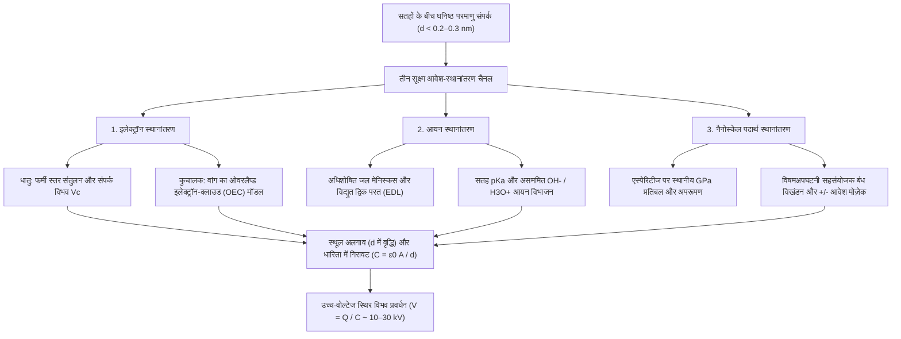
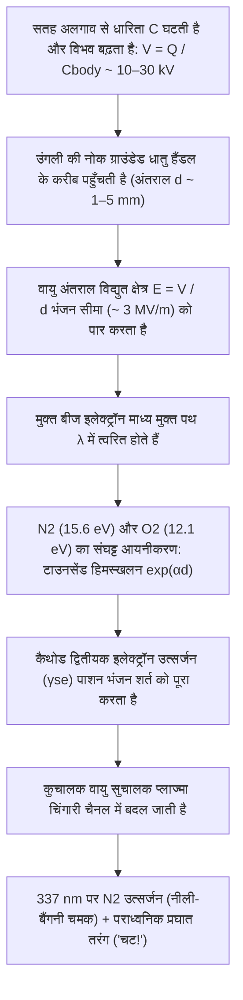

## 1. परिचय: सर्दियों के दरवाजे के हैंडल पर छिपा 2,600 साल पुराना रहस्य

सर्दियों की एक शुष्क, ठंडी सुबह आप कालीन पर चलते हुए पीतल के दरवाजे के हैंडल को छूने के लिए हाथ बढ़ाते हैं और—*चट!*—आपकी उंगली की नोक से नीली-सफेद बिजली की एक सूक्ष्म चिंगारी निकलती है और एक तीखा झटका देती है। अंधेरे में ऊनी स्वेटर उतारते समय चिटचिटाहट की आवाज के साथ बैंगनी चिंगारियां दिखाई देती हैं; यहाँ तक कि निर्वात कक्ष (vacuum chamber) में साधारण स्कॉच टेप को तेजी से खोलने पर छिलने वाले इंटरफेस से इतनी ट्राइबोल्यूमिनेसेंट एक्स-रे (X-rays) निकलती हैं कि आपकी उंगली की हड्डी का एक्स-रे लिया जा सकता है। ये सभी दैनिक घटनाएं एक ही मूलभूत भौतिक प्रक्रिया से उत्पन्न होती हैं: <strong>स्थिर विद्युत (Static Electricity)</strong>, जिसे भौतिकी में <strong>घर्षण विद्युत (Triboelectricity)</strong> या अधिक सटीक रूप से <strong>संपर्क विद्युतीकरण (Contact Electrification, CE)</strong> कहा जाता है।

ऐतिहासिक रूप से, घर्षण विद्युत मानवता का विद्युत चुंबकत्व से पहला परिचय था। लगभग $600\,\text{ईसा पूर्व}$, प्राचीन यूनानी दार्शनिक मिलेटस के थेल्स (Thales of Miletus) ने दर्ज किया कि जीवाश्म पेड़ की राल—<strong>एम्बर (Amber)</strong>, जिसे यूनानी में $\eta\lambda\epsilon\kappa\tau\rho o\nu$ (*ēlektron*) कहा जाता है—को जानवरों के फर से रगड़ने पर उसमें हल्के तिनकों और पंखों को आकर्षित करने की अदृश्य शक्ति आ जाती है। 17वीं शताब्दी में, अंग्रेज चिकित्सक विलियम गिल्बर्ट ने इस बल के लिए नव-लैटिन शब्द *electricus* ("एम्बर जैसा") गढ़ा, जिससे आधुनिक शब्द *इलेक्ट्रिसिटी (Electricity)* और *इलेक्ट्रॉन (Electron)* का जन्म हुआ।

फिर भी इस परिचित घटना के पीछे आधुनिक विज्ञान का एक सबसे आश्चर्यजनक रहस्य छिपा है: <strong>21वीं सदी में भी—मैक्सवेल द्वारा विद्युत चुंबकत्व के एकीकरण, क्वांटम यांत्रिकी द्वारा हाइड्रोजन परमाणु को हल करने, और गुरुत्वाकर्षण तरंगों तथा हिग्स बोसॉन की खोज के बहुत बाद भी—दो कुचालक (insulating) सतहों के संपर्क में आने पर विद्युत आवेश के स्थानांतरण की मूलभूत सूक्ष्म प्रक्रिया संघनित पदार्थ भौतिकी (condensed matter physics) और सतह रसायन विज्ञान में सबसे अधिक बहस वाले अनसुलझे प्रश्नों में से एक बनी हुई है।</strong>

जहाँ दो *धातुओं* के बीच इलेक्ट्रॉन स्थानांतरण स्पष्ट फर्मी स्तरों (Fermi levels) द्वारा नियंत्रित होता है, वहीं सामान्य ट्राइबोइलेक्ट्रिक पदार्थ—जैसे कांच, पॉलीटेट्राफ्लुओरोएथिलीन (PTFE/टेफ्लॉन), नायलॉन, सिलिकॉन रबर और मानव बाल—चौड़े बैंडगैप ($E_g \approx 4\text{–}9\,\text{eV}$) वाले <strong>कुचालक (डाइइलेक्ट्रिक्स)</strong> हैं जिनमें कमरे के तापमान पर मुक्त चालन इलेक्ट्रॉन लगभग शून्य होते हैं। जब दो कुचालक छूते हैं, तो वास्तव में इंटरफेस को कौन पार करता है? क्या वे <strong>इलेक्ट्रॉन</strong> हैं जो सतह अवस्थाओं या अतिव्यापी परमाणु कक्षकों के बीच क्वांटम टनलिंग करते हैं? क्या वे नैनोमीटर जल परतों में बंटने वाले <strong>गतिशील आयन</strong> ($\text{H}_3\text{O}^+, \text{OH}^-$) हैं? या सहसंयोजक बहुलक श्रृंखलाओं के मैकेनोकेमिकल विखंडन से बने <strong>नैनोस्केल पदार्थ के टुकड़े</strong> हैं?

इस लेख में हम परमाणु स्तर से लेकर ग्रहीय और औद्योगिक स्तर तक स्थिर विद्युत के भौतिक विज्ञान का विश्लेषण करेंगे: आभासी बनाम वास्तविक संपर्क क्षेत्र, झोंग लिन वांग के <strong>ओवरलैप्ड इलेक्ट्रॉन-क्लाउड (OEC) मॉडल</strong> सहित तीन सूक्ष्म आवेश-स्थानांतरण तंत्र, चक्रीय ट्राइबोइलेक्ट्रिक श्रेणी और समान-पदार्थ विद्युतीकरण के विरोधाभास, सर्दियों की आर्द्रता का प्रभाव, <strong>पाशन का नियम (Paschen's Law)</strong>, तथा लेजर प्रिंटर, N95 इलेक्ट्रेट मास्क और <strong>ट्राइबोइलेक्ट्रिक नैनोजेनरेटर (TENG)</strong> में इसके अनुप्रयोग।

---

## 2. "रगड़ने" का सच: आभासी बनाम वास्तविक सूक्ष्म संपर्क क्षेत्र

बोलचाल की भाषा में हम "घर्षण विद्युत" (यूनानी शब्द *tribos*, अर्थात "रगड़ना") कहते हैं। किंतु आधुनिक सतह भौतिकी ने सिद्ध किया है कि आवेश उत्पन्न करने के लिए गतिज घर्षण आवश्यक नहीं है; आवेश स्थानांतरण केवल <strong>घनिष्ठ भौतिक संपर्क और उसके बाद अलगाव</strong> से ही हो जाता है। तो फिर हम गुब्बारे को बालों में क्यों रगड़ते हैं?

### 2.1 सतह की सूक्ष्म चोटियाँ (Asperities) और वास्तविक संपर्क क्षेत्र $A_{\text{real}} \ll A_{\text{apparent}}$

परमाणु बल सूक्ष्मदर्शी (AFM) के नीचे, अभ्रक (mica) या ग्राफीन जैसे परमाण्विक रूप से समतल क्रिस्टलों को छोड़कर, प्रत्येक ठोस सतह नैनोमीटर से माइक्रोमीटर आकार की सूक्ष्म चोटियों और घाटियों की एक ऊबड़-खाबड़ पर्वत श्रृंखला जैसी दिखती है, जिन्हें <strong>एस्पेरिटीज (Asperities)</strong> कहा जाता है। जब आभासी क्षेत्र $A_{\text{apparent}}$ वाली दो वस्तुओं को अभिलंब बल $F_N$ के तहत दबाया जाता है, तो वे केवल सबसे ऊँची चोटियों के सिरों पर ही छूती हैं। बोडेन-टैबोर और ग्रीनवुड-विलियमसन संपर्क यांत्रिकी के अनुसार, <strong>वास्तविक संपर्क क्षेत्र ($A_{\text{real}}$)</strong> अभिलंब भार और प्रभावी प्रत्यास्थता मापांक $E^*$ के अनुपात के समानुपाती होता है:

$$A_{\text{real}} = \sum_{i=1}^{N} A_i \propto \frac{F_N}{E^*} \quad \left( \text{आमतौर पर } \frac{A_{\text{real}}}{A_{\text{apparent}}} \sim 10^{-5} \text{ से } 10^{-3} \right)$$

सामान्य दबाव में, <strong>आभासी सतह क्षेत्र का $0.001\%$ से $0.1\%$ से भी कम हिस्सा वास्तव में परमाणु संपर्क बनाता है!</strong>

### 2.2 लेनार्ड-जोन्स विभव और पाउली प्रतिकर्षण क्षेत्र में प्रवेश

एक परमाणु A से दूसरे परमाणु B में इलेक्ट्रॉन या आयन के जाने के लिए दोनों परमाणुओं को <strong>$d \lesssim 0.2\text{–}0.3\,\text{nm}$</strong> (रासायनिक बंध की लंबाई के बराबर) तक करीब लाना पड़ता है। क्लासिक <strong>लेनार्ड-जोन्स अंतर-परमाण्विक विभव (Lennard-Jones Potential)</strong> $U_{\text{LJ}}(r)$ पर विचार करें:

$$U_{\text{LJ}}(r) = 4\varepsilon \left[ \left(\frac{\sigma}{r}\right)^{12} - \left(\frac{\sigma}{r}\right)^{6} \right]$$

यहाँ $-\left(\sigma/r\right)^6$ लंबी दूरी के वान डेर वाल्स आकर्षण को दर्शाता है, जबकि तीव्र $+\left(\sigma/r\right)^{12}$ पद <strong>छोटी दूरी के पाउली प्रतिकर्षण (Pauli Repulsion)</strong> को दर्शाता है जो तब उत्पन्न होता है जब दोनों परमाणुओं के बाहरी इलेक्ट्रॉन बादल स्थानिक रूप से ओवरलैप होने लगते हैं। आवेश स्थानांतरण के लिए परमाणुओं को इस <strong>प्रतिकर्षण क्षेत्र ($r < r_{\text{eq}}$)</strong> में धकेलना आवश्यक है। रगड़ने (स्पर्शरेखीय फिसलन) की वास्तविक भौतिक भूमिका यह है कि सूक्ष्म चोटियाँ विपरीत सतह के नए क्षेत्रों से गुजरती हैं, जिससे <strong>परमाणु निकटता ($d \lesssim 0.3\,\text{nm}$) प्राप्त करने वाला संचयी वास्तविक संपर्क क्षेत्र $\int A_{\text{real}}\,dt$ सैकड़ों से हजारों गुना बढ़ जाता है!</strong>

---

## 3. आवेश स्थानांतरण के तीन सूक्ष्म तंत्र

आधुनिक सतह विज्ञान दर्शाता है कि पदार्थ की प्रकृति और वातावरण के आधार पर <strong>तीन सूक्ष्म तंत्र</strong> स्वतंत्र रूप से या मिलकर काम करते हैं:

### 3.1 इलेक्ट्रॉन स्थानांतरण: फर्मी स्तर से ओवरलैप्ड इलेक्ट्रॉन-क्लाउड (OEC) मॉडल तक

#### (1) धातु-धातु संपर्क और वोल्टा संपर्क विभवांतर
धातु में चालन इलेक्ट्रॉन <strong>फर्मी-डिराक वितरण</strong> का पालन करते हैं:

$$f(E) = \frac{1}{\exp\left(\frac{E - E_F}{k_B T}\right) + 1}$$

जहाँ $E_F$ फर्मी स्तर है और $\Phi = E_{\text{vac}} - E_F$ कार्य फलन (work function) है। जब दो भिन्न धातुएँ ($\Phi_1 < \Phi_2$) संपर्क में आती हैं, तो इलेक्ट्रॉन धातु 1 से धातु 2 में टनल करते हैं जब तक कि फर्मी स्तर बराबर न हो जाएँ, जिससे <strong>वोल्टा संपर्क विभवांतर $V_c = -(\Phi_1 - \Phi_2)/e$</strong> उत्पन्न होता है।

#### (2) कुचालक-कुचालक संपर्क: सतह अवस्थाएँ और झोंग लिन वांग का OEC मॉडल
कुचालकों में सतह पर जालक समरूपता टूटने से वर्जित बैंडगैप के भीतर स्थानीयकृत <strong>सतह अवस्थाएँ (surface states)</strong> बनती हैं। 2018 और 2020 के बीच, <strong>प्रो. झोंग लिन वांग (Zhong Lin Wang)</strong> ने एक सार्वभौमिक क्वांटम-यांत्रिक ढांचा प्रस्तुत किया जिसे <strong>ओवरलैप्ड इलेक्ट्रॉन-क्लाउड (OEC) मॉडल</strong> कहा जाता है:
- <strong>संपर्क से पहले ($d > 0.5\,\text{nm}$)</strong>: परमाणु A और परमाणु B के संयोजकता इलेक्ट्रॉन स्वतंत्र गहरे विभव कूपों में बंद होते हैं जिनके बीच एक उच्च ऊर्जा अवरोध $E_b$ होता है।
- <strong>घनिष्ठ यांत्रिक संपर्क के दौरान ($d < 0.2\text{–}0.3\,\text{nm}$)</strong>: जब बाहरी बल परमाणुओं को लेनार्ड-जोन्स विभव के प्रतिकर्षण क्षेत्र में धकेलता है, तो उनके बाहरी इलेक्ट्रॉन बादल ($\psi_A$ और $\psi_B$) प्रबल रूप से ओवरलैप होते हैं ($\langle \psi_A | \psi_B \rangle \neq 0$)। यह ओवरलैप अंतर-परमाण्विक अवरोध $E_b$ को भारी मात्रा में घटा देता है, जिससे द्विक-कूप विभव एक असममित एकल-कूप (या निम्न-अवरोध द्विक-कूप) में बदल जाता है।
- <strong>क्वांटम संक्रमण और अलगाव पर ट्रैपिंग</strong>: अवरोध घटने पर परमाणु A के उच्च-ऊर्जा कक्षकों के इलेक्ट्रॉन स्वतः ही परमाणु B के निम्न-ऊर्जा रिक्त कक्षकों में चले जाते हैं। सतहों के अलग होते ही ($d \to \infty$) अवरोध $E_b$ तुरंत वापस ऊपर उठ जाता है और स्थानांतरित इलेक्ट्रॉनों को सतह B में स्थायी रूप से कैद कर लेता है।

वांग के समूह ने सिद्ध किया कि उच्च तापमान ($350\text{–}650\,\text{K}$) पर ट्राइबोइलेक्ट्रिक आवेश का क्षय <strong>रिचर्डसन-डशमैन तापायनिक उत्सर्जन नियम (Richardson–Dushman Law)</strong> का पालन करता है:

$$J_{\text{th}} = A^* T^2 \exp\left(-\frac{\Phi_B}{k_B T}\right)$$

### 3.2 आयन स्थानांतरण: अधिशोषित जल मेनिस्कस और विद्युत द्विक परत (EDL)

सामान्य आर्द्रता में जलरागी सतहों या आयनिक बहुलकों पर <strong>जॉर्ज व्हाइटसाइड्स (George M. Whitesides)</strong> और सहयोगियों (2008) ने <strong>गतिशील आयन स्थानांतरण</strong> की प्रमुख भूमिका दिखाई। हवा में लगभग हर ठोस सतह पर $0.5\text{–}5\,\text{nm}$ मोटी जल परत होती है। कांच ($\text{SiO}_2$) पर सिलानॉल समूह विप्रोटोनीकृत ($-\text{Si–O}^- + \text{H}_3\text{O}^+$) होकर गतिशील $\text{H}_3\text{O}^+$ आयनों के साथ <strong>विद्युत द्विक परत (EDL)</strong> बनाते हैं, जबकि PTFE जैसे जलविरागी बहुलक प्राथमिकता से <strong>हाइड्रॉक्साइड आयनों ($\text{OH}^-$)</strong> को अधिशोषित करते हैं। संपर्क के समय जल सेतु जुड़ते हैं और अलग होते समय असममित रूप से टूटकर आयनिक आवेश छोड़ते हैं।

### 3.3 नैनोस्केल पदार्थ स्थानांतरण और मैकेनोकेमिस्ट्री: आवेश मोज़ेक

2011 में <strong>बार्टोस ग्रिबोव्स्की (Bartosz A. Grzybowski)</strong> और साथियों (*Science* 2011) ने केल्विन प्रोब फोर्स माइक्रोस्कोपी (KPFM) से खोजा कि संपर्क-आवेशित कुचालक सतह पर $10\text{–}200\,\text{nm}$ आकार के <strong>धनात्मक ($+$) और ऋणात्मक ($-$) डोमेन का नैनोस्केल मोज़ेक (Charge Mosaic)</strong> बनता है। एस्पेरिटीज पर गीगापास्कल ($\sim \text{GPa}$) प्रतिबल सहसंयोजक बंधों का <strong>विषमअपघटनी विखंडन (heterolytic cleavage)</strong> कर धनात्मक व ऋणात्मक मैकेनोआयन ($\text{R}_1^+ + \text{R}_2^-$) और बहुलक टुकड़ों का आदान-प्रदान करते हैं।

| विशेषता | 1. इलेक्ट्रॉन स्थानांतरण | 2. आयन स्थानांतरण | 3. नैनोस्केल पदार्थ स्थानांतरण |
| :--- | :--- | :--- | :--- |
| <strong>मुख्य आवेश वाहक</strong> | इलेक्ट्रॉन ($e^-$) | गतिशील आयन ($\text{H}_3\text{O}^+, \text{OH}^-$) | आवेशित ओलिगोमर टुकड़े व मैकेनोआयन ($\text{R}^+, \text{R}^-$) |
| <strong>सैद्धांतिक आधार</strong> | फर्मी स्तर, सतह अवस्थाएँ, <strong>OEC मॉडल</strong> | जल मेनिस्कस, <strong>EDL</strong>, $\text{pK}_a$ व $\zeta$ विभव | <strong>मैकेनोकेमिकल बंध विखंडन</strong>, आसंजक घिसाव |
| <strong>लंबाई का पैमाना</strong> | परमाणु प्रतिकर्षण क्षेत्र ($d \lesssim 0.2\text{–}0.3\,\text{nm}$) | जल परत व मेनिस्कस ($0.5\text{–}10\,\text{nm}$) | नैनोडोमेन मोज़ेक ($10\text{–}500\,\text{nm}$) |
| <strong>पर्यावरणीय संवेदनशीलता</strong> | अति-उच्च निर्वात (UHV) व निम्न $T$ में सक्रिय; $>350\,\text{K}$ पर तापायनिक क्षय | सापेक्ष आर्द्रता ($RH$) पर अत्यधिक निर्भर | अपरूपण प्रतिबल व क्रॉसलिंकिंग पर निर्भर |

---

## 4. ट्राइबोइलेक्ट्रिक श्रेणी (Triboelectric Series) और इसके विरोधाभास

### 4.1 ट्राइबोइलेक्ट्रिक श्रेणी की रासायनिक और क्वांटम उत्पत्ति

1757 में जोहान कार्ल विल्के द्वारा संकलित और 2019 में वांग के समूह द्वारा तरल पारे के सापेक्ष मानकीकृत <strong>ट्राइबोइलेक्ट्रिक श्रेणी</strong> पदार्थों को मानकीकृत आवेश घनत्व $\sigma_N$ ($\mu\text{C/m}^2$) के अनुसार क्रमबद्ध करती है:

| ध्रुवणता प्रवृत्ति | प्रतिनिधि पदार्थ | प्रमुख क्रियात्मक समूह | आवेश घनत्व $\sigma_N$ ($\mu\text{C/m}^2$) | इलेक्ट्रॉनिक और रासायनिक तंत्र |
| :---: | :--- | :--- | :---: | :--- |
| <strong>अत्यधिक धनात्मक ($+++$)</strong> | क्वार्ट्ज / कांच ($\text{SiO}_2$), अभ्रक | सिलानॉल समूह ($-\text{Si–OH}$), सिलिकेट जालक | $+80 \text{ से } +110$ | ऑक्सीजन के उच्च-ऊर्जा एकाकी इलेक्ट्रॉन युग्म आसानी से इलेक्ट्रॉन दान करते हैं (लुईस क्षार) |
| <strong>मध्यम धनात्मक ($++$)</strong> | नायलॉन-6,6, मानव त्वचा और बाल, ऊन | एमाइड बंध ($-\text{NH–CO}-$), अमीन ($-\text{NH}_2$), केराटिन | $+50 \text{ से } +85$ | इलेक्ट्रॉन दाता N/O युग्म; ऊनी स्वेटर और त्वचा के बीच प्रबल आवेश का कारण |
| <strong>हल्का धनात्मक ($+$)</strong> | एल्युमिनियम, कागज (सेलुलोज), कपास, लकड़ी | ऑक्साइड परत ($\text{Al}_2\text{O}_3$), $-\text{OH}$ समृद्ध बायोपॉलिमर | $+10 \text{ से } +40$ | मध्यम इलेक्ट्रॉन दान और प्रोटॉन विभाजन |
| <strong>उदासीन ($0$)</strong> | स्टील, PMMA (ऐक्रेलिक), पॉलीकार्बोनेट (PC) | धात्विक फर्मी सागर, एस्टर और कार्बोनेट समूह | $-10 \text{ से } +10$ | उभयधर्मी: PTFE के साथ धनात्मक और नायलॉन के साथ ऋणात्मक आवेशित |
| <strong>मध्यम ऋणात्मक ($-$)</strong> | पॉलीस्टाइरीन (PS), पॉलीएथिलीन (PE), पॉलीप्रोपाइलीन (PP) | संतृप्त हाइड्रोकार्बन श्रृंखलाएँ ($-\text{CH}_2-$) | $-30 \text{ से } -60$ | अध्रुवीय जलविरागी सतहें; दोष अवस्थाओं में इलेक्ट्रॉन ट्रैपिंग और $\text{OH}^-$ अधिशोषण |
| <strong>प्रबल ऋणात्मक ($--$)</strong> | PVC, PDMS (सिलिकॉन), कैप्टन (पॉलीइमाइड) | $-\text{C–Cl}$ बंध, सिलोक्सेन श्रृंखला, इमाइड वलय | $-70 \text{ से } -110$ | विद्युतऋणात्मक क्लोरीन ($\chi = 3.16$) और इलेक्ट्रॉन-आकर्षी इमाइड वलय |
| <strong>अत्यंत ऋणात्मक ($---$)</strong> | <strong>PTFE (टेफ्लॉन)</strong>, FEP, PVDF | परफ्लुओरीनेटेड श्रृंखलाएँ ($-(\text{CF}_2-\text{CF}_2)_n-$), $\text{C–F}$ आवरण | $-110 \text{ से } -150$ | <strong>फ्लुओरीन की पॉलिंग विद्युतऋणात्मकता सर्वाधिक ($\chi = 3.98$) है</strong>; गहरे रिक्त $\sigma^*$ कक्षक |

### 4.2 विरोधाभास: चक्रीय अक्रमिकता ($A > B > C > A$) और समान-पदार्थ विद्युतीकरण

चूँकि संपर्क विद्युतीकरण में इलेक्ट्रॉनिक अवस्थाएँ, आयन, प्रत्यास्थता मापांक असममिति ($E_A \neq E_B$) और घिसाव एक साथ काम करते हैं, इसलिए कभी-कभी <strong>चक्रीय ट्राइबोइलेक्ट्रिक त्रिक ($A > B > C > A$)</strong> देखे जाते हैं।

यहाँ तक कि <strong>रासायनिक रूप से समान पदार्थ</strong> के दो टुकड़े भी आपस में टकराने पर आवेशित हो जाते हैं:
1. <strong>विकृति प्रवणता और फ्लेक्सोइलेक्ट्रिसिटी (Flexoelectricity)</strong>: असमान विकृति प्रवणता $\frac{\partial \varepsilon_{jk}}{\partial x_l}$ स्थानीय समरूपता को तोड़कर ध्रुवण $P_i = \mu_{ijkl} \frac{\partial \varepsilon_{jk}}{\partial x_l}$ प्रेरित करती है जो ऊर्जा बैंड को खिसका देती है।
2. <strong>कण-आकार आधारित द्विध्रुवीय आवेशन (छोटे कण $-$, बड़े कण $+$)</strong>: कणों की टक्कर में (लैक्स-कोक-वाइटुकाइटिस मॉडल) <strong>छोटे कण ऋणात्मक ($-$) और बड़े कण धनात्मक ($+$) आवेश प्राप्त करते हैं</strong>। हवा के ऊर्ध्वप्रवाह और गुरुत्वाकर्षण द्वारा इन आवेशों के अलग होने से $\text{MV/m}$ तीव्रता के विद्युत क्षेत्र बनते हैं जो <strong>रेगिस्तानी रेत के तूफानों की बिजली</strong>, <strong>ज्वालामुखीय बिजली ("गंदे तड़ितझंझावात")</strong> उत्पन्न करते हैं, और प्रोटोप्लैनेटरी डिस्क में सिलिकेट धूल को <strong>"मीटर-आकार अवरोध"</strong> पार कर ग्रहाणुओं (planetesimals) तथा पृथ्वी जैसे ग्रहों के निर्माण में मदद करते हैं (Steinpilz & Wurm, *Nature Physics* 2020)।

---

## 5. आर्द्रता, धारिता प्रवर्धन ($V = Q / C$), और पाशन का नियम

### 5.1 सर्दियों में स्थिर विद्युत क्यों बढ़ती है: BET समतापी और सतह चालकता

सर्दियों की शुष्क हवा आवेश के रिसाव को रोकती है। अधिशोषित जल एकल-परतों की संख्या $\theta_{\text{BET}}$ <strong>ब्रूनॉअर-एमेट-टेलर (BET) समतापी</strong> का पालन करती है:

$$\theta_{\text{BET}}(RH) = \frac{v}{v_m} = \frac{c \cdot RH}{(1 - RH)\left[1 + (c - 1)RH\right]}$$

सर्दियों में ($RH < 20\text{–}30\%$) $\theta_{\text{BET}} < 1$: पानी अलग-थलग द्वीप बनाता है और सतह प्रतिरोध $10^{15}\,\Omega/\text{sq}$ से अधिक हो जाता है। गर्मियों में ($RH > 60\text{–}70\%$), $2\text{–}5$ परतों का सतत जल नेटवर्क बनता है जिसमें <strong>ग्रोथस तंत्र (Grotthuss mechanism)</strong> द्वारा प्रोटॉन ($\text{H}^+$) तेजी से कूदते हैं, जिससे सतह चालकता $\sigma_s(RH) \approx \sigma_0 \exp(\alpha_{\text{RH}} \cdot RH)$ चरघातांकी रूप से $6$ से $10$ कोटि तक बढ़ जाती है।

### 5.2 वोल्टेज प्रवर्धन ($V = Q / C$) और पाशन का नियम

संपर्क के क्षण ($d_0 \approx 1\,\text{nm}$) धारिता $C_0 = \varepsilon_0 A / d_0$ बहुत बड़ी होती है और वोल्टेज केवल कुछ वोल्ट होता है। जब आप कालीन से पैर उठाते हैं, तो दूरी $d$ $10^8$ गुना बढ़ जाती है और धारिता घटकर मानव शरीर की धारिता ($C_{\text{body}} \approx 150\,\text{pF}$) रह जाती है। नियत आवेश $Q$ पर आपकी मांसपेशियों का यांत्रिक कार्य $V(d) = Q / C(d)$ के अनुसार वोल्टेज को <strong>$10,000\text{–}30,000\,\text{V}$ ($10\text{–}30\,\text{kV}$)</strong> तक बढ़ा देता है! यह झटका जानलेवा नहीं होता क्योंकि संचित ऊर्जा केवल $U_E = \frac{1}{2}C_{\text{body}}V^2 = 30\,\text{mJ}$ ($Q = 3.0\,\mu\text{C}$, अवधि $\tau \approx 150\,\text{ns}$) होती है, किंतु यह आधुनिक CMOS माइक्रोचिप्स की $2\,\text{nm}$ गेट ऑक्साइड को तुरंत नष्ट कर सकता है।

जब उंगली दरवाजे के हैंडल के कुछ मिलीमीटर करीब पहुँचती है, तो विद्युत क्षेत्र $E = V/d$ <strong>टाउनसेंड इलेक्ट्रॉन हिमस्खलन (Townsend avalanche)</strong> ($\alpha = Ap\exp(-Bp/E)$) और द्वितीयक उत्सर्जन ($\gamma_{\text{se}}$) को जन्म देता है, जो <strong>पाशन के नियम (1889)</strong> द्वारा शासित होता है:

$$V_B(p d) = \frac{B \cdot p d}{\ln(A \cdot p d) - \ln\left[\ln\left(1 + \frac{1}{\gamma_{\text{se}}}\right)\right]}$$

$1\,\text{atm}$ पर वायु का भंजन क्षेत्र <strong>$E_{\text{crit}} \approx 3\,\text{kV/mm}$</strong> और <strong>पाशन न्यूनतम $V_{\text{min}} \approx 327\,\text{V}$</strong> ($pd \approx 7.5\,\mu\text{m}\cdot\text{atm}$) होता है। नीली-बैंगनी चमक उत्तेजित नाइट्रोजन ($\text{N}_2$, $\lambda = 337.1\,\text{nm}$) से और 'चट' की आवाज प्लाज्मा चैनल के पराध्वनिक तापीय प्रसार से उत्पन्न होती है।

---

## 6. तकनीकी अनुप्रयोग: लेजर प्रिंटिंग, N95 मास्क और TENG

1. <strong>ज़ेरोग्राफी (लेजर प्रिंटिंग) और इलेक्ट्रोस्टैटिक प्रेसिपिटेटर (ESP)</strong>: लेजर प्रिंटर ट्राइबोइलेक्ट्रिक रूप से आवेशित टोनर कणों ($Q/M \approx -20\text{ से }-40\,\mu\text{C/g}$) का उपयोग करते हैं; औद्योगिक ESP संयंत्र $>99.9\%$ सूक्ष्म धूल कणों ($\text{PM}_{2.5}$) को पकड़ते हैं।
2. <strong>N95 मेडिकल रेस्पिरेटर में इलेक्ट्रेट नॉनवोवन फिल्टर</strong>: <strong>इलेक्ट्रेट (Electret)</strong> पॉलीप्रोपाइलीन सूक्ष्म रेशे प्रबल विद्युत क्षेत्र प्रवणता बनाते हैं जो सांस लेने में बाधा डाले बिना <strong>डाइइलेक्ट्रोफोरेटिक बल</strong> द्वारा उदासीन वायरस एरोसोल ($0.1\text{–}0.3\,\mu\text{m}$) को खींच लेते हैं:

$$\mathbf{F}_{\text{DEP}} = 2\pi r_p^3 \varepsilon_0 \left(\frac{\varepsilon_p - \varepsilon_0}{\varepsilon_p + 2\varepsilon_0}\right) \nabla |\mathbf{E}|^2$$

3. <strong>ट्राइबोइलेक्ट्रिक नैनोजेनरेटर (TENG) और मैक्सवेल की विस्थापन धारा</strong>: 2012 में झोंग लिन वांग द्वारा आविष्कृत TENG <strong>मैक्सवेल की विस्थापन धारा</strong> में सतह ध्रुवण पद $\frac{\partial \mathbf{P}_s}{\partial t}$ के माध्यम से निम्न-आवृत्ति यांत्रिक ऊर्जा को बिजली में बदलता है:

$$\mathbf{J}_D = \frac{\partial \mathbf{D}}{\partial t} = \varepsilon_0 \frac{\partial \mathbf{E}}{\partial t} + \frac{\partial \mathbf{P}_s}{\partial t}$$

जिससे मानव कदमों, हृदय गति, बारिश की बूंदों और समुद्री लहरों (*ब्लू एनर्जी*) से स्वच्छ ऊर्जा प्राप्त की जा सकती है।
