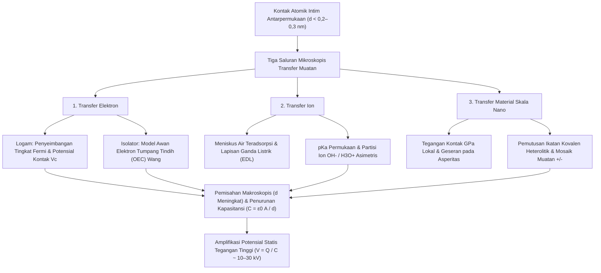
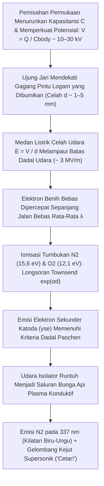

## 1. Pendahuluan: Misteri Berusia 2.600 Tahun yang Tersembunyi di Gagang Pintu Musim Dingin

Di pagi musim dingin yang kering dan dingin, Anda berjalan di atas lantai berkarpet, meraih gagang pintu kuningan, dan—*CETAR!*—kilatan petir biru-putih mini melompat dari ujung jari Anda, memberikan sengatan tajam. Saat Anda melepas sweter wol di ruang gelap, terdengar suara gemeretak disertai percikan ungu redup; saat Anda membuka gulungan pita perekat biasa di dalam ruang vakum, antarmuka pengelupasannya memancarkan sinar-X triboluminesensi yang cukup kuat untuk memotret tulang jari Anda. Semua fenomena sehari-hari ini berasal dari proses fisika fundamental yang sama: <strong>listrik statis</strong>, yang dalam fisika dikenal sebagai <strong>triboelektrisitas</strong> atau, lebih tepatnya, <strong>Elektrifikasi Kontak (Contact Electrification, CE)</strong>.

Secara historis, triboelektrisitas adalah perjumpaan pertama umat manusia dengan fenomena elektromagnetik. Sekitar $600\,\text{SM}$, filsuf Yunani kuno Thales dari Miletus mencatat bahwa menggosok resin pohon fosil—<strong>amber</strong>, disebut $\eta\lambda\epsilon\kappa\tau\rho o\nu$ (*ēlektron*) dalam bahasa Yunani—pada bulu hewan memberinya kekuatan tak kasatmata untuk menarik jerami dan bulu ringan. Pada abad ke-17, dokter Inggris William Gilbert menciptakan istilah Neo-Latin *electricus* ("seperti amber"), yang melahirkan kata modern *listrik (electricity)* dan *elektron*.

Namun di balik demonstrasi masa kecil yang akrab ini tersembunyi salah satu rahasia paling mengejutkan dalam sains modern: <strong>bahkan di abad ke-21—jauh setelah Maxwell menyatukan elektromagnetisme, mekanika kuantum memecahkan atom hidrogen, dan fisikawan mendeteksi gelombang gravitasi serta boson Higgs—mekanisme mikroskopis fundamental tentang bagaimana muatan listrik berpindah di antara dua permukaan isolator saat bersentuhan tetap menjadi salah satu pertanyaan terbuka yang paling sengit diperdebatkan dalam fisika benda terkondensasi dan kimia permukaan.</strong>

Sementara transfer elektron antara dua *logam* diatur oleh tingkat Fermi yang terdefinisi dengan baik, material triboelektrik umum—seperti kaca, politetrafluoroetilena (PTFE/Teflon), nilon, karet silikon, dan rambut manusia—adalah <strong>isolator (dielektrik)</strong> dengan celah pita elektronik lebar ($E_g \approx 4\text{–}9\,\text{eV}$) dan hampir nol elektron konduksi bebas pada suhu kamar. Ketika dua isolator bersentuhan, entitas fisik apa yang sebenarnya melintasi antarmuka? Apakah <strong>elektron</strong> yang menerowong (tunneling) di antara keadaan permukaan terlokalisasi atau orbital atom yang tumpang tindih? Apakah <strong>ion bergerak</strong> ($\text{H}_3\text{O}^+, \text{OH}^-$) yang terpartisi melintasi lapisan air teradsorpsi nanometrik? Ataukah <strong>fragmen material skala nano</strong> yang tercipta akibat pemutusan mekanokimia rantai polimer kovalen?

Dalam artikel ini, kita membedah fisika listrik statis dari skala atom hingga skala planet dan industri: perbedaan antara luas kontak semu dan nyata, tiga mekanisme transfer muatan mikroskopis termasuk <strong>model Awan Elektron Tumpang Tindih (OEC)</strong> dari Zhong Lin Wang, paradoks deret triboelektrik siklik dan pengisian material identik dalam badai pasir gurun serta cakram protoplanet, efek kelembapan musim dingin, <strong>Hukum Paschen</strong> tentang peluahan bunga api, serta aplikasi pada printer laser, masker elektret N95, dan <strong>Nanogenerator Triboelektrik (TENG)</strong>.

---

## 2. Kebenaran Tentang "Menggosok": Luas Kontak Semu vs. Nyata

Dalam bahasa sehari-hari kita menyebut "listrik gesekan" (dari bahasa Yunani *tribos*, "menggosok"). Namun, fisika permukaan modern telah membuktikan bahwa gesekan kinetik bukanlah prasyarat pembentukan muatan: transfer muatan terjadi cukup melalui <strong>kontak fisik intim yang diikuti oleh pemisahan</strong>. Lalu mengapa kita secara naluriah menggosok balon ke rambut?

### 2.1 Asperitas Permukaan dan Luas Kontak Nyata $A_{\text{real}} \ll A_{\text{apparent}}$

Di bawah Mikroskop Gaya Atom (AFM), setiap permukaan padat—kecuali kristal berlapis yang dibelah secara atomik seperti mika atau grafena—adalah pegunungan terjal dari puncak dan lembah mikroskopis berukuran nanometer hingga mikrometer yang disebut <strong>asperitas (asperities)</strong>. Ketika dua benda dengan luas nominal $A_{\text{apparent}}$ ditekan bersama oleh gaya normal $F_N$, kontak fisik hanya terjadi di ujung puncak asperitas tertinggi. Menurut mekanika kontak Bowden–Tabor dan Greenwood–Williamson, <strong>luas kontak nyata ($A_{\text{real}}$)</strong> berbanding lurus dengan beban normal dibagi modulus elastisitas efektif $E^*$:

$$A_{\text{real}} = \sum_{i=1}^{N} A_i \propto \frac{F_N}{E^*} \quad \left( \text{umumnya } \frac{A_{\text{real}}}{A_{\text{apparent}}} \sim 10^{-5} \text{ hingga } 10^{-3} \right)$$

Di bawah gaya tekan biasa, <strong>kurang dari $0,001\%$ hingga $0,1\%$ dari luas permukaan semu yang benar-benar melakukan kontak atomik!</strong>

### 2.2 Potensial Lennard-Jones dan Rezim Repulsif Jarak Pendek Pauli

Agar elektron atau ion dapat menyeberang dari Atom A ke Atom B, kedua atom harus didekatkan hingga <strong>$d \lesssim 0,2\text{–}0,3\,\text{nm}$</strong>—sebanding dengan panjang ikatan kimia. Tinjaulah <strong>potensial antaratom Lennard-Jones</strong> $U_{\text{LJ}}(r)$:

$$U_{\text{LJ}}(r) = 4\varepsilon \left[ \left(\frac{\sigma}{r}\right)^{12} - \left(\frac{\sigma}{r}\right)^{6} \right]$$

Suku $-\left(\sigma/r\right)^6$ mewakili gaya tarik van der Waals jarak jauh, sedangkan suku curam $+\left(\sigma/r\right)^{12}$ mewakili <strong>tolakan Pauli jarak pendek</strong> ketika kulit elektron terluar (fungsi gelombang) kedua atom mulai tumpang tindih. Transfer muatan menuntut atom antarmuka didorong masuk ke <strong>rezim repulsif ($r < r_{\text{eq}}$)</strong> ini. Peran fisik sebenarnya dari menggosok (penggeseran tangensial) adalah membuat asperitas menyapu area segar di permukaan lawan, <strong>melipatgandakan luas kontak nyata kumulatif $\int A_{\text{real}}\,dt$ yang mencapai kedekatan atomik ($d \lesssim 0,3\,\text{nm}$) hingga ratusan atau ribuan kali lipat!</strong>

---

## 3. Tiga Mekanisme Mikroskopis Transfer Muatan

Sains permukaan modern mengungkapkan bahwa <strong>tiga mekanisme mikroskopis</strong> bekerja secara independen atau sinergis bergantung pada jenis material dan kondisi lingkungan:

### 3.1 Transfer Elektron: Dari Tingkat Fermi ke Model Awan Elektron Tumpang Tindih (OEC)

#### (1) Kontak Logam–Logam dan Potensial Kontak Volta
Dalam logam, elektron konduksi mengikuti <strong>distribusi Fermi–Dirac</strong>:

$$f(E) = \frac{1}{\exp\left(\frac{E - E_F}{k_B T}\right) + 1}$$

dengan tingkat Fermi $E_F$ dan fungsi kerja $\Phi = E_{\text{vac}} - E_F$. Ketika dua logam ($\Phi_1 < \Phi_2$) bersentuhan, elektron menerowong dari logam 1 ke logam 2 hingga tingkat Fermi keduanya sama, menghasilkan <strong>beda potensial kontak Volta $V_c = -(\Phi_1 - \Phi_2)/e$</strong>.

#### (2) Kontak Isolator–Isolator: Keadaan Permukaan dan Model OEC Zhong Lin Wang
Pada isolator, terputusnya simetri kisi di permukaan menciptakan <strong>keadaan permukaan terlokalisasi (surface states)</strong> di dalam celah pita. Antara 2018 dan 2020, <strong>Prof. Zhong Lin Wang</strong> mengusulkan kerangka mekanika kuantum universal yang dikenal sebagai <strong>Model Awan Elektron Tumpang Tindih (Overlapped Electron-Cloud, OEC Model)</strong>:
- <strong>Sebelum Kontak ($d > 0,5\,\text{nm}$)</strong>: Elektron valensi Atom A dan Atom B terkurung dalam sumur potensial tunggal yang terpisah oleh penghalang energi tinggi $E_b$.
- <strong>Selama Kontak Mekanis Intim ($d < 0,2\text{–}0,3\,\text{nm}$)</strong>: Ketika gaya normal mendorong kedua atom permukaan ke rezim repulsif Lennard-Jones, awan elektron terluar ($\psi_A$ dan $\psi_B$) tumpang tindih secara kuat ($\langle \psi_A | \psi_B \rangle \neq 0$). Tumpang tindih orbital ini menurunkan penghalang potensial $E_b$ secara drastis, mengubah potensial sumur ganda menjadi sumur tunggal asimetris (atau sumur ganda berpenghalang rendah).
- <strong>Transisi Kuantum & Penjebakan Saat Pemisahan</strong>: Dengan tertekannya penghalang, elektron yang terikat lemah pada orbital berenergi lebih tinggi di Atom A bertransisi secara spontan ke orbital kosong berenergi lebih rendah di Atom B. Saat kedua permukaan dipisahkan ($d \to \infty$), penghalang $E_b$ langsung naik kembali, menjebak elektron secara permanen di permukaan B.

Kelompok Wang membuktikan secara eksperimental bahwa peluruhan termal muatan triboelektrik ($350\text{–}650\,\text{K}$) mengikuti <strong>hukum emisi termionik Richardson–Dushman</strong>:

$$J_{\text{th}} = A^* T^2 \exp\left(-\frac{\Phi_B}{k_B T}\right)$$

### 3.2 Transfer Ion: Meniskus Air Teradsorpsi dan Lapisan Ganda Listrik (EDL)

Pada permukaan hidrofilik atau polimer ionik di bawah kelembapan udara, <strong>George M. Whitesides</strong> dkk. (2008) menunjukkan peran penting <strong>transfer ion bergerak</strong>. Hampir setiap permukaan padat dilapisi film air nanometrik ($0,5\text{–}5\,\text{nm}$). Kaca ($\text{SiO}_2$) mendeprotonasi gugus silanol ($-\text{Si–O}^- + \text{H}_3\text{O}^+$) membentuk <strong>Lapisan Ganda Listrik (EDL)</strong> dengan ion lawan $\text{H}_3\text{O}^+$, sedangkan polimer hidrofobik seperti PTFE secara preferensial mengadsorpsi <strong>ion hidroksida ($\text{OH}^-$)</strong>. Saat bersentuhan, jembatan air kapiler menyatu dan saat terpisah putus secara asimetris.

### 3.3 Transfer Material Skala Nano dan Mekanokimia: Mosaik Muatan

Pada tahun 2011, <strong>Bartosz A. Grzybowski</strong> dkk. (*Science* 2011) menggunakan Mikroskop Gaya Probe Kelvin (KPFM) dan menemukan bahwa isolator bermuatan kontak membentuk <strong>mosaik skala nano dari domain positif ($+$) dan negatif ($-$) ($10\text{–}200\,\text{nm}$)</strong>. Tekanan lokal gigapascal ($\sim \text{GPa}$) pada asperitas memicu <strong>pemutusan ikatan kovalen mekanokimia heterolitik</strong> (menghasilkan mekanoion $\text{R}_1^+ + \text{R}_2^-$ dan radikal bebas) beserta transfer fragmen oligomer.

| Karakteristik | 1. Transfer Elektron | 2. Transfer Ion | 3. Transfer Material Skala Nano |
| :--- | :--- | :--- | :--- |
| <strong>Pembawa Muatan</strong> | Elektron ($e^-$) | Ion bergerak ($\text{H}_3\text{O}^+, \text{OH}^-$, ion lawan) | Fragmen oligomer & mekanoion ($\text{R}^+, \text{R}^-$) |
| <strong>Kerangka Teoretis</strong> | Tingkat Fermi, keadaan permukaan, <strong>model OEC</strong> | Meniskus air, <strong>EDL</strong>, $\text{pK}_a$ & potensial $\zeta$ | <strong>Pemutusan ikatan mekanokimia</strong>, keausan adhesif |
| <strong>Skala Panjang</strong> | Rezim repulsif atomik ($d \lesssim 0,2\text{–}0,3\,\text{nm}$) | Ketebalan film air & meniskus ($0,5\text{–}10\,\text{nm}$) | Mosaik nanodomain ($10\text{–}500\,\text{nm}$) |
| <strong>Sensitivitas Lingkungan</strong> | Bekerja di vakum ultra-tinggi (UHV) & $T$ rendah; peluruhan termionik $>350\,\text{K}$ | Sangat bergantung pada kelembapan relatif ($RH$) | Bergantung pada tegangan geser dan ikatan silang |

---

## 4. Deret Triboelektrik dan Paradoksnya

### 4.1 Asal-Usul Kimia dan Kuantum Deret Triboelektrik

Disusun oleh Johan Carl Wilcke pada tahun 1757 dan distandarisasi oleh Wang dkk. (2019) terhadap merkuri cair melalui rapat muatan ternormalisasi $\sigma_N$ ($\mu\text{C/m}^2$), <strong>Deret Triboelektrik</strong> mengurutkan material dari yang paling positif ($+$) hingga paling negatif ($-$):

| Polaritas | Material Representatif | Gugus Fungsi Dominan | Rapat Muatan $\sigma_N$ ($\mu\text{C/m}^2$) | Mekanisme Elektronik & Kimia |
| :---: | :--- | :--- | :---: | :--- |
| <strong>Sangat Positif ($+++$)</strong> | Kuarsa / Kaca ($\text{SiO}_2$), Mika | Gugus silanol ($-\text{Si–OH}$), kisi silikat | $+80 \text{ hingga } +110$ | Pasangan elektron bebas berenergi tinggi pada oksigen mudah mendonorkan elektron (basa Lewis) |
| <strong>Cukup Positif ($++$)</strong> | Nilon-6,6, kulit & rambut manusia, wol | Ikatan amida ($-\text{NH–CO}-$), amina ($-\text{NH}_2$), keratin | $+50 \text{ hingga } +85$ | Pasangan elektron bebas N/O pendonor kuat; menjelaskan listrik statis kuat antara sweter wol dan kulit |
| <strong>Sedikit Positif ($+$)</strong> | Aluminium, kertas (selulosa), katun, kayu | Oksida alami ($\text{Al}_2\text{O}_3$), biopolimer kaya $-\text{OH}$ | $+10 \text{ hingga } +40$ | Donasi elektron moderat dan partisi proton |
| <strong>Netral ($0$)</strong> | Baja, PMMA (akrilik), polikarbonat (PC) | Laut Fermi logam, gugus ester & karbonat | $-10 \text{ hingga } +10$ | Sifat amfoter: bermuatan positif terhadap PTFE tetapi negatif terhadap nilon |
| <strong>Cukup Negatif ($-$)</strong> | Polistirena (PS), polietilena (PE), polipropilena (PP) | Rantai hidrokarbon jenuh ($-\text{CH}_2-$) | $-30 \text{ hingga } -60$ | Permukaan hidrofobik nonpolar; menjebak elektron pada cacat dan mengadsorpsi $\text{OH}^-$ |
| <strong>Sangat Negatif ($--$)</strong> | PVC, PDMS (silikon), Kapton (poliimida) | Ikatan $-\text{C–Cl}$, tulang punggung siloksana, cincin imida | $-70 \text{ hingga } -110$ | Klorin elektronegatif ($\chi = 3,16$) dan cincin imida penarik elektron |
| <strong>Ekstrem Negatif ($---$)</strong> | <strong>PTFE (Teflon)</strong>, FEP, PVDF | Rantai perfluorokarbon ($-(\text{CF}_2-\text{CF}_2)_n-$), selubung $\text{C–F}$ | $-110 \text{ hingga } -150$ | <strong>Fluorin memiliki elektronegativitas Pauling tertinggi ($\chi = 3,98$)</strong>; orbital $\sigma^*$ rendah menjebak elektron |

### 4.2 Paradoks: Siklus Intransitif ($A > B > C > A$) dan Pengisian Material Identik

Karena elektrifikasi kontak menggabungkan keadaan elektronik, partisi ion, asimetri modulus elastisitas ($E_A \neq E_B$), dan keausan, sifat transitif dapat dilanggar membentuk <strong>tripel triboelektrik siklik ($A > B > C > A$)</strong>.

Bahkan dua benda dari <strong>material yang identik secara kimia</strong> tetap bermuatan berlawanan saat bertumbukan karena:
1. <strong>Fleksoelektrisitas akibat Gradien Regangan</strong>: Gradien regangan tak seragam $\frac{\partial \varepsilon_{jk}}{\partial x_l}$ menginduksi polarisasi $P_i = \mu_{ijkl} \frac{\partial \varepsilon_{jk}}{\partial x_l}$ yang menggeser tepi pita energi lokal.
2. <strong>Pengisian Bipolar Bergantung Ukuran Partikel (Partikel Kecil $-$, Besar $+$)</strong>: Dalam tumbukan granular (model Lacks–Kok–Waitukaitis), <strong>partikel kecil secara sistematis bermuatan negatif ($-$), sedangkan partikel besar bermuatan positif ($+$)</strong>. Pemisahan gravitasi dalam arus udara naik menciptakan medan $\text{MV/m}$ yang memicu <strong>petir badai pasir gurun</strong>, <strong>petir vulkanik ("badai petir kotor")</strong>, serta membantu debu silikat di cakram protoplanet mengatasi <strong>"penghalang ukuran meter"</strong> untuk membentuk planetesimal dan planet kebumian (Steinpilz & Wurm, *Nature Physics* 2020).

---

## 5. Kelembapan, Amplifikasi Kapasitansi ($V = Q / C$), dan Hukum Paschen

### 5.1 Mengapa Listrik Statis Merajalela di Musim Dingin: Isoterma BET dan Konduktivitas Permukaan

Udara musim dingin yang kering menghambat kebocoran muatan ke tanah. Jumlah lapisan tunggal air yang teradsorpsi $\theta_{\text{BET}}$ mengikuti <strong>isoterma Brunauer–Emmett–Teller (BET)</strong>:

$$\theta_{\text{BET}}(RH) = \frac{v}{v_m} = \frac{c \cdot RH}{(1 - RH)\left[1 + (c - 1)RH\right]}$$

Di musim dingin ($RH < 20\text{–}30\%$ di dalam ruangan), $\theta_{\text{BET}} < 1$: molekul air membentuk pulau-pulau terisolasi dan resistansi permukaan melampaui $10^{15}\,\Omega/\text{sq}$. Di musim panas ($RH > 60\text{–}70\%$), terbentuk jaringan air ikatan hidrogen kontinu ($2\text{–}5$ lapisan) tempat proton ($\text{H}^+$) melompat cepat melalui <strong>mekanisme Grotthuss</strong>, meningkatkan konduktivitas permukaan $\sigma_s(RH) \approx \sigma_0 \exp(\alpha_{\text{RH}} \cdot RH)$ secara eksponensial sebesar $6$ hingga $10$ orde besaran.

### 5.2 Amplifikasi Tegangan ($V = Q / C$) dan Hukum Paschen

Saat kontak ($d_0 \approx 1\,\text{nm}$), kapasitansi $C_0 = \varepsilon_0 A / d_0$ sangat besar dan tegangan hanya beberapa volt. Saat Anda mengangkat sepatu dari karpet, jarak $d$ meningkat $10^8$ kali lipat dan kapasitansi anjlok ke kapasitansi tubuh manusia ($C_{\text{body}} \approx 150\,\text{pF}$). Dengan muatan $Q$ tetap, kerja mekanis otot Anda memperkuat tegangan menurut $V(d) = Q / C(d)$ menjadi <strong>$10.000\text{–}30.000\,\text{V}$ ($10\text{–}30\,\text{kV}$)</strong>! Sengatan ini tidak mematikan karena energi yang tersimpan hanya $U_E = \frac{1}{2}C_{\text{body}}V^2 = 30\,\text{mJ}$ ($Q = 3,0\,\mu\text{C}$, durasi $\tau \approx 150\,\text{ns}$), namun sanggup menghancurkan oksida gerbang $2\,\text{nm}$ pada mikrocip CMOS modern.

Ketika ujung jari mendekati gagang pintu pada jarak beberapa milimeter, medan $E = V/d$ memicu <strong>longsoran elektron Townsend</strong> ($\alpha = Ap\exp(-Bp/E)$) dan emisi sekunder ($\gamma_{\text{se}}$), yang diatur oleh <strong>Hukum Paschen (1889)</strong>:

$$V_B(p d) = \frac{B \cdot p d}{\ln(A \cdot p d) - \ln\left[\ln\left(1 + \frac{1}{\gamma_{\text{se}}}\right)\right]}$$

Pada tekanan $1\,\text{atm}$, medan dadal udara adalah <strong>$E_{\text{crit}} \approx 3\,\text{kV/mm}$</strong> dan <strong>minimum Paschen adalah $V_{\text{min}} \approx 327\,\text{V}$</strong> ($pd \approx 7,5\,\mu\text{m}\cdot\text{atm}$). Kilatan biru-ungu berasal dari molekul nitrogen tereksitasi ($\text{N}_2$, $\lambda = 337,1\,\text{nm}$), sedangkan bunyi hentakan tajam berasal dari gelombang kejut ekspansi termal supersonik saluran plasma.

---

## 6. Aplikasi Teknologi: Pencetakan Laser, Respirator N95, dan TENG

1. <strong>Elektrofotografi (Pencetakan Laser) dan Pengendap Elektrostatik (ESP)</strong>: Printer laser menggunakan partikel toner bermuatan triboelektrik ($Q/M \approx -20\text{ hingga }-40\,\mu\text{C/g}$); ESP industri menangkap $>99,9\%$ partikulat $\text{PM}_{2.5}$.
2. <strong>Filter Bukan Tenunan Elektret pada Respirator Medis N95</strong>: Serat mikro polipropilena *melt-blown* bermuatan <strong>elektret</strong> menciptakan gradien medan listrik lokal yang kuat untuk menangkap aerosol virus netral ($0,1\text{–}0,3\,\mu\text{m}$) melalui <strong>gaya dielektroforetik</strong> tanpa menghambat pernapasan:

$$\mathbf{F}_{\text{DEP}} = 2\pi r_p^3 \varepsilon_0 \left(\frac{\varepsilon_p - \varepsilon_0}{\varepsilon_p + 2\varepsilon_0}\right) \nabla |\mathbf{E}|^2$$

3. <strong>Nanogenerator Triboelektrik (TENG) dan Arus Perpindahan Maxwell</strong>: Ditemukan oleh Zhong Lin Wang pada tahun 2012, TENG memanen energi mekanis frekuensi rendah melalui suku polarisasi permukaan $\frac{\partial \mathbf{P}_s}{\partial t}$ yang ditambahkan pada <strong>arus perpindahan Maxwell</strong>:

$$\mathbf{J}_D = \frac{\partial \mathbf{D}}{\partial t} = \varepsilon_0 \frac{\partial \mathbf{E}}{\partial t} + \frac{\partial \mathbf{P}_s}{\partial t}$$

mengubah langkah kaki manusia, detak jantung, tetesan hujan, dan gelombang laut (*Blue Energy*) menjadi listrik bersih.
