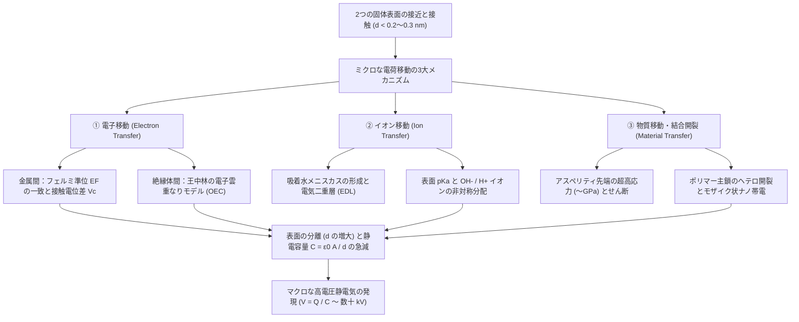
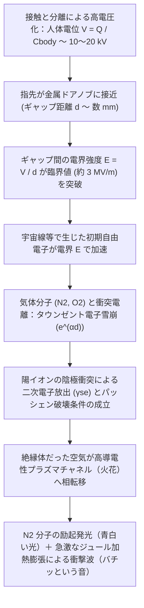

## 1. はじめに：冬のドアノブに潜む2600年の未解決問題

乾燥した冬の朝、ウールのセーターを脱いだ瞬間にパチパチと音を立てて火花が散ったり、部屋の金属製ドアノブに手を伸ばした瞬間に「バチッ！」と鋭い痛みとともに青白い閃光が走ったりする経験は、誰もが持っているはずです。あるいは、子どもの頃にプラスチックの下敷きを髪の毛でこすって逆立てたり、暗闇の中で粘着テープ（スコッチテープ）を勢いよく剥がしたときに青白い光（トリボルミネッセンス：摩擦発光）が見えたりする現象も、すべて同じ物理現象——<strong>静電気（Static Electricity）</strong>、専門的には<strong>摩擦帯電（Triboelectricity）</strong>または<strong>接触帯電（Contact Electrification: CE）</strong>と呼ばれる現象に起因しています。

実は、人類が最初に出会った電気現象こそがこの摩擦帯電でした。紀元前600年頃、古代ギリシャの哲学者タレス（Thales of Miletus）は、宝石の一種である<strong>琥珀（ギリシャ語で $\eta\lambda\epsilon\kappa\tau\rho o\nu$：エレクトロン）</strong>を動物の毛皮でこすると、乾いた草や羽毛を引き寄せる不思議な力が生まれることを記録しています。現代の「電気（Electricity）」や「電子（Electron）」という言葉の語源は、まさにこの琥珀をこする実験にあるのです。

しかし、驚くべき事実があります。マクスウェルが電磁気学を統一し、量子力学が原子と電子の振る舞いを完璧に記述し、ヒッグス粒子や重力波さえも検出された21世紀の現代においてなお、<strong>「2つの絶縁体をこすり合わせたとき、なぜ、どのようにして電荷が移動するのか？」というミクロな根本機構は、物性物理学と表面化学における最も熱い未解決問題のひとつであり続けている</strong>のです。

「高校の物理で『一方の物質から他方の物質へ電子が移動するから』と習ったではないか」と思われるかもしれません。しかし、金属ならまだしも、プラスチックやガラス、ゴムといった<strong>絶縁体（誘電体）</strong>には、金属のように自由に動き回れる伝導電子（自由電子）が存在しません。エネルギーバンドギャップが $4\text{〜}9\,\text{eV}$ もある絶縁体の表面同士が触れ合ったとき、いったい何がエネルギー障壁を越えて移動しているのでしょうか？ 移動しているのは本当に<strong>「電子（Electron）」</strong>なのか、それとも表面に吸着した水分子層に溶け込んだ<strong>「イオン（Ion）」</strong>なのか、あるいは分子鎖が引きちぎられた<strong>「ナノスケールの物質片（Material Fragment）」</strong>なのでしょうか？

本記事では、日常の「バチッ」という静電気の正体を、表面物理学・量子力学・気体放電物理・応用工学の視点から徹底的に解き明かします。「こする（摩擦）」という行為の本当の意味から、最新の<strong>電子雲重なりモデル（Overlapped Electron-Cloud Model）</strong>、同じ物質同士がぶつかっても帯電する砂嵐や火山雷のパラドックス、冬の乾燥と<strong>パッシェンの法則（Paschen's Law）</strong>による絶縁破壊の数理、さらにはレーザープリンターやN95医療用マスク、マクスウェルの変位電流を応用した<strong>摩擦帯電ナノ発電機（TENG）</strong>に至るまで、身近で奥深い静電気の科学を探究していきましょう。

---

## 2. 「摩擦」の真実：見かけの接触面積と真実接触面積のトポロジー

日常用語では、物をこすり合わせて電気を起こすことを「摩擦電気（摩擦帯電：Triboelectrification、ギリシャ語の *tribos*＝「こする」に由来）」と呼びます。しかし、現代の物理学において、この現象の本質は「摩擦（Friction）」ではなく<strong>「接触と分離（Contact and Separation）」</strong>にあることが分かっています。そのため、厳密な学術用語としては<strong>接触帯電（Contact Electrification: CE）</strong>という名称が用いられます。

では、もし「接触して離れるだけ」で電気が生まれるのであれば、なぜ私たちは下敷きや風船を一生懸命に「こする」のでしょうか？ ここに、固体表面のミクロなトポロジー（微細形状）に関わる重要な物理が隠されています。

### 2.1 アスペリティ（微小突起）と真実接触面積 $A_{\text{real}} \ll A_{\text{apparent}}$

私たちの目にはどれほど平滑で鏡のようにピカピカに見える固体表面であっても、原子間力顕微鏡（AFM）や走査型トンネル顕微鏡（STM）を使ってナノメートル（$1\,\text{nm} = 10^{-9}\,\text{m}$）からマイクロメートル（$1\,\mu\text{m} = 10^{-6}\,\text{m}$）のスケールで観察すると、まるでアルプス山脈のように激しい凹凸が連なっています。この表面の微小な突起のことを、トライボロジー（摩擦学）では<strong>アスペリティ（Asperity：微小突起）</strong>と呼びます。

2つの固体表面を上から押し付けて重ね合わせたとき、マクロな目線で見た面積を<strong>「見かけの接触面積（Apparent Contact Area: $A_{\text{apparent}}$）」</strong>と呼びます。しかし実際には、山脈の頂上と頂上がぶつかり合うように、ごく一部のアスペリティの先端同士しか接触していません。実際に原子レベルで触れ合っている面積の総和を<strong>「真実接触面積（Real Contact Area: $A_{\text{real}}$）」</strong>と呼びます。

バウデン・テイバー（Bowden–Tabor）の凝着摩擦理論やグリーンウッド・ウィリアムソン（Greenwood–Williamson）の弾性接触理論によれば、真実接触面積 $A_{\text{real}}$ は見かけの面積 $A_{\text{apparent}}$ にはほとんど依存せず、垂直押し付け荷重 $F_N$ と複合ヤング率 $E^*$（または材料の降伏応力 $H$）によって決まります。

$$A_{\text{real}} = \sum_{i=1}^{N} A_i \propto \frac{F_N}{E^*} \quad \left( \text{一般に } \frac{A_{\text{real}}}{A_{\text{apparent}}} \sim 10^{-5} \text{〜} 10^{-3} \right)$$

つまり、普通に2つの物体をペタッと重ねただけでは、<strong>全体のわずか $0.001\%\text{〜}0.1\%$ 程度の面積しか本当に接触していない</strong>のです。

### 2.2 レナード・ジョーンズ・ポテンシャルと原子間反発領域への突入

さらに、一方の物質から他方の物質へ電子やイオンが移動するためには、2つの表面の原子同士が単に「近づく」だけでなく、<strong>原子間距離 $d$ が約 $0.2\text{〜}0.3\,\text{nm}$ 以下</strong>という、化学結合距離に匹敵する極限的な近接状態に到達しなければなりません。

中性原子間の相互作用エネルギーを記述する<strong>レナード・ジョーンズ・ポテンシャル（Lennard-Jones Potential）</strong>を見てみましょう。

$$U_{\text{LJ}}(r) = 4\varepsilon \left[ \left(\frac{\sigma}{r}\right)^{12} - \left(\frac{\sigma}{r}\right)^{6} \right]$$

ここで、$r$ は原子間距離、$\varepsilon$ はポテンシャル井戸の深さ、$\sigma$ はポテンシャルがゼロになる距離です。右辺第2項の $-( \sigma / r )^6$ は遠距離で働くファンデルワールス引力（ロンドン分散力）を表し、第1項の $+( \sigma / r )^{12}$ はパウリの排他律と電子雲の重なりによって生じる<strong>短距離の強い斥力（反発力）</strong>を表します。

後述するように、接触帯電における電子移動が起きるためには、2つの表面の原子がこの<strong>短距離斥力領域（反発領域：$r < r_{\text{eq}}$）</strong>に突入するほど強く押し付けられ、外殻電子雲（波動関数）が空間的に重なり合う必要があります。

ここに、「こする（摩擦する）」ことの真の物理的意味があります。物体を接線方向に滑らせてこすり合わせると、一方の表面の無数のアスペリティが他方の表面を掃引（スイープ）し、<strong>原子レベルで $0.2\text{〜}0.3\,\text{nm}$ 以内に接近した累積真実接触面積 $\int A_{\text{real}}\,dt$ が、単純な押し付けに比べて数百倍から数千倍へと爆発的に増大する</strong>のです。

もちろん、摩擦には副次的な効果もあります。アスペリティ先端での局所的な<strong>摩擦熱（フラッシュ温度上昇 $\Delta T$）</strong>が熱電子放出やイオン拡散を加速したり、強いせん断応力（Shear Stress）がポリマー鎖の共有結合を引きちぎる<strong>メカノケミカル反応</strong>を誘発したりします。しかし、最も本質的な役割は「ミクロな接触の機会を極大化すること」にあります。実際、原子レベルで平坦な劈開面（マイカやグラフェンなど）や液体金属（水銀やガリンスタン）を用いれば、一切こすることなく「軽く触れて離すだけ」で最大密度の静電気が発生することが実験的に証明されています。

---

## 3. 電荷キャリアの正体：電子か、イオンか、物質片か？

接触した界面を隔てて、いったい「何」が移動しているのか？ この問いをめぐって、物理学界と化学界では半世紀以上にわたり激しい論争が繰り広げられてきました。現在では、材料の組み合わせ（金属・半導体・無機絶縁体・高分子ポリマー）や周囲環境（真空・乾燥気体・高湿度・液中）に応じて、以下の<strong>3つのミクロ機構が競合・共存している</strong>という統合的な理解に到達しています。

1. <strong>電子移動（Electron Transfer）</strong>：フェルミ準位の均衡化、表面準位、および電子雲の重なりによる量子遷移
2. <strong>イオン移動（Ion Transfer）</strong>：表面吸着水膜（メニスカス）内の電気二重層と $\text{H}^+ / \text{OH}^-$ 等のイオン分配
3. <strong>ナノスケールの物質移動と結合開裂（Nanoscale Material Transfer & Bond Scission）</strong>：共有結合の不均等開裂（ヘテロリシス）によるメカノイオン・メカノラジカルの移動

それぞれの物理メカニズムを数式とともに詳しく見ていきましょう。

### 3.1 電子移動モデル：フェルミ準位から「電子雲重なりモデル（OEC）」へ

#### (1) 金属ー金属接触におけるフェルミ準位の均衡化
まず最も完全に解明されている<strong>金属同士の接触帯電</strong>から出発しましょう。金属内部の電子は、温度 $T$ において次の<strong>フェルミ・ディラック分布関数（Fermi–Dirac Distribution）</strong>に従ってエネルギー準位を占めています。

$$f(E) = \frac{1}{\exp\left(\frac{E - E_F}{k_B T}\right) + 1}$$

ここで、$E_F$ は<strong>フェルミ準位（電気化学ポテンシャル $\mu$）</strong>、$k_B$ はボルツマン定数です。フェルミ準位 $E_F$ にある電子を真空中（エネルギー $E_{\text{vac}}$）へ取り出すのに必要な最小エネルギーを<strong>仕事関数（Work Function: $\Phi = E_{\text{vac}} - E_F$）</strong>と呼びます。

仕事関数が異なる2種類の金属（たとえば $\Phi_1 < \Phi_2$）を接触させると、熱力学的な平衡条件（電気化学ポテンシャルの一致）を満たすために、フェルミ準位が高い（仕事関数が小さい）金属1から、フェルミ準位が低い（仕事関数が大きい）金属2へと、量子力学的なトンネル効果によって電子が瞬時に移動します。その結果、両者のフェルミ準位が一致した時点で平衡に達し、界面には次の<strong>接触電位差（Contact Potential Difference: $V_c$、ボルタ電位）</strong>が生じます。

$$V_c = -\frac{\Phi_1 - \Phi_2}{e}$$

ここで $e$ は電気素量です。接触面積 $A$、界面の実効的な原子間ギャップ $d_0$ とすると、移動する電荷量 $\Delta Q$ は界面静電容量 $C_0 = \varepsilon_0 A / d_0$ を用いて $\Delta Q = C_0 V_c$ と表されます。この現象は18世紀末にアレッサンドロ・ボルタ（Alessandro Volta）が発見して以来、ケルビンプローブ（Kelvin Probe）による仕事関数測定の基礎となっています。

#### (2) 絶縁体における表面準位と王中林の「電子雲重なりモデル（OEC）」
では、自由電子を持たずフェルミ準位が禁制帯（バンドギャップ）の真ん中にある<strong>絶縁体（誘電体）同士の接触</strong>ではどうなるのでしょうか？

1960〜1980年代にデューク（C. B. Duke）やローウェル＆ローズ（Lowell & Rose）らが提唱したのが<strong>「表面準位モデル（Surface States Model）」</strong>です。結晶や高分子の内部（バルク）では周期的なポテンシャルによって広いバンドギャップが形成されていますが、物質の「表面」では原子配列の周期性が突然途切れ、ダングリングボンド（未結合手）や酸化官能基、構造欠陥が存在します。これらがバンドギャップ内に局在化した電子準位（表面準位）を形成し、絶縁体にも実効的な仕事関数 $\Phi_{\text{eff}}$ を定義できるという考え方です。

さらに2018〜2020年、摩擦帯電ナノ発電機（TENG）の発明者であるジョージア工科大学の<strong>王中林（Zhong Lin Wang）教授</strong>は、あらゆる固体・液体に普遍的に適用できるミクロ機構として<strong>「電子雲重なりモデル（Overlapped Electron-Cloud Model: OECモデル、またはWang遷移モデル）」</strong>を提唱し、大きなブレークスルーをもたらしました。

OECモデルの核心は以下の通りです。
- <strong>接触前（独立した原子）</strong>：物質Aの原子と物質Bの原子が離れているとき、それぞれの電子は深い単一井戸型ポテンシャル（Single-Well Potential）の中に強く束縛されており、外へ飛び出すことはできません。その間には高いポテンシャル障壁 $E_b$ を持つ非対称な<strong>二重井戸型ポテンシャル（Double-Well Potential）</strong>が存在します。
- <strong>強接触時（電子雲の重なり）</strong>：外部からの機械的な力によって2つの原子が平衡結合距離よりも近い反発領域（$d < 0.2\text{〜}0.3\,\text{nm}$）まで押し付けられると、原子Aと原子Bの最外殻電子雲（波動関数 $\psi_A, \psi_B$）が空間的に強く重なり合います（$\langle \psi_A | \psi_B \rangle \neq 0$）。すると、2つの原子間のポテンシャル障壁 $E_b$ が劇的に低下し、二重井戸型ポテンシャルが<strong>非対称な単一井戸型ポテンシャル（または極めて障壁の低い二重井戸）</strong>へと変形します。
- <strong>量子遷移と分離後のトラップ</strong>：障壁が消滅（または低下）した瞬間、原子Aの高いエネルギー軌道（3D軌道や外殻分子軌道）にいた電子が、原子Bの低い未占有軌道へとトンネル遷移または熱活性化ホッピングによって移動します。その後、2つの表面を引き離すと、ポテンシャル障壁が瞬時に元の高さに復活するため、移動した電子は物質Bの表面に<strong>トラップ（捕獲）</strong>され、室温では戻れなくなります。これが静電気の正体です。

#### (3) 熱電子放出による実験的証明
王中林らの研究グループは、接触帯電した絶縁体（SiO$_2$、Al$_2$O$_3$、ポリマー等）を加熱した際の表面電荷の減衰特性を精密に測定しました。その結果、温度が $350\text{〜}600\,\text{K}$ を超えると、保持されていた電荷が<strong>リチャードソン・ダッシュマンの熱電子放出の式（Richardson–Dushman Thermionic Emission Equation）</strong>に厳密に従って真空中へ放出・減衰することを発見しました。

$$J_{\text{th}} = A^* T^2 \exp\left(-\frac{\Phi_B}{k_B T}\right)$$

ここで、$J_{\text{th}}$ は熱電子放出電流密度、$A^*$ はリチャードソン定数、$\Phi_B$ は電子がトラップされているポテンシャル障壁の高さです。もし帯電の原因がすべて重たいイオンや物質片であれば、このような熱電子放出則に従う減衰や光励起による電子放出は起きません。この実験事実は、<strong>多くの固体ー固体間接触帯電において「電子移動」が第一義的な主役である</strong>ことを決定的に裏付けました。

### 3.2 イオン移動モデル：吸着水メニスカスと電気二重層（EDL）

一方、ハーバード大学のジョージ・ホワイトサイズ（George M. Whitesides）教授らは、特に<strong>親水性表面や大気中（湿度が存在する環境）、あるいはイオン性高分子</strong>の接触帯電においては、電子ではなく<strong>「イオン（Ion）」の移動</strong>が支配的であると主張しました（McCarty & Whitesides, 2008）。

私たちが暮らす大気中では、どれほど乾いているように見えるガラスやセラミックス、ポリマーの表面であっても、ファンデルワールス力や水素結合によって<strong>厚さ $0.5\text{〜}5\,\text{nm}$（水分子数層〜十数層分）の極薄の吸着水膜（Adsorbed Water Film）</strong>に覆われています。

このナノ水膜の中では、水分子の自己解離（$2\text{H}_2\text{O} \rightleftharpoons \text{H}_3\text{O}^+ + \text{OH}^-$）や大気中の二酸化炭素の溶解、さらには固体表面の酸性・塩基性官能基の解離によって、可動性のイオン（$\text{H}_3\text{O}^+, \text{OH}^-, \text{Na}^+, \text{Cl}^-$ など）が存在しています。

1. <strong>表面 $\text{pK}_a$ と電気二重層（EDL）の形成</strong>：
   たとえばガラス（シリカ：$\text{SiO}_2$）の表面にはシラノール基（$-\text{Si–OH}$）が存在し、水膜中で $-\text{Si–O}^- + \text{H}^+$ のように解離して固定電荷と拡散対イオンからなる<strong>電気二重層（Electrical Double Layer: EDL）</strong>を形成します。この界面の電位は<strong>ゼータ電位（Zeta Potential: $\zeta$）</strong>によって特徴づけられます。
2. <strong>疎水性界面への水酸化物イオン（$\text{OH}^-$）の特異吸着</strong>：
   さらに興味深いことに、PTFE（テフロン）やポリエチレンのような化学的に不活性な疎水性ポリマー表面であっても、水と接すると負に帯電する傾向があります。これは、水分子の非対称な水素結合ネットワークの性質により、ヒドロニウムイオン（$\text{H}_3\text{O}^+$）よりも<strong>水酸化物イオン（$\text{OH}^-$）の方が疎水性固体ー水界面に優先的に吸着して安定化する</strong>ためです。
3. <strong>毛細管水架橋（キャピラリー・ブリッジ）の形成と分裂</strong>：
   2つの表面が接触すると、双方の吸着水膜が融合してナノスケールの<strong>水メニスカス（毛細管水架橋）</strong>が形成されます。この水架橋の内部で、両表面の誘電率 $\varepsilon_r$ や酸解離定数 $\text{pK}_a$、ゼータ電位 $\zeta$ の違いに応じて $\text{H}^+$ と $\text{OH}^-$ が非対称に分配されます。そして表面を引き離す瞬間、水架橋が引き伸ばされてちぎれることで、一方の表面に過剰な $\text{H}^+$（正電荷）、他方の表面に過剰な $\text{OH}^-$（負電荷）が取り残されるのです。

### 3.3 ナノスケールの物質移動とメカノケミストリー：モザイク状帯電の発見

さらに2011年、ノースウェスタン大学の<strong>バルトシュ・グジボフスキ（Bartosz A. Grzybowski）教授</strong>らのグループが科学誌 *Science* に発表した論文（Baytekin et al., *Science* 2011）は、静電気研究の世界に大きな衝撃を与えました。

それまでの教科書では、「ポリマーAとポリマーBを接触させると、Aの表面全体が一様にプラス（$+$）に帯電し、Bの表面全体が一様にマイナス（$-$）に帯電する」と信じられていました。しかし、グジボフスキらが<strong>ケルビンプローブ原子間力顕微鏡（KPFM: Kelvin Probe Force Microscopy）</strong>を用いて、接触後の絶縁体表面の電位分布をナノメートル分解能で可視化したところ、驚くべき光景が浮かび上がったのです。

なんと、帯電したポリマーの表面は一様なプラスでもマイナスでもなく、<strong>プラスに強く帯電した領域とマイナスに強く帯電した領域が数十〜数百ナノメートルのスケールでランダムに入り組んだ「電荷のモザイク模様（Charge Mosaic）」</strong>になっていたのです！ 私たちがマクロに測定している「プラス帯電」「マイナス帯電」とは、実はこの高密度な正負のナノドメインを空間平均したときの、わずかな「差し引きの余り（Net Charge）」に過ぎなかったのです。

なぜこのような正負のモザイクが生まれるのでしょうか？ その原因は<strong>メカノケミストリー（Mechanochemistry：機械化学的な結合開裂）</strong>と<strong>ナノスケールの物質移動（Material Transfer）</strong>にあります。

2つの高分子ポリマー表面が接触して引き離される際、凝着力やせん断力によってアスペリティ先端にはギガパスカル（$\sim \text{GPa}$）級の極めて高い局所応力が集中します。すると、ファンデルワールス界面で綺麗に剥がれるのではなく、ポリマー主鎖の共有結合（$\text{C–C}$ 結合や $\text{Si–O}$ 結合など）そのものがブチッと引きちぎられる<strong>結合開裂（Bond Scission）</strong>が発生します。

- <strong>ホモリシス（均等開裂）とヘテロリシス（不均等開裂）</strong>：
  共有結合 $\text{R}_1\text{–R}_2$ が切れるとき、共有電子対が1個ずつ分かれると電気的に中性な<strong>メカノラジカル（Mechanoradical: $\text{R}_1^\bullet + \text{R}_2^\bullet$）</strong>が生じ、共有電子対が片方に偏って切れる（またはラジカル間で直後に電子移動が起きる）と、正負の<strong>メカノイオン（Mechanoion: $\text{R}_1^+ + \text{R}_2^-$）</strong>および帯電したナノ分子片が生じます。
- 実際、X線光電子分光法（XPS）やラマン分光法、電子スピン共鳴法（ESR）を用いて接触後の表面を調べると、PDMS（シリコーンゴム）とPTFE（テフロン）を接触させただけで、PDMS表面にPTFE由来のフッ素（$\text{F}$）を含むナノ断片が付着し、同時にPTFE表面にPDMS由来のケイ素（$\text{Si}$）断片が移動していることが確認されています。

### 3.4 3つの電荷移動メカニズムの比較整理

これら3つのメカニズムは決して互いに矛盾するものではなく、状況に応じて協調して働きます。その特徴を以下の表に整理します。

| 比較項目 | ① 電子移動 (Electron Transfer) | ② イオン移動 (Ion Transfer) | ③ 物質移動・結合開裂 (Material Transfer) |
| :--- | :--- | :--- | :--- |
| <strong>主な電荷キャリア</strong> | 電子 ($e^-$) | 可動イオン ($\text{H}_3\text{O}^+, \text{OH}^-$, 対イオン) | 帯電オリゴマー断片、メカノイオン ($\text{R}^+, \text{R}^-$) |
| <strong>支配的な物理モデル</strong> | フェルミ準位均衡化、表面準位、<strong>OEC（電子雲重なり）モデル</strong> | 吸着水メニスカス、<strong>電気二重層（EDL）</strong>、表面 $\text{pK}_a$ | <strong>メカノケミカル結合開裂</strong>、凝着摩耗 |
| <strong>発生する空間スケール</strong> | 原子間距離 ($d \lesssim 0.2\text{〜}0.3\,\text{nm}$) | 水膜厚・毛細管架橋 ($0.5\text{〜}10\,\text{nm}$) | ナノドメイン ($10\text{〜}500\,\text{nm}$ のモザイク) |
| <strong>環境依存性（真空・温度）</strong> | 超高真空中・極低温や液体窒素中でも発生。高温 ($>400\,\text{K}$) で熱電子放出減衰 | 湿度 ($RH$) に強く依存。完全乾燥・超高真空では抑制される（イオン性固体を除く） | 接触圧力・せん断応力・ポリマーの分子量や架橋密度に強く依存 |
| <strong>決定的な実験的証拠</strong> | KPFMでの仕事関数相関、高温でのリチャードソン熱電子放出、液体金属接触 | 湿度による帯電量変化、表面化学修飾（イオン交換樹脂）での極性反転 | KPFMでの正負モザイク観測、XPSによる異種元素検出、ESRによるラジカル検出 |

---

## 4. 帯電列（Triboelectric Series）の法則とパラドックス：なぜ同じ物質同士でも帯電するのか？

### 4.1 帯電列（Triboelectric Series）の化学的・量子的起源

1757年、スウェーデンの物理学者ヨハン・カール・ヴィルケ（Johan Carl Wilcke）は、様々な物質を互いにこすり合わせたときに「どちらがプラスになり、どちらがマイナスになるか」を順番に並べた<strong>「帯電列（Triboelectric Series）」</strong>を世界で初めて発表しました。

帯電列の上位にある物質ほど電子を放出して<strong>正（$+$）に帯電しやすく</strong>、下位にある物質ほど電子を受け取って<strong>負（$-$）に帯電しやすい</strong>という経験則です。2019年には王中林らのグループが、液体金属（水銀）を基準電極として標準化された環境下で数十種類の材料の<strong>正規化摩擦帯電電荷密度（Normalized Triboelectric Charge Density: $\sigma_N$）</strong>を精密に定量化し、現代版の定量的帯電列を確立しました（Zou et al., *Nature Communications* 2019）。

代表的な物質の帯電列と、その背景にある化学構造・表面物性を以下の表にまとめます。

| 帯電の極性傾向 | 代表的な物質名 | 主な表面官能基・化学結合の特徴 | 標準化帯電密度の目安 ($\mu\text{C/m}^2$) | 電子的・化学的な役割 |
| :---: | :--- | :--- | :---: | :--- |
| <strong>極めて正 ($+++$)</strong> | ガラス（石英・ソーダガラス）、マイカ（雲母） | シラノール基 ($-\text{Si–OH}$)、アルミノケイ酸骨格 | $+80 \text{ 〜 } +110$ | 酸素原子の非共有電子対や高い占有表面準位から電子を供与しやすい（ルイス塩基的） |
| <strong>強い正 ($++$)</strong> | ナイロン6,6（ポリアミド）、人間の皮膚・髪の毛、羊毛（ウール） | アミド結合 ($-\text{NH–CO}-$)、アミノ基 ($-\text{NH}_2$)、ケラチンタンパク質 | $+50 \text{ 〜 } +85$ | 窒素・酸素の孤立電子対が豊富で電子供与性が高い。冬にウールと肌で帯電しやすい主因 |
| <strong>やや正 ($+$)</strong> | アルミニウム、紙（セルロース）、綿（コットン）、木材 | 自然酸化被膜 ($\text{Al}_2\text{O}_3$)、ヒドロキシ基 ($-\text{OH}$) | $+10 \text{ 〜 } +40$ | 水酸基の水素結合ネットワークにより中程度に正帯電 |
| <strong>中立付近 ($0$)</strong> | 鋼鉄（スチール）、PMMA（アクリル樹脂）、ポリカーボネート | 金属自由電子、エステル基 ($-\text{COOCH}_3$) | $-10 \text{ 〜 } +10$ | 相手次第で正にも負にも帯電する中間領域 |
| <strong>やや負 ($-$)</strong> | ポリスチレン（PS）、ポリエチレン（PE）、ポリプロピレン（PP） | 炭化水素鎖 ($-\text{CH}_2-\text{CH}_2-$)、フェニル基 | $-30 \text{ 〜 } -60$ | 非極性・疎水性であり、低エネルギー空軌道または $\text{OH}^-$ 吸着により負に帯電 |
| <strong>強い負 ($--$)</strong> | ポリ塩化ビニル（PVC）、PDMS（シリコーン）、カプトン（ポリイミド） | 炭素ー塩素結合 ($-\text{C–Cl}$)、シロキサン骨格、イミド環 | $-70 \text{ 〜 } -110$ | 電気陰性度の高い塩素原子 ($\chi = 3.16$) や共役イミド環が強く電子を引き寄せる |
| <strong>極めて負 ($---$)</strong> | <strong>PTFE（ポリテトラフルオロエチレン／テフロン）</strong>、FEP | フッ化炭素鎖 ($-(\text{CF}_2-\text{CF}_2)_n-$)、高密度な $\text{C–F}$ 結合 | $-110 \text{ 〜 } -150$ | <strong>全元素中で最大の電気陰性度を持つフッ素 ($\chi = 3.98$)</strong> の鞘が電子を強力に捕獲・保持 |

なぜ<strong>PTFE（テフロン）</strong>は帯電列の「絶対王者」として最もマイナスに帯電しやすく、逆に<strong>ナイロンやガラス</strong>は最もプラスに帯電しやすいのでしょうか？
分子軌道法（DFT計算）とルイス酸・塩基の概念から見ると、その理由は明快です。PTFEの主鎖は、全元素中で最も電気陰性度が大きいフッ素原子（ポーリングの電気陰性度 $\chi = 3.98$）によって隙間なく螺旋状に覆われています。この強力な電子求引性を持つ $\text{C–F}$ 結合群は、エネルギーの低い未占有表面軌道（LUMOに相当する深い電子トラップ準位）を多数形成し、接触した相手から電子をむしり取って離しません。逆にナイロンのアミド基（$-\text{CONH}-$）やガラスの表面酸素は、電子供与性の高い非共有電子対（高いHOMO準位）を持っているため、容易に電子を明け渡してプラスに帯電するのです。

### 4.2 パラドックス①：推移律の破れと「循環する帯電列（Cyclic Triboelectric Series）」

もし帯電列が、物質固有のたった1つのスカラー量（たとえば実効仕事関数 $\Phi_{\text{eff}}$ だけ）によって厳密に決まっているのであれば、数学的な<strong>推移律（Transitivity）</strong>が必ず成り立つはずです。すなわち、「物質Aが物質Bに対してプラスになり（$A > B$）、物質Bが物質Cに対してプラスになる（$B > C$）ならば、必ず物質Aは物質Cに対してプラスになる（$A > C$）」という関係です。

ところが、実際の実験ではしばしばこの推移律が破れ、<strong>「$A > B$ かつ $B > C$ なのに、$C > A$ となる（ジャンケンのグー・チョキ・パーのような三すくみ状態）」</strong>という<strong>循環帯電列（Cyclic Triboelectric Series）</strong>が観測されます！

なぜこのようなパラドックスが起きるのでしょうか？ それは、絶縁体の接触帯電が単一のパラメータではなく、以下のような<strong>複数の独立した物理チャネルの競合（多次元ベクトル問題）</strong>だからです。
1. <strong>電子移動とイオン移動・物質移動の競合</strong>：A–B間では電子移動が支配的だが、B–C間では吸着水膜を介したイオン移動が支配的となり、C–A間ではヤング率（硬さ）の違いによるメカノケミカルな摩耗片の移動が支配的になる場合、単一の順序は成立しません。
2. <strong>表面粗さと接触力学の非対称性</strong>：ヘルツ接触応力や局所的な変形ポテンシャルが組み合わさることで、同じ化学組成でも表面トポロジーによって帯電の向きが逆転することがあります。

### 4.3 パラドックス②：なぜ「全く同じ物質同士」をぶつけても帯電するのか？

静電気の科学において、研究者を最も悩ませてきた最大のミステリーが<strong>「同種材料間接触帯電（Same-Material Contact Electrification / Identical-Material Tribocharging）」</strong>です。

直感的に考えてみてください。全く同じ化学組成で作られた2枚のポリマーシート、あるいは全く同じガラスの微粒子同士をぶつけたりこすり合わせたりしたとき、両者の仕事関数 $\Phi$ も、電気陰性度も、表面 $\text{pK}_a$ も完全に同じ（$\Delta \Phi = 0$）です。対称性の原理からすれば、電荷の移動はゼロになるはずです。
<strong>ところが実際には、同じ物質同士をこすり合わせても、異種材料間に匹敵するほど強い静電気が発生するのです！</strong>

この対称性の破れ（Symmetry Breaking）を生み出すメカニズムは、主に2つのスケールで解明されつつあります。

#### (1) 幾何学的・力学的な非対称性とフレキソエレクトリック効果
同じ材質のシートであっても、「片方を曲げて（湾曲させて）もう片方の平らな面に押し付ける」あるいは「小さな面積の領域を、広い面積の上で滑らせる」と、必ず<strong>幾何学的・力学的な非対称性</strong>が生まれます。
- 固体に不均一なひずみ勾配（Strain Gradient: $\frac{\partial \varepsilon_{ij}}{\partial x_l}$）が加わると、結晶や高分子の対称性が局所的に破れて電気分極 $\mathbf{P}_{\text{flexo}}$ が誘起される<strong>フレキソエレクトリック効果（Flexoelectric Effect：撓電効果）</strong>が働きます。

$$P_i = \mu_{ijkl} \frac{\partial \varepsilon_{jk}}{\partial x_l}$$

これにより、引っ張り応力を受ける凸面と圧縮応力を受ける平面の間で実効的な電子エネルギー準位に差（変形ポテンシャルシフト）が生じ、同じ物質間でも一方向への電子移動が駆動されます。

#### (2) 粒径依存性バイポーラ帯電：砂嵐・火山雷・そして惑星の誕生へ
さらに自然界で劇的な役割を果たしているのが、粉体や微粒子が衝突する際の<strong>「粒径依存性帯電（Particle-Size-Dependent Charging）」</strong>です。砂漠の砂（石英粒子）や火山灰（ケイ酸塩粒子）、あるいは工場の医薬品パウダーなど、<strong>同じ物質の粒子が集まって激しく衝突し合うと、不思議なことに「小さい粒子はマイナス（$-$）に帯電し、大きい粒子はプラス（$+$）に帯電する」という普遍的な法則</strong>が観測されます。

なぜ小さい粒子がマイナスになり、大きい粒子がプラスになるのでしょうか？ ケース・ウェスタン・リザーブ大学のダニエル・ラックス（Daniel J. Lacks）やシカゴ大学のグループらが提唱した<strong>「非対称衝突統計モデル（高エネルギートラップ電子の枯渇モデル）」</strong>が、この謎を美しく説明しています。

1. すべての粒子の表面には、初期状態で単位面積あたり同じ密度の高エネルギー状態にトラップされた電子（接触時に相手へ移動できる電子）が存在するとします。
2. しかし、粒度分布を持つ粒子群の中で衝突が繰り返されるとき、<strong>表面積が小さい「小粒子（半径 $R_S$）」と表面積が極めて大きい「大粒子（半径 $R_L \gg R_S$）」では、接触の幾何学と表面状態の枯渇速度（あるいは局所温度上昇）に非対称性が生じます</strong>。また、小粒子は曲率が大きいため表面の面密度や吸着水膜中のイオン拡散境界条件が異なり、統計的に大粒子から放出された電子（または負イオン）が小粒子側へと蓄積していくのです。
3. さらに大気中や噴煙の中では重力による沈降速度の差（終端速度 $v_t \propto R^2$）が働きます。<strong>マイナスに帯電した軽い小粒子は上昇気流に乗って雲の上方へと舞い上がり、プラスに帯電した重い大粒子は重力によって下方へと落下します。</strong>

この「ミクロな接触帯電」と「重力によるマクロな電荷分離」のコンビネーションこそが、地球規模の壮大な放電現象を引き起こすエンジンです。
- <strong>砂嵐の雷（Sandstorm Lightning）</strong>：雨が1滴も降っていない乾燥したサハラ砂漠の砂嵐の中で激しい稲妻が走るのは、砂粒同士の同種材料接触帯電によって空間的な巨大コンデンサが形成されるためです。
- <strong>火山雷（Volcanic Lightning）</strong>：桜島やアイスランドのエイヤフィヤトラヨークトル火山の噴火時に、噴煙の中で凄まじい稲妻が閃く現象も、破砕されたマグマ（火山灰粒子）同士の破砕帯電（Fractoelectrification）と粒径依存性接触帯電によって数億ボルトの電位差が生まれるために起こります。
- <strong>惑星形成における「メートルサイズ障壁（Meter-Size Barrier）」の克服</strong>：
  さらに宇宙物理学（惑星科学）において、この静電気は<strong>「なぜ地球のような惑星が生まれることができたのか？」</strong>という根源的な謎を解く鍵となっています。原始惑星系円盤の中で、ミクロンサイズの宇宙塵（ダスト）が合体して数ミリ〜数センチの「ペブル（小石）」に成長すると、衝突速度が上がるため、普通にぶつかると跳ね返るか砕け散ってしまい、それ以上大きくなれないという難問（跳ね返り障壁・メートルサイズ障壁）がありました。しかし近年の研究（Steinpilz et al., *Nature Physics* 2020など）により、同種ダスト粒子間の接触帯電によって生じるプラスとマイナスの静電引力が「電気的な接着剤」として働き、小石同士を凝集させて微惑星（Planetesimal）へと成長させる決定的な駆動力になっていることが明らかになったのです。私たちの地球そのものが、実は静電気の力で組み立てられたと言っても過言ではありません。

---

## 5. 湿度と静電気放電（ESD）の物理学：冬の「バチッ」を支配するパッシェンの法則

ミクロな接触帯電の仕組みが分かったところで、次は日常の疑問に立ち返りましょう。<strong>「なぜ静電気は夏には起きず、冬にだけ猛威を振るうのか？」</strong>、そして<strong>「わずか数ボルトの接触電位から、なぜ数万ボルトもの火花放電（ESD: Electrostatic Discharge）が生まれるのか？」</strong>という問題です。

### 5.1 なぜ冬に静電気が溜まるのか？ BET吸着等温線と表面導電率の指数関数的変化

よくある誤解として「冬は空気が乾燥しているから静電気がたくさん発生する」というものがありますが、物理学的には少し違います。電荷の「発生（Generation）」自体は夏でも冬でも起きています（むしろイオン移動機構が働く場合は、適度な湿度がある方が初期移動電荷量が増えることさえあります）。冬に静電気が問題になる最大の理由は、発生した電荷が逃げていく<strong>「漏洩・散逸（Charge Dissipation / Relaxation）」のルートが完全に遮断されるから</strong>です。

固体表面への水分子の吸着量は、気体の相対湿度 $RH = p / p_0$（$p$ は水蒸気圧、$p_0$ は飽和水蒸気圧、$0 \le RH \le 1$）の関数として、<strong>ブルナウアー・エメット・テラー（BET）の多分子層吸着等温式（BET Adsorption Isotherm）</strong>によって記述されます。

$$\theta_{\text{BET}}(RH) = \frac{v}{v_m} = \frac{c \cdot RH}{(1 - RH)\left[1 + (c - 1)RH\right]}$$

ここで、$\theta_{\text{BET}}$ は水分子の被覆層数（単分子層容量 $v_m$ に対する吸着量 $v$ の比）、$c$ は固体表面と水分子の吸着エンタルピーに関わるBET定数です。

- <strong>冬季の低湿度環境（$RH < 20\text{〜}30\%$）</strong>：
  $\theta_{\text{BET}} < 1$ となり、表面の水分子は島状に孤立して点在しているだけで、連続した水膜を形成できません。そのため、絶縁体表面のシート抵抗（表面抵抗率 $\rho_s$）は $10^{14}\text{〜}10^{18}\,\Omega/\text{sq}$ という天文学的な高抵抗になり、一度帯電した電荷は何時間も表面に取り残されます。
- <strong>夏季の高湿度環境（$RH > 60\text{〜}70\%$）</strong>：
  $\theta_{\text{BET}}$ が $2\text{〜}5$ 分子層以上に達し、表面全体に一続きの水素結合ネットワーク（パーコレーション経路）が形成されます。すると、水分子間でプロトン（$\text{H}^+$）がバケツリレーのように次々と受け渡される<strong>グロッタス機構（Grotthuss Mechanism：プロトンホッピング伝導）</strong>が劇的に活性化します。

その結果、絶縁体の<strong>表面導電率 $\sigma_s(RH)$ は相対湿度 $RH$ に対して指数関数的に（6桁〜10桁も！）増大</strong>します。

$$\sigma_s(RH) \approx \sigma_0 \exp(\alpha_{\text{RH}} \cdot RH)$$

帯電した電荷が周囲へ減衰していく緩和時定数 $\tau_{\text{relax}}$ は、静電容量 $C$ と漏洩抵抗 $R \propto 1/\sigma_s(RH)$ の積 $\tau_{\text{relax}} = RC$ で決まります。夏の日は $\tau_{\text{relax}}$ がミリ秒〜数秒以下であるため、セーターを脱いだ瞬間に電荷は空気中や床へと音もなく逃げていきます。しかし冬の暖房の効いた室内（相対湿度 $20\%$ 以下）では、$\tau_{\text{relax}}$ が数十分から数時間へと跳ね上がるため、歩くたび、服が擦れるたびに電荷 $Q$ が人体にどんどん蓄積していくのです。

### 5.2 分離による電圧増幅：$V = Q / C$ が生み出す $30,000\,\text{V}$ の高電圧

ここで、電磁気学の極めて重要なトリックが登場します。2つの表面が原子レベルで接触している瞬間（距離 $d_0 \sim 1\,\text{nm}$）には、たとえ高い電荷密度（たとえば $\sigma = 50\,\mu\text{C/m}^2$）が移動していても、界面の電位差 $V_0$ はわずか数ボルト以下に過ぎません。なぜなら、距離 $d_0$ が極めて小さいため、平行平板コンデンサとして見たときの<strong>静電容量 $C = \frac{\varepsilon_0 A}{d}$ が非常に大きいから</strong>です。

ところが、セーターを体から引き剥がしたり、カーペットの上から靴底を持ち上げたりして、<strong>2つの帯電面の間隔 $d$ を $1\,\text{nm}$（$10^{-9}\,\text{m}$）から $10\,\text{cm}$（$10^{-1}\,\text{m}$）へと引き離す</strong>と何が起きるでしょうか？

絶縁体上の電荷 $Q$ は逃げ場がないため一定（$Q = \text{const.}$）に保たれたまま、距離 $d$ の増大に伴って<strong>静電容量 $C(d)$ が数万分の一〜数百万分の一（人体全体の対地静電容量 $C_{\text{body}} \approx 100\text{〜}200\,\text{pF}$ のレベル）へと急激に減少</strong>します。コンデンサの基本式 $Q = C V$ を変形すると、電位 $V(d)$ は次のように表されます。

$$V(d) = \frac{Q}{C(d)} = \frac{Q \cdot d}{\varepsilon_0 A}$$

つまり、<strong>距離 $d$ を引き離すことによって、静電容量 $C$ が激減し、それに反比例して電圧 $V$ が数ボルトから数千〜数万ボルト（$3\,\text{kV}\text{〜}30\,\text{kV}$）へと一気に増幅される</strong>のです！

エネルギー保存則の観点から見ると、この「数万ボルトの高電圧エネルギー」はどこから湧いて出たのでしょうか？ 答えは<strong>「あなた自身の筋肉がした力学的な仕事（Mechanical Work）」</strong>です。プラスに帯電した体とマイナスに帯電したセーターの間には、クーロン引力 $F_C = \frac{Q^2}{2\varepsilon_0 A}$ が働いています。あなたがこのクーロン引力に逆らって腕の力でセーターをグッと引き剥がしたとき、あなたの筋肉が消費したATPの化学エネルギー（力学的仕事 $W = \int F_C\,dd$）が、そのまま静電場エネルギー $U_E$ へと変換・蓄電されているのです。

$$U_E = \frac{1}{2} \frac{Q^2}{C(d)} = \frac{1}{2} C(d) V(d)^2$$

#### なぜ2万ボルトの静電気に感電しても死なないのか？
家庭用コンセントの $100\,\text{V}$ に感電すると命の危険があるのに、なぜ冬のドアノブで $20,000\,\text{V}$（$20\,\text{kV}$）もの静電気を浴びても「イタッ！」で済むのでしょうか？
その理由は、人体というコンデンサの容量 $C_{\text{body}}$ が約 $150\,\text{pF}$（$1.5 \times 10^{-10}\,\text{F}$）と極めて小さく、蓄えられている総電荷量 $Q$ と総エネルギー $U_E$ がごくわずかだからです。実際に計算してみましょう。

$$Q = C_{\text{body}} V = (1.5 \times 10^{-10}\,\text{F}) \times (2.0 \times 10^4\,\text{V}) = 3.0 \times 10^{-6}\,\text{C} \,\, (3\,\mu\text{C})$$

$$U_E = \frac{1}{2} C_{\text{body}} V^2 = \frac{1}{2} \times (1.5 \times 10^{-10}\,\text{F}) \times (2.0 \times 10^4\,\text{V})^2 = 0.03\,\text{J} \,\, (30\,\text{mJ})$$

全エネルギーはわずか $30\,\text{ミリジュール}$（$0.03\,\text{J}$）しかありません。人体モデル（HBM: Human Body Model、等価直列抵抗 $R_{\text{HBM}} \approx 1500\,\Omega$、等価容量 $C_{\text{HBM}} \approx 100\,\text{pF}$）で放電が起きるとき、ピーク電流自体は一瞬だけ十数アンペアに達しますが、放電時間（時定数 $\tau = R_{\text{HBM}} C_{\text{HBM}} \approx 150\,\text{ns}$）が<strong>100ナノ秒（1000万分の1秒）程度</strong>で終わってしまうため、心臓の心室細動を引き起こすには至らないのです（人間が指先で衝撃を感じる閾値は約 $0.5\,\text{mJ}$（帯電電圧約 $2\text{〜}3\,\text{kV}$）、痛みを感じるのが $10\,\text{mJ}$ 以上です）。

ただし、人間にとっては無害なこの $30\,\text{mJ}$・$20\,\text{kV}$ の放電も、<strong>現代の半導体集積回路（MOSFET）にとっては致命的な破壊兵器</strong>となります。先端半導体チップのゲート酸化膜（$\text{SiO}_2$ や $\text{HfO}_2$）の厚さはわずか $1\text{〜}3\,\text{nm}$ しかなく、十数ボルトの電圧がかかっただけで絶縁破壊を起こして溶断してしまうため、半導体工場や精密電子機器の組み立て現場では徹底したESD（静電気放電）対策が施されています。

### 5.3 タウンゼント電子雪崩とパッシェンの法則（Paschen's Law）

では、$10\,\text{kV}$ に帯電したあなたの指先が、接地された金属のドアノブに数ミリメートルまで近づいた瞬間、空気中で何が起きて「バチッ！」と火花が飛ぶのでしょうか？ これを記述するのが気体放電物理学の金字塔である<strong>タウンゼント理論（Townsend Discharge Theory）</strong>と<strong>パッシェンの法則（Paschen's Law）</strong>です。

本来、空気（窒素 $\text{N}_2$ が $78\%$、酸素 $\text{O}_2$ が $21\%$）は極めて優れた絶縁体です。しかし、自然界の空気中には宇宙線や大地からの自然放射線によって、常に $1\,\text{cm}^3$ あたり数百〜数千個の自由電子とイオン対がわずかに漂っています。

指先とドアノブの距離 $d$ が縮まり、空間の電界強度 $E = V / d$ が高まると、この初期自由電子が電界から強いクーロン力 $F = -eE$ を受けて猛烈に加速されます。電子が気体分子と衝突するまでの平均自由行程（Mean Free Path: $\lambda \propto 1/p$、$p$ は気圧）を走る間に、窒素分子の電離エネルギー（$15.6\,\text{eV}$）や酸素分子の電離エネルギー（$12.1\,\text{eV}$）を上回る運動エネルギーを獲得すると、衝突した気体分子から新たな電子を弾き出します（衝突電離）。

1個の電子が2個になり、2個が4個、4個が8個……とネズミ算式に増幅される現象を<strong>タウンゼントの電子雪崩（Townsend Electron Avalanche）</strong>と呼びます。電子が単位距離あたりに引き起こす電離回数を<strong>タウンゼントの第一電離係数 $\alpha$</strong> と呼ぶと、$\alpha$ は気圧 $p$ と電界 $E$ の関数として次式で与えられます。

$$\alpha = A p \exp\left(-\frac{B p}{E}\right)$$

ここで $A, B$ は気体の種類によって決まる定数です。距離 $d$ を進む間に、1個の初期電子は $\exp(\alpha d)$ 個へと指数関数的に増殖します。さらに、電離によって生じた陽イオンが陰極（マイナス側）に衝突した際、確率 $\gamma_{\text{se}}$（<strong>タウンゼントの第二電離係数：二次電子放出係数</strong>）で陰極表面から新たな電子を叩き出します。

外部からの種電子なしに放電が自続的に爆発（絶縁破壊）する条件（タウンゼントの火花条件）は次式で表されます。

$$\gamma_{\text{se}} \left( e^{\alpha d} - 1 \right) = 1 \quad \Longrightarrow \quad \alpha d = \ln\left(1 + \frac{1}{\gamma_{\text{se}}}\right)$$

この条件式に $\alpha = A p \exp(-B p d / V_B)$（ただし $E = V_B / d$）を代入して破壊電圧 $V_B$ について解くと、1889年にフリードリヒ・パッシェン（Friedrich Paschen）が発見した<strong>パッシェンの法則（Paschen's Law）</strong>が導かれます。

$$V_B(p d) = \frac{B \cdot p d}{\ln(A \cdot p d) - \ln\left[\ln\left(1 + \frac{1}{\gamma_{\text{se}}}\right)\right]}$$

この式は、気体の絶縁破壊電圧 $V_B$ が気圧 $p$ と電極間距離 $d$ の積 <strong>$pd$ だけの関数</strong>になるという驚くべき事実を示しています。このパッシェン曲線 $V_B(pd)$ は下に凸のV字型（U字型）のグラフを描き、以下の極めて重要な物理的性質を持っています。

1. <strong>マクロな空気の絶縁破壊電界（$E_{\text{crit}} \approx 3 \times 10^6\,\text{V/m} = 3\,\text{kV/mm}$）</strong>：
   1気圧（$p = 1\,\text{atm}$）で距離 $d$ が数ミリメートルの領域では、空気の絶縁破壊電界は約 $3\,\text{kV/mm}$（$30,000\,\text{V/cm}$）です。したがって、あなたが $9,000\,\text{V}$ に帯電している場合、指先がドアノブから約 $3\,\text{mm}$ の距離に近づいた瞬間に空気の絶縁が破れ、プラズマ放電が走ります。
2. <strong>パッシェン極小値（Paschen Minimum: 約 $327\,\text{V}$）のパラドックス</strong>：
   もし帯電電圧が $300\,\text{V}$ 以下だったら、距離 $d$ を限りなくゼロ（$1\,\mu\text{m}$ など）に近づければ放電するでしょうか？ 答えは「NO（気体放電は起きない）」です！ $1\,\text{atm}$ の空気においてギャップ距離 $d$ が約 $7.5\,\mu\text{m}$ より狭くなると、電子が気体分子と衝突する前に向こう側の電極に到達してしまうため、電子雪崩が起きなくなります。そのため、大気中の火花放電には<strong>最小火花電圧 $V_{\text{min}} \approx 327\,\text{V}$（$pd \approx 7.5\,\mu\text{m}\cdot\text{atm}$）</strong>という下限が存在し、これ以下の電圧では気体放電による「バチッ」は絶対に発生しません。
3. <strong>なぜ青白く光り、「バチッ」と音が鳴るのか？</strong>
   電子雪崩によって形成されたプラズマチャネル内では、励起された窒素分子（$\text{N}_2$ の第二正帯系：$C^3\Pi_u \to B^3\Pi_g$ 遷移）が波長 $337.1\,\text{nm}$（紫外線〜青紫色領域）を中心とする光子を放出し、あの特有の<strong>青白い閃光</strong>を生み出します。同時に、細い放電路の空気が数十ナノ秒のうちに数千ケルビンへと急速にジュール加熱されて断熱膨張するため、<strong>微小な超音速衝撃波（ミクロな雷鳴）</strong>が発生します。これが耳に聞こえる「パチッ！」「バチッ！」という音の正体です。つまり、冬のドアノブの静電気とは、文字通り<strong>「指先で起きているミニチュアの雷」</strong>なのです。

> [!TIP]
> <strong>冬のドアノブで「バチッ」を防ぐ科学的な裏技</strong>
> 金属のドアノブに直接触れると、指先の1点（面積が極めて小さい）に電流密度 $J = I / A$ が集中し、皮膚の痛覚神経（侵害受容器）を強く刺激します。ドアノブに触れる前に、<strong>木製のドアやコンクリートの壁、ガラス窓などの「半導電性・高抵抗体」に手のひら全体でペタッと触れる</strong>と、抵抗 $R$ が大きいため放電時定数 $\tau = RC$ が引き伸ばされ、火花を飛ばすことなく微小な漏洩電流として体内の電荷 $Q$ を痛みを伴わずにゆっくり逃がす（アースする）ことができます。また、金属の鍵（キー）を強く握りしめて、<strong>鍵の先端をドアノブに接触させる</strong>と、火花放電自体は鍵の先端とドアノブの間で飛びますが、鍵と手のひらの接触面積 $A$ が広いため人体を流れる電流密度 $J$ が分散され、まったく痛みを感じずに放電させることができます。

---

## 6. 厄介者からテクノロジーの主役へ：静電気の高度な産業・医療・エネルギー応用

冬場に人間を驚かせ、半導体工場や化学プラント（粉塵爆発や溶剤引火）では徹底的に排除される「厄介者」の静電気ですが、その強大なクーロン力を精密に制御することで、現代文明を支える不可欠なハイテク技術へと昇華されています。

### 6.1 電子写真（ゼログラフィ・レーザープリンター）：チェスター・カールソンの革命

オフィスや家庭にある<strong>レーザープリンターやコピー機（複合機）</strong>は、まさに接触帯電（摩擦帯電）の芸術品です。1938年にアメリカの物理学者・特許弁護士であったチェスター・カールソン（Chester Carlson）が発明した<strong>電子写真方式（Electrophotography / Xerography：ギリシャ語の *xeros*「乾いた」＋ *graphein*「書く」）</strong>は、以下のステップでミリ秒単位の高速印刷を実現しています。

1. <strong>帯電（Charging）</strong>：暗所にて、感光体ドラム（有機光導電体：OPC）の表面を一様にマイナス（たとえば $-600\,\text{V}$）に帯電させます。
2. <strong>露光（Exposure）</strong>：印字したい文字や画像のパターンに合わせてレーザー光を照射します。光が当たった部分だけ光導電効果によって電荷が消滅し（約 $-100\,\text{V}$ に変化）、目に見えない<strong>「静電潜像（Electrostatic Latent Image）」</strong>が描かれます。
3. <strong>現像（Development：摩擦帯電トナーの飛翔）</strong>：ここで摩擦帯電が主役を演じます。直径 $5\text{〜}8\,\mu\text{m}$ の着色樹脂微粒子である<strong>トナー（Toner）</strong>を、磁性キャリア粒子（フェライトビーズ）や現像ブレードと激しくこすり合わせることで、質量あたり電荷量 $Q/M$ が厳密に $-20\text{〜}-40\,\mu\text{C/g}$ になるよう精密に摩擦帯電させます。この負帯電トナーを感光体ドラムに近づけると、クーロン力によって静電潜像（露光されて電位が上がった部分）の上にだけミクロン単位の精度でトナーが飛び移ります。
4. <strong>転写と定着（Transfer & Fusing）</strong>：紙の裏側から逆極性（プラス）の電界をかけてトナーを紙へ一気に引き寄せ、最後に熱と圧力で樹脂を溶かして紙繊維に定着させます。

### 6.2 電気集塵機（ESP）と静電粉体塗装（回り込み効果）

- <strong>コットレル電気集塵機（Electrostatic Precipitator: ESP）</strong>：
  1907年にフレデリック・コットレル（Frederick Gardner Cottrell）が発明した装置で、火力発電所、製鉄所、セメント工場などの巨大な煙突の内部に設置されています。コロナ放電によって排気ガス中の煤塵（すす）やフライアッシュ、PM2.5粒子を帯電させ、接地された集塵極板へとクーロン力で吸着させます。目の細かいフィルターを使わないため排気ガスの圧力損失がほとんどなく、<strong>$99.9\%$ 以上の微粒子を除去できる</strong>地球環境保全の要です。
- <strong>静電粉体塗装（Electrostatic Powder Coating）</strong>：
  自動車のボディや家電製品の塗装では、有機溶剤（VOC）を使わない環境配慮型の粉体塗装が主流です。スプレーガンの内部（特にPTFE製のバレル内）を通過する際に摩擦帯電（またはコロナ帯電）によってプラスやマイナスに帯電した塗料粉末を、アースされた金属ボディに向けて噴射します。すると、塗料粒子は電気力線に沿って飛翔するため、スプレーの正面だけでなく<strong>金属パーツの「裏側」にまでぐるりと回り込んで均一に付着する「回り込み効果（Wrap-Around Effect）」</strong>が働き、塗料の無駄を最小限に抑えた美しい塗膜が得られます。

### 6.3 N95医療用マスクとエレクトレット（永久帯電体）不織布の物理

感染症対策や医療現場で活躍する<strong>N95マスク（や高性能不織布マスク）</strong>には、静電気を応用した驚くべき物理トリックが使われています。

N95マスクに求められる性能は「直径 $0.3\,\mu\text{m}$ の微粒子を $95\%$ 以上捕集すること」ですが、もし単純な「網の目（ふるい）」として $0.3\,\mu\text{m}$ より細かい隙間しか開いていないシートを作ったらどうなるでしょうか？ 空気抵抗が巨大になりすぎて、人間は息ができなくなってしまいます。実際のマスクの繊維と繊維の隙間（ポアサイズ）は $10\text{〜}30\,\mu\text{m}$ もあり、ウイルス飛沫核やエアロゾル粒子（$0.1\text{〜}0.3\,\mu\text{m}$）から見れば、まるで巨大なトンネルのようにスカスカなのです。

では、なぜスカスカの網の目で微小なウイルス粒子をほぼ完璧に捕まえられるのでしょうか？
その秘密は、マスクの中間層に挟まれている<strong>「メルトブロー法ポリプロピレン・エレクトレット（Melt-Blown Polypropylene Electret）」</strong>にあります。<strong>エレクトレット（Electret）</strong>とは、磁石（Magnet）が永久磁気双極子を持つのと同様に、<strong>半永久的に静電荷（空間電荷や配向双極子）を保持し続ける誘電体材料</strong>のことです。

極細のポリプロピレン繊維にコロナ放電や水流帯電（ハイドロチャージング）を施すことで、繊維の周囲には $10^5\text{〜}10^6\,\text{V/m}$ もの強い局所静電場が形成されています。
- 帯電しているエアロゾル粒子が近づけば、直接的な<strong>クーロン引力 $\mathbf{F}_e = q\mathbf{E}$</strong> によって繊維に吸い寄せられます。
- たとえ電気的に全く中性（$q = 0$）の微粒子（半径 $r_p$、誘電率 $\varepsilon_p$）であっても、繊維近傍の強い不均一電場 $\nabla |\mathbf{E}|^2$ の中に入ると粒子内部に誘電分極が誘起され、次の<strong>誘電泳動引力（Dielectrophoretic Force: $\mathbf{F}_{\text{DEP}}$）</strong>によって繊維表面へと強力に引き寄せられて捕集されるのです！

$$\mathbf{F}_{\text{DEP}} = 2\pi r_p^3 \varepsilon_0 \left(\frac{\varepsilon_p - \varepsilon_0}{\varepsilon_p + 2\varepsilon_0}\right) \nabla |\mathbf{E}|^2$$

これにより、「息がしやすい（圧力損失が低い）」と「ミクロン以下の粒子を逃さず捕集する」という二律背反を見事に両立させています（ちなみに、使い捨て不織布マスクをアルコール消毒したり洗剤で洗ったりすると性能が激減するのは、このエレクトレット繊維の静電荷が中和・消失してしまうためです）。

### 6.4 摩擦帯電ナノ発電機（TENG）と拡張されたマクスウェルの変位電流

そして2012年、先述の王中林（Zhong Lin Wang）教授が発明した<strong>摩擦帯電ナノ発電機（Triboelectric Nanogenerator: TENG）</strong>は、これまで「無駄に散逸していた静電気」を「クリーンな電力源」へと変えるエネルギーハーベスティング（環境発電）の革命を起こしました。

TENGの基本構造は極めてシンプルです。帯電列の位置が大きく離れた2種類の誘電体フィルム（たとえばPTFEとナイロン）の背面に金属電極を貼り合わせ、両者を周期的に「接触・分離（またはスライド）」させます。
1. 接触によって界面に正負の静電荷（表面分極 $\mathbf{P}_s$）が生成されます。
2. 機械的な力（人間の歩行、心拍、風の揺れ、海の波、雨粒の落下など）によって2枚のフィルムの間隔 $z(t)$ が変化すると、背面電極間に<strong>静電誘導（Electrostatic Induction）</strong>が働き、外部回路を通じて交流電流が流れます。

2017年、王中林教授はこのTENGの基礎理論を体系化するため、電磁気学の根幹である<strong>マクスウェルの変位電流（Maxwell's Displacement Current: $\mathbf{J}_D$）</strong>の式に、外力による接触帯電や圧電効果が生み出す<strong>機械的誘起表面分極項 $\mathbf{P}_s$</strong> を明示的に組み込んだ拡張表現を導出しました。

$$\mathbf{J}_D = \frac{\partial \mathbf{D}}{\partial t} = \varepsilon_0 \frac{\partial \mathbf{E}}{\partial t} + \frac{\partial \mathbf{P}_s}{\partial t}$$

ここで、第1項の $\varepsilon_0 \frac{\partial \mathbf{E}}{\partial t}$ は19世紀にマクスウェルが予言しヘルツが実証した<strong>「電磁波（無線通信・光）」</strong>を生み出す源泉です。一方、第2項の $\frac{\partial \mathbf{P}_s}{\partial t}$ は、接触帯電によって表面に固定された静電荷が機械的運動によって空間的に変位する時間変化を表しており、これこそが<strong>「ナノ発電機（TENG）による発電電流とエネルギー変換」</strong>の源泉です。

ファラデーの電磁誘導の法則に基づく従来の電磁発電機（タービンやダイナモ）は、毎秒数十回転以上の<strong>高周波領域（$> 10\text{〜}50\,\text{Hz}$）</strong>で高い効率を発揮する一方、人間の歩行や海の波のような<strong>低周波領域（$< 1\text{〜}5\,\text{Hz}$）</strong>では出力電圧と変換効率が急激に低下するという弱点がありました。これに対し、$\partial \mathbf{P}_s / \partial t$ で駆動されるTENGは、$1\,\text{Hz}$ 以下の極めてゆっくりとした微弱な動きからでも数百ボルトの高電圧と高いエネルギー変換効率を引き出すことができます。現在、バッテリー交換が不要なIoTセンサーネットワーク、心臓の鼓動で自ら発電する次世代ペースメーカー、さらには海面に浮かべて波のエネルギーから大規模発電を行う「ブルーエネルギー（Blue Energy）」構想まで、世界中で研究開発が加速しています。

---

## 7. 現代物理学における未解決のフロンティアとまとめ

タレスが琥珀を毛皮でこすってから2600年。私たちは静電気の正体について多くのことを解き明かしてきましたが、現代の凝縮系物理学（物性物理学）と化学物理の最前線には、今なお挑むべき深いフロンティアが広がっています。

- <strong>第一原理計算（非平衡量子力学）による非晶質界面の解明</strong>：
  結晶とは異なり、実際のプラスチック（非晶質ポリマー）の表面は分子鎖が複雑に絡み合い、熱ゆらぎと摩擦せん断下で絶えず構造が変化しています。時間依存密度汎関数理論（TD-DFT）や非断熱分子動力学シミュレーションを用いて、アスペリティ衝突の数ピコ秒の間に起きる電子雲の重なりとトンネル遷移、結合開裂を第一原理から統一的に予測する研究が進められています。
- <strong>固液界面・気液界面の接触帯電（雨粒発電とマイクロ流体力学）</strong>：
  実は接触帯電は固体同士だけでなく、「固体と液体（たとえばテフロン表面を滑り落ちる水滴）」や「液体と気体」の間でも激しく発生します。なぜ水滴が疎水性表面を転がるだけで電子移動と電気二重層の再編が同時に起きるのか？ この解明は、雨粒1滴から数十ボルトを発電する液滴TENG（Droplet-based Electricity Generator）や、不均一触媒反応の制御に直結しています。
- <strong>量子トライボロジーとナノスケール摩擦制御</strong>：
  ナノマシン（MEMS/NEMS）の世界では、表面積対体積比が極大化するため、接触帯電によるクーロン力と電子摩擦（Electronic Friction）が機械要素を貼り付かせて動かなくしてしまいます。超潤滑（Superlubricity）と電荷移動の量子制御は、次世代ナノテクノロジーの鍵を握っています。

冬の朝、ドアノブに手を伸ばして「バチッ！」と飛び散るあの小さな火花。その背後には、ナノメートルの山脈（アスペリティ）の衝突、量子力学的な電子雲の重なりとトンネル遷移、吸着水分子のグロッタス機構、筋肉の仕事による静電容量増幅、そして気体分子のタウンゼント雪崩という、物理学の壮大なドラマが凝縮されています。次に静電気を感じたときは、ぜひその指先で起きている量子と電磁気のシンフォニーに思いを馳せてみてください。
