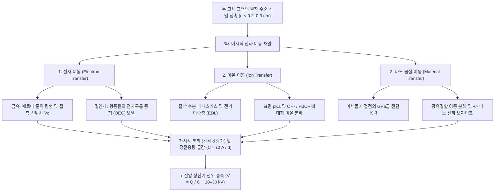
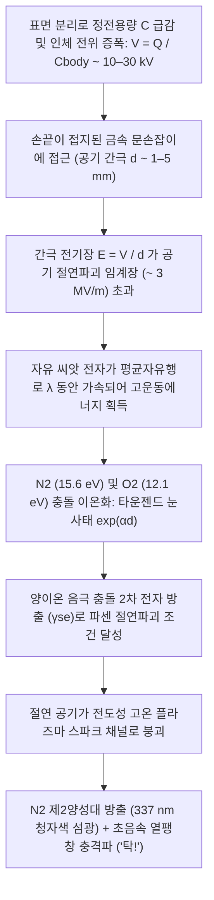

## 1. 서론: 겨울철 문손잡이에 숨겨진 2,600년 된 물리학의 미스터리

건조하고 추운 겨울 아침, 카펫이 깔린 바닥을 걸어 황동 문손잡이에 손을 뻗는 순간—*탁!*—하는 소리와 함께 손끝에서 청백색의 초소형 번개가 튀며 따끔한 충격을 줍니다. 어두운 방에서 울 스웨터를 벗을 때 파바박거리는 소리와 함께 보라색 불꽃이 일고, 진공 챔버 안에서 평범한 스카치테이프를 빠르게 떼어내면 박리 계면에서 손가락 뼈의 엑스선 사진을 찍을 수 있을 정도의 마찰발광 엑스선(Triboluminescent X-rays)이 방출됩니다. 이 모든 현상은 동일한 근본 물리 과정에서 비롯됩니다. 바로 <strong>정전기(Static Electricity)</strong>, 물리학 용어로는 <strong>마찰전기(Triboelectricity)</strong> 혹은 더 엄밀하게 <strong>접촉 대전(Contact Electrification, CE)</strong>이라 불리는 현상입니다.

역사적으로 마찰전기는 인류가 최초로 마주한 전자기 현상이었습니다. 기원전 600년경 고대 그리스 밀레토스 학파의 철학자 탈레스(Thales of Miletus)는 나무 수지 화석인 <strong>호박(Amber, 그리스어로 $\eta\lambda\epsilon\kappa\tau\rho o\nu$, *ēlektron*)</strong>을 동물의 털가죽으로 문지르면 가벼운 지푸라기나 깃털을 끌어당기는 보이지 않는 힘이 생긴다고 기록했습니다. 17세기 영국의 의사 윌리엄 길버트(William Gilbert)는 이 인력을 설명하기 위해 그리스어 호박에서 유래한 신라틴어 *electricus*("호박 같은")라는 용어를 만들었고, 여기서 현대의 '전기(Electricity)'와 '전자(Electron)'라는 단어가 탄생했습니다.

그러나 어린아이도 아는 이 친숙한 현상 이면에는 현대 과학에서 가장 놀라운 비밀 중 하나가 숨겨져 있습니다. <strong>맥스웰이 전자기학을 통합하고, 양자역학이 수소 원자를 완벽히 풀어냈으며, 중력파와 힉스 보손까지 검출해 낸 21세기 오늘날에도 두 절연체(유전체) 표면이 접촉했다가 분리될 때 전하가 어떻게 계면을 건너 이동하는지에 대한 미시적 메커니즘은 응집물질물리학과 표면화학에서 가장 치열하게 논쟁 중인 미해결 난제 중 하나입니다.</strong>

언뜻 학창 시절 교과서의 설명("두 물체를 문지르면 한쪽에서 다른 쪽으로 전자가 이동한다")을 떠올릴지 모릅니다. 하지만 두 *금속* 사이의 전자 이동은 명확한 페르미 준위(Fermi Level)에 의해 설명되는 반면, 일상에서 정전기를 가장 잘 일으키는 유리, 폴리테트라플루오로에틸렌(PTFE/테플론), 나일론, 실리콘 고무, 사람의 머리카락 등은 모두 넓은 띠틈($E_g \approx 4\text{–}9\,\text{eV}$)을 가져 상온에서 자유 전도 전자가 거의 존재하지 않는 <strong>절연체(유전체)</strong>입니다. 두 절연체가 닿을 때 실제로 계면을 건너는 입자는 무엇일까요? 국소 표면 상태나 중첩된 원자 오비탈 사이를 터널링하는 <strong>전자(Electrons)</strong>일까요? 나노미터 두께의 흡착 수분층을 가로질러 분배되는 <strong>이동성 이온($\text{H}_3\text{O}^+, \text{OH}^-$)</strong>일까요? 아니면 고분자 공유결합 사슬이 전단 응력에 의해 끊어지며 생성된 <strong>나노스케일 물질 파편(Material Fragments)</strong>일까요?

이 글에서는 원자 스케일에서 행성 및 첨단 산업 스케일에 이르기까지 정전기의 물리학을 심층 해부합니다. 왜 '마찰'이 접촉 대전의 필수 조건이 아닌지 밝히고, 왕중린(Zhong Lin Wang) 교수의 <strong>전자구름 중첩(Overlapped Electron-Cloud, OEC) 모델</strong>을 포함한 3대 미시적 전하 이동 메커니즘, 마찰전기 서열의 순환 모순과 사막 모래폭풍·원시행성계 원반에서의 동종 물질 대전 역설, 겨울철 습도 효과와 <strong>파센의 법칙(Paschen's Law)</strong>, 그리고 레이저 프린터, N95 일렉트릿 마스크, <strong>마찰전기 나노발전기(TENG)</strong>에 이르는 현대 공학 응용을 완벽히 유도합니다.

---

## 2. '마찰'의 진실: 거시적 겉보기 접촉 면적과 미시적 실제 접촉 면적

일상적으로 우리는 '마찰전기'(그리스어 *tribos*, '문지르다'에서 유래)라는 말을 씁니다. 그러나 현대 표면물리학은 운동 마찰(Kinetic Friction) 자체가 전하 생성의 필수 전제 조건이 아님을 입증했습니다. 전하 이동은 단순히 <strong>원자 수준의 긴밀한 물리적 접촉과 뒤이은 분리</strong>만으로 발생하며, 따라서 엄밀한 과학 용어는 <strong>접촉 대전(Contact Electrification, CE)</strong>입니다.

단순 접촉만으로 전하가 이동한다면, 왜 우리는 풍선을 머리카락에 문지르거나 플라스틱 막대를 털가죽으로 힘껏 문지를까요? 그 해답은 고체 표면의 나노 지형학과 원자간 힘의 극단적인 단거리 특성에 있습니다.

### 2.1 표면 미세돌기(Asperities)와 실제 접촉 면적 $A_{\text{real}} \ll A_{\text{apparent}}$

육안으로 볼 때 유리판이나 연마된 금속 블록, 고분자 필름은 매끄럽고 평탄해 보입니다. 하지만 원자간력 현미경(AFM)으로 들여다보면, 운모(Mica)나 그래핀처럼 원자 단위로 벽개된 층상 결정을 제외한 모든 고체 표면은 나노미터에서 마이크로미터 크기의 봉우리와 계곡이 이어진 험준한 산맥과 같습니다. 트라이볼로지(마찰공학)에서는 이러한 미시적 봉우리를 <strong>미세돌기(Asperities)</strong>라고 부릅니다.

거시적 겉보기 면적 $A_{\text{apparent}}$를 가진 두 물체를 수직 하중 $F_N$으로 누르면, 두 표면은 전체 면적에 걸쳐 닿지 않고 양쪽에서 가장 높게 솟은 미세돌기 끝부분끼리만 접촉합니다. Bowden–Tabor 응착 이론과 Greenwood–Williamson 탄성 접촉 역학에 따르면, 이러한 미시적 접촉점들의 합인 <strong>실제 접촉 면적($A_{\text{real}}$)</strong>은 수직 하중 $F_N$을 유효 탄성 계수 $E^*$로 나눈 값에 비례합니다:

$$A_{\text{real}} = \sum_{i=1}^{N} A_i \propto \frac{F_N}{E^*} \quad \left( \text{일반적으로 } \frac{A_{\text{real}}}{A_{\text{apparent}}} \sim 10^{-5} \text{ ~ } 10^{-3} \right)$$

보통의 누르는 힘 아래에서 <strong>실제로 원자 수준의 접촉을 이루는 면적은 겉보기 면적의 $0.001\%$에서 $0.1\%$ 미만에 불과합니다!</strong> 나머지 $99.9\%$ 이상의 계면은 수십~수천 나노미터의 공기층으로 분리되어 있어 전하 이동이 일어날 수 없습니다.

### 2.2 레나드-존스 퍼텐셜과 단거리 파울리 척력 영역 진입

더 나아가 한 표면의 원자 A에서 다른 표면의 원자 B로 전자나 이온이 건너가려면, 두 원자는 반데르발스 평형 거리보다 더 가깝게, 즉 화학 결합 길이에 맞먹는 <strong>$d \lesssim 0.2\text{–}0.3\,\text{nm}$</strong> 이내로 접근해야 합니다.

거리 $r$만큼 떨어진 두 중성 원자 사이의 상호작용 에너지 $U_{\text{LJ}}(r)$를 기술하는 고전적인 <strong>레나드-존스 퍼텐셜(Lennard-Jones Potential)</strong>을 살펴봅시다:

$$U_{\text{LJ}}(r) = 4\varepsilon \left[ \left(\frac{\sigma}{r}\right)^{12} - \left(\frac{\sigma}{r}\right)^{6} \right]$$

여기서 $\varepsilon$은 퍼텐셜 우물의 깊이, $\sigma$는 퍼텐셜이 0이 되는 거리이며, $-\left(\sigma/r\right)^6$ 항은 장거리 반데르발스 인력(런던 분산력)을, 가파른 $+\left(\sigma/r\right)^{12}$ 항은 두 원자의 최외각 전자껍질(파동함수)이 공간에서 중첩되기 시작할 때 발생하는 <strong>단거리 파울리 배타 원리 척력(Pauli Repulsion)</strong>을 나타냅니다.

전하 이동이 일어나려면 계면 원자들을 이 <strong>척력 영역($r < r_{\text{eq}}$)</strong>으로 밀어 넣어 전자구름이 강하게 겹치게 해야 합니다. 이것이 바로 거시적 '마찰(접선 방향 미끄러짐)'의 진짜 물리적 역할입니다. 한 표면을 다른 표면 위로 미끄러뜨리면 돌출된 미세돌기들이 상대 표면의 새로운 영역을 훑고 지나가면서, <strong>원자 수준 근접($d \lesssim 0.3\,\text{nm}$)을 달성하는 누적 실제 접촉 면적 $\int A_{\text{real}}\,dt$를 단순 수직 접촉에 비해 수백~수천 배로 증폭시킵니다!</strong> 물론 마찰 미끄러짐은 미세돌기 접점での 국소적 마찰열(섬광 온도 $\Delta T$)과 전단 응력($\tau$)에 의한 고분자 사슬 절단 같은 부수적 효과도 유발하지만, 표면에 완벽히 밀착하는 액체 금속(수은이나 갈륨-인듐 공융합금, $A_{\text{real}} \approx A_{\text{apparent}}$) 실험은 문지름 없이 순수한 수직 접촉과 분리만으로도 최대 전하 밀도에 도달함을 명확히 입증합니다.

---

## 3. 접촉 대전의 3대 미시적 메커니즘: 전자, 이온, 나노 물질 이동

접촉 대전 중 실제로 계면을 건너는 물리적 실체는 무엇일까요? 반세기에 걸친 논쟁 끝에 현대 표면과학은 재료군(금속, 무기 유전체, 고분자)과 환경 조건에 따라 <strong>세 가지 미시적 메커니즘</strong>이 독립적으로 혹은 시너지 효과를 내며 작동한다는 사실을 밝혀냈습니다.

### 3.1 전자 이동: 페르미 준위 정렬에서 전자구름 중첩(OEC) 모델까지

#### (1) 금속-금속 접촉과 볼타 접촉 전위차
금속 내부의 전도 전자들은 축퇴된 페르미 기체를 이루며, 에너지 $E$와 절대온도 $T$에서의 점유 확률은 <strong>페르미-디랙 분포(Fermi–Dirac Distribution)</strong>를 따릅니다:

$$f(E) = \frac{1}{\exp\left(\frac{E - E_F}{k_B T}\right) + 1}$$

여기서 $E_F$는 <strong>페르미 준위</strong>이며, 페르미 준위의 전자를 표면 밖 진공 준위 $E_{\text{vac}}$로 꺼내는 데 필요한 최소 에너지가 금속의 <strong>일함수(Work Function)</strong> $\Phi = E_{\text{vac}} - E_F$입니다. 일함수가 $\Phi_1, \Phi_2$($\Phi_1 < \Phi_2$)인 두 이종 금속이 접촉하면 페르미 준위가 같아질 때까지($E_{F,1} = E_{F,2}$) 금속 1에서 금속 2로 전자가 터널링하여 <strong>접촉 전위차(볼타 전위) $V_c = -(\Phi_1 - \Phi_2)/e$</strong>를 형성합니다.

#### (2) 절연체-절연체 접촉: 표면 상태와 왕중린의 OEC 모델
자유 전자가 없는 절연체(PTFE와 나일론 등) 사이에서는 어떻게 전자가 이동할까요? 결정 표면에서는 주기적 대칭성이 깨지면서 불포화 결합(Dangling bonds)과 사슬 말단에 의해 금지대 내부에 국소적인 <strong>표면 상태(Surface States)</strong>가 형성됩니다.

나아가 2018~2020년 조지아 공과대학교의 <strong>왕중린(Zhong Lin Wang)</strong> 교수는 전도띠가 없는 임의의 두 응집물질 표면 사이의 전자 이동을 설명하는 보편적 양자역학 프레임워크인 <strong>전자구름 중첩 모델(Overlapped Electron-Cloud, OEC Model)</strong>을 제시했습니다:
- <strong>접촉 전($d > 0.5\,\text{nm}$)</strong>: 표면 A와 B의 원자는 각각의 원자가 전자를 독립된 깊은 단일 우물 퍼텐셜에 가두고 있으며, 두 원자 사이에는 높은 에너지 장벽 $E_b$를 가진 비대칭 이중 우물 퍼텐셜이 존재합니다.
- <strong>긴밀한 기계적 접촉 중($d < 0.2\text{–}0.3\,\text{nm}$)</strong>: 수직 외력이 두 표면 원자를 레나드-존스 퍼텐셜의 단거리 파울리 척력 영역으로 밀어 넣으면, 최외각 전자구름(원자/분자 오비탈 $\psi_A, \psi_B$)이 실공간에서 <strong>강하게 중첩($\langle \psi_A | \psi_B \rangle \neq 0$)</strong>됩니다. 이 강한 오비탈 중첩이 원자간 퍼텐셜 장벽 $E_b$를 극적으로 낮추어 이중 우물을 비대칭 단일 우물(혹은 저장벽 이중 우물)로 변환시킵니다.
- <strong>양자 전이와 분리 후 포획</strong>: 장벽이 낮아진 틈을 타 원자 A의 높은 에너지 표면 궤도에 있던 약하게 결합된 전자가 원자 B의 낮은 에너지 비점유 궤도로 양자 터널링(또는 열적 호핑)을 통해 자발적으로 전이합니다. 이후 두 표면이 분리되면($d \to \infty$) 장벽 $E_b$가 즉시 다시 솟아올라 이동한 전자를 표면 B의 깊은 퍼텐셜 우물에 영구히 가둡니다!

왕중린 연구팀은 고온($350\text{–}650\,\text{K}$)에서 유전체 표면의 정전기 전하 감쇠가 <strong>리처드슨-더시먼 열전자 방출 법칙(Richardson–Dushman Law)</strong>을 따름을 실험적으로 입증하여, 고체-고체 접촉 대전의 지배적 메커니즘이 전자 이동임을 증명했습니다:

$$J_{\text{th}} = A^* T^2 \exp\left(-\frac{\Phi_B}{k_B T}\right)$$

### 3.2 이온 이동: 흡착 수분 메니스커스와 전기이중층(EDL)

반면 친수성 표면이나 이온성 고분자가 대기 습도 하에서 접촉할 때는 하버드 대학교 <strong>조지 화이트사이드(George M. Whitesides)</strong> 교수팀이 규명한 <strong>이동성 이온 전달</strong>이 핵심 역할을 합니다. 대기 중 모든 고체 표면에는 $0.5\text{–}5\,\text{nm}$ 두께의 수분층이 흡착되어 있습니다. 유리($\text{SiO}_2$) 표면의 실라놀기($-\text{Si–OH}$)는 물속에서 탈양성자화되어 고정 음전하($-\text{Si–O}^-$)와 이동성 $\text{H}_3\text{O}^+$ 반대이온 구름으로 이루어진 <strong>전기이중층(EDL)</strong>을 형성하며, 반대로 PTFE 같은 소수성 고분자 계면은 비대칭 수소결합 네트워크로 인해 수산화 이온($\text{OH}^-$)을 우선 흡착합니다. 두 표면이 접촉할 때 합쳐진 나노 <strong>모세관 수분 가교(Meniscus)</strong>를 통해 이온이 확산된 뒤, 분리 시 수분 가교가 끊어지면서 비대칭적인 이온 전하를 남깁니다.

### 3.3 나노 물질 이동과 기계화학: 전하 모자이크(Charge Mosaics)

2011년 노스웨스턴 대학교의 <strong>바르토시 그지보프스키(Bartosz A. Grzybowski)</strong> 교수팀(Baytekin et al., *Science* 2011)은 <strong>켈빈 탐침 현미경(KPFM)</strong>을 이용해 접촉 대전된 절연체 표면이 균일한 단일 극성이 아니라, $10\text{–}200\,\text{nm}$ 크기의 <strong>양($+$)전하와 음($-$)전하 도메인이 뒤섞인 '나노 전하 모자이크(Charge Mosaic)'</strong>로 이루어져 있음을 발견했습니다. 이는 미세돌기 접점의 기가파스칼($\sim \text{GPa}$)급 응력이 고분자 공유결합 사슬을 이종 분해(Heterolytic cleavage)하여 양/음의 기계이온($\text{R}_1^+ + \text{R}_2^-$)과 나노 올리고머 파편을 상호 전사시키기 때문입니다.

| 비교 항목 | 1. 전자 이동 (Electron Transfer) | 2. 이온 이동 (Ion Transfer) | 3. 나노 물질 이동 및 기계화학 |
| :--- | :--- | :--- | :--- |
| <strong>주요 전하 운반체</strong> | 전자 ($e^-$) | 이동성 이온 ($\text{H}_3\text{O}^+, \text{OH}^-$, 반대이온) | 하전된 올리고머 파편 및 기계이온 ($\text{R}^+, \text{R}^-$) |
| <strong>핵심 이론 모델</strong> | 페르미 준위 정렬, 표면 상태, <strong>전자구름 중첩(OEC) 모델</strong> | 흡착 수분 가교, <strong>전기이중층(EDL)</strong>, 표면 $\text{pK}_a$ 및 $\zeta$ 전위 | <strong>기계화학적 공유결합 절단</strong> (이종/균일 분해), 응착 마모 |
| <strong>특성 길이 스케일</strong> | 원자간 단거리 파울리 척력 영역 ($d \lesssim 0.2\text{–}0.3\,\text{nm}$) | 흡착 수분층 및 메니스커스 두께 ($0.5\text{–}10\,\text{nm}$) | 나노 도메인 전하 모자이크 ($10\text{–}500\,\text{nm}$) |
| <strong>환경 민감도</strong> | 초고진공(UHV) 및 극저온에서도 작동; 고온에서 열전자 방출 감쇠 | 상대습도($RH$)에 강하게 의존; 초고진공에서 억제됨 | 접촉 응력, 전단 속도, 분자량 및 가교 밀도에 의존 |

---

## 4. 마찰전기 서열(Triboelectric Series)과 두 가지 역설

### 4.1 마찰전기 서열의 화학적·양자적 기원

1757년 스웨덴 물리학자 빌케(Johan Carl Wilcke)가 처음 작성하고 2019년 왕중린 교수팀이 액체 수은 기준 전극으로 정량 표준화한 <strong>마찰전기 서열</strong>은 전자를 잃고 <strong>양전하($+$)</strong>를 띠기 쉬운 물질부터 전자를 포획해 <strong>음전하($-$)</strong>를 띠기 쉬운 물질 순으로 배열한 도표입니다.

| 극성 경향 | 대표 물질 | 주요 작용기 및 화학 결합 | 정규화 전하 밀도 $\sigma_N$ ($\mu\text{C/m}^2$) | 전자 구조 및 화학적 메커니즘 |
| :---: | :--- | :--- | :---: | :--- |
| <strong>극강 양전하 ($+++$)</strong> | 석영 / 유리 ($\text{SiO}_2$), 백운모 | 실라놀기 ($-\text{Si–OH}$), 알루미노규산염 격자 | $+80 \text{ ~ } +110$ | 산소의 고에너지 비공유 전자쌍과 높은 점유 표면 상태가 전자를 쉽게 공여 (루이스 염기) |
| <strong>강한 양전하 ($++$)</strong> | 나일론-6,6, 사람의 피부·머리카락, 양모 | 아마이드 결합 ($-\text{NH–CO}-$), 아민기 ($-\text{NH}_2$), 케라틴 | $+50 \text{ ~ } +85$ | 질소/산소 비공유 전자쌍의 강한 전자 공여; 겨울철 스웨터와 피부 사이의 강한 정전기 원인 |
| <strong>약한 양전하 ($+$)</strong> | 알루미늄 (Al), 종이 (셀룰로오스), 면, 목재 | 자연 산화막 ($\text{Al}_2\text{O}_3$), 하이드록실기 ($-\text{OH}$) 생체고분자 | $+10 \text{ ~ } +40$ | 완만한 전자 공여 및 양성자 분배 |
| <strong>중성 / 중간 ($0$)</strong> | 강철, PMMA (아크릴), 폴리카보네이트 (PC) | 금속 페르미 바다, 에스터기 및 카보네이트기 | $-10 \text{ ~ } +10$ | 양쪽성 거동: PTFE에 대해서는 $+$, 나일론에 대해서는 $-$로 대전 |
| <strong>중간 음전하 ($-$)</strong> | 폴리스티렌 (PS), 폴리에틸렌 (PE), 폴리프로필렌 (PP) | 포화 탄화수소 사슬 ($-\text{CH}_2-\text{CH}_2-$), 페닐 고리 | $-30 \text{ ~ } -60$ | 비극성 소수성 표면; 결함 상태에 전자 포획 및 계면 수분에서 $\text{OH}^-$ 우선 흡착 |
| <strong>강한 음전하 ($--$)</strong> | PVC, PDMS (실리콘 고무), 캡톤 (폴리이미드) | 탄소-염소 결합 ($-\text{C–Cl}$), 실록산 골격, 이미드 고리 | $-70 \text{ ~ } -110$ | 전기음성도가 큰 염소 원자 ($\chi = 3.16$)와 전자 흡인성 이미드 고리가 음전하 안정화 |
| <strong>극강 음전하 ($---$)</strong> | <strong>PTFE (테플론)</strong>, FEP, PVDF | 과불소화 탄소 사슬 ($-(\text{CF}_2-\text{CF}_2)_n-$), 조밀한 $\text{C–F}$ 외피 | $-110 \text{ ~ } -150$ | <strong>플루오린은 폴링 전기음성도 최대 ($\chi = 3.98$)</strong>; 깊고 낮은 비점유 $\sigma^*$ 오비탈이 전자를 강력히 포획 |

### 4.2 역설 1: 추이성 위배와 순환 마찰전기 서열 ($A > B > C > A$)
접촉 대전이 단일 스칼라 물성(유효 일함수 $\Phi_{\text{eff}}$)만으로 결정된다면 $A > B$이고 $B > C$일 때 반드시 $A > C$여야 합니다. 그러나 실제 실험에서는 가위바위보처럼 <strong>$A > B > C > A$가 되는 순환 마찰전기 삼중항</strong>이 관찰됩니다. 이는 실제 절연체 대전이 전자 표면 상태 밀도, 이온 $\text{pK}_a$, 탄성 계수 비대칭성($E_A \neq E_B$) 및 기계화학적 마모가 결합된 다변수 벡터 과정이기 때문입니다.

### 4.3 역설 2: 동종 물질 접촉 대전 — 사막 모래폭풍 번개부터 행성 탄생까지
화학적으로 완전히 동일한 두 조각의 실리카나 나일론을 부딪쳐도 양/음 전하가 분리됩니다! 이 대칭성 깨짐은 두 가지 메커니즘에서 기인합니다:
1. <strong>변형률 구배와 플렉소전기 효과(Flexoelectricity)</strong>: 비균일한 변형률 구배($\frac{\partial \varepsilon_{jk}}{\partial x_l}$)가 국소 반전 대칭성을 깨뜨려 분극 $P_i = \mu_{ijkl} \frac{\partial \varepsilon_{jk}}{\partial x_l}$을 유도하고 국소 에너지 띠를 이동시킵니다.
2. <strong>입자 크기 의존 양극성 대전(작은 입자는 $-$, 큰 입자는 $+$)</strong>: 크기가 다른 동종 입자들이 충돌할 때 기하학적 표면적 비율과 충돌 통계의 비대칭성(Lacks–Kok–Waitukaitis 모델)으로 인해 <strong>작은 입자는 체계적으로 음전하($-$)를 띠고 큰 입자는 양전하($+$)를 띱니다</strong>. 상승 기류와 중력 침강이 가벼운 음전하 미세 입자를 구름 상단으로, 무거운 양전하 큰 입자를 하단으로 분리시키면서 <strong>사막 모래폭풍 번개</strong>와 <strong>화산재 번개('더티 뇌우')</strong>를 일으킵니다. 나아가 2020년 Steinpilz와 Wurm 연구팀(*Nature Physics*)은 원시행성계 원반에서 규산염 먼지 입자들이 충돌할 때 발생하는 <strong>동종 물질 정전기 인력</strong>이 '미터 크기 장벽(Bouncing barrier)'을 극복하고 미행성체(Planetesimals)와 지구 같은 암석 행성을 형성하게 한 결정적 힘이었음을 입증했습니다.

---

## 5. 습도, 정전용량 전압 증폭, 그리고 정전기 방전(ESD)의 파센 법칙

### 5.1 왜 정전기는 겨울에 기승을 부릴까? BET 흡착 등온선과 표면 전도도
겨울철 건조한 공기가 전하를 더 많이 만드는 것이 아니라, 여름에는 전하가 빠르게 새어 나가는 것입니다. 상대습도($RH$)에 따라 고체 표면에 흡착되는 물 분자층의 수 $\theta_{\text{BET}}$는 <strong>BET 흡착 등온선</strong>을 따릅니다:

$$\theta_{\text{BET}}(RH) = \frac{v}{v_m} = \frac{c \cdot RH}{(1 - RH)\left[1 + (c - 1)RH\right]}$$

겨울철 실내($RH < 20\text{–}30\%$)에서는 $\theta_{\text{BET}} < 1$이 되어 물 분자가 고립된 섬 형태를 띠고 표면 저항이 $10^{15}\text{–}10^{18}\,\Omega/\text{sq}$에 달해 전하가 몇 시간이고 갇혀 있습니다. 반면 여름($RH > 60\text{–}70\%$)에는 $2\text{–}5$개 단분자층의 연속적인 수소결합 수분 네트워크가 형성되어 양성자($\text{H}^+$)가 <strong>그로투스 메커니즘(Grotthuss mechanism, 양성자 호핑 전도)</strong>으로 빠르게 이동하므로 표면 전도도 $\sigma_s(RH) \approx \sigma_0 \exp(\alpha_{\text{RH}} \cdot RH)$가 $10^6\text{–}10^{10}$배 폭증하여 정전기가 즉시 소멸합니다.

### 5.2 분리 시 전압 증폭 ($V = Q / C$)과 $20,000\,\text{V}$ 충격이 치명적이지 않은 이유
접촉 순간($d_0 \approx 1\,\text{nm}$) 계면 정전용량 $C_0 = \varepsilon_0 A / d_0$는 매우 커서 전압 $V_0$는 수 볼트에 불과합니다. 그러나 카펫에서 발을 떼거나 스웨터를 벗어 거리 $d$가 $1\,\text{nm}$에서 $10\,\text{cm}$로 $10^8$배 멀어지면, 보존된 전하 $Q$에 대해 정전용량 $C(d)$가 인체 자기 정전용량($C_{\text{body}} \approx 150\,\text{pF}$) 수준으로 급감하면서 전압이 수만 볼트로 증폭됩니다:

$$V(d) = \frac{Q}{C(d)} = \frac{Q \cdot d}{\varepsilon_0 A} \sim 10\text{–}30\,\text{kV}$$

왜 $20,000\,\text{V}$의 정전기 충격에 감전사하지 않을까요? 인체 정전용량 $C_{\text{body}} \approx 150\,\text{pF}$에 저장된 총 전하량은 $Q = CV = 3.0\,\mu\text{C}$, 총 에너지는 $U_E = \frac{1}{2}C_{\text{body}}V^2 = 30\,\text{mJ}$($0.03\,\text{J}$)에 불과하며 방전 시상수 또한 $\tau \approx 150\,\text{ns}$로 극히 짧기 때문입니다. 하지만 두께 $1\text{–}3\,\text{nm}$의 게이트 산화막을 가진 현대 CMOS 반도체 칩에게는 치명적인 파괴(ESD)를 일으킵니다.

### 5.3 타운젠드 전자 눈사태와 파센의 법칙(Paschen's Law)
대전된 손끝이 문손잡이에 다가갈 때 공기가 절연체에서 플라즈마 도체로 바뀌는 과정은 <strong>타운젠드 전자 눈사태(Townsend Avalanche, $\alpha = Ap\exp(-Bp/E)$)</strong>와 양이온의 음극 2차 전자 방출($\gamma_{\text{se}}$)이 결합된 <strong>파센의 법칙(Paschen's Law, 1889)</strong>으로 기술됩니다:

$$V_B(p d) = \frac{B \cdot p d}{\ln(A \cdot p d) - \ln\left[\ln\left(1 + \frac{1}{\gamma_{\text{se}}}\right)\right]}$$

파센의 법칙에 따라 1기압 공기의 절연파괴 전기장은 약 $E_{\text{crit}} \approx 3\,\text{kV/mm}$이며, $pd \approx 7.5\,\mu\text{m}\cdot\text{atm}$ 아래에서는 전자가 충돌 없이 간극을 통과하므로 최소 절연파괴 전압(<strong>파센 최솟값 $V_{\text{min}} \approx 327\,\text{V}$</strong>) 이하에서는 스파크가 발생하지 않습니다. 방전 순간 플라즈마 내부의 들뜬 질소 분자($\text{N}_2$, $C^3\Pi_u \to B^3\Pi_g$)가 $\lambda = 337.1\,\text{nm}$의 청자색 빛을 내뿜고, 수십 나노초 만의 급격한 줄 가열이 초음속 충격파('탁!' 소리)를 만들어냅니다.

---

## 6. 핵심 산업·의료·에너지 기술로의 응용

1. <strong>전자사진(레이저 프린터 및 복사기)과 전기집진기(ESP)</strong>: 토너 입자의 정밀한 마찰 대전($Q/M \approx -20\text{ ~ }-40\,\mu\text{C/g}$)을 이용해 잠상을 현상하며, 화력발전소의 코트렐 전기집진기(ESP)는 코로나 방전과 쿨롱 힘으로 미세먼지($\text{PM}_{2.5}$)를 $99.9\%$ 이상 포집합니다.
2. <strong>N95 마스크의 멜트블로운 폴리프로필렌 일렉트릿(Electret) 필터</strong>: 숨쉬기 편한 $10\text{–}30\,\mu\text{m}$의 넓은 섬유 간격을 유지하면서도 $0.1\text{–}0.3\,\mu\text{m}$의 바이러스 에어로졸을 $95\%$ 이상 걸러내는 비결은 반영구적 전하를 주입한 <strong>일렉트릿(Electret)</strong> 부직포입니다. 섬유 주변의 강한 비균일 전기장 구배가 중성 입자에 유도 쌍극자를 형성하여 <strong>유전영동 힘(Dielectrophoretic Force)</strong>으로 끌어당깁니다:

$$\mathbf{F}_{\text{DEP}} = 2\pi r_p^3 \varepsilon_0 \left(\frac{\varepsilon_p - \varepsilon_0}{\varepsilon_p + 2\varepsilon_0}\right) \nabla |\mathbf{E}|^2$$

3. <strong>마찰전기 나노발전기(TENG)와 맥스웰 변위 전류의 확장</strong>: 2012년 왕중린 교수가 발명한 <strong>TENG</strong>는 접촉 대전과 정전기 유도를 결합해 저주파 기계적 에너지를 전기로 변환합니다. 2017년 왕중린 교수는 표면에 고정된 정전기 전하의 기계적 이동에 의한 분극 밀도 $\mathbf{P}_s$ 항을 추가하여 <strong>맥스웰의 변위 전류($\mathbf{J}_D$)</strong>를 확장했습니다:

$$\mathbf{J}_D = \frac{\partial \mathbf{D}}{\partial t} = \varepsilon_0 \frac{\partial \mathbf{E}}{\partial t} + \frac{\partial \mathbf{P}_s}{\partial t}$$

첫 번째 항 $\varepsilon_0 \frac{\partial \mathbf{E}}{\partial t}$가 전자기파와 무선 통신을 탄생시켰다면, 두 번째 항 $\frac{\partial \mathbf{P}_s}{\partial t}$는 인체 보행, 심장 박동, 빗방울, 바다 파도('블루 에너지')를 수확하는 나노발전기의 이론적 초석이 되고 있습니다.
