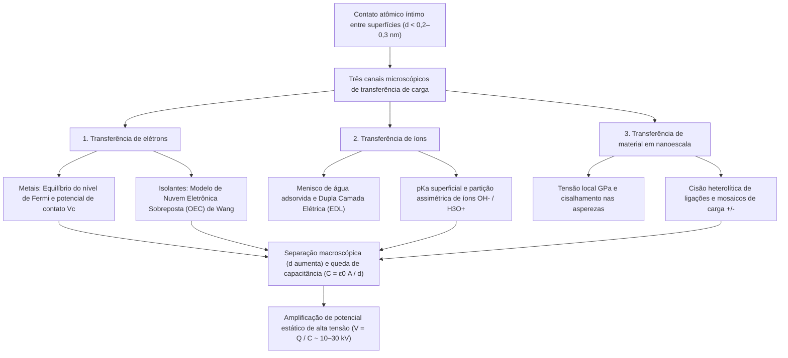
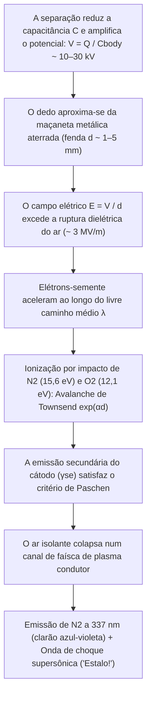

## 1. Introdução: Um mistério de 2.600 anos escondido na maçaneta da porta no inverno

Numa manhã fria e seca de inverno, você caminha sobre um tapete, estende a mão para uma maçaneta de latão e — *ESTALO!* — um minúsculo raio azul-esbranquiçado salta da ponta do seu dedo, aplicando um choque agudo. Ao tirar um suéter de lã no escuro, ouve-se uma série de estalos acompanhados por faíscas violetas; ao desenrolar uma fita adesiva comum numa câmara de vácuo, a interface de descolamento emite raios X triboluminescentes suficientes para radiografar os ossos do seu dedo. Todos esses fenômenos cotidianos nascem do mesmo processo físico fundamental: a <strong>eletricidade estática</strong>, conhecida na física como <strong>triboeletricidade</strong> ou, mais precisamente, <strong>eletrificação por contato (Contact Electrification, CE)</strong>.

Historicamente, a triboeletricidade foi o primeiro encontro da humanidade com o eletromagnetismo. Por volta de $600\,\text{a.C.}$, o filósofo grego Tales de Mileto registrou que esfregar resina fossilizada — <strong>âmbar</strong>, chamado $\eta\lambda\epsilon\kappa\tau\rho o\nu$ (*ēlektron*) em grego — contra pele de animal lhe conferia o poder invisível de atrair palha e penas leves. No século XVII, o médico inglês William Gilbert cunhou o termo neolatino *electricus* («semelhante ao âmbar»), dando origem às palavras modernas *eletricidade* e *elétron*.

Contudo, por trás dessa experiência familiar esconde-se um dos segredos mais surpreendentes da ciência moderna: <strong>mesmo no século XXI — muito depois de Maxwell ter unificado o eletromagnetismo, da mecânica quântica ter resolvido o átomo de hidrogênio e dos físicos terem detectado ondas gravitacionais e o bóson de Higgs — o mecanismo microscópico fundamental de como a carga elétrica se transfere entre duas superfícies isolantes em contato permanece uma das questões em aberto mais intensamente debatidas na física da matéria condensada e na química de superfícies.</strong>

Enquanto a transferência de elétrons entre dois *metais* é regida por níveis de Fermi bem definidos, os materiais triboelétricos comuns — como vidro, politetrafluoretileno (PTFE/Teflon), náilon, borracha de silicone e cabelo humano — são <strong>isolantes (dielétricos)</strong> com largas bandas proibidas ($E_g \approx 4\text{–}9\,\text{eV}$) e praticamente zero elétrons livres à temperatura ambiente. Quando dois isolantes se tocam, qual espécie física atravessa a interface? São <strong>elétrons</strong> fazendo tunelamento entre estados superficiais localizados ou orbitais atômicos sobrepostos? São <strong>íons móveis</strong> ($\text{H}_3\text{O}^+, \text{OH}^-$) partilhados através de camadas nanométricas de água adsorvida? Ou são <strong>fragmentos materiais em nanoescala</strong> criados pela ruptura mecanocímica de cadeias poliméricas covalentes?

Neste artigo, dissecamos a física da eletricidade estática desde a escala atômica até a escala planetária e industrial: a diferença entre área de contato aparente e real, os três mecanismos microscópicos incluindo o <strong>modelo de Nuvem Eletrônica Sobreposta (OEC)</strong> de Zhong Lin Wang, os paradoxos das séries triboelétricas cíclicas e da eletrização entre materiais idênticos, o efeito da umidade no inverno, a <strong>lei de Paschen</strong> da ruptura dielétrica do ar e as aplicações em impressoras a laser, respiradores N95 de eletreto e <strong>nanogeradores triboelétricos (TENG)</strong>.

---

## 2. A verdade sobre o «atrito»: Área de contato aparente vs. real

Na linguagem cotidiana falamos em «eletricidade por atrito» (do grego *tribos*, «esfregar»). Porém, a física de superfícies moderna provou que o atrito cinético não é um pré-requisito para a geração de carga: a transferência ocorre simplesmente pelo <strong>contato físico íntimo e subsequente separação</strong>. Por que então esfregamos um balão no cabelo?

### 2.1 Asperezas superficiais e a área de contato real $A_{\text{real}} \ll A_{\text{apparent}}$

Sob um microscópio de força atômica (AFM), qualquer superfície sólida — exceto cristais lamelares clivados atomicamente como mica ou grafeno — é uma cordilheira acidentada de picos e vales nanométricos e micrométricos chamados <strong>asperezas (asperities)</strong>. Quando dois objetos de área nominal $A_{\text{apparent}}$ são pressionados sob uma carga normal $F_N$, o contato ocorre exclusivamente no topo das asperezas mais altas. Pela mecânica de contato de Bowden–Tabor e Greenwood–Williamson, a <strong>área de contato real ($A_{\text{real}}$)</strong> é proporcional à carga normal dividida pelo módulo elástico efetivo $E^*$:

$$A_{\text{real}} = \sum_{i=1}^{N} A_i \propto \frac{F_N}{E^*} \quad \left( \text{tipicamente } \frac{A_{\text{real}}}{A_{\text{apparent}}} \sim 10^{-5} \text{ a } 10^{-3} \right)$$

Sob forças normais comuns, <strong>menos de $0,001\%$ a $0,1\%$ da área aparente faz realmente contato atômico!</strong>

### 2.2 O potencial de Lennard-Jones e o regime repulsivo de Pauli

Para que um elétron ou íon passe de um átomo A para um átomo B, os dois átomos devem aproximar-se a <strong>$d \lesssim 0,2\text{–}0,3\,\text{nm}$</strong>, comparável ao comprimento de uma ligação química. No clássico <strong>potencial interatômico de Lennard-Jones</strong> $U_{\text{LJ}}(r)$:

$$U_{\text{LJ}}(r) = 4\varepsilon \left[ \left(\frac{\sigma}{r}\right)^{12} - \left(\frac{\sigma}{r}\right)^{6} \right]$$

o termo $-\left(\sigma/r\right)^6$ descreve a atração de van der Waals de longo alcance, enquanto o termo íngreme $+\left(\sigma/r\right)^{12}$ representa a <strong>repulsão de Pauli de curto alcance</strong> quando as nuvens eletrônicas externas começam a se sobrepor no espaço. A transferência de carga exige empurrar os átomos interfaciais para dentro desse <strong>regime repulsivo ($r < r_{\text{eq}}$)</strong>. O verdadeiro papel físico de esfregar (deslizamento tangencial) é fazer com que as asperezas varram regiões frescas da superfície oposta, <strong>multiplicando por centenas ou milhares a área de contato real acumulada $\int A_{\text{real}}\,dt$ que atinge proximidade atômica ($d \lesssim 0,3\,\text{nm}$)</strong>.

---

## 3. Os três mecanismos microscópicos de transferência de carga

A ciência de superfícies revelou que <strong>três mecanismos microscópicos</strong> operam de forma independente ou sinérgica conforme a classe de materiais e a umidade:

### 3.1 Transferência de elétrons: Do nível de Fermi ao modelo de Nuvem Eletrônica Sobreposta (OEC)

#### (1) Contato metal–metal e potencial de contato de Volta
Em um metal, os elétrons de condução obedecem à <strong>distribuição de Fermi–Dirac</strong>:

$$f(E) = \frac{1}{\exp\left(\frac{E - E_F}{k_B T}\right) + 1}$$

com nível de Fermi $E_F$ e função trabalho $\Phi = E_{\text{vac}} - E_F$. Quando dois metais ($\Phi_1 < \Phi_2$) entram em contato, elétrons tunelam do metal 1 para o metal 2 até igualar os níveis de Fermi, gerando a <strong>diferença de potencial de contato de Volta $V_c = -(\Phi_1 - \Phi_2)/e$</strong>.

#### (2) Contato isolante–isolante: Estados superficiais e o modelo OEC de Zhong Lin Wang
Nos isolantes, a interrupção da simetria cristalina na superfície cria <strong>estados superficiais localizados</strong> dentro do bandgap. Entre 2018 e 2020, o <strong>Prof. Zhong Lin Wang</strong> propôs o <strong>modelo de Nuvem Eletrônica Sobreposta (Overlapped Electron-Cloud, OEC)</strong>:
- <strong>Antes do contato ($d > 0,5\,\text{nm}$)</strong>: Os elétrons de valência dos átomos A e B estão confinados em poços de potencial individuais separados por uma alta barreira de energia $E_b$.
- <strong>Durante o contato mecânico íntimo ($d < 0,2\text{–}0,3\,\text{nm}$)</strong>: Quando a força normal força os átomos para o regime repulsivo de Lennard-Jones, seus orbitais externos $\psi_A$ e $\psi_B$ sobrepõem-se fortemente ($\langle \psi_A | \psi_B \rangle \neq 0$). Essa forte sobreposição orbital reduz drasticamente a barreira interatômica $E_b$, convertendo o poço duplo num poço único assimétrico (ou poço duplo de baixa barreira).
- <strong>Transição quântica e aprisionamento na separação</strong>: Com a barreira suprimida, elétrons fracamente ligados em orbitais de maior energia no átomo A transitam espontaneamente para orbitais desocupados de menor energia no átomo B. Ao separar as superfícies ($d \to \infty$), a barreira $E_b$ sobe instantaneamente, aprisionando permanentemente os elétrons transferidos na superfície B.

O grupo de Wang provou experimentalmente que o decaimento térmico das cargas triboelétricas ($350\text{–}650\,\text{K}$) obedece à <strong>lei de emissão termiônica de Richardson–Dushman</strong>:

$$J_{\text{th}} = A^* T^2 \exp\left(-\frac{\Phi_B}{k_B T}\right)$$

### 3.2 Transferência de íons: Meniscos de água adsorvida e Dupla Camada Elétrica (EDL)

Em superfícies hidrofílicas ou polímeros iônicos sob umidade ambiente, <strong>George M. Whitesides</strong> e colaboradores (2008) demonstraram o papel da <strong>transferência de íons móveis</strong>. Quase toda superfície sólida possui um filme nanométrico de água adsorvida ($0,5\text{–}5\,\text{nm}$). O vidro ($\text{SiO}_2$) desprotona grupos silanol ($-\text{Si–O}^- + \text{H}_3\text{O}^+$) formando uma <strong>Dupla Camada Elétrica (EDL)</strong> com contra-íons móveis $\text{H}_3\text{O}^+$, enquanto polímeros hidrofóbicos como o PTFE adsorvem preferencialmente <strong>íons hidróxido ($\text{OH}^-$)</strong>. No contato, as pontes capilares de água fundem-se e, na separação, rompem-se assimetricamente.

### 3.3 Transferência de material em nanoescala e mecanocímica: Mosaicos de carga

Em 2011, <strong>Bartosz A. Grzybowski</strong> et al. (*Science* 2011) descobriram via microscopia de sonda Kelvin (KPFM) que um isolante carregado por contato exibe um <strong>mosaico em nanoescala de domínios positivos ($+$) e negativos ($-$) ($10\text{–}200\,\text{nm}$)</strong>. Tensões locais de gigapascals ($\sim \text{GPa}$) nas asperezas provocam a <strong>cisão mecanocímica heterolítica de ligações covalentes</strong> (gerando mecano-íons $\text{R}_1^+ + \text{R}_2^-$ e radicais livres) acompanhada pela transferência de fragmentos poliméricos.

| Propriedade | 1. Transferência de elétrons | 2. Transferência de íons | 3. Transferência de material em nanoescala |
| :--- | :--- | :--- | :--- |
| <strong>Portador de carga</strong> | Elétrons ($e^-$) | Íons móveis ($\text{H}_3\text{O}^+, \text{OH}^-$, contra-íons) | Fragmentos de oligômeros e mecano-íons ($\text{R}^+, \text{R}^-$) |
| <strong>Modelo teórico</strong> | Nível de Fermi, estados superficiais, <strong>modelo OEC</strong> | Menisco de água, <strong>EDL</strong>, $\text{pK}_a$ e potencial $\zeta$ | <strong>Cisão mecanocímica covalente</strong>, desgaste adesivo |
| <strong>Escala espacial</strong> | Regime repulsivo atômico ($d \lesssim 0,2\text{–}0,3\,\text{nm}$) | Filme de água e menisco ($0,5\text{–}10\,\text{nm}$) | Mosaicos de nanodomínios ($10\text{–}500\,\text{nm}$) |
| <strong>Sensibilidade ambiental</strong> | Opera em ultra-alto vácuo (UHV) e baixa $T$; decaimento termiônico $>350\,\text{K}$ | Fortemente dependente da umidade relativa ($RH$) | Dependente da tensão de cisalhamento e reticulação |

---

## 4. A série triboelétrica e seus paradoxos

### 4.1 Origens químicas e quânticas da série triboelétrica

Compilada por Johan Carl Wilcke em 1757 e padronizada por Wang et al. (2019) contra mercúrio líquido através da densidade de carga normalizada $\sigma_N$ ($\mu\text{C/m}^2$), a <strong>série triboelétrica</strong> classifica os materiais:

| Polaridade | Materiais representativos | Grupos funcionais dominantes | Densidade $\sigma_N$ ($\mu\text{C/m}^2$) | Mecanismo eletrônico e químico |
| :---: | :--- | :--- | :---: | :--- |
| <strong>Muito positivo ($+++$)</strong> | Quartzo / Vidro ($\text{SiO}_2$), Mica | Grupos silanol ($-\text{Si–OH}$), rede de silicato | $+80 \text{ a } +110$ | Pares isolados de alta energia no oxigênio doam elétrons facilmente (base de Lewis) |
| <strong>Moderadamente positivo ($++$)</strong> | Náilon-6,6, pele e cabelo humano, lã | Ligações amida ($-\text{NH–CO}-$), aminas ($-\text{NH}_2$), queratina | $+50 \text{ a } +85$ | Pares isolados doadores N/O; explica a forte carga entre suéteres de lã e a pele |
| <strong>Levemente positivo ($+$)</strong> | Alumínio, papel (celulose), algodão, madeira | Óxido nativo ($\text{Al}_2\text{O}_3$), biopolímeros ricos em $-\text{OH}$ | $+10 \text{ a } +40$ | Doação moderada de elétrons e partição de prótons |
| <strong>Neutro ($0$)</strong> | Aço, PMMA (acrílico), policarbonato (PC) | Mar de Fermi metálico, grupos éster e carbonato | $-10 \text{ a } +10$ | Comportamento anfótero: carrega positivamente contra PTFE e negativamente contra náilon |
| <strong>Moderadamente negativo ($-$)</strong> | Poliestireno (PS), polietileno (PE), polipropileno (PP) | Cadeias hidrocarbonadas saturadas ($-\text{CH}_2-$) | $-30 \text{ a } -60$ | Superfícies hidrofóbicas apolares; aprisionam elétrons em defeitos e adsorvem $\text{OH}^-$ |
| <strong>Muito negativo ($--$)</strong> | PVC, PDMS (silicone), Kapton (poliimida) | Ligações $-\text{C–Cl}$, cadeia siloxano, anéis imida | $-70 \text{ a } -110$ | Cloro eletronegativo ($\chi = 3,16$) e anéis imida retiradores de elétrons |
| <strong>Extremamente negativo ($---$)</strong> | <strong>PTFE (Teflon)</strong>, FEP, PVDF | Cadeias perfluoradas ($-(\text{CF}_2-\text{CF}_2)_n-$), bainha $\text{C–F}$ | $-110 \text{ a } -150$ | <strong>O flúor possui a maior eletronegatividade de Pauling ($\chi = 3,98$)</strong>; orbitais $\sigma^*$ profundos |

### 4.2 Paradoxos: Ciclos intransitivos ($A > B > C > A$) e carga entre materiais idênticos

Como a triboeletricidade acopla estados eletrônicos, íons, assimetria elástica ($E_A \neq E_B$) e desgaste, podem surgir <strong>tripletos cíclicos ($A > B > C > A$)</strong>.

Além disso, dois corpos do <strong>mesmo material</strong> carregam-se mutuamente devido a:
1. <strong>Flexoeletricidade por gradientes de deformação</strong>: Um gradiente de deformação $\frac{\partial \varepsilon_{jk}}{\partial x_l}$ induz uma polarização $P_i = \mu_{ijkl} \frac{\partial \varepsilon_{jk}}{\partial x_l}$ que desloca as bandas de energia locais.
2. <strong>Carga bipolar dependente do tamanho da partícula (partículas pequenas $-$, grandes $+$)</strong>: Em colisões granulares (modelo de Lacks–Kok–Waitukaitis), <strong>partículas menores carregam-se negativamente ($-$) e partículas maiores positivamente ($+$)</strong>. A separação gravitacional dessas cargas em correntes ascendentes gera campos de $\text{MV/m}$ que alimentam os <strong>relâmpagos em tempestades de areia no deserto</strong>, os <strong>relâmpagos vulcânicos («tempestades sujas»)</strong> e a agregação eletrostática de poeira de silicato através da <strong>«barreira do metro»</strong> em discos protoplanetários para formar planetesimais e planetas rochosos como a Terra (Steinpilz & Wurm, *Nature Physics* 2020).

---

## 5. Umidade, amplificação capacitiva ($V = Q / C$) e a lei de Paschen

### 5.1 Por que a eletricidade estática domina no inverno: Isoterma BET e condutividade superficial

O ar seco de inverno impede a dissipação da carga. O número de monocamadas de água adsorvidas $\theta_{\text{BET}}$ segue a <strong>isoterma de Brunauer–Emmett–Teller (BET)</strong>:

$$\theta_{\text{BET}}(RH) = \frac{v}{v_m} = \frac{c \cdot RH}{(1 - RH)\left[1 + (c - 1)RH\right]}$$

No inverno ($RH < 20\text{–}30\%$ em ambientes aquecidos), $\theta_{\text{BET}} < 1$: a água forma ilhas isoladas e a resistência superficial ultrapassa $10^{15}\,\Omega/\text{sq}$. No verão ($RH > 60\text{–}70\%$), forma-se um filme contínuo de $2\text{–}5$ monocamadas onde prótons ($\text{H}^+$) saltam via <strong>mecanismo de Grotthuss</strong>, aumentando exponencialmente a condutividade superficial $\sigma_s(RH) \approx \sigma_0 \exp(\alpha_{\text{RH}} \cdot RH)$ em $6$ a $10$ ordens de grandeza.

### 5.2 Amplificação de tensão ($V = Q / C$) e a lei de Paschen

No contato ($d_0 \approx 1\,\text{nm}$), a capacitância $C_0 = \varepsilon_0 A / d_0$ é enorme e a tensão é de apenas alguns volts. Ao levantar o sapato do tapete, $d$ aumenta $10^8$ vezes e a capacitância cai até a do corpo humano ($C_{\text{body}} \approx 150\,\text{pF}$). Com a carga $Q$ conservada, o trabalho mecânico amplifica a tensão segundo $V(d) = Q / C(d)$ até <strong>$10.000\text{–}30.000\,\text{V}$ ($10\text{–}30\,\text{kV}$)</strong>! O choque não é letal porque a energia armazenada é de apenas $U_E = \frac{1}{2}C_{\text{body}}V^2 = 30\,\text{mJ}$ ($Q = 3,0\,\mu\text{C}$, pulso de $\tau \approx 150\,\text{ns}$), mas destrói instantaneamente óxidos de porta de $2\,\text{nm}$ em chips CMOS.

A poucos milímetros da maçaneta, o campo $E = V/d$ dispara uma <strong>avalanche eletrônica de Townsend</strong> ($\alpha = Ap\exp(-Bp/E)$) e emissão secundária ($\gamma_{\text{se}}$), regida pela <strong>lei de Paschen (1889)</strong>:

$$V_B(p d) = \frac{B \cdot p d}{\ln(A \cdot p d) - \ln\left[\ln\left(1 + \frac{1}{\gamma_{\text{se}}}\right)\right]}$$

A $1\,\text{atm}$, o campo de ruptura do ar é <strong>$E_{\text{crit}} \approx 3\,\text{kV/mm}$</strong> e o <strong>mínimo de Paschen é $V_{\text{min}} \approx 327\,\text{V}$</strong> ($pd \approx 7,5\,\mu\text{m}\cdot\text{atm}$). O clarão azul-violeta vem do nitrogênio excitado ($\text{N}_2$, $\lambda = 337,1\,\text{nm}$) e o estalo acústico da expansão térmica supersônica do canal de plasma.

---

## 6. Aplicações tecnológicas: Impressão a laser, máscaras N95 e TENG

1. <strong>Xerografia (impressão a laser) e precipitadores eletrostáticos (ESP)</strong>: Impressoras a laser usam toner carregado triboeletricamente ($Q/M \approx -20\text{ a }-40\,\mu\text{C/g}$); precipitadores industriais capturam $>99,9\%$ das partículas $\text{PM}_{2.5}$.
2. <strong>Filtros de eletreto em respiradores médicos N95 / PFF2</strong>: Microfibras de polipropileno carregadas como <strong>eletreto</strong> criam intensos gradientes de campo elétrico que capturam aerossóis virais neutros ($0,1\text{–}0,3\,\mu\text{m}$) via <strong>força dieletroforética</strong> sem dificultar a respiração:

$$\mathbf{F}_{\text{DEP}} = 2\pi r_p^3 \varepsilon_0 \left(\frac{\varepsilon_p - \varepsilon_0}{\varepsilon_p + 2\varepsilon_0}\right) \nabla |\mathbf{E}|^2$$

3. <strong>Nanogeradores triboelétricos (TENG) e a corrente de deslocamento de Maxwell</strong>: Inventados por Zhong Lin Wang em 2012, os TENG colhem energia mecânica de baixa frequência através do termo de polarização superficial $\frac{\partial \mathbf{P}_s}{\partial t}$ adicionado à <strong>corrente de deslocamento de Maxwell</strong>:

$$\mathbf{J}_D = \frac{\partial \mathbf{D}}{\partial t} = \varepsilon_0 \frac{\partial \mathbf{E}}{\partial t} + \frac{\partial \mathbf{P}_s}{\partial t}$$

convertendo passos humanos, batimentos cardíacos, gotas de chuva e ondas oceânicas (*Energia Azul*) em eletricidade limpa.
