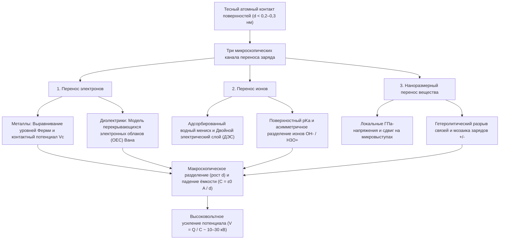
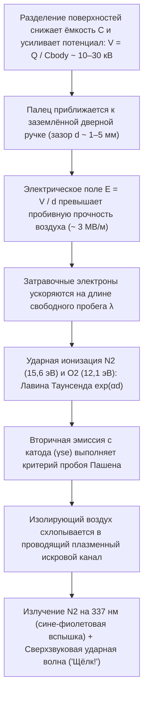

## 1. Введение: 2600-летняя загадка на зимней дверной ручке

Морозным сухим зимним утром вы идёте по ковру, тянетесь к латунной дверной ручке и — *ЩЁЛК!* — с кончика вашего пальца срывается миниатюрная бело-голубая молния, ощутимо ударяя током. Снимите шерстяной свитер в темноте — и вы услышите треск в сопровождении тусклых фиолетовых искр; быстро размотайте рулон обычного скотча в вакуумной камере — и линия отрыва начнёт излучать триболюминесцентное рентгеновское излучение, достаточное для рентгеновского снимка костей пальца. Все эти явления порождаются одним фундаментальным процессом: <strong>статическим электричеством</strong>, которое в физике называют <strong>трибоэлектричеством</strong> или, более строго, <strong>контактной электризацией (Contact Electrification, CE)</strong>.

Исторически трибоэлектричество стало первым знакомством человечества с электромагнетизмом. Около $600\,\text{г. до н. э.}$ древнегреческий философ Фалес Милетский заметил, что натёртая о мех окаменелая древесная смола — <strong>янтарь</strong>, по-гречески $\eta\lambda\epsilon\kappa\tau\rho o\nu$ (*ēlektron*) — обретает невидимую силу притягивать соломинки и перья. В XVII веке английский врач Уильям Гильберт ввёл неолатинский термин *electricus* («подобный янтарю»), давший жизнь современным словам *электричество* и *электрон*.

Однако за этим знакомым с детства опытом скрывается один из самых удивительных секретов современной науки: <strong>даже в XXI веке — спустя долгое время после того, как Максвелл объединил электромагнетизм, квантовая механика описала атом водорода, а физики открыли гравитационные волны и бозон Хиггса — фундаментальный микроскопический механизм переноса электрического заряда при контакте двух диэлектриков остаётся одной из самых горячо обсуждаемых нерешённых проблем физики конденсированного состояния и химии поверхности.</strong>

Если перенос электронов между двумя *металлами* легко объясняется выравниванием уровней Ферми, то типичные трибоэлектрические материалы — стекло, политетрафторэтилен (ПТФЭ/тефлон), нейлон, силикон и человеческие волосы — являются <strong>изоляторами (диэлектриками)</strong> с широкой запрещённой зоной ($E_g \approx 4\text{–}9\,\text{эВ}$) и практически полным отсутствием свободных электронов проводимости при комнатной температуре. Какая же частица пересекает границу раздела при контакте двух диэлектриков? Туннелирующие <strong>электроны</strong>? <strong>Подвижные ионы</strong> ($\text{H}_3\text{O}^+, \text{OH}^-$) в нанометровых адсорбированных слоях воды? Или <strong>наноразмерные фрагменты вещества</strong>, возникающие при механохимическом разрыве ковалентных полимерных цепей?

В этой статье мы разберём физику статического электричества от атомного до планетарного и промышленного масштабов: различие между кажущейся и реальной площадью контакта, три конкурирующих механизма переноса заряда включая <strong>модель перекрывающихся электронных облаков (OEC)</strong> Чжун Линь Вана, парадоксы циклических трибоэлектрических рядов и электризации идентичных материалов, влияние зимней влажности, <strong>закон Пашена</strong> для искрового пробоя, а также применение в лазерных принтерах, электретных масках N95 и <strong>трибоэлектрических наногенераторах (TENG)</strong>.

---

## 2. Правда о «трении»: Кажущаяся и реальная площадь контакта

В быту мы говорим об «электричестве трения» (от греч. *tribos* — тереть). Однако современная физика поверхности доказала, что кинетическое трение не является обязательным условием генерации заряда: перенос происходит просто при <strong>тесном физическом контакте и последующем разделении</strong>. Зачем же тогда мы трём воздушный шарик о волосы?

### 2.1 Микровыступы (аспериты) и реальная площадь контакта $A_{\text{real}} \ll A_{\text{apparent}}$

Под атомно-силовым микроскопом (АСМ) любая твёрдая поверхность — за исключением атомарно сколотых слоистых кристаллов вроде слюды или графена — представляет собой горный хребет из нано- и микроскопических пиков и впадин, называемых <strong>микровыступами (asperities)</strong>. При сжатии двух тел номинальной площади $A_{\text{apparent}}$ нормальной силой $F_N$ соприкосновение происходит лишь на вершинах самых высоких выступов. Согласно механике контакта Боудена–Тейбора и Гринвуда–Уильямсона, <strong>реальная площадь контакта ($A_{\text{real}}$)</strong> пропорциональна нормальной нагрузке, делённой на эффективный модуль упругости $E^*$:

$$A_{\text{real}} = \sum_{i=1}^{N} A_i \propto \frac{F_N}{E^*} \quad \left( \text{обычно } \frac{A_{\text{real}}}{A_{\text{apparent}}} \sim 10^{-5} \text{ до } 10^{-3} \right)$$

При обычном нажатии <strong>менее $0,001\%\text{–}0,1\%$ кажущейся площади вступает в реальный атомный контакт!</strong>

### 2.2 Потенциал Леннард-Джонса и режим короткодействующего отталкивания Паули

Чтобы электрон или ион перешёл от атома A к атому B, атомы должны сблизиться на расстояние <strong>$d \lesssim 0,2\text{–}0,3\,\text{нм}$</strong>, сопоставимое с длиной химической связи. Рассмотрим классический <strong>межатомный потенциал Леннард-Джонса</strong> $U_{\text{LJ}}(r)$:

$$U_{\text{LJ}}(r) = 4\varepsilon \left[ \left(\frac{\sigma}{r}\right)^{12} - \left(\frac{\sigma}{r}\right)^{6} \right]$$

Член $-\left(\sigma/r\right)^6$ описывает дальнодействующее притяжение Ван-дер-Ваальса, а крутой член $+\left(\sigma/r\right)^{12}$ — <strong>короткодействующее отталкивание Паули</strong> при пространственном перекрытии внешних электронных оболочек. Перенос заряда требует вдавливания поверхностных атомов именно в этот <strong>режим отталкивания ($r < r_{\text{eq}}$)</strong>. Истинная роль макроскопического трения (скольжения) состоит в том, что микровыступы пропахивают свежие участки встречной поверхности, <strong>увеличивая кумулятивную площадь атомного контакта $\int A_{\text{real}}\,dt$ в сотни и тысячи раз!</strong>

---

## 3. Три микроскопических механизма переноса заряда

Современная наука о поверхности выделяет <strong>три микроскопических канала</strong>, действующих индивидуально или синергетически:

### 3.1 Перенос электронов: От уровня Ферми к модели перекрывающихся электронных облаков (OEC)

#### (1) Контакт металл–металл и контактная разность потенциалов Вольта
В металле электроны проводимости подчиняются <strong>распределению Ферми–Дирака</strong>:

$$f(E) = \frac{1}{\exp\left(\frac{E - E_F}{k_B T}\right) + 1}$$

с уровнем Ферми $E_F$ и работой выхода $\Phi = E_{\text{vac}} - E_F$. При контакте двух металлов ($\Phi_1 < \Phi_2$) электроны туннелируют из металла 1 в металл 2 до выравнивания уровней Ферми, создавая <strong>контактную разность потенциалов Вольта $V_c = -(\Phi_1 - \Phi_2)/e$</strong>.

#### (2) Контакт диэлектрик–диэлектрик: Поверхностные состояния и модель OEC Чжун Линь Вана
На поверхности диэлектрика обрыв периодичности кристаллической решётки порождает локализованные <strong>поверхностные состояния</strong> внутри запрещённой зоны. В 2018–2020 годах профессор <strong>Чжун Линь Ван (Zhong Lin Wang)</strong> предложил универсальную квантово-механическую <strong>модель перекрывающихся электронных облаков (Overlapped Electron-Cloud, OEC)</strong>:
- <strong>До контакта ($d > 0,5\,\text{нм}$)</strong>: Валентные электроны атомов A и B заперты в глубоких одиночных потенциальных ямах, разделённых высоким энергетическим барьером $E_b$.
- <strong>Во время тесного механического контакта ($d < 0,2\text{–}0,3\,\text{нм}$)</strong>: В режиме отталкивания Леннард-Джонса внешние атомные орбитали $\psi_A$ и $\psi_B$ сильно перекрываются ($\langle \psi_A | \psi_B \rangle \neq 0$). Это резко снижает потенциальный барьер $E_b$, превращая двухъямный потенциал в асимметричную потенциальную яму с низким барьером.
- <strong>Квантовый переход и захват при разделении</strong>: Слабосвязанные электроны с высокоэнергетических орбиталей атома A туннелируют на низкоэнергетические свободные орбитали атома B. При разведении поверхностей ($d \to \infty$) барьер $E_b$ мгновенно вырастает вновь, навсегда запирая перешедшие электроны на поверхности B.

Группа Вана подтвердила это экспериментально, показав, что термический спад трибоэлектрического заряда ($350\text{–}650\,\text{К}$) строго подчиняется <strong>закону термоэлектронной эмиссии Ричардсона–Дэшмана</strong>:

$$J_{\text{th}} = A^* T^2 \exp\left(-\frac{\Phi_B}{k_B T}\right)$$

### 3.2 Перенос ионов: Адсорбированные водные мениски и Двойной электрический слой (ДЭС)

Для гидрофильных поверхностей и ионных полимеров при комнатной влажности <strong>Джордж Уайтсайдс (George M. Whitesides)</strong> и коллеги (2008) доказали ключевую роль <strong>переноса подвижных ионов</strong>. На воздухе любая поверхность покрыта плёнкой воды толщиной $0,5\text{–}5\,\text{нм}$. Стекло ($\text{SiO}_2$) депротонирует силанольные группы ($-\text{Si–O}^- + \text{H}_3\text{O}^+$), формируя <strong>двойной электрический слой (ДЭС)</strong> с подвижными катионами $\text{H}_3\text{O}^+$, тогда как гидрофобные полимеры вроде ПТФЭ преимущественно адсорбируют <strong>гидроксид-ионы ($\text{OH}^-$)</strong>. При контакте водные плёнки сливаются в капиллярный мостик, а при разрыве мостика ионы распределяются асимметрично.

### 3.3 Наноразмерный перенос вещества и механохимия: Зарядовые мозаики

В 2011 году <strong>Бартош Гжибовский (Bartosz A. Grzybowski)</strong> и соавторы (*Science* 2011) с помощью зондовой микроскопии Кельвина (KPFM) обнаружили, что заряженный диэлектрик представляет собой <strong>наномозаику из положительных ($+$) и отрицательных ($-$) доменов ($10\text{–}200\,\text{нм}$)</strong>. Гигапаскальные ($\sim \text{ГПа}$) напряжения на вершинах микровыступов вызывают <strong>механохимический гетеролитический разрыв ковалентных связей</strong> (рождая механоионы $\text{R}_1^+ + \text{R}_2^-$ и свободные радикалы) и взаимный перенос нанофрагментов полимеров.

| Характеристика | 1. Перенос электронов | 2. Перенос ионов | 3. Наноперенос вещества и механохимия |
| :--- | :--- | :--- | :--- |
| <strong>Носитель заряда</strong> | Электроны ($e^-$) | Подвижные ионы ($\text{H}_3\text{O}^+, \text{OH}^-$) | Заряженные олигомеры и механоионы ($\text{R}^+, \text{R}^-$) |
| <strong>Теоретическая модель</strong> | Уровень Ферми, поверхностные состояния, <strong>модель OEC</strong> | Водный мениск, <strong>ДЭС</strong>, $\text{pK}_a$ и $\zeta$-потенциал | <strong>Механохимический разрыв связей</strong>, адгезионный износ |
| <strong>Пространственный масштаб</strong> | Межатомное отталкивание ($d \lesssim 0,2\text{–}0,3\,\text{нм}$) | Толщина водной плёнки ($0,5\text{–}10\,\text{нм}$) | Мозаика нанодоменов ($10\text{–}500\,\text{нм}$) |
| <strong>Влияние среды</strong> | Работает в сверхвысоком вакууме (UHV) и при низких $T$; спад $>350\,\text{К}$ | Сильно зависит от относительной влажности ($RH$) | Зависит от напряжения сдвига и сшивки полимера |

---

## 4. Трибоэлектрический ряд и его парадоксы

### 4.1 Химическая и квантовая природа трибоэлектрического ряда

Составленный Иоганном Карлом Вильке в 1757 году и количественно стандартизированный группой Вана (2019) относительно жидкой ртути через нормированную плотность заряда $\sigma_N$ ($\text{мкКл/м}^2$), <strong>трибоэлектрический ряд</strong> ранжирует материалы:

| Полярность | Типичные материалы | Доминирующие функциональные группы | Плотность $\sigma_N$ ($\text{мкКл/м}^2$) | Электронный и химический механизм |
| :---: | :--- | :--- | :---: | :--- |
| <strong>Сильно положительная ($+++$)</strong> | Кварц / Стекло ($\text{SiO}_2$), Слюда | Силанольные группы ($-\text{Si–OH}$), силикатная решётка | $+80 \text{ до } +110$ | Высокоэнергетические неподелённые пары кислорода легко отдают электроны (основание Льюиса) |
| <strong>Умеренно положительная ($++$)</strong> | Нейлон-6,6, кожа и волосы человека, шерсть | Амидные связи ($-\text{NH–CO}-$), амины ($-\text{NH}_2$), кератин | $+50 \text{ до } +85$ | Электронодонорные пары N/O; объясняет сильную электризацию шерстяного свитера о кожу |
| <strong>Слабо положительная ($+$)</strong> | Алюминий, бумага (целлюлоза), хлопок, дерево | Оксид ($\text{Al}_2\text{O}_3$), гидроксильные биополимеры ($-\text{OH}$) | $+10 \text{ до } +40$ | Умеренная отдача электронов и перенос протонов |
| <strong>Нейтральная ($0$)</strong> | Сталь, ПММА (оргстекло), поликарбонат (ПК) | Ферми-газ металла, сложноэфирные и карбонатные группы | $-10 \text{ до } +10$ | Амфотерное поведение: положителен к ПТФЭ, отрицателен к нейлону |
| <strong>Умеренно отрицательная ($-$)</strong> | Полистирол (ПС), полиэтилен (ПЭ), полипропилен (ПП) | Насыщенные углеводородные цепи ($-\text{CH}_2-$) | $-30 \text{ до } -60$ | Неполярные гидрофобные поверхности; захват электронов дефектами и адсорбция $\text{OH}^-$ |
| <strong>Сильно отрицательная ($--$)</strong> | ПВХ, ПДМС (силикон), Каптон (полиимид) | Связи $-\text{C–Cl}$, силоксановый остов, имидные циклы | $-70 \text{ до } -110$ | Электроотрицательный хлор ($\chi = 3,16$) и электроноакцепторные имидные кольца |
| <strong>Экстремально отрицательная ($---$)</strong> | <strong>ПТФЭ (Тефлон)</strong>, FEP, ПВДФ | Перфторированные цепи ($-(\text{CF}_2-\text{CF}_2)_n-$), оболочка $\text{C–F}$ | $-110 \text{ до } -150$ | <strong>Фтор имеет высшую электроотрицательность Полинга ($\chi = 3,98$)</strong>; глубокие пустые $\sigma^*$-орбитали |

### 4.2 Парадоксы: Циклическая нетранзитивность ($A > B > C > A$) и электризация одинаковых материалов

Из-за конкуренции электронных состояний, ионного обмена, разницы модулей упругости ($E_A \neq E_B$) и износа линейная транзитивность может нарушаться, образуя <strong>циклические тройки ($A > B > C > A$)</strong>.

Более того, два образца <strong>одного и того же материала</strong> заряжаются при трении и соударениях благодаря двум механизмам нарушения симметрии:
1. <strong>Флексоэлектричество от градиентов деформации</strong>: Неоднородный градиент деформации $\frac{\partial \varepsilon_{jk}}{\partial x_l}$ наводит поляризацию $P_i = \mu_{ijkl} \frac{\partial \varepsilon_{jk}}{\partial x_l}$, сдвигающую локальные края энергетических зон.
2. <strong>Биполярная зарядка частиц разного размера (мелкие частицы $-$, крупные $+$)</strong>: При столкновениях гранул (модель Лакса–Кока–Вайтукайтиса) <strong>мелкие частицы систематически заряжаются отрицательно ($-$), а крупные — положительно ($+$)</strong>. Разделение этих зарядов восходящими потоками и гравитацией создаёт поля в мегавольты на метр, порождая <strong>молнии в песчаных бурях пустынь</strong>, <strong>вулканические молнии («грязные грозы»)</strong> и помогая силикатной пыли в протопланетных дисках преодолеть <strong>«метровый барьер»</strong> для формирования планетезималей и планет земного типа (Steinpilz & Wurm, *Nature Physics* 2020).

---

## 5. Влажность, ёмкостное усиление ($V = Q / C$) и закон Пашена

### 5.1 Почему статическое электричество бушует зимой: Изотерма БЭТ и поверхностная проводимость

Зимний сухой воздух препятствует утечке заряда. Число адсорбированных монослоёв воды $\theta_{\text{BET}}$ подчиняется <strong>изотерме Брунауэра–Эммета–Теллера (БЭТ)</strong>:

$$\theta_{\text{BET}}(RH) = \frac{v}{v_m} = \frac{c \cdot RH}{(1 - RH)\left[1 + (c - 1)RH\right]}$$

Зимой ($RH < 20\text{–}30\%$ в помещении) $\theta_{\text{BET}} < 1$: вода образует изолированные островки, и поверхностное сопротивление превышает $10^{15}\,\text{Ом/кв}$. Летом ($RH > 60\text{–}70\%$) возникает сплошная плёнка из $2\text{–}5$ монослоёв, по которой протоны ($\text{H}^+$) стремительно прыгают по <strong>механизму Гротгуса</strong>, экспоненциально увеличивая поверхностную проводимость $\sigma_s(RH) \approx \sigma_0 \exp(\alpha_{\text{RH}} \cdot RH)$ на $6\text{–}10$ порядков.

### 5.2 Усиление напряжения ($V = Q / C$) и закон Пашена для газового пробоя

В момент контакта ($d_0 \approx 1\,\text{нм}$) ёмкость $C_0 = \varepsilon_0 A / d_0$ огромна, а напряжение составляет всего несколько вольт. Когда вы отрываете подошву от ковра, $d$ возрастает в $10^8$ раз, а ёмкость падает до ёмкости тела человека ($C_{\text{body}} \approx 150\,\text{пФ}$). При сохранении заряда $Q$ механическая работа мышц усиливает напряжение по формуле $V(d) = Q / C(d)$ до <strong>$10\,000\text{–}30\,000\,\text{В}$ ($10\text{–}30\,\text{кВ}$)</strong>! Этот разряд безопасен для жизни, так как запасённая энергия равна лишь $U_E = \frac{1}{2}C_{\text{body}}V^2 = 30\,\text{мДж}$ ($Q = 3,0\,\text{мкКл}$, длительность $\tau \approx 150\,\text{нс}$), но он мгновенно пробивает $2\,\text{нм}$ подзатворный диэлектрик современных КМОП-микросхем.

При приближении пальца к дверной ручке на несколько миллиметров поле $E = V/d$ запускает <strong>электронную лавину Таунсенда</strong> ($\alpha = Ap\exp(-Bp/E)$) и вторичную эмиссию ($\gamma_{\text{se}}$), определяемую <strong>законом Пашена (1889)</strong>:

$$V_B(p d) = \frac{B \cdot p d}{\ln(A \cdot p d) - \ln\left[\ln\left(1 + \frac{1}{\gamma_{\text{se}}}\right)\right]}$$

При $1\,\text{атм}$ пробивное поле воздуха равно <strong>$E_{\text{crit}} \approx 3\,\text{кВ/мм}$</strong>, а <strong>минимум Пашена составляет $V_{\text{min}} \approx 327\,\text{В}$</strong> ($pd \approx 7,5\,\text{мкм}\cdot\text{атм}$). Сине-фиолетовая вспышка испускается возбуждённым азотом ($\text{N}_2$, $\lambda = 337,1\,\text{нм}$), а резкий щелчок порождается сверхзвуковым тепловым расширением плазменного канала.

---

## 6. Технологические применения: Лазерная печать, респираторы N95 и TENG

1. <strong>Электрофотография (лазерная печать) и электрофильтры (ESP)</strong>: Лазерные принтеры используют трибоэлектрически заряженный тонер ($Q/M \approx -20\text{ до }-40\,\text{мкКл/г}$); промышленные электрофильтры Коттрелла улавливают $>99,9\%$ частиц $\text{PM}_{2.5}$.
2. <strong>Электретные фильтры в медицинских респираторах N95 / FFP2</strong>: Полипропиленовые микроволокна со встроенным <strong>электретным</strong> зарядом создают сильные градиенты поля, улавливающие нейтральные вирусные аэрозоли ($0,1\text{–}0,3\,\text{мкм}$) за счёт <strong>диэлектрофоретической силы</strong> без затруднения дыхания:

$$\mathbf{F}_{\text{DEP}} = 2\pi r_p^3 \varepsilon_0 \left(\frac{\varepsilon_p - \varepsilon_0}{\varepsilon_p + 2\varepsilon_0}\right) \nabla |\mathbf{E}|^2$$

3. <strong>Трибоэлектрические наногенераторы (TENG) и ток смещения Максвелла</strong>: Изобретённые Чжун Линь Ваном в 2012 году TENG преобразуют низкочастотную механическую энергию в электричество благодаря члену поверхностной поляризации $\frac{\partial \mathbf{P}_s}{\partial t}$ в <strong>токе смещения Максвелла</strong>:

$$\mathbf{J}_D = \frac{\partial \mathbf{D}}{\partial t} = \varepsilon_0 \frac{\partial \mathbf{E}}{\partial t} + \frac{\partial \mathbf{P}_s}{\partial t}$$

собирая энергию человеческих шагов, сердцебиения, капель дождя и океанских волн (*Голубая энергия*).
