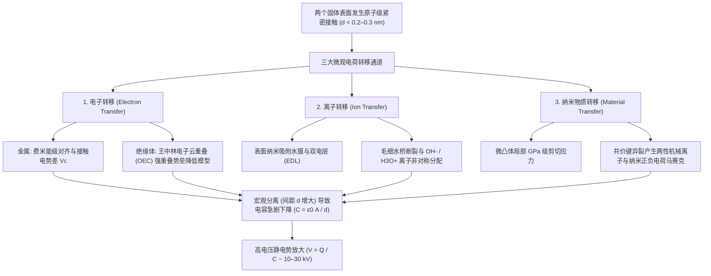
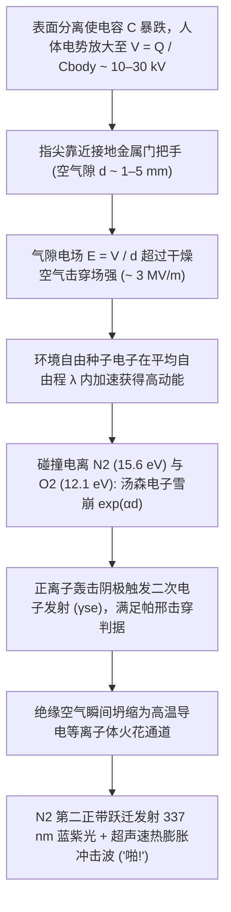

## 1. 引言：隐藏在冬日门把手上的 2600 年物理学之谜

在干燥寒冷的冬日清晨，当你走过铺着地毯的房间，伸手触碰金属门把手的瞬间——“啪！”一道蓝白色的微型闪电从指尖跃出，带来一阵尖锐的刺痛。在黑暗中脱下羊毛衫时，你会听到噼啪作响的静电声并看到微弱的紫色火花；甚至在真空室中快速撕开一卷普通的透明胶带，剥离界面处产生的摩擦发光与高能电子制动辐射竟然足以发射出能够给手指骨骼拍片的 X 射线。所有这些日常现象都源于同一个基础物理过程：<strong>静电（Static Electricity）</strong>，在物理学中被称为<strong>摩擦起电（Triboelectricity）</strong>，或更精确地称为<strong>接触起电（Contact Electrification, CE）</strong>。

从科学史来看，摩擦起电是人类最早观测到的电磁现象。早在公元前 600 年左右，古希腊米利都学派哲学家泰勒斯（Thales of Miletus）就记载了用动物毛皮摩擦琥珀（希腊语为 $\eta\lambda\epsilon\kappa\tau\rho o\nu$，*ēlektron*）后，琥珀能够吸引轻小的麦秆和羽毛。17 世纪，英国御医威廉·吉尔伯特（William Gilbert）根据希腊语“琥珀”一词创造了新拉丁语词汇 *electricus*（意为“像琥珀一样的吸引性质”），由此诞生了现代语言中的“电（Electricity）”与“电子（Electron）”。

然而，在这个连小学生都熟知的科学常识背后，却隐藏着现代物理学最令人惊讶的秘密之一：<strong>即便在 21 世纪的今天——在麦克斯韦统一电磁学、量子力学彻底解开氢原子光谱、甚至人类已经探测到引力波和希格斯玻色子之后——当两个绝缘体（电介质）表面相互接触并分离时，电荷究竟是如何跨越界面发生转移的微观物理机制，依然是凝聚态物理与表面化学领域争论最激烈的前沿课题之一。</strong>

初看起来，人们或许会想起中学教科书里的简单解释：“当两个物体相互摩擦时，电子从一个物体跳到了另一个物体上。”然而，金属与金属接触时的电子转移固然可以用具有明确费米能级（Fermi Level）的固体能带理论完美解释，但日常生活中最容易产生强静电的材料——如玻璃、聚四氟乙烯（PTFE / 特氟龙）、尼龙、硅胶、琥珀以及人类毛发——全部是具有宽禁带（$E_g \approx 4\text{–}9\,\text{eV}$）、室温下几乎不存在自由导带电子的<strong>绝缘体（电介质）</strong>。当两个绝缘体接触时，跨越界面的物理载体究竟是什么？是隧穿局域表面态或重叠原子轨道的<strong>电子（Electrons）</strong>？是在纳米级吸附水膜中发生非对称分配的<strong>可移动离子（$\text{H}_3\text{O}^+, \text{OH}^-$）</strong>？还是共价聚合物主链在机械剪切应力下发生异裂而产生的<strong>纳米级带电物质碎片（Material Fragments）</strong>？

本文将从原子尺度出发，直至行星科学与现代工业应用，全面剖析接触起电与静电的深层物理学。我们将探讨为何“摩擦”并非起电的必要条件，解析以王中林（Zhong Lin Wang）院士提出的<strong>电子云重叠模型（Overlapped Electron-Cloud, OEC Model）</strong>为核心的三大微观电荷转移机制，揭开循环摩擦起电序列悖论与沙漠雷暴、行星形成中“同种材料接触起电”的对称性破缺机制，严格推导冬季湿度效应、电容电压放大（$V = Q/C$）与气体放电击穿的<strong>帕邢定律（Paschen's Law）</strong>，并展示静电在激光打印机、N95 驻极体熔喷布口罩以及<strong>摩擦纳米发电机（TENG）</strong>中的尖端工程应用。

---

## 2. “摩擦”的真相：宏观表观接触面积与微观真实接触面积

在日常语言中，我们将静电称为“摩擦电”（Triboelectricity，源自希腊语 *tribos*，意为“摩擦”）。然而，现代纳米表面物理学已经确凿地证明：宏观的滑动摩擦（Kinetic Friction）本身并不是产生电荷的先决条件。只要两个表面发生<strong>紧密的原子级接触并随后分离</strong>，电荷转移就会发生——因此科学界更倾向于使用<strong>接触起电（Contact Electrification, CE）</strong>这一严格术语。

既然单纯接触就能转移电荷，为什么我们在生活中总要本能地把气球在头发上反复摩擦，或者用毛皮用力擦拭塑料棒呢？答案隐藏在固体表面的纳米形貌与原子间作用力的极短程特性之中。

### 2.1 表面微凸体（Asperities）与真实接触面积 $A_{\text{real}} \ll A_{\text{apparent}}$

在肉眼看来，一块抛光的金属板、一片玻璃或一层高分子薄膜似乎是平坦而光滑的。然而在原子力显微镜（AFM）或扫描隧道显微镜（STM）下，除了云母（Mica）或石墨烯等少数可实现原子级解理的层状晶体外，几乎所有固体表面都是由无数纳米至微米尺度的峰谷构成的险峻山脉。在摩擦学（Tribology）中，这些微观山峰被称为<strong>微凸体（Asperities）</strong>。

当两个宏观表观面积为 $A_{\text{apparent}}$ 的物体在法向载荷 $F_N$ 下相互挤压时，它们并非在整个平面上接触，而是仅仅在双方最高微凸体的尖端发生顶对顶的局部接触。根据 Bowden–Tabor 粘着理论与 Greenwood–Williamson 弹性接触力学，所有微观接触斑点的面积之和——即<strong>真实接触面积（$A_{\text{real}}$）</strong>——正比于法向载荷 $F_N$ 与有效弹性模量 $E^*$（或塑性压入硬度 $H$）之比：

$$A_{\text{real}} = \sum_{i=1}^{N} A_i \propto \frac{F_N}{E^*} \quad \left( \text{通常 } \frac{A_{\text{real}}}{A_{\text{apparent}}} \sim 10^{-5} \text{ 至 } 10^{-3} \right)$$

在普通的按压力下，<strong>实际发生原子级接触的面积还不到表观面积的 $0.001\%$ 至 $0.1\%$！</strong> 界面上其余 $99.9\%$ 以上的区域都被数十至数千纳米的空气隙隔开，根本无法发生任何电荷转移。

### 2.2 兰纳-琼斯势（Lennard-Jones Potential）与短程泡利排斥区

更进一步说，要让一个电子或离子从表面 A 的原子跨越到表面 B 的原子，两个原子必须靠近到比范德华平衡距离更近的位置，进入<strong>$d \lesssim 0.2\text{–}0.3\,\text{nm}$</strong>（与化学键长度相当）的极短距离。

考察描述两个相距 $r$ 的中性非成键原子相互作用能 $U_{\text{LJ}}(r)$ 的经典<strong>兰纳-琼斯势（Lennard-Jones Potential）</strong>：

$$U_{\text{LJ}}(r) = 4\varepsilon \left[ \left(\frac{\sigma}{r}\right)^{12} - \left(\frac{\sigma}{r}\right)^{6} \right]$$

其中 $\varepsilon$ 为势阱深度，$\sigma$ 为势能为零时的特征距离，$-\left(\sigma/r\right)^6$ 项代表长程吸引的范德华力（伦敦色散力），而陡峭的 $+\left(\sigma/r\right)^{12}$ 项则代表当两个原子的外层电子壳层（波函数）在空间上开始发生重叠时产生的<strong>短程泡利不相容排斥力（Pauli Repulsion）</strong>。

正如我们在第 3 节中将看到的，电荷转移要求外力将界面原子强行推入这一<strong>短程排斥区（$r < r_{\text{eq}}$）</strong>，使双方的电子云发生强烈交叠。这正是宏观“摩擦（切向滑动）”的真正物理作用：当你将一个表面在另一个表面上滑过宏观距离 $L$ 时，突出的微凸体像犁一样扫过对方表面的新鲜区域，<strong>将达到原子级间距（$d \lesssim 0.3\,\text{nm}$）的累积微观真实接触面积 $\int A_{\text{real}}\,dt$ 放大了成百上千倍！</strong> 此外，摩擦滑动在微凸体接触点产生的局部瞬态高温（<strong>闪温 Flash Temperature $\Delta T$</strong>）能够促进热电子激发，而局部吉帕（$\text{GPa}$）级的切应力则能引发共价键的机械化学断裂。不过，利用液态金属（如液态汞或镓铟共晶，其与固体表面完美贴合，$A_{\text{real}} \approx A_{\text{apparent}}$）进行的实验确凿证明：无需任何摩擦，仅靠纯粹的法向接触与分离即可达到饱和接触电荷密度。

---

## 3. 接触起电的三大微观物理机制：电子、离子与机械化学物质转移

在接触起电过程中，究竟是什么粒子跨越了界面？经过半个多世纪的争论与高分辨率实验探索，现代凝聚态物理与表面化学界已经认识到，根据材料类别（金属、无机电介质、高分子聚合物）与环境条件的不同，<strong>三种微观机制</strong>既可独立主导，也可协同作用：

1. <strong>电子转移（Electron Transfer）</strong>：由金属中的费米能级平衡、绝缘体中的局域表面态以及<strong>王中林电子云重叠（OEC）量子跃迁模型</strong>主导。
2. <strong>离子转移（Ion Transfer）</strong>：由纳米级吸附水膜与毛细水桥中的可移动反离子（$\text{H}_3\text{O}^+, \text{OH}^-$）根据表面 $\text{pK}_a$、Zeta 电位与<strong>双电层（EDL）</strong>发生的非对称分配主导。
3. <strong>纳米级物质转移与机械化学键断裂（Material Transfer & Mechanochemistry）</strong>：由微凸体接触点的高剪切应力引发聚合物共价键异裂，形成正负电荷交错的纳米马赛克（Charge Mosaic）。

### 3.1 电子转移：从费米能级对齐到王中林“电子云重叠（OEC）模型”

#### (1) 金属-金属接触与伏打接触电势差（Contact Potential Difference）
在金属中，自由导带电子构成简并费米气体，其在能量 $E$ 和绝对温度 $T$ 下的占据概率服从<strong>费米-狄拉克分布（Fermi–Dirac Distribution）</strong>：

$$f(E) = \frac{1}{\exp\left(\frac{E - E_F}{k_B T}\right) + 1}$$

其中 $E_F$ 为<strong>费米能级</strong>（电子的电化学势），$k_B$ 为玻尔兹曼常数。将电子从费米能级移出至表面外侧真空能级 $E_{\text{vac}}$ 所需的最小能量即为金属的<strong>功函数（Work Function）</strong> $\Phi = E_{\text{vac}} - E_F$。

当两种功函数分别为 $\Phi_1$ 和 $\Phi_2$（设 $\Phi_1 < \Phi_2$）的不同金属发生接触时，热力学平衡要求两者的费米能级对齐（$E_{F,1} = E_{F,2}$）。电子自发地从金属 1（费米能级较高、功函数较小）隧穿进入金属 2（费米能级较低、功函数较大），直到界面处建立的静电场阻止电子继续流动，从而形成<strong>接触电势差（伏打电势 Volta Potential）$V_c$</strong>：

$$V_c = -\frac{\Phi_1 - \Phi_2}{e}$$

其中 $e$ 为元电荷。当两金属分离时，在隧穿截止距离 $d_0 \approx 1\,\text{nm}$ 处被冻结的转移电荷量即为 $\Delta Q = C_0 V_c = \left(\varepsilon_0 A / d_0\right) V_c$。

#### (2) 绝缘体-绝缘体接触：表面态与电子云重叠（OEC）模型
然而，对于内部没有自由电子海洋、体相禁带宽度高达 $5\text{–}9\,\text{eV}$ 的两个绝缘体（如 PTFE 与尼龙、石英与硅胶），电子是如何转移的？

早期学者（Duke, Fabish, Lowell & Rose）提出了<strong>表面态与陷阱态模型（Surface States Model）</strong>：虽然绝缘体内部因周期性晶格对称性而存在宽禁带，但在表面处晶格周期性突然中断，悬挂键、分子链末端、吸附氧原子和拓扑缺陷会在禁带中央引入局域化的电子态（<strong>表面态 Surface States</strong>），赋予绝缘体一个有效功函数 $\Phi_{\text{eff}}$。

2018 至 2020 年间，佐治亚理工学院与中国科学院北京纳米能源与系统研究所的<strong>王中林（Zhong Lin Wang）</strong>教授提出了普适的量子力学框架——<strong>电子云重叠模型（Overlapped Electron-Cloud, OEC Model，又称王氏跃迁模型）</strong>，从原子轨道波函数层面揭示了任意凝聚态物质间的接触起电本质：

- <strong>接触前（$d > 0.5\,\text{nm}$）</strong>：表面 A 的原子与表面 B 的原子各自将外层价电子束缚在孤立的深单势阱中。两者之间构成的<strong>非对称双势阱（Asymmetric Double-Well Potential）</strong>被极高的原子间势垒 $E_b$ 隔开，室温下电子无法逃逸。
- <strong>紧密机械接触期间（$d < 0.2\text{–}0.3\,\text{nm}$）</strong>：当外部机械压力迫使两个表面原子进入兰纳-琼斯势的短程排斥区（间距小于常规化学键长）时，双方最外层的电子云（原子或分子轨道波函数 $\psi_A$ 与 $\psi_B$）在实空间发生<strong>强烈重叠（$\langle \psi_A | \psi_B \rangle \neq 0$）</strong>。这种强轨道重叠显著压低了两个原子之间的势垒高度 $E_b$，将原本高势垒的双势阱转变为<strong>低势垒双势阱或非对称单势阱</strong>。
- <strong>量子跃迁与分离捕获</strong>：随着界面势垒因电子云重叠而大幅降低，原子 A 上占据高能量表面轨道的弱束缚电子便自发地（通过量子隧穿或热激活跃迁）转移到原子 B 的低能量未占据轨道中。一旦外力撤除、两表面分离（$d \to \infty$），原子间势垒 $E_b$ 瞬间恢复高耸状态，转移过去的电子便被永久锁死在表面 B 的深势阱中！

#### (3) 热电子发射衰减的实验铁证
为了证明固体-固体接触起电的主导载体是电子而非笨重的离子，王中林团队研究了不同电介质表面（$\text{SiO}_2, \text{Al}_2\text{O}_3, \text{Si}_3\text{N}_4$ 及耐高温聚合物）在高温（$350\text{–}650\,\text{K}$）下的表面电荷衰减动力学。他们发现，接触电荷的热衰减严格遵循金属物理中的<strong>理查森-杜什曼热电子发射定律（Richardson–Dushman Thermionic Emission Law）</strong>：

$$J_{\text{th}} = A^* T^2 \exp\left(-\frac{\Phi_B}{k_B T}\right)$$

其中 $J_{\text{th}}$ 为热电子发射电流密度，$A^*$ 为有效理查森常数，$\Phi_B$ 为束缚电子的表面势垒高度。由于离子和聚合物碎片不可能通过理查森热电子发射规律蒸发到真空中，这一系列实验为<strong>电子云重叠驱动的电子转移是固-固接触起电的首要机制</strong>提供了直接谱学证据。

### 3.2 离子转移：表面吸附水膜与双电层（EDL）分配

当亲水性表面或含离子聚合物在环境湿度下接触时，哈佛大学的<strong>乔治·怀特塞兹（George M. Whitesides）</strong>教授团队（McCarty & Whitesides, 2008）证明了<strong>可移动离子转移</strong>同样扮演着重要甚至主导角色。

在大气环境中，几乎所有固体表面都覆盖着一层厚度为 $0.5\text{–}5\,\text{nm}$（约 2 至 15 个水分子单层）的<strong>纳米吸附水膜</strong>。由于水的自偶电离（$2\text{H}_2\text{O} \rightleftharpoons \text{H}_3\text{O}^+ + \text{OH}^-$）、溶解的二氧化碳（形成 $\text{HCO}_3^-$）以及固体表面官能团的解离：
1. <strong>表面 $\text{pK}_a$ 与双电层（EDL）</strong>：玻璃（$\text{SiO}_2$）表面的硅醇基（$-\text{Si–OH}$）在水中去质子化形成固定负电荷（$-\text{Si–O}^-$）和可移动的 $\text{H}_3\text{O}^+$ 反离子云；而含氨基表面（如尼龙）则质子化形成固定正电荷（$-\text{NH}_3^+$）和可移动的 $\text{OH}^-$ 反离子云。
2. <strong>疏水界面的氢氧根（$\text{OH}^-$）优先吸附</strong>：即便是化学惰性的疏水聚合物（如 PTFE、聚乙烯），在水界面处也会因不对称氢键网络而优先吸附 <strong>$\text{OH}^-$ 离子</strong>，表现出负的 Zeta 电位（$\zeta < 0$）。
3. <strong>毛细水桥合并与断裂</strong>：当两表面接触时，各自的吸附水膜合并为纳米级<strong>毛细水桥（Meniscus）</strong>；可移动的 $\text{H}_3\text{O}^+$ 与 $\text{OH}^-$ 在表面 $\text{pK}_a$ 差、介电常数 $\varepsilon_r$ 镜像力与电化学势梯度驱动下发生跨界面扩散。当两表面分离、水桥拉断时，正负离子便被非对称地留在两个表面上。

### 3.3 纳米物质转移与机械化学：正负电荷马赛克（Charge Mosaics）

2011 年，西北大学的<strong>巴托什·格日博夫斯基（Bartosz A. Grzybowski）</strong>团队（Baytekin et al., *Science* 2011）利用纳米级分辨率的<strong>开尔文探针力显微镜（KPFM）</strong>扫描接触后的聚合物表面，推翻了静电学延续百年的假设：接触起电后的绝缘体表面<strong>绝非均匀带正电或均匀带负电</strong>，而是由无数直径 $10\text{–}200\,\text{nm}$、<strong>正（$+$）负（$-$）电荷微区交错排列构成的“纳米电荷马赛克（Charge Mosaic）”</strong>！宏观法拉第筒测得的“尼龙带正电、PTFE 带负电”，仅仅是数十亿个正负纳米畴相互抵消后的微弱算术净余量。

这种双极性马赛克源于微凸体接触点的高应力（$\sim \text{GPa}$）引发的<strong>机械化学共价键断裂（Mechanochemical Bond Scission）</strong>：聚合物主链（$\text{C–C}, \text{Si–O}$ 键）在剥离时发生均裂（产生可通过电子自旋共振 ESR 检测的自由基 $\text{R}^\bullet$）与异裂（产生正负机械离子 $\text{R}_1^+ + \text{R}_2^-$），并伴随纳米级低聚物碎片在两表面间的双向粘着转移。

### 3.4 三大接触起电微观机制综合对比

| 物理特征 / 维度 | 1. 电子转移 (Electron Transfer) | 2. 离子转移 (Ion Transfer) | 3. 纳米物质转移与机械化学 |
| :--- | :--- | :--- | :--- |
| <strong>主要电荷载体</strong> | 电子（$e^-$） | 可移动离子（$\text{H}_3\text{O}^+, \text{OH}^-$，反离子） | 带电低聚物分子碎片与机械离子（$\text{R}^+, \text{R}^-$） |
| <strong>核心理论模型</strong> | 费米能级对齐、表面态、<strong>王中林电子云重叠（OEC）模型</strong> | 纳米吸附水膜、<strong>双电层（EDL）</strong>、表面 $\text{pK}_a$ 与 $\zeta$ 电位 | <strong>机械化学共价键断裂</strong>（异裂/均裂）、粘着磨损 |
| <strong>特征空间尺度</strong> | 原子间短程泡利排斥区（$d \lesssim 0.2\text{–}0.3\,\text{nm}$） | 吸附水膜与毛细水桥厚度（$0.5\text{–}10\,\text{nm}$） | 纳米双极性电荷马赛克畴（$10\text{–}500\,\text{nm}$） |
| <strong>环境与温度依赖性</strong> | 在超高真空（UHV）与极低温下依然强烈发生；高温下遵循热电子发射衰减 | 强烈依赖环境相对湿度（$RH$）；高真空下受抑制（本征离子聚合物除外） | 强烈依赖接触应力、剪切速度、分子量与交联密度 |
| <strong>关键实验证据</strong> | 功函数相关性、Richardson–Dushman 热衰减、紫外光致发射 | 湿度/pH 敏感性、聚电解质抗衡离子反转实验 | KPFM 正负电荷马赛克、XPS 元素转移、ESR 自由基信号 |

---

## 4. 摩擦起电序列（Triboelectric Series）及其两大物理悖论

### 4.1 摩擦起电序列的化学与量子起源

1757 年由瑞典物理学家威尔克（Johan Carl Wilcke）首次汇编、并于 2019 年由王中林团队利用液态汞参比电极标准化的<strong>摩擦起电序列（Triboelectric Series）</strong>，按照材料接触时失去电子带<strong>正电（$+$）</strong>到捕获电子带<strong>负电（$-$）</strong>的倾向进行排列：

| 极性倾向 | 代表性材料 | 主导官能团与化学键 | 归一化电荷密度 $\sigma_N$ ($\mu\text{C/m}^2$) | 电子结构与化学机制 |
| :---: | :--- | :--- | :---: | :--- |
| <strong>极强正电性 ($+++$)</strong> | 石英 / 玻璃 ($\text{SiO}_2$)、白云母 | 硅醇基 ($-\text{Si–OH}$)、硅氧四面体网络 | $+80 \text{ 至 } +110$ | 氧原子高能孤对电子与高占据表面态极易给出电子（路易斯碱性） |
| <strong>强正电性 ($++$)</strong> | 尼龙-6,6 (聚酰胺)、人类皮肤与毛发、羊毛 | 酰胺键 ($-\text{NH–CO}-$)、氨基 ($-\text{NH}_2$)、角蛋白 | $+50 \text{ 至 } +85$ | 氮/氧孤对电子强给电子能力；解释了冬季羊毛衫与皮肤/头发的强静电 |
| <strong>弱正电性 ($+$)</strong> | 铝 (Al)、纸张 (纤维素)、棉布、木材 | 自然氧化膜 ($\text{Al}_2\text{O}_3$)、多羟基 ($-\text{OH}$) 生物大分子 | $+10 \text{ 至 } +40$ | 温和给电子倾向与羟基质子解离 |
| <strong>中性 / 中间态 ($0$)</strong> | 钢铁、PMMA (亚克力)、聚碳酸酯 (PC) | 金属费米海、酯基 ($-\text{COOCH}_3$) 与碳酸酯基 | $-10 \text{ 至 } +10$ | 两性行为：对 PTFE 带正电，对尼龙带负电 |
| <strong>中度负电性 ($-$)</strong> | 聚苯乙烯 (PS)、聚乙烯 (PE)、聚丙烯 (PP) | 饱和碳氢主链 ($-\text{CH}_2-\text{CH}_2-$)、苯环 | $-30 \text{ 至 } -60$ | 非极性疏水表面；缺陷态捕获电子并在水膜中优先吸附 $\text{OH}^-$ |
| <strong>强负电性 ($--$)</strong> | 聚氯乙烯 (PVC)、PDMS (硅胶)、Kapton (聚酰亚胺) | 碳氯键 ($-\text{C–Cl}$)、硅氧主链、酰亚胺环 | $-70 \text{ 至 } -110$ | 高电负性氯原子 ($\chi = 3.16$) 与吸电子酰亚胺环稳定负电荷 |
| <strong>极强负电性 ($---$)</strong> | <strong>PTFE (特氟龙)</strong>、FEP、PVDF | 全氟碳链 ($-(\text{CF}_2-\text{CF}_2)_n-$)、致密 $\text{C–F}$ 鞘层 | $-110 \text{ 至 } -150$ | <strong>氟具有元素周期表最高的鲍林电负性 ($\chi = 3.98$)</strong>；深能级未占据轨道强力捕获电子 |

为什么<strong>聚四氟乙烯（PTFE）</strong>稳居负电端之首，而<strong>尼龙与玻璃</strong>位于正电端之巅？从密度泛函理论（DFT）与前线分子轨道理论来看，PTFE 的碳主链被电负性极高的氟原子（$\chi = 3.98$）螺旋鞘层紧密包裹，强吸电子的 $\text{C–F}$ 键形成了深能级的低未占据表面轨道（低 LUMO / 高电子亲和能），成为电子的不可逆陷阱；相反，尼龙的酰胺基（$-\text{CONH}-$）和玻璃的硅醇氧原子拥有高能量的孤对电子轨道（高 HOMO / 低电离能），在电子云重叠时极易给出电子。

### 4.2 悖论一：传递性破缺与“石头剪刀布”式的循环摩擦起电序列（$A > B > C > A$）

如果接触起电仅由单一标量属性（如有效功函数 $\Phi_{\text{eff}}$，$\Delta q \propto \Phi_{\text{eff},B} - \Phi_{\text{eff},A}$）决定，那么摩擦序列必然严格满足数学上的<strong>传递性（Transitivity）</strong>：若 $A$ 对 $B$ 带正电（$A > B$），且 $B$ 对 $C$ 带正电（$B > C$），则 $A$ 对 $C$ 必定带正电（$A > C$）。然而实验却多次观测到违背传递性的<strong>循环摩擦起电三元组（$A > B > C > A$）</strong>！这是因为真实绝缘体的接触起电并非一维标量比较，而是耦合了<strong>电子表面态密度、离子 $\text{pK}_a$ 分配、弹性模量不对称性（$E_A \neq E_B$）引起的应变梯度以及非对称机械磨损</strong>的多维矢量过程。

### 4.3 悖论二：同种材料接触起电——从沙漠雷暴、火山闪电到行星诞生

更令人称奇的是<strong>同种材料接触起电（Same-Material Contact Electrification）</strong>：当两块化学成分完全相同的二氧化硅、PMMA 或尼龙相互摩擦或碰撞时，依然会产生显著的正负电荷分离！其对称性破缺源于两大物理机制：

1. <strong>几何应变不对称与挠曲电效应（Flexoelectricity）</strong>：在任何电介质固体中，非均匀的<strong>应变梯度（$\frac{\partial \varepsilon_{jk}}{\partial x_l}$）</strong>会打破局域反演对称性，通过<strong>挠曲电效应</strong>诱导电极化 $P_i = \mu_{ijkl} \frac{\partial \varepsilon_{jk}}{\partial x_l}$，使受拉区与受压区的局域能带边缘发生偏移，驱动电荷定向转移。
2. <strong>粒径依赖的双极性起电（小颗粒带负电、大颗粒带正电）</strong>：在多分散颗粒碰撞中（Lacks, Kok, Waitukaitis 模型），小颗粒（半径 $R_S$）与大颗粒（$R_L \gg R_S$）经历不对称的碰撞面积暴露率与赫兹接触应力，导致高能陷落电子净迁移至小颗粒上，呈现出<strong>“小颗粒系统性带负电（$-$）、大颗粒带正电（$+$）”</strong>的普适规律。在重力沉降与上升气流作用下，轻小的负电微粒被吹向高空，沉重的正电大颗粒沉降到底部，建立起高达兆伏每米（$\text{MV/m}$）的巨型大气静电场：
   - <strong>沙漠沙尘暴闪电与火山灰闪电（“脏雷暴”）</strong>：在毫无雨水和冰晶的撒哈拉沙尘暴或火山喷发羽流（如冰岛艾雅法拉火山、日本樱岛火山）中，二氧化硅沙粒与火山灰的同种材料粒径分选起电直接引爆了壮观的闪电风暴。
   - <strong>天体物理行星形成的“米级壁垒（Meter-Size Barrier）”突破</strong>：在年轻恒星周围的原行星盘中，微米级宇宙尘埃聚集成毫米至厘米级硅酸盐“卵石”后，范德华粘着力不足以阻止碰撞反弹。2020 年 Steinpilz 与 Wurm 团队在《Nature Physics》发表的微重力落塔实验证明，正是硅酸盐颗粒碰撞产生的<strong>同种材料静电引力</strong>克服了弹跳壁垒，将星际尘埃粘合成星子（Planetesimals），最终孕育出地球等岩质行星！

---

## 5. 为什么冬天静电最猛烈？湿度指数律、电容放大与帕邢放电定律

### 5.1 冬季静电之谜：BET 吸附等温线与表面电导率的指数暴跌

冬季干燥空气并不会“凭空制造更多电荷”，真正决定静电强弱的是<strong>电荷泄漏（耗散）速率</strong>。固体表面物理吸附的水分子层数 $\theta_{\text{BET}}$ 遵循<strong>Brunauer–Emmett–Teller (BET) 吸附等温线</strong>：

$$\theta_{\text{BET}}(RH) = \frac{v}{v_m} = \frac{c \cdot RH}{(1 - RH)\left[1 + (c - 1)RH\right]}$$

- <strong>冬季室内（相对湿度 $RH < 20\text{–}30\%$）</strong>：$\theta_{\text{BET}} < 1$，水分子仅在表面形成孤立、不连通的微岛，聚合物与地毯的表面电阻率高达 $10^{15}\text{–}10^{18}\,\Omega/\text{sq}$，电荷可被困数小时。
- <strong>夏季潮湿环境（$RH > 60\text{–}70\%$）</strong>：$\theta_{\text{BET}}$ 达到 $2\text{–}5$ 个分子层，形成连续贯通的氢键液态水膜网络。质子（$\text{H}^+$）通过<strong>格罗特斯机制（Grotthuss Mechanism，质子跳跃导电）</strong>在水分子链间高速传递，使绝缘体表面电导率 $\sigma_s(RH)$ 随相对湿度呈<strong>指数级暴涨（跨越 6 至 10 个数量级）</strong>：

$$\sigma_s(RH) \approx \sigma_0 \exp(\alpha_{\text{RH}} \cdot RH)$$

因此，夏季行走产生的电荷在毫秒级的 RC 弛豫时间（$\tau = RC \propto \varepsilon/\sigma_s$）内便泄漏入地；而在冬季，每走一步的电荷都在绝缘人体上不断累加。

### 5.2 分离瞬间的电容电压放大：$V = Q / C$ 如何产生 $30,000\,\text{V}$ 高压？

当鞋底与地毯紧密接触时（$d_0 \approx 1\,\text{nm}$），界面电容 $C_0 = \varepsilon_0 A / d_0$ 极大，即便电荷密度达 $\sigma = 50\,\mu\text{C/m}^2$，界面电压也仅有 $V_0 = \sigma d_0 / \varepsilon_0 \approx 5.6\,\text{V}$。然而当你抬起脚或脱下毛衣，间距 $d$ 从 $1\,\text{nm}$ 拉大到 $10\,\text{cm}$（增大 $10^8$ 倍），总电容迅速跌落至人体对地的自电容（$C_{\text{body}} \approx 100\text{–}200\,\text{pF}$）。由于电荷 $Q$ 守恒，根据 $V = Q / C$：

$$V(d) = \frac{Q}{C(d)} = \frac{Q \cdot d}{\varepsilon_0 A}$$

<strong>正是分离过程中肌肉克服库仑引力所做的机械功（$U_E = \int F_C\,dx = \frac{1}{2}CV^2$），将几伏特的界面电势瞬间放大成了 $10,000\text{–}30,000\,\text{V}$（$10\text{–}30\,\text{kV}$）的静电高压！</strong>

为什么 $20,000\,\text{V}$ 的门把手电击不会致人死亡？因为人体电容极小（取标准人体模型 HBM：$C_{\text{body}} = 150\,\text{pF}$），总电荷量仅 $Q = CV = 3.0\,\mu\text{C}$，总储能仅 $U_E = \frac{1}{2} C_{\text{body}} V^2 = 30\,\text{mJ}$（$0.03\,\text{J}$），且放电时间常数仅 $\tau = R_{\text{HBM}}C_{\text{HBM}} \approx 150\,\text{ns}$，远不足以引起心脏室颤。然而对于栅极氧化层仅 $1\text{–}3\,\text{nm}$ 厚（击穿电压 $<5\,\text{V}$）的现代纳米 CMOS 芯片而言，这一微小的静电放电（ESD）脉冲足以将其瞬间烧毁。

### 5.3 汤森电子雪崩与气体击穿的帕邢定律（Paschen's Law）

当带电指尖（$V \sim 15\,\text{kV}$）靠近门把手至 $d \sim 3\text{–}5\,\text{mm}$ 时，空气隙电场 $E = V/d$ 超过临界值，触发指数级的<strong>汤森电子雪崩（Townsend Electron Avalanche）</strong>。宇宙射线产生的自由种子电子在平均自由程 $\lambda \propto 1/p$ 内加速并碰撞电离氮气（$15.6\,\text{eV}$）和氧气（$12.1\,\text{eV}$），第一汤森电离系数为 $\alpha = A p \exp(-Bp/E)$。结合正离子轰击阴极产生的二次电子发射系数 $\gamma_{\text{se}}$，由击穿判据 $\gamma_{\text{se}}(e^{\alpha d} - 1) = 1$ 可导出著名的<strong>帕邢定律（Paschen's Law, 1889）</strong>：

$$V_B(p d) = \frac{B \cdot p d}{\ln(A \cdot p d) - \ln\left[\ln\left(1 + \frac{1}{\gamma_{\text{se}}}\right)\right]}$$

帕邢定律揭示了静电火花的三大核心特征：
1. <strong>常压空气宏观击穿场强 $E_{\text{crit}} \approx 3 \times 10^6\,\text{V/m} = 3\,\text{kV/mm}$</strong>：带电 $12\,\text{kV}$ 的手指在距离门把手约 $4\,\text{mm}$ 时即发生火花跳火。
2. <strong>帕邢极小值（Paschen Minimum，$V_{\text{min}} \approx 327\,\text{V}$ at $pd \approx 7.5\,\mu\text{m}\cdot\text{atm}$）</strong>：当间隙小于电子平均自由程（常压下 $d < 7.5\,\mu\text{m}$）时，电子无需碰撞即可飞越间隙，因此常压空气中低于约 $327\,\text{V}$ 的电压永远不会产生气体雪崩火花。
3. <strong>蓝光与“啪”声的起源</strong>：等离子体通道中被激发的氮气分子（$\text{N}_2$ 第二正带系 $C^3\Pi_u \to B^3\Pi_g$）辐射出主峰位于 $\lambda = 337.1\,\text{nm}$ 的近紫外与蓝紫光；同时通道在数十纳秒内被焦耳热升温至数千开尔文，引发超声速热膨胀——这就是我们听到的微型雷鸣（“啪！”）。

---

## 6. 从冬日烦恼到核心科技：激光打印、N95 驻极体口罩与摩擦纳米发电机（TENG）

1. <strong>静电复印与激光打印（Xerography）、静电除尘（ESP）与粉末涂装</strong>：切斯特·卡尔森（Chester Carlson）发明的激光打印技术依靠聚合物碳粉颗粒（Toner）的精准摩擦起电（荷质比 $Q/M \approx -20\text{ 至 }-40\,\mu\text{C/g}$）吸附到感光鼓的静电潜影上；工业科特雷尔静电除尘器（ESP）利用电晕放电捕获燃煤电厂 $>99.9\%$ 的 $\text{PM}_{2.5}$ 粉尘；汽车静电粉末喷涂则利用库仑力实现背面自动包覆（Wrap-around Effect）。
2. <strong>N95 医疗口罩中的熔喷聚丙烯驻极体（Electret）滤材</strong>：N95 口罩之所以能保持 $10\text{–}30\,\mu\text{m}$ 的宽透气孔隙以保证呼吸顺畅，同时又能拦截 $>95\%$ 直径仅 $0.1\text{–}0.3\,\mu\text{m}$ 的病毒气溶胶，靠的正是经过电晕或水驻极处理的<strong>聚丙烯驻极体（Electret）</strong>微纤维。驻极体内部的半永久空间电荷在纤维周围建立起 $\sim 10^6\,\text{V/m}$ 的强局部静电场，不仅通过库仑力 $\mathbf{F}_e = q\mathbf{E}$ 捕获带电微粒，更能通过非均匀场梯度对完全中性的病毒飞沫产生<strong>介电泳极化引力（Dielectrophoretic Force）</strong>：

$$\mathbf{F}_{\text{DEP}} = 2\pi r_p^3 \varepsilon_0 \left(\frac{\varepsilon_p - \varepsilon_0}{\varepsilon_p + 2\varepsilon_0}\right) \nabla |\mathbf{E}|^2$$

3. <strong>摩擦纳米发电机（TENG）与麦克斯韦位移电流的拓展</strong>：2012 年，王中林教授发明了<strong>摩擦纳米发电机（Triboelectric Nanogenerator, TENG）</strong>，利用接触起电与静电感应的耦合将低频机械能转化为电能。2017 年，王中林将<strong>麦克斯韦位移电流（$\mathbf{J}_D$）</strong>拓展为包含机械运动表面静电荷诱导的极化密度项 $\mathbf{P}_s$：

$$\mathbf{J}_D = \frac{\partial \mathbf{D}}{\partial t} = \varepsilon_0 \frac{\partial \mathbf{E}}{\partial t} + \frac{\partial \mathbf{P}_s}{\partial t}$$

第一项 $\varepsilon_0 \frac{\partial \mathbf{E}}{\partial t}$ 预言了电磁波并奠定了无线通信基础；而第二项 $\frac{\partial \mathbf{P}_s}{\partial t}$ 则成为机械能转化为电能的纳米发电机理论基石，使人类能够高效收集人体步态、心跳脉搏、微风振动、雨滴撞击乃至海洋波浪的“蓝色能源（Blue Energy）”。下次当冬日门把手在指尖绽放出蓝色电火花时，不妨驻足赞叹这一跨越纳米电子云重叠与宏观等离子体雪崩的壮丽物理交响曲。
