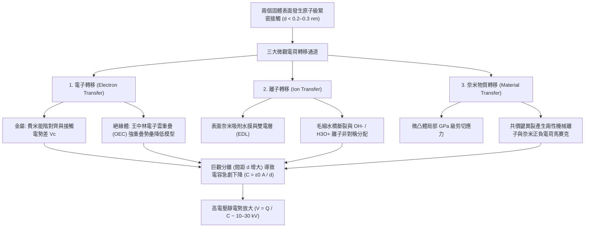
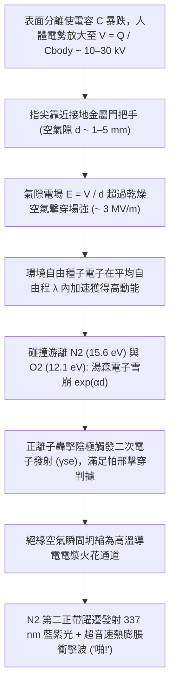

## 1. 引言：隱藏在冬日門把手上的 2600 年物理學之謎

在乾燥寒冷的冬日清晨，當你走過鋪著地毯的房間，伸手觸碰金屬門把手的瞬間——「啪！」一道藍白色的微型閃電從指尖躍出，帶來一陣尖銳的刺痛。在黑暗中脫下羊毛衫時，你會聽到劈啪作響的靜電聲並看到微弱的紫色火花；甚至在真空室中快速撕開一卷普通的透明膠帶，剝離界面處產生的摩擦發光與高能電子制動輻射竟然足以發射出能夠給手指骨骼拍片的 X 射線。所有這些日常現象都源於同一個基礎物理過程：<strong>靜電（Static Electricity）</strong>，在物理學中被稱為<strong>摩擦起電（Triboelectricity）</strong>，或更精確地稱為<strong>接觸起電（Contact Electrification, CE）</strong>。

從科學史來看，摩擦起電是人類最早觀測到的電磁現象。早在西元前 600 年左右，古希臘米利都學派哲學家泰勒斯（Thales of Miletus）就記載了用動物毛皮摩擦琥珀（希臘語為 $\eta\lambda\epsilon\kappa\tau\rho o\nu$，*ēlektron*）後，琥珀能夠吸引輕小的麥稈和羽毛。17 世紀，英國御醫威廉·吉爾伯特（William Gilbert）根據希臘語「琥珀」一詞創造了新拉丁語詞彙 *electricus*（意為「像琥珀一樣的吸引性質」），由此誕生了現代語言中的「電（Electricity）」與「電子（Electron）」。

然而，在這個連小學生都熟知的科學常識背後，卻隱藏著現代物理學最令人驚訝的秘密之一：<strong>即便在 21 世紀的今天——在馬克士威統一電磁學、量子力學徹底解開氫原子光譜、甚至人類已經探測到重力波和希格斯玻色子之後——當兩個絕緣體（電介質）表面相互接觸並分離時，電荷究竟是如何跨越界面發生轉移的微觀物理機制，依然是凝聚態物理與表面化學領域爭論最激烈的前沿課題之一。</strong>

初看起來，人們或許會想起中學教科書裡的簡單解釋：「當兩個物體相互摩擦時，電子從一個物體跳到了另一個物體上。」然而，金屬與金屬接觸時的電子轉移固然可以用具有明確費米能階（Fermi Level）的固體能帶理論完美解釋，但日常生活中最容易產生強靜電的材料——如玻璃、聚四氟乙烯（PTFE / 鐵氟龍）、尼龍、矽膠、琥珀以及人類毛髮——全部是具有寬能隙（$E_g \approx 4\text{–}9\,\text{eV}$）、室溫下幾乎不存在自由導帶電子的<strong>絕緣體（電介質）</strong>。當兩個絕緣體接觸時，跨越界面的物理載體究竟是什麼？是穿隧局域表面態或重疊原子軌域的<strong>電子（Electrons）</strong>？是在奈米級吸附水膜中發生非對稱分配的<strong>可移動離子（$\text{H}_3\text{O}^+, \text{OH}^-$）</strong>？還是共價聚合物主鏈在機械剪切應力下發生異裂而產生的<strong>奈米級帶電物質碎片（Material Fragments）</strong>？

本文將從原子尺度出發，直至行星科學與現代工業應用，全面剖析接觸起電與靜電的深層物理學。我們將探討為何「摩擦」並非起電的必要條件，解析以王中林（Zhong Lin Wang）院士提出的<strong>電子雲重疊模型（Overlapped Electron-Cloud, OEC Model）</strong>為核心的三大微觀電荷轉移機制，揭開循環摩擦起電序列悖論與沙漠雷暴、行星形成中「同種材料接觸起電」的對稱性破缺機制，嚴格推導冬季濕度效應、電容電壓放大（$V = Q/C$）與氣體放電擊穿的<strong>帕邢定律（Paschen's Law）</strong>，並展示靜電在雷射印表機、N95 駐極體熔噴布口罩以及<strong>摩擦奈米發電機（TENG）</strong>中的尖端工程應用。

---

## 2. 「摩擦」的真相：巨觀表觀接觸面積與微觀真實接觸面積

在日常語言中，我們將靜電稱為「摩擦電」（Triboelectricity，源自希臘語 *tribos*，意為「摩擦」）。然而，現代奈米表面物理學已經確鑿地證明：巨觀的滑動摩擦（Kinetic Friction）本身並不是產生電荷的先決條件。只要兩個表面發生<strong>緊密的原子級接觸並隨後分離</strong>，電荷轉移就會發生——因此科學界更傾向於使用<strong>接觸起電（Contact Electrification, CE）</strong>這一嚴格術語。

既然單純接觸就能轉移電荷，為什麼我們在生活中總要本能地把氣球在頭髮上反覆摩擦，或者用毛皮用力擦拭塑膠棒呢？答案隱藏在固體表面的奈米形貌與原子間作用力的極短程特性之中。

### 2.1 表面微凸體（Asperities）與真實接觸面積 $A_{\text{real}} \ll A_{\text{apparent}}$

在肉眼看來，一塊拋光的金屬板、一片玻璃或一層高分子薄膜似乎是平坦而光滑的。然而在原子力顯微鏡（AFM）或掃描穿隧顯微鏡（STM）下，除了雲母（Mica）或石墨烯等少數可實現原子級解理的層狀晶體外，幾乎所有固體表面都是由無數奈米至微米尺度的峰谷構成的險峻山脈。在摩擦學（Tribology）中，這些微觀山峰被稱為<strong>微凸體（Asperities）</strong>。

當兩個巨觀表觀面積為 $A_{\text{apparent}}$ 的物體在法向載荷 $F_N$ 下相互擠壓時，它們並非在整個平面上接觸，而是僅僅在雙方最高微凸體的尖端發生頂對頂的局部接觸。根據 Bowden–Tabor 黏著理論與 Greenwood–Williamson 彈性接觸力學，所有微觀接觸斑點的面積之和——即<strong>真實接觸面積（$A_{\text{real}}$）</strong>——正比於法向載荷 $F_N$ 與有效彈性模數 $E^*$（或塑性壓入硬度 $H$）之比：

$$A_{\text{real}} = \sum_{i=1}^{N} A_i \propto \frac{F_N}{E^*} \quad \left( \text{通常 } \frac{A_{\text{real}}}{A_{\text{apparent}}} \sim 10^{-5} \text{ 至 } 10^{-3} \right)$$

在普通的按壓力下，<strong>實際發生原子級接觸的面積還不到表觀面積的 $0.001\%$ 至 $0.1\%$！</strong> 界面上其餘 $99.9\%$ 以上的區域都被數十至數千奈米的空氣隙隔開，根本無法發生任何電荷轉移。

### 2.2 蘭納-瓊斯勢（Lennard-Jones Potential）與短程包立排斥區

更進一步說，要讓一個電子或離子從表面 A 的原子跨越到表面 B 的原子，兩個原子必須靠近到比范德華平衡距離更近的位置，進入<strong>$d \lesssim 0.2\text{–}0.3\,\text{nm}$</strong>（與化學鍵長度相當）的極短距離。

考察描述兩個相距 $r$ 的中性非成鍵原子交互作用能 $U_{\text{LJ}}(r)$ 的經典<strong>蘭納-瓊斯勢（Lennard-Jones Potential）</strong>：

$$U_{\text{LJ}}(r) = 4\varepsilon \left[ \left(\frac{\sigma}{r}\right)^{12} - \left(\frac{\sigma}{r}\right)^{6} \right]$$

其中 $\varepsilon$ 為勢阱深度，$\sigma$ 為勢能為零時的特徵距離，$-\left(\sigma/r\right)^6$ 項代表長程吸引的范德華力（倫敦色散力），而陡峭的 $+\left(\sigma/r\right)^{12}$ 項則代表當兩個原子的外層電子殼層（波函數）在空間上開始發生重疊時產生的<strong>短程包立不相容排斥力（Pauli Repulsion）</strong>。

正如我們在第 3 節中將看到的，電荷轉移要求外力將界面原子強行推入這一<strong>短程排斥區（$r < r_{\text{eq}}$）</strong>，使雙方的電子雲發生強烈交疊。這正是巨觀「摩擦（切向滑動）」的真正物理作用：當你將一個表面在另一個表面上滑過巨觀距離 $L$ 時，突出的微凸體像犁一樣掃過對方表面的新鮮區域，<strong>將達到原子級間距（$d \lesssim 0.3\,\text{nm}$）的累積微觀真實接觸面積 $\int A_{\text{real}}\,dt$ 放大了成百上千倍！</strong> 此外，摩擦滑動在微凸體接觸點產生的局部瞬態高溫（<strong>閃溫 Flash Temperature $\Delta T$</strong>）能夠促進熱電子激發，而局部吉帕（$\text{GPa}$）級的切應力則能引發共價鍵的機械化學斷裂。不過，利用液態金屬（如液態汞或鎵銦共晶，其與固體表面完美貼合，$A_{\text{real}} \approx A_{\text{apparent}}$）進行的實驗確鑿證明：無需任何摩擦，僅靠純粹的法向接觸與分離即可達到飽和接觸電荷密度。

---

## 3. 接觸起電的三大微觀物理機制：電子、離子與機械化學物質轉移

在接觸起電過程中，究竟是什麼粒子跨越了界面？經過半個多世紀的爭論與高解析度實驗探索，現代凝聚態物理與表面化學界已經認識到，根據材料類別（金屬、無機電介質、高分子聚合物）與環境條件的不同，<strong>三種微觀機制</strong>既可獨立主導，也可協同作用：

1. <strong>電子轉移（Electron Transfer）</strong>：由金屬中的費米能階平衡、絕緣體中的局域表面態以及<strong>王中林電子雲重疊（OEC）量子躍遷模型</strong>主導。
2. <strong>離子轉移（Ion Transfer）</strong>：由奈米級吸附水膜與毛細水橋中的可移動反離子（$\text{H}_3\text{O}^+, \text{OH}^-$）根據表面 $\text{pK}_a$、Zeta 電位與<strong>雙電層（EDL）</strong>發生的非對稱分配主導。
3. <strong>奈米級物質轉移與機械化學鍵斷裂（Material Transfer & Mechanochemistry）</strong>：由微凸體接觸點的高剪切應力引發聚合物共價鍵異裂，形成正負電荷交錯的奈米馬賽克（Charge Mosaic）。

### 3.1 電子轉移：從費米能階對齊到王中林「電子雲重疊（OEC）模型」

#### (1) 金屬-金屬接觸與伏打接觸電勢差（Contact Potential Difference）
在金屬中，自由導帶電子構成簡併費米氣體，其在能量 $E$ 和絕對溫度 $T$ 下的佔據機率服從<strong>費米-狄拉克分佈（Fermi–Dirac Distribution）</strong>：

$$f(E) = \frac{1}{\exp\left(\frac{E - E_F}{k_B T}\right) + 1}$$

其中 $E_F$ 為<strong>費米能階</strong>（電子的電化學勢），$k_B$ 為波茲曼常數。將電子從費米能階移出至表面外側真空能階 $E_{\text{vac}}$ 所需的最小能量即為金屬的<strong>功函數（Work Function）</strong> $\Phi = E_{\text{vac}} - E_F$。

當兩種功函數分別為 $\Phi_1$ 和 $\Phi_2$（設 $\Phi_1 < \Phi_2$）的不同金屬發生接觸時，熱力學平衡要求兩者的費米能階對齊（$E_{F,1} = E_{F,2}$）。電子自發地從金屬 1（費米能階較高、功函數較小）穿隧進入金屬 2（費米能階較低、功函數較大），直到界面處建立的靜電場阻止電子繼續流動，從而形成<strong>接觸電勢差（伏打電勢 Volta Potential）$V_c$</strong>：

$$V_c = -\frac{\Phi_1 - \Phi_2}{e}$$

其中 $e$ 為基本電荷。當兩金屬分離時，在穿隧截止距離 $d_0 \approx 1\,\text{nm}$ 處被凍結的轉移電荷量即為 $\Delta Q = C_0 V_c = \left(\varepsilon_0 A / d_0\right) V_c$。

#### (2) 絕緣體-絕緣體接觸：表面態與電子雲重疊（OEC）模型
然而，對於內部沒有自由電子海洋、體相能隙寬度高達 $5\text{–}9\,\text{eV}$ 的兩個絕緣體（如 PTFE 與尼龍、石英與矽膠），電子是如何轉移的？

早期學者（Duke, Fabish, Lowell & Rose）提出了<strong>表面態與陷阱態模型（Surface States Model）</strong>：雖然絕緣體內部因週期性晶格對稱性而存在寬能隙，但在表面處晶格週期性突然中斷，懸掛鍵、分子鏈末端、吸附氧原子和拓撲缺陷會在能隙中央引入局域化的電子態（<strong>表面態 Surface States</strong>），賦予絕緣體一個有效功函數 $\Phi_{\text{eff}}$。

2018 至 2020 年間，喬治亞理工學院與中國科學院北京奈米能源與系統研究所的<strong>王中林（Zhong Lin Wang）</strong>教授提出了普適的量子力學框架——<strong>電子雲重疊模型（Overlapped Electron-Cloud, OEC Model，又稱王氏躍遷模型）</strong>，從原子軌域波函數層面揭示了任意凝聚態物質間的接觸起電本質：

- <strong>接觸前（$d > 0.5\,\text{nm}$）</strong>：表面 A 的原子與表面 B 的原子各自將外層價電子束縛在孤立的深單勢阱中。兩者之間構成的<strong>非對稱雙勢阱（Asymmetric Double-Well Potential）</strong>被極高的原子間勢壘 $E_b$ 隔開，室溫下電子無法逃逸。
- <strong>緊密機械接觸期間（$d < 0.2\text{–}0.3\,\text{nm}$）</strong>：當外部機械壓力迫使兩個表面原子進入蘭納-瓊斯勢的短程排斥區（間距小於常規化學鍵長）時，雙方最外層的電子雲（原子或分子軌域波函數 $\psi_A$ 與 $\psi_B$）在實空間發生<strong>強烈重疊（$\langle \psi_A | \psi_B \rangle \neq 0$）</strong>。這種強軌域重疊顯著壓低了兩個原子之間的勢壘高度 $E_b$，將原本高勢壘的雙勢阱轉變為<strong>低勢壘雙勢阱或非對稱單勢阱</strong>。
- <strong>量子躍遷與分離捕獲</strong>：隨著界面勢壘因電子雲重疊而大幅降低，原子 A 上佔據高能量表面軌域的弱束縛電子便自發地（透過量子穿隧或熱激活躍遷）轉移到原子 B 的低能量未佔據軌域中。一旦外力撤除、兩表面分離（$d \to \infty$），原子間勢壘 $E_b$ 瞬間恢復高聳狀態，轉移過去的電子便被永久鎖死在表面 B 的深勢阱中！

#### (3) 熱電子發射衰減的實驗鐵證
為了證明固體-固體接觸起電的主導載體是電子而非笨重的離子，王中林團隊研究了不同電介質表面（$\text{SiO}_2, \text{Al}_2\text{O}_3, \text{Si}_3\text{N}_4$ 及耐高溫聚合物）在高溫（$350\text{–}650\,\text{K}$）下的表面電荷衰減動力學。他們發現，接觸電荷的熱衰減嚴格遵循金屬物理中的<strong>理查森-杜什曼熱電子發射定律（Richardson–Dushman Thermionic Emission Law）</strong>：

$$J_{\text{th}} = A^* T^2 \exp\left(-\frac{\Phi_B}{k_B T}\right)$$

其中 $J_{\text{th}}$ 為熱電子發射電流密度，$A^*$ 為有效理查森常數，$\Phi_B$ 為束縛電子的表面勢壘高度。由於離子和聚合物碎片不可能透過理查森熱電子發射規律蒸發到真空中，這一系列實驗為<strong>電子雲重疊驅動的電子轉移是固-固接觸起電的首要機制</strong>提供了直接光譜學證據。

### 3.2 離子轉移：表面吸附水膜與雙電層（EDL）分配

當親水性表面或含離子聚合物在環境濕度下接觸時，哈佛大學的<strong>喬治·懷特塞茲（George M. Whitesides）</strong>教授團隊（McCarty & Whitesides, 2008）證明了<strong>可移動離子轉移</strong>同樣扮演著重要甚至主導角色。

在大氣環境中，幾乎所有固體表面都覆蓋著一層厚度為 $0.5\text{–}5\,\text{nm}$（約 2 至 15 個水分子單層）的<strong>奈米吸附水膜</strong>。由於水的自偶電離（$2\text{H}_2\text{O} \rightleftharpoons \text{H}_3\text{O}^+ + \text{OH}^-$）、溶解的二氧化碳（形成 $\text{HCO}_3^-$）以及固體表面官能基的解離：
1. <strong>表面 $\text{pK}_a$ 與雙電層（EDL）</strong>：玻璃（$\text{SiO}_2$）表面的矽醇基（$-\text{Si–OH}$）在水中去質子化形成固定負電荷（$-\text{Si–O}^-$）和可移動的 $\text{H}_3\text{O}^+$ 反離子雲；而含胺基表面（如尼龍）則質子化形成固定正電荷（$-\text{NH}_3^+$）和可移動的 $\text{OH}^-$ 反離子雲。
2. <strong>疏水界面的氫氧根（$\text{OH}^-$）優先吸附</strong>：即便是化學惰性的疏水聚合物（如 PTFE、聚乙烯），在水界面處也會因不對稱氫鍵網路而優先吸附 <strong>$\text{OH}^-$ 離子</strong>，表現出負的 Zeta 電位（$\zeta < 0$）。
3. <strong>毛細水橋合併與斷裂</strong>：當兩表面接觸時，各自的吸附水膜合併為奈米級<strong>毛細水橋（Meniscus）</strong>；可移動的 $\text{H}_3\text{O}^+$ 與 $\text{OH}^-$ 在表面 $\text{pK}_a$ 差、介電常數 $\varepsilon_r$ 鏡像力與電化學勢梯度驅動下發生跨界面擴散。當兩表面分離、水橋拉斷時，正負離子便被非對稱地留在兩個表面上。

### 3.3 奈米物質轉移與機械化學：正負電荷馬賽克（Charge Mosaics）

2011 年，西北大學的<strong>巴托什·格日博夫斯基（Bartosz A. Grzybowski）</strong>團隊（Baytekin et al., *Science* 2011）利用奈米級解析度的<strong>開爾文探針力顯微鏡（KPFM）</strong>掃描接觸後的聚合物表面，推翻了靜電學延續百年的假設：接觸起電後的絕緣體表面<strong>絕非均勻帶正電或均勻帶負電</strong>，而是由無數直徑 $10\text{–}200\,\text{nm}$、<strong>正（$+$）負（$-$）電荷微區交錯排列構成的「奈米電荷馬賽克（Charge Mosaic）」</strong>！巨觀法拉第筒測得的「尼龍帶正電、PTFE 帶負電」，僅僅是數十億個正負奈米疇相互抵消後的微弱算術淨餘量。

這種雙極性馬賽克源於微凸體接觸點的高應力（$\sim \text{GPa}$）引發的<strong>機械化學共價鍵斷裂（Mechanochemical Bond Scission）</strong>：聚合物主鏈（$\text{C–C}, \text{Si–O}$ 鍵）在剝離時發生均裂（產生可透過電子自旋共振 ESR 檢測的自由基 $\text{R}^\bullet$）與異裂（產生正負機械離子 $\text{R}_1^+ + \text{R}_2^-$），並伴隨奈米級低聚物碎片在兩表面間的雙向黏著轉移。

### 3.4 三大接觸起電微觀機制綜合對比

| 物理特徵 / 維度 | 1. 電子轉移 (Electron Transfer) | 2. 離子轉移 (Ion Transfer) | 3. 奈米物質轉移與機械化學 |
| :--- | :--- | :--- | :--- |
| <strong>主要電荷載體</strong> | 電子（$e^-$） | 可移動離子（$\text{H}_3\text{O}^+, \text{OH}^-$，反離子） | 帶電低聚物分子碎片與機械離子（$\text{R}^+, \text{R}^-$） |
| <strong>核心理論模型</strong> | 費米能階對齊、表面態、<strong>王中林電子雲重疊（OEC）模型</strong> | 奈米吸附水膜、<strong>雙電層（EDL）</strong>、表面 $\text{pK}_a$ 與 $\zeta$ 電位 | <strong>機械化學共價鍵斷裂</strong>（異裂/均裂）、黏著磨損 |
| <strong>特徵空間尺度</strong> | 原子間短程包立排斥區（$d \lesssim 0.2\text{–}0.3\,\text{nm}$） | 吸附水膜與毛細水橋厚度（$0.5\text{–}10\,\text{nm}$） | 奈米雙極性電荷馬賽克疇（$10\text{–}500\,\text{nm}$） |
| <strong>環境與溫度依賴性</strong> | 在超高真空（UHV）與極低溫下依然強烈發生；高溫下遵循熱電子發射衰減 | 強烈依賴環境相對濕度（$RH$）；高真空下受抑制（本徵離子聚合物除外） | 強烈依賴接觸應力、剪切速度、分子量與交聯密度 |
| <strong>關鍵實驗證據</strong> | 功函數相關性、Richardson–Dushman 熱衰減、紫外光致發射 | 濕度/pH 敏感性、聚電解質抗衡離子反轉實驗 | KPFM 正負電荷馬賽克、XPS 元素轉移、ESR 自由基訊號 |

---

## 4. 摩擦起電序列（Triboelectric Series）及其兩大物理悖論

### 4.1 摩擦起電序列的化學與量子起源

1757 年由瑞典物理學家威爾克（Johan Carl Wilcke）首次彙編、並於 2019 年由王中林團隊利用液態汞參比電極標準化的<strong>摩擦起電序列（Triboelectric Series）</strong>，按照材料接觸時失去電子帶<strong>正電（$+$）</strong>到捕獲電子帶<strong>負電（$-$）</strong>的傾向進行排列：

| 極性傾向 | 代表性材料 | 主導官能基與化學鍵 | 歸一化電荷密度 $\sigma_N$ ($\mu\text{C/m}^2$) | 電子結構與化學機制 |
| :---: | :--- | :--- | :---: | :--- |
| <strong>極強正電性 ($+++$)</strong> | 石英 / 玻璃 ($\text{SiO}_2$)、白雲母 | 矽醇基 ($-\text{Si–OH}$)、矽氧四面體網路 | $+80 \text{ 至 } +110$ | 氧原子高能孤對電子與高佔據表面態極易給出電子（路易斯鹼性） |
| <strong>強正電性 ($++$)</strong> | 尼龍-6,6 (聚醯胺)、人類皮膚與毛髮、羊毛 | 醯胺鍵 ($-\text{NH–CO}-$)、胺基 ($-\text{NH}_2$)、角蛋白 | $+50 \text{ 至 } +85$ | 氮/氧孤對電子強給電子能力；解釋了冬季羊毛衫與皮膚/頭髮的強靜電 |
| <strong>弱正電性 ($+$)</strong> | 鋁 (Al)、紙張 (纖維素)、棉布、木材 | 自然氧化膜 ($\text{Al}_2\text{O}_3$)、多羥基 ($-\text{OH}$) 生物大分子 | $+10 \text{ 至 } +40$ | 溫和給電子傾向與羥基質子解離 |
| <strong>中性 / 中間態 ($0$)</strong> | 鋼鐵、PMMA (壓克力)、聚碳酸酯 (PC) | 金屬費米海、酯基 ($-\text{COOCH}_3$) 與碳酸酯基 | $-10 \text{ 至 } +10$ | 兩性行為：對 PTFE 帶正電，對尼龍帶負電 |
| <strong>中度負電性 ($-$)</strong> | 聚苯乙烯 (PS)、聚乙烯 (PE)、聚丙烯 (PP) | 飽和碳氫主鏈 ($-\text{CH}_2-\text{CH}_2-$)、苯環 | $-30 \text{ 至 } -60$ | 非極性疏水表面；缺陷態捕獲電子並在水膜中優先吸附 $\text{OH}^-$ |
| <strong>強負電性 ($--$)</strong> | 聚氯乙烯 (PVC)、PDMS (矽膠)、Kapton (聚醯亞胺) | 碳氯鍵 ($-\text{C–Cl}$)、矽氧主鏈、醯亞胺環 | $-70 \text{ 至 } -110$ | 高電負度氯原子 ($\chi = 3.16$) 與吸電子醯亞胺環穩定負電荷 |
| <strong>極強負電性 ($---$)</strong> | <strong>PTFE (鐵氟龍)</strong>、FEP、PVDF | 全氟碳鏈 ($-(\text{CF}_2-\text{CF}_2)_n-$)、致密 $\text{C–F}$ 鞘層 | $-110 \text{ 至 } -150$ | <strong>氟具有元素週期表最高的鮑林電負度 ($\chi = 3.98$)</strong>；深能階未佔據軌域強力捕獲電子 |

為什麼<strong>聚四氟乙烯（PTFE）</strong>穩居負電端之首，而<strong>尼龍與玻璃</strong>位於正電端之巔？從密度泛函理論（DFT）與前線分子軌域理論來看，PTFE 的碳主鏈被電負度極高的氟原子（$\chi = 3.98$）螺旋鞘層緊密包裹，強吸電子的 $\text{C–F}$ 鍵形成了深能階的低未佔據表面軌域（低 LUMO / 高電子親和力），成為電子的不可逆陷阱；相反，尼龍的醯胺基（$-\text{CONH}-$）和玻璃的矽醇氧原子擁有高能量的孤對電子軌域（高 HOMO / 低游離能），在電子雲重疊時極易給出電子。

### 4.2 悖論一：傳遞性破缺與「剪刀石頭布」式的循環摩擦起電序列（$A > B > C > A$）

如果接觸起電僅由單一純量屬性（如有效功函數 $\Phi_{\text{eff}}$，$\Delta q \propto \Phi_{\text{eff},B} - \Phi_{\text{eff},A}$）決定，那麼摩擦序列必然嚴格滿足數學上的<strong>傳遞性（Transitivity）</strong>：若 $A$ 對 $B$ 帶正電（$A > B$），且 $B$ 對 $C$ 帶正電（$B > C$），則 $A$ 對 $C$ 必定帶正電（$A > C$）。然而實驗卻多次觀測到違背傳遞性的<strong>循環摩擦起電三元組（$A > B > C > A$）</strong>！這是因為真實絕緣體的接觸起電並非一維純量比較，而是耦合了<strong>電子表面態密度、離子 $\text{pK}_a$ 分配、彈性模數不對稱性（$E_A \neq E_B$）引起的應變梯度以及非對稱機械磨損</strong>的多維向量過程。

### 4.3 悖論二：同種材料接觸起電——從沙漠雷暴、火山閃電到行星誕生

更令人稱奇的是<strong>同種材料接觸起電（Same-Material Contact Electrification）</strong>：當兩塊化學成分完全相同的二氧化矽、PMMA 或尼龍相互摩擦或碰撞時，依然會產生顯著的正負電荷分離！其對稱性破缺源於兩大物理機制：

1. <strong>幾何應變不對稱與撓曲電效應（Flexoelectricity）</strong>：在任何電介質固體中，非均勻的<strong>應變梯度（$\frac{\partial \varepsilon_{jk}}{\partial x_l}$）</strong>會打破局域反演對稱性，透過<strong>撓曲電效應</strong>誘導電極化 $P_i = \mu_{ijkl} \frac{\partial \varepsilon_{jk}}{\partial x_l}$，使受拉區與受壓區的局域能帶邊緣發生偏移，驅動電荷定向轉移。
2. <strong>粒徑依賴的雙極性起電（小顆粒帶負電、大顆粒帶正電）</strong>：在多分散顆粒碰撞中（Lacks, Kok, Waitukaitis 模型），小顆粒（半徑 $R_S$）與大顆粒（$R_L \gg R_S$）經歷不對稱的碰撞面積暴露率與赫茲接觸應力，導致高能陷落電子淨遷移至小顆粒上，呈現出<strong>「小顆粒系統性帶負電（$-$）、大顆粒帶正電（$+$）」</strong>的普適規律。在重力沉降與上升氣流作用下，輕小的負電微粒被吹向高空，沉重的正電大顆粒沉降到底部，建立起高達兆伏每公尺（$\text{MV/m}$）的巨型大氣靜電場：
   - <strong>沙漠沙塵暴閃電與火山灰閃電（「髒雷暴」）</strong>：在毫無雨水和冰晶的撒哈拉沙塵暴或火山噴發羽流（如冰島艾雅法拉火山、日本櫻島火山）中，二氧化矽沙粒與火山灰的同種材料粒徑分選起電直接引爆了壯觀的閃電風暴。
   - <strong>天體物理行星形成的「公尺級壁壘（Meter-Size Barrier）」突破</strong>：在年輕恆星周圍的原行星盤中，微米級宇宙塵埃聚集成毫米至公分級矽酸鹽「卵石」後，范德華黏著力不足以阻止碰撞反彈。2020 年 Steinpilz 與 Wurm 團隊在《Nature Physics》發表的微重力落塔實驗證明，正是矽酸鹽顆粒碰撞產生的<strong>同種材料靜電引力</strong>克服了彈跳壁壘，將星際塵埃黏合成星子（Planetesimals），最終孕育出地球等岩質行星！

---

## 5. 為什麼冬天靜電最猛烈？濕度指數律、電容放大與帕邢放電定律

### 5.1 冬季靜電之謎：BET 吸附等溫線與表面電導率的指數暴跌

冬季乾燥空氣並不會「憑空製造更多電荷」，真正決定靜電強弱的是<strong>電荷洩漏（耗散）速率</strong>。固體表面物理吸附的水分子層數 $\theta_{\text{BET}}$ 遵循<strong>Brunauer–Emmett–Teller (BET) 吸附等溫線</strong>：

$$\theta_{\text{BET}}(RH) = \frac{v}{v_m} = \frac{c \cdot RH}{(1 - RH)\left[1 + (c - 1)RH\right]}$$

- <strong>冬季室內（相對濕度 $RH < 20\text{–}30\%$）</strong>：$\theta_{\text{BET}} < 1$，水分子僅在表面形成孤立、不連通的微島，聚合物與地毯的表面電阻率高達 $10^{15}\text{–}10^{18}\,\Omega/\text{sq}$，電荷可被困數小時。
- <strong>夏季潮濕環境（$RH > 60\text{–}70\%$）</strong>：$\theta_{\text{BET}}$ 達到 $2\text{–}5$ 個分子層，形成連續貫通的氫鍵液態水膜網路。質子（$\text{H}^+$）透過<strong>格羅特斯機制（Grotthuss Mechanism，質子跳躍導電）</strong>在水分子鏈間高速傳遞，使絕緣體表面電導率 $\sigma_s(RH)$ 隨相對濕度呈<strong>指數級暴漲（跨越 6 至 10 個數量級）</strong>：

$$\sigma_s(RH) \approx \sigma_0 \exp(\alpha_{\text{RH}} \cdot RH)$$

因此，夏季行走產生的電荷在毫秒級的 RC 弛豫時間（$\tau = RC \propto \varepsilon/\sigma_s$）內便洩漏入地；而在冬季，每走一步的電荷都在絕緣人體上不斷累加。

### 5.2 分離瞬間的電容電壓放大：$V = Q / C$ 如何產生 $30,000\,\text{V}$ 高壓？

當鞋底與地毯緊密接觸時（$d_0 \approx 1\,\text{nm}$），界面電容 $C_0 = \varepsilon_0 A / d_0$ 極大，即便電荷密度達 $\sigma = 50\,\mu\text{C/m}^2$，界面電壓也僅有 $V_0 = \sigma d_0 / \varepsilon_0 \approx 5.6\,\text{V}$。然而當你抬起腳或脫下毛衣，間距 $d$ 從 $1\,\text{nm}$ 拉大到 $10\,\text{cm}$（增大 $10^8$ 倍），總電容迅速跌落至人體對地的自電容（$C_{\text{body}} \approx 100\text{–}200\,\text{pF}$）。由於電荷 $Q$ 守恆，根據 $V = Q / C$：

$$V(d) = \frac{Q}{C(d)} = \frac{Q \cdot d}{\varepsilon_0 A}$$

<strong>正是分離過程中肌肉克服庫侖引力所做的機械功（$U_E = \int F_C\,dx = \frac{1}{2}CV^2$），將幾伏特的界面電勢瞬間放大成了 $10,000\text{–}30,000\,\text{V}$（$10\text{–}30\,\text{kV}$）的靜電高壓！</strong>

為什麼 $20,000\,\text{V}$ 的門把手電擊不會致人死亡？因為人體電容極小（取標準人體模型 HBM：$C_{\text{body}} = 150\,\text{pF}$），總電荷量僅 $Q = CV = 3.0\,\mu\text{C}$，總儲能僅 $U_E = \frac{1}{2} C_{\text{body}} V^2 = 30\,\text{mJ}$（$0.03\,\text{J}$），且放電時間常數僅 $\tau = R_{\text{HBM}}C_{\text{HBM}} \approx 150\,\text{ns}$，遠不足以引起心臟室顫。然而對於閘極氧化層僅 $1\text{–}3\,\text{nm}$ 厚（擊穿電壓 $<5\,\text{V}$）的現代奈米 CMOS 晶片而言，這一微小的靜電放電（ESD）脈衝足以將其瞬間燒毀。

### 5.3 湯森電子雪崩與氣體擊穿的帕邢定律（Paschen's Law）

當帶電指尖（$V \sim 15\,\text{kV}$）靠近門把手至 $d \sim 3\text{–}5\,\text{mm}$ 時，空氣隙電場 $E = V/d$ 超過臨界值，觸發指數級的<strong>湯森電子雪崩（Townsend Electron Avalanche）</strong>。宇宙射線產生的自由種子電子在平均自由程 $\lambda \propto 1/p$ 內加速並碰撞游離氮氣（$15.6\,\text{eV}$）和氧氣（$12.1\,\text{eV}$），第一湯森游離係數為 $\alpha = A p \exp(-Bp/E)$。結合正離子轟擊陰極產生的二次電子發射係數 $\gamma_{\text{se}}$，由擊穿判據 $\gamma_{\text{se}}(e^{\alpha d} - 1) = 1$ 可導出著名的<strong>帕邢定律（Paschen's Law, 1889）</strong>：

$$V_B(p d) = \frac{B \cdot p d}{\ln(A \cdot p d) - \ln\left[\ln\left(1 + \frac{1}{\gamma_{\text{se}}}\right)\right]}$$

帕邢定律揭示了靜電火花的三大核心特徵：
1. <strong>常壓空氣巨觀擊穿場強 $E_{\text{crit}} \approx 3 \times 10^6\,\text{V/m} = 3\,\text{kV/mm}$</strong>：帶電 $12\,\text{kV}$ 的手指在距離門把手約 $4\,\text{mm}$ 時即發生火花跳火。
2. <strong>帕邢極小值（Paschen Minimum，$V_{\text{min}} \approx 327\,\text{V}$ at $pd \approx 7.5\,\mu\text{m}\cdot\text{atm}$）</strong>：當間隙小於電子平均自由程（常壓下 $d < 7.5\,\mu\text{m}$）時，電子無需碰撞即可飛越間隙，因此常壓空氣中低於約 $327\,\text{V}$ 的電壓永遠不會產生氣體雪崩火花。
3. <strong>藍光與「啪」聲的起源</strong>：電漿通道中被激發的氮氣分子（$\text{N}_2$ 第二正帶系 $C^3\Pi_u \to B^3\Pi_g$）輻射出主峰位於 $\lambda = 337.1\,\text{nm}$ 的近紫外與藍紫光；同時通道在數十奈秒內被焦耳熱升溫至數千克耳文，引發超音速熱膨脹——這就是我們聽到的微型雷鳴（「啪！」）。

---

## 6. 從冬日煩惱到核心科技：雷射列印、N95 駐極體口罩與摩擦奈米發電機（TENG）

1. <strong>靜電複印與雷射列印（Xerography）、靜電除塵（ESP）與粉末塗裝</strong>：切斯特·卡爾森（Chester Carlson）發明的雷射列印技術依靠聚合物碳粉顆粒（Toner）的精準摩擦起電（荷質比 $Q/M \approx -20\text{ 至 }-40\,\mu\text{C/g}$）吸附到感光鼓的靜電潛影上；工業科特雷爾靜電除塵器（ESP）利用電暈放電捕獲燃煤電廠 $>99.9\%$ 的 $\text{PM}_{2.5}$ 粉塵；汽車靜電粉末噴塗則利用庫侖力實現背面自動包覆（Wrap-around Effect）。
2. <strong>N95 醫療口罩中的熔噴聚丙烯駐極體（Electret）濾材</strong>：N95 口罩之所以能保持 $10\text{–}30\,\mu\text{m}$ 的寬透氣孔隙以保證呼吸順暢，同時又能攔截 $>95\%$ 直徑僅 $0.1\text{–}0.3\,\mu\text{m}$ 的病毒氣溶膠，靠的正是經過電暈或水駐極處理的<strong>聚丙烯駐極體（Electret）</strong>微纖維。駐極體內部的半永久空間電荷在纖維周圍建立起 $\sim 10^6\,\text{V/m}$ 的強局部靜電場，不僅透過庫侖力 $\mathbf{F}_e = q\mathbf{E}$ 捕獲帶電微粒，更能透過非均勻場梯度對完全中性的病毒飛沫產生<strong>介電泳極化引力（Dielectrophoretic Force）</strong>：

$$\mathbf{F}_{\text{DEP}} = 2\pi r_p^3 \varepsilon_0 \left(\frac{\varepsilon_p - \varepsilon_0}{\varepsilon_p + 2\varepsilon_0}\right) \nabla |\mathbf{E}|^2$$

3. <strong>摩擦奈米發電機（TENG）與馬克士威位移電流的拓展</strong>：2012 年，王中林教授發明了<strong>摩擦奈米發電機（Triboelectric Nanogenerator, TENG）</strong>，利用接觸起電與靜電感應的耦合將低頻機械能轉化為電能。2017 年，王中林將<strong>馬克士威位移電流（$\mathbf{J}_D$）</strong>拓展為包含機械運動表面靜電荷誘導的極化密度項 $\mathbf{P}_s$：

$$\mathbf{J}_D = \frac{\partial \mathbf{D}}{\partial t} = \varepsilon_0 \frac{\partial \mathbf{E}}{\partial t} + \frac{\partial \mathbf{P}_s}{\partial t}$$

第一項 $\varepsilon_0 \frac{\partial \mathbf{E}}{\partial t}$ 預言了電磁波並奠定了無線通訊基礎；而第二項 $\frac{\partial \mathbf{P}_s}{\partial t}$ 則成為機械能轉化為電能的奈米發電機理論基石，使人類能夠高效收集人體步態、心跳脈搏、微風振動、雨滴撞擊乃至海洋波浪的「藍色能源（Blue Energy）」。下次當冬日門把手在指尖綻放出藍色電火花時，不妨駐足讚嘆這一跨越奈米電子雲重疊與巨觀電漿雪崩的壯麗物理交響曲。
