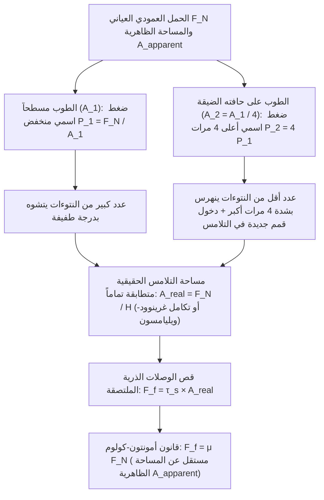
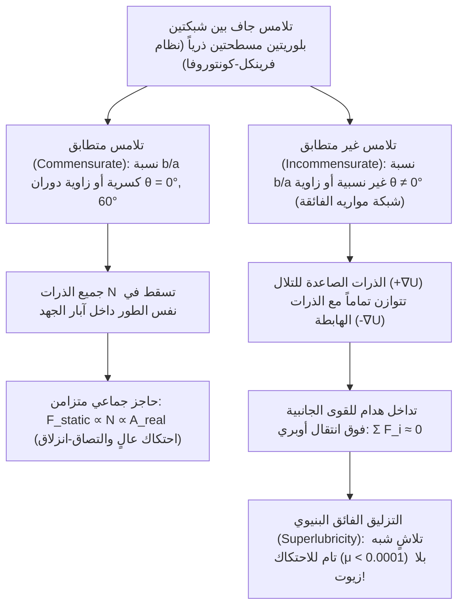

قلّما نجد في الفيزياء الكلاسيكية معادلة تبدو في ظاهرها بهذه البساطة، بينما تُخفي وراءها مفارقة فيزيائية عميقة، مثل قانون الاحتكاك الجاف:

$$F_f = \mu F_N$$

لنتخيل قالب طوب مستطيلاً موضوعاً على طاولة أفقية. إذا سحبناه أفقياً بميزان نابضي وهو مستلقٍ على وجهه العريض (المساحة الظاهرية $A_1 = 200\,\text{cm}^2$)، ثم أعدنا التجربة بعد إقامته على حافته الضيقة ($A_2 = 50\,\text{cm}^2$)، فإن الحدس اليومي يوحي بأن الوجه الأكبر بأربعة أضعاف سيولّد مقاومة احتكاك أكبر بكثير. غير أن التجربة تُثبت أن <strong>قوة الاحتكاك $F_f$ تظل متطابقة تماماً رغم تغير المساحة الهندسية أربعة أضعاف!</strong> وفي المقابل، إذا كان الاحتكاك لا يعتمد حقاً على المساحة، فلماذا تستخدم سيارات الفورمولا 1 إطارات ملساء (Slick Tires) فائقة العرض؟

وتتعلق المفارقة الثانية بالسؤال الشهير: لماذا ينزلق الجليد؟ لقد ردّدت الكتب المدرسية طويلاً أن المتزلج ينزلق لأن الضغط العالي تحت شفرة الحذاء يخفض درجة انصهار الجليد ويصنع غشاءً مائياً. لكن الحساب الدقيق باستخدام <strong>معادلة كلاوزيوس-كلابيرون (Clausius–Clapeyron Equation)</strong> يكشف أن متزلجاً وزنه $75\,\text{kg}$ لا يخفض نقطة انصهار الجليد إلا بمقدار $0.12^\circ\text{C}$ فقط — وهو ما يعجز تماماً عن تفسير التزلج عند $-10^\circ\text{C}$ أو $-20^\circ\text{C}$!

في هذا المقال نستكشف <strong>علم الترايبولوجي (Tribology — علم الاحتكاك والتآكل والتزليق)</strong> عبر فيزياء الأسطح النانوية: من الفرق الجوهري بين <strong>مساحة التلامس الظاهرية ($A_{\text{apparent}}$)</strong> و<strong>مساحة التلامس الحقيقية ($A_{\text{real}}$)</strong>، إلى ديناميكيات <strong>الالتصاق والانزلاق (Stick-Slip)</strong>، و<strong>الطبقة شبه السائلة (QLL)</strong> على سطح الجليد، وصولاً إلى <strong>التزليق الفائق البنيوي (Structural Superlubricity)</strong>.

---

## 1. اللغز الكلاسيكي: قوانين أمونتون-كولوم وفشل نموذج التشابك الهندسي

### 1.1 من ليوناردو دا فينشي (1493) إلى أمونتون (1699) وكولوم (1785)

حوالي عام 1493، سجّل <strong>ليوناردو دا فينشي</strong> في دفاتره (*مخطوطة أروندل*) أن قوة الاحتكاك تتناسب طردياً مع الحمل العمودي ولا تعتمد على مساحة التلامس. وبعد إعادة اكتشافها على يد <strong>غيوم أمونتون (1699)</strong>، وصياغتها رياضياً بواسطة <strong>ليونهارت أويلر (1748)</strong> بالرمز $\mu = \tan\theta_c$، وترسيخها تجريبياً على يد <strong>شارل أوغستان دي كولوم (1785)</strong>، اكتملت <strong>القوانين الكلاسيكية الثلاثة للاحتكاك الجاف</strong>:

$$\begin{aligned}
\text{القانون الأول (التناسب مع القوة العمودية):} & \quad F_f = \mu F_N \\
\text{القانون الثاني (الاستقلال عن المساحة الظاهرية):} & \quad \frac{\partial F_f}{\partial A_{\text{apparent}}} = 0 \\
\text{القانون الثالث (الاستقلال عن سرعة الانزلاق):} & \quad \frac{\partial F_k}{\partial v} \approx 0 \quad (\text{مع } F_k = \mu_k F_N < F_s^{\max} = \mu_s F_N)
\end{aligned}$$

إن نموذج الأسنان الصلبة المتشابكة ذات الميل $\tan\theta$ ($F_f = F_N \tan\theta$) يناقض القانون الأول للديناميكا الحرارية (حفظ الطاقة): فعلى منحدر صلب أو مرن تماماً، الشغل المبذول لرفع الجسم إلى قمة النتوء $W_{\text{up}} = F_N \Delta h$ <strong>يُسترد بالكامل ($W_{\text{down}} = -F_N \Delta h$) عند الهبوط من الجانب الآخر</strong> ($\oint \mathbf{F}\cdot d\mathbf{r} = 0$). لذا يتطلب الاحتكاك الحقيقي تشوهاً غير عكوس وتبديداً للطاقة على هيئة اهتزازات شبكية بلورية (<strong>فونونات Phonons</strong>).

---

## 2. مساحة التلامس الظاهرية مقابل الحقيقية: كيف تحل النتوءات المجهرية (Asperities) مفارقة الطوب

### 2.1 «وضع سويسرا مقلوبةً فوق النمسا»: نظرية الالتصاق اللدن لبودن وتابور (1950)

كما أوضح عالما الفيزياء في كامبريدج <strong>فرانك فيليب بودن</strong> و<strong>ديفيد تابور</strong> (1950)، فإن سطح الفولاذ المصقول كالمرآة يُظهر تحت مجهر القوة الذرية (AFM) خشونة قدرها $R_q \sim 10\,\text{nm}\text{–}1\,\mu\text{m}$، أي أكبر بألف مرة من مدى الروابط الذرية ($0.2\text{–}0.4\,\text{nm}$). وبحسب تشبيه بودن الشهير: <strong>«إن وضع جسمين صلبين أحدهما فوق الآخر يشبه قلب سويسرا رأساً على عقب ووضعها فوق النمسا؛ فلن يتلامسا إلا عند أعلى قمم جبال الألب».</strong>

تُسمى هذه القمم المجهرية <strong>النتوءات الدقيقة (Asperities)</strong>. ومجموع مساحات التلامس الذري الفعلي عند رؤوس هذه النتوءات هو <strong>مساحة التلامس الحقيقية ($A_{\text{real}}$)</strong>، وهي جزء ضئيل جداً من <strong>مساحة التلامس الظاهرية ($A_{\text{apparent}}$)</strong>:

$$A_{\text{real}} = \sum_{i=1}^{N_c} A_i \ll A_{\text{apparent}}, \qquad \frac{A_{\text{real}}}{A_{\text{apparent}}} \sim 10^{-5} \text{ – } 10^{-3}$$

ونظراً لتركز كامل القوة العمودية $F_N$ في $A_{\text{real}}$، يصل الضغط الموضعي $p_{\text{local}} = F_N / A_{\text{real}}$ فوراً إلى <strong>صلادة الخضوع اللدن للمادة $H \approx 3\sigma_y$</strong>. فتنهرس رؤوس النتوءات لدناً حتى تتسع المساحة الحقيقية بالقدر الكافي لحمل القوة $F_N$:

$$p_{\text{local}} = H \implies A_{\text{real}} = \frac{F_N}{H}$$

وعند نقاط التلامس الذري هذه تتشكل <strong>وصلات التصاق مجهرية (لحام بارد)</strong> ذات مقاومة قص $\tau_s$. ولكي ينزلق الجسم لا بد من قص هذه الوصلات:

$$F_f = \tau_s A_{\text{real}} = \tau_s \left(\frac{F_N}{H}\right) = \left(\frac{\tau_s}{H}\right) F_N \implies \mu = \frac{\tau_s}{H}$$

وهكذا تُحل مفارقة الطوب: <strong>إن قوة الاحتكاك تتناسب طردياً وبصرامة مع مساحة التلامس الحقيقية $A_{\text{real}}$!</strong> فعند إقامة الطوب على حافته الضيقة يتضاعف الضغط الاسمي أربع مرات، فتنهرس النتوءات أربع مرات أكثر، مما يحفظ المساحة الحقيقية الكلية $A_{\text{real}} = F_N / H$ ثابتة تماماً!

### 2.2 الميكانيكا الإحصائية المرنة لغرينوود-ويليامسون (1966) وحالات انهيار قانون أمونتون

لكرة مرنة واحدة نصف قطرها $R$، تعطي <strong>نظرية هيرتز (1882)</strong> العلاقة $A_{\text{single}} \propto w^{2/3}$. غير أن <strong>غرينوود وويليامسون (1966)</strong> أثبتا أنه عند التكامل على التوزيع الاحتمالي لارتفاعات القمم $\phi(z) = \frac{1}{\sigma_s} e^{-z/\sigma_s}$، فإن دخول نتوءات جديدة باستمرار في التلامس يبقي متوسط مساحة البقعة الواحدة ثابتاً ($\pi R \sigma_s$) بينما يزداد عدد البقع خطياً مع $F_N$:

$$A_{\text{real}} = \frac{\sqrt{\pi}}{E^* \sqrt{\sigma_s / R}} F_N \propto F_N$$

<strong>متى ينهار قانون أمونتون؟</strong> عندما تقترب المساحة الحقيقية من الظاهرية ($A_{\text{real}} \to A_{\text{apparent}}$):
1. <strong>المطاط اللزج مرن وإطارات الفورمولا 1 الملساء (نظرية JKR، 1971)</strong>: بفضل معامل يونغ المنخفض جداً ($E \sim 1\text{–}10\,\text{MPa}$) وطاقة الالتصاق $\Delta\gamma$ وفق معادلة <strong>جونسون-كيندال-روبرتس (JKR)</strong> $a_{\text{JKR}}^3 = \frac{3R}{4E^*}(w + 3\pi R \Delta\gamma + \sqrt{6\pi R \Delta\gamma w + (3\pi R \Delta\gamma)^2})$، ينخفض معامل الاحتكاك الفعال مع زيادة الضغط الاسمي ($\mu_{\text{eff}} \propto P_{\text{nom}}^{-1/3}$). لذلك تُصنع إطارات السباق عريضة لتعظيم $A_{\text{apparent}}$ وخفض الضغط وزيادة التماسك.
2. <strong>أقدام الوزغ (Gecko Setae & Spatulae)</strong>: ملايين الشعيرات الكيراتينية المتفرعة إلى ملاعق نانوية بعرض $100\text{–}200\,\text{nm}$ تخفض المعامل الفعال دون معيار دالكويست ($E_{\text{eff}} < 100\,\text{kPa}$)، محققةً $A_{\text{real}} \approx A_{\text{apparent}}$ بقوى فان دير فالس.
3. <strong>اللحام البارد في الفراغ الفضائي الفائق</strong>: في غياب طبقة الأكسيد الواقية ($1\text{–}5\,\text{nm}$)، تلتحم المعادن النقية فوراً في الفضاء ($\mu \to \infty$، وهو سبب تعطل هوائي مركبة *غاليليو* الفضائية عام 1991).

---

## 3. ديناميكيات الالتصاق والانزلاق (Stick-Slip) وقانون ديترش-روينا: من الكمان إلى الزلازل

كتلة $m$ تُسحب بسرعة $v_0$ عبر نابض صلابته $k$ تخضع للمعادلة $m \ddot{x} = k(v_0 t - x) - F_f(\dot{x}, \theta)$. بعد طور الالتصاق (Stick) لمدة $t_{\text{stick}} = \frac{(\mu_s - \mu_k)F_N}{k v_0}$، تنطلق الكتلة في طور الانزلاق السريع (Slip) بتردد طبيعي $\omega_0 = \sqrt{k/m}$:

$$x(t') = v_0 t' + \frac{(\mu_s - \mu_k)F_N}{k}(1 - \cos\omega_0 t') - \frac{v_0}{\omega_0}\sin\omega_0 t'$$

لماذا يكون $\mu_s > \mu_k$؟ لأن زحف النتوءات (Creep) يجعل المساحة الحقيقية تنمو لوغاريتمياً مع زمن التوقف: $A_{\text{real}}(t) = A_0 [1 + c \ln(1 + t/\tau_0)]$ (<strong>تقادم التلامس / Contact Aging</strong>). ويجمع <strong>قانون ديترش-روينا للاحتكاك المعتمد على المعدل والحالة (Rate-and-State Friction Law، 1979–1983)</strong> بين تأثير السرعة المباشر ($a$) ومتغير عمر التلامس ($\theta$، مسافة التجديد الحرجة $D_c$):

$$\mu(v, \theta) = \mu_0 + a \ln\!\left(\frac{v}{v_*}\right) + b \ln\!\left(\frac{v_* \theta}{D_c}\right), \qquad \frac{d\theta}{dt} = 1 - \frac{v \theta}{D_c}$$

وفي الحالة المستقرة ($\theta_{\text{ss}} = D_c / v$) نجد $\mu_{\text{ss}}(v) = \mu_0 + (a - b)\ln(v/v_*)$. وفي <strong>نظام الإضعاف بالسرعة ($a - b < 0$)</strong> تنشأ اهتزازات الالتصاق والانزلاق عبر تشعب هوبف متى كانت صلابة النظام $k$ أقل من <strong>الصلابة الحرجة $k_c$</strong>:

$$k < k_c = \frac{(b - a) F_N}{D_c}$$

يفسر هذا الشرط كلاً من <strong>حركة هيلمهولتز</strong> لوتر الكمان المطلي بالقلفونية، و<strong>الزلازل العظمى</strong> في مناطق الاندساس التكتوني.

---

## 4. لماذا ينزلق الجليد حقاً؟ دحض فرضية الضغط بمعادلة كلاوزيوس-كلابيرون والطبقة شبه السائلة (QLL)

لنحسب انخفاض نقطة انصهار الجليد ($\text{I}_h$) بواسطة <strong>معادلة كلاوزيوس-كلابيرون</strong> ($T_m = 273.15\,\text{K}$، الحرارة الكامنة للانصهار $L_f = 3.335 \times 10^5\,\text{J/kg}$، $\rho_{\text{liq}} = 999.8\,\text{kg/m}^3$، $\rho_{\text{ice}} = 916.7\,\text{kg/m}^3$، $\Delta v = -9.07 \times 10^{-5}\,\text{m}^3/\text{kg}$):

$$\frac{dP}{dT_m} = \frac{L_f}{T_m \left(v_{\text{liq}} - v_{\text{ice}}\right)} = \frac{3.335 \times 10^5}{(273.15)(-9.07 \times 10^{-5})} \approx -1.346 \times 10^7\,\text{Pa/K} = -13.46\,\text{MPa/K}$$

لمتزلج كتلته $75\,\text{kg}$ ($F_N = 735\,\text{N}$) يقف على شفرة أبعادها $30\,\text{cm} \times 1.5\,\text{mm}$ ($A = 4.5 \times 10^{-4}\,\text{m}^2$)، فإن الضغط $\Delta P = 1.63\,\text{MPa}$ يخفض نقطة الانصهار بمقدار:

$$\Delta T_m = \frac{1.63\,\text{MPa}}{-13.46\,\text{MPa/K}} \approx -0.12^\circ\text{C}$$

إذن يستحيل أن يفسر الانصهار بالضغط التزلج عند $-10^\circ\text{C}$! وتتمثل الآليات الفيزيائية الثلاث الحقيقية في:
1. <strong>الانصهار المسبق السطحي والطبقة شبه السائلة لفاراداي (QLL، 1850)</strong>: جزيئات $\text{H}_2\text{O}$ السطحية ناقصة التناسق (ترتبط برابطتين أو ثلاث روابط هيدروجينية بدلاً من 4) تهتز بحرية وتشكل تلقائياً <strong>طبقة شبه سائلة (QLL)</strong> بسمك $1\text{–}20\,\text{nm}$ حتى درجة <strong>$-30^\circ\text{C}$</strong> دون أي ضغط خارجي.
2. <strong>التسخين الاحتكاكي (بودن وهيوز، 1939)</strong>: يتركز التدفق الحراري $q = \mu P v$ في طبقة الانتشار الحراري $\delta_{\text{th}} \sim \sqrt{\alpha_{\text{th}} L / v}$ فيرفع حرارة التلامس موضعياً إلى $0^\circ\text{C}$ (ولذلك تنزلق زلاجات البولي إيثيلين العازلة حرارياً أفضل بكثير من الزلاجات المعدنية).
3. <strong>الريولوجيا اللزجة المرنة المعقدة للماء البيني (Canale, Bocquet & Bonn, 2019, *Phys. Rev. X*)</strong>: يمتلك الغشاء المائي النانوي لزوجة فعالة أعلى بـ $50\text{–}100$ مرة من الماء العادي ومعامل مرونة $G'(\omega)$ يولّد قوة رفع مرنة هيدروديناميكية.

---

## 5. من منحنى ستريبك إلى التزليق الفائق البنيوي

إلى جانب التزليق الهيدروديناميكي المحكوم بـ<strong>معادلة رينولدز (1886)</strong> على <strong>منحنى ستريبك</strong>:

$$\frac{\partial}{\partial x}\!\left(\frac{h^3}{12\eta}\frac{\partial p}{\partial x}\right) + \frac{\partial}{\partial y}\!\left(\frac{h^3}{12\eta}\frac{\partial p}{\partial y}\right) = \frac{U}{2}\frac{\partial h}{\partial x} + \frac{\partial h}{\partial t}$$

يصف <strong>نموذج براندتل-توملينسون (1928–1929)</strong> الاحتكاك الذري الجاف عبر الجهد $V_{\text{PT}}(x, X) = -\frac{U_0}{2}\cos(2\pi x/a) + \frac{1}{2}k_{\text{eff}}(x - X)^2$ والمعامل $\eta_{\text{PT}} = \frac{2\pi^2 U_0}{k_{\text{eff}} a^2}$. وعندما يكون $\eta_{\text{PT}} \le 1$ يختفي القفز الذري وتبدد الفونونات تماماً.

وفي نموذج <strong>فرينكل-كونتوروفا</strong> متعدد الذرات، تنبأ الفيزيائيان اليابانيان <strong>موتوهيسا هيرانو وكازوماسا شينجو (1990)</strong> بظاهرة <strong>التزليق الفائق البنيوي</strong> (التي أكدها تجريبياً <strong>Dienwiebel et al., 2004</strong> على الغرافيت المدار): ففي <strong>التلامس غير المتطابق</strong> (شبكات مواريه الفائقة للغرافين أو $\text{MoS}_2$ فوق <strong>انتقال أوبري</strong>)، تلغي القوى الجانبية على الذرات بعضها بعضاً بالتداخل الهدام ($\sum F_i \approx 0$)، مما يهبط بمعامل الاحتكاك الجاف إلى <strong>$\mu < 0.0001$</strong>!

---

## 6. خلاصة: جدول مقارن للأنظمة الترايبولوجية

| النظام الترايبولوجي | الآلية المجهرية السائدة | علاقة مساحة التلامس بالحمل | معامل الاحتكاك $\mu$ | المعادلات والنماذج الأساسية |
| :--- | :--- | :--- | :--- | :--- |
| <strong>الاحتكاك الجاف للأجسام الصلبة</strong> | خضوع لدن أو تشوه مرن إحصائي للنتوءات + قص الوصلات | $A_{\text{real}} \propto F_N \ll A_{\text{apparent}}$ (مستقل عن $A_{\text{apparent}}$) | $0.15 \text{ – } 0.80$ | بودن-تابور ($A_{\text{real}}=F_N/H$)، غرينوود-ويليامسون (1966)، بيرسون |
| <strong>المطاط اللين وأقدام الوزغ</strong> | تطابق كامل بفضل انخفاض $E_{\text{eff}}$ + التصاق فان دير فالس | $A_{\text{real}} \to A_{\text{apparent}}$ (يزداد مع $A_{\text{apparent}}$) | $0.80 \text{ – } 3.0+$ | نظرية JKR (1971)، معيار دالكويست ($E_{\text{eff}} < 100\,\text{kPa}$) |
| <strong>عدم استقرار الالتصاق والانزلاق</strong> | تقادم لوغاريتمي لـ $A_{\text{real}}(t)$ مقابل تجدد الانزلاق عبر $D_c$ | $A_{\text{real}}(t) = A_0[1 + c\ln(1+t/\tau_0)]$ | $\mu_s(t) > \mu_k(v)$ | قانون ديترش-روينا (RSF)، الصلابة الحرجة $k_c = \frac{(b-a)F_N}{D_c}$ |
| <strong>تزليق الجليد (التزلج)</strong> | طبقة شبه سائلة (QLL) ناقصة التناسق + حرارة الاحتكاك + رفع لزج مرن | QLL ($1\text{–}20\,\text{nm}$) وغشاء الانصهار يفصلان النتوءات حتى $-30^\circ\text{C}$ | $0.005 \text{ – } 0.03$ | انصهار فاراداي المسبق (1850)، بودن-هيوز، بوكيه-بون (2019) |
| <strong>التزليق الهيدروديناميكي</strong> | إسفين مائع متقارب يولّد ضغطاً هيدروديناميكياً ذاتياً $p(x,y)$ | انعدام التلامس الصلب ($\Lambda = h_{\min}/\sigma^* > 3$) | $0.001 \text{ – } 0.005$ | منحنى ستريبك (1902)، معادلة رينولدز التفاضلية (1886) |
| <strong>التزليق الفائق البنيوي (بلورات 2D)</strong> | تداخل هدام للقوى الذرية الجانبية في شبكات مواريه غير المتطابقة | تلاشي القوى الداخلية ($F_f \propto A^{0\text{–}0.5}$) | $< 0.0001$ | براندتل-توملينسون ($\eta_{\text{PT}} \le 1$)، فرينكل-كونتوروفا، هيرانو (1990) |
