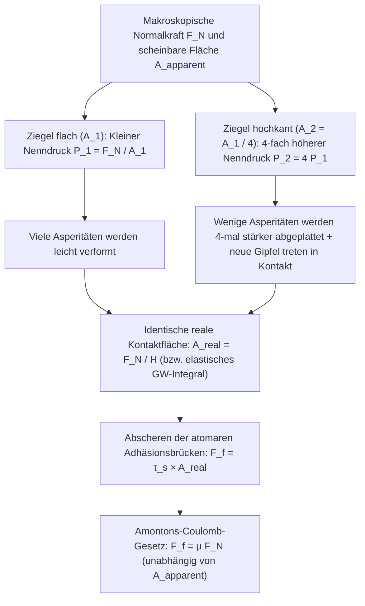
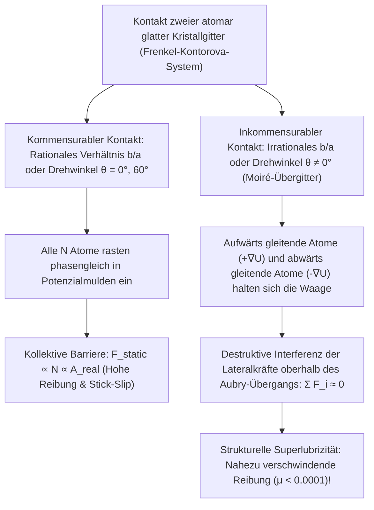

Kaum eine Gleichung der klassischen Mechanik wirkt auf den ersten Blick so schlicht und birgt doch ein so tiefes physikalisches Paradoxon wie das Gesetz der trockenen Festkörperreibung:

$$F_f = \mu F_N$$

Stellen wir uns einen massiven Ziegelstein auf einer ebenen Tischoberfläche vor. Ziehen wir ihn mit einer Federwaage horizontal über den Tisch, während er flach auf seiner breiten Seite liegt (scheinbare Fläche $A_1 = 200\,\text{cm}^2$), messen wir eine bestimmte Reibungskraft $F_f$. Stellen wir denselben Ziegelstein nun hochkant auf seine schmale Kante ($A_2 = 50\,\text{cm}^2$), widerspricht das Messergebnis jeder Alltagsintuition: <strong>Obwohl sich die geometrische Reibungsfläche um das Vierfache verringert hat, bleibt die erforderliche Zugkraft $F_f$ exakt gleich!</strong> Und wenn die Reibung tatsächlich unabhängig von der Auflagefläche ist, warum nutzen Formel-1-Rennwagen dann extrem breite, profillose Slick-Reifen?

Ein zweiter, ebenso hartnäckiger Mythos betrifft die Frage, warum Eis glatt ist. Generationen von Lehrbüchern behaupteten, der hohe Druck unter einer schmalen Schlittschuhkufe senke den Schmelzpunkt des Eises und erzeuge so einen Schmierfilm aus flüssigem Wasser. Doch eine einfache Rechnung mit der thermodynamischen <strong>Clausius-Clapeyron-Gleichung</strong> zeigt, dass ein $75\,\text{kg}$ schwerer Eisläufer den Schmelzpunkt des Eises um lediglich $0{,}12^\circ\text{C}$ absenkt – was völlig unerklärt lässt, wie Eishockeyspieler und Skifahrer bei $-15^\circ\text{C}$ mühelos gleiten.

In diesem Artikel tauchen wir in die <strong>Tribologie</strong> (die Wissenschaft von Reibung, Verschleiß und Schmierung) ein, um diese klassischen Rätsel mithilfe der modernen Oberflächenphysik aufzulösen: von der Unterscheidung zwischen <strong>scheinbarer Kontaktfläche ($A_{\text{apparent}}$)</strong> und <strong>realer Kontaktfläche ($A_{\text{real}}$)</strong> über die <strong>Stick-Slip-Dynamik</strong> bis hin zur <strong>Quasi-Flüssigkeitsschicht (QLL)</strong> auf Eis und der nahezu reibungsfreien <strong>strukturellen Superlubrizität</strong>.

---

## 1. Das klassische Rätsel: Die Amontons-Coulomb-Gesetze und das Scheitern des Sägezahnmodells

### 1.1 Von Leonardo da Vinci (1493) über Amontons (1699) bis Coulomb (1785)

Bereits um 1493 entdeckte <strong>Leonardo da Vinci</strong> in seinen Notizbüchern (*Codex Arundel*), dass die Reibungskraft proportional zur Last ist und nicht von der Auflagefläche abhängt. Nach der Wiederentdeckung durch <strong>Guillaume Amontons (1699)</strong>, der Einführung des Reibungskoeffizienten $\mu = \tan\theta_c$ durch <strong>Leonhard Euler (1748)</strong> und den systematischen Experimenten von <strong>Charles-Augustin de Coulomb (1785)</strong> wurden die drei klassischen Gesetze der Trockenreibung formuliert:

$$\begin{aligned}
\text{1. Gesetz (Proportionalität zur Normalkraft):} & \quad F_f = \mu F_N \\
\text{2. Gesetz (Unabhängigkeit von der Fläche):} & \quad \frac{\partial F_f}{\partial A_{\text{apparent}}} = 0 \\
\text{3. Gesetz (Unabhängigkeit von der Geschwindigkeit):} & \quad \frac{\partial F_k}{\partial v} \approx 0 \quad (\text{mit } F_k = \mu_k F_N < F_s^{\max} = \mu_s F_N)
\end{aligned}$$

Amontons und Coulomb erklärten dies durch das <strong>geometrische Verhakungsmodell</strong> starrer mikroskopischer Sägezähne der Steigung $\tan\theta$, sodass beim Anheben gegen die Schwerkraft $F_f = F_N \tan\theta$ gilt. Doch nach dem ersten Hauptsatz der Thermodynamik (Energieerhaltung) ist dieses Modell unhaltbar: Wenn die Oberflächenspitzen vollkommen starr oder rein elastisch sind, wird die beim Aufstieg auf einen Zahn geleistete Arbeit $W_{\text{up}} = F_N \Delta h$ <strong>beim Hinabgleiten auf der Rückseite des Zahns vollständig zurückgewonnen ($W_{\text{down}} = -F_N \Delta h$)</strong>. Ein konservatives Potenzial erzeugt im Mittel exakt null Energiedissipation ($\oint \mathbf{F}\cdot d\mathbf{r} = 0$). Wahre Reibung erfordert irreversible Deformation und die Anregung von Gitterschwingungen (<strong>Phononen</strong>).

---

## 2. Scheinbare vs. reale Kontaktfläche: Wie Mikro-Asperitäten das Ziegelstein-Paradoxon lösen

### 2.1 „Die Schweiz kopfüber auf Österreich stellen“: Das Bowden-Tabor-Adhäsionsmodell (1950)

Wie die Cambridger Physiker <strong>Frank Philip Bowden</strong> und <strong>David Tabor</strong> (1950) zeigten, weist selbst ein spiegelpolierter Stahlblock unter dem Rasterkraftmikroskop (AFM) eine Rauheit von $R_q \sim 10\,\text{nm}\text{–}1\,\mu\text{m}$ auf – tausendmal größer als die Reichweite atomarer Bindungen ($0{,}2\text{–}0{,}4\,\text{nm}$). Bowden formulierte berühmt: <strong>„Zwei Festkörper aufeinanderzulegen ist, als würde man die Schweiz umdrehen und auf Österreich stellen – sie berühren sich nur an den höchsten Alpengipfeln.“</strong>

Diese mikroskopischen Gipfel heißen <strong>Asperitäten (Mikroerhebungen)</strong>. Die Summe der tatsächlichen atomaren Berührungsflächen ist die <strong>reale Kontaktfläche ($A_{\text{real}}$)</strong>, die meist nur einen winzigen Bruchteil der geometrischen <strong>scheinbaren Kontaktfläche ($A_{\text{apparent}}$)</strong> ausmacht:

$$A_{\text{real}} = \sum_{i=1}^{N_c} A_i \ll A_{\text{apparent}}, \qquad \frac{A_{\text{real}}}{A_{\text{apparent}}} \sim 10^{-5} \text{ bis } 10^{-3}$$

Da sich die gesamte Normalkraft $F_N$ auf diese winzigen Spitzen konzentriert, erreicht der lokale Druck $p_{\text{local}} = F_N / A_{\text{real}}$ sofort die <strong>plastische Eindringhärte $H \approx 3\sigma_y$</strong> des Materials. Die Asperitätenspitzen fließen plastisch, bis die reale Kontaktfläche genau groß genug ist, um die Last $F_N$ bei der Fließspannung $H$ zu tragen:

$$p_{\text{local}} = H \implies A_{\text{real}} = \frac{F_N}{H}$$

An diesen atomaren Kontaktbrücken bilden sich kaltverschweißte Adhäsionsverbindungen mit der Scherfestigkeit $\tau_s$. Um den Körper zu verschieben, müssen diese Brücken abgeschert werden:

$$F_f = \tau_s A_{\text{real}} = \tau_s \left(\frac{F_N}{H}\right) = \left(\frac{\tau_s}{H}\right) F_N \implies \mu = \frac{\tau_s}{H}$$

Damit ist das Ziegelstein-Paradoxon gelöst: <strong>Die Reibungskraft ist proportional zur REALEN Kontaktfläche $A_{\text{real}}$!</strong> Stellt man den Ziegelstein auf die schmale Kante ($A_{\text{apparent}}$ sinkt auf $1/4$), steigt der Druck auf das Vierfache, wodurch die Asperitäten viermal stärker plattgedrückt werden – die Summe $A_{\text{real}} = F_N / H$ bleibt exakt konstant!

### 2.2 Elastische Statistik: Das Greenwood-Williamson-Modell (1966) und Ausnahmen des Gesetzes

Für eine einzelne elastische Kugel vom Radius $R$ liefert die <strong>Hertzsche Kontaktmechanik (1882)</strong> $A_{\text{single}} \propto w^{2/3}$, was bei gleich hohen Spitzen $F_f \propto F_N^{2/3}$ ergäbe. <strong>J. A. Greenwood und J. B. P. Williamson (1966)</strong> bewiesen jedoch, dass für eine realistische Höhenverteilung $\phi(z) = \frac{1}{\sigma_s} e^{-z/\sigma_s}$ der Asperitäten beim Zusammenpressen auf den Abstand $d$ ständig neue Gipfel hinzukommen:

$$A_{\text{real}}(d) = \pi \eta A_{\text{apparent}} R \int_d^\infty (z - d)\phi(z)\,dz, \qquad F_N(d) = \frac{4}{3} \eta A_{\text{apparent}} E^* R^{1/2} \int_d^\infty (z - d)^{3/2}\phi(z)\,dz$$

Beide Integrale sind proportional zu $e^{-d/\sigma_s}$, sodass die mittlere Fläche pro Kontaktpunkt konstant bleibt, während die Anzahl der Kontakte linear mit $F_N$ wächst:

$$A_{\text{real}} = \frac{\sqrt{\pi}}{E^* \sqrt{\sigma_s / R}} F_N \propto F_N$$

<strong>Wann bricht das Amontons-Gesetz zusammen?</strong> Sobald $A_{\text{real}} \to A_{\text{apparent}}$ strebt:
1. <strong>Weiche Elastomere und Formel-1-Slick-Reifen (JKR-Theorie, 1971)</strong>: Gummi hat einen extrem niedrigen Elastizitätsmodul ($E \sim 1\text{–}10\,\text{MPa}$) und schmiegt sich vollständig in Straßenunebenheiten ein. Nach der <strong>Johnson-Kendall-Roberts-(JKR)-Gleichung</strong> $a_{\text{JKR}}^3 = \frac{3R}{4E^*}(w + 3\pi R \Delta\gamma + \sqrt{6\pi R \Delta\gamma w + (3\pi R \Delta\gamma)^2})$ sinkt der effektive Reibungskoeffizient bei hohem Druck ($\mu_{\text{eff}} \propto P_{\text{nom}}^{-1/3}$). Breite Slick-Reifen maximieren $A_{\text{apparent}}$, senken den Nenndruck und erhöhen so den Grip erheblich.
2. <strong>Gecko-Füße (Setae & Spatulae)</strong>: Millionen hierarchisch verzweigter Keratinhärchen (Spatulae von $100\text{–}200\,\text{nm}$ Breite) senken den effektiven Modul auf $E_{\text{eff}} < 100\,\text{kPa}$ (Dahlquist-Kriterium) und erzeugen durch reine van-der-Waals-Kräfte volle Kontaktfläche ($A_{\text{real}} \approx A_{\text{apparent}}$).
3. <strong>Kaltverschweißung im Weltraum-Ultrahochvakuum</strong>: Ohne schützende Oxidschichten ($1\text{–}5\,\text{nm}$) verschweißen blanke Metalloberflächen im Vakuum ($P < 10^{-10}\,\text{Pa}$) sofort atomar ($\mu \to \infty$, Ursache für das Klemmen der Hauptantenne der Raumsonde *Galileo* 1991).

---

## 3. Stick-Slip-Dynamik und das Dieterich-Ruina-Gesetz: Von der Violine bis zu Erdbeben

Ein Masse-Feder-Block-System $m \ddot{x} = k(v_0 t - x) - F_f(\dot{x}, \theta)$ zeigt bei $\mu_s > \mu_k$ sägezahnförmige <strong>Relaxationsschwingungen (Stick-Slip)</strong>: Nach einer Haftphase der Dauer $t_{\text{stick}} = \frac{(\mu_s - \mu_k)F_N}{k v_0}$ schnellt der Block mit der Eigenfrequenz $\omega_0 = \sqrt{k/m}$ nach vorn:

$$x(t') = v_0 t' + \frac{(\mu_s - \mu_k)F_N}{k}(1 - \cos\omega_0 t') - \frac{v_0}{\omega_0}\sin\omega_0 t'$$

Warum gilt $\mu_s > \mu_k$? Weil die Asperitäten während der Ruhezeit $t$ durch plastisches Kriechen (Creep) wachsen: $A_{\text{real}}(t) = A_0 [1 + c \ln(1 + t/\tau_0)]$ (<strong>Kontaktalterung / Contact Aging</strong>). Das <strong>Dieterich-Ruina-Zustandsgesetz (Rate-and-State Friction Law, 1979–1983)</strong> vereint den direkten Geschwindigkeitseffekt ($a$) und die Kontaktalterung ($\theta$, charakteristische Gleitdistanz $D_c$):

$$\mu(v, \theta) = \mu_0 + a \ln\!\left(\frac{v}{v_*}\right) + b \ln\!\left(\frac{v_* \theta}{D_c}\right), \qquad \frac{d\theta}{dt} = 1 - \frac{v \theta}{D_c}$$

Im stationären Zustand ($\dot{\theta} = 0 \implies \theta_{\text{ss}} = D_c / v$) gilt $\mu_{\text{ss}}(v) = \mu_0 + (a - b)\ln(v/v_*)$. Im <strong>geschwindigkeitsentfestigenden Regime ($a - b < 0$)</strong> wird das Gleiten über eine Hopf-Bifurkation instabil, sobald die Systemsteifigkeit $k$ unter die <strong>kritische Steifigkeit $k_c$</strong> fällt:

$$k < k_c = \frac{(b - a) F_N}{D_c}$$

Dieses Gesetz erklärt sowohl die <strong>Helmholtz-Bewegung</strong> einer mit Kolophonium (Rosin) gestrichenen Violinensaite als auch <strong>Megathrust-Erdbeben</strong> an Subduktionszonen, die Jahrhunderte haften (Stick) und in Sekunden um mehrere Meter aufreißen (Slip).

---

## 4. Warum ist Eis wirklich glatt? Widerlegung der Druckschmelz-Hypothese und die Quasi-Flüssigkeitsschicht (QLL)

Berechnen wir die Schmelzpunkterniedrigung von Eis ($\text{I}_h$) exakt mithilfe der <strong>Clausius-Clapeyron-Gleichung</strong> ($T_m = 273{,}15\,\text{K}$, Schmelzwärme $L_f = 3{,}335 \times 10^5\,\text{J/kg}$, $\rho_{\text{liq}} = 999{,}8\,\text{kg/m}^3$, $\rho_{\text{ice}} = 916{,}7\,\text{kg/m}^3$, $\Delta v = -9{,}07 \times 10^{-5}\,\text{m}^3/\text{kg}$):

$$\frac{dP}{dT_m} = \frac{L_f}{T_m \left(v_{\text{liq}} - v_{\text{ice}}\right)} = \frac{3{,}335 \times 10^5}{(273{,}15)(-9{,}07 \times 10^{-5})} \approx -1{,}346 \times 10^7\,\text{Pa/K} = -13{,}46\,\text{MPa/K}$$

Für einen $75\,\text{kg}$ schweren Eisläufer ($F_N = 735\,\text{N}$) auf einer Schlittschuhkufe ($L = 30\,\text{cm}$, Breite $w = 1{,}5\,\text{mm}$, $A = 4{,}5 \times 10^{-4}\,\text{m}^2$) beträgt der Druck $\Delta P = 1{,}63\,\text{MPa}$ und die Schmelzpunkterniedrigung:

$$\Delta T_m = \frac{1{,}63\,\text{MPa}}{-13{,}46\,\text{MPa/K}} \approx -0{,}12^\circ\text{C}$$

Druckschmelzen kann das Eislaufen bei $-10^\circ\text{C}$ also unmöglich erklären! Die wahren Ursachen sind:
1. <strong>Oberflächen-Vorschmelzen und Faradays Quasi-Flüssigkeitsschicht (QLL, 1850)</strong>: Wassermoleküle an der freien Eisoberfläche besitzen statt 4 nur 2 oder 3 Wasserstoffbrückenbindungen (unterkoordinierte Bindungen). Sie schwingen stark und bilden selbst ohne Druck bis <strong>$-30^\circ\text{C}$</strong> eine $1\text{–}20\,\text{nm}$ dicke ungeordnete <strong>Quasi-Liquid Layer (QLL)</strong>.
2. <strong>Reibungswärme (Bowden & Hughes, 1939)</strong>: Beim Gleiten mit Geschwindigkeit $v$ erhitzt die Wärmestromdichte $q = \mu P v$ die dünne thermische Eindringtiefe $\delta_{\text{th}} \sim \sqrt{\alpha_{\text{th}} L / v}$ lokal auf $0^\circ\text{C}$ (weshalb schlecht wärmeleitende Polyethylen-Skier viel besser gleiten als Metallskier).
3. <strong>Viskoelastische Rheologie des Grenzflächenwassers (Canale, Bocquet & Bonn, 2019, *Phys. Rev. X*)</strong>: Der geschorene Nanowasserfilm besitzt eine $50\text{–}100$-mal höhere effektive Viskosität als normales Wasser sowie einen elastischen Speichermodul $G'(\omega)$, der dynamischen Auftrieb erzeugt.

---

## 5. Von der Stribeck-Kurve zur strukturellen Superlubrizität

Während hydrodynamische Schmierung ($\Lambda > 3$ auf der <strong>Stribeck-Kurve</strong>) auf der <strong>Reynolds-Gleichung (1886)</strong> beruht:

$$\frac{\partial}{\partial x}\!\left(\frac{h^3}{12\eta}\frac{\partial p}{\partial x}\right) + \frac{\partial}{\partial y}\!\left(\frac{h^3}{12\eta}\frac{\partial p}{\partial y}\right) = \frac{U}{2}\frac{\partial h}{\partial x} + \frac{\partial h}{\partial t}$$

beschreibt das <strong>Prandtl-Tomlinson-Modell (1928–1929)</strong> die trockene atomare Reibung über das Potenzial $V_{\text{PT}}(x, X) = -\frac{U_0}{2}\cos(2\pi x/a) + \frac{1}{2}k_{\text{eff}}(x - X)^2$ mit dem Parameter $\eta_{\text{PT}} = \frac{2\pi^2 U_0}{k_{\text{eff}} a^2}$. Für $\eta_{\text{PT}} \le 1$ verschwindet das atomare Stick-Slip-Springen vollständig.

Im mehratomigen <strong>Frenkel-Kontorova-Modell</strong> entdeckten <strong>Motohisa Hirano und Kazumasa Shinjo (1990)</strong> die <strong>strukturelle Superlubrizität</strong> (experimentell bestätigt an gedrehtem Graphit durch <strong>Dienwiebel et al., 2004</strong>): Bei <strong>inkommensurablem Kontakt</strong> (z. B. verdrehtem Graphen oder $\text{MoS}_2$-Moiré-Gittern oberhalb des <strong>Aubry-Übergangs</strong>) heben sich die Horizontalkräfte aller $N$ Gitteratome durch destruktive Interferenz gegenseitig auf ($\sum F_i \approx 0$), sodass der Reibungskoeffizient ganz ohne Schmieröl auf <strong>$\mu < 0{,}0001$</strong> abfällt!

---

## 6. Synthese: Vergleich der tribologischen Regime

| Tribologisches Regime | Mikroskopischer Mechanismus | Skalierung der Kontaktfläche | Typisches $\mu$ | Grundgleichungen & Modelle |
| :--- | :--- | :--- | :--- | :--- |
| <strong>Trockenreibung harter Festkörper</strong> | Plastisches Fließen oder statistisch-elastische Deformation der Asperitäten + Abscheren | $A_{\text{real}} \propto F_N \ll A_{\text{apparent}}$ (unabhängig von $A_{\text{apparent}}$) | $0{,}15 \text{ – } 0{,}80$ | Bowden-Tabor ($A_{\text{real}}=F_N/H$), Greenwood-Williamson (1966), Persson |
| <strong>Weiche Elastomere & Gecko-Haftung</strong> | Konformer Kontakt durch kleines $E_{\text{eff}}$ + van-der-Waals-Adhäsion | $A_{\text{real}} \to A_{\text{apparent}}$ (wächst mit $A_{\text{apparent}}$) | $0{,}80 \text{ – } 3{,}0+$ | JKR-Adhäsionstheorie (1971), Dahlquist-Kriterium ($E_{\text{eff}} < 100\,\text{kPa}$) |
| <strong>Stick-Slip-Instabilität</strong> | Logarithmisches Kriech-Altern $A_{\text{real}}(t)$ vs. Gleit-Verjüngung über $D_c$ | $A_{\text{real}}(t) = A_0[1 + c\ln(1+t/\tau_0)]$ | $\mu_s(t) > \mu_k(v)$ | Dieterich-Ruina-Gesetz (RSF), kritische Steifigkeit $k_c = \frac{(b-a)F_N}{D_c}$ |
| <strong>Eis-Schmierung (Eislauf & Ski)</strong> | Unterkoordinierte Quasi-Flüssigkeitsschicht (QLL) + Reibungswärme + Viskoelastizität | QLL ($1\text{–}20\,\text{nm}$) & Schmelzfilm trennen Asperitäten bis $-30^\circ\text{C}$ | $0{,}005 \text{ – } 0{,}03$ | Faraday-Vorschmelzen (1850), Bowden-Hughes, Bocquet-Bonn (2019) |
| <strong>Hydrodynamische Schmierung</strong> | Konvergierender Schmierkeil erzeugt tragenden Fluiddruck $p(x,y)$ | Kein Festkörperkontakt ($\Lambda = h_{\min}/\sigma^* > 3$) | $0{,}001 \text{ – } 0{,}005$ | Stribeck-Kurve (1902), Reynolds-Gleichung (1886) |
| <strong>Strukturelle Superlubrizität</strong> | Destruktive Phaseninterferenz lateraler Atomkräfte in inkommensurablen Moiré-Gittern | Innere Kräfte kompensieren sich ($F_f \propto A^{0\text{–}0{,}5}$) | $< 0{,}0001$ | Prandtl-Tomlinson ($\eta_{\text{PT}} \le 1$), Frenkel-Kontorova, Hirano (1990) |
