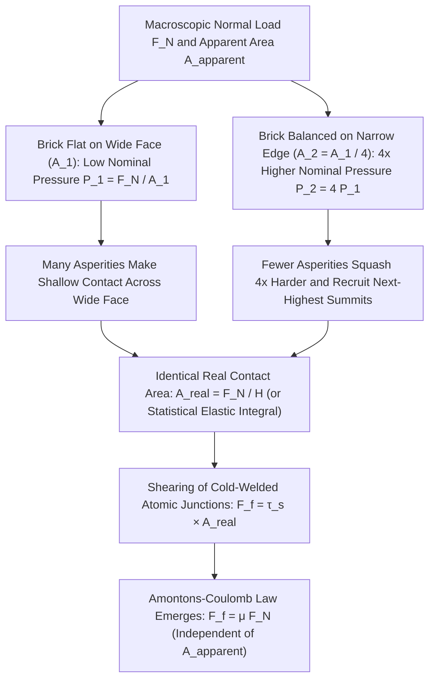
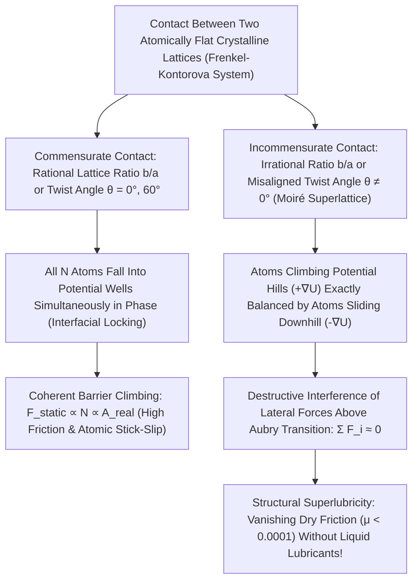

Few equations in introductory physics appear simpler—or conceal a deeper physical paradox—than the classical law of dry sliding friction:

$$F_f = \mu F_N$$

Consider a solid rectangular steel or masonry brick resting on a flat tabletop. If we pull the brick horizontally with a spring scale while it lies flat on its broad face (say, an area of $A_1 = 200\,\text{cm}^2$), we measure a well-defined threshold force $F_s = \mu_s F_N$ required to initiate motion and a steady kinetic force $F_k = \mu_k F_N$ to sustain sliding. Now suppose we tip the exact same brick up onto its narrow edge (an area of $A_2 = 50\,\text{cm}^2$). Everyday intuition strongly suggests that when four times as much surface area is rubbing against the table, the frictional resistance ought to be substantially larger. Yet when we perform the experiment, <strong>the frictional force required to pull the brick on its narrow edge is identical to the force required on its wide face</strong>. And if friction truly does not depend on contact area, why do Formula 1 racing cars and dragsters mount extraordinarily wide, treadless "slick" tires to maximize grip?

A second, equally pervasive paradox surrounds the question of why ice is slippery. For over a century, textbooks have repeated the claim that an ice skater glides on a thin film of liquid water created because the pressure of the narrow skate blade depresses the melting point of ice. Yet a straightforward substitution into the thermodynamic <strong>Clausius–Clapeyron equation</strong> reveals that a $75\,\text{kg}$ skater lowers the melting temperature of ice by barely $0.12^\circ\text{C}$—leaving completely unexplained how hockey players, figure skaters, and skiers glide effortlessly at $-10^\circ\text{C}$ or $-20^\circ\text{C}$.

In this article, we journey into <strong>tribology</strong>—the interdisciplinary science of friction, wear, and lubrication (coined by Peter Jost in 1966 from the Greek *tribo*, "I rub")—to resolve these classical puzzles from first principles. We will bridge macroscopic mechanics and atomic-scale surface physics: from the stark divergence between <strong>apparent contact area ($A_{\text{apparent}}$)</strong> and <strong>real contact area ($A_{\text{real}}$)</strong> in Bowden–Tabor plastic adhesion and Greenwood–Williamson statistical contact mechanics, to the nonlinear <strong>Dieterich–Ruina rate-and-state friction laws</strong> governing violin strings and tectonic earthquakes, the <strong>Quasi-Liquid Layer (QLL)</strong> of premelted ice, and finally <strong>Structural Superlubricity</strong>, where incommensurate crystal lattices cancel lateral atomic forces to make friction vanish almost completely.

---

## 1. The Classical Puzzle: The Amontons–Coulomb Laws and the Failure of Geometric Interlocking

### 1.1 Historical Lineage: From Leonardo da Vinci (1493) to Amontons (1699) and Coulomb (1785)

Long before Isaac Newton formulated his laws of motion in the *Principia* (1687), <strong>Leonardo da Vinci</strong> conducted the first systematic experimental investigation of friction around 1493. In his notebooks (*Codex Arundel* and *Codex Madrid I*), Leonardo sketched wooden blocks pulled across horizontal and inclined planes by weights hung over rollers. He recorded two foundational empirical discoveries:

1. *"Friction made by the same weight will be of equal resistance at the beginning of its movement, although the contact may be of different breadths or lengths."*
2. *"Friction produces double the amount of effort if the weight be doubled"* (estimating $\mu \approx 1/4$ for smooth wood-on-wood).

Because Leonardo's manuscripts remained unpublished for centuries, these laws were independently rediscovered two hundred years later by the French physicist <strong>Guillaume Amontons</strong> in his 1699 memoir to the Royal Academy of Sciences in Paris (*De la résistance causée dans les machines*). In 1748, <strong>Leonhard Euler</strong> introduced the canonical symbol $\mu$ for the coefficient of friction, proved that a block on an inclined plane begins to slide at the critical angle of repose $\theta_c$ satisfying $\mu_s = \tan\theta_c$, and mathematically distinguished static friction ($\mu_s$) from kinetic friction ($\mu_k < \mu_s$).

Finally, in 1785, <strong>Charles-Augustin de Coulomb</strong>—working at the Rochefort naval shipyard before his famous torsion-balance experiments in electrostatics—published his monumental treatise *Théorie des machines simples*. Measuring friction across combinations of oak, elm, iron, copper, and hemp under loads up to several tons, Coulomb consolidated what we now call the <strong>Three Classical Laws of Dry Friction (Amontons–Coulomb Laws)</strong>:

$$\begin{aligned}
\text{First Law (Load Proportionality):} & \quad F_f = \mu F_N \\
\text{Second Law (Area Independence):} & \quad \frac{\partial F_f}{\partial A_{\text{apparent}}} = 0 \\
\text{Third Law (Velocity Independence):} & \quad \frac{\partial F_k}{\partial v} \approx 0 \quad (\text{with } F_k = \mu_k F_N < F_s^{\max} = \mu_s F_N)
\end{aligned}$$

Here $F_N$ is the normal load pressing the two bodies together, $A_{\text{apparent}}$ is the macroscopic geometric area of the interface, and $v$ is the relative sliding velocity.

### 1.2 Why the Classical "Interlocking Sawtooth" Model Violates Thermodynamics

How did Amontons and Coulomb explain why friction is proportional to normal load $F_N$ and independent of area $A_{\text{apparent}}$? They proposed the <strong>Geometric Interlocking (or Cobblestone) Hypothesis</strong>: even a seemingly smooth solid surface is covered with rigid, microscopic sawtooth-like protuberances of characteristic slope angle $\theta$. When the upper block is pulled horizontally, it must be lifted up the ramps of the lower surface's teeth against gravity.

By simple static equilibrium on a rigid ramp of inclination $\theta$, the horizontal force $F_f$ required to lift a normal load $F_N$ satisfies:

$$F_f \cos\theta = F_N \sin\theta \implies F_f = F_N \tan\theta \implies \mu = \tan\theta$$

At first glance, this geometric relation appears to explain everything: $\tan\theta$ depends only on the microscopic slope of the roughness, not on the total macroscopic area $A_{\text{apparent}}$ or the sliding speed $v$.

Yet with the formulation of energy conservation (the First Law of Thermodynamics) in the nineteenth century, physicists realized that the rigid interlocking sawtooth model is fundamentally flawed. If the surface asperities are perfectly rigid (or purely elastic without hysteresis), the mechanical work $W_{\text{up}} = F_N \Delta h$ expended in lifting the block to the peak of an asperity is <strong>completely recovered ($W_{\text{down}} = -F_N \Delta h$) as the block slides down the back side of the tooth into the next valley</strong>! Over a full cycle, a conservative potential landscape produces zero net energy dissipation:

$$\oint \mathbf{F}_{\text{conservative}} \cdot d\mathbf{r} = 0 \implies \langle F_k \rangle = 0$$

Furthermore, if friction were merely the riding up and down of rigid macroscopic interlocking teeth, polishing a metal block to an optical mirror finish should cause $\tan\theta \to 0$ and eliminate friction. In practice, when two gauge blocks are polished to sub-nanometer flatness and wrung together, friction does not vanish—instead, the blocks <strong>seize together with enormous resistance</strong>! A genuine theory of friction must explain both how macroscopic kinetic energy is irreversibly dissipated into lattice vibrations (<strong>phonons</strong>) and why smoothing a surface beyond a certain point increases rather than decreases friction.

---

## 2. Apparent vs. Real Contact Area: Asperities, Plastic Adhesion, and Statistical Contact Mechanics

### 2.1 "Putting Switzerland on Top of Austria": The Reality of Microscopic Roughness

The modern physical resolution of Amontons's paradox was pioneered at the University of Cambridge by <strong>Frank Philip Bowden</strong> and <strong>David Tabor</strong> in their landmark 1950 monograph *The Friction and Lubrication of Solids*. As Bowden memorably remarked:

> *"Putting two solids together is rather like turning Switzerland upside down and standing it on top of Austria—the area of intimate contact will be small."*

When examined with White-Light Interferometry, Scanning Tunneling Microscopy (STM), or Atomic Force Microscopy (AFM), even a finely machined or mirror-polished engineering steel surface exhibits a root-mean-square (RMS) surface roughness $R_q$ of $10\,\text{nm}$ to $1\,\mu\text{m}$. By contrast, the range of repulsive and attractive interatomic forces (metallic bonding, covalent bonding, or van der Waals dispersion forces) is only $a_0 \approx 0.2\text{ to }0.4\,\text{nm}$.

Consequently, when two macroscopic solids are brought together, they do not touch across their nominal geometric boundary, the <strong>Apparent Contact Area ($A_{\text{apparent}} = L_x L_y$)</strong>. Instead, contact is supported exclusively at the summits of the highest microscopic mountain peaks, known as <strong>asperities</strong>. The sum of the areas of these discrete micro-contacts constitutes the <strong>Real Contact Area ($A_{\text{real}}$)</strong>:

$$A_{\text{real}} = \sum_{i=1}^{N_c} A_i \ll A_{\text{apparent}}, \qquad \frac{A_{\text{real}}}{A_{\text{apparent}}} \sim 10^{-5} \text{ to } 10^{-3}$$

Under ordinary engineering loads, the real area of atomic contact is typically between $0.001\%$ and $0.1\%$ of the apparent geometric area!

### 2.2 Bowden and Tabor's Plastic Adhesion Theory (1939–1950)

Because the entire normal load $F_N$ is funneled through a minuscule fraction of the surface ($A_{\text{real}} \sim 10^{-4} A_{\text{apparent}}$), the local normal stress $p_{\text{local}} = F_N / A_{\text{real}}$ at the tips of the first-touching asperities is astronomical. Even if a $1\,\text{kg}$ steel block ($F_N \approx 9.8\,\text{N}$) exerts a tiny nominal pressure $P_{\text{nom}} = F_N / A_{\text{apparent}} \approx 1\,\text{kPa}$, the local stress at micron-scale asperity tips immediately reaches several gigapascals ($\text{GPa}$)—exceeding the material's uniaxial yield stress $\sigma_y$ and reaching its <strong>plastic indentation hardness $H \approx 3\sigma_y$</strong> (Tabor's plasticity relation).

As a result, the tips of the contacting asperities undergo local <strong>plastic flow (plastic yielding)</strong>, squashing and spreading laterally until the total real contact area $A_{\text{real}}$ has grown just large enough to support the applied normal load $F_N$ at the constant yield pressure $H$:

$$p_{\text{local}} = H \implies A_{\text{real}} = \frac{F_N}{H}$$

Notice what is completely absent from this equation: the apparent area $A_{\text{apparent}}$!
Within these crushed micro-contact patches, atoms of the upper and lower bodies are forced within $0.2\text{–}0.3\,\text{nm}$ of each other, forming strong interatomic bonds—<strong>cold-welded adhesive micro-junctions</strong>. To slide the upper body horizontally, the external pulling force must continuously shear these welded junctions, which possess an interfacial shear strength $\tau_s$ (typically $\tau_s \approx 0.2\,\sigma_y \approx H / 6$ for clean metals, or lower when passivated by oxides and adsorbates), plus a ploughing contribution $F_{\text{plough}}$ if hard asperities groove a softer counterface:

$$F_f = F_{\text{adhesion}} + F_{\text{plough}} \approx \tau_s A_{\text{real}} = \tau_s \left(\frac{F_N}{H}\right) = \left(\frac{\tau_s}{H}\right) F_N \implies \mu = \frac{\tau_s}{H}$$

This reveals the true resolution of the brick paradox:
<strong>Friction is NOT independent of contact area—in fact, friction is strictly proportional to the REAL contact area ($F_f = \tau_s A_{\text{real}}$)!</strong>
When you flip the brick from its wide face ($A_1$) onto its narrow edge ($A_2 = A_1 / 4$), the number of available asperities on the bottom face drops by a factor of $4$, so the nominal pressure $P_{\text{nom}} = F_N / A_{\text{apparent}}$ increases fourfold. This fourfold higher pressure crushes the contacting asperities under the narrow edge four times more severely (and brings new sub-surface summits into contact), so that the <strong>sum of the microscopic contact areas $A_{\text{real}} = F_N / H$ remains invariant</strong>!

### 2.3 The Elastic Paradox and the Greenwood–Williamson (1966) & Persson Multi-Scale Theories

Although Bowden and Tabor's plastic yielding model was a triumph, a subtle theoretical objection soon emerged. While asperities certainly deform plastically during the very first contact, machine components slide over each other millions of times. After initial "running-in" (shakedown), the asperity tips must deform predominantly <strong>elastically</strong>. Does $A_{\text{real}} \propto F_N$ still hold for purely elastic contact?

According to <strong>Heinrich Hertz's (1882) classical theory of elastic contact</strong>, when a single elastic sphere (representing a single asperity tip of radius of curvature $R$) is pressed against a flat surface with normal load $w$, the contact circle radius $a$ and contact area $A_{\text{single}}$ scale nonlinearly with load:

$$a = \left(\frac{3 w R}{4 E^*}\right)^{1/3} \implies A_{\text{single}} = \pi a^2 = \pi \left(\frac{3 R}{4 E^*}\right)^{2/3} w^{2/3} \propto w^{2/3}$$

where $E^* = \left(\frac{1-\nu_1^2}{E_1} + \frac{1-\nu_2^2}{E_2}\right)^{-1}$ is the combined elastic contact modulus.
If a surface consisted of $N$ identical spherical asperities all standing at the exact same height, then under total load $F_N = N w$, the real contact area would scale as $A_{\text{real}} \propto A_{\text{apparent}}^{1/3} F_N^{2/3}$, yielding $F_f \propto F_N^{2/3}$ (so $\mu \propto F_N^{-1/3}$)—a direct violation of both Amontons's First and Second Laws! Indeed, when a single-asperity diamond tip or an Atomic Force Microscope (AFM) probe slides in the non-adhesive elastic regime, experiments directly measure $F_f \propto F_N^{2/3}$.

How, then, does $A_{\text{real}} \propto F_N^{1.0}$ emerge from purely elastic asperities obeying $A_i \propto w_i^{2/3}$? In 1966, <strong>J. A. Greenwood and J. B. P. Williamson</strong> solved this mystery in one of the most celebrated papers in contact mechanics (*Contact of Nominally Flat Surfaces*).

Greenwood and Williamson recognized that on any real rough surface, the summit heights $z$ of the asperities are not uniform; they follow a statistical probability density distribution $\phi(z)$ with standard deviation $\sigma_s$ (such as a Gaussian distribution or an exponential upper tail $\phi(z) = \frac{1}{\sigma_s} e^{-z/\sigma_s}$). When a rigid flat plane approaches the rough surface to a separation distance $d$ above the mean plane, every asperity whose summit height exceeds $z > d$ is compressed by an indentation depth $\delta = z - d > 0$. By Hertzian mechanics, a single compressed asperity has contact area $A_i(\delta) = \pi R \delta = \pi R (z - d)$ and supports a load $w_i(\delta) = \frac{4}{3} E^* R^{1/2} \delta^{3/2} = \frac{4}{3} E^* R^{1/2} (z - d)^{3/2}$.

Summing statistically over an areal summit density $\eta$ across apparent area $A_{\text{apparent}}$, the total number of contacting asperities $N_c(d)$, total real contact area $A_{\text{real}}(d)$, and total normal load $F_N(d)$ are given by the integrals:

$$\begin{aligned}
N_c(d) &= \eta A_{\text{apparent}} \int_d^\infty \phi(z)\,dz \\
A_{\text{real}}(d) &= \pi \eta A_{\text{apparent}} R \int_d^\infty (z - d)\,\phi(z)\,dz \\
F_N(d) &= \frac{4}{3} \eta A_{\text{apparent}} E^* R^{1/2} \int_d^\infty (z - d)^{3/2}\,\phi(z)\,dz
\end{aligned}$$

Let us evaluate these integrals explicitly for the exponential summit height distribution $\phi(z) = \frac{1}{\sigma_s} \exp(-z / \sigma_s)$ by substituting $u = (z - d)/\sigma_s$ and using the Gamma function $\int_0^\infty u^n e^{-u}\,du = \Gamma(n+1)$ (with $\Gamma(2) = 1$ and $\Gamma(5/2) = \frac{3\sqrt{\pi}}{4}$):

$$\begin{aligned}
N_c(d) &= \eta A_{\text{apparent}} \, e^{-d/\sigma_s} \\
A_{\text{real}}(d) &= \pi \eta A_{\text{apparent}} R \sigma_s \, e^{-d/\sigma_s} \\
F_N(d) &= \sqrt{\pi} \eta A_{\text{apparent}} E^* R^{1/2} \sigma_s^{3/2} \, e^{-d/\sigma_s}
\end{aligned}$$

Dividing $A_{\text{real}}(d)$ by $F_N(d)$, both the exponential dependence $e^{-d/\sigma_s}$ on separation distance $d$ and the apparent area $A_{\text{apparent}}$ <strong>cancel out identically</strong>:

$$A_{\text{real}} = \frac{\sqrt{\pi}}{E^* \sqrt{\sigma_s / R}} F_N \propto F_N$$

Why did the $2/3$ power law disappear? Because as you press two rough surfaces harder together (decreasing $d$), existing contacts grow larger, <strong>while simultaneously smaller asperities that were previously just out of reach make fresh contact</strong>! The continual birth of tiny new contacts exactly balances the growth of older contacts so that the <strong>average area per individual contact $\langle A_i \rangle = A_{\text{real}} / N_c = \pi R \sigma_s$ remains strictly constant</strong>, while the number of contacts $N_c \propto F_N$ grows linearly with load!

In 2001, <strong>Bo N. J. Persson</strong> generalized this statistical theory to realistic <strong>self-affine fractal surfaces</strong> whose roughness power spectral density $C(q) \propto q^{-2(1+H_f)}$ spans many decades of spatial wavevector $q$ (magnification $\zeta = q / q_0$). By proving that the interfacial stress probability distribution $P(\sigma, \zeta)$ obeys a diffusion-like partial differential equation with respect to magnification $\zeta$, Persson demonstrated that for small nominal pressures, the real contact area obeys the universal continuum law:

$$A_{\text{real}} = \frac{\kappa}{E^* \sqrt{\langle |\nabla h|^2 \rangle}} F_N$$

where $\sqrt{\langle |\nabla h|^2 \rangle}$ is the RMS surface slope and $\kappa \approx \sqrt{8/\pi} \approx 1.60$.

### 2.4 When Amontons's Laws Break Down: Racing Slick Tires, Gecko Setae, and Cold Welding in Space

Understanding that Amontons's Laws rely on $A_{\text{real}} \ll A_{\text{apparent}}$ immediately explains the famous engineering and biological regimes where <strong>contact area DOES strongly affect friction</strong>:

1. <strong>Soft Viscoelastic Elastomers and Formula 1 Slick Tires (JKR Adhesive Contact Mechanics)</strong>:
   Vulcanized rubber has an elastic modulus $E \sim 1\text{–}10\,\text{MPa}$—five orders of magnitude softer than steel ($E \approx 200\,\text{GPa}$). Under load, rubber deforms easily to fill the micro-cavities of asphalt road roughness, driving $A_{\text{real}}$ toward a large fraction of $A_{\text{apparent}}$. Moreover, soft polymers exhibit strong interfacial adhesion governed by the <strong>Johnson–Kendall–Roberts (JKR, 1971) theory</strong>, which modifies Hertzian contact to include the thermodynamic work of adhesion $\Delta\gamma$:
   $$a_{\text{JKR}}^3 = \frac{3R}{4E^*}\left(w + 3\pi R \Delta\gamma + \sqrt{6\pi R \Delta\gamma w + (3\pi R \Delta\gamma)^2}\right)$$
   Even at zero normal load ($w = 0$), adhesive forces maintain a finite contact radius $a_0 = \left(\frac{9\pi R^2 \Delta\gamma}{2E^*}\right)^{1/3}$, and a tensile pull-off force $w_c = -\frac{3}{2}\pi R \Delta\gamma$ is required to separate the surfaces. At high tire loads where asperity contact begins to saturate ($A_{\text{real}} \propto A_{\text{apparent}}^{1/3} F_N^{2/3}$), the effective coefficient of friction decreases with nominal contact pressure ($\mu_{\text{eff}} \propto P_{\text{nom}}^{-1/3}$, known in vehicle dynamics as <strong>tire load sensitivity</strong>). Formula 1 cars and dragsters use wide, treadless slick tires to maximize $A_{\text{apparent}}$, thereby lowering nominal pressure $P_{\text{nom}}$ to stay in the high-$\mu$ adhesive/viscoelastic regime while spreading immense frictional heat over a larger thermal footprint.

2. <strong>Biomimetic Hierarchy of Gecko Footpads (Setae and Spatulae)</strong>:
   A tokay gecko (*Gekko gecko*) can sprint up vertical glass walls or hang from a ceiling by a single toe without secreting any glue. Its toe pads are covered with millions of hierarchical $\beta$-keratin hairs called <strong>setae</strong> ($\sim 100\,\mu\text{m}$ long), each branching into hundreds of nanoscale flat tips called <strong>spatulae</strong> ($100\text{–}200\,\text{nm}$ wide). Although bulk keratin is stiff ($E \sim 2\,\text{GPa}$), this hierarchical fibrillar architecture reduces the effective structural modulus to $E_{\text{eff}} < 100\,\text{kPa}$ (satisfying <strong>Dahlquist's criterion for tack</strong>). Consequently, the spatulae conform intimately to almost $100\%$ of any nanoscale surface roughness ($A_{\text{real}} \approx A_{\text{apparent}}$), generating enormous shear adhesion via universal <strong>van der Waals dispersion forces</strong> even at zero or negative normal load!

3. <strong>Cold Welding in Ultra-High Vacuum (Spacecraft Tribology)</strong>:
   Why don't two flat blocks of steel weld together into a single piece of metal when pressed together on a workbench? Because in Earth's atmosphere, every metal surface is instantaneously coated by a $1\text{–}5\,\text{nm}$ native oxide film ($\text{Fe}_2\text{O}_3, \text{Al}_2\text{O}_3$) and adsorbed monolayers of water, oxygen, and hydrocarbons, which screen metallic bonding and drastically lower $\tau_s$.
   In the ultra-high vacuum of outer space ($P < 10^{-10}\,\text{Pa}$), if sliding wear scrapes away this protective oxide or solid-lubricant layer, no oxygen molecules exist to reform it. Bare metallic lattices make direct atomic contact across the interface, electrons delocalize across the boundary, and <strong>macroscopic cold welding</strong> occurs ($\mu \to \infty$). In 1991, NASA's *Galileo* Jupiter spacecraft suffered a famous failure to deploy its umbrella-like high-gain antenna because vibration during transport wore away the $\text{MoS}_2$ dry lubricant on three titanium retention pins, causing them to cold-weld shut in the vacuum of space.

---

## 3. Stick-Slip Dynamics and Rate-and-State Friction: From Violin Strings to Megathrust Earthquakes

### 3.1 The Spring-Block Slider Model and Relaxation Oscillations

Why does a rusty door hinge creak, a piece of chalk screech across a slate blackboard, an automotive disc brake squeal, a bowed violin string sing with rich harmonics, and a locked tectonic fault suddenly rupture in a magnitude-9 earthquake? Every one of these acoustic and geophysical phenomena is a manifestation of <strong>Stick-Slip Dynamics</strong>—a self-excited nonlinear <strong>relaxation oscillation</strong> driven by friction.

To model stick-slip mathematically, consider the canonical <strong>Burridge–Knopoff / Spring-Block Slider system</strong>: a block of mass $m$ resting on a frictional substrate, pulled horizontally via a linear spring of stiffness $k$ whose far end moves at a constant driving velocity $v_0$. Measuring the block's position $x(t)$ from the initial unstretched position of the spring, Newton's second law yields:

$$m \frac{d^2 x}{dt^2} = k(v_0 t - x) - F_f\!\left(\frac{dx}{dt}, \theta\right)$$

In the simplest classical idealization where static friction exceeds kinetic friction ($\mu_s > \mu_k$), the motion splits into two alternating phases:

* <strong>Phase 1: The Stick Phase (Elastic Energy Accumulation, $\dot{x} = 0$)</strong>
  Suppose at $t = 0$ the block comes to rest at the point where the spring tension equals the kinetic friction force, $F_{\text{spring}}(0) = \mu_k F_N$. Because $\mu_k F_N < \mu_s F_N$, the block remains locked to the substrate ($\dot{x} = 0$). As the drive stage advances at speed $v_0$, the spring stretches and its tension grows linearly in time:
  $$F_{\text{spring}}(t) = \mu_k F_N + k v_0 t$$
  This stationary stick phase persists until $F_{\text{spring}}(t)$ reaches the static breakaway threshold $F_s^{\max} = \mu_s F_N$, which occurs after a sticking duration:
  $$t_{\text{stick}} = \frac{(\mu_s - \mu_k) F_N}{k v_0}$$
  Notice that slow driving velocities ($v_0 \ll 1$) and compliant springs ($k \ll 1$) produce long, pronounced stick phases.

* <strong>Phase 2: The Slip Phase (Rapid Inertial Release, $\dot{x} > 0$)</strong>
  At $t = t_{\text{stick}}$, the interfacial junctions rupture and the resisting friction drops abruptly from $\mu_s F_N$ to $\mu_k F_N$. Driven by the unbalanced force jump $\Delta F = (\mu_s - \mu_k)F_N$, the block accelerates forward at the natural harmonic frequency $\omega_0 = \sqrt{k / m}$. Shifting the time origin to the onset of slip ($t' = t - t_{\text{stick}}$, with $x(0) = 0, \dot{x}(0) = 0$), the differential equation $m \ddot{x} + k x = \Delta F + k v_0 t'$ has the exact analytical solution:
  $$x(t') = v_0 t' + \frac{(\mu_s - \mu_k)F_N}{k}\left(1 - \cos \omega_0 t'\right) - \frac{v_0}{\omega_0}\sin \omega_0 t'$$
  $$v(t') = \dot{x}(t') = v_0 \left(1 - \cos \omega_0 t'\right) + \frac{(\mu_s - \mu_k)F_N}{\sqrt{m k}}\sin \omega_0 t'$$
  The block surges forward at a peak slip velocity $v_{\max} \approx v_0 + \frac{(\mu_s - \mu_k)F_N}{\sqrt{mk}} \gg v_0$, overshoots the mechanical equilibrium point, and decelerates as the spring compresses. After a slip duration $t_{\text{slip}} \approx \frac{\pi}{\omega_0} = \pi\sqrt{\frac{m}{k}}$, the block's velocity drops back to $v(t_{\text{slip}}) = 0$. Instantaneously, the surfaces re-lock into the Stick phase, generating a periodic <strong>sawtooth wave</strong> of spring force vs. time!

### 3.2 Contact Aging and the Dieterich–Ruina Rate-and-State Friction (RSF) Law

The classical jump from $\mu_s$ to $\mu_k$ begs a deeper microscopic question: <strong>Why is static friction larger than kinetic friction in the first place?</strong>

As Coulomb himself noticed in 1785, and as <strong>James H. Dieterich (1979)</strong>, <strong>Andy Ruina (1983)</strong>, and <strong>Jay Fineberg (2004)</strong> demonstrated with high-precision experiments, static friction is not a fixed constant—it <strong>grows logarithmically with the time $t$ of stationary contact ("Contact Aging")</strong>!

While two rough surfaces sit in stationary contact under load, the extreme local stresses at asperity tips drive thermally activated <strong>plastic and viscoelastic creep</strong>, slowly increasing the real area of each micro-contact, while interfacial chemical bonding (e.g., siloxane $\text{Si–O–Si}$ or hydrogen bond bridges) progressively strengthens the interface. Using an ingenious optical technique where a laser sheet undergoes total internal reflection across a transparent PMMA interface—so that evanescent light is transmitted *only* through the actual points of atomic contact—Fineberg, Rubinstein, and Cohen directly photographed $A_{\text{real}}(t)$ in real time and proved that:

$$A_{\text{real}}(t) = A_0 \left[ 1 + c \ln\!\left(1 + \frac{t}{\tau_0}\right) \right] \implies \mu_s(t) = \mu_0 + b \ln\!\left(1 + \frac{t}{\tau_0}\right)$$

Conversely, once the surface begins to slide at velocity $v$, the old, creep-strengthened asperity contacts are sheared off and replaced by newly formed, "young" contacts after sliding a characteristic memory distance $D_c$ (typically $1\text{–}50\,\mu\text{m}$, comparable to the mean asperity contact diameter). Therefore, the average lifetime ("age" or <strong>state variable $\theta$</strong>) of the contacts during steady sliding at speed $v$ is simply $\theta_{\text{ss}} = D_c / v$: faster sliding continuously rejuvenates the interface, keeping $A_{\text{real}}$ small and lowering friction!

To unify the direct thermally activated rate effect of shearing atomic bonds with this time-dependent contact aging, Dieterich and Ruina formulated the <strong>Rate-and-State Friction (RSF) Constitutive Law</strong>—today the foundational equation of nonlinear tribology and earthquake seismology:

$$\mu(v, \theta) = \mu_0 + a \ln\!\left(\frac{v}{v_*}\right) + b \ln\!\left(\frac{v_* \theta}{D_c}\right)$$

coupled with the state evolution equation (the <strong>Dieterich Aging Law</strong>):

$$\frac{d\theta}{dt} = 1 - \frac{v \theta}{D_c}$$

Here:
* $v_*$ is an arbitrary reference velocity and $\mu_0$ is the steady-state friction coefficient at $v = v_*$.
* $a > 0$ (typically $0.005\text{–}0.05$) measures the <strong>direct velocity effect</strong>: because breaking atomic bonds is a thermally activated Eyring/Arrhenius rate process ($v \propto \exp[-(\Delta E - \tau V_{\text{act}})/k_B T]$), shearing faster at fixed contact area requires a logarithmically higher stress $\tau_s(v) \propto a \ln v$.
* $b > 0$ (typically $0.005\text{–}0.05$) measures the <strong>state evolution (aging) effect</strong>: during stationary hold ($v = 0$), $\frac{d\theta}{dt} = 1 \implies \theta(t) = \theta_0 + t$, reproducing logarithmic static aging $\Delta\mu_s = b \ln(t)$.

During steady-state sliding at constant velocity $v$, the state variable equilibrates to $\frac{d\theta}{dt} = 0 \implies \theta_{\text{ss}}(v) = \frac{D_c}{v}$. Substituting $\theta_{\text{ss}}(v)$ into $\mu(v, \theta)$ yields the steady-state velocity dependence:

$$\mu_{\text{ss}}(v) = \mu_0 + (a - b) \ln\!\left(\frac{v}{v_*}\right)$$

Linear stability analysis of the spring-slider equation coupled with the Dieterich–Ruina RSF law reveals a sharp dynamical bifurcation governed by the sign of $(a - b)$:

1. <strong>Velocity-Strengthening Regime ($a - b > 0$)</strong>:
   Steady-state friction increases with sliding speed ($\frac{d\mu_{\text{ss}}}{dv} > 0$). Any sudden acceleration increases frictional resistance, damping out perturbations. Sliding is unconditionally stable (<strong>aseismic fault creep</strong>).
2. <strong>Velocity-Weakening Regime ($a - b < 0$)</strong>:
   Contact rejuvenation ($b$) outweighs thermal viscosity ($a$), so steady-state friction decreases with velocity ($\frac{d\mu_{\text{ss}}}{dv} < 0$), acting as <strong>negative damping</strong>. Whenever the elastic stiffness $k$ of the surrounding loading medium falls below the <strong>critical stiffness $k_c$</strong>, steady sliding loses stability via a <strong>Hopf bifurcation</strong> and erupts into sustained stick-slip oscillations:

$$k < k_c = \frac{(b - a) F_N}{D_c}$$

### 3.3 Helmholtz Motion of a Bowed Violin String and Subduction-Zone Megathrust Earthquakes

This single stability criterion ($k < k_c$ with $b > a$) governs two phenomena separated by twelve orders of magnitude in mass:

* <strong>The Physics of the Violin Bow (Helmholtz Motion, 1862)</strong>:
  Why must a violinist rub horsehair with <strong>rosin (colophony, an amorphous abietic-acid glass whose glass transition temperature $T_g \approx 30\text{–}50^\circ\text{C}$ lies just above room temperature)</strong>? During the stick phase, the rosin-coated bow hairs weld to the string and drag it along at the bow speed $v_0$. As the sharp kink in the string—discovered by <strong>Hermann von Helmholtz</strong> in 1862 and known as the <strong>Helmholtz corner</strong>—races to the violin bridge, reflects, and returns to the bow, it triggers a sudden local jump in slip speed. Rosin undergoes local shear-heating softening right at its glass transition, producing a strong velocity-weakening drop ($b - a \gg 0$) that lets the string snap back rapidly during the slip phase before cooling and re-sticking cleanly in every single acoustic cycle ($440$ times per second on the A4 string!).

* <strong>Tectonic Faults and Megathrust Earthquakes</strong>:
  Along subduction zones such as the Nankai Trough, Cascadia, or the Japan Trench, oceanic lithosphere converges at $v_0 \sim 3\text{–}10\,\text{cm/year}$ ($\sim 10^{-9}\,\text{m/s}$). At shallow depths ($< 5\,\text{km}$) or deep ductile depths ($> 35\,\text{km}$), fault gouge minerals are velocity-strengthening ($a - b > 0$) and slide smoothly via aseismic creep. Within the brittle seismogenic zone ($10\text{–}30\,\text{km}$ depth, $T \sim 150\text{–}350^\circ\text{C}$), hydrothermal quartz and feldspar exhibit strong velocity weakening ($a - b < 0$), while the elastic stiffness of the surrounding crustal plate $k \approx G / L_{\text{fault}}$ is below $k_c$. Consequently, the fault remains locked for centuries ($t_{\text{stick}} \sim 100\text{–}1000\,\text{years}$), aging logarithmically until a nucleation patch exceeds $L_c \sim \frac{G D_c}{(b-a)\sigma_n}$, unleashing a catastrophic <strong>Slip phase</strong> where the fault leaps several meters in seconds at $v_{\text{slip}} \sim 1\text{–}5\,\text{m/s}$!

---

## 4. Why Is Ice Really Slippery? Debunking the Pressure-Melting Myth and Unraveling the Quasi-Liquid Layer

### 4.1 Quantitative Refutation of the Pressure-Melting Hypothesis via the Clausius–Clapeyron Equation

Ask almost any student—or consult many introductory textbooks—why an ice skater can glide effortlessly across an ice rink, and you will hear the <strong>Pressure-Melting Hypothesis</strong> (originally suggested by James Thomson and his brother William Thomson, Lord Kelvin, in the 1850s to explain *regelation*):

> <strong>[The Textbook Myth]</strong>: *"Because ordinary hexagonal ice ($\text{I}_h$) is less dense than liquid water ($\rho_{\text{ice}} < \rho_{\text{liq}}$), applying high pressure lowers the melting point of ice below $0^\circ\text{C}$. The concentrated weight of a skater standing on a thin steel skate blade exerts enough pressure to melt the ice beneath the blade, creating a lubricating film of water that refreezes as soon as the skate passes."*

Does this explanation survive quantitative thermodynamic scrutiny? Let us calculate the exact melting-point depression $\Delta T_m$ using the <strong>Clausius–Clapeyron Equation</strong> for the solid–liquid phase boundary:

$$\frac{dP}{dT_m} = \frac{\Delta s_{\text{fus}}}{\Delta v_{\text{fus}}} = \frac{L_f}{T_m \left(v_{\text{liq}} - v_{\text{ice}}\right)} = \frac{L_f}{T_m \left(\frac{1}{\rho_{\text{liq}}} - \frac{1}{\rho_{\text{ice}}}\right)}$$

Let us substitute the exact experimental constants for water and hexagonal ice $\text{I}_h$ at $T_m = 273.15\,\text{K}$ ($0^\circ\text{C}$):
* Specific latent heat of fusion: $L_f = 3.335 \times 10^5\,\text{J/kg}$
* Density of liquid water at $0^\circ\text{C}$: $\rho_{\text{liq}} = 999.8\,\text{kg/m}^3 \implies v_{\text{liq}} = 1.0002 \times 10^{-3}\,\text{m}^3/\text{kg}$
* Density of ice $\text{I}_h$ at $0^\circ\text{C}$: $\rho_{\text{ice}} = 916.7\,\text{kg/m}^3 \implies v_{\text{ice}} = 1.0909 \times 10^{-3}\,\text{m}^3/\text{kg}$
* Specific volume change upon melting: $\Delta v_{\text{fus}} = v_{\text{liq}} - v_{\text{ice}} = -9.07 \times 10^{-5}\,\text{m}^3/\text{kg}$

Evaluating the slope of the melting curve:

$$\frac{dP}{dT_m} = \frac{3.335 \times 10^5\,\text{J/kg}}{(273.15\,\text{K})\left(-9.07 \times 10^{-5}\,\text{m}^3/\text{kg}\right)} \approx -1.346 \times 10^7\,\text{Pa/K} = -13.46\,\text{MPa/K}$$

In other words, <strong>it requires $13.46\,\text{MPa}$ (roughly $133\,\text{atmospheres}$!) of pressure to lower the melting point of ice by just $1^\circ\text{C}$!</strong>

Now consider a figure skater or hockey player of mass $m = 75\,\text{kg}$ ($F_N = mg \approx 735\,\text{N}$) balanced on a single skate blade of contact length $L = 30\,\text{cm} = 0.30\,\text{m}$ and effective contact edge width $w = 1.5\,\text{mm} = 1.5 \times 10^{-3}\,\text{m}$ (contact area $A = L w = 4.5 \times 10^{-4}\,\text{m}^2$):

$$\Delta P = \frac{F_N}{A} = \frac{735\,\text{N}}{4.5 \times 10^{-4}\,\text{m}^2} \approx 1.63 \times 10^6\,\text{Pa} = 1.63\,\text{MPa} \quad (\approx 16.1\,\text{atm})$$

The resulting depression of the melting point of ice beneath the skate blade is:

$$\Delta T_m = \frac{\Delta P}{dP / dT_m} = \frac{1.63\,\text{MPa}}{-13.46\,\text{MPa/K}} \approx -0.12\,\text{K} \quad (-0.12^\circ\text{C})!$$

<strong>The skater's weight lowers the melting point of ice by barely one-eighth of a degree Celsius!</strong>
Even if one argues that real contact occurs over a smaller fraction of the blade up to the plastic indentation hardness / compressive crushing strength of ice ($H_{\text{ice}} \approx 10\text{–}20\,\text{MPa}$), ice mechanically fractures and crushes before pressure melting can ever exceed $\Delta T_m \approx -1.0\text{ to }-1.5^\circ\text{C}$.

Yet NHL hockey rinks and Olympic speed-skating ovals are maintained at <strong>$-5^\circ\text{C}$ to $-9^\circ\text{C}$</strong>, outdoor winter skating and alpine skiing thrive at <strong>$-15^\circ\text{C}$ to $-25^\circ\text{C}$</strong>, and a pedestrian wearing flat-soled shoes ($\Delta P \sim 20\,\text{kPa} \implies \Delta T_m \approx -0.0015^\circ\text{C}$) still slips violently on an icy sidewalk! Pressure melting is thermodynamically incapable of explaining the slipperiness of ice.

### 4.2 The Three Real Physical Mechanisms: Faraday's Quasi-Liquid Layer (QLL), Frictional Heating, and Interfacial Viscoelasticity

Modern surface physics and nanotribology have established that the extraordinary lubricity of ice ($\mu \approx 0.005\text{–}0.02$) arises from the synergy of three distinct microscopic mechanisms:

1. <strong>Surface Premelting and the Quasi-Liquid Layer (QLL — Michael Faraday 1850)</strong>:
   Remarkably, in a lecture at the Royal Institution on June 7, 1850, <strong>Michael Faraday</strong> proposed the correct answer: that a thin, intrinsic film of liquid-like water exists on the free surface of ice well below $0^\circ\text{C}$ at normal atmospheric pressure—a phenomenon now called <strong>surface premelting</strong>.
   Why does ice premelt at its surface? Inside the bulk hexagonal lattice of ice $\text{I}_h$, every $\text{H}_2\text{O}$ molecule is tetrahedrally coordinated, locked in place by <strong>four hydrogen bonds</strong> to its nearest neighbors. At the free surface termination of the crystal, however, water molecules lack neighbors above them and are left with <strong>under-coordinated dangling $-\text{OH}$ bonds and lone pairs</strong> (only two or three hydrogen bonds instead of four).
   As confirmed by Sum-Frequency Generation (SFG) vibrational spectroscopy, X-ray scattering, and proton channeling, these under-coordinated surface molecules vibrate with far larger root-mean-square thermal amplitudes than bulk molecules. Because the surface free energy of the dry crystal–vapor interface exceeds the sum of the solid–liquid and liquid–vapor interfaces ($\Delta\gamma = \gamma_{\text{sv}} - (\gamma_{\text{sl}} + \gamma_{\text{lv}}) > 0$), thermodynamics favors wetting the crystal surface with its own disorder! Even at zero applied pressure, the top molecular bilayers detach from the rigid lattice and form a mobile, disordered <strong>Quasi-Liquid Layer (QLL)</strong> of thickness $d_{\text{QLL}}(T) \sim 1\text{–}20\,\text{nm}$ that persists down to approximately <strong>$-30^\circ\text{C}$ to $-35^\circ\text{C}$</strong>.
   Below $-35^\circ\text{C}$ (as polar explorers like Robert Falcon Scott and Fridtjof Nansen bitterly recorded in Antarctica and Greenland), the QLL freezes out completely, and snow and ice become as abrasive and high-friction as dry sand ($\mu \approx 0.4\text{–}0.6$). Above $-30^\circ\text{C}$, this ever-present QLL provides the instant zero-velocity boundary lubrication that causes a flat shoe sole to slip the moment it steps onto ice.

2. <strong>Frictional Heating During Sliding (Bowden & Hughes 1939)</strong>:
   While a $2\,\text{nm}$ QLL initiates slip, high-speed skating or skiing ($v \sim 5\text{–}20\,\text{m/s}$) requires a thicker melt film to clear micron-scale surface roughness. In 1939, working in a high-altitude ice cave at the Jungfraujoch research station in the Swiss Alps, <strong>F. P. Bowden and T. P. Hughes</strong> proved that once sliding begins, <strong>viscous and asperity frictional heating</strong> is the dominant melt generator.
   During sliding at speed $v$, the dissipated mechanical power per unit contact area $q_{\text{fric}} = \mu P_{\text{local}} v$ is injected into a microscopic thermal diffusion skin depth $\delta_{\text{th}} \sim \sqrt{\alpha_{\text{th}} t_c} = \sqrt{\alpha_{\text{th}} L / v}$ (only a few micrometers thick). Even when the bulk ice is at $-15^\circ\text{C}$, this concentrated heat flux raises the local interface temperature to $0^\circ\text{C}$ within milliseconds, thickening the QLL into a $50\,\text{nm}\text{–}1\,\mu\text{m}$ melt film.
   Crucially, Bowden and Hughes tested skis made of high-thermal-conductivity brass ($k_{\text{th}} \approx 110\,\text{W/m}\cdot\text{K}$) against low-thermal-conductivity ebonite and wood ($k_{\text{th}} \approx 0.17\,\text{W/m}\cdot\text{K}$), proving that <strong>metallic skis experience much higher friction on cold ice because they conduct frictional heat away from the interface into the ski rather than melting the ice!</strong> This is why modern racing skis use low-conductivity Ultra-High-Molecular-Weight Polyethylene (UHMWPE) bases and hydrophobic fluorocarbon waxes.

3. <strong>Complex Viscoelastic Rheology of Nanoconfined Interfacial Water (Canale, Bocquet & Bonn 2019)</strong>:
   A lingering puzzle remained: bulk liquid water at $0^\circ\text{C}$ has a tiny dynamic viscosity ($\eta_0 \approx 1.79\,\text{mPa}\cdot\text{s}$), making it a terrible hydrodynamic lubricant because high contact pressures should instantly squeeze such a runny fluid out of the contact zone!
   In a landmark 2019 study published in *Physical Review X*, <strong>Louison Canale, Lydéric Bocquet, Daniel Bonn, and colleagues</strong> used a quartz tuning-fork Atomic Force Microscope to simultaneously measure the nanomechanical shear and normal impedance of the premelted/sheared film on ice. They discovered that the nanoconfined water/ice-debris layer is <strong>NOT simple Newtonian bulk water</strong>: it behaves as a <strong>complex viscoelastic fluid</strong> whose effective viscosity is up to <strong>$50\text{ to }100$ times higher than bulk water</strong> and which possesses a substantial elastic storage modulus $G'(\omega)$! Because of this intrinsic viscoelasticity, shearing the film generates an <strong>elasto-hydrodynamic lift force</strong> that pushes the skate blade upward, preventing solid-on-solid asperity contact and yielding Ultra-Low Friction ($\mu \sim 0.005$).

---

## 5. From the Stribeck Curve to Structural Superlubricity: Eliminating Friction at the Atomic Scale

### 5.1 Classical Lubrication Regimes: The Stribeck Curve and the Reynolds Equation

Approximately $23\%$ of the world's total primary energy consumption is dissipated overcoming friction and wear in mechanical systems. In classical engineering, lubrication between moving surfaces is organized around the <strong>Stribeck Curve</strong> (established by <strong>Richard Stribeck</strong> in 1902), which plots the friction coefficient $\mu$ against the dimensionless <strong>Hersey number $He = \frac{\eta U}{P}$</strong> (where $\eta$ is lubricant dynamic viscosity, $U$ is entrainment speed, and $P$ is nominal pressure) or the <strong>Tallian film-thickness ratio $\Lambda$</strong>:

$$\Lambda = \frac{h_{\min}}{\sqrt{R_{q1}^2 + R_{q2}^2}}$$

where $h_{\min}$ is the minimum lubricant film thickness and $R_{q1}, R_{q2}$ are the RMS roughnesses of the two surfaces:

1. <strong>Boundary Lubrication ($\Lambda < 1$, $\mu \approx 0.05\text{–}0.15$)</strong>:
   At low speeds or high loads, the fluid film cannot separate the surfaces, and load is carried by contacting asperities. To prevent metallic cold-welding, boundary additives such as stearic acid (forming <strong>Self-Assembled Monolayers, SAMs</strong>), molybdenum dithiocarbamate ($\text{MoDTC}$), or zinc dialkyldithiophosphate ($\text{ZDDP}$) chemically graft onto the metal to form sacrificial, low-shear-strength ($\tau_s$) tribofilms.
2. <strong>Mixed and Elastohydrodynamic Lubrication (EHL, $1 \le \Lambda \le 3$, $\mu \approx 0.01\text{–}0.05$)</strong>:
   Load is shared between elastically deformed asperity summits and pressurized fluid pockets; the global minimum of the Stribeck curve occurs around $\Lambda \approx 3$.
3. <strong>Hydrodynamic Lubrication ($\Lambda > 3$, $\mu \approx 0.001\text{–}0.005$)</strong>:
   A continuous pressurized fluid film completely separates the solid surfaces. Derived by <strong>Osborne Reynolds (1886)</strong> as a thin-film lubrication reduction of the Navier–Stokes equations, the pressure field $p(x,y,t)$ inside a film of thickness profile $h(x,y)$ obeys the <strong>Reynolds Equation</strong>:

$$\frac{\partial}{\partial x}\!\left(\frac{h^3}{12\eta}\frac{\partial p}{\partial x}\right) + \frac{\partial}{\partial y}\!\left(\frac{h^3}{12\eta}\frac{\partial p}{\partial y}\right) = \frac{U}{2}\frac{\partial h}{\partial x} + \frac{\partial h}{\partial t}$$

Whenever the upper and lower surfaces form a <strong>converging geometric wedge ($\frac{\partial h}{\partial x} < 0$)</strong>, viscous Couette dragging pulls fluid into the narrowing gap, generating immense hydrodynamic pressure $p(x,y)$ that levitates multi-ton steam turbine rotors and automotive crankshafts without a single atom of solid-on-solid contact!

### 5.2 Atomic-Scale Friction: The Prandtl–Tomlinson (PT) Model and Phonon Dissipation

Can we achieve friction coefficients even lower than hydrodynamic lubrication ($\mu < 0.0001$) in <strong>completely dry, solid-on-solid contact</strong>? To see how, we must examine the fundamental mechanism of energy dissipation at the atomic scale via the <strong>Prandtl–Tomlinson (PT) Model</strong>, formulated independently by <strong>Ludwig Prandtl (1928)</strong> and <strong>G. A. Tomlinson (1929)</strong>.

Consider a single surface atom (or an AFM tip apex) of coordinate $x$ connected by an effective harmonic spring of stiffness $k_{\text{eff}}$ (representing the elastic compliance of the tip and crystal lattice) to a rigid stage moving at position $X = v t$ across a periodic crystalline substrate of lattice constant $a$ and corrugation amplitude $U_0$. The total potential energy of the atom is:

$$V_{\text{PT}}(x, X) = -\frac{U_0}{2}\cos\!\left(\frac{2\pi x}{a}\right) + \frac{1}{2} k_{\text{eff}} (x - X)^2$$

At any stage position $X$, the mechanical equilibrium positions $x$ of the atom satisfy $\frac{\partial V_{\text{PT}}}{\partial x} = 0$:

$$\frac{\pi U_0}{a}\sin\!\left(\frac{2\pi x}{a}\right) + k_{\text{eff}}(x - X) = 0$$

Whether this equilibrium position moves smoothly or undergoes sudden catastrophic jumps is determined by the curvature (second derivative) of the potential, $\frac{\partial^2 V_{\text{PT}}}{\partial x^2} = \frac{2\pi^2 U_0}{a^2}\cos\!\left(\frac{2\pi x}{a}\right) + k_{\text{eff}}$. Introducing the dimensionless <strong>Tomlinson Parameter (Corrugation Ratio) $\eta_{\text{PT}}$</strong>:

$$\eta_{\text{PT}} = \frac{2\pi^2 U_0}{k_{\text{eff}} a^2}$$

we discover a sharp dynamical phase transition at $\eta_{\text{PT}} = 1$:

* <strong>The Atomic Stick-Slip Regime ($\eta_{\text{PT}} > 1$)</strong>:
  When the substrate potential corrugation $U_0$ is strong relative to the lattice spring stiffness $k_{\text{eff}}$, $\frac{\partial^2 V_{\text{PT}}}{\partial x^2}$ becomes negative over portions of the lattice cell, creating multiple metastable minima separated by energy barriers. As the stage $X$ advances, the atom remains trapped in its local potential well (atomic stick) until the local minimum annihilates with an inflection point in a <strong>saddle-node bifurcation</strong>. At that instant, the atom snaps violently into the adjacent lattice well at high speed (atomic slip), ringing at the atomic vibrational frequency and radiating its stored elastic energy into substrate <strong>lattice phonons (heat)</strong>! In 1987, <strong>C. M. Mate, G. M. McClelland, R. Erlandsson, and S. Chiang</strong> at IBM Almaden first observed this atomic sawtooth stick-slip directly using Friction Force Microscopy (FFM) on a graphite basal plane.

* <strong>The Superlubric Smooth-Sliding Regime ($\eta_{\text{PT}} \le 1$)</strong>:
  When the crystal lattice is sufficiently stiff or the potential corrugation is weak ($\eta_{\text{PT}} \le 1$), $\frac{\partial^2 V_{\text{PT}}}{\partial x^2} \ge 0$ everywhere! For every stage position $X$, the total potential $V_{\text{PT}}(x, X)$ possesses a <strong>unique, single global minimum</strong>. As the stage moves forward, the atom glides smoothly and adiabatically over the potential hills without any discontinuous jumps, returning $100\%$ of the climb energy back into the spring on the descent. Consequently, in the quasi-static limit ($v \to 0$), <strong>hysteresis vanishes and dry static/kinetic friction drops to zero</strong>!

### 5.3 Motohisa Hirano's Structural Superlubricity (1990) and Incommensurate Moiré Lattices

For a single atom, reaching $\eta_{\text{PT}} \le 1$ is difficult because individual chemical bonds are relatively compliant. However, when we replace a single atom with an extended crystalline sheet of $N$ atoms coupled by stiff covalent bonds of spring constant $K$ sliding over a periodic substrate—the <strong>Frenkel–Kontorova (FK) Model</strong>—a spectacular collective phenomenon emerges:

$$H_{\text{FK}} = \sum_{i=1}^{N} \left[ \frac{p_i^2}{2m} + \frac{K}{2}\left(x_{i+1} - x_i - b\right)^2 - \frac{U_0}{2}\cos\!\left(\frac{2\pi x_i}{a}\right) \right]$$

In 1990, Japanese physicists <strong>Motohisa Hirano and Kazumasa Shinjo</strong> proved theoretically that when two atomically flat, stiff crystalline surfaces slide in <strong>incommensurate contact</strong> (meaning the ratio of their lattice constants $b/a$ is irrational, or two identical 2D lattices are rotated by a twist angle $\theta$ that breaks lattice periodicity), dry static friction vanishes identically—a state they named <strong>Structural Superlubricity</strong>!

Why does rotating one crystal flake by a few degrees eliminate friction?

1. <strong>Commensurate Contact (Locked Lattices, e.g., Graphite at $\theta = 0^\circ$ or $60^\circ$)</strong>:
   When the upper and lower hexagonal graphene lattices are aligned in AB-stacking ($\theta = 0^\circ$), the lattice periods match identically. Every one of the $N$ atoms in the upper flake settles simultaneously into a potential energy minimum of the lower substrate. To slide the flake, all $N$ atoms must climb the potential barrier $U_0$ <strong>coherently in phase</strong>, so the static friction force scales linearly with the total number of interfacial atoms (and contact area):
   $$F_{\text{static}}^{\text{comm}} = N \frac{\pi U_0}{a} \propto A_{\text{contact}}$$

2. <strong>Incommensurate Contact (Structural Superlubricity, $\theta \neq 0^\circ$ above the Aubry Transition)</strong>:
   When the upper flake is rotated by an incommensurate twist angle $\theta$ (or when two mismatched 2D crystals such as <strong>graphene on hexagonal boron nitride $\text{h-BN}$</strong> or <strong>molybdenum disulfide $\text{MoS}_2$</strong> are stacked), the interface forms an aperiodic or long-wavelength <strong>Moiré superlattice</strong>. Because intralayer $sp^2$ carbon–carbon bonds are extraordinarily stiff ($K \gg U_0 / a^2$, placing the crystal above the <strong>Aubry transition</strong> proved by Serge Aubry in 1983), the atoms cannot deform their lattice to drop into local substrate wells.
   Consequently, the $N$ atoms sample every phase $\phi_i = \frac{2\pi x_i}{a} \pmod{2\pi}$ of the substrate potential uniformly! At any instant during sliding, <strong>for every atom in the flake that is being pushed uphill against a potential barrier ($+\frac{\pi U_0}{a}\sin\phi_i$), another atom elsewhere in the flake is sliding downhill down an identical slope ($-\frac{\pi U_0}{a}\sin\phi_j$), pushing the flake forward!</strong> The lateral forces cancel out across the crystal via destructive interference:

$$F_{\text{lateral}}^{\text{incomm}} = -\sum_{i=1}^{N} \frac{\pi U_0}{a}\sin\!\left(\frac{2\pi x_i}{a}\right) \approx \mathcal{O}\!\left(N^0 \text{ to } N^{1/2}\right) \ll N$$

Instead of scaling with the area $A \propto N$, residual friction arises only from uncompensated atoms along the perimeter edge ($\propto N^{1/2}$ or $N^0$).
In 2004, <strong>Martin Dienwiebel, Joost Frenken, and colleagues</strong> at Leiden University achieved the celebrated experimental verification of Hirano's prediction (*Physical Review Letters*): by dragging a nano-flake of graphite across a graphite substrate while varying its twist angle $\theta$, they observed high atomic stick-slip friction within $\pm 2^\circ$ of the commensurate angles $\theta = 0^\circ$ and $60^\circ$, followed by a <strong>complete collapse of friction to near zero ($\mu < 0.0001$) across all intermediate incommensurate angles</strong>!

Today, structural superlubricity has been scaled up from nanometer flakes to micrometer and millimeter van der Waals heterostructures (graphene/$\text{h-BN}$, $\text{MoS}_2$, centimeter-long double-walled carbon nanotubes, and hydrogenated Diamond-Like Carbon [DLC] coatings in dry nitrogen), heralding a future of wear-free mechanical bearings, space mechanisms, and nano-electromechanical systems (NEMS).

---

## 6. Synthesis: A Unified Panorama of Tribology Across Scales

The table below synthesizes the physical regimes, area-scaling laws, governing equations, and typical friction coefficients across the entire spectrum of tribology examined in this article:

| Tribological Regime | Dominant Microscopic Mechanism | Contact Area Scaling Law | Typical Friction Coefficient $\mu$ | Governing Equations & Theoretical Models |
| :--- | :--- | :--- | :--- | :--- |
| <strong>Dry Metallic & Hard-Solid Friction</strong> | Plastic yielding or statistical elastic deformation of micron/nano-asperities + junction shearing | $A_{\text{real}} \propto F_N \ll A_{\text{apparent}}$ (Independent of $A_{\text{apparent}}$) | $0.15 \text{ – } 0.80$ | Bowden–Tabor ($A_{\text{real}} = F_N/H$), Greenwood–Williamson (1966), Persson (2001) |
| <strong>Soft Elastomer & Gecko Adhesion</strong> | Low effective modulus ($E_{\text{eff}}$) conformal contact + van der Waals adhesion & viscoelastic hysteresis | $A_{\text{real}} \to A_{\text{apparent}}$ (Increases with $A_{\text{apparent}}$) | $0.80 \text{ – } 3.0+$ | JKR Adhesive Contact Theory (1971), Dahlquist Tack Criterion ($E_{\text{eff}} < 100\,\text{kPa}$) |
| <strong>Stick-Slip Unstable Sliding</strong> | Logarithmic creep aging of $A_{\text{real}}(t)$ during hold vs. slip rejuvenation over distance $D_c$ | $A_{\text{real}}(t) = A_0[1 + c\ln(1+t/\tau_0)]$ | $\mu_s(t) > \mu_k(v)$ | Dieterich–Ruina Rate-and-State Friction (RSF) Law, Critical Stiffness $k_c = \frac{(b-a)F_N}{D_c}$ |
| <strong>Ice Lubrication (Skating & Skiing)</strong> | Premelted Quasi-Liquid Layer (QLL) of under-coordinated $\text{H}_2\text{O}$ + frictional heating + viscoelastic lift | QLL ($1\text{–}20\,\text{nm}$) & melt film separate solid asperities down to $-30^\circ\text{C}$ | $0.005 \text{ – } 0.03$ | Faraday Surface Premelting (1850), Bowden–Hughes Thermal Melt, Bocquet–Bonn Viscoelasticity (2019) |
| <strong>Hydrodynamic Fluid Lubrication</strong> | Viscous wedge entrainment generating self-acting hydrodynamic pressure field $p(x,y)$ | Zero solid contact ($\Lambda = h_{\min}/\sigma^* > 3$) | $0.001 \text{ – } 0.005$ | Stribeck Curve (1902), Osborne Reynolds Thin-Film Lubrication PDE (1886) |
| <strong>Structural Superlubricity (2D Crystals)</strong> | Destructive phase interference of lateral atomic forces across incommensurate Moiré lattices | Bulk interior forces cancel; scales only with perimeter ($F_f \propto A^{0 \text{ to } 0.5}$) | $< 0.0001$ ($10^{-4} \text{ – } 10^{-5}$) | Prandtl–Tomlinson ($\eta_{\text{PT}} \le 1$), Frenkel–Kontorova, Aubry Transition, Hirano (1990) |

From a brick pulled across a wooden bench to a Stradivarius violin, from an Olympic speed skater gliding at $-10^\circ\text{C}$ to a subduction fault rupturing beneath the ocean, and down to twisted sheets of graphene sliding without resistance, the laws of friction illustrate one of the deepest themes in physics: <strong>simple macroscopic laws are emergent statistical consequences of complex microscopic landscapes</strong>. Apparent area drops out of $F_f = \mu F_N$ not because geometry is irrelevant to friction, but because the hidden mountain ranges of microscopic asperities automatically adjust their real contact area in exact proportion to the normal load.
