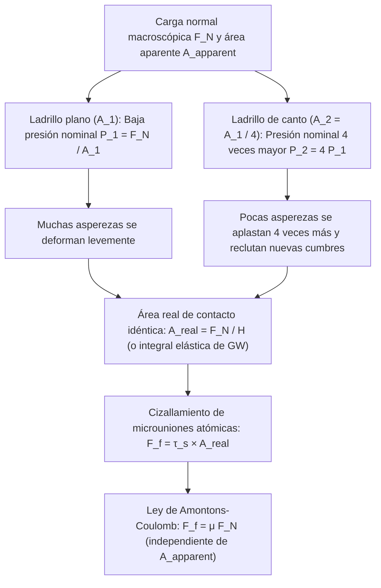
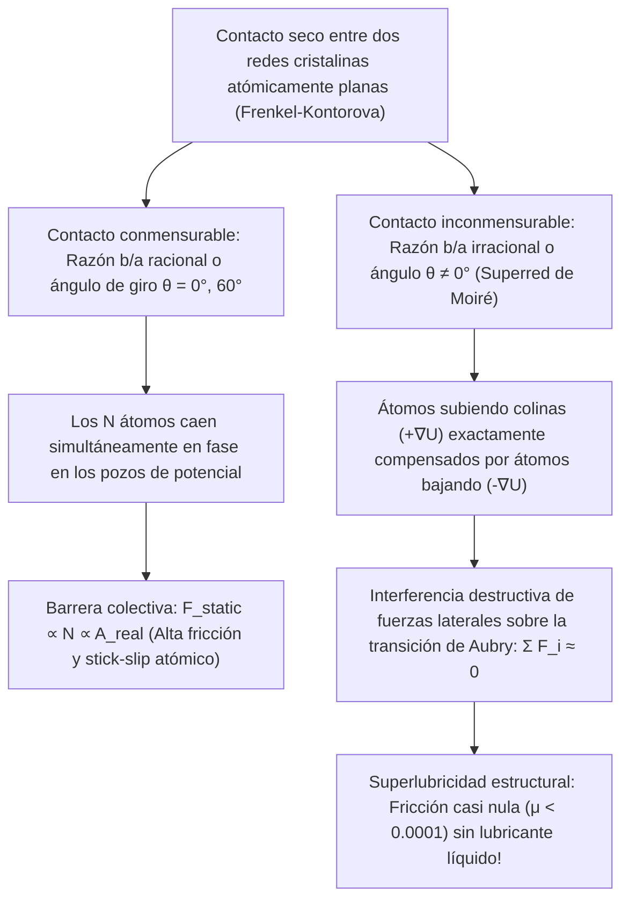

Pocas ecuaciones de la mecánica clásica parecen tan sencillas —y esconden al mismo tiempo una paradoja física tan profunda— como la ley de la fricción seca:

$$F_f = \mu F_N$$

Imaginemos un ladrillo rectangular sobre una mesa plana. Si tiramos de él horizontalmente con un dinamómetro cuando descansa sobre su cara ancha (área aparente $A_1 = 200\,\text{cm}^2$) y luego cuando se apoya sobre su canto estrecho ($A_2 = 50\,\text{cm}^2$), nuestra intuición cotidiana dicta que la cara cuatro veces más grande debería oponer mucha más resistencia. Sin embargo, el experimento demuestra que <strong>la fuerza de fricción $F_f$ es exactamente la misma independientemente del área geométrica de apoyo</strong>. Y si la fricción no depende del área, ¿por qué los monoplazas de Fórmula 1 utilizan neumáticos *slick* extremadamente anchos?

Un segundo mito clásico afirma que los patinadores se deslizan sobre el hielo porque la alta presión de la cuchilla reduce el punto de fusión del hielo y crea una película de agua. Pero al aplicar la <strong>ecuación termodinámica de Clausius-Clapeyron</strong>, descubrimos que un patinador de $75\,\text{kg}$ rebaja el punto de fusión en apenas $0{,}12^\circ\text{C}$, lo que jamás podría explicar el patinaje a $-10^\circ\text{C}$ o $-20^\circ\text{C}$.

En este artículo exploramos la <strong>tribología</strong> (la ciencia de la fricción, el desgaste y la lubricación) desde la física de superficies a nanoescala: la diferencia entre el <strong>área de contacto aparente ($A_{\text{apparent}}$)</strong> y el <strong>área de contacto real ($A_{\text{real}}$)</strong>, la dinámica <strong>stick-slip (adherencia-deslizamiento)</strong>, la <strong>capa cuasilíquida (QLL)</strong> del hielo y la <strong>superlubricidad estructural</strong>.

---

## 1. El enigma clásico: las leyes de Amontons-Coulomb y el fracaso del engranaje geométrico

### 1.1 De Leonardo da Vinci (1493) a Amontons (1699) y Coulomb (1785)

Hacia 1493, <strong>Leonardo da Vinci</strong> descubrió experimentalmente (*Codex Arundel*) que la fricción es proporcional a la carga e independiente del área de contacto. Redescubiertas por <strong>Guillaume Amontons (1699)</strong>, formalizadas por <strong>Leonhard Euler (1748)</strong> con el coeficiente $\mu = \tan\theta_c$ y consolidadas por <strong>Charles-Augustin de Coulomb (1785)</strong>, estas observaciones conforman las <strong>tres leyes clásicas de Amontons-Coulomb</strong>:

$$\begin{aligned}
\text{1.ª Ley (Proporcionalidad a la carga normal):} & \quad F_f = \mu F_N \\
\text{2.ª Ley (Independencia del área aparente):} & \quad \frac{\partial F_f}{\partial A_{\text{apparent}}} = 0 \\
\text{3.ª Ley (Independencia de la velocidad):} & \quad \frac{\partial F_k}{\partial v} \approx 0 \quad (\text{con } F_k = \mu_k F_N < F_s^{\max} = \mu_s F_N)
\end{aligned}$$

El modelo clásico de dientes de sierra rígidos de pendiente $\tan\theta$ ($F_f = F_N \tan\theta$) viola la primera ley de la termodinámica: en una rampa rígida o puramente elástica, el trabajo $W_{\text{up}} = F_N \Delta h$ invertido al subir un diente <strong>se recupera íntegramente ($W_{\text{down}} = -F_N \Delta h$) al descender por la cara opuesta</strong> ($\oint \mathbf{F}\cdot d\mathbf{r} = 0$). La fricción real exige deformación irreversible y disipación de energía en vibraciones cristalinas (<strong>fonones</strong>).

---

## 2. Área aparente frente a área real de contacto: las asperezas resuelven la paradoja

### 2.1 «Poner Suiza boca abajo sobre Austria»: el modelo adhesivo de Bowden y Tabor (1950)

Como demostraron <strong>Frank Philip Bowden</strong> y <strong>David Tabor</strong> (Cambridge, 1950), incluso un bloque de acero pulido a espejo presenta bajo el microscopio de fuerza atómica (AFM) una rugosidad $R_q \sim 10\,\text{nm}\text{–}1\,\mu\text{m}$, mil veces mayor que el alcance de los enlaces atómicos ($0{,}2\text{–}0{,}4\,\text{nm}$). En palabras de Bowden: <strong>«Poner dos sólidos en contacto es como dar la vuelta a Suiza y colocarla sobre Austria: solo se tocan las cumbres alpinas más altas».</strong>

Esas cumbres microscópicas se llaman <strong>asperezas (asperities)</strong>. La suma de los microcontactos atómicos constituye el <strong>área real de contacto ($A_{\text{real}}$)</strong>, minúscula frente al <strong>área aparente ($A_{\text{apparent}}$)</strong>:

$$A_{\text{real}} = \sum_{i=1}^{N_c} A_i \ll A_{\text{apparent}}, \qquad \frac{A_{\text{real}}}{A_{\text{apparent}}} \sim 10^{-5} \text{ a } 10^{-3}$$

Al concentrarse toda la carga normal $F_N$ en $A_{\text{real}}$, la presión local $p_{\text{local}} = F_N / A_{\text{real}}$ alcanza la <strong>dureza de fluencia plástica $H \approx 3\sigma_y$</strong>. Las puntas de las asperezas fluyen plásticamente hasta que el área real soporta exactamente la carga $F_N$:

$$p_{\text{local}} = H \implies A_{\text{real}} = \frac{F_N}{H}$$

En estos microcontactos íntimos se forman <strong>microuniones adhesivas soldadas en frío</strong> con resistencia al corte $\tau_s$. Para deslizar el bloque hay que cizallar dichas uniones:

$$F_f = \tau_s A_{\text{real}} = \tau_s \left(\frac{F_N}{H}\right) = \left(\frac{\tau_s}{H}\right) F_N \implies \mu = \frac{\tau_s}{H}$$

Así se resuelve la paradoja del ladrillo: <strong>¡la fricción es directamente proporcional al área REAL de contacto $A_{\text{real}}$!</strong> Al apoyar el ladrillo sobre su canto estrecho, la presión nominal se cuadruplica, aplastando cuatro veces más las asperezas de modo que $A_{\text{real}} = F_N / H$ permanece invariable.

### 2.2 Mecánica estadística elástica de Greenwood-Williamson (1966) y excepciones a la ley

Para una esfera elástica individual de radio $R$, la <strong>teoría de Hertz (1882)</strong> predice $A_{\text{single}} \propto w^{2/3}$. Sin embargo, <strong>J. A. Greenwood y J. B. P. Williamson (1966)</strong> demostraron que al integrar sobre una distribución estadística de alturas $\phi(z) = \frac{1}{\sigma_s} e^{-z/\sigma_s}$, la incorporación continua de nuevas cumbres mantiene constante el área media por contacto ($\pi R \sigma_s$) mientras el número de contactos crece linealmente con $F_N$:

$$A_{\text{real}} = \frac{\sqrt{\pi}}{E^* \sqrt{\sigma_s / R}} F_N \propto F_N$$

<strong>¿Cuándo falla la ley de Amontons?</strong> Cuando $A_{\text{real}} \to A_{\text{apparent}}$:
1. <strong>Caucho viscoelástico y neumáticos slick de Fórmula 1 (teoría JKR, 1971)</strong>: Con un módulo elástico muy bajo ($E \sim 1\text{–}10\,\text{MPa}$) y adhesión regida por la ecuación de <strong>Johnson-Kendall-Roberts (JKR)</strong> $a_{\text{JKR}}^3 = \frac{3R}{4E^*}(w + 3\pi R \Delta\gamma + \sqrt{6\pi R \Delta\gamma w + (3\pi R \Delta\gamma)^2})$, el coeficiente efectivo decrece con la presión ($\mu_{\text{eff}} \propto P_{\text{nom}}^{-1/3}$). Un neumático ancho maximiza $A_{\text{apparent}}$, reduce la presión nominal y eleva el agarre.
2. <strong>Setae y spatulae del geco</strong>: Millones de pelos de queratina ramificados en espátulas de $100\text{–}200\,\text{nm}$ reducen el módulo efectivo bajo el criterio de Dahlquist ($E_{\text{eff}} < 100\,\text{kPa}$), logrando $A_{\text{real}} \approx A_{\text{apparent}}$ por fuerzas de van der Waals.
3. <strong>Soldadura en frío en el ultra-alto vacío espacial</strong>: Sin películas de óxido ($1\text{–}5\,\text{nm}$), los metales limpios se sueldan instantáneamente en el espacio ($\mu \to \infty$, causa del fallo de la antena de la sonda *Galileo* en 1991).

---

## 3. Dinámica Stick-Slip y ley de Dieterich-Ruina: del violín a los megaterremotos

Un bloque de masa $m$ arrastrado a velocidad $v_0$ mediante un resorte de rigidez $k$ obedece a $m \ddot{x} = k(v_0 t - x) - F_f(\dot{x}, \theta)$. Tras una fase de bloqueo (Stick) de duración $t_{\text{stick}} = \frac{(\mu_s - \mu_k)F_N}{k v_0}$, el bloque se desliza bruscamente (Slip) con frecuencia natural $\omega_0 = \sqrt{k/m}$:

$$x(t') = v_0 t' + \frac{(\mu_s - \mu_k)F_N}{k}(1 - \cos\omega_0 t') - \frac{v_0}{\omega_0}\sin\omega_0 t'$$

¿Por qué $\mu_s > \mu_k$? Porque la fluencia lenta (creep) de las asperezas hace crecer el área real logarítmicamente con el tiempo de espera: $A_{\text{real}}(t) = A_0 [1 + c \ln(1 + t/\tau_0)]$ (<strong>envejecimiento del contacto</strong>). La <strong>ley de fricción de velocidad y estado de Dieterich-Ruina (Rate-and-State Friction Law, 1979–1983)</strong> unifica el efecto directo de la velocidad ($a$) y la edad media del contacto ($\theta$, distancia crítica $D_c$):

$$\mu(v, \theta) = \mu_0 + a \ln\!\left(\frac{v}{v_*}\right) + b \ln\!\left(\frac{v_* \theta}{D_c}\right), \qquad \frac{d\theta}{dt} = 1 - \frac{v \theta}{D_c}$$

En estado estacionario ($\theta_{\text{ss}} = D_c / v$), $\mu_{\text{ss}}(v) = \mu_0 + (a - b)\ln(v/v_*)$. En el <strong>régimen de debilitamiento por velocidad ($a - b < 0$)</strong>, aparece una inestabilidad de Hopf (stick-slip) cuando la rigidez $k$ cae por debajo de la <strong>rigidez crítica $k_c$</strong>:

$$k < k_c = \frac{(b - a) F_N}{D_c}$$

Esta condición explica tanto el <strong>movimiento de Helmholtz</strong> de una cuerda de violín frotada con resina (colofonia) como los <strong>megaterremotos de subducción</strong>.

---

## 4. ¿Por qué resbala realmente el hielo? Refutación por Clausius-Clapeyron y la capa cuasilíquida (QLL)

Calculemos el descenso del punto de fusión del hielo ($\text{I}_h$) mediante la <strong>ecuación de Clausius-Clapeyron</strong> ($T_m = 273{,}15\,\text{K}$, calor latente $L_f = 3{,}335 \times 10^5\,\text{J/kg}$, $\rho_{\text{liq}} = 999{,}8\,\text{kg/m}^3$, $\rho_{\text{ice}} = 916{,}7\,\text{kg/m}^3$, $\Delta v = -9{,}07 \times 10^{-5}\,\text{m}^3/\text{kg}$):

$$\frac{dP}{dT_m} = \frac{L_f}{T_m \left(v_{\text{liq}} - v_{\text{ice}}\right)} = \frac{3{,}335 \times 10^5}{(273{,}15)(-9{,}07 \times 10^{-5})} \approx -1{,}346 \times 10^7\,\text{Pa/K} = -13{,}46\,\text{MPa/K}$$

Para un patinador de $75\,\text{kg}$ ($F_N = 735\,\text{N}$) sobre una cuchilla de $30\,\text{cm} \times 1{,}5\,\text{mm}$ ($A = 4{,}5 \times 10^{-4}\,\text{m}^2$), la presión $\Delta P = 1{,}63\,\text{MPa}$ reduce el punto de fusión en tan solo:

$$\Delta T_m = \frac{1{,}63\,\text{MPa}}{-13{,}46\,\text{MPa/K}} \approx -0{,}12^\circ\text{C}$$

¡La fusión por presión no puede explicar el patinaje a $-10^\circ\text{C}$! Los tres mecanismos reales son:
1. <strong>Prefusión superficial y capa cuasilíquida de Faraday (QLL, 1850)</strong>: Las moléculas superficiales de $\text{H}_2\text{O}$, subcoordinadas con solo 2 o 3 enlaces de hidrógeno en lugar de 4, vibran con gran amplitud y forman espontáneamente una <strong>capa cuasilíquida (QLL)</strong> de $1\text{–}20\,\text{nm}$ hasta <strong>$-30^\circ\text{C}$</strong> a presión cero.
2. <strong>Calentamiento por fricción (Bowden & Hughes, 1939)</strong>: El flujo de calor $q = \mu P v$ confinado en la longitud de difusión térmica $\delta_{\text{th}} \sim \sqrt{\alpha_{\text{th}} L / v}$ funde una película submicrométrica (por ello los esquís aislantes de polietileno UHMWPE deslizan mucho mejor que los de metal).
3. <strong>Reología viscoelástica compleja del agua interfacial (Canale, Bocquet & Bonn, 2019, *Phys. Rev. X*)</strong>: La película nanométrica posee una viscosidad efectiva $50\text{ a }100$ veces mayor que el agua libre y un módulo elástico $G'(\omega)$ que genera sustentación elastohidrodinámica.

---

## 5. De la curva de Stribeck a la superlubricidad estructural

Más allá de la lubricación hidrodinámica gobernada por la <strong>ecuación de Reynolds (1886)</strong> en la <strong>curva de Stribeck</strong>:

$$\frac{\partial}{\partial x}\!\left(\frac{h^3}{12\eta}\frac{\partial p}{\partial x}\right) + \frac{\partial}{\partial y}\!\left(\frac{h^3}{12\eta}\frac{\partial p}{\partial y}\right) = \frac{U}{2}\frac{\partial h}{\partial x} + \frac{\partial h}{\partial t}$$

el <strong>modelo de Prandtl-Tomlinson (1928–1929)</strong> describe la fricción atómica en seco mediante $V_{\text{PT}}(x, X) = -\frac{U_0}{2}\cos(2\pi x/a) + \frac{1}{2}k_{\text{eff}}(x - X)^2$ y el parámetro $\eta_{\text{PT}} = \frac{2\pi^2 U_0}{k_{\text{eff}} a^2}$. Para $\eta_{\text{PT}} \le 1$, el salto stick-slip atómico desaparece por completo.

En el modelo de $N$ átomos de <strong>Frenkel-Kontorova</strong>, <strong>Motohisa Hirano y Kazumasa Shinjo (1990)</strong> predijeron la <strong>superlubricidad estructural</strong> (verificada en grafito rotado por <strong>Dienwiebel et al., 2004</strong>): en un <strong>contacto inconmensurable</strong> (superredes de Moiré de grafeno o $\text{MoS}_2$ por encima de la <strong>transición de Aubry</strong>), las fuerzas laterales sobre los átomos se cancelan por interferencia destructiva ($\sum F_i \approx 0$), reduciendo el coeficiente de fricción a <strong>$\mu < 0{,}0001$</strong>.

---

## 6. Síntesis: tabla comparativa de regímenes tribológicos

| Régimen tribológico | Mecanismo microscópico dominante | Escalamiento del área real | Coeficiente $\mu$ típico | Ecuaciones y modelos fundamentales |
| :--- | :--- | :--- | :--- | :--- |
| <strong>Fricción seca de sólidos duros</strong> | Fluencia plástica o deformación elástica estadística de asperezas + cizallamiento | $A_{\text{real}} \propto F_N \ll A_{\text{apparent}}$ (independiente de $A_{\text{apparent}}$) | $0{,}15 \text{ – } 0{,}80$ | Bowden-Tabor ($A_{\text{real}}=F_N/H$), Greenwood-Williamson (1966), Persson |
| <strong>Elastómeros blandos y adhesión del geco</strong> | Contacto conforme de bajo $E_{\text{eff}}$ + fuerzas de van der Waals | $A_{\text{real}} \to A_{\text{apparent}}$ (crece con $A_{\text{apparent}}$) | $0{,}80 \text{ – } 3{,}0+$ | Teoría adhesiva JKR (1971), criterio de Dahlquist ($E_{\text{eff}} < 100\,\text{kPa}$) |
| <strong>Inestabilidad Stick-Slip</strong> | Envejecimiento logarítmico de $A_{\text{real}}(t)$ vs. rejuvenecimiento en $D_c$ | $A_{\text{real}}(t) = A_0[1 + c\ln(1+t/\tau_0)]$ | $\mu_s(t) > \mu_k(v)$ | Ley de Dieterich-Ruina (RSF), rigidez crítica $k_c = \frac{(b-a)F_N}{D_c}$ |
| <strong>Lubricación del hielo (patinaje y esquí)</strong> | Capa cuasilíquida (QLL) subcoordinada + calor de fricción + sustentación viscoelástica | QLL ($1\text{–}20\,\text{nm}$) y película fundida separan asperezas hasta $-30^\circ\text{C}$ | $0{,}005 \text{ – } 0{,}03$ | Prefusión de Faraday (1850), Bowden-Hughes, Bocquet-Bonn (2019) |
| <strong>Lubricación hidrodinámica</strong> | Cuña viscosa convergente que genera presión hidrodinámica $p(x,y)$ | Contacto sólido nulo ($\Lambda = h_{\min}/\sigma^* > 3$) | $0{,}001 \text{ – } 0{,}005$ | Curva de Stribeck (1902), ecuación de Reynolds (1886) |
| <strong>Superlubricidad estructural (cristales 2D)</strong> | Interferencia destructiva de fuerzas laterales en superredes de Moiré inconmensurables | Cancelación interna; solo contribuye el borde ($F_f \propto A^{0\text{–}0{,}5}$) | $< 0{,}0001$ | Prandtl-Tomlinson ($\eta_{\text{PT}} \le 1$), Frenkel-Kontorova, Hirano (1990) |
