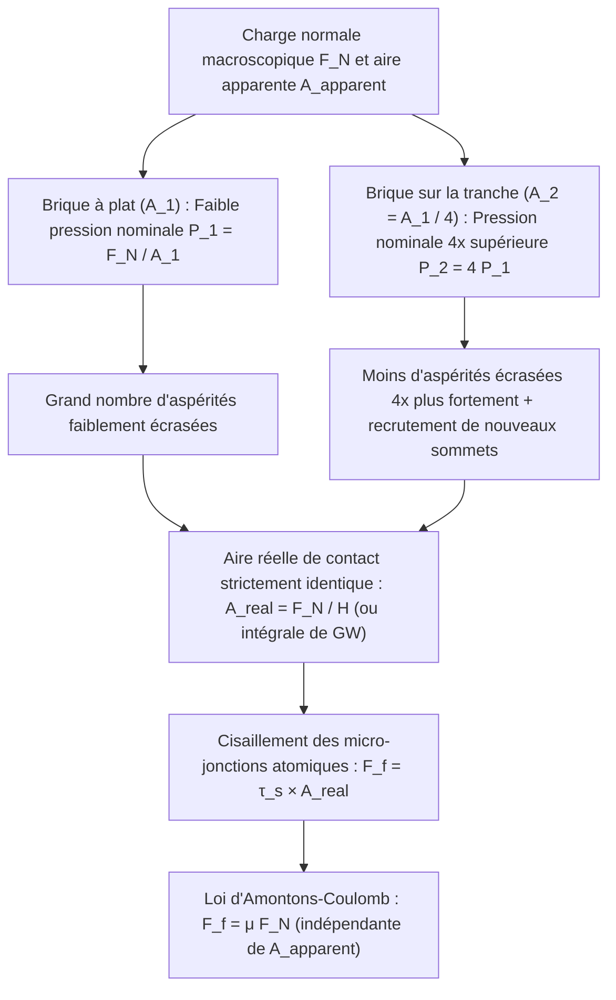
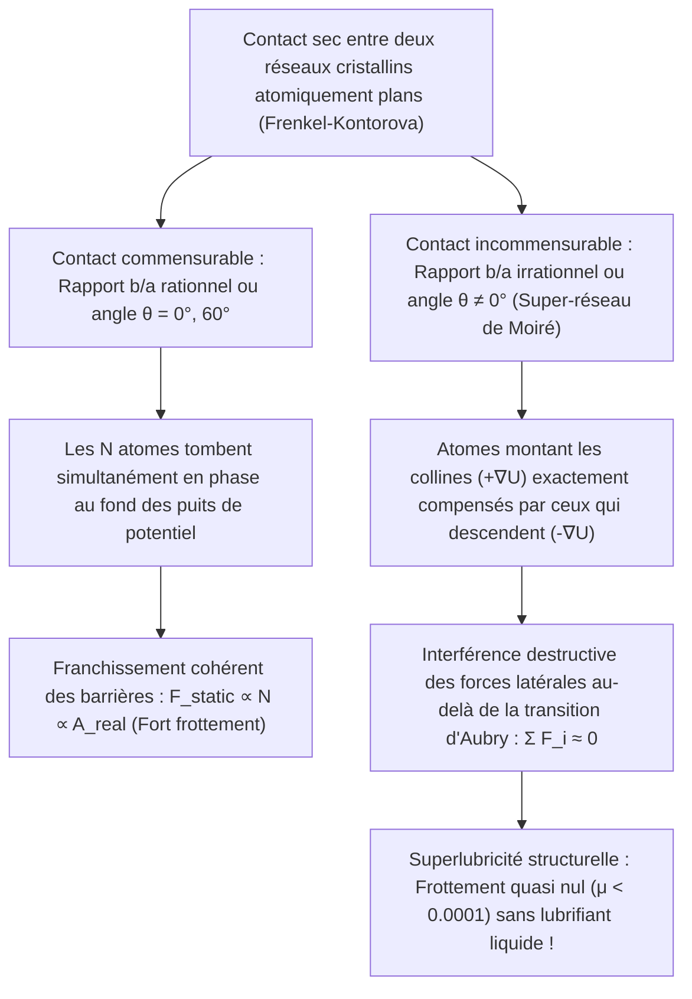

Peu d'équations de la physique classique semblent aussi élémentaires — tout en dissimulant un paradoxe aussi profond — que la loi du frottement sec :

$$F_f = \mu F_N$$

Imaginons une brique rectangulaire posée sur une table horizontale. Si nous la tirons à l'aide d'un dynamomètre lorsqu'elle repose à plat sur sa grande face (surface apparente $A_1 = 200\,\text{cm}^2$), puis lorsque nous la dressons sur sa tranche étroite ($A_2 = 50\,\text{cm}^2$), l'intuition suggère que la grande face devrait offrir beaucoup plus de résistance. Or, l'expérience montre que <strong>la force de frottement $F_f$ demeure rigoureusement identique, bien que la surface géométrique ait varié d'un facteur quatre !</strong> Inversement, si le frottement ne dépend pas de l'aire de contact, pourquoi les monoplaces de Formule 1 utilisent-elles des pneus *slicks* extra-larges ?

Un second mythe tenace prétend qu'un patineur glisse sur la glace parce que la pression exercée par la lame abaisse le point de fusion de la glace et crée un film d'eau liquide. Pourtant, le calcul exact via l'<strong>équation de Clausius-Clapeyron</strong> démontre qu'un patineur de $75\,\text{kg}$ n'abaisse la température de fusion que de $0{,}12^\circ\text{C}$ — ce qui ne saurait expliquer comment l'on patine aisément à $-10^\circ\text{C}$ ou $-20^\circ\text{C}$ !

Dans cet article, nous mobilisons la <strong>tribologie</strong> (la science du frottement, de l'usure et de la lubrification) et la physique des surfaces à l'échelle nanométrique pour résoudre ces énigmes : de la distinction entre <strong>aire de contact apparente ($A_{\text{apparent}}$)</strong> et <strong>aire de contact réelle ($A_{\text{real}}$)</strong> à la dynamique <strong>stick-slip (adhérence-glissement)</strong>, en passant par la <strong>couche quasi liquide (QLL)</strong> de la glace et la <strong>superlubricité structurelle</strong>.

---

## 1. L'énigme classique : les lois d'Amontons-Coulomb et la faillite de l'engrènement géométrique

### 1.1 De Léonard de Vinci (1493) à Amontons (1699) et Coulomb (1785)

Dès 1493, <strong>Léonard de Vinci</strong> consigna dans ses carnets (*Codex Arundel*) que la résistance de frottement est proportionnelle à la charge et indépendante de l'étendue des surfaces. Redécouvertes par le physicien français <strong>Guillaume Amontons (1699)</strong> à l'Académie royale des sciences, enrichies par <strong>Leonhard Euler (1748)</strong> qui introduisit le symbole $\mu = \tan\theta_c$, puis systématisées par <strong>Charles-Augustin de Coulomb (1785)</strong> à l'arsenal de Rochefort, ces observations forment les <strong>trois lois d'Amontons-Coulomb</strong> :

$$\begin{aligned}
\text{1re loi (Proportionnalité à la charge normale) :} & \quad F_f = \mu F_N \\
\text{2e loi (Indépendance de l'aire apparente) :} & \quad \frac{\partial F_f}{\partial A_{\text{apparent}}} = 0 \\
\text{3e loi (Indépendance de la vitesse) :} & \quad \frac{\partial F_k}{\partial v} \approx 0 \quad (\text{avec } F_k = \mu_k F_N < F_s^{\max} = \mu_s F_N)
\end{aligned}$$

Amontons et Coulomb imaginaient que les surfaces étaient couvertes de dents de scie rigides d'angle $\theta$, donnant $F_f = F_N \tan\theta$. Mais le premier principe de la thermodynamique invalide ce modèle : sur une rampe rigide ou purement élastique, le travail $W_{\text{up}} = F_N \Delta h$ dépensé pour gravir une aspérité est <strong>intégralement restitué ($W_{\text{down}} = -F_N \Delta h$) lors de la descente sur le versant opposé</strong> ($\oint \mathbf{F}\cdot d\mathbf{r} = 0$). Pour dissiper de l'énergie en chaleur (<strong>phonons</strong> du réseau cristallin), il faut une irréversibilité microscopique.

---

## 2. Aire apparente vs aire réelle de contact : comment les aspérités résolvent le paradoxe

### 2.1 « Poser la Suisse à l'envers sur l'Autriche » : la théorie adhésive de Bowden et Tabor (1950)

Comme l'ont démontré <strong>Frank Philip Bowden</strong> et <strong>David Tabor</strong> (Cambridge, 1950), même un acier poli miroir présente au microscope à force atomique (AFM) une rugosité $R_q \sim 10\,\text{nm}\text{–}1\,\mu\text{m}$, mille fois supérieure à la portée des liaisons atomiques ($0{,}2\text{–}0{,}4\,\text{nm}$). Selon la célèbre métaphore de Bowden : <strong>« Mettre deux solides en contact revient à retourner la Suisse pour la poser sur l'Autriche : seuls les plus hauts sommets alpins se touchent. »</strong>

Ces sommets microscopiques sont les <strong>aspérités</strong>. La somme des micro-surfaces où les atomes se touchent réellement constitue l'<strong>aire réelle de contact ($A_{\text{real}}$)</strong>, infime devant l'<strong>aire apparente ($A_{\text{apparent}}$)</strong> :

$$A_{\text{real}} = \sum_{i=1}^{N_c} A_i \ll A_{\text{apparent}}, \qquad \frac{A_{\text{real}}}{A_{\text{apparent}}} \sim 10^{-5} \text{ à } 10^{-3}$$

Concentrée sur $A_{\text{real}}$, la contrainte locale $p_{\text{local}} = F_N / A_{\text{real}}$ atteint immédiatement la <strong>dureté d'indentation plastique $H \approx 3\sigma_y$</strong> du matériau. Les pointes d'aspérités s'écrasent plastiquement jusqu'à ce que l'aire réelle équilibre exactement la charge normale $F_N$ :

$$p_{\text{local}} = H \implies A_{\text{real}} = \frac{F_N}{H}$$

Sous cette pression intime, des <strong>micro-jonctions adhésives (soudure à froid)</strong> de résistance au cisaillement $\tau_s$ se forment. Pour glisser, il faut cisailler ces jonctions :

$$F_f = \tau_s A_{\text{real}} = \tau_s \left(\frac{F_N}{H}\right) = \left(\frac{\tau_s}{H}\right) F_N \implies \mu = \frac{\tau_s}{H}$$

Le paradoxe de la brique est résolu : <strong>le frottement est strictement proportionnel à l'aire RÉELLE de contact $A_{\text{real}}$ !</strong> En dressant la brique sur sa tranche, la pression nominale quadruple, écrasant quatre fois plus les aspérités de sorte que $A_{\text{real}} = F_N / H$ reste invariante.

### 2.2 Mécanique statistique élastique de Greenwood-Williamson (1966) et régimes de violation

Pour une sphère élastique unique de rayon $R$, la <strong>théorie de Hertz (1882)</strong> donne $A_{\text{single}} \propto w^{2/3}$. Toutefois, <strong>J. A. Greenwood et J. B. P. Williamson (1966)</strong> ont prouvé qu'en intégrant sur une distribution statistique des hauteurs de sommets $\phi(z) = \frac{1}{\sigma_s} e^{-z/\sigma_s}$, le recrutement continu de nouvelles aspérités maintient la taille moyenne des contacts constante ($\pi R \sigma_s$) tandis que leur nombre croît linéairement avec $F_N$ :

$$A_{\text{real}} = \frac{\sqrt{\pi}}{E^* \sqrt{\sigma_s / R}} F_N \propto F_N$$

<strong>Quand la loi d'Amontons est-elle violée ?</strong> Lorsque $A_{\text{real}} \to A_{\text{apparent}}$ :
1. <strong>Élastomères souples et pneus slicks de Formule 1 (théorie JKR, 1971)</strong> : Avec un module d'Young très faible ($E \sim 1\text{–}10\,\text{MPa}$) et un travail d'adhésion $\Delta\gamma$ régi par l'équation de <strong>Johnson-Kendall-Roberts (JKR)</strong> $a_{\text{JKR}}^3 = \frac{3R}{4E^*}(w + 3\pi R \Delta\gamma + \sqrt{6\pi R \Delta\gamma w + (3\pi R \Delta\gamma)^2})$, le coefficient de frottement diminue avec la pression nominale ($\mu_{\text{eff}} \propto P_{\text{nom}}^{-1/3}$). Un pneu F1 large maximise $A_{\text{apparent}}$ pour abaisser la pression et maximiser l'adhérence.
2. <strong>Setae et spatulae du gecko</strong> : Des millions de fibrilles de kératine ramifiées en spatules de $100\text{–}200\,\text{nm}$ abaissent le module effectif sous le critère de Dahlquist ($E_{\text{eff}} < 100\,\text{kPa}$), assurant $A_{\text{real}} \approx A_{\text{apparent}}$ par forces de van der Waals.
3. <strong>Soudure à froid dans l'ultravide spatial</strong> : En l'absence de couche d'oxyde native ($1\text{–}5\,\text{nm}$), les métaux nus fusionnent spontanément dans le vide spatial ($\mu \to \infty$, cause du blocage de l'antenne de la sonde *Galileo* en 1991).

---

## 3. Dynamique Stick-Slip et loi vitesse-état de Dieterich-Ruina : du violon aux séismes

Un patin de masse $m$ tiré à vitesse $v_0$ par un ressort de raideur $k$ obéit à $m \ddot{x} = k(v_0 t - x) - F_f(\dot{x}, \theta)$. Après une phase de blocage (Stick) de durée $t_{\text{stick}} = \frac{(\mu_s - \mu_k)F_N}{k v_0}$, le patin glisse brutalement (Slip) à la pulsation $\omega_0 = \sqrt{k/m}$ :

$$x(t') = v_0 t' + \frac{(\mu_s - \mu_k)F_N}{k}(1 - \cos\omega_0 t') - \frac{v_0}{\omega_0}\sin\omega_0 t'$$

Pourquoi $\mu_s > \mu_k$ ? Parce que le fluage plastique des aspérités fait croître l'aire réelle logarithmiquement avec le temps d'attente : $A_{\text{real}}(t) = A_0 [1 + c \ln(1 + t/\tau_0)]$ (<strong>vieillissement du contact / Contact Aging</strong>). La <strong>loi vitesse-état de Dieterich-Ruina (Rate-and-State Friction Law, 1979–1983)</strong> couple l'effet direct de vitesse ($a$) et l'état d'âge moyen des contacts ($\theta$, distance critique $D_c$) :

$$\mu(v, \theta) = \mu_0 + a \ln\!\left(\frac{v}{v_*}\right) + b \ln\!\left(\frac{v_* \theta}{D_c}\right), \qquad \frac{d\theta}{dt} = 1 - \frac{v \theta}{D_c}$$

En régime stationnaire ($\theta_{\text{ss}} = D_c / v$), $\mu_{\text{ss}}(v) = \mu_0 + (a - b)\ln(v/v_*)$. Dans le <strong>régime d'affaiblissement dynamique ($a - b < 0$)</strong>, une bifurcation de Hopf déclenche des oscillations stick-slip dès que la raideur $k$ est inférieure à la <strong>raideur critique $k_c$</strong> :

$$k < k_c = \frac{(b - a) F_N}{D_c}$$

Ce mécanisme régit aussi bien le <strong>mouvement de Helmholtz</strong> d'une corde de violon frottée à la colophane que les <strong>mégaséismes de subduction</strong>.

---

## 4. Pourquoi la glace glisse-t-elle vraiment ? Réfutation par Clapeyron et couche quasi liquide (QLL)

Évaluons l'abaissement du point de fusion de la glace ($\text{I}_h$) par l'<strong>équation de Clausius-Clapeyron</strong> ($T_m = 273{,}15\,\text{K}$, chaleur latente $L_f = 3{,}335 \times 10^5\,\text{J/kg}$, $\rho_{\text{liq}} = 999{,}8\,\text{kg/m}^3$, $\rho_{\text{ice}} = 916{,}7\,\text{kg/m}^3$, $\Delta v = -9{,}07 \times 10^{-5}\,\text{m}^3/\text{kg}$) :

$$\frac{dP}{dT_m} = \frac{L_f}{T_m \left(v_{\text{liq}} - v_{\text{ice}}\right)} = \frac{3{,}335 \times 10^5}{(273{,}15)(-9{,}07 \times 10^{-5})} \approx -1{,}346 \times 10^7\,\text{Pa/K} = -13{,}46\,\text{MPa/K}$$

Pour un patineur de $75\,\text{kg}$ ($F_N = 735\,\text{N}$) sur une lame de $30\,\text{cm} \times 1{,}5\,\text{mm}$ ($A = 4{,}5 \times 10^{-4}\,\text{m}^2$), la surpression $\Delta P = 1{,}63\,\text{MPa}$ n'abaisse la température de fusion que de :

$$\Delta T_m = \frac{1{,}63\,\text{MPa}}{-13{,}46\,\text{MPa/K}} \approx -0{,}12^\circ\text{C}$$

La fusion sous pression est donc incapable d'expliquer le patinage à $-10^\circ\text{C}$ ! Les trois mécanismes réels sont :
1. <strong>Préfusion de surface et couche quasi liquide de Faraday (QLL, 1850)</strong> : En surface, les molécules $\text{H}_2\text{O}$ sous-coordonnées (2 ou 3 liaisons hydrogène au lieu de 4) vibrent librement et forment spontanément une <strong>couche quasi liquide (QLL)</strong> de $1\text{–}20\,\text{nm}$ jusqu'à <strong>$-30^\circ\text{C}$</strong> à pression nulle.
2. <strong>Échauffement par frottement (Bowden & Hughes, 1939)</strong> : Le flux thermique $q = \mu P v$ confiné dans l'épaisseur de peau thermique $\delta_{\text{th}} \sim \sqrt{\alpha_{\text{th}} L / v}$ porte localement l'interface à $0^\circ\text{C}$ (d'où la supériorité des semelles de ski isolantes en polyéthylène UHMWPE sur le métal).
3. <strong>Rhéologie viscoélastique complexe de l'eau interfaciale (Canale, Bocquet & Bonn, 2019, *Phys. Rev. X*)</strong> : Le film nanométrique cisaillé présente une viscosité $50\text{ à }100$ fois supérieure à l'eau libre et un module élastique $G'(\omega)$ qui génère une portance élasto-hydrodynamique.

---

## 5. De la courbe de Stribeck à la superlubricité structurelle

Au-delà de la lubrification hydrodynamique décrite par l'<strong>équation de Reynolds (1886)</strong> sur la <strong>courbe de Stribeck</strong> :

$$\frac{\partial}{\partial x}\!\left(\frac{h^3}{12\eta}\frac{\partial p}{\partial x}\right) + \frac{\partial}{\partial y}\!\left(\frac{h^3}{12\eta}\frac{\partial p}{\partial y}\right) = \frac{U}{2}\frac{\partial h}{\partial x} + \frac{\partial h}{\partial t}$$

le <strong>modèle de Prandtl-Tomlinson (1928–1929)</strong> régit le frottement atomique sec via $V_{\text{PT}}(x, X) = -\frac{U_0}{2}\cos(2\pi x/a) + \frac{1}{2}k_{\text{eff}}(x - X)^2$ et le paramètre $\eta_{\text{PT}} = \frac{2\pi^2 U_0}{k_{\text{eff}} a^2}$. Lorsque $\eta_{\text{PT}} \le 1$, l'instabilité stick-slip atomique et la dissipation en phonons disparaissent.

Dans le modèle à $N$ atomes de <strong>Frenkel-Kontorova</strong>, <strong>Motohisa Hirano et Kazumasa Shinjo (1990)</strong> ont prédit la <strong>superlubricité structurelle</strong> (confirmée sur le graphite tourné par <strong>Dienwiebel et al., 2004</strong>) : lorsque deux réseaux cristallins rigides (au-delà de la <strong>transition d'Aubry</strong>) sont en <strong>contact incommensurable</strong> (super-réseau de Moiré du graphène ou $\text{MoS}_2$), les forces latérales sur les atomes s'annulent par interférence destructive ($\sum F_i \approx 0$), abaissant le coefficient de frottement sous <strong>$\mu < 0{,}0001$</strong> !

---

## 6. Synthèse : tableau comparatif des régimes tribologiques

| Régime tribologique | Mécanisme microscopique dominant | Loi d'échelle de l'aire réelle | Coefficient $\mu$ typique | Équations et modèles fondamentaux |
| :--- | :--- | :--- | :--- | :--- |
| <strong>Frottement sec des solides durs</strong> | Écrasement plastique ou élastique statistique des aspérités + cisaillement | $A_{\text{real}} \propto F_N \ll A_{\text{apparent}}$ (indépendant de $A_{\text{apparent}}$) | $0{,}15 \text{ – } 0{,}80$ | Bowden-Tabor ($A_{\text{real}}=F_N/H$), Greenwood-Williamson (1966), Persson |
| <strong>Élastomères souples & pattes de gecko</strong> | Contact conforme à faible $E_{\text{eff}}$ + adhésion de van der Waals | $A_{\text{real}} \to A_{\text{apparent}}$ (croît avec $A_{\text{apparent}}$) | $0{,}80 \text{ – } 3{,}0+$ | Théorie adhésive JKR (1971), critère de Dahlquist ($E_{\text{eff}} < 100\,\text{kPa}$) |
| <strong>Instabilité Stick-Slip</strong> | Vieillissement logarithmique de $A_{\text{real}}(t)$ vs rajeunissement sur $D_c$ | $A_{\text{real}}(t) = A_0[1 + c\ln(1+t/\tau_0)]$ | $\mu_s(t) > \mu_k(v)$ | Loi vitesse-état de Dieterich-Ruina (RSF), raideur critique $k_c = \frac{(b-a)F_N}{D_c}$ |
| <strong>Lubrification de la glace (patinage)</strong> | Couche quasi liquide (QLL) sous-coordonnée + fusion thermique + portance viscoélastique | QLL ($1\text{–}20\,\text{nm}$) & film fondu séparent les aspérités jusqu'à $-30^\circ\text{C}$ | $0{,}005 \text{ – } 0{,}03$ | Préfusion de Faraday (1850), Bowden-Hughes, Bocquet-Bonn (2019) |
| <strong>Lubrification hydrodynamique</strong> | Coin fluide convergent générant une pression hydrodynamique $p(x,y)$ | Aucun contact solide ($\Lambda = h_{\min}/\sigma^* > 3$) | $0{,}001 \text{ – } 0{,}005$ | Courbe de Stribeck (1902), équation de Reynolds (1886) |
| <strong>Superlubricité structurelle (cristaux 2D)</strong> | Interférence destructive des forces latérales dans un réseau de Moiré incommensurable | Annulation en volume ; effet de bord seul ($F_f \propto A^{0\text{–}0{,}5}$) | $< 0{,}0001$ | Prandtl-Tomlinson ($\eta_{\text{PT}} \le 1$), Frenkel-Kontorova, Hirano (1990) |
