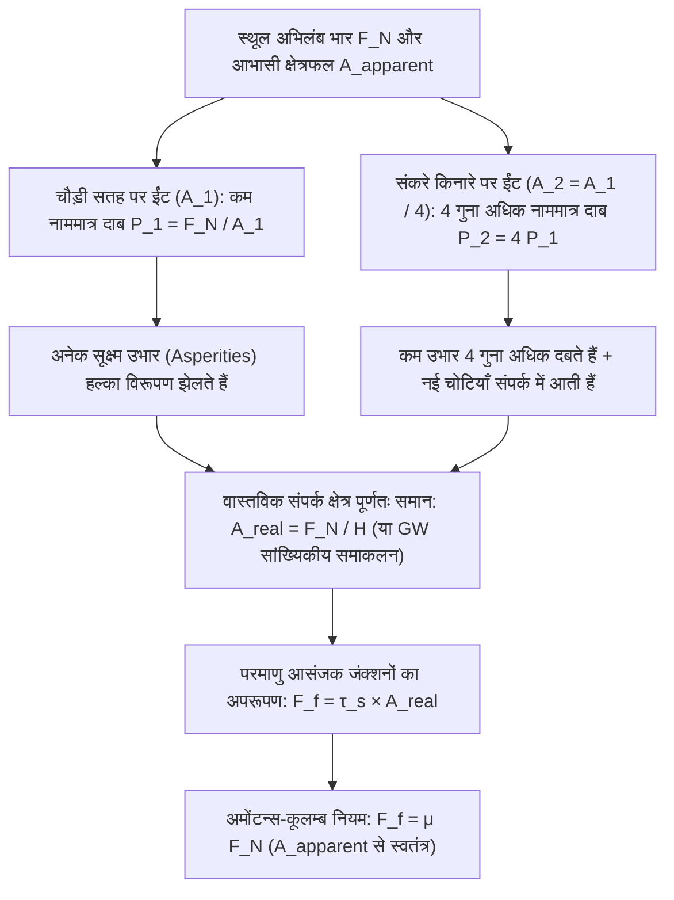
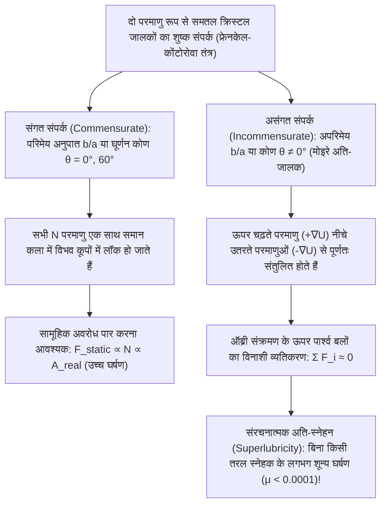

प्रारंभिक भौतिकी में शायद ही कोई समीकरण इतना सरल दिखता हो—और साथ ही अपने भीतर इतना गहरा भौतिक विरोधाभास छिपाए हो—जितना कि शुष्क सर्पी घर्षण (dry sliding friction) का शास्त्रीय नियम:

$$F_f = \mu F_N$$

कल्पना कीजिए कि एक समतल मेज पर एक आयताकार ईंट रखी है। यदि हम इसे स्प्रिंग तुला से क्षैतिज रूप से तब खींचते हैं जब यह अपनी चौड़ी सतह पर पड़ी हो (आभासी संपर्क क्षेत्र $A_1 = 200\,\text{cm}^2$), और फिर तब खींचते हैं जब उसी ईंट को उसके संकरे किनारे पर खड़ा किया गया हो ($A_2 = 50\,\text{cm}^2$), तो हमारा सामान्य सहज ज्ञान कहता है कि चार गुना बड़े क्षेत्रफल वाली चौड़ी सतह में घर्षण बहुत अधिक होना चाहिए। किंतु प्रयोग सिद्ध करता है कि <strong>ज्यामितीय संपर्क क्षेत्र चार गुना बदलने पर भी ईंट को खींचने के लिए आवश्यक घर्षण बल $F_f$ बिल्कुल समान रहता है!</strong> इसके विपरीत, यदि घर्षण वास्तव में क्षेत्रफल पर निर्भर नहीं करता, तो फॉर्मूला 1 (F1) रेसिंग कारें इतनी चौड़ी और बिना खांचे वाली 'स्लिक टायरों' (Slick Tires) का उपयोग क्यों करती हैं?

दूसरा प्रसिद्ध मिथक यह है कि आइस स्केटर बर्फ पर इसलिए फिसलता है क्योंकि पतले ब्लेड के नीचे उच्च दाब बर्फ के गलनांक को कम कर देता है और पानी की एक परत बना देता है। परंतु ऊष्मागतिकी के <strong>क्लॉसियस-क्लैपेरॉन समीकरण (Clausius–Clapeyron Equation)</strong> से सटीक गणना करने पर पता चलता है कि $75\,\text{kg}$ का स्केटर बर्फ के गलनांक को मात्र $0.12^\circ\text{C}$ ही कम कर पाता है—जो यह बिल्कुल नहीं समझा सकता कि लोग $-10^\circ\text{C}$ या $-20^\circ\text{C}$ के तापमान पर आसानी से स्केटिंग कैसे कर लेते हैं!

इस लेख में हम <strong>ट्राइबोलॉजी (Tribology — घर्षण, घिसाव और स्नेहन का विज्ञान)</strong> और नैनो-स्तरीय पृष्ठ भौतिकी (surface physics) के माध्यम से इन पहेलियों को सुलझाएंगे: <strong>आभासी संपर्क क्षेत्र ($A_{\text{apparent}}$)</strong> बनाम <strong>वास्तविक संपर्क क्षेत्र ($A_{\text{real}}$)</strong>, <strong>स्टिक-स्लिप (Stick-Slip) गतिकी</strong>, बर्फ की <strong>अर्ध-द्रव परत (Quasi-Liquid Layer - QLL)</strong>, और लगभग शून्य घर्षण प्रदान करने वाला <strong>संरचनात्मक अति-स्नेहन (Structural Superlubricity)</strong>।

---

## 1. शास्त्रीय पहेली: अमोंटन्स-कूलम्ब के नियम और ज्यामितीय इंटरलॉकिंग मॉडल की विफलता

### 1.1 लियोनार्डो दा विंची (1493) से अमोंटन्स (1699) और कूलम्ब (1785) तक

लगभग 1493 में <strong>लियोनार्डो दा विंची</strong> ने अपनी नोटबुक (*कोडेक्स अरुंडेल*) में प्रयोगों द्वारा दर्ज किया कि घर्षण बल अभिलंब भार के समानुपाती होता है और संपर्क क्षेत्र से स्वतंत्र होता है। बाद में <strong>गियोम अमोंटन्स (Guillaume Amontons, 1699)</strong> द्वारा पुन: खोजे जाने, <strong>लियोनहार्ड यूलर (Leonhard Euler, 1748)</strong> द्वारा घर्षण गुणांक $\mu = \tan\theta_c$ परिभाषित किए जाने, और <strong>चार्ल्स-ऑगस्टिन डी कूलम्ब (Charles-Augustin de Coulomb, 1785)</strong> के व्यापक प्रयोगों के बाद <strong>शुष्क घर्षण के तीन शास्त्रीय नियम</strong> स्थापित हुए:

$$\begin{aligned}
\text{प्रथम नियम (अभिलंब बल के समानुपाती):} & \quad F_f = \mu F_N \\
\text{द्वितीय नियम (आभासी क्षेत्रफल से स्वतंत्रता):} & \quad \frac{\partial F_f}{\partial A_{\text{apparent}}} = 0 \\
\text{तृतीय नियम (सर्पी वेग से स्वतंत्रता):} & \quad \frac{\partial F_k}{\partial v} \approx 0 \quad (\text{जहाँ } F_k = \mu_k F_N < F_s^{\max} = \mu_s F_N)
\end{aligned}$$

$\tan\theta$ ढलान वाले कठोर सूक्ष्म आरी-दांतों (sawtooth) का मॉडल ($F_f = F_N \tan\theta$) ऊष्मागतिकी के प्रथम नियम (ऊर्जा संरक्षण) का उल्लंघन करता है: एक पूर्णतः कठोर या शुद्ध प्रत्यास्थ ढलान पर उभार के शिखर तक चढ़ने में किया गया कार्य $W_{\text{up}} = F_N \Delta h$, <strong>दूसरी ओर से नीचे फिसलते समय गुरुत्वाकर्षण द्वारा $100\%$ वापस मिल जाता है ($W_{\text{down}} = -F_N \Delta h$)</strong> ($\oint \mathbf{F}\cdot d\mathbf{r} = 0$)। वास्तविक घर्षण के लिए अनुत्क्रमणीय विरूपण और क्रिस्टल जालक कंपनों (<strong>फोनॉन / Phonons</strong>) के रूप में ऊर्जा का क्षय आवश्यक है।

---

## 2. आभासी बनाम वास्तविक संपर्क क्षेत्र: सूक्ष्म उभार (Asperities) ईंट के विरोधाभास को कैसे सुलझाते हैं

### 2.1 "स्विट्जरलैंड को उल्टा करके ऑस्ट्रिया के ऊपर रखना": बाउडेन और टेबर का आसंजन सिद्धांत (1950)

कैम्ब्रिज के भौतिकविदों <strong>फ्रैंक फिलिप बाउडेन (Frank Philip Bowden)</strong> और <strong>डेविड टेबर (David Tabor)</strong> (1950) ने दिखाया कि दर्पण की तरह पॉलिश किए गए स्टील के ब्लॉक में भी परमाणु बल सूक्ष्मदर्शी (AFM) के नीचे $R_q \sim 10\,\text{nm}\text{–}1\,\mu\text{m}$ का खुरदरापन होता है, जो परमाणु बंधन की दूरी ($0.2\text{–}0.4\,\text{nm}$) से हजारों गुना बड़ा है। बाउडेन के प्रसिद्ध शब्दों में: <strong>"दो ठोस पदार्थों को एक साथ रखना स्विट्जरलैंड को उल्टा करके ऑस्ट्रिया के ऊपर रखने जैसा है—वे केवल आल्प्स की सबसे ऊँची चोटियों के सिरों पर ही स्पर्श करते हैं।"</strong>

इन सूक्ष्म चोटियों को <strong>एस्पेरिटीज (Asperities / सूक्ष्म उभार)</strong> कहा जाता है। इन उभारों के सिरों पर वास्तविक परमाणु संपर्क क्षेत्रों का योग <strong>वास्तविक संपर्क क्षेत्र ($A_{\text{real}}$)</strong> कहलाता है, जो ज्यामितीय <strong>आभासी संपर्क क्षेत्र ($A_{\text{apparent}}$)</strong> की तुलना में अत्यंत सूक्ष्म होता है:

$$A_{\text{real}} = \sum_{i=1}^{N_c} A_i \ll A_{\text{apparent}}, \qquad \frac{A_{\text{real}}}{A_{\text{apparent}}} \sim 10^{-5} \text{ से } 10^{-3}$$

चूँकि संपूर्ण अभिलंब बल $F_N$ इसी सूक्ष्म $A_{\text{real}}$ पर केंद्रित होता है, उभारों के सिरों पर स्थानीय दाब $p_{\text{local}} = F_N / A_{\text{real}}$ तुरंत पदार्थ की <strong>सुघट्य कठोरता (Plastic Indentation Hardness) $H \approx 3\sigma_y$</strong> तक पहुँच जाता है। उभार तब तक दबकर फैलते हैं जब तक कि वास्तविक क्षेत्रफल भार $F_N$ को संभालने योग्य न हो जाए:

$$p_{\text{local}} = H \implies A_{\text{real}} = \frac{F_N}{H}$$

इन परमाणु संपर्क बिंदुओं पर अपरूपण सामर्थ्य $\tau_s$ वाले <strong>आसंजक सूक्ष्म-जंक्शन (शीत-वेल्डिंग)</strong> बन जाते हैं। फिसलने के लिए इन जंक्शनों को काटना पड़ता है:

$$F_f = \tau_s A_{\text{real}} = \tau_s \left(\frac{F_N}{H}\right) = \left(\frac{\tau_s}{H}\right) F_N \implies \mu = \frac{\tau_s}{H}$$

इससे ईंट का विरोधाभास पूरी तरह सुलझ जाता है: <strong>घर्षण बल वास्तव में 'वास्तविक संपर्क क्षेत्र' $A_{\text{real}}$ के सीधे समानुपाती होता है!</strong> ईंट को संकरे किनारे पर खड़ा करने से दाब चार गुना बढ़ जाता है, जिससे उभार चार गुना अधिक दबते हैं और कुल वास्तविक क्षेत्रफल $A_{\text{real}} = F_N / H$ अपरिवर्तित रहता है!

### 2.2 ग्रीनवुड-विलियमसन (1966) प्रत्यास्थ सांख्यिकीय यांत्रिकी और अमोंटन्स नियम के अपवाद

त्रिज्या $R$ के एकल प्रत्यास्थ गोले के लिए <strong>हर्ट्ज़ का सिद्धांत (1882)</strong> $A_{\text{single}} \propto w^{2/3}$ देता है। किंतु <strong>जे. ए. ग्रीनवुड और जे. बी. पी. विलियमसन (1966)</strong> ने सिद्ध किया कि उभारों की ऊँचाई के प्रायिकता वितरण $\phi(z) = \frac{1}{\sigma_s} e^{-z/\sigma_s}$ पर समाकलन करने पर नए उभारों के निरंतर संपर्क में आने से प्रति संपर्क औसत क्षेत्रफल ($\pi R \sigma_s$) स्थिर रहता है और संपर्कों की संख्या $F_N$ के साथ रैखिक रूप से बढ़ती है:

$$A_{\text{real}} = \frac{\sqrt{\pi}}{E^* \sqrt{\sigma_s / R}} F_N \propto F_N$$

<strong>अमोंटन्स का नियम कब टूटता है?</strong> जब $A_{\text{real}} \to A_{\text{apparent}}$:
1. <strong>नरम रबर और फॉर्मूला 1 स्लिक टायर (JKR सिद्धांत, 1971)</strong>: कम प्रत्यास्थता मापांक ($E \sim 1\text{–}10\,\text{MPa}$) और <strong>जॉनसन-केंडल-रॉबर्ट्स (JKR)</strong> समीकरण $a_{\text{JKR}}^3 = \frac{3R}{4E^*}(w + 3\pi R \Delta\gamma + \sqrt{6\pi R \Delta\gamma w + (3\pi R \Delta\gamma)^2})$ के कारण उच्च दाब पर प्रभावी घर्षण गुणांक घटता है ($\mu_{\text{eff}} \propto P_{\text{nom}}^{-1/3}$)। चौड़े F1 टायर $A_{\text{apparent}}$ को बढ़ाकर दाब घटाते हैं और अधिकतम पकड़ (grip) देते हैं।
2. <strong>छिपकली (Gecko) के पैर के नैनो-रोम (Setae & Spatulae)</strong>: $100\text{–}200\,\text{nm}$ चौड़े स्पैटुला में विभाजित लाखों केराटिन रोम प्रभावी मापांक को डालक्विस्ट मानदंड ($E_{\text{eff}} < 100\,\text{kPa}$) से नीचे ले आते हैं और वान डर वाल्स बलों द्वारा $A_{\text{real}} \approx A_{\text{apparent}}$ प्राप्त करते हैं।
3. <strong>अंतरिक्ष के अति-उच्च निर्वात में शीत-वेल्डिंग (Cold Welding)</strong>: सुरक्षात्मक ऑक्साइड परत ($1\text{–}5\,\text{nm}$) के बिना स्वच्छ धातुएं निर्वात ($P < 10^{-10}\,\text{Pa}$) में तुरंत जुड़ जाती हैं ($\mu \to \infty$, 1991 में *गैलीलियो* अंतरिक्ष यान के एंटीना जाम होने का कारण)।

---

## 3. स्टिक-स्लिप (Stick-Slip) गतिकी और डाइटरिच-रुइना नियम: वायलिन से महाभूकंप तक

द्रव्यमान $m$ का ब्लॉक जब कठोरता $k$ की स्प्रिंग द्वारा वेग $v_0$ से खींचा जाता है, तो $m \ddot{x} = k(v_0 t - x) - F_f(\dot{x}, \theta)$ के अनुसार $t_{\text{stick}} = \frac{(\mu_s - \mu_k)F_N}{k v_0}$ तक चिपकने (Stick) के बाद प्राकृतिक आवृत्ति $\omega_0 = \sqrt{k/m}$ से तेजी से फिसलता (Slip) है:

$$x(t') = v_0 t' + \frac{(\mu_s - \mu_k)F_N}{k}(1 - \cos\omega_0 t') - \frac{v_0}{\omega_0}\sin\omega_0 t'$$

$\mu_s > \mu_k$ क्यों होता है? क्योंकि स्थिर संपर्क समय $t$ के दौरान उभारों के विसर्पण (creep) से वास्तविक क्षेत्रफल लघुगणकीय रूप से बढ़ता है: $A_{\text{real}}(t) = A_0 [1 + c \ln(1 + t/\tau_0)]$ (<strong>संपर्क कालप्रभावन / Contact Aging</strong>)। <strong>डाइटरिच-रुइना दर-और-अवस्था घर्षण नियम (Rate-and-State Friction Law, 1979–1983)</strong> प्रत्यक्ष वेग प्रभाव ($a$) और संपर्क आयु अवस्था ($\theta$, क्रांतिक दूरी $D_c$) को जोड़ता है:

$$\mu(v, \theta) = \mu_0 + a \ln\!\left(\frac{v}{v_*}\right) + b \ln\!\left(\frac{v_* \theta}{D_c}\right), \qquad \frac{d\theta}{dt} = 1 - \frac{v \theta}{D_c}$$

स्थायी अवस्था ($\theta_{\text{ss}} = D_c / v$) में $\mu_{\text{ss}}(v) = \mu_0 + (a - b)\ln(v/v_*)$। <strong>वेग-दुर्बलीकरण क्षेत्र ($a - b < 0$)</strong> में जब तंत्र की कठोरता $k$ <strong>क्रांतिक कठोरता $k_c$</strong> से कम होती है, तो हॉफ द्विभाजन द्वारा स्टिक-स्लिप दोलन उत्पन्न होते हैं:

$$k < k_c = \frac{(b - a) F_N}{D_c}$$

यही समीकरण बिरोजा (rosin) लगे वायलिन के तार की <strong>हेल्महोल्ट्ज़ गति</strong> और सबडक्शन ज़ोन के <strong>महाभूकंपों</strong> दोनों को नियंत्रित करता है।

---

## 4. बर्फ वास्तव में फिसलन भरी क्यों होती है? क्लॉसियस-क्लैपेरॉन खंडन और अर्ध-द्रव परत (QLL)

आइए <strong>क्लॉसियस-क्लैपेरॉन समीकरण</strong> से बर्फ ($\text{I}_h$) के गलनांक में कमी की गणना करें ($T_m = 273.15\,\text{K}$, गुप्त ऊष्मा $L_f = 3.335 \times 10^5\,\text{J/kg}$, $\rho_{\text{liq}} = 999.8\,\text{kg/m}^3$, $\rho_{\text{ice}} = 916.7\,\text{kg/m}^3$, $\Delta v = -9.07 \times 10^{-5}\,\text{m}^3/\text{kg}$):

$$\frac{dP}{dT_m} = \frac{L_f}{T_m \left(v_{\text{liq}} - v_{\text{ice}}\right)} = \frac{3.335 \times 10^5}{(273.15)(-9.07 \times 10^{-5})} \approx -1.346 \times 10^7\,\text{Pa/K} = -13.46\,\text{MPa/K}$$

$30\,\text{cm} \times 1.5\,\text{mm}$ ($A = 4.5 \times 10^{-4}\,\text{m}^2$) के ब्लेड पर खड़े $75\,\text{kg}$ ($F_N = 735\,\text{N}$) के स्केटर द्वारा उत्पन्न दाब $\Delta P = 1.63\,\text{MPa}$ गलनांक को केवल इतना घटाता है:

$$\Delta T_m = \frac{1.63\,\text{MPa}}{-13.46\,\text{MPa/K}} \approx -0.12^\circ\text{C}$$

अतः दाब-पिघलना $-10^\circ\text{C}$ पर स्केटिंग की व्याख्या कदापि नहीं कर सकता! इसके तीन वास्तविक भौतिक कारण हैं:
1. <strong>पृष्ठ पूर्व-पिघलना और फैराडे की अर्ध-द्रव परत (QLL, 1850)</strong>: बर्फ की ऊपरी सतह के $\text{H}_2\text{O}$ अणुओं में 4 के बजाय केवल 2 या 3 हाइड्रोजन बंध होते हैं; वे तीव्रता से कंपन करते हैं और शून्य बाह्य दाब पर भी <strong>$-30^\circ\text{C}$</strong> तक $1\text{–}20\,\text{nm}$ मोटी <strong>अर्ध-द्रव परत (Quasi-Liquid Layer - QLL)</strong> बनाते हैं।
2. <strong>घर्षण तापन (Bowden & Hughes, 1939)</strong>: गति $v$ के दौरान घर्षण ऊष्मा फ्लक्स $q = \mu P v$ पतली तापीय परत $\delta_{\text{th}} \sim \sqrt{\alpha_{\text{th}} L / v}$ को तुरंत $0^\circ\text{C}$ तक गर्म कर जल की परत बनाता है (इसीलिए कम ऊष्मा चालकता वाले पॉलीइथिलीन UHMWPE स्की धातु के स्की से कहीं बेहतर फिसलते हैं)।
3. <strong>अंतरापृष्ठीय जल की जटिल विस्कोइलास्टिक रियोलॉजी (Canale, Bocquet & Bonn, 2019, *Phys. Rev. X*)</strong>: नैनो-जल परत की प्रभावी श्यानता सामान्य पानी से $50\text{–}100$ गुना अधिक होती है और इसका प्रत्यास्थ मापांक $G'(\omega)$ ब्लेड को ऊपर उठाए रखने वाला बल (lift) प्रदान करता है।

---

## 5. स्ट्राइबेक वक्र से संरचनात्मक अति-स्नेहन (Structural Superlubricity) तक

<strong>स्ट्राइबेक वक्र</strong> पर <strong>रेनॉल्ड्स समीकरण (1886)</strong> द्वारा शासित द्रवगतिकीय स्नेहन के अलावा:

$$\frac{\partial}{\partial x}\!\left(\frac{h^3}{12\eta}\frac{\partial p}{\partial x}\right) + \frac{\partial}{\partial y}\!\left(\frac{h^3}{12\eta}\frac{\partial p}{\partial y}\right) = \frac{U}{2}\frac{\partial h}{\partial x} + \frac{\partial h}{\partial t}$$

<strong>प्रैंडटल-टॉमलिंसन मॉडल (1928–1929)</strong> परमाणु स्तर के शुष्क घर्षण को $V_{\text{PT}}(x, X) = -\frac{U_0}{2}\cos(2\pi x/a) + \frac{1}{2}k_{\text{eff}}(x - X)^2$ और प्राचल $\eta_{\text{PT}} = \frac{2\pi^2 U_0}{k_{\text{eff}} a^2}$ द्वारा समझाता है। जब $\eta_{\text{PT}} \le 1$ होता है, तो परमाणु स्टिक-स्लिप और फोनॉन ऊर्जा क्षय समाप्त हो जाता है।

$N$ परमाणुओं के <strong>फ्रेनकेल-कोंटोरोवा मॉडल</strong> में जापानी भौतिकविदों <strong>मोटोहिसा हिरानो और काज़ुमासा शिंजो (1990)</strong> ने <strong>संरचनात्मक अति-स्नेहन</strong> की भविष्यवाणी की (जिसे <strong>Dienwiebel et al., 2004</strong> ने घुमाए गए ग्रेफाइट पर सिद्ध किया): <strong>असंगत संपर्क (Incommensurate Contact)</strong> में (जैसे ग्राफीन या $\text{MoS}_2$ के मोइरे अति-जालक में <strong>ऑब्री संक्रमण</strong> के ऊपर), परमाणुओं पर लगने वाले पार्श्व बल विनाशी व्यतिकरण ($\sum F_i \approx 0$) द्वारा एक-दूसरे को निरस्त कर देते हैं, जिससे शुष्क घर्षण गुणांक गिरकर <strong>$\mu < 0.0001$</strong> रह जाता है!

---

## 6. सारांश: ट्राइबोलॉजिकल व्यवस्थाओं की तुलनात्मक तालिका

| ट्राइबोलॉजिकल व्यवस्था | प्रमुख सूक्ष्म भौतिक तंत्र | वास्तविक संपर्क क्षेत्र का नियम | विशिष्ट घर्षण गुणांक $\mu$ | मूल समीकरण और सिद्धांत |
| :--- | :--- | :--- | :--- | :--- |
| <strong>कठोर ठोसों का शुष्क घर्षण</strong> | सूक्ष्म उभारों का सुघट्य या सांख्यिकीय प्रत्यास्थ विरूपण + जंक्शन अपरूपण | $A_{\text{real}} \propto F_N \ll A_{\text{apparent}}$ ($A_{\text{apparent}}$ से स्वतंत्र) | $0.15 \text{ – } 0.80$ | बाउडेन-टेबर ($A_{\text{real}}=F_N/H$), ग्रीनवुड-विलियमसन (1966), पर्सन |
| <strong>नरम रबर और छिपकली आसंजन</strong> | कम $E_{\text{eff}}$ द्वारा पूर्ण संपर्क + वान डर वाल्स आसंजन | $A_{\text{real}} \to A_{\text{apparent}}$ ($A_{\text{apparent}}$ के साथ बढ़ता है) | $0.80 \text{ – } 3.0+$ | JKR आसंजन सिद्धांत (1971), डालक्विस्ट मानदंड ($E_{\text{eff}} < 100\,\text{kPa}$) |
| <strong>स्टिक-स्लिप अस्थिरता</strong> | स्थिर अवस्था में $A_{\text{real}}(t)$ की लघुगणकीय वृद्धि बनाम $D_c$ पर नवीनीकरण | $A_{\text{real}}(t) = A_0[1 + c\ln(1+t/\tau_0)]$ | $\mu_s(t) > \mu_k(v)$ | डाइटरिच-रुइना नियम (RSF), क्रांतिक कठोरता $k_c = \frac{(b-a)F_N}{D_c}$ |
| <strong>बर्फ का स्नेहन (स्केटिंग और स्कीइंग)</strong> | अर्ध-द्रव परत (QLL) + घर्षण तापन + विस्कोइलास्टिक उत्थापन बल | QLL ($1\text{–}20\,\text{nm}$) और पिघली परत $-30^\circ\text{C}$ तक उभारों को अलग रखती है | $0.005 \text{ – } 0.03$ | फैराडे पूर्व-पिघलना (1850), बाउडेन-ह्यूजेस, बोके-बॉन (2019) |
| <strong>द्रवगतिकीय स्नेहन (Hydrodynamic)</strong> | अभिसारी तरल पच्चर द्वारा स्वतः द्रवगतिकीय दाब $p(x,y)$ का निर्माण | शून्य ठोस संपर्क ($\Lambda = h_{\min}/\sigma^* > 3$) | $0.001 \text{ – } 0.005$ | स्ट्राइबेक वक्र (1902), रेनॉल्ड्स समीकरण (1886) |
| <strong>संरचनात्मक अति-स्नेहन (2D क्रिस्टल)</strong> | असंगत मोइरे जालक में पार्श्व परमाणु बलों का विनाशी कला व्यतिकरण | आंतरिक बल निरस्त ($F_f \propto A^{0\text{–}0.5}$) | $< 0.0001$ | प्रैंडटल-टॉमलिंसन ($\eta_{\text{PT}} \le 1$), फ्रेनकेल-कोंटोरोवा, हिरानो (1990) |
