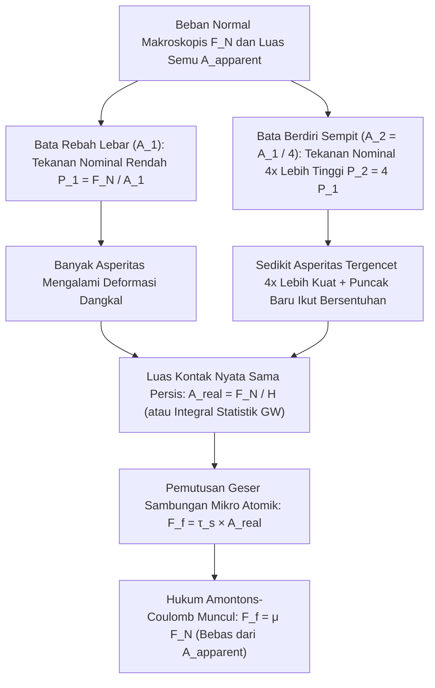
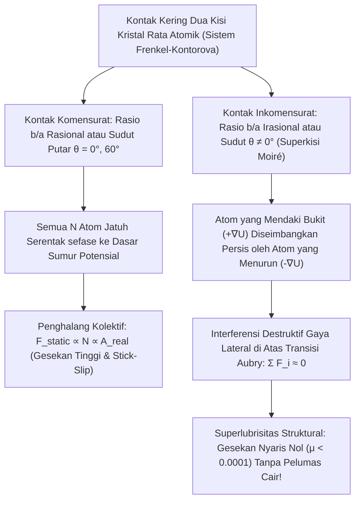

Hanya sedikit persamaan dalam fisika dasar yang tampak begitu sederhana—namun menyimpan paradoks fisik yang begitu mendalam—seperti hukum gesekan kering klasik:

$$F_f = \mu F_N$$

Bayangkan sebuah batu bata persegi panjang di atas meja datar. Jika kita menariknya secara horizontal dengan neraca pegas saat ia rebah pada sisi lebarnya (luas kontak semu $A_1 = 200\,\text{cm}^2$) dan kemudian saat ia berdiri pada sisi sempitnya ($A_2 = 50\,\text{cm}^2$), intuisi sehari-hari mengatakan bahwa sisi yang empat kali lebih luas seharusnya menghasilkan hambatan gesek yang jauh lebih besar. Namun eksperimen membuktikan bahwa <strong>gaya gesek $F_f$ tetap persis sama meskipun luas permukaan geometrisnya berubah empat kali lipat!</strong> Sebaliknya, jika gesekan benar-benar tidak bergantung pada luas kontak, mengapa mobil balap Formula 1 menggunakan ban *slick* tanpa alur yang sangat lebar?

Mitos klasik kedua menyatakan bahwa pemain seluncur es (*ice skating*) dapat meluncur karena tekanan tinggi di bawah pisau sepatu menurunkan titik leleh es dan menciptakan lapisan air cair. Namun perhitungan eksak menggunakan <strong>persamaan termodinamika Clausius-Clapeyron</strong> menunjukkan bahwa pemain seluncur seberat $75\,\text{kg}$ hanya menurunkan titik leleh es sebesar $0{,}12^\circ\text{C}$—sama sekali tidak mampu menjelaskan bagaimana orang berseluncur dengan mulus pada suhu $-10^\circ\text{C}$ atau $-20^\circ\text{C}$!

Dalam artikel ini, kita menyelami <strong>tribologi</strong> (ilmu tentang gesekan, keausan, dan pelumasan) melalui fisika permukaan skala nano: perbedaan antara <strong>luas kontak semu ($A_{\text{apparent}}$)</strong> dan <strong>luas kontak nyata ($A_{\text{real}}$)</strong>, dinamika <strong>stick-slip (lekat-gelincir)</strong>, <strong>lapisan kuasi-cair (QLL)</strong> pada permukaan es, hingga <strong>superlubrisitas struktural</strong>.

---

## 1. Teka-Teki Klasik: Hukum Amontons-Coulomb dan Runtuhnya Model Penguncian Geometris

### 1.1 Dari Leonardo da Vinci (1493) hingga Amontons (1699) dan Coulomb (1785)

Sekitar tahun 1493, <strong>Leonardo da Vinci</strong> mencatat melalui eksperimen balok kayu (*Codex Arundel*) bahwa gaya gesek sebanding dengan beban normal dan tidak bergantung pada luas kontak. Ditemukan kembali oleh <strong>Guillaume Amontons (1699)</strong>, diformalkan oleh <strong>Leonhard Euler (1748)</strong> dengan simbol $\mu = \tan\theta_c$, dan dikonsolidasikan oleh <strong>Charles-Augustin de Coulomb (1785)</strong>, pengamatan ini membentuk <strong>tiga hukum klasik Amontons-Coulomb</strong>:

$$\begin{aligned}
\text{Hukum ke-1 (Sebanding dengan gaya normal):} & \quad F_f = \mu F_N \\
\text{Hukum ke-2 (Independen terhadap luas semu):} & \quad \frac{\partial F_f}{\partial A_{\text{apparent}}} = 0 \\
\text{Hukum ke-3 (Independen terhadap kecepatan):} & \quad \frac{\partial F_k}{\partial v} \approx 0 \quad (\text{dengan } F_k = \mu_k F_N < F_s^{\max} = \mu_s F_N)
\end{aligned}$$

Model gigi gergaji kaku dengan kemiringan $\tan\theta$ ($F_f = F_N \tan\theta$) melanggar hukum pertama termodinamika: pada lereng yang sepenuhnya kaku atau elastis murni, usaha $W_{\text{up}} = F_N \Delta h$ untuk mengangkat balok ke puncak tonjolan <strong>dipulihkan $100\%$ ($W_{\text{down}} = -F_N \Delta h$) saat balok menuruni sisi sebaliknya</strong> ($\oint \mathbf{F}\cdot d\mathbf{r} = 0$). Gesekan sejati menuntut deformasi tak-terbalikkan (ireversibel) dan disipasi energi menjadi getaran kisi kristal (<strong>fonon</strong>).

---

## 2. Luas Kontak Semu vs. Luas Kontak Nyata: Bagaimana Mikro-Asperitas Memecahkan Paradoks Batu Bata

### 2.1 "Meletakkan Swiss Terbalik di Atas Austria": Teori Adhesi Plastis Bowden & Tabor (1950)

Sebagaimana ditunjukkan oleh fisikawan Cambridge <strong>Frank Philip Bowden</strong> dan <strong>David Tabor</strong> (1950), bahkan balok baja yang dipoles sehalus cermin masih memiliki kekasaran permukaan $R_q \sim 10\,\text{nm}\text{–}1\,\mu\text{m}$ di bawah mikroskop gaya atom (AFM)—seribu kali lebih besar daripada jangkauan ikatan atom ($0{,}2\text{–}0{,}4\,\text{nm}$). Bowden mengibaratkannya secara terkenal: <strong>"Menumpuk dua benda padat bersama-sama ibarat membalikkan negara Swiss dan meletakkannya di atas Austria—keduanya hanya bersentuhan di puncak-puncak tertinggi Pegunungan Alpen."</strong>

Puncak-puncak mikroskopis ini disebut <strong>asperitas (asperities / tonjolan mikro)</strong>. Jumlah area kontak atomik aktual di ujung asperitas adalah <strong>luas kontak nyata ($A_{\text{real}}$)</strong>, yang jauh lebih kecil daripada <strong>luas kontak semu ($A_{\text{apparent}}$)</strong>:

$$A_{\text{real}} = \sum_{i=1}^{N_c} A_i \ll A_{\text{apparent}}, \qquad \frac{A_{\text{real}}}{A_{\text{apparent}}} \sim 10^{-5} \text{ hingga } 10^{-3}$$

Karena seluruh beban normal $F_N$ terpusat pada $A_{\text{real}}$, tekanan lokal $p_{\text{local}} = F_N / A_{\text{real}}$ langsung mencapai <strong>kekerasan luluh plastis material $H \approx 3\sigma_y$</strong>. Ujung asperitas mengalir secara plastis hingga luas kontak nyata cukup besar untuk menopang beban $F_N$:

$$p_{\text{local}} = H \implies A_{\text{real}} = \frac{F_N}{H}$$

Pada titik kontak atomik ini terbentuk <strong>sambungan mikro adhesif (las dingin)</strong> dengan kekuatan geser antarmuka $\tau_s$. Untuk menggeser benda, sambungan ini harus diputuskan:

$$F_f = \tau_s A_{\text{real}} = \tau_s \left(\frac{F_N}{H}\right) = \left(\frac{\tau_s}{H}\right) F_N \implies \mu = \frac{\tau_s}{H}$$

Paradoks batu bata pun terpecahkan: <strong>gaya gesek berbanding lurus dengan luas kontak NYATA $A_{\text{real}}$!</strong> Saat batu bata diberdirikan pada sisi sempitnya, tekanan nominal meningkat empat kali lipat sehingga asperitas tergencet empat kali lebih lebar, menjaga total $A_{\text{real}} = F_N / H$ tetap konstan!

### 2.2 Mekanika Statistik Elastis Greenwood-Williamson (1966) dan Batas Hukum Amontons

Untuk satu bola elastis berjari-jari $R$, <strong>teori kontak Hertz (1882)</strong> memberikan $A_{\text{single}} \propto w^{2/3}$. Namun, <strong>J. A. Greenwood dan J. B. P. Williamson (1966)</strong> membuktikan bahwa dengan mengintegrasikan distribusi statistik tinggi puncak asperitas $\phi(z) = \frac{1}{\sigma_s} e^{-z/\sigma_s}$, bertambahnya puncak-puncak baru yang ikut bersentuhan menjaga luas rata-rata per kontak tetap konstan ($\pi R \sigma_s$), sedangkan jumlah titik kontak tumbuh secara linear terhadap $F_N$:

$$A_{\text{real}} = \frac{\sqrt{\pi}}{E^* \sqrt{\sigma_s / R}} F_N \propto F_N$$

<strong>Kapan hukum Amontons runtuh?</strong> Ketika $A_{\text{real}} \to A_{\text{apparent}}$:
1. <strong>Karet Viskoelastis dan Ban Slick Formula 1 (Teori JKR, 1971)</strong>: Dengan modulus elastisitas sangat rendah ($E \sim 1\text{–}10\,\text{MPa}$) dan kerja adhesi $\Delta\gamma$ menurut persamaan <strong>Johnson-Kendall-Roberts (JKR)</strong> $a_{\text{JKR}}^3 = \frac{3R}{4E^*}(w + 3\pi R \Delta\gamma + \sqrt{6\pi R \Delta\gamma w + (3\pi R \Delta\gamma)^2})$, koefisien gesek efektif menurun saat tekanan naik ($\mu_{\text{eff}} \propto P_{\text{nom}}^{-1/3}$). Ban F1 yang lebar memaksimalkan $A_{\text{apparent}}$, menurunkan tekanan nominal, dan memaksimalkan cengkeraman.
2. <strong>Telapak Kaki Tokek (Setae & Spatulae)</strong>: Jutaan rambut keratin yang bercabang menjadi spatula berukuran $100\text{–}200\,\text{nm}$ menurunkan modulus efektif di bawah kriteria Dahlquist ($E_{\text{eff}} < 100\,\text{kPa}$), mencapai $A_{\text{real}} \approx A_{\text{apparent}}$ murni lewat gaya van der Waals.
3. <strong>Pengelasan Dingin (Cold Welding) di Vakum Luar Angkasa</strong>: Tanpa lapisan oksida pelindung ($1\text{–}5\,\text{nm}$), logam bersih di ruang hampa ($P < 10^{-10}\,\text{Pa}$) langsung menyatu secara atomik ($\mu \to \infty$, penyebab macetnya antena wahana *Galileo* pada 1991).

---

## 3. Dinamika Stick-Slip dan Hukum Dieterich-Ruina: Dari Biola hingga Gempa Bumi

Balok bermassa $m$ yang ditarik dengan kecepatan $v_0$ melalui pegas berkonstanta $k$ memenuhi $m \ddot{x} = k(v_0 t - x) - F_f(\dot{x}, \theta)$. Setelah fase menempel (Stick) selama $t_{\text{stick}} = \frac{(\mu_s - \mu_k)F_N}{k v_0}$, balok meluncur cepat (Slip) pada frekuensi alami $\omega_0 = \sqrt{k/m}$:

$$x(t') = v_0 t' + \frac{(\mu_s - \mu_k)F_N}{k}(1 - \cos\omega_0 t') - \frac{v_0}{\omega_0}\sin\omega_0 t'$$

Mengapa $\mu_s > \mu_k$? Karena rangkak (creep) plastis asperitas membuat luas kontak nyata tumbuh secara logaritmik terhadap waktu diam: $A_{\text{real}}(t) = A_0 [1 + c \ln(1 + t/\tau_0)]$ (<strong>penuaan kontak / Contact Aging</strong>). <strong>Hukum Gesekan Laju-dan-Keadaan Dieterich-Ruina (Rate-and-State Friction Law, 1979–1983)</strong> menggabungkan efek kecepatan langsung ($a$) dan variabel usia kontak ($\theta$, jarak kritis $D_c$):

$$\mu(v, \theta) = \mu_0 + a \ln\!\left(\frac{v}{v_*}\right) + b \ln\!\left(\frac{v_* \theta}{D_c}\right), \qquad \frac{d\theta}{dt} = 1 - \frac{v \theta}{D_c}$$

Pada keadaan tunak ($\theta_{\text{ss}} = D_c / v$), berlaku $\mu_{\text{ss}}(v) = \mu_0 + (a - b)\ln(v/v_*)$. Dalam <strong>rezim pelemahan kecepatan ($a - b < 0$)</strong>, osilasi stick-slip meledak melalui bifurkasi Hopf ketika kekakuan $k$ berada di bawah <strong>kekakuan kritis $k_c$</strong>:

$$k < k_c = \frac{(b - a) F_N}{D_c}$$

Hukum ini menjelaskan baik <strong>gerak Helmholtz</strong> pada dawai biola yang digesek dengan gondorukem (*rosin*) maupun <strong>gempa bumi megathrust</strong> di zona subduksi.

---

## 4. Mengapa Es Benar-Benar Licin? Bantahan Clausius-Clapeyron dan Lapisan Kuasi-Cair (QLL)

Mari kita hitung penurunan titik leleh es ($\text{I}_h$) menggunakan <strong>persamaan Clausius-Clapeyron</strong> ($T_m = 273{,}15\,\text{K}$, kalor laten lebur $L_f = 3{,}335 \times 10^5\,\text{J/kg}$, $\rho_{\text{liq}} = 999{,}8\,\text{kg/m}^3$, $\rho_{\text{ice}} = 916{,}7\,\text{kg/m}^3$, $\Delta v = -9{,}07 \times 10^{-5}\,\text{m}^3/\text{kg}$):

$$\frac{dP}{dT_m} = \frac{L_f}{T_m \left(v_{\text{liq}} - v_{\text{ice}}\right)} = \frac{3{,}335 \times 10^5}{(273{,}15)(-9{,}07 \times 10^{-5})} \approx -1{,}346 \times 10^7\,\text{Pa/K} = -13{,}46\,\text{MPa/K}$$

Untuk pemain seluncur bermassa $75\,\text{kg}$ ($F_N = 735\,\text{N}$) di atas pisau berukuran $30\,\text{cm} \times 1{,}5\,\text{mm}$ ($A = 4{,}5 \times 10^{-4}\,\text{m}^2$), tekanan $\Delta P = 1{,}63\,\text{MPa}$ hanya menurunkan titik leleh sebesar:

$$\Delta T_m = \frac{1{,}63\,\text{MPa}}{-13{,}46\,\text{MPa/K}} \approx -0{,}12^\circ\text{C}$$

Peleburan akibat tekanan mustahil menjelaskan seluncur es pada $-10^\circ\text{C}$! Tiga mekanisme fisika yang sebenarnya adalah:
1. <strong>Pra-Peleburan Permukaan dan Lapisan Kuasi-Cair Faraday (QLL, 1850)</strong>: Molekul $\text{H}_2\text{O}$ di permukaan es kekurangan pasangan ikatan (hanya memiliki 2 atau 3 ikatan hidrogen, bukan 4), sehingga bergetar bebas dan membentuk <strong>Lapisan Kuasi-Cair (QLL)</strong> setebal $1\text{–}20\,\text{nm}$ hingga suhu <strong>$-30^\circ\text{C}$</strong> tanpa tekanan eksternal.
2. <strong>Pemanasan Gesekan (Bowden & Hughes, 1939)</strong>: Fluks panas gesekan $q = \mu P v$ pada kedalaman difusi termal $\delta_{\text{th}} \sim \sqrt{\alpha_{\text{th}} L / v}$ melelehkan lapisan air submikron secara lokal (itulah sebabnya papan ski polietilena UHMWPE yang isolator jauh lebih licin daripada papan logam).
3. <strong>Reologi Viskoelastis Kompleks Air Antarmuka (Canale, Bocquet & Bonn, 2019, *Phys. Rev. X*)</strong>: Lapisan air nano yang tergeser memiliki viskositas efektif $50\text{–}100$ kali lebih tinggi dari air biasa serta modulus elastis $G'(\omega)$ yang menghasilkan gaya angkat elastohidrodinamik.

---

## 5. Dari Kurva Stribeck ke Superlubrisitas Struktural

Di luar pelumasan hidrodinamik yang diatur oleh <strong>persamaan Reynolds (1886)</strong> pada <strong>kurva Stribeck</strong>:

$$\frac{\partial}{\partial x}\!\left(\frac{h^3}{12\eta}\frac{\partial p}{\partial x}\right) + \frac{\partial}{\partial y}\!\left(\frac{h^3}{12\eta}\frac{\partial p}{\partial y}\right) = \frac{U}{2}\frac{\partial h}{\partial x} + \frac{\partial h}{\partial t}$$

<strong>model Prandtl-Tomlinson (1928–1929)</strong> menjelaskan gesekan atomik kering lewat potensial $V_{\text{PT}}(x, X) = -\frac{U_0}{2}\cos(2\pi x/a) + \frac{1}{2}k_{\text{eff}}(x - X)^2$ dan parameter $\eta_{\text{PT}} = \frac{2\pi^2 U_0}{k_{\text{eff}} a^2}$. Saat $\eta_{\text{PT}} \le 1$, lompatan stick-slip atomik lenyap sepenuhnya.

Dalam model $N$ atom <strong>Frenkel-Kontorova</strong>, <strong>Motohisa Hirano dan Kazumasa Shinjo (1990)</strong> memprediksi <strong>superlubrisitas struktural</strong> (dibuktikan pada grafit terputar oleh <strong>Dienwiebel et al., 2004</strong>): pada <strong>kontak inkomensurat</strong> (superkisi Moiré grafena atau $\text{MoS}_2$ di atas <strong>transisi Aubry</strong>), gaya lateral antar-atom saling meniadakan melalui interferensi destruktif ($\sum F_i \approx 0$), menurunkan koefisien gesek hingga <strong>$\mu < 0{,}0001$</strong>!

---

## 6. Sintesis: Tabel Perbandingan Rezim Tribologi

| Rezim Tribologi | Mekanisme Mikroskopis Dominan | Penskalaan Luas Kontak Nyata | Koefisien $\mu$ Tipikal | Persamaan & Model Fundamental |
| :--- | :--- | :--- | :--- | :--- |
| <strong>Gesekan Kering Padatan Keras</strong> | Luluh plastis atau deformasi elastis statistik asperitas + geseran sambungan | $A_{\text{real}} \propto F_N \ll A_{\text{apparent}}$ (independen dari $A_{\text{apparent}}$) | $0{,}15 \text{ – } 0{,}80$ | Bowden-Tabor ($A_{\text{real}}=F_N/H$), Greenwood-Williamson (1966), Persson |
| <strong>Elastomer Lunak & Kaki Tokek</strong> | Kontak konformal $E_{\text{eff}}$ rendah + adhesi van der Waals | $A_{\text{real}} \to A_{\text{apparent}}$ (naik bersama $A_{\text{apparent}}$) | $0{,}80 \text{ – } 3{,}0+$ | Teori Adhesi JKR (1971), Kriteria Dahlquist ($E_{\text{eff}} < 100\,\text{kPa}$) |
| <strong>Instabilitas Stick-Slip</strong> | Penuaan logaritmik $A_{\text{real}}(t)$ vs. peremajaan geser pada jarak $D_c$ | $A_{\text{real}}(t) = A_0[1 + c\ln(1+t/\tau_0)]$ | $\mu_s(t) > \mu_k(v)$ | Hukum Dieterich-Ruina (RSF), kekakuan kritis $k_c = \frac{(b-a)F_N}{D_c}$ |
| <strong>Pelumasan Es (Seluncur & Ski)</strong> | Lapisan Kuasi-Cair (QLL) + pemanasan gesek + gaya angkat viskoelastis | QLL ($1\text{–}20\,\text{nm}$) & film leleh memisahkan asperitas hingga $-30^\circ\text{C}$ | $0{,}005 \text{ – } 0{,}03$ | Pra-peleburan Faraday (1850), Bowden-Hughes, Bocquet-Bonn (2019) |
| <strong>Pelumasan Hidrodinamik</strong> | Baji fluida konvergen membangkitkan tekanan hidrodinamik $p(x,y)$ | Tanpa kontak padat ($\Lambda = h_{\min}/\sigma^* > 3$) | $0{,}001 \text{ – } 0{,}005$ | Kurva Stribeck (1902), Persamaan Reynolds (1886) |
| <strong>Superlubrisitas Struktural (Kristal 2D)</strong> | Interferensi destruktif gaya atom lateral pada superkisi Moiré inkomensurat | Gaya internal saling meniadakan ($F_f \propto A^{0\text{–}0{,}5}$) | $< 0{,}0001$ | Prandtl-Tomlinson ($\eta_{\text{PT}} \le 1$), Frenkel-Kontorova, Hirano (1990) |
