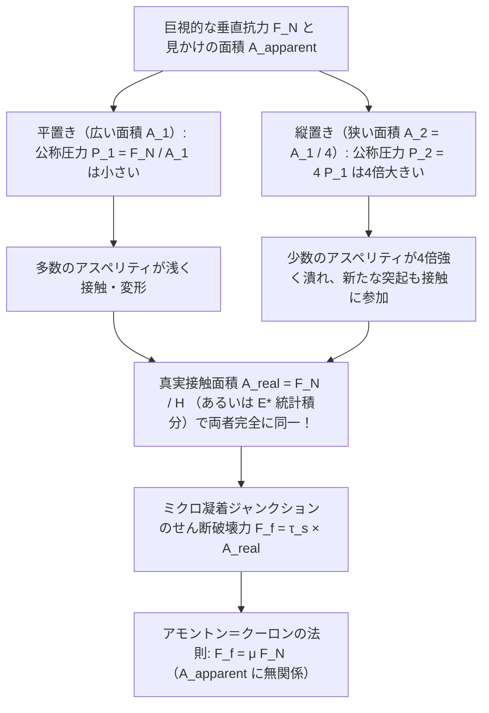
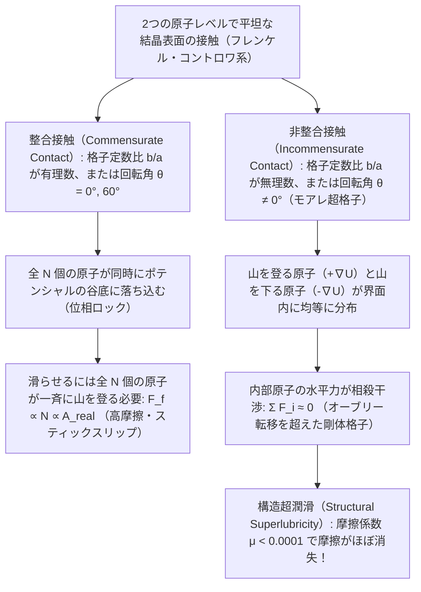

高校の物理の授業で習う最も簡潔な方程式の一つに、乾燥摩擦の式 $F_f = \mu F_N$ がある。机の上に置かれた直方体のレンガをバネばかりで水平に引っ張るとき、動き出す直前の最大静止摩擦力や動摩擦力は、レンガの重さ（垂直抗力 $F_N$）と摩擦係数 $\mu$ の積だけで決まるという法則だ。

しかし、このあまりにも見慣れた式の裏には、私たちの日常的な直感と真っ向から衝突する深いパラドックスが潜んでいる。同じレンガを、広い底面（例えば面積 $200\,\text{cm}^2$）を下にして机に置いた場合と、狭い側面（面積 $50\,\text{cm}^2$）を下にして縦に立てて置いた場合を比べてみよう。直感的には、机と擦れ合う面積が $4$ 倍も広い平置きの方が、はるかに大きな摩擦力を生みそうに思える。ところが実際にバネばかりで引いてみると、<strong>接触面積が $4$ 倍変わっても、必要な引っ張り力 $F_f$ は驚くほど正確に一致する</strong>のである。さらに言えば、もし本当に「面積が摩擦に関係ない」のであれば、なぜF1マシンやドラッグレースの車両は、あれほど極端に幅の広いスリックタイヤを履くのだろうか？

同様に、私たちは「スケート靴の刃が氷の上を滑るのは、体重による高い圧力で氷が溶けて水の膜ができるから（圧力融解説）」と教わってきた。しかし、熱力学のクラウジウス・クラペイロンの式に実際の数値を代入して計算すると、体重 $75\,\text{kg}$ のスケーターが氷の融点を下げられる幅はわずか $0.12^\circ\text{C}$ に過ぎず、$-10^\circ\text{C}$ のスケートリンクで滑れる理由をまったく説明できないことが判明する。

本稿では、摩擦・摩耗・潤滑を扱う学際領域である<strong>トライボロジー（Tribology、ギリシャ語の「擦る＝tribo」に由来）</strong>の視点から、これらの古典的パラドックスをミクロおよびナノスケールの表面物理学によって解き明かす。巨視的な「見かけの接触面積」と微視的な「真実接触面積」の乖離、バイオリンの音色から巨大地震までを支配するスティックスリップ（固着・滑り）力学、氷の表面に潜む擬似液体層（QLL）の正体、そして摩擦係数がほぼゼロに消失する究極のナノテクノロジー「構造超潤滑（Structural Superlubricity）」まで、数理モデルとともに体系的に掘り下げていこう。

---

## 1. 古典摩擦学の謎：アモントン＝クーロンの法則と直感の衝突

### 1.1 ダ・ヴィンチからアモントン、クーロンへ至る歴史的系譜

摩擦の科学的探究は、ニュートン力学の確立よりもさらに2世紀近く前、ルネサンス期の天才<strong>レオナルド・ダ・ヴィンチ（Leonardo da Vinci）</strong>によって切り拓かれた。1493年頃のノート（『アランデル手稿』および『マドリード手稿』）の中で、ダ・ヴィンチはさまざまな形状の木片や縄を滑車と重りで牽引する実験を繰り返し、次の2つの驚くべき事実を世界で初めて記録している。

1. 「同じ重さの物体であれば、接触する面の幅が広くても狭くても、動かすのに必要な摩擦抵抗は等しい。」
2. 「物体の重さを2倍にすれば、摩擦抵抗も2倍になる（ダ・ヴィンチは滑らかな木材同士で $F_f \approx \frac{1}{4} F_N$ と見積もった）。」

ダ・ヴィンチの手稿は長らく未公開のまま埋もれていたため、この法則が科学界の公知となったのは約200年後の1699年、フランスの物理学者<strong>ギヨーム・アモントン（Guillaume Amontons）</strong>がパリ王立科学アカデミーで発表した論文『機械における摩擦によって引き起こされる抵抗について（*De la résistance causée dans les machines*）』によってであった。その後、1748年に<strong>レオンハルト・オイラー（Leonhard Euler）</strong>が摩擦係数の記号 $\mu$ を導入して斜面の滑落角 $\theta_c$ との関係 $\mu_s = \tan \theta_c$ を導き、さらに静止摩擦と動摩擦の間に不連続な差（$\mu_s > \mu_k$）があることを数学的に定式化した。

そして1785年、静電気の法則で知られるフランスの<strong>シャルル・ド・クーロン（Charles-Augustin de Coulomb）</strong>が、ロシュフォール海軍造船所における大規模な実験を通じて摩擦の包括的な体系をまとめ上げ、今日<strong>アモントン＝クーロンの3法則（Amontons–Coulomb Laws of Dry Friction）</strong>と呼ばれる古典則が完成した。

$$\begin{aligned}
\text{第1法則（垂直抗力への比例）：} & \quad F_f = \mu F_N \\
\text{第2法則（接触面積からの独立）：} & \quad \frac{\partial F_f}{\partial A_{\text{apparent}}} = 0 \\
\text{第3法則（滑り速度からの独立）：} & \quad \frac{\partial F_k}{\partial v} \approx 0 \quad (\text{ただし } F_k = \mu_k F_N < F_s^{\max} = \mu_s F_N)
\end{aligned}$$

ここで $F_N$ は接触面に垂直に働く荷重（垂直抗力）、$A_{\text{apparent}}$ は巨視的な物体の外形から測った「見かけの接触面積」、$v$ は相対的な滑り速度である。

### 1.2 古典的な「凹凸噛み合い説」の熱力学的破綻

アモントンやクーロン自身は、なぜこのような法則が成り立つのかを説明するために、<strong>幾何学的な凹凸の噛み合いモデル（Geometric Interlocking / Cobblestone Model）</strong>を提唱した。いかに滑らかに見える金属や木材の表面にも、微小なノコギリの歯のような硬い凹凸（傾斜角 $\theta$）が存在し、上の物体を水平に動かすためには、重力に逆らって斜面 $\theta$ を持ち上げなければならないと考えたのである。

確かに、質量 $m$（垂直抗力 $F_N = mg$）の剛体ブロックを傾斜角 $\theta$ の微小な斜面に沿って引き上げるのに必要な水平力 $F_f$ は、力の釣り合いから次のように書ける。

$$F_f \cos\theta = F_N \sin\theta \implies F_f = F_N \tan\theta \implies \mu = \tan\theta$$

この単純な幾何学モデルは、一見すると「摩擦力が垂直抗力 $F_N$ に比例し、面積 $A_{\text{apparent}}$ にも速度 $v$ にも依存しない」理由を見事に説明しているように見える。しかし、19世紀後半にエネルギー保存則（熱力学第一法則）と統計力学が確立されると、この「剛体のノコギリ歯モデル」には致命的な欠陥があることが明らかになった。

もし表面の突起が変形も破壊もしない完全な剛体（または完全弾性体）の斜面であるならば、突起の山を登るときに外力がした仕事 $W_{\text{up}} = F_N h$ は、<strong>山の頂上を越えて反対側の斜面を滑り降りるときに、重力によってそのまま運動エネルギーまたは推進力として $100\%$ 回収（$W_{\text{down}} = -F_N h$）されてしまう</strong>からである。結果として、1周期あたりの正味のエネルギー散逸（熱の発生）はゼロになり、巨視的な動摩擦力は生じ得ない。

摩擦とは本質的に、巨視的な並進運動の運動エネルギーを、界面における非可逆的な過程を通じて結晶格子の振動エネルギー（<strong>フォノン：音子</strong>）や電子励起、すなわち「熱」へと散逸させる非平衡熱力学現象である。このパラドックスを真に解決するには、20世紀半ばの表面物理学と接触力学の登場を待たねばならなかった。

---

## 2. 見かけの接触面積と真実接触面積：ミクロのアスペリティが解くパラドックス

### 2.1 スイスを逆さまにしてオーストリアの上に乗せる

20世紀におけるトライボロジーの革命を主導したケンブリッジ大学の物理学者<strong>フランク・フィリップ・バウデン（Frank Philip Bowden）</strong>と<strong>デビッド・テイバー（David Tabor）</strong>は、1950年の名著『固体の摩擦と潤滑（*The Friction and Lubrication of Solids*）』の中で、固体同士の接触を次のように形容した。

> 「どれほど精密に鏡面研磨された2枚の金属平板を重ね合わせることも、ミクロのスケールで見れば、<strong>スイス連邦を逆さまにしてオーストリア共和国の上に重ね合わせるようなもの</strong>である。2つの国が実際に触れ合うのは、最も高く突き出たアルプスの山頂同士のごくわずかな点に過ぎない。」

現代の走査型トンネル顕微鏡（STM）や原子間力顕微鏡（AFM）で観察すると、最高度に鏡面仕上げされたゲージブロック（二乗平均平方根粗さ $R_q \sim 10\,\text{nm} \sim 0.1\,\mu\text{m}$）でさえ、原子間結合の到達距離（ファンデルワールス力や金属結合が働く距離 $a_0 \sim 0.2 \sim 0.5\,\text{nm}$）に比べれば、巨大な山脈と渓谷の連なりである。この表面の微小な突起を<strong>アスペリティ（Asperity：微細突起）</strong>と呼ぶ。

したがって、2つの固体を接触させたとき、実際に原子レベルで接近して力を及ぼし合っている部分の面積の総和――<strong>真実接触面積（Real Contact Area, $A_{\text{real}}$）</strong>――は、外形寸法から計算した<strong>見かけの接触面積（Apparent Contact Area, $A_{\text{apparent}}$）</strong>よりも桁違いに小さい。通常の機械部品や日常の荷重下では、両者の比は次の程度にしかならない。

$$\frac{A_{\text{real}}}{A_{\text{apparent}}} = \frac{\sum_{i=1}^{N} A_i}{L_x L_y} \sim 10^{-5} \sim 10^{-3} \quad (0.001\% \sim 0.1\%)$$

私たちが机の上に置いたレンガを見るとき、底面全体が机に触れているように錯覚しているが、実際にはレンガの全重量は、底面全体のわずか数千分の一から数万分の一にあたるミクロのアスペリティ先端の点群だけで支えられているのである。

### 2.2 バウデン・テイバーの凝着・塑性変形理論（1950年）

真実接触面積 $A_{\text{real}}$ が見かけの面積の $10^{-4}$ しかないという事実は、アスペリティの先端に途方もない局所圧力（局所垂直応力 $p_{\text{local}}$）が集中することを意味する。

例えば、質量 $1\,\text{kg}$（$F_N \approx 10\,\text{N}$）の鋼鉄ブロックを、見かけの面積 $A_{\text{apparent}} = 10\,\text{cm}^2 = 10^{-3}\,\text{m}^2$ で置いたとしよう。巨視的な平均圧力（公称圧力）は $P_{\text{nom}} = F_N / A_{\text{apparent}} = 10\,\text{kPa}$（約 $0.1$ 気圧）に過ぎない。しかし、もし初期の接触がわずか数個のアスペリティ先端（合計面積 $10^{-9}\,\text{m}^2$）で始まったとすれば、局所応力は $10\,\text{GPa}$ に達し、鋼鉄の<strong>塑性降伏応力 $\sigma_y$</strong>（および押し込み硬さ $H \approx 3\sigma_y$、テイバーの関係式）を瞬時に突破してしまう。

その結果、接触したアスペリティの先端はすぐさま<strong>塑性変形（Plastic Deformation：潰れて広がる変形）</strong>を起こす。アスペリティが押し潰されて接触スポットの面積 $A_i$ が広がると、局所圧力 $p_{\text{local}} = F_N / \sum A_i$ は低下していく。この塑性流動は、局所圧力がちょうどその材料の<strong>塑性流動圧力（押し込み硬さ $H$、単位 $\text{Pa}$）</strong>と釣り合った瞬間に停止する。ゆえに、平衡状態における真実接触面積 $A_{\text{real}}$ は、見かけの接触面積 $A_{\text{apparent}}$ には一切依存せず、垂直抗力 $F_N$ と材料の硬さ $H$ のみによって一意に決定される！

$$p_{\text{local}} = H \implies A_{\text{real}} = \sum_{i=1}^{N} A_i = \frac{F_N}{H}$$

さらに、アスペリティ先端同士が原子間距離（$< 0.3 \sim 0.5\,\text{nm}$）まで押し付けられると、界面の原子間に強い引力（金属結合、共有結合、あるいはファンデルワールス分散力）が働き、ミクロな<strong>冷間圧接・凝着ジャンクション（Adhesive Micro-Junctions）</strong>が形成される。物体を水平に滑らせるためには、この凝着した面積 $A_{\text{real}}$ のジャンクションを<strong>界面せん断強度 $\tau_s$（単位 $\text{Pa}$）</strong>で引きちぎる（せん断破壊する）必要がある。

したがって、凝着項による摩擦力 $F_{\text{adh}}$ は真実接触面積 $A_{\text{real}}$ に厳密に比例する。ここに上式の $A_{\text{real}} = F_N / H$ を代入すると、アモントン＝クーロンの法則が鮮やかに導出される。

$$F_f = F_{\text{adh}} + F_{\text{plough}} \approx \tau_s A_{\text{real}} = \tau_s \left(\frac{F_N}{H}\right) = \left(\frac{\tau_s}{H}\right) F_N \implies \mu = \frac{\tau_s}{H}$$

（ここで $F_{\text{plough}}$ は硬い側の突起が柔らかい側の表面を鋤のように掘り進む「掘り起こし項（Ploughing term）」であり、硬い砥粒や摩耗粉がある場合に寄与する。）

これで、冒頭の「レンガのパラドックス」の謎は完全に解けた。
<strong>摩擦力は「接触面積」に無関係なのではない。実は、摩擦力は「真実接触面積 $A_{\text{real}}$」に完璧に比例している（$F_f = \tau_s A_{\text{real}}$）のである！</strong>
私たちがレンガを平置きから縦置きに変えて見かけの面積 $A_{\text{apparent}}$ を $1/4$ に減らしたとき、接触面に含まれるアスペリティの総数は $1/4$ に減るが、レンガ全体の重さ $F_N = mg$ は変わらないため、1個あたりのアスペリティにかかる荷重が $4$ 倍に増大する。その結果、個々のアスペリティがより大きく潰れる（かつ次に高いアスペリティ群が新たに接触に加わる）ことで、<strong>総和としての真実接触面積 $A_{\text{real}}$ は平置きのときと寸分違わず同じ値に保たれる</strong>のである。

### 2.3 弾性接触における統計力学：グリーンウッド・ウィリアムソン理論（1966年）とペルソンのマルチスケール理論

バウデンとテイバーの塑性変形理論は極めて明快だったが、すぐに1つの鋭い反論が提起された。「もしアスペリティが接触のたびに塑性変形（非可逆な永久変形）をしているのなら、同じ面を何度も繰り返し滑らせた後（なじみ運転後）には、突起はすっかり平らに潰れてしまい、2回目以降の接触は<strong>弾性変形（Elastic Deformation）</strong>になるはずだ。弾性変形でも $A_{\text{real}} \propto F_N$ は成り立つのか？」という疑問である。

1882年にハインリヒ・ヘルツ（Heinrich Hertz）が導いた古典的な<strong>ヘルツの弾性接触理論（Hertzian Contact Mechanics）</strong>によれば、曲率半径 $R$ を持つ1個の弾性球（単一アスペリティ）を、複合ヤング率 $E^* = \left(\frac{1-\nu_1^2}{E_1} + \frac{1-\nu_2^2}{E_2}\right)^{-1}$ の平面に垂直荷重 $w$ で押し付けたとき、接触円の半径 $a$ と接触面積 $A_{\text{single}}$ は次のように非線形に増加する。

$$a = \left(\frac{3 w R}{4 E^*}\right)^{1/3} \implies A_{\text{single}} = \pi a^2 = \pi \left(\frac{3 R}{4 E^*}\right)^{2/3} w^{2/3} \propto w^{2/3}$$

もし表面のすべてのアスペリティが同じ高さに揃っていたならば、全体の真実接触面積も $A_{\text{real}} \propto F_N^{2/3}$ となり、摩擦力は $F_f = \tau_s A_{\text{real}} \propto F_N^{2/3}$（すなわち荷重が増えるほど摩擦係数 $\mu \propto F_N^{-1/3}$ が減少する）となって、アモントンの第1法則に反してしまう！実際に、単結晶ダイヤモンドの針先やAFMの単一探針を平滑面に押し付けるナノ摩擦実験では、この $F_f \propto F_N^{2/3}$ が明確に観測される。

では、なぜ現実の巨視的な弾性表面では $A_{\text{real}} \propto F_N^{1.0}$ が成り立つのか？この難問を1966年に解決したのが、<strong>J. A. グリーンウッド（J. A. Greenwood）</strong>と<strong>J. B. P. ウィリアムソン（J. B. P. Williamson）</strong>による<strong>GW統計的マルチアスペリティ接触モデル</strong>である。

グリーンウッドとウィリアムソンは、現実の粗い表面にあるアスペリティの頂上高さ $z$ が一定ではなく、標準偏差 $\sigma_s$ を持つ<strong>確率密度分布 $\phi(z)$</strong>（ガウス分布や指数分布 $\phi(z) = \frac{1}{\sigma_s}\exp(-z/\sigma_s)$）に従ってランダムにばらついていることに着目した。基準面が高さ $d$ まで接近したとき、高さ $z > d$ を持つアスペリティだけが接触し、それぞれの押し込み量 $\delta = z - d$ に応じてヘルツの式 $A_i = \pi R \delta$、$w_i = \frac{4}{3} E^* R^{1/2} \delta^{3/2}$ に従う力を生む。見かけの面積 $A_{\text{apparent}}$ あたりの突起密度を $\eta$ とすると、接触する突起の総数 $N_c(d)$、真実接触面積 $A_{\text{real}}(d)$、および垂直抗力 $F_N(d)$ は次の積分で与えられる。

$$\begin{aligned}
N_c(d) &= \eta A_{\text{apparent}} \int_d^\infty \phi(z)\,dz \\
A_{\text{real}}(d) &= \pi \eta A_{\text{apparent}} R \int_d^\infty (z - d)\,\phi(z)\,dz \\
F_N(d) &= \frac{4}{3} \eta A_{\text{apparent}} E^* R^{1/2} \int_d^\infty (z - d)^{3/2}\,\phi(z)\,dz
\end{aligned}$$

ここで、高い山頂の裾野を表す指数分布 $\phi(z) = \frac{1}{\sigma_s} e^{-z/\sigma_s}$ を代入して変数変換 $u = (z - d)/\sigma_s$ を行うと、驚くべき数学的帰結が現れる。ガンマ関数 $\Gamma(2) = 1$、$\Gamma(5/2) = \frac{3\sqrt{\pi}}{4}$ を用いることで、$d$ に依存する因子 $e^{-d/\sigma_s}$ がすべての式で共通に括り出され、<strong>完全に消去される</strong>のである！

$$\begin{aligned}
N_c(d) &= \eta A_{\text{apparent}} e^{-d/\sigma_s} \\
A_{\text{real}}(d) &= \pi \eta A_{\text{apparent}} R \sigma_s e^{-d/\sigma_s} \\
F_N(d) &= \sqrt{\pi} \eta A_{\text{apparent}} E^* R^{1/2} \sigma_s^{3/2} e^{-d/\sigma_s}
\end{aligned}$$

後の2式の比をとると、見かけの面積 $A_{\text{apparent}}$ も接近距離 $d$ も綺麗に約分され、純粋な弾性接触でありながら、真実接触面積 $A_{\text{real}}$ が垂直抗力 $F_N$ に厳密に1次比例する関係式が導かれる。

$$A_{\text{real}} = \frac{\sqrt{\pi}}{E^* \sqrt{\sigma_s / R}} F_N \propto F_N$$

なぜ単一突起では $w^{2/3}$ なのに、集合体では $F_N^1$ になるのか？その物理的理由は極めて美しい。垂直荷重 $F_N$ を増やして表面同士を押し付けると、すでに接触していた高いアスペリティの面積が広がるのと同時に、<strong>それまで僅かな隙間を隔てて浮いていた「次に背の高いアスペリティたち」が次々と新しく接触に参加してくる</strong>からである。結果として、「1個の接触スポットあたりの平均面積 $A_{\text{real}} / N_c = \pi R \sigma_s$」は荷重が増えても常に一定に保たれ、<strong>接触スポットの個数 $N_c$ そのものが荷重 $F_N$ に比例して増えていく</strong>ため、全体として完全な線形性 $A_{\text{real}} \propto F_N$ が創発するのである。

さらに2001年、<strong>ボー・ペルソン（Bo N. J. Persson）</strong>はこの統計理論を、あらゆる空間波長（倍率 $\zeta = q/q_0$）にわたって自己アフィン・フラクタル性（パワースペクトル密度 $C(q) \propto q^{-2(1+H_f)}$）を持つ現実の表面へと拡張した。ペルソンのマルチスケール接触力学では、倍率 $\zeta$ を上げていくにつれて接触面内の応力確率分布 $P(\sigma, \zeta)$ が拡散方程式に従って進化することを解き、微小な公称圧力領域において二乗平均平方根勾配 $\bar{g} = \sqrt{\langle |\nabla h|^2 \rangle}$ を用いた普遍的な比例関係 $A_{\text{real}} = \frac{\kappa}{E^* \bar{g}} F_N$ が厳密に成り立つことを証明している。

### 2.4 アモントンの法則が破綻する3つの極限：F1タイヤ、ヤモリの足、宇宙空間の冷間圧接

真実接触面積の理論は、アモントンの法則がなぜ成り立つかを説明するだけでなく、<strong>「どのような条件でアモントンの法則が破れるか（面積が大きいほど摩擦力が増大するか）」</strong>をも完璧に予言する。それは、真実接触面積 $A_{\text{real}}$ が見かけの接触面積 $A_{\text{apparent}}$ に近づき（$A_{\text{real}} \to A_{\text{apparent}}$）、あるいは外力ゼロでも分子間凝着力が支配的になる極限である。

1. <strong>粘弾性ゴムとF1レーシングカーの極太スリックタイヤ（JKR凝着接触力学）</strong>：
   金属のヤング率（$E \sim 100 \sim 200\,\text{GPa}$）に対し、加硫ゴムやエラストマーの弾性率は $E \sim 1 \sim 10\,\text{MPa}$ と約5桁も小さい。そのため、ゴムタイヤをアスファルト路面に押し付けると、ゴムは路面のミクロな凹凸の谷間まで柔軟に変形して入り込み、真実接触面積が見かけの面積のかなりの割合（高荷重では飽和領域）に達する。
   さらに、1971年に<strong>ジョンソン・ケンドール・ロバーツ（Johnson, Kendall & Roberts: JKR理論）</strong>が導いた凝着弾性接触モデルによれば、界面の凝着仕事 $\Delta\gamma$ が大きい柔軟材料では、接触半径 $a_{\text{JKR}}$ は次の式に従う。
   $$a_{\text{JKR}}^3 = \frac{3R}{4E^*}\left(w + 3\pi R \Delta\gamma + \sqrt{6\pi R \Delta\gamma w + (3\pi R \Delta\gamma)^2}\right)$$
   この式が示す通り、垂直荷重 $w \to 0$ であっても $a_{\text{JKR}} > 0$ の有限の接触面積が維持され、引き剥がすには負の荷重（引力 $w_c = -\frac{3}{2}\pi R \Delta\gamma$）が必要になる。また、高荷重側では $A_{\text{real}} \propto A_{\text{apparent}}^{1/3} F_N^{2/3}$ の非線形性が現れ、単位面積あたりの面圧 $P_{\text{nom}} = F_N / A_{\text{apparent}}$ が低いほど実効摩擦係数 $\mu_{\text{eff}} = F_f / F_N \propto P_{\text{nom}}^{-1/3}$ が高くなる（タイヤの<strong>荷重感度：Load Sensitivity</strong>）。F1マシンが溝のない極太のスリックタイヤを履くのは、見かけの接触面積 $A_{\text{apparent}}$ を最大化することで公称面圧を下げ、JKR凝着項と粘弾性ヒステリシス項を稼ぎつつ、摩擦熱によるゴムの熱分解（ブリスター）を防ぐためなのである。

2. <strong>ヤモリ（Gecko）の足裏の階層的ナノ剛毛（Setae & Spatulae）</strong>：
   ヤモリは垂直なガラス壁や天井を自在に走り回るが、足裏から粘液を出しているわけではない。ヤモリの足裏には<strong>セタ（Setae）</strong>と呼ばれる数百万本のケラチン質の微細毛が生えており、その1本1本の先端がさらに数百本の<strong>スパチュラ（Spatulae：直径 $100 \sim 200\,\text{nm}$ のヘラ状ナノ突起）</strong>へと階層的に分岐している。バルクのケラチンは硬いタンパク質（$E \sim 2\,\text{GPa}$）だが、このナノ分岐構造によって構造全体としての実効弾性率は $E_{\text{eff}} < 100\,\text{kPa}$（粘着テープのダルキスト基準）にまで劇的に低下している。結果として、ヤモリの足はどれほど粗い壁面のナノ凹凸にも隙間なく密着して $A_{\text{real}} \approx A_{\text{apparent}}$ を達成し、純粋な<strong>ファンデルワールス力（分子間分散力）</strong>だけで体重の数十倍もの剪断保持力を生み出す。

3. <strong>超高真空（宇宙空間）における金属の冷間圧接（Cold Welding）</strong>：
   地上の大気中で2枚の清浄な鉄やアルミニウムの板を合わせてもくっつかないのはなぜか？それは、大気中の酸素や水蒸気、炭化水素分子が瞬時に金属表面と反応し、厚さ $1 \sim 5\,\text{nm}$ の<strong>自然酸化被膜（$\text{Fe}_2\text{O}_3, \text{Al}_2\text{O}_3$）や吸着汚染分子層</strong>を作って金属原子同士の直接接触を遮断しているからである。
   しかし、大気分子が存在しない宇宙空間の超高真空（$P < 10^{-10}\,\text{Pa}$）では、摺動によって一度表面の酸化膜が摩耗して剥がれ落ちると、再び酸化膜が再生されることがない。露出した清浄な金属結晶面同士が接触した瞬間、界面を挟んで自由電子が共有されて金属結合が形成され、2つの部品が1つの金属塊へと一体化する<strong>冷間圧接（Cold Welding / マクロ凝着）</strong>が発生する。1991年に木星探査機「ガリレオ（Galileo）」の高利得パラボラアンテナが宇宙空間で開かなくなった有名な事故も、打ち上げ時の振動でチタン製ピンの固体潤滑被膜（二硫化モリブデン $\text{MoS}_2$）が剥離し、真空中で冷間圧接（固着）を起こしたことが原因であった。

---

## 3. スティックスリップ現象と速度・状態依存摩擦則：バイオリンから巨大地震まで

### 3.1 バネ・ブロックモデルと弛緩振動（Relaxation Oscillation）の数理

古いドアを開けるときの「ギーッ」というきしみ音、黒板にチョークを押し付けて引いたときの不快なスクリーチ音、自動車のブレーキ鳴き、バイオリンの弓が奏でる美しい倍音、そして数百年周期でプレート境界を破壊する巨大地震――。一見まったく無関係に見えるこれらの現象はすべて、摩擦界面における<strong>スティックスリップ現象（Stick-Slip Phenomenon：固着・滑り振動）</strong>という同一の非線形力学によって引き起こされている。

この現象の本質を理解するために、水平な床の上に置かれた質量 $m$ のブロックを、バネ定数（剛性）$k$ のバネを介して、一定の駆動速度 $v_0$ で水平に引っ張る<strong>バネ・ブロックモデル（Burridge–Knopoff / Spring-Slider Model）</strong>を考えよう。時刻 $t$ におけるブロックの位置を $x(t)$ とすると、運動方程式は次のように書ける。

$$m \frac{d^2 x}{dt^2} = k(v_0 t - x) - F_f\!\left(\frac{dx}{dt}, \theta\right)$$

ここで、静止摩擦係数 $\mu_s$ が動摩擦係数 $\mu_k$ よりも大きい（$\mu_s > \mu_k$）古典的なケースを解析すると、運動は明確な2つのフェーズを交互に繰り返す<strong>弛緩振動（Relaxation Oscillation）</strong>となる。

* <strong>第1フェーズ：スティック（固着・エネルギー蓄積期、$\dot{x} = 0$）</strong>
  時刻 $t = 0$ でバネの伸びが動摩擦と釣り合う位置 $x(0) = -\mu_k F_N / k$ からスタートしたとする。ブロックは床に固着したまま動かない（$\dot{x} = 0$）が、バネの先端は一定速度 $v_0$ で進み続けるため、バネが蓄える弾性張力 $F_{\text{spring}}(t) = \mu_k F_N + k v_0 t$ は時間とともに線形に増大していく。
  この固着状態は、バネの張力が最大静止摩擦力 $F_s^{\max} = \mu_s F_N$ に到達する時刻 $t_{\text{stick}}$ まで続く。
  $$t_{\text{stick}} = \frac{(\mu_s - \mu_k) F_N}{k v_0}$$
  駆動速度 $v_0$ が遅いほど、またバネ剛性 $k$ が柔らかいほど、固着してエネルギーを溜め込む時間 $t_{\text{stick}}$ は長くなる。

* <strong>第2フェーズ：スリップ（滑り・急速解放期、$\dot{x} > 0$）</strong>
  時刻 $t = t_{\text{stick}}$ で張力が $\mu_s F_N$ を超えた瞬間、界面の凝着ジャンクションが一斉に破断し、摩擦力は瞬時に動摩擦力 $\mu_k F_N$ へと急落する。この力の差 $\Delta F = (\mu_s - \mu_k)F_N$ によってブロックには正の加速度が生じ、固有角振動数 $\omega_0 = \sqrt{k/m}$ で急速に前方へと滑り出す。スリップ開始時刻を $t' = 0$（位置 $x = 0$、初速 $\dot{x}(0) = 0$）と置くと、運動方程式 $m \ddot{x} + kx = (\mu_s - \mu_k)F_N + k v_0 t'$ の解は次のようになる。
  $$x(t') = v_0 t' + \frac{(\mu_s - \mu_k)F_N}{k}(1 - \cos \omega_0 t') - \frac{v_0}{\omega_0}\sin \omega_0 t'$$
  $$v(t') = \dot{x}(t') = v_0 (1 - \cos \omega_0 t') + \frac{(\mu_s - \mu_k)F_N}{\sqrt{m k}}\sin \omega_0 t'$$
  ブロックはバネの釣り合い位置を通り越してオーバーシュートし、やがてバネが縮み切ることで減速して、時刻 $t_{\text{slip}} \approx \frac{\pi}{\omega_0} = \pi\sqrt{\frac{m}{k}}$ 付近で再び速度 $v(t') = 0$ に達する。速度がゼロになった瞬間、表面は再び凝着してスティック（固着）フェーズへと戻り、同じノコギリ波（Sawtooth wave）のサイクルが永続的に繰り返される。

### 3.2 なぜ静止摩擦は動摩擦より大きいのか？：接触の経時変化（エイジング）とディートリッヒ・ルイナ則

ここでさらに深い疑問が生じる。<strong>そもそも、なぜ静止摩擦係数 $\mu_s$ は動摩擦係数 $\mu_k$ よりも大きいのか？また、なぜ滑り速度 $v$ が速くなると摩擦力が下がる（速度弱化）ことがあるのか？</strong>

その答えは、クーロンが1785年にすでに気づき、20世紀後半にジェームズ・ディートリッヒ（James H. Dieterich, 1979）とアンディ・ルイナ（Andy Ruina, 1983）、そしてジェイ・ファインバーグ（Jay Fineberg, 2004）らの実験によってミクロな実証が与えられた<strong>「真実接触面積の時間発展（Contact Aging：接触の経時成長）」</strong>にある。

2つの表面が静止して押し付けられている間、高応力にさらされたミクロのアスペリティ先端は、熱活性化された<strong>塑性クリープ変形（または粘弾性クリープ）</strong>を起こしてじわじわと沈み込み、さらに界面の原子間で化学結合や水素結合・シロキサン結合の架橋が時間とともに進行する。ファインバーグらの研究グループは、透明なアクリル樹脂（PMMA）の接触界面にレーザー光シートを全反射角で入射させ、エバネッセント波を透過した光強度（真実接触している点だけが光を透過する）を高速カメラで直接撮影することで、静止接触時間 $t$ に対して真実接触面積 $A_{\text{real}}(t)$ が<strong>対数関数的に成長する</strong>ことを直接証明した。

$$A_{\text{real}}(t) = A_0 \left[ 1 + c \ln\!\left(1 + \frac{t}{\tau_0}\right) \right] \implies \mu_s(t) = \mu_0 + b \ln\!\left(1 + \frac{t}{\tau_0}\right)$$

つまり、「静止摩擦係数 $\mu_s$」とは決して固定された物質定数ではなく、<strong>「どれだけ長い時間じっと止まって接触を熟成（エイジング）させたか」によって対数的に増大し続ける動的な関数</strong>なのである！一方、一度滑り始めると（速度 $v$）、古いアスペリティ接触は特徴的な滑り距離 $D_c$（アスペリティの平均直径に相当し、数 $\mu\text{m}$ 〜数十 $\mu\text{m}$）だけ動いた時点で外れてリセットされ、平均寿命 $\theta \approx D_c / v$ の「若くて面積の小さい接触」に絶えず入れ替わるため、動摩擦係数 $\mu_k$ は必然的に小さくなる。

この「直接的な熱活性化速度効果（Rate）」と「接触面の経時熟成効果（State：状態変数 $\theta$、平均接触寿命の次元を持つ）」を統一した現代トライボロジーおよび地震物理学の基本方程式が、<strong>ディートリッヒ・ルイナの速度・状態依存摩擦則（Dieterich–Ruina Rate-and-State Friction Law: RSF則）</strong>である。

$$\mu(v, \theta) = \mu_0 + a \ln\!\left(\frac{v}{v_*}\right) + b \ln\!\left(\frac{v_* \theta}{D_c}\right)$$

$$\frac{d\theta}{dt} = 1 - \frac{v \theta}{D_c} \quad \text{（ディートリッヒのエイジング則 / Aging Law）}$$

ここで $v_*$ は基準速度、$\mu_0$ は $v = v_*, \theta = D_c / v_*$ における基準摩擦係数、$a > 0$ は速度が上がったときに熱活性化エネルギー障壁を越えるのに必要な応力が増える「直接速度効果」の無次元係数、$b > 0$ は状態変数 $\theta$（真実接触面積の成長）に伴う「状態進化効果」の無次元係数（ともに通常 $0.005 \sim 0.05$ 程度）である。

* 完全静止状態（$v = 0$）では、状態方程式は $\frac{d\theta}{dt} = 1 \implies \theta(t) = \theta_0 + t$ となり、状態変数 $\theta$ はまさに静止経過時間そのものとして成長し、静止摩擦が $\Delta\mu_s \propto b \ln t$ で強化される。
* 一定速度 $v$ での定常滑り状態（$\frac{d\theta}{dt} = 0$）では、$\theta_{\text{ss}}(v) = \frac{D_c}{v}$ となり、これを摩擦係数の式に代入すると定常動摩擦係数 $\mu_{\text{ss}}(v)$ が得られる。

$$\mu_{\text{ss}}(v) = \mu_0 + (a - b) \ln\!\left(\frac{v}{v_*}\right)$$

この $(a - b)$ の符号こそが、その摩擦系が「静かに滑らかに滑るか」それとも「激しいスティックスリップ振動を起こすか」を決定する分岐パラメータとなる。

1. <strong>速度強化領域（Velocity-Strengthening: $a - b > 0$）</strong>：
   滑り速度 $v$ が増すほど定常摩擦係数 $\mu_{\text{ss}}(v)$ が増加する。このとき摩擦は正の減衰（ダンピング）として働くため、スティックスリップは絶対に起きず、常に安定な定常滑り（断層における非地震性クリープ滑り）となる。
2. <strong>速度弱化領域（Velocity-Weakening: $a - b < 0$）</strong>：
   滑り速度 $v$ が増すほど接触の若返り効果 $b$ が上回って定常摩擦係数 $\mu_{\text{ss}}(v)$ が減少する。このとき摩擦は「負の減衰（Negative Damping）」として働き、系を駆動するバネ剛性 $k$ が次の<strong>臨界剛性 $k_c$</strong> を下回ると、ホップ分岐（Hopf Bifurcation）を起こして自励的なスティックスリップ振動が爆発的に発生する！

$$k < k_c = \frac{(b - a) F_N}{D_c}$$

### 3.3 バイオリンのヘルムホルツ運動とプレート境界型巨大地震

この速度・状態依存摩擦則と臨界剛性 $k < k_c$ の条件は、極小の楽器から地球規模の地殻変動までを見事に統一する。

* <strong>バイオリンの弦と松脂（Rosin）の物理学</strong>：
  バイオリンの馬毛の弓に塗られる<strong>松脂（ロジン、主成分はアビエチン酸などの樹脂酸）</strong>は、室温付近にガラス転移温度 $T_g$ を持つ非晶質高分子である。弓で弦を擦るとき、固着時には松脂が弦に強く凝着し、滑り出すと局所的なせん断発熱によって松脂が軟化して急激な速度弱化（$b - a > 0$）を示す。
  1862年にヘルマン・フォン・ヘルムホルツ（Hermann von Helmholtz）が解明した通り、バイオリンの弦は弓に引っ張られて一定速度で移動する「スティック期」と、弦の上を伝播して駒（Bridge）で反射してきた鋭い折れ曲がり波（<strong>ヘルムホルツ・コーナー</strong>）が弓の位置を通過した瞬間に起こる高速の「スリップ期」を、弦の基本周波数（例えばA線なら $440\,\text{Hz}$、1秒間に440回）に完全同期して繰り返している。もし弓に松脂ではなくグリース（速度強化型：$a - b > 0$）を塗れば、スティックスリップは消滅し、バイオリンは一切音を鳴らすことができなくなる。

* <strong>沈み込み帯の巨大地震（Megathrust Earthquakes）</strong>：
  地球の海洋プレートは年間数 $\text{cm}$（$v_0 \sim 10^{-9}\,\text{m/s}$）という極めて遅い一定速度で大陸プレートの下へ沈み込んでいる。深さ $10 \sim 30\,\text{km}$ の地震発生帯（Seismogenic zone）の岩石・断層ガウジは、温度・圧力条件から $a - b < 0$（速度弱化）の特性を持ち、周囲の地殻の弾性剛性 $k$ が臨界剛性 $k_c$ よりも小さい。
  そのため、断層面は数百年間にわたって固着（スティック）し続け、$\theta(t)$ の成長とともに摩擦強度を高めながら周囲の地殻という巨大なバネに弾性ひずみエネルギーを蓄え続ける。そして剪断応力が限界に達した瞬間、数秒〜数十秒のうちに滑り速度 $v \sim 1 \sim 10\,\text{m/s}$（駆動速度の10億倍！）で数メートルを一気に滑るスリップフェーズ――すなわち<strong>巨大地震</strong>――が発生するのである。

---

## 4. 氷が滑る本当の理由：「圧力融解説」の熱力学的否定と擬似液体層（QLL）

### 4.1 教科書の通説「圧力融解説」をクラウジウス・クラペイロン式で検証する

摩擦の物理学において、アモントンの法則と並んで最も広く誤解されているトピックが<strong>「なぜ氷の上は滑るのか？なぜアイススケートができるのか？」</strong>という問題である。
多くの一般向け科学書や古い教科書には、19世紀のジェームズ・トムソンとウィリアム・トムソン（ケルビン卿）による復氷（Regelation）の議論を引用して、次のような説明が書かれている。

> <strong>【よくある通説（圧力融解説）】</strong>：水は固体（氷）よりも液体（水）の方が密度が大きい異常液体である。そのため、氷に高い圧力をかけると融点が $0^\circ\text{C}$ より下がる。スケート靴の薄いブレード（刃）の上に人間の全体重が乗ると、氷に巨大な圧力がかかって氷が局所的に融解し、刃と氷の間に薄い水の潤滑膜ができるため滑るのである。

この説明は直感的に非常にわかりやすく聞こえる。しかし、物理学者にとって仮説の真偽は常に<strong>定量的な計算</strong>によって判定されなければならない。相平衡の熱力学における<strong>クラウジウス・クラペイロンの式（Clausius–Clapeyron Equation）</strong>を使って、スケーターの体重が氷の融点を実際に何℃下げることができるのかを厳密に計算してみよう。

温度 $T_m$、圧力 $P$ において固相（氷）と液相（水）が共存するとき、両相の化学ポテンシャルの微小変化が等しい（$d\mu_{\text{ice}} = d\mu_{\text{liq}}$）ことから、融解曲線 $P(T)$ の傾きは次のクラウジウス・クラペイロン式で与えられる。

$$\frac{dP}{dT_m} = \frac{\Delta s}{\Delta v} = \frac{L_f}{T_m \left(v_{\text{liq}} - v_{\text{ice}}\right)} = \frac{L_f}{T_m \left(\frac{1}{\rho_{\text{liq}}} - \frac{1}{\rho_{\text{ice}}}\right)}$$

ここに、大気圧下（$T_m = 273.15\,\text{K} = 0^\circ\text{C}$）における水と氷 $\text{I}_h$ の正確な物性値を代入する。

* 氷の融解潜熱（融解エンタルピー）：$L_f = 3.335 \times 10^5\,\text{J/kg}$
* 液体の水の密度（$0^\circ\text{C}$）：$\rho_{\text{liq}} = 999.8\,\text{kg/m}^3 \implies v_{\text{liq}} = 1.0002 \times 10^{-3}\,\text{m}^3/\text{kg}$
* 氷 $\text{I}_h$ の密度（$0^\circ\text{C}$）：$\rho_{\text{ice}} = 916.7\,\text{kg/m}^3 \implies v_{\text{ice}} = 1.0909 \times 10^{-3}\,\text{m}^3/\text{kg}$
* 融解に伴う比体積変化：$\Delta v = v_{\text{liq}} - v_{\text{ice}} = -9.07 \times 10^{-5}\,\text{m}^3/\text{kg}$（体積が約 $8.3\%$ 収縮）

これらを代入して融解曲線の勾配を計算すると、次の値が得られる。

$$\frac{dP}{dT_m} = \frac{3.335 \times 10^5\,\text{J/kg}}{(273.15\,\text{K}) \times (-9.07 \times 10^{-5}\,\text{m}^3/\text{kg})} \approx -1.346 \times 10^7\,\text{Pa/K} = -13.46\,\text{MPa/K}$$

これは、<strong>「氷の融点をたった $1^\circ\text{C}$（$1\,\text{K}$）下げるだけでも、約 $13.5\,\text{MPa}$（約 $133$ 気圧！）もの巨大な圧力が必要である」</strong>ことを意味している。

では、体重 $m = 75\,\text{kg}$（重力 $F_N = mg \approx 735\,\text{N}$）のフィギュアスケート選手が、片足のスケートブレード全体で氷の上に立ったときの圧力 $\Delta P$ を計算してみよう。ブレードの氷との接触長さを $L = 30\,\text{cm} = 0.30\,\text{m}$、ブレードの幅（またはエッジが氷に食い込む実効幅）を $w = 1.5\,\text{mm} = 1.5 \times 10^{-3}\,\text{m}$ とすると、接触面積は $A = L w = 4.5 \times 10^{-4}\,\text{m}^2$ である。

$$\Delta P = \frac{F_N}{A} = \frac{735\,\text{N}}{4.5 \times 10^{-4}\,\text{m}^2} \approx 1.63 \times 10^6\,\text{Pa} = 1.63\,\text{MPa} \quad (\text{約 } 16.1\,\text{気圧})$$

この圧力 $\Delta P = 1.63\,\text{MPa}$ による氷の融点降下量 $\Delta T_m$ は、次の通りである。

$$\Delta T_m = \frac{\Delta P}{dP / dT_m} = \frac{1.63\,\text{MPa}}{-13.46\,\text{MPa/K}} \approx -0.12\,\text{K} \quad (-0.12^\circ\text{C})$$

<strong>なんと、たったの $0.12^\circ\text{C}$ しか融点は下がらないのである！</strong>
もし「エッジの先端のごく一部（真実接触面積）だけに体重が集中すれば、もっと圧力が上がるのでは？」と反論したとしても、氷の圧縮降伏強度（押し込み硬さ $H_{\text{ice}}$）は温度にもよるが約 $10 \sim 20\,\text{MPa}$ が上限であり、それ以上の圧力がかかれば氷は融解する前に塑性破砕してしまう。仮に氷の破砕限界である $15\,\text{MPa}$ まで局所圧力が上がったとしても、融点降下は $\Delta T_m \approx -1.1^\circ\text{C}$ が絶対的な限界である。

ところが現実には、アイスホッケーやスピードスケートのリンクの氷温は通常 <strong>$-5^\circ\text{C} \sim -10^\circ\text{C}$</strong> に保たれており、屋外の寒冷地では <strong>$-15^\circ\text{C} \sim -20^\circ\text{C}$</strong> でも問題なくスケートやスキーができる。さらに決定的なことに、底面が広くて圧力が極めて小さい革靴やスニーカー（$\Delta P \sim 20\,\text{kPa} \implies \Delta T_m \sim -0.0015^\circ\text{C}$）で氷の上に立っても、私たちはツルツルと足を滑らせて転んでしまう。つまり、<strong>圧力融解説は「氷が滑る理由」としては完全に破綻している</strong>のである。

### 4.2 氷が滑る3つの真の物理機構：ファラデーの擬似液体層（QLL）・摩擦熱・粘弾性流体レオロジー

圧力融解ではないとすれば、一体なぜ $-10^\circ\text{C}$ の氷の表面には潤滑膜が存在し、摩擦係数が $\mu \approx 0.005 \sim 0.02$ という驚異的な低さを示すのだろうか？現代の表面物理学が解明した答えは、次の<strong>3つの物理機構の協奏</strong>にある。

1. <strong>表面前融解（Surface Premelting）と擬似液体層（Quasi-Liquid Layer: QLL）</strong>：
   実は、圧力融解説が唱えられるのとほぼ同じ1850年、電磁気学の父<strong>マイケル・ファラデー（Michael Faraday）</strong>は王立研究所での実験から「氷の表面には、融点以下の温度でも最初から極薄の液状の水の層が存在している」という本質を突いた洞察（<strong>表面前融解現象</strong>）を発表していた。しかし当時は直接観測する手段がなく、100年以上にわたって忘れ去られていたのである。
   氷 $\text{I}_h$ の結晶内部（バルク）では、すべての水分子（$\text{H}_2\text{O}$）が周囲の4つの水分子と強固な四面体型<strong>水素結合ネットワーク（配位数4）</strong>を組んで固定されている。しかし、氷の最表面（空気や固体との界面）に露出した水分子には、「上側」に結合すべき相手が存在しない。そのため、表面の分子は水素結合が2本または3本しか形成できない<strong>配位不足状態（Under-coordinated dangling bonds）</strong>に置かれる。
   近年、和周波発生（SFG）分光法、X線回折、および原子間力顕微鏡（AFM）による直接計測によって確認された通り、これらの結合の手が余った表面水分子は熱振動によって激しく動き回り、熱力学的な表面自由エネルギー $\Delta\gamma = \gamma_{\text{sv}} - (\gamma_{\text{sl}} + \gamma_{\text{lv}}) > 0$ を下げるために、<strong>外部圧力がゼロであっても $-30^\circ\text{C} \sim -35^\circ\text{C}$ 付近から自発的に結晶構造を崩して「擬似液体層（Quasi-Liquid Layer: QLL）」と呼ばれるナノメートル厚（$1 \sim 20\,\text{nm}$）の無秩序な流動層を形成している</strong>のである！
   このQLLの厚み $d_{\text{QLL}}(T)$ は $0^\circ\text{C}$ に近づくにつれて発散的に成長し、逆に $-35^\circ\text{C}$ 以下になるとほぼ消失する。南極やシベリアの極寒地（$-40^\circ\text{C}$ 以下）を探検した人々が「極低温の雪や氷はまったく滑らず、乾いた砂の上をソリで引くように引っかかる」と証言するのは、まさにこの温度域でファラデーのQLLが凍結・消失するためである。そして私たちが靴底で氷の上に乗った瞬間に滑るのは、最初から氷の表面を覆っているこのQLLが初期の境界潤滑剤として働くからである。

2. <strong>バウデン・ヒューズの摩擦熱融解（Frictional Heating, 1939年）</strong>：
   初期の滑り出しはナノメートル厚のQLLによって担われるが、時速 $30 \sim 50\,\text{km/h}$（$v \sim 10\,\text{m/s}$）で疾走するスピードスケートやアルペンスキーの重荷重を支えるには、さらに厚い水の層が必要になる。それを生み出す主役が、1939年にバウデンとT. P. ヒューズ（T. P. Hughes）がスイス・ユングフラウヨッホの氷河洞窟実験で証明した<strong>摩擦熱による局所融解（Frictional Heating）</strong>である。
   ブレードやスキー板が速度 $v$ で滑るとき、単位面積・単位時間あたりに発生する摩擦熱フラックス $q_{\text{fric}} = \mu P_{\text{local}} v$ は、接触時間 $t_c = L / v$ の間に熱拡散長 $\delta_{\text{th}} \sim \sqrt{\alpha_{\text{th}} t_c}$ という極めて薄い表層に集中して注入される。これにより、氷温が $-15^\circ\text{C}$ であってもアスペリティ接触点の温度は瞬時に $0^\circ\text{C}$ まで上昇し、QLLを核として厚さ数十 $\text{nm} \sim$ 数 $\mu\text{m}$ の融解水膜が連続的に生成される。
   バウデンらは、熱伝導率が非常に高い真鍮（Brass）製のスキー板と、熱伝導率が低いエボナイトやPTFE（テフロン）/超高分子量ポリエチレン（UHMWPE）製のスキー板を氷上で比較し、<strong>熱伝導率が高い金属板ほど摩擦熱がスキー板側へ逃げてしまって氷が溶けず、著しく滑りにくくなる</strong>ことを実証した。現代のスキー板の滑走面に低熱伝導・疎水性のポリエチレンやフッ素ワックスが使われるのは、摩擦熱を氷の極表層に閉じ込めて水膜生成効率を最大化するためである。

3. <strong>界面ナノ水膜の複素粘弾性レオロジー（Canale, Bocquet & Bonn, 2019年）</strong>：
   さらに2019年、パリ高等師範学校の<strong>Lydéric Bocquet（リデリック・ボケ）</strong>とアムステルダム大学の<strong>Daniel Bonn（ダニエル・ボン）</strong>らの共同研究チーム（*Physical Review X*）は、水晶音叉型AFMプローブを氷の表面でナノ振動させる実験により、驚くべき事実を発見した。
   通常の水（バルクの水）は粘度が $\eta_0 \approx 1.8\,\text{mPa}\cdot\text{s}$ と極めてサラサラしているため、もしスケート刃の下の水膜が単なる普通の水であれば、高い圧力によって一瞬で横へ絞り出され（スクイーズアウト）、固体同士が直接接触して摩擦が急増してしまうはずである。ところがボケらが計測した氷表面のサブミクロン水膜（QLLと破砕氷・融解水の複合層）は、水素結合ネットワークの揺らぎによって<strong>通常のバルク水よりも50倍〜100倍も高い実効粘度と、高分子ゲルのような複素弾性貯蔵弾性率 $G'(\omega)$ を併せ持つ「粘弾性流体（Viscoelastic Complex Fluid）」として振る舞っている</strong>ことが判明したのである！
   氷の上の潤滑層は、「滑り方向のせん断に対しては滑らかに流動しつつ、垂直方向の押し込みに対しては弾性的な反発力（粘弾性揚力）を生んでブレードが氷の結晶に食い込むのを防ぐ」という、理想的なエラスト・ハイドロダイナミック（弾性流体）潤滑剤として機能していたのである。

---

## 5. ストライベック曲線から「構造超潤滑（Superlubricity）」へ：摩擦ゼロへの挑戦

### 5.1 潤滑の3形態とストライベック曲線・レイノルズ流体潤滑方程式

産業界におけるエネルギー消費の約 $20 \sim 25\%$ は摩擦に打ち勝つために費やされており、それを制御する基本指針が、1902年にドイツの<strong>リヒャルト・ストライベック（Richard Stribeck）</strong>が軸受実験から確立した<strong>ストライベック曲線（Stribeck Curve）</strong>である。

潤滑油の粘度 $\eta$、摺動速度 $U$、および公称面圧 $P$ を組み合わせた無次元の<strong>ハーシー数（Hersey Number: $He = \frac{\eta U}{P}$）</strong>、あるいは最小油膜厚さ $h_{\min}$ と両表面の合成粗さ $\sigma^* = \sqrt{R_{q1}^2 + R_{q2}^2}$ の比である<strong>膜厚パラメータ（$\Lambda = \frac{h_{\min}}{\sigma^*}$）</strong>を横軸にとると、潤滑状態は次の3つの領域へと連続的に遷移する。

1. <strong>境界潤滑（Boundary Lubrication: $\Lambda < 1$、$\mu \approx 0.05 \sim 0.15$）</strong>：
   低速・高荷重のため油膜がアスペリティの高さより薄く、荷重は固体突起同士の接触で支えられる。金属同士の直接凝着を防ぐため、潤滑油に添加された脂肪酸や有機モリブデン（MoDTC）、ジアルキルジチオリン酸亜鉛（ZDDP）が金属表面に吸着・反応して厚さ数 $\text{nm}$ の<strong>自己組織化単分子膜（SAM）やトライボフィルム</strong>を形成し、低いせん断強度 $\tau_s$ で身代わりに滑る。
2. <strong>混合潤滑・弾性流体潤滑（Mixed / Elastohydrodynamic Lubrication: $1 \le \Lambda \le 3$、$\mu \approx 0.01 \sim 0.05$）</strong>：
   荷重の一部を高いアスペリティの弾性接触が支え、残りを谷間に閉じ込められた高圧流体膜が支える遷移領域であり、ストライベック曲線の極小値（最小摩擦点）がこの境界付近に現れる。
3. <strong>流体潤滑（Hydrodynamic Lubrication: $\Lambda > 3$、$\mu \approx 0.001 \sim 0.005$）</strong>：
   高速回転または高粘度によって十分な油膜厚さが形成され、2つの固体表面が流体膜によって完全に分離された状態である。1886年に<strong>オズボーン・レイノルズ（Osborne Reynolds）</strong>がナビエ・ストークス方程式の薄膜近似から導出した<strong>レイノルズ潤滑方程式</strong>が、この領域の圧力分布 $p(x,y)$ を支配する。

$$\frac{\partial}{\partial x}\!\left(\frac{h^3}{12\eta}\frac{\partial p}{\partial x}\right) + \frac{\partial}{\partial y}\!\left(\frac{h^3}{12\eta}\frac{\partial p}{\partial y}\right) = \frac{U}{2}\frac{\partial h}{\partial x} + \frac{\partial h}{\partial t}$$

右辺第1項の<strong>くさび膜項（$\frac{U}{2}\frac{\partial h}{\partial x}$、隙間 $h(x)$ が進行方向に向かって狭まる勾配 $\frac{\partial h}{\partial x} < 0$）</strong>によって流体が狭い隙間へ引きずり込まれることで、巨大な動水圧 $p(x,y)$ が自己生成され、何トンものタービン軸や自動車エンジンのクランクシャフトを非接触で浮上させるのである。

### 5.2 原子スケールの摩擦モデル：プラントル・トムリンソン（PT）モデルとフォノン散逸

では、流体潤滑油を一切使わない固体の乾燥接触において、摩擦を極限までゼロに近づけることは可能だろうか？その鍵を握るのが、1928年に<strong>ルートヴィヒ・プラントル（Ludwig Prandtl）</strong>と1929年に<strong>G. A. トムリンソン（G. A. Tomlinson）</strong>が独立に考案した原子スケール摩擦の基礎理論、<strong>プラントル・トムリンソン・モデル（Prandtl–Tomlinson Model: PTモデル）</strong>である。

結晶格子周期 $a$、ポテンシャル障壁の振幅 $U_0$ を持つ周期的な基板表面の上を、実効バネ剛性 $k_{\text{eff}}$（探針や結晶格子の弾性定数）で支えられた1個の原子（位置 $x$）が、ステージ位置 $X = v t$ に引っ張られて移動する系を考えよう。系全体のポテンシャルエネルギー $V_{\text{PT}}(x, X)$ は、基板との周期的相互作用項と弾性バネ項の和で表される。

$$V_{\text{PT}}(x, X) = -\frac{U_0}{2}\cos\!\left(\frac{2\pi x}{a}\right) + \frac{1}{2} k_{\text{eff}} (x - X)^2$$

原子の釣り合い位置 $x$ は、ポテンシャルの極小条件 $\frac{\partial V_{\text{PT}}}{\partial x} = 0$ から決まる。

$$\frac{\pi U_0}{a}\sin\!\left(\frac{2\pi x}{a}\right) + k_{\text{eff}}(x - X) = 0$$

さらに、この釣り合い点が安定か不安定（鞍点消滅分岐を起こしてジャンプするか）かは、2階微分 $\frac{\partial^2 V_{\text{PT}}}{\partial x^2} \ge 0$ の符号によって決まる。ここで次の無次元パラメータ <strong>$\eta_{\text{PT}}$（トムリンソン・パラメータ / コルゲーション比）</strong>を導入しよう。

$$\eta_{\text{PT}} = \frac{2\pi^2 U_0}{k_{\text{eff}} a^2}$$

* <strong>原子論的スティックスリップ領域（$\eta_{\text{PT}} > 1$）</strong>：
  ポテンシャルの起伏 $U_0$ が大きいか、原子を繋ぐバネ $k_{\text{eff}}$ が柔らかい場合、$\frac{\partial^2 V_{\text{PT}}}{\partial x^2} = \frac{2\pi^2 U_0}{a^2}\cos\!\left(\frac{2\pi x}{a}\right) + k_{\text{eff}}$ が負になり得る領域（不安定領域）が出現する。ステージ $X$ を進めても、原子はしばらく元のポテンシャルの谷底に捕獲されたまま留まり（原子スティック）、極小点が消滅する臨界位置に達した瞬間、隣の谷底へと<strong>非断熱的に急激にジャンプ（原子スリップ）</strong>する！ジャンプした原子は新しい谷底で激しく減衰振動し、蓄えられていた弾性エネルギーを基板の結晶格子振動（<strong>フォノン</strong>）として非可逆的に散逸させる。これが原子レベルにおける動摩擦の正体であり、1987年にメイト（C. M. Mate）らが摩擦間力顕微鏡（FFM）を用いてグラファイト表面の原子周期ノコギリ波として世界で初めて直接観測に成功した。

* <strong>超潤滑・断熱的連続滑り領域（$\eta_{\text{PT}} \le 1$）</strong>：
  逆に、結晶格子が極めて硬い（$k_{\text{eff}}$ が非常に大きい）か、ポテンシャル障壁 $U_0$ が小さい場合（$\eta_{\text{PT}} \le 1$）、任意のステージ位置 $X$ に対してポテンシャル $V_{\text{PT}}(x, X)$ は常にただ1つの大域的極小値しか持たない！不安定なジャンプ（スリップ）が一切起こらないため、原子はポテンシャルの山を登ったときに蓄えたエネルギーを、山を降りるときに $100\%$ そのままバネへ返還しながら滑らかに連続移動する。すなわち、<strong>準静的なエネルギー散逸（静摩擦および低速動摩擦）が原理的にゼロになる</strong>のである！

### 5.3 平野元久の「構造超潤滑（Structural Superlubricity）」と非整合モアレ格子

単一原子では $\eta_{\text{PT}} \le 1$ を満たすには非常に硬いバネが必要だが、これを多数の原子が周期的に並んだ2次元結晶シート同士の接触（<strong>フレンケル・コントロワ・モデル / Frenkel–Kontorova Model: FKモデル</strong>）へと拡張したとき、劇的なブレークスルーが生まれた。1990年、日本の物理学者<strong>平野元久（Motohisa Hirano）と新庄一正（Kazumasa Shinjo）</strong>が理論的に予言し、「<strong>超潤滑（Superlubricity）</strong>」と命名した現象である。

下部基板の格子定数を $a$、上部結晶フレーク（原子数 $N$、原子間バネ定数 $K$）の自然格子定数を $b$ とする1次元フレンケル・コントロワ・ハミルトニアンは次のように書ける。

$$H_{\text{FK}} = \sum_{i=1}^{N} \left[ \frac{p_i^2}{2m} + \frac{K}{2}(x_{i+1} - x_i - b)^2 - \frac{U_0}{2}\cos\!\left(\frac{2\pi x_i}{a}\right) \right]$$

ここで、上下の結晶格子の周期比 $b/a$（あるいは2次元結晶における<strong>相対ツイスト角 $\theta$</strong>）によって、摩擦の振る舞いは天と地ほどに分裂する。

1. <strong>整合接触（Commensurate Contact：格子がぴったり重なる場合）</strong>：
   同じグラファイト（グラフェン）同士をツイスト角 $\theta = 0^\circ$（または六方晶の対称角 $60^\circ$）で重ね合わせた場合、上部フレークのすべての炭素原子 $N$ 個が、下部基板のポテンシャルの谷底（安定点）に<strong>一斉に同じ位相で落ち込んでロックされる</strong>。この状態からフレークを横に滑らせるためには、$N$ 個すべての原子が同時にポテンシャル障壁 $U_0$ の坂を登らなければならないため、最大静止摩擦力は接触面積（原子数 $N$）に比例して巨大になる。
   $$F_{\text{static}}^{\text{comm}} = N \frac{\pi U_0}{a} \propto A_{\text{contact}}$$

2. <strong>非整合接触（Incommensurate Contact：構造超潤滑）</strong>：
   ところが、上部フレークをほんの数度だけ回転させてツイスト角 $\theta \neq 0^\circ$（例えば $\theta = 15^\circ$ や $30^\circ$）にするか、格子定数比 $b/a$ が無理数となる異種2次元結晶（例えば<strong>グラフェンと六方晶窒化ホウ素 $\text{h-BN}$</strong>、あるいは<strong>二硫化モリブデン $\text{MoS}_2$</strong>）を重ね合わせると、界面には周期のずれた<strong>モアレ超格子（Moiré Superlattice）</strong>が形成される。
   もし結晶シートの面内剛性 $K$ が十分に大きく（セルジュ・オーブリーが証明した<strong>オーブリー転移［Aubry Transition］</strong>の臨界値を超え）、各原子が局所的な谷底へ落ち込むために格子を歪ませることができないならば、フレーク内の $N$ 個の原子はポテンシャルの山から谷までのあらゆる位相 $\phi_i = \frac{2\pi x_i}{a} \pmod{2\pi}$ に一様に分布することになる。
   その結果、フレークを横に動かそうとしたとき、<strong>ある原子がポテンシャルの坂を登るのに必要な力（$+\frac{\pi U_0}{a}\sin\phi_i$）と、別の場所にある原子がちょうど反対側の坂を滑り降りることで推進してくれる力（$-\frac{\pi U_0}{a}\sin\phi_j$）が、結晶全体で完全に打ち消し合う（相殺干渉する）</strong>のである！

$$F_{\text{lateral}}^{\text{incomm}} = -\sum_{i=1}^{N} \frac{\pi U_0}{a}\sin\!\left(\frac{2\pi x_i}{a}\right) \approx \mathcal{O}\!\left(N^0 \sim N^{1/2}\right) \ll N$$

2004年、ライデン大学の<strong>マルティン・ディーンヴィーベル（Martin Dienwiebel）</strong>とヨースト・フレンケン（Joost Frenken）らの研究グループは、超高精度の摩擦間力顕微鏡を用いてグラファイト基板上でナノグラファイト片を回転させながら摩擦を測定し、回転角 $\theta = 0^\circ$ と $60^\circ$ の鋭い整合ピークの角度を除いたすべての非整合角度において、<strong>摩擦力が測定限界以下（摩擦係数 $\mu < 0.0001$）へと劇的に消失すること</strong>を実験的に実証した。

今日では、カーボンナノチューブの二重壁引き抜き、センチメートルスケールの多結晶ダイヤモンドライクカーボン（DLC）薄膜、さらにはマクロスケールのグラフェン／$\text{MoS}_2$ ヘテロ接合において、一切の液体潤滑油を使わずに $\mu \sim 10^{-4} \sim 10^{-5}$ を達成する構造超潤滑の研究が急速に進んでおり、宇宙機器やハードディスク、MEMS/NEMS（微小電気機械システム）の寿命を事実上無限にする次世代技術として期待されている。

---

## 6. 総括：ミクロからマクロへ貫かれるトライボロジーの統一描像

本稿で辿ってきた乾燥摩擦・氷の潤滑・超潤滑の物理機構を整理すると、以下の比較表のようにまとめられる。

| 摩擦・潤滑のレジーム | 支配的なミクロ物理機構 | 真実接触面積と荷重の関係 | 代表的な摩擦係数 $\mu$ | 支配方程式・基礎理論モデル |
| :--- | :--- | :--- | :--- | :--- |
| <strong>金属・硬質固体の乾燥摩擦</strong> | アスペリティ先端の塑性降伏またはマルチアスペリティ弾性変形と凝着部のせん断 | $A_{\text{real}} \propto F_N \ll A_{\text{apparent}}$（見かけ面積に非依存） | $0.15 \sim 0.80$ | バウデン・テイバー則 $A_{\text{real}} = F_N/H$、GW統計モデル、ペルソン理論 |
| <strong>軟質ゴム・ヤモリ足の凝着摩擦</strong> | 低弾性率による完全密着とファンデルワールス力・粘弾性ヒステリシス損失 | $A_{\text{real}} \to A_{\text{apparent}}$（見かけ面積が大きいほど高摩擦） | $0.80 \sim 3.0+$ | JKR凝着接触理論、ダルキスト基準（$E_{\text{eff}} < 100\,\text{kPa}$） |
| <strong>スティックスリップ不安定滑り</strong> | 静止時間に対する接触クリープ熟成（エイジング）と滑りによる接触若返り | $A_{\text{real}}(t) = A_0[1 + c\ln(1+t/\tau_0)]$ | $\mu_s(t) > \mu_k(v)$ | ディートリッヒ・ルイナ速度・状態依存摩擦則（RSF則）、臨界剛性 $k_c$ |
| <strong>氷上の潤滑（スケート・スキー）</strong> | 配位不足水分子の擬似液体層（QLL）＋摩擦熱融解＋界面水の粘弾性揚力 | QLL（$1 \sim 20\,\text{nm}$）と融解水膜が固体突起を分離 | $0.005 \sim 0.03$ | ファラデー表面前融解、バウデン摩擦熱則、ボケ・ボン複素粘弾性モデル |
| <strong>流体潤滑（軸受・エンジン）</strong> | くさび膜効果による動水圧発生とニュートン粘性せん断 | 固体接触ゼロ（$\Lambda = h_{\min}/\sigma^* > 3$） | $0.001 \sim 0.005$ | ストライベック曲線、レイノルズ流体潤滑偏微分方程式 |
| <strong>構造超潤滑（2次元非整合結晶）</strong> | 非整合モアレ超格子における原子間水平力の位相相殺干渉 | 内部原子の寄与が相殺し周縁原子のみ寄与（$F_f \propto A^{0 \sim 0.5}$） | $< 0.0001$（$10^{-4} \sim 10^{-5}$） | プラントル・トムリンソン（$\eta_{\text{PT}} \le 1$）、フレンケル・コントロワ／平野理論 |

「レンガを平らに置いても縦に立てても摩擦力が変わらないのはなぜか」という素朴な問いから出発した私たちの旅は、固体表面が決して平らではなく、アルプス山脈のようなミクロのアスペリティの集合体であるという真実へと辿り着いた。見かけの接触面積 $A_{\text{apparent}}$ が変わっても、アスペリティの塑性変形と統計的な弾性接触の増加によって真実接触面積 $A_{\text{real}}$ が常に垂直抗力 $F_N$ に厳密に比例するからこそ、500年前にダ・ヴィンチが見出した $F_f = \mu F_N$ という簡潔なマクロ法則が成立していたのである。

そして、そのミクロな接触点が時間とともにクリープ成長する対数法則（エイジング）がバイオリンの美しい旋律と巨大地震の破壊を生み出し、氷の最表面で結合の手を余らせた水分子たちの熱振動（擬似液体層）が銀盤の上の華麗なスケートを可能にし、さらに原子の並びの周期をほんの少しずらす（非整合接触）だけで摩擦力が文字通り消滅する構造超潤滑の世界が開かれた。日常の足元に転がる最もありふれた「擦れ合い」の中にこそ、古典力学・熱力学・統計力学・量子物性物理学が交差する最もスリリングなフロンティアが広がっているのである。
