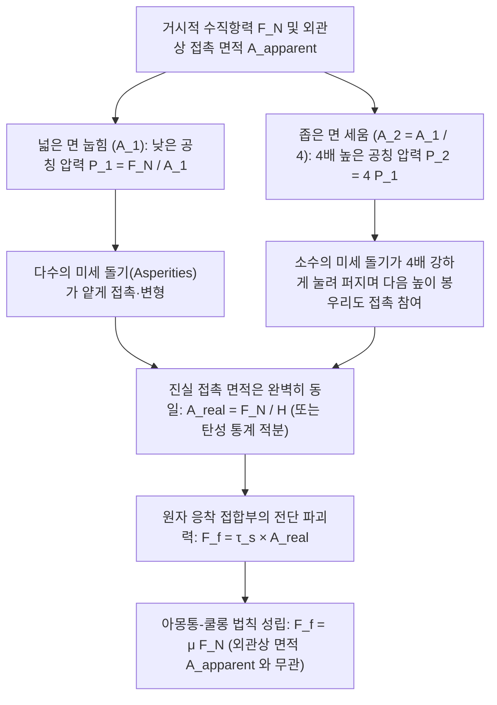
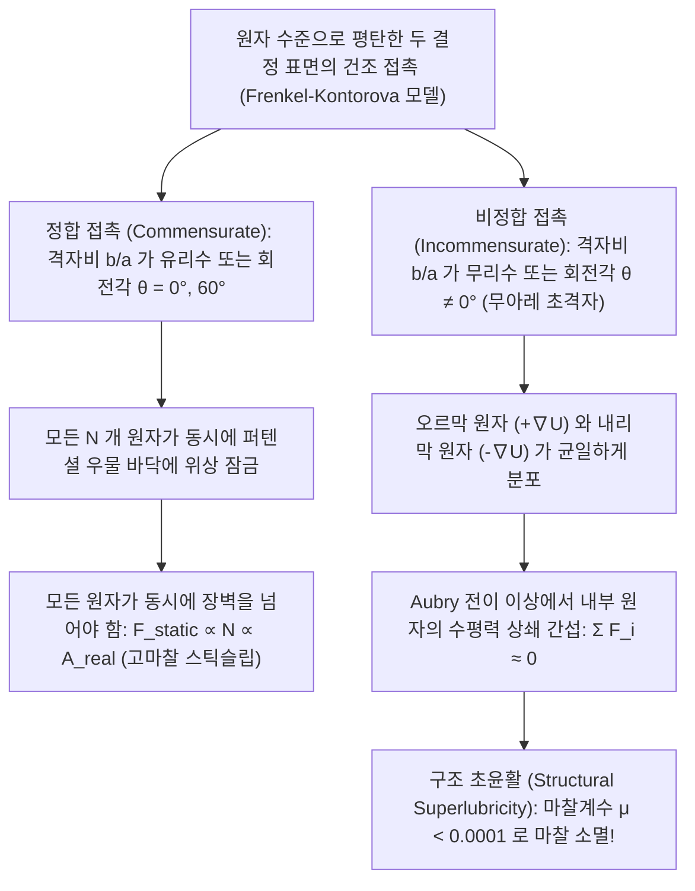

고등학교 물리 교과서에서 배우는 가장 간결한 방정식 중 하나는 건조 마찰 법칙인 $F_f = \mu F_N$이다. 책상 위에 놓인 직육면체 벽돌을 용수철저울로 수평으로 당길 때, 움직이기 직전의 최대 정지 마찰력이나 운동 마찰력은 오직 벽돌의 무게(수직항력 $F_N$)와 마찰계수 $\mu$의 곱으로만 결정된다는 법칙이다.

그러나 이 익숙한 공식 이면에는 우리의 일상적 직관과 정면으로 충돌하는 깊은 역설이 숨어 있다. 동일한 벽돌을 넓은 바닥면(예: 면적 $A_1 = 200\,\text{cm}^2$)이 닿도록 눕혀 놓았을 때와, 좁은 옆면(면적 $A_2 = 50\,\text{cm}^2$)이 닿도록 세워 놓았을 때를 비교해 보자. 직관적으로는 바닥과 문질러지는 면적이 $4$배나 넓은 눕힌 상태에서 훨씬 큰 마찰 저항이 발생할 것 같다. 하지만 실제로 측정해 보면, <strong>접촉 면적이 $4$배 달라져도 벽돌을 당기는 데 필요한 마찰력 $F_f$는 놀라울 정도로 정확히 일치한다!</strong> 반대로 만약 마찰력이 정말 면적과 무관하다면, 왜 포뮬러 원(F1) 경주차나 드래그 레이스 차량은 그토록 극단적으로 폭이 넓은 민무늬 슬릭 타이어(Slick Tires)를 장착하는 것일까?

마찬가지로 우리는 오랫동안 "스케이트 날이 얼음 위에서 미끄러지는 이유는 좁은 날에 집중된 체중의 높은 압력이 얼음의 녹는점을 낮춰 물막을 만들기 때문(압력 융해설)"이라고 배워 왔다. 그러나 열역학의 <strong>클라우지우스-클라페이롱 방정식(Clausius–Clapeyron Equation)</strong>에 실제 수치를 대입해 계산해 보면, 체중 $75\,\text{kg}$의 스케이터가 낮출 수 있는 얼음의 녹는점은 고작 $0.12^\circ\text{C}$에 불과하여, $-10^\circ\text{C}$나 $-20^\circ\text{C}$의 빙판에서 스케이트를 탈 수 있는 이유를 전혀 설명하지 못한다.

본 글에서는 마찰·마모·윤활을 다루는 융합 학문인 <strong>트라이볼로지(Tribology)</strong>의 관점에서 이 고전적 수수께끼들을 나노 및 마이크로 표면물리학으로 명쾌하게 풀어낸다. 거시적인 <strong>외관상 접촉 면적($A_{\text{apparent}}$)</strong>과 미시적인 <strong>진실 접촉 면적($A_{\text{real}}$)</strong>의 괴리, 바이올린의 선율부터 판 경계 거대 지진까지 지배하는 <strong>스틱슬립(Stick-Slip) 동역학과 속도-상태 마찰 법칙</strong>, 얼음 표면에 존재하는 <strong>유사 액체층(QLL)</strong>의 정체, 그리고 마찰계수가 사실상 0으로 소멸하는 궁극의 나노기술 <strong>구조 초윤활(Structural Superlubricity)</strong>까지 수리 모델과 함께 깊이 있게 살펴보자.

---

## 1. 고전 마찰학의 수수께끼: 아몽통-쿨롱의 법칙과 기하학적 맞물림 가설의 붕괴

### 1.1 다빈치(1493), 아몽통(1699), 쿨롱(1785)으로 이어지는 역사적 계보

마찰에 대한 최초의 정량적 실험은 뉴턴 역학보다 약 2세기 앞선 1493년경, 르네상스의 천재 <strong>레오나르도 다빈치(Leonardo da Vinci)</strong>에 의해 수행되었다. 다빈치는 수첩(《아룬델 코덱스》 및 《마드리드 코덱스》)에서 나무 블록과 도르래 실험을 통해 (1) 무게가 같다면 접촉면의 넓이와 상관없이 마찰 저항이 같고, (2) 무게가 2배가 되면 마찰력도 2배가 된다는 사실을 최초로 기록했다.

이후 1699년 프랑스의 <strong>기욤 아몽통(Guillaume Amontons)</strong>이 이 법칙을 재발견하여 파리 왕립과학아카데미에 발표했고, 1748년 <strong>레온하르트 오일러(Leonhard Euler)</strong>가 마찰계수 기호 $\mu$와 안식각 공식 $\mu_s = \tan\theta_c$를 도입하며 정지 마찰과 운동 마찰($\mu_s > \mu_k$)을 구분했다. 마침내 1785년, 프랑스의 <strong>샤를 오귀스탱 드 쿨롱(Charles-Augustin de Coulomb)</strong>이 로슈포르 해군 조선소에서의 정밀 실험을 집대성하여 오늘날의 <strong>아몽통-쿨롱 건조 마찰 3법칙(Amontons–Coulomb Laws)</strong>을 완성했다.

$$\begin{aligned}
\text{제1법칙 (수직항력 비례 법칙):} & \quad F_f = \mu F_N \\
\text{제2법칙 (외관상 면적 무관 법칙):} & \quad \frac{\partial F_f}{\partial A_{\text{apparent}}} = 0 \\
\text{제3법칙 (미끄럼 속도 무관 법칙):} & \quad \frac{\partial F_k}{\partial v} \approx 0 \quad (\text{단, } F_k = \mu_k F_N < F_s^{\max} = \mu_s F_N)
\end{aligned}$$

### 1.2 강체 톱니 맞물림 모델의 열역학적 모순

아몽통과 쿨롱은 표면의 미세한 강체 톱니(경사각 $\theta$)를 타고 올라가는 <strong>기하학적 요철 맞물림 모델(Geometric Interlocking Model)</strong>로 $F_f = F_N \tan\theta$를 설명하려 했다. 그러나 19세기 에너지 보존 법칙(열역학 제1법칙)이 확립되면서 이 모델의 치명적 결함이 드러났다. 만약 미세 돌기가 변형되지 않는 완전 강체(혹은 완전 탄성체)라면, 오르막 경사면을 올라갈 때 외력이 한 일 $W_{\text{up}} = F_N \Delta h$는 <strong>정상 너머 내리막 경사면을 미끄러져 내려올 때 중력에 의해 $100\%$ 운동 에너지로 회수($W_{\text{down}} = -F_N \Delta h$)</strong>되어 버린다! 즉, 한 주기 동안의 순 에너지 소산($\oint \mathbf{F}\cdot d\mathbf{r} = 0$)이 0이 되어 거시적 운동 마찰력이 존재할 수 없다. 또한 금속 게이지 블록을 나노미터 수준으로 거울처럼 연마($\tan\theta \to 0$)하면 마찰이 사라지는 것이 아니라 오히려 강력하게 달라붙어 버린다. 따라서 진정한 마찰 이론은 <strong>원자 수준의 진실 접촉 면적에서의 비가역적 변형과 포논(Phonon, 격자 진동) 열 소산</strong>을 설명해야만 한다.

---

## 2. 외관상 접촉 면적과 진실 접촉 면적: 미세 돌기(Asperity)가 푸는 벽돌의 역설

### 2.1 "스위스를 뒤집어 오스트리아 위에 올려놓기": 보든-테이버의 응착 소성 변형 이론(1950)

20세기 트라이볼로지 혁명을 이끈 케임브리지 대학교의 <strong>프랭크 필립 보든(Frank Philip Bowden)</strong>과 <strong>데이비드 테이버(David Tabor)</strong>는 1950년 명저 《고체의 마찰과 윤활》에서 고체 접촉의 본질을 다음과 같이 묘사했다.

> <strong>"아무리 정밀하게 연마된 두 금속 평판을 포개어 놓는 것도, 미시적 스케일에서 보면 스위스를 거꾸로 뒤집어 오스트리아 위에 올려놓는 것과 같다. 실제로 맞닿는 곳은 가장 높이 솟아오른 알프스 산봉우리 끝부분의 극히 일부에 불과하다."</strong>

원자간력 현미경(AFM)으로 관찰하면 거울처럼 매끄러운 강철 표면조차 제곱평균제곱근 거칠기 $R_q \sim 10\,\text{nm}\text{–}1\,\mu\text{m}$의 산맥을 이루고 있으며, 이는 원자 결합 거리($0.2\text{–}0.4\,\text{nm}$)보다 수천 배 크다. 이 미세한 산봉우리를 <strong>애스퍼리티(Asperity, 미세 돌기)</strong>라고 부른다. 두 고체가 맞닿을 때 실제로 원자 수준에서 힘을 주고받는 미세 접촉점들의 면적 총합인 <strong>진실 접촉 면적(Real Contact Area, $A_{\text{real}}$)</strong>은 거시적인 <strong>외관상 접촉 면적(Apparent Contact Area, $A_{\text{apparent}}$)</strong>의 $10^{-5} \sim 10^{-3}$($0.001\% \sim 0.1\%$)에 불과하다.

$$\frac{A_{\text{real}}}{A_{\text{apparent}}} = \frac{\sum_{i=1}^{N_c} A_i}{L_x L_y} \sim 10^{-5} \text{ – } 10^{-3}$$

전체 수직 하중 $F_N$이 이 극소 면적 $A_{\text{real}}$에 집중되므로, 미세 돌기 끝단의 국소 압력 $p_{\text{local}} = F_N / A_{\text{real}}$은 즉각 재료의 항복 응력 $\sigma_y$를 넘어 <strong>소성 압입 경도 $H \approx 3\sigma_y$</strong>(테이버 관계식)에 도달한다. 미세 돌기 끝단은 국소 압력이 $H$와 평형을 이룰 때까지 <strong>소성 유동(Plastic Yielding)</strong>하며 납작하게 눌려 넓어진다.

$$p_{\text{local}} = H \implies A_{\text{real}} = \frac{F_N}{H}$$

이 미세 접촉점들에서 상하 원자들이 $0.3\,\text{nm}$ 이내로 밀착되면 금속 결합이나 반데르발스 인력에 의해 <strong>냉간 압접 응착 접합부(Adhesive Micro-junctions)</strong>가 형성된다. 물체를 수평으로 미끄러뜨리려면 계면 전단 강도 $\tau_s$를 가진 이 접합부들을 끊어내야 하므로, 마찰력은 다음과 같이 도출된다.

$$F_f = F_{\text{adh}} + F_{\text{plough}} \approx \tau_s A_{\text{real}} = \tau_s \left(\frac{F_N}{H}\right) = \left(\frac{\tau_s}{H}\right) F_N \implies \mu = \frac{\tau_s}{H}$$

이로써 벽돌의 역설이 완벽히 풀렸다. <strong>마찰력은 접촉 면적과 무관한 것이 아니라, 미시적인 '진실 접촉 면적 $A_{\text{real}}$'에 정비례한다!</strong> 벽돌을 세워 외관상 면적 $A_{\text{apparent}}$를 $1/4$로 줄이면 단위 면적당 압력이 $4$배로 증가하여 개별 돌기가 $4$배 더 넓게 찌부러지므로, 총 진실 접촉 면적 $A_{\text{real}} = F_N / H$는 눕혔을 때와 정확히 같게 유지되는 것이다!

### 2.2 그린우드-윌리엄슨(1966) 다중 돌기 탄성 접촉 이론과 페르손의 멀티스케일 이론

반복 마찰 후 미세 돌기가 <strong>순수 탄성 변형</strong>만 한다면 어떨까? 1882년 <strong>헤르츠 탄성 접촉 이론(Hertzian Contact)</strong>에 따르면 반지름 $R$인 단일 탄성 구가 하중 $w$를 받을 때 접촉 면적은 $A_{\text{single}} = \pi \left(\frac{3R}{4E^*}\right)^{2/3} w^{2/3} \propto w^{2/3}$로 비선형 증가한다. 만약 모든 돌기 높이가 같다면 $A_{\text{real}} \propto F_N^{2/3}$가 되어 아몽통 법칙이 깨진다.

1966년 <strong>그린우드(J. A. Greenwood)와 윌리엄슨(J. B. P. Williamson)</strong>은 실제 거친 표면의 돌기 정상 높이 $z$가 표준편차 $\sigma_s$를 갖는 확률 분포 $\phi(z)$(예: 지수 분포 꼬리 $\phi(z) = \frac{1}{\sigma_s} e^{-z/\sigma_s}$)를 따른다는 점에 착안했다. 두 표면이 거리 $d$만큼 접근했을 때 $z > d$인 모든 돌기에 대해 헤르츠 식을 적분하면 다음과 같다.

$$\begin{aligned}
N_c(d) &= \eta A_{\text{apparent}} \int_d^\infty \phi(z)\,dz = \eta A_{\text{apparent}} \, e^{-d/\sigma_s} \\
A_{\text{real}}(d) &= \pi \eta A_{\text{apparent}} R \int_d^\infty (z - d)\,\phi(z)\,dz = \pi \eta A_{\text{apparent}} R \sigma_s \, e^{-d/\sigma_s} \\
F_N(d) &= \frac{4}{3} \eta A_{\text{apparent}} E^* R^{1/2} \int_d^\infty (z - d)^{3/2}\,\phi(z)\,dz = \sqrt{\pi} \eta A_{\text{apparent}} E^* R^{1/2} \sigma_s^{3/2} \, e^{-d/\sigma_s}
\end{aligned}$$

두 식의 비를 취하면 $e^{-d/\sigma_s}$와 $A_{\text{apparent}}$가 정확히 약분되어 순수 탄성 접촉에서도 엄밀한 선형 비례 관계가 도출된다!

$$A_{\text{real}} = \frac{\sqrt{\pi}}{E^* \sqrt{\sigma_s / R}} F_N \propto F_N$$

하중 $F_N$이 증가할 때 기존 접촉점이 넓어지는 동시에 <strong>새로이 작은 돌기들이 접촉에 계속 합류</strong>하기 때문에, 개별 접촉점의 평균 면적($\pi R \sigma_s$)은 일정하게 유지되고 접촉점의 개수 $N_c$가 하중에 비례하여 증가하는 것이다. 2001년 <strong>보 페르손(Bo N. J. Persson)</strong>은 이를 자기 아핀 프랙탈(Self-affine fractal) 표면으로 확장하여 $A_{\text{real}} = \frac{\kappa}{E^* \sqrt{\langle |\nabla h|^2 \rangle}} F_N$의 보편성을 증명했다.

### 2.3 아몽통 법칙이 깨지는 3가지 극한: F1 슬릭 타이어, 게코도마뱀 발바닥, 우주 냉간 압접

$A_{\text{real}} \to A_{\text{apparent}}$가 되거나 분자 응착력이 지배적인 영역에서는 아몽통 법칙이 깨지고 외관상 면적이 마찰력을 좌우한다.
1. <strong>점탄성 고무와 F1 광폭 슬릭 타이어(JKR 응착 접촉역학, 1971)</strong>: 고무는 탄성 계수가 매우 낮아($E \sim 1\text{–}10\,\text{MPa}$) 노면의 미세 요철을 메우며 $A_{\text{real}} \to A_{\text{apparent}}$에 도달한다. <strong>JKR(Johnson–Kendall–Roberts) 방정식</strong> $a_{\text{JKR}}^3 = \frac{3R}{4E^*}\left(w + 3\pi R \Delta\gamma + \sqrt{6\pi R \Delta\gamma w + (3\pi R \Delta\gamma)^2}\right)$에 의해 하중 $w=0$에서도 유한한 응착 면적이 유지되며, 고하중 포화 영역에서는 유효 마찰계수가 공칭 압력에 반비례($\mu_{\text{eff}} \propto P_{\text{nom}}^{-1/3}$, 타이어 하중 민감도)한다. F1 머신이 광폭 슬릭 타이어를 쓰는 이유는 $A_{\text{apparent}}$를 극대화하여 면압을 낮추고 응착·점탄성 그립을 극대화하기 위함이다.
2. <strong>게코도마뱀(Gecko) 발바닥의 계층적 나노 강모(Setae & Spatulae)</strong>: 수백만 개의 케라틴 강모(Setae) 끝이 $100\text{–}200\,\text{nm}$ 폭의 주걱형 나노 돌기(Spatulae)로 분기하여 유효 탄성 계수를 $E_{\text{eff}} < 100\,\text{kPa}$(달퀴스트 점착 기준)로 낮춤으로써 거친 벽면에서도 $A_{\text{real}} \approx A_{\text{apparent}}$를 달성, 순수 반데르발스 힘만으로 천장에 매달린다.
3. <strong>초고진공 우주 공간의 냉간 압접(Cold Welding)</strong>: 대기 중의 금속은 $1\text{–}5\,\text{nm}$의 자연 산화막으로 보호되지만, 우주 초고진공($P < 10^{-10}\,\text{Pa}$)에서 산화막이나 $\text{MoS}_2$ 윤활막이 마모되면 깨끗한 금속 원자들이 직접 맞닿아 즉각 금속 결합으로 일체화($\mu \to \infty$, 1991년 갈릴레오 목성 탐사선 안테나 고착 사고의 원인)된다.

---

## 3. 스틱슬립(Stick-Slip) 동역학과 속도-상태 마찰 법칙: 바이올린에서 거대 지진까지

### 3.1 용수철-블록 모델과 이완 진동(Relaxation Oscillation)

강성 $k$인 용수철을 통해 일정 속도 $v_0$로 견인되는 질량 $m$ 블록의 운동 방정식은 다음과 같다.

$$m \frac{d^2 x}{dt^2} = k(v_0 t - x) - F_f\!\left(\frac{dx}{dt}, \theta\right)$$

$\mu_s > \mu_k$일 때 블록은 $t_{\text{stick}} = \frac{(\mu_s - \mu_k)F_N}{k v_0}$ 동안 정지해 탄성 에너지를 축적하는 <strong>스틱(Stick, 고착) 단계</strong>와, 정지 마찰 한계를 넘는 순간 고유 진동수 $\omega_0 = \sqrt{k/m}$로 급격히 미끄러지는 <strong>슬립(Slip, 미끄럼) 단계</strong>를 주기적으로 반복한다.

$$x(t') = v_0 t' + \frac{(\mu_s - \mu_k)F_N}{k}(1 - \cos\omega_0 t') - \frac{v_0}{\omega_0}\sin\omega_0 t'$$

### 3.2 접촉 노화(Contact Aging)와 디터리히-루이나 속도-상태 마찰 법칙(RSF)

왜 정지 마찰은 운동 마찰보다 클까? <strong>제임스 디터리히(Dieterich, 1979)</strong>, <strong>앤디 루이나(Ruina, 1983)</strong>, <strong>제이 파인버그(Fineberg, 2004)</strong>의 실험이 입증했듯, 정지 접촉 시간 $t$ 동안 미세 돌기 끝단이 크리프(Creep) 변형과 화학 결합을 일으켜 진실 접촉 면적이 <strong>로그 함수적으로 성장(접촉 노화)</strong>하기 때문이다.

$$A_{\text{real}}(t) = A_0 \left[ 1 + c \ln\!\left(1 + \frac{t}{\tau_0}\right) \right]$$

반면 속도 $v$로 미끄러지면 특성 거리 $D_c$($1\text{–}50\,\mu\text{m}$)마다 오래된 접촉이 끊어지고 평균 수명 $\theta \approx D_c / v$인 젊은 접촉으로 교체된다. 이를 정식화한 것이 <strong>디터리히-루이나 속도-상태 마찰 법칙(Rate-and-State Friction Law)</strong>이다.

$$\mu(v, \theta) = \mu_0 + a \ln\!\left(\frac{v}{v_*}\right) + b \ln\!\left(\frac{v_* \theta}{D_c}\right), \qquad \frac{d\theta}{dt} = 1 - \frac{v \theta}{D_c}$$

정상 상태($\dot{\theta} = 0 \implies \theta_{\text{ss}} = D_c / v$)에서 $\mu_{\text{ss}}(v) = \mu_0 + (a - b)\ln(v/v_*)$가 되며, <strong>속도 약화 영역($a - b < 0$)</strong>에서 시스템 강성 $k$가 <strong>임계 강성 $k_c$</strong>보다 작으면 호프 분기(Hopf Bifurcation)를 통해 스틱슬립 진동이 폭발한다!

$$k < k_c = \frac{(b - a) F_N}{D_c}$$

송진(Rosin)을 바른 바이올린 활이 현을 문지를 때 일어나는 <strong>헬름홀츠 운동(Helmholtz Motion)</strong>과, 연간 수 $\text{cm}$로 섭입하는 해양판이 수백 년간 고착(Stick)되었다가 수 초 만에 수 미터를 미끄러지는(Slip) <strong>섭입대 거대 지진</strong>은 정확히 동일한 방정식으로 기술된다.

---

## 4. 얼음이 미끄러운 진짜 이유: 압력 융해설의 열역학적 반박과 유사 액체층(QLL)

### 4.1 클라우지우스-클라페이롱 방정식을 통한 압력 융해설의 정량적 반박

고체 얼음과 액체 물의 상평형 경계 기울기를 <strong>클라우지우스-클라페이롱 방정식</strong>으로 계산해 보자($T_m = 273.15\,\text{K}$, 융해 잠열 $L_f = 3.335 \times 10^5\,\text{J/kg}$, $\rho_{\text{liq}} = 999.8\,\text{kg/m}^3$, $\rho_{\text{ice}} = 916.7\,\text{kg/m}^3$, $\Delta v = -9.07 \times 10^{-5}\,\text{m}^3/\text{kg}$).

$$\frac{dP}{dT_m} = \frac{L_f}{T_m \left(v_{\text{liq}} - v_{\text{ice}}\right)} = \frac{3.335 \times 10^5}{(273.15)(-9.07 \times 10^{-5})} \approx -1.346 \times 10^7\,\text{Pa/K} = -13.46\,\text{MPa/K}$$

즉 <strong>얼음의 녹는점을 단 $1^\circ\text{C}$ 낮추는 데에도 약 $13.5\,\text{MPa}$(약 $133$기압!)의 막대한 압력이 필요하다.</strong>
체중 $75\,\text{kg}$($F_N = 735\,\text{N}$)인 스케이터가 길이 $30\,\text{cm}$, 폭 $1.5\,\text{mm}$($A = 4.5 \times 10^{-4}\,\text{m}^2$)인 스케이트 날 한 개로 섰을 때 가해지는 압력과 녹는점 강하는 다음과 같다.

$$\Delta P = \frac{735\,\text{N}}{4.5 \times 10^{-4}\,\text{m}^2} \approx 1.63\,\text{MPa} \implies \Delta T_m = \frac{1.63\,\text{MPa}}{-13.46\,\text{MPa/K}} \approx -0.12^\circ\text{C}$$

설령 얼음의 압축 파쇄 한계($H_{\text{ice}} \approx 15\,\text{MPa}$)까지 국소 압력이 치솟더라도 녹는점은 최대 $-1.1^\circ\text{C}$밖에 내려가지 않는다. 따라서 $-10^\circ\text{C} \sim -20^\circ\text{C}$의 링크에서 스케이트를 타거나 평평한 신발 밑창이 빙판에서 미끄러지는 현상은 압력 융해설로 절대 설명할 수 없다.

### 4.2 얼음 윤활의 3대 핵심 물리 메커니즘

1. <strong>표면 예융해(Surface Premelting)와 패러데이의 유사 액체층(QLL, 1850)</strong>: 얼음 결정 내부의 물 분자는 $4$개의 수소 결합으로 고정되어 있으나, 최표면의 물 분자는 위쪽 이웃이 없어 $2\text{–}3$개의 수소 결합만 맺는 <strong>배위 부족 상태(Under-coordinated state)</strong>에 놓인다. 표면 자유 에너지를 낮추기 위해 이 분자들은 격렬히 열진동하며, 외부 압력이 0이어도 <strong>$-30^\circ\text{C} \sim -35^\circ\text{C}$</strong>부터 두께 $1\text{–}20\,\text{nm}$의 비정질 <strong>유사 액체층(Quasi-Liquid Layer, QLL)</strong>을 자발적으로 형성한다. ($-35^\circ\text{C}$ 이하의 극지방에서는 QLL이 얼어붙어 눈과 얼음이 모래처럼 뻑뻑해진다.)
2. <strong>마찰열 국소 융해(Bowden & Hughes, 1939)</strong>: 활주 속도 $v$에서 발생하는 마찰열 플럭스 $q = \mu P v$가 얇은 열확산 깊이 $\delta_{\text{th}} \sim \sqrt{\alpha_{\text{th}} L / v}$에 집중되어 접촉점을 즉시 $0^\circ\text{C}$까지 가열하고 수백 $\text{nm}$ 두께의 수막을 생성한다. 열전도율이 낮은 폴리에틸렌(UHMWPE) 스키판이 금속 스키판보다 훨씬 잘 미끄러지는 이유가 바로 마찰열을 얼음 표면에 가두기 때문이다.
3. <strong>계면 나노 수막의 복소 점탄성 유변학(Canale, Bocquet & Bonn, 2019, *Phys. Rev. X*)</strong>: 튜닝포크 AFM 측정 결과, 얼음 표면의 전단 수막은 일반 물보다 점도가 $50\text{–}100$배 높고 탄성 저장 계수 $G'(\omega)$를 지닌 <strong>복소 점탄성 유체</strong>로 작용하여, 스케이트 날이 얼음을 파고드는 것을 막아주는 탄성유체 양력을 생성함이 밝혀졌다.

---

## 5. 스트리벡 곡선에서 구조 초윤활(Structural Superlubricity)까지

### 5.1 스트리벡 곡선(Stribeck Curve)과 레이놀즈 유체 윤활 방정식

윤활 상태는 유막 두께비 $\Lambda = h_{\min} / \sqrt{R_{q1}^2 + R_{q2}^2}$에 따라 <strong>경계 윤활($\Lambda < 1$)</strong>, <strong>혼합/탄성유체 윤활($1 \le \Lambda \le 3$)</strong>, <strong>유체역학적 윤활($\Lambda > 3$)</strong>로 나뉘며, 유체 윤활 영역의 압력장 $p(x,y)$는 1886년 <strong>오즈번 레이놀즈(Osborne Reynolds)</strong>가 유도한 편미분방정식을 따른다.

$$\frac{\partial}{\partial x}\!\left(\frac{h^3}{12\eta}\frac{\partial p}{\partial x}\right) + \frac{\partial}{\partial y}\!\left(\frac{h^3}{12\eta}\frac{\partial p}{\partial y}\right) = \frac{U}{2}\frac{\partial h}{\partial x} + \frac{\partial h}{\partial t}$$

### 5.2 프란틀-톰린슨(PT) 모델과 히라노 모토히사의 구조 초윤활(1990)

액체 윤활제 없는 원자 스케일 건조 접촉에서 <strong>프란틀-톰린슨 모델(Prandtl–Tomlinson Model, 1928–1929)</strong>의 무차원 주름 파라미터 $\eta_{\text{PT}}$는 다음과 같이 정의된다.

$$V_{\text{PT}}(x, X) = -\frac{U_0}{2}\cos\!\left(\frac{2\pi x}{a}\right) + \frac{1}{2} k_{\text{eff}} (x - X)^2, \qquad \eta_{\text{PT}} = \frac{2\pi^2 U_0}{k_{\text{eff}} a^2}$$

$\eta_{\text{PT}} > 1$이면 원자가 에너지 장벽에 갇혔다가 비단열적으로 점프하며 격자 <strong>포논(열)</strong>을 방출하는 원자 스틱슬립이 일어나지만, $\eta_{\text{PT}} \le 1$이면 단일 극소점만 존재하여 에너지 소산 없이 부드럽게 미끄러진다.

이를 $N$개 원자의 2차원 결정 시트(<strong>프렌켈-콘토로바 모델, Frenkel–Kontorova Model</strong>)로 확장할 때, 일본의 <strong>히라노 모토히사(Motohisa Hirano, 1990)</strong>가 이론적으로 예언하고 <strong>Dienwiebel 연구팀(2004)</strong>이 흑연 나노플레이크 회전 실험으로 입증한 <strong>구조 초윤활(Structural Superlubricity)</strong>이 나타난다. 두 결정 격자가 비정합 각도($\theta \neq 0^\circ$)로 어긋나 <strong>무아레 초격자(Moiré Superlattice)</strong>를 형성하면, 오르막 퍼텐셜($+\nabla U$)을 오르는 원자와 내리막 퍼텐셜($-\nabla U$)을 내려가는 원자의 수평력이 완벽히 <strong>상쇄 간섭</strong>을 일으킨다.

$$F_{\text{lateral}}^{\text{incomm}} = -\sum_{i=1}^{N} \frac{\pi U_0}{a}\sin\!\left(\frac{2\pi x_i}{a}\right) \approx \mathcal{O}\!\left(N^0 \text{ – } N^{1/2}\right) \ll N$$

그 결과 액체 윤활유가 전혀 없는 건조 상태에서도 마찰계수가 <strong>$\mu < 0.0001$</strong> 이하로 급감하며 마찰이 사실상 사라지게 된다.

---

## 6. 총괄: 스케일별 마찰 및 윤활 물리 메커니즘 비교표

| 마찰·윤활 레짐 | 지배적 미시 물리 메커니즘 | 진실 접촉 면적 및 하중 스케일링 | 대표 마찰계수 $\mu$ | 지배 방정식 및 핵심 이론 모델 |
| :--- | :--- | :--- | :--- | :--- |
| <strong>경질 고체 건조 마찰</strong> | 미세 돌기 끝단의 소성 항복 또는 통계적 탄성 변형 + 응착부 전단 | $A_{\text{real}} \propto F_N \ll A_{\text{apparent}}$ (외관상 면적과 무관) | $0.15 \text{ – } 0.80$ | 보든-테이버 $A_{\text{real}}=F_N/H$, GW 통계 모델, Persson 이론 |
| <strong>연질 고무 및 게코 응착 마찰</strong> | 낮은 유효 탄성 계수에 의한 완전 밀착 + 반데르발스 힘·점탄성 손실 | $A_{\text{real}} \to A_{\text{apparent}}$ (외관상 면적이 클수록 고마찰) | $0.80 \text{ – } 3.0+$ | JKR 응착 접촉 이론(1971), 달퀴스트 기준($E_{\text{eff}} < 100\,\text{kPa}$) |
| <strong>스틱슬립 불안정 미끄럼</strong> | 정지 시간 동안의 크리프 접촉 노화 vs. 미끄럼 거리 $D_c$ 갱신 | $A_{\text{real}}(t) = A_0[1 + c\ln(1+t/\tau_0)]$ | $\mu_s(t) > \mu_k(v)$ | 디터리히-루이나 속도-상태 마찰 법칙(RSF), 임계 강성 $k_c$ |
| <strong>얼음 표면 윤활 (스케이트·스키)</strong> | 배위 부족 물 분자의 유사 액체층(QLL) + 마찰열 융해 + 점탄성 양력 | QLL($1\text{–}20\,\text{nm}$)과 융해 수막이 고체 돌기 분리($-30^\circ\text{C}$까지) | $0.005 \text{ – } 0.03$ | 패러데이 표면 예융해, 보든 마찰열, Bocquet-Bonn 복소 점탄성 |
| <strong>유체역학적 윤활 (베어링)</strong> | 쐐기막 점성 유입에 의한 자체 동수압 $p(x,y)$ 발생 | 고체 간 직접 접촉 0 ($\Lambda = h_{\min}/\sigma^* > 3$) | $0.001 \text{ – } 0.005$ | 스트리벡 곡선(1902), 레이놀즈 유체 윤활 편미분방정식(1886) |
| <strong>구조 초윤활 (2차원 비정합 결정)</strong> | 비정합 무아레 초격자에서 원자 수평력의 위상 상쇄 간섭 | 내부 원자력 상쇄, 가장자리 원자만 기여($F_f \propto A^{0\text{–}0.5}$) | $< 0.0001$ ($10^{-4}\text{–}10^{-5}$) | 프란틀-톰린슨($\eta_{\text{PT}} \le 1$), FK 모델, 히라노 초윤활 이론 |
