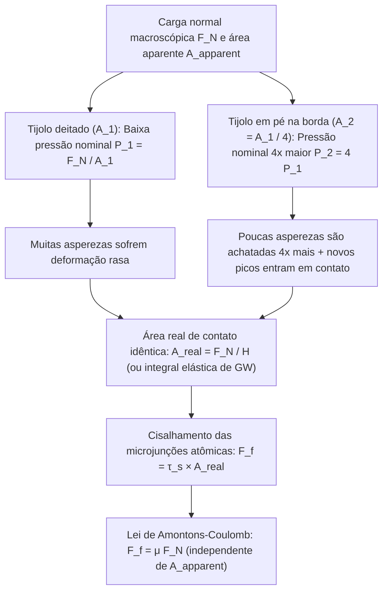
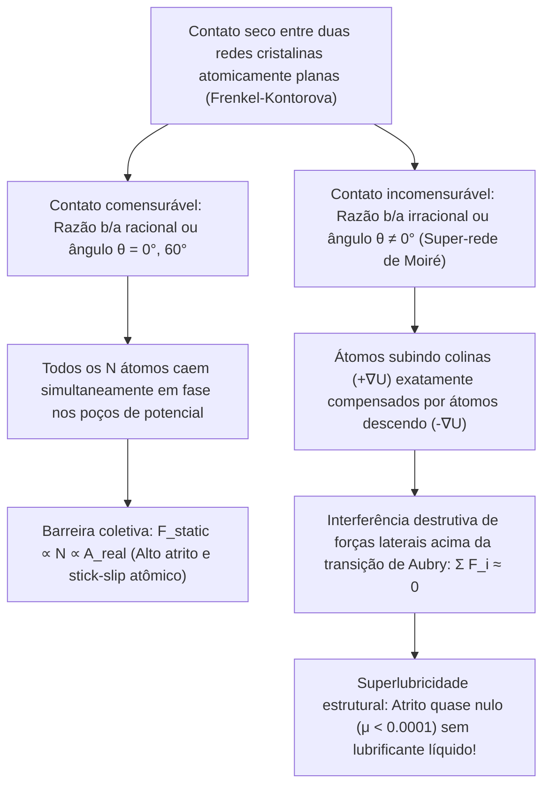

Poucas equações da mecânica clássica parecem tão simples — e ocultam um paradoxo físico tão profundo — quanto a lei do atrito seco:

$$F_f = \mu F_N$$

Imagine um tijolo retangular apoiado sobre uma mesa plana. Se o puxarmos horizontalmente com um dinamômetro quando está deitado sobre sua face larga (área aparente $A_1 = 200\,\text{cm}^2$) e depois quando está apoiado sobre sua borda estreita ($A_2 = 50\,\text{cm}^2$), a intuição sugere que a face quatro vezes maior deveria oferecer muito mais resistência. Contudo, o experimento comprova que <strong>a força de atrito $F_f$ é exatamente igual, independentemente da área geométrica de contato!</strong> Por outro lado, se o atrito realmente independe da área, por que os carros de Fórmula 1 utilizam pneus *slick* extremamente largos?

Um segundo mito clássico afirma que um patinador desliza no gelo porque a alta pressão da lâmina reduz o ponto de fusão do gelo e derrete uma fina camada de água. Porém, aplicando a <strong>equação termodinâmica de Clausius-Clapeyron</strong>, verifica-se que um patinador de $75\,\text{kg}$ reduz o ponto de fusão em apenas $0{,}12^\circ\text{C}$ — o que jamais explicaria como patinamos a $-10^\circ\text{C}$ ou $-20^\circ\text{C}$!

Neste artigo exploramos a <strong>tribologia</strong> (a ciência do atrito, desgaste e lubrificação) sob a ótica da física de superfícies em nanoescala: a diferença entre a <strong>área de contato aparente ($A_{\text{apparent}}$)</strong> e a <strong>área de contato real ($A_{\text{real}}$)</strong>, a dinâmica <strong>stick-slip (aderência-deslizamento)</strong>, a <strong>camada quase líquida (QLL)</strong> do gelo e a <strong>superlubricidade estrutural</strong>.

---

## 1. O enigma clássico: as leis de Amontons-Coulomb e a falha do engrenamento geométrico

### 1.1 De Leonardo da Vinci (1493) a Amontons (1699) e Coulomb (1785)

Por volta de 1493, <strong>Leonardo da Vinci</strong> registrou em seus cadernos (*Codex Arundel*) que o atrito é proporcional à carga normal e independente da área de contato. Redescobertas por <strong>Guillaume Amontons (1699)</strong>, formalizadas por <strong>Leonhard Euler (1748)</strong> com o coeficiente $\mu = \tan\theta_c$ e consolidadas por <strong>Charles-Augustin de Coulomb (1785)</strong>, essas leis formam as <strong>três leis clássicas de Amontons-Coulomb</strong>:

$$\begin{aligned}
\text{1.ª Lei (Proporcionalidade à carga normal):} & \quad F_f = \mu F_N \\
\text{2.ª Lei (Independência da área aparente):} & \quad \frac{\partial F_f}{\partial A_{\text{apparent}}} = 0 \\
\text{3.ª Lei (Independência da velocidade):} & \quad \frac{\partial F_k}{\partial v} \approx 0 \quad (\text{com } F_k = \mu_k F_N < F_s^{\max} = \mu_s F_N)
\end{aligned}$$

O modelo clássico de dentes de serra rígidos de inclinação $\tan\theta$ ($F_f = F_N \tan\theta$) viola a primeira lei da termodinâmica: numa rampa rígida ou puramente elástica, o trabalho $W_{\text{up}} = F_N \Delta h$ gasto para subir um dente <strong>é integralmente recuperado ($W_{\text{down}} = -F_N \Delta h$) ao descer pelo lado oposto</strong> ($\oint \mathbf{F}\cdot d\mathbf{r} = 0$). O atrito real requer deformação irreversível e dissipação em vibrações da rede cristalina (<strong>fônons</strong>).

---

## 2. Área aparente vs. área real de contato: como as asperezas resolvem o paradoxo

### 2.1 «Colocar a Suíça de cabeça para baixo sobre a Áustria»: a teoria adesiva de Bowden e Tabor (1950)

Como demonstraram <strong>Frank Philip Bowden</strong> e <strong>David Tabor</strong> (Cambridge, 1950), até mesmo um bloco de aço polido como espelho apresenta ao microscópio de força atômica (AFM) uma rugosidade $R_q \sim 10\,\text{nm}\text{–}1\,\mu\text{m}$, mil vezes maior que o alcance das ligações atômicas ($0{,}2\text{–}0{,}4\,\text{nm}$). Segundo a famosa metáfora de Bowden: <strong>«Colocar dois sólidos em contato é como virar a Suíça de cabeça para baixo e apoiá-la sobre a Áustria: apenas os picos alpinos mais altos se tocam».</strong>

Esses picos microscópicos são chamados de <strong>asperezas (asperities)</strong>. A soma das microáreas de contato atômico efetivo é a <strong>área real de contato ($A_{\text{real}}$)</strong>, muito menor que a <strong>área aparente ($A_{\text{apparent}}$)</strong>:

$$A_{\text{real}} = \sum_{i=1}^{N_c} A_i \ll A_{\text{apparent}}, \qquad \frac{A_{\text{real}}}{A_{\text{apparent}}} \sim 10^{-5} \text{ a } 10^{-3}$$

Como toda a força normal $F_N$ se concentra em $A_{\text{real}}$, a pressão local $p_{\text{local}} = F_N / A_{\text{real}}$ atinge imediatamente a <strong>dureza de escoamento plástico $H \approx 3\sigma_y$</strong>. As pontas das asperezas deformam-se plasticamente até que a área real suporte exatamente a carga $F_N$:

$$p_{\text{local}} = H \implies A_{\text{real}} = \frac{F_N}{H}$$

Nesses microcontatos formam-se <strong>microjunções adesivas soldadas a frio</strong> com resistência ao cisalhamento $\tau_s$. Para deslizar o corpo, é preciso cisalhar essas junções:

$$F_f = \tau_s A_{\text{real}} = \tau_s \left(\frac{F_N}{H}\right) = \left(\frac{\tau_s}{H}\right) F_N \implies \mu = \frac{\tau_s}{H}$$

Assim resolve-se o paradoxo do tijolo: <strong>o atrito é estritamente proporcional à área REAL de contato $A_{\text{real}}$!</strong> Ao apoiar o tijolo na borda estreita, a pressão nominal quadruplica, achatando quatro vezes mais as asperezas de modo que $A_{\text{real}} = F_N / H$ permanece invariante.

### 2.2 Mecânica estatística elástica de Greenwood-Williamson (1966) e exceções à lei

Para uma única esfera elástica de raio $R$, a <strong>teoria de Hertz (1882)</strong> prevê $A_{\text{single}} \propto w^{2/3}$. Todavia, <strong>J. A. Greenwood e J. B. P. Williamson (1966)</strong> provaram que, integrando sobre uma distribuição estatística de alturas $\phi(z) = \frac{1}{\sigma_s} e^{-z/\sigma_s}$, o recrutamento contínuo de novas asperezas mantém constante a área média por contato ($\pi R \sigma_s$) enquanto o número de contatos cresce linearmente com $F_N$:

$$A_{\text{real}} = \frac{\sqrt{\pi}}{E^* \sqrt{\sigma_s / R}} F_N \propto F_N$$

<strong>Quando a lei de Amontons falha?</strong> Quando $A_{\text{real}} \to A_{\text{apparent}}$:
1. <strong>Borracha viscoelástica e pneus slick de Fórmula 1 (teoria JKR, 1971)</strong>: Com baixo módulo de elasticidade ($E \sim 1\text{–}10\,\text{MPa}$) e adesão regida pela equação de <strong>Johnson-Kendall-Roberts (JKR)</strong> $a_{\text{JKR}}^3 = \frac{3R}{4E^*}(w + 3\pi R \Delta\gamma + \sqrt{6\pi R \Delta\gamma w + (3\pi R \Delta\gamma)^2})$, o coeficiente efetivo cai com o aumento da pressão ($\mu_{\text{eff}} \propto P_{\text{nom}}^{-1/3}$). Pneus largos maximizam $A_{\text{apparent}}$, reduzindo a pressão nominal e elevando a aderência.
2. <strong>Setae e spatulae da lagartixa (gecko)</strong>: Milhões de cerdas de queratina ramificadas em espátulas de $100\text{–}200\,\text{nm}$ reduzem o módulo efetivo abaixo do critério de Dahlquist ($E_{\text{eff}} < 100\,\text{kPa}$), atingindo $A_{\text{real}} \approx A_{\text{apparent}}$ via forças de van der Waals.
3. <strong>Soldagem a frio no ultra-alto vácuo espacial</strong>: Sem camadas protetoras de óxido ($1\text{–}5\,\text{nm}$), metais limpos fundem-se instantaneamente no vácuo espacial ($\mu \to \infty$, causa do travamento da antena da sonda *Galileo* em 1991).

---

## 3. Dinâmica Stick-Slip e lei de Dieterich-Ruina: do violino aos megaterremotos

Um bloco de massa $m$ puxado à velocidade $v_0$ por uma mola de rigidez $k$ obedece a $m \ddot{x} = k(v_0 t - x) - F_f(\dot{x}, \theta)$. Após uma fase de aderência (Stick) de duração $t_{\text{stick}} = \frac{(\mu_s - \mu_k)F_N}{k v_0}$, o bloco desliza abruptamente (Slip) com frequência natural $\omega_0 = \sqrt{k/m}$:

$$x(t') = v_0 t' + \frac{(\mu_s - \mu_k)F_N}{k}(1 - \cos\omega_0 t') - \frac{v_0}{\omega_0}\sin\omega_0 t'$$

Por que $\mu_s > \mu_k$? Porque a fluência (creep) das asperezas faz crescer a área real logaritmicamente com o tempo de contato estacionário: $A_{\text{real}}(t) = A_0 [1 + c \ln(1 + t/\tau_0)]$ (<strong>envelhecimento do contato</strong>). A <strong>lei de atrito de taxa e estado de Dieterich-Ruina (Rate-and-State Friction Law, 1979–1983)</strong> unifica o efeito direto da velocidade ($a$) e a idade média do contato ($\theta$, distância crítica $D_c$):

$$\mu(v, \theta) = \mu_0 + a \ln\!\left(\frac{v}{v_*}\right) + b \ln\!\left(\frac{v_* \theta}{D_c}\right), \qquad \frac{d\theta}{dt} = 1 - \frac{v \theta}{D_c}$$

Em regime estacionário ($\theta_{\text{ss}} = D_c / v$), $\mu_{\text{ss}}(v) = \mu_0 + (a - b)\ln(v/v_*)$. No <strong>regime de enfraquecimento por velocidade ($a - b < 0$)</strong>, ocorre uma bifurcação de Hopf (stick-slip) quando a rigidez $k$ é menor que a <strong>rigidez crítica $k_c$</strong>:

$$k < k_c = \frac{(b - a) F_N}{D_c}$$

Essa condição governa tanto o <strong>movimento de Helmholtz</strong> da corda de um violino com breu quanto os <strong>megaterremotos de subducção</strong>.

---

## 4. Por que o gelo é realmente escorregadio? Refutação por Clausius-Clapeyron e a camada quase líquida (QLL)

Calculemos a redução do ponto de fusão do gelo ($\text{I}_h$) pela <strong>equação de Clausius-Clapeyron</strong> ($T_m = 273{,}15\,\text{K}$, calor latente $L_f = 3{,}335 \times 10^5\,\text{J/kg}$, $\rho_{\text{liq}} = 999{,}8\,\text{kg/m}^3$, $\rho_{\text{ice}} = 916{,}7\,\text{kg/m}^3$, $\Delta v = -9{,}07 \times 10^{-5}\,\text{m}^3/\text{kg}$):

$$\frac{dP}{dT_m} = \frac{L_f}{T_m \left(v_{\text{liq}} - v_{\text{ice}}\right)} = \frac{3{,}335 \times 10^5}{(273{,}15)(-9{,}07 \times 10^{-5})} \approx -1{,}346 \times 10^7\,\text{Pa/K} = -13{,}46\,\text{MPa/K}$$

Para um patinador de $75\,\text{kg}$ ($F_N = 735\,\text{N}$) sobre uma lâmina de $30\,\text{cm} \times 1{,}5\,\text{mm}$ ($A = 4{,}5 \times 10^{-4}\,\text{m}^2$), a pressão $\Delta P = 1{,}63\,\text{MPa}$ reduz o ponto de fusão em apenas:

$$\Delta T_m = \frac{1{,}63\,\text{MPa}}{-13{,}46\,\text{MPa/K}} \approx -0{,}12^\circ\text{C}$$

A fusão por pressão jamais explicaria a patinação a $-10^\circ\text{C}$! Os três mecanismos reais são:
1. <strong>Pré-fusão superficial e camada quase líquida de Faraday (QLL, 1850)</strong>: Moléculas superficiais de $\text{H}_2\text{O}$ subcoordenadas (apenas 2 ou 3 ligações de hidrogênio em vez de 4) vibram livremente e formam espontaneamente uma <strong>camada quase líquida (QLL)</strong> de $1\text{–}20\,\text{nm}$ até <strong>$-30^\circ\text{C}$</strong> sob pressão zero.
2. <strong>Aquecimento por atrito (Bowden & Hughes, 1939)</strong>: O fluxo térmico $q = \mu P v$ confinado na camada de difusão térmica $\delta_{\text{th}} \sim \sqrt{\alpha_{\text{th}} L / v}$ derrete um filme submicrométrico (explicando por que esquis isolantes de polietileno UHMWPE deslizam muito melhor que esquis metálicos).
3. <strong>Reologia viscoelástica complexa da água interfacial (Canale, Bocquet & Bonn, 2019, *Phys. Rev. X*)</strong>: O filme nanométrico cisalhado exibe viscosidade $50\text{ a }100$ vezes maior que a água comum e um módulo elástico $G'(\omega)$ que gera sustentação elastoidrodinâmica.

---

## 5. Da curva de Stribeck à superlubricidade estrutural

Além da lubrificação hidrodinâmica regida pela <strong>equação de Reynolds (1886)</strong> na <strong>curva de Stribeck</strong>:

$$\frac{\partial}{\partial x}\!\left(\frac{h^3}{12\eta}\frac{\partial p}{\partial x}\right) + \frac{\partial}{\partial y}\!\left(\frac{h^3}{12\eta}\frac{\partial p}{\partial y}\right) = \frac{U}{2}\frac{\partial h}{\partial x} + \frac{\partial h}{\partial t}$$

o <strong>modelo de Prandtl-Tomlinson (1928–1929)</strong> descreve o atrito atômico seco via $V_{\text{PT}}(x, X) = -\frac{U_0}{2}\cos(2\pi x/a) + \frac{1}{2}k_{\text{eff}}(x - X)^2$ e o parâmetro $\eta_{\text{PT}} = \frac{2\pi^2 U_0}{k_{\text{eff}} a^2}$. Para $\eta_{\text{PT}} \le 1$, o salto stick-slip atômico desaparece.

No modelo de $N$ átomos de <strong>Frenkel-Kontorova</strong>, <strong>Motohisa Hirano e Kazumasa Shinjo (1990)</strong> previram a <strong>superlubricidade estrutural</strong> (confirmada em grafite rotacionado por <strong>Dienwiebel et al., 2004</strong>): num <strong>contato incomensurável</strong> (super-redes de Moiré de grafeno ou $\text{MoS}_2$ acima da <strong>transição de Aubry</strong>), as forças laterais sobre os átomos cancelam-se por interferência destrutiva ($\sum F_i \approx 0$), reduzindo o coeficiente de atrito para <strong>$\mu < 0{,}0001$</strong>.

---

## 6. Síntese: tabela comparativa dos regimes tribológicos

| Regime tribológico | Mecanismo microscópico dominante | Escalonamento da área real | Coeficiente $\mu$ típico | Equações e modelos fundamentais |
| :--- | :--- | :--- | :--- | :--- |
| <strong>Atrito seco de sólidos duros</strong> | Escoamento plástico ou deformação elástica estatística de asperezas + cisalhamento | $A_{\text{real}} \propto F_N \ll A_{\text{apparent}}$ (independente de $A_{\text{apparent}}$) | $0{,}15 \text{ – } 0{,}80$ | Bowden-Tabor ($A_{\text{real}}=F_N/H$), Greenwood-Williamson (1966), Persson |
| <strong>Elastômeros macios e adesão do gecko</strong> | Contato conforme de baixo $E_{\text{eff}}$ + forças de van der Waals | $A_{\text{real}} \to A_{\text{apparent}}$ (cresce com $A_{\text{apparent}}$) | $0{,}80 \text{ – } 3{,}0+$ | Teoria adesiva JKR (1971), critério de Dahlquist ($E_{\text{eff}} < 100\,\text{kPa}$) |
| <strong>Instabilidade Stick-Slip</strong> | Envelhecimento logarítmico de $A_{\text{real}}(t)$ vs. rejuvenescimento em $D_c$ | $A_{\text{real}}(t) = A_0[1 + c\ln(1+t/\tau_0)]$ | $\mu_s(t) > \mu_k(v)$ | Lei de Dieterich-Ruina (RSF), rigidez crítica $k_c = \frac{(b-a)F_N}{D_c}$ |
| <strong>Lubrificação do gelo (patinação e esqui)</strong> | Camada quase líquida (QLL) subcoordenada + calor de atrito + sustentação viscoelástica | QLL ($1\text{–}20\,\text{nm}$) e filme fundido separam asperezas até $-30^\circ\text{C}$ | $0{,}005 \text{ – } 0{,}03$ | Pré-fusão de Faraday (1850), Bowden-Hughes, Bocquet-Bonn (2019) |
| <strong>Lubrificação hidrodinâmica</strong> | Cunha viscosa convergente gerando pressão hidrodinâmica $p(x,y)$ | Contato sólido nulo ($\Lambda = h_{\min}/\sigma^* > 3$) | $0{,}001 \text{ – } 0{,}005$ | Curva de Stribeck (1902), equação de Reynolds (1886) |
| <strong>Superlubricidade estrutural (cristais 2D)</strong> | Interferência destrutiva de forças laterais em super-redes de Moiré incomensuráveis | Cancelamento interno; apenas a borda contribui ($F_f \propto A^{0\text{–}0{,}5}$) | $< 0{,}0001$ | Prandtl-Tomlinson ($\eta_{\text{PT}} \le 1$), Frenkel-Kontorova, Hirano (1990) |
